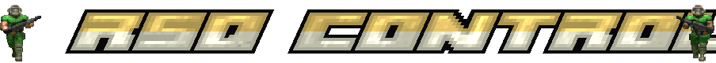

# RSQ Controls

The series' buttons and its How To Play. RSQ_Controls.pk3 is the pk3 that sets the buttons: it offers
**RSQoopaControls**, the owner's controller layout, once when it first loads, and any time from Radiant Silvergun
Options. It also carries the series' one How To Play page, "HOW TO RIP AND TEAR", with a CONTROLS tab that shows the
whole layout, a BODY tab, and a tab for every series mod that is loaded.

## How to play

| Do this | What happens | Needs |
|---|---|---|
| Start QuestZDoom with RSQ_Controls.pk3 loaded for the first time | About a second after the title is up, a screen asks whether to set every button to RSQoopaControls and turn natural crouch on. Yes writes every bind, double-press bind and setting of the layout; No changes nothing. Back counts as No | No menu open at that moment (it waits until none is) |
| Start QuestZDoom again | Nothing: the screen asked once and does not come back until the layout itself changes | |
| Open Options > Radiant Silvergun Options > How To Play, or press F1 | The How To Play page opens on its CONTROLS tab: two panels, LEFT CONTROLLER and RIGHT CONTROLLER, each button's press, double press and right grip + press, a dash where nothing is bound | |
| Push left or right on the page | The next tab: CONTROLS, BODY, then one tab per series mod loaded, in the Options order | |
| Open How To Play with the left-handed control scheme | The LEFT CONTROLLER panel shows the main hand's buttons with X and Y where A and B were, and the modifier column reads LEFT GRIP + PRESS, as QuestZDoom swaps the hands | Control scheme: left-handed |
| Press Use RSQoopaControls (Options > Radiant Silvergun Options, right under How To Play), then Yes | Every button is set to RSQoopaControls and natural crouch is turned on. No other key changes | |
| Type `exec RSQoopaControls.cfg` in the console | The same lines, from the file that ships beside the pk3 | RSQoopaControls.cfg in the QuestZDoom folder |
| Pick SHOW ME under a body move on How To Play | Every menu closes and RSQ Tactical Rig's ghost hand does that move once on your body | RSQ Tactical Rig, on, in a game, in VR |
| Start a new game | About 5 seconds into the first map, one line: "HOW TO PLAY: OPTIONS > RADIANT SILVERGUN OPTIONS", once that game | |

## Keys

<!-- GEN:keys -->
This mod has no keys.
<!-- /GEN:keys -->

It sets other mods' keys instead: the layout is `design/controls/rsq_standard_controls.ini` (the file keeps that
name), explained line by line in `design/controls/CONTROLS.md`, and drawn in the front README's Keys section and on
the CONTROLS tab.

## Options

<!-- GEN:options -->
This mod has no options page.
<!-- /GEN:options -->

Its two rows sit first in Options > Radiant Silvergun Options, put there by the How To Play row itself:

| Option | Default | What it does |
|---|---|---|
| How To Play | (page) | Opens the How To Play page (the same as F1). |
| Use RSQoopaControls | (button) | Asks "Do you really want to do this?"; Yes sets every button to RSQoopaControls and turns natural crouch on. |

## Works with

| Mod | What changes |
|---|---|
| Every series mod | Each one loaded gets its own tab, its rows from its README's How to play table. A mod counts as loaded when the class its tab names is there |
| RSQ Score | Its Glossary is its tab, the six families as sections. The page uses Score's fonts and colours when Score is loaded, the engine's own otherwise |
| RSQ Tactical Rig | SHOW ME and SHOW ON MY BODY rows, asked of its `RSQTR_RigService` by name ("ghost.demo", "mirror.show") |
| RSQ VisualRewards | The new-game line is its toast (`RSQVR_Service` "toast"); without it, a plain print |
| RSQ SlowMo, RSQ Grapple, RSQ Wheel, RSQ ShieldSaw, RSQ Tactical Rig, RSQ Glow In The Dark | RSQoopaControls binds their keys (`rsqsm_toggle`, `rsqsm_dodge`, `+rsqgr_hook`, `+wr_wheel`, `ssq_draw`, `rsqtr_recenter`, `netevent rsqgd_randomize`) |
| Brutal Doom, BD22 VR Reloaded, Gun Bonsai | RSQoopaControls binds their keys too (`+user1`, `+zoom`, `+reload`, `+user3`, `brutaltaunt`; `netevent bonsai-show-info`) |
| A series pk3 built before 2026-11-27 | It still carries its own older How To Play. When that one opens, it hands over to this one, the newest |

This mod answers one service, `RSQCT_HowToService` ("howto.version", "howto.menu"), for that hand-over.

## Limits

- Not compiled and not run in an engine or a headset yet.
- The first-launch screen asks once per layout. Back counts as No. To set the layout later, use the Options row.
- A bind a mod's own KEYCONF made for a key RSQoopaControls also uses is replaced; any key RSQoopaControls does not
  name is left as it was.
- `exec RSQoopaControls.cfg` on a QuestZDoom command line runs too early for its binds: write
  `+wait 1;exec RSQoopaControls.cfg` there (the file's first lines and `design/controls/CONTROLS.md` say why).
- Score's Glossary tab is a copy made when the page is generated; it is regenerated with every run of
  `tools/howtoplay/gen_howtoplay.py`.
- How To Play exists only with RSQ_Controls.pk3 loaded: the other series mods no longer carry it.

## Credits

The layout is presidentkoopa's (2026-11-27). The page grew out of RSQ Score's Glossary; the body figure is the Doom
marine sprite PLAYA1. The engine is QuestZDoom (Emawind and Team Beef).

---
Written with the code, 2026-11-27 (not compiled).
