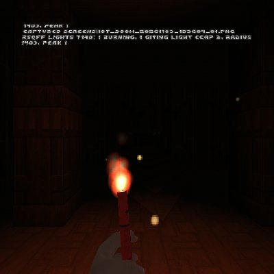
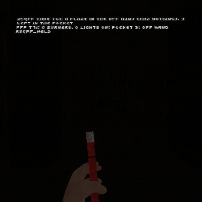
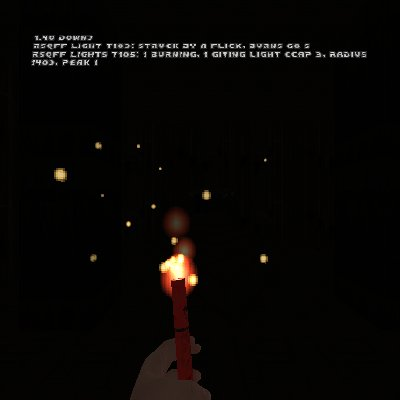
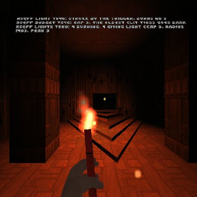
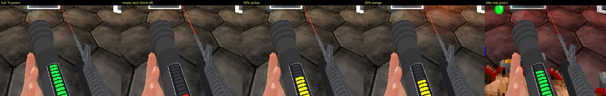
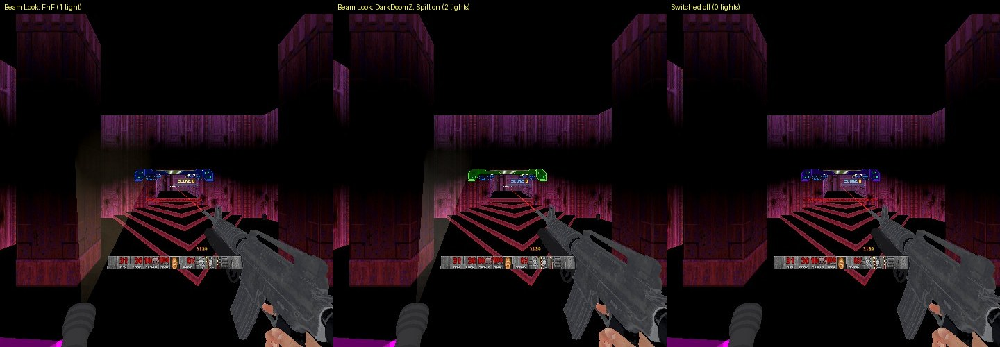

# RSQ FnF
### Doom Arcade VR · a road flare you strike and throw by hand, and a flashlight you carry on your body

Reach for a road flare, strike it with a flick of your wrist and hold it up to light the way, or throw it down the
corridor and watch it light the room where it lands. A flashlight hangs on you too: grab it, click it on, and point a
real beam with your hand.

**Where they are worn** (owner, 2026-11-11):

| | With RSQ Tactical Rig (its Flare Holster on, the default) | FnF alone |
|---|---|---|
| **Flares** | The rig's flare holster on your off-hand hip, and only there | A pocket on your chest, gun-hand side |
| **Flashlight** | A hand's width behind the flare holster, same side and height (seated: beside your waist, over the flare) | A clip on your chest, off-hand side |
| **The rig's cigarettes** | Left chest (right, left-handed), with nothing else there | (no rig, no cigarettes) |

With the rig on but its Flare Holster turned off, the flares go back to the chest pocket and the flashlight stays behind
the flare holster's place. *Code only, not shown.*

*Rig frame from an earlier build. Not a capture from the headset.*

*[GIF to come: a flare struck, held up, then thrown down a dark corridor where it lights the room]*

---

## What it feels like

- **Where the flares are.** Your off hand pulls a flare from its home, unlit, cap on: the Tactical Rig's flare holster on
  your off-hand hip, or, without it, the pocket on your chest (gun-hand side). Your gun hand keeps its gun.
- **Strike it like the real thing.** A sharp flick down and it catches with a burst of sparks, sputters for a moment,
  then burns red. Or just pull that hand's trigger.
- **Throw it like a grenade.** Hold the trigger, swing, and let go mid-swing. It flies the way your hand moved, tumbles,
  bounces and lies burning where it stops, lighting the walls round it.
- **It burns for a minute.** In your hand or on the floor, then it dies away over its last two seconds. Burn it out in
  your hand and the spent flare drops.
- **Hit a monster with it.** A flying flare does a little damage. With Brutal Doom, zombies, imps and other small fry
  catch fire.
- **A flashlight beside the flares.** Grab it from its clip (behind the flare holster with the Tactical Rig, on your
  chest without it) and it comes up switched on. The trigger clicks it off and on. You see the beam in the air, cut short where it meets a wall or a monster.
- **The battery matters.** A meter on the flashlight's body counts down while it is on, and the beam dims and flickers
  when it runs low. Switch it off and it charges again. Kills inside your beam top it up.

---

## How to play

| Do this | What happens |
|---|---|
| Grip with your off hand at the flare holster (Tactical Rig) or the pocket on your chest (FnF alone, gun-hand side) | An unlit flare in your off hand |
| Grip there again with the flare still unlit | It goes back |
| Flick the flare hand sharply down, or pull that hand's trigger | It catches, sputters, then burns |
| Hold the trigger, swing, and let go while your hand is moving | Thrown, along your swing |
| Let go of the trigger with your hand still | It stays in your hand |
| Grip with your off hand at the flashlight's clip (Tactical Rig: behind the flare holster; FnF alone: your chest, off-hand side) | The flashlight in your hand, switched on |
| Pull the trigger with the flashlight in your hand | Off, on, off |
| Grip at the clip again | The flashlight goes back on its clip |

You start a game with 2 flares, and get them back after you die. Boxes of 6 turn up lying beside other items in the
levels, at most 2 a map. You carry up to 24. Grip an empty pocket and you are told "No flares left".

A burning flare never goes back in the pocket: it leaves your hand by a throw, by burning out, or by something else
taking your off hand (it falls there, still burning). A burning flare in your hand at a level exit is used up; an unlit one goes back in your pocket. The grip does nothing to a lit flare.

---

## Controls

- **No keys.** Nothing to bind, and no menu button stands in for a key.
- **Off hand only.** Your gun hand keeps its gun.
  - **Off-hand grip** (read raw from QuestZDoom's grip keys; their codes are on Test and Debug): at the flares' home
    (the rig's flare holster, or FnF's chest pocket without it), take a flare or put an unlit one back; at the
    flashlight's clip (behind the flare holster, or on your chest without the rig), take the flashlight or put it back.
  - **Off-hand trigger:** with a flare, light it (**Light It By** Trigger or Either); hold it, swing and let go to
    throw. With the flashlight, click it off and on.
- **Gestures:** a sharp flick down of the flare hand strikes it (**Light It By** Strike or Either); a swing released
  with the trigger held throws it.

---

## The flare

*Rig frames from an earlier build. Not captures from the headset.*

- **One light each,** a warm red-orange that flickers in size and colour. A lying flare's light sits a little above it,
  so the walls light, not just the floor.
- **Flame and sparks** come off the burning end, and a thin smoke trail if you want one.
- **Soft Light** doubles how far the light reaches at half the brightness, for a gentler look.
- **Shoot Out Flares** (off by default): shoot a thrown or dropped flare and it goes out.
- A spent flare lies dark for 10 seconds, then it is gone.

### When a lot of flares are burning

Only 3 flares give light at once. Light a fourth and the oldest one lying on the floor fades dark over half a second.
It keeps burning as flame and sparks, it just stops lighting the room. The flare in your hand is the last to go dark.
When one burns out, the last one that went dark lights up again.

*Rig frame from an earlier build: the oldest flare went dark when the fourth was lit.*

*[GIF to come: four flares thrown one after another, the oldest fading dark as the newest lands]*

---

## Throwing flares and setting things on fire

The throw is RSQ Grenade's: how hard and which way you swung is how it flies, a hard throw arcs higher than a gentle
one, and your own running speed is carried with it. A flying flare hits each monster it touches once, for a little damage.

**With Brutal Doom,** that hit is fire. Zombiemen, shotgunners, chaingunners, SS and imps (and Brutal Doom's own
humans and small demons of that size) catch fire and burn for 5 seconds, enough on its own to kill an imp. Their
burning pain and burning death are Brutal Doom's own. Bigger monsters only take the hit. A LegenDoom legendary or a
Champions champion only catches fire once it is below 25% of its health (you can change that number).

**Without Brutal Doom,** a flare only does its little hit damage.

*[GIF to come: a flare thrown into an imp, the imp burning]*

---

## The flashlight

It hangs on a clip: with RSQ Tactical Rig, a hand's width behind the rig's flare holster on your off-hand hip (seated:
beside your waist, over the flare); without the rig, on your chest, on your off-hand side. Grip there and it is in your
hand, switched on, with a click.
The trigger turns it off and on. Grip at the clip again to put it back.

- **One thing in the off hand at a time.** With a flare in your hand the clip does nothing. Take a flare while you hold
  the flashlight and the flashlight goes away; when the flare leaves your hand, the flashlight comes back as it was, on
  or off.
- **On a new level** a flashlight in your hand stays there, switched off.
- **The beam you can see:** a see-through cone in the beam's colour that fades out over 4 metres and stops where it
  meets a wall or a monster. The light itself reaches much further. On PCVR and High quality, dust drifts in it.
- **Pick your beam:** Narrow, Medium or Wide; Warm White, White, Pink, Cyan, Amber, Violet, or Random (a new one of the
  six every time you switch it on).
- **Beam Hotspot** (off by default): a soft glow where the beam lands.

*[Still to come: the flashlight on its chest clip, and the beam's cone in a dark room]*

### The battery

*Rig frames from an earlier build. Not captures from the headset.*

- **3 minutes of light** from full. It drains while the flashlight is on and charges back at the same rate while it is
  off, in your hand or on the clip. The charge carries over from one level to the next; a new game starts full.
- **The meter** on the flashlight's body has 10 segments: green when it is well charged, then yellow, orange and red.
  On the last segment its light blinks red.
- **Low battery:** from half charge down, the beam gets dimmer, and below 20% it flickers and narrows.
- **Empty:** it clicks itself off, and it won't switch on again until it has a second of light in it.
- **Kills in the beam:** a monster you kill while it is inside your lit beam gives back 5% of a full battery.
- Set Battery to 0, or turn on **Battery Never Drains**, and it never runs out (no meter then).

### Beam Look: FnF or DarkDoomZ

There is one flashlight, this one. **Beam Look** picks how its light looks:

- **FnF:** this pack's own beam, with your Beam Size and Beam Colour.
- **DarkDoomZ:** the beam of the DarkDoomZ mod's flashlight, rewritten to come from this flashlight's lens. Pick its
  type (Incandescent, Halogen, LED or Red Filter). With **DarkDoomZ Spill Light** on you get its beam light plus a wider,
  dimmer spill light; off, one light in between. Beam Size and Beam Colour don't apply in this look.

The cone, the dust, the hotspot and the battery work the same in both looks.

*Rig frames, 2026-11-09: the FnF look (one light), the DarkDoomZ look with Spill Light on (two lights), and switched
off (none). The flashlight is the one in the left hand.*

---

## Plays well with

- **Brutal Doom:** thrown flares set small enemies on fire, using Brutal Doom's own fire damage, burning pain and
  burning death.
- **Brutal Doom 22 VR Reloaded:** the hands holding the flare and the flashlight are its hands, toned by its Hand Skin
  Tone. When the flare or flashlight leaves your off hand, you get its empty hand back.
- **RSQ Tactical Rig:** the flares live in the rig's flare holster (the chest pocket and its diamond are off while that
  holster is on), and the flashlight hangs where the rig says, behind the flare holster, so the left chest is the rig's
  cigarette pocket alone (owner, 2026-11-11). The clip turns with the rig's body, like its holsters. While your off hand
  is in one of the rig's places, the grip is the rig's. A quick reach down to a holster is never read as a strike.
- **RSQ Distance Grab:** pick up a flare lying on the floor and throw it. With Brutal Doom, a burning one sets a small
  enemy it hits alight.
- **RSQ VisualRewards** and **Legion of Bones:** turn on **Bones Drop Battery Bits** and Legion of Bones monsters
  sometimes drop battery bits (8% of kills; a legendary or champion always drops 3). Each one you pick up refills 15% of
  your battery. Without VisualRewards, no bits drop.
- **LegenDoom** and **Champions:** their boosted monsters only burn below the health share you set.
- **RSQ Glow In The Dark:** it has DarkDoomZ's darkness built in, without DarkDoomZ's own flashlight. This pack's
  flashlight is the flashlight, and its DarkDoomZ Beam Look gives you DarkDoomZ's beam.
- **RSQ Accessibility:** its Reset Every Mod resets this pack too.

---

## Options

*Options → Radiant Silvergun Options → RSQ FnF (Flash and Flare).* Everything is on one page; the fine-tuning numbers
are under Test and Debug. Defaults in brackets.

| Section | Rows |
|---|---|
| Flares | Flares (On) · Show Flare (On) · Show Hand (On) · Light It By (Either; Strike, Trigger) · Soft Light (Off) · Burn Time (60 s) · Sparks (On) · Smoke (Off) · Sounds (On) · Shoot Out Flares (Off) · Boosted monsters ignite below N% health (25) |
| Supply | Start With (2) · Boxes in Levels (On) · Boxes a Map (2) · Refill Each Level (Off) · Refill To (4) |
| Flashlight | Flashlight (On) · Show Flashlight (On) · Beam Size (Medium; Narrow, Wide) · Beam Colour (Warm White; White, Pink, Cyan, Amber, Violet, Random) · Beam Quality (Quest; PCVR, High) · Beam Length (4 m) · Beam Hotspot (Off) · Show Cone (On) · Battery (3 min; 0 never drains) · Battery Never Drains (Off) · Bones Drop Battery Bits (Off) · Beam Look (FnF; DarkDoomZ) · DarkDoomZ Beam Type (Halogen; Incandescent, LED, Red Filter) · DarkDoomZ Spill Light (On) |
| Test and Debug | Flare Light: Light Radius (140) · Most Lit at Once (3) · Flicker Step (4 tics). Hands: Strike Speed (1.4 m/s) · Throw Speed (2.0 m/s) · Throw Strength (1.0) · Arc (0.35) · Off Grip Keys (443 436). Pocket (not used while the rig's flare holster is on): Forward (0.12 m) · Toward Main Hand (0.15 m) · Height (-0.28 m) · Reach (0.11 m). Flashlight Clip: Forward (0.10 m) · Toward Off Hand (0.17 m) · Height (-0.22 m) (these three for FnF alone; with the rig on, the rig places the clip) · Reach (0.08 m). Debug Log |

Both pages end with **Reset All**. **Show Flare** hangs a flare at the pocket while you carry any; **Show Flashlight**
hangs the flashlight on its clip while it is not in your hand; **Show Hand** draws the hand holding the flare and the
flashlight. **Flares** turns the flares off; the flashlight has its own **Flashlight** row and keeps working without
them. Beam Size and Beam Colour only apply to the FnF look, and the two DarkDoomZ rows only to the DarkDoomZ look.

The light, supply, burn and flashlight rows are the server's (one setting for everyone in netplay). How your hands are
read (Light It By, the speeds, the pocket and clip places, the grip keys) and the Show rows are each player's own.

---

## Status

| | |
|---|---|
| **code only, not shown** (2026-11-11, `design/rigtest_2026-11-10/RESULTS_DOWNSHOT.md`; not run, by the owner's order "no rig test, code only until i say"; not load-checked either) | Your eyes as this pack reads them (the flare pocket and the flashlight clip, placed from the neck) use the engine's fixed standing eye height (the player class's ViewHeight), not the pawn's ViewHeight. RSQ SlowMo's DOWN scales the pawn's ViewHeight to 40%, which put them about 0.9 m too high while you were down. Standing and crouching are unchanged |
| **rig only, not headset-confirmed** (2026-11-10, the batched rig test) | Every launch loaded every RSQ pk3 with no script error from our packs, on doom2, brutal22test6, BD_VoxelPack, BD22 VR Reloaded 2.0.4f, LOB, Champions, Gun Bonsai and the series (`design/rigtest_2026-11-10/RESULTS.md`). Nothing of this pack was exercised |
| **rig only, not headset-confirmed** (2026-11-10 night, RSQ Gun Cards' item card checks: `design/rigtest_2026-11-10/RESULTS_P2.md` N1, `RESULTS_FIX.md` 5) | The flare and the flashlight held in the off hand, their states read on Gun Cards' item card: the flare UNLIT with 5 left, the flashlight ON with its battery at 99 (`design/rigtest_2026-11-10/evidence/FIX_5_item_cards_before_after.jpg`, `FIX_C_log.txt`). Only their states were read; nothing was struck, thrown or switched |
| **rig only, not headset-confirmed** (2026-11-09, `design/rigtest_2026-11-09/logs/J_flashlight.log`) | The flashlight taken into the off hand (it came up switched on) and switched off and on, sent as the same network events the grip and the trigger send; the Beam Look lights: FnF 1, DarkDoomZ with Spill Light 2, DarkDoomZ without Spill Light 1, switched off 0. The pack loaded with no script error of its own, on doom2, brutal22test6, BD_VoxelPack, BD22 VR Reloaded and the rest of the series |
| **Headset-confirmed** | Nothing yet |
| **code only, not shown** (2026-11-11, the owner's headset report of 15:19; not run, by his order "no rig test, code only until i say"; not load-checked either) | The flares' one home: with RSQ Tactical Rig's flare holster on, the chest pocket is off (no grab, no diamond, no flare drawn there). The flashlight beside the flare: with the rig on, its clip hangs where the rig says, 0.21 m behind the flare holster (standing), and its grab radius is 0.08 m (was 0.12; a saved 0.12 moves to 0.08 once, settings version 4). Distances measured on the code's numbers (RSQ Tactical Rig `tools/measure_torch_spot.py`), not in a game |
| **code only, not shown** | Everything else on this page, including reading the hands themselves (grip, strike, throw). Also the 11-09 evening changes (commit 9533a9d7): no free flare at a level exit (a lit one is used up), the battery's charge carried between levels. The 11-10 rumble changes: Accessibility's Rumble Strength and Rumble Backup |
| **not yet run** | Nothing. The batched rig test of 2026-11-10 had no check of its own for this pack (its flare and flashlight stood in for Gun Cards' N1, above) |

The rig frames from earlier builds on this page are pictures of what the code did then. They are not proof of the
current build.

---

## Under the hood

- **Netplay-safe by design.** Your hands are read on your own machine only. What they decide (take, put back, strike,
  throw, the flashlight's take, put back and switch) travels as network events, and every machine runs the burn, the
  light budget, the beam and the battery from the same synced state. Boxes are placed with the game's synced random
  numbers, so every machine gets the same boxes.
- **The throw** is RSQ Grenade's: the fastest two-tic window of the last seven, measured against your body, so walking
  and turning are never a swing. The hand is taken where the last rendered frame put it, carried to where the body is
  now, so a slow frame never reads as a swing.
- **The strike** is a flick mostly downward at 1.4 m/s or more, read from 8 tics after the take. With RSQ Tactical Rig
  loaded it waits 3 tics: if your hand went into one of the rig's places, it was a reach, not a strike.
- **The flare's light budget:** one point light per burning flare, no shadow maps, at most 3 lit at once (Most Lit at
  Once). The flicker changes the light every 4 tics, not every frame. Flame, sparks and smoke are particles, not actors.
- **The flashlight's budget:** one spot light (two in the DarkDoomZ look with Spill Light), no shadow map. Its reach is
  set by Beam Quality: 448 map units on Quest, 640 on PCVR, 896 on High. One trace a tic finds where the beam stops
  (every second tic on Quest). The cone is one model, the hotspot one sprite with no light, the dust particles.
- **The cone never hides monsters.** It is drawn as a world object in the see-through pass, not as part of the hand, and
  it is moved a tic ahead so it sits on the hand instead of trailing it.
- **Damage:** a flying flare's hit is 4, once per monster per flight. With Brutal Doom the burn is 3 fire damage every
  6 tics for 5 seconds (90 in all).
- **No hard links.** Every other mod (Brutal Doom, BD22 VR Reloaded, Tactical Rig, Distance Grab, VisualRewards, Legion
  of Bones, LegenDoom, Champions) is found by name while the game runs. FnF loads and plays alone.
- **Stock QuestZDoom 17.3:** ZScript and data only. No engine changes.

## Credits

The full list, with every file and licence, is in **CREDITS.txt**.

- **presidentkoopa:** the flare model; the hands, from his Brutal Doom 22 VR Reloaded (the rifle-magazine hold for the
  flare, the shotgun pump hand for the flashlight); the throw, from his RSQ Grenade; RSQ Tactical Rig's body and hand
  geometry.
- **saegiru's Emergency Flare** (UDV Survival Flares, part of the UAC Survival Pack by JohnnyDoom): the box and lying
  flare sprites, the strike, burn and burn-out sounds, the box of 6, carrying 24, the flare's colour and the way boxes
  turn up beside items.
- **BD_VoxelPack:** DooMAD's ammo box voxel, made into the flare box.
- **Ermac's VR-Flashlight** (its base, SuaveSteve's Steve's Flashlight): the idea of a spot light that follows the
  controller, and the battery's model (its drain and recharge, its 10-step meter, its low-battery dim and flicker).
  Read and rewritten; none of its code or art is used.
- **DarkDoomZ** by Caligari87 (Sterling Parker), zlib licence: the DarkDoomZ Beam Look is an altered rewrite of its
  flashlight code (its four types and its beam and spill lights), from this pack's lens. Its licence notice is kept in
  that file. DarkDoomZ's credits also name Kinsie, Gutawer, FishyClockwork, phantombeta, Marisa Kirisame and Accensus
  (code), and Fort of Hard Knox, a1337spy and Orange Bomb (testing).
- **QuestZDoom** (Emawind and Team Beef): the engine and its VR hand API.
