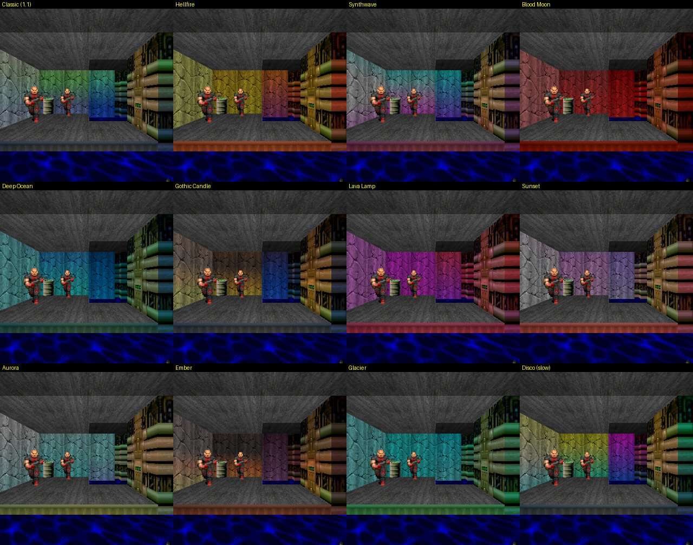
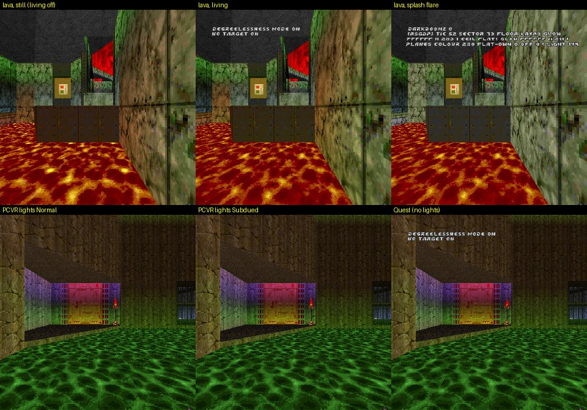
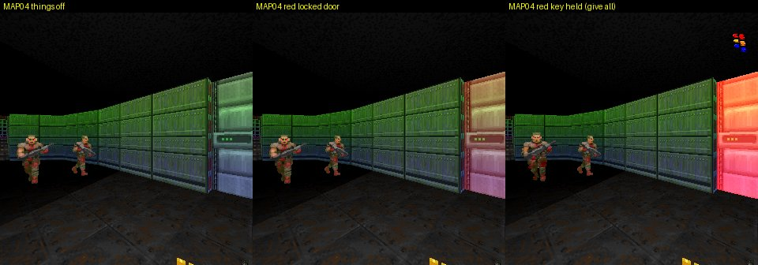
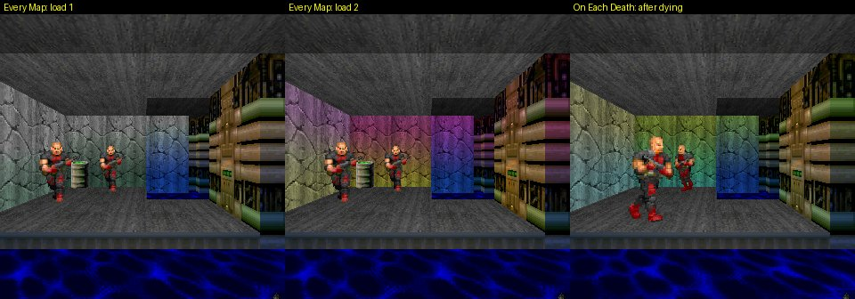
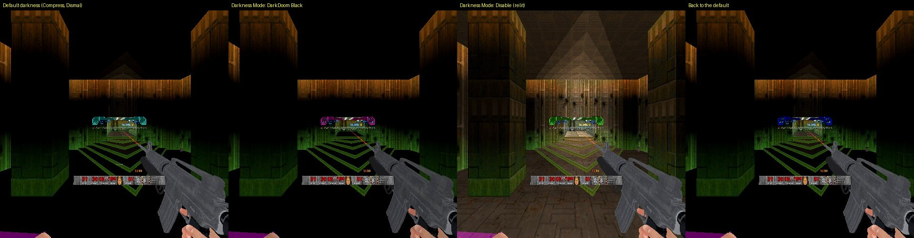
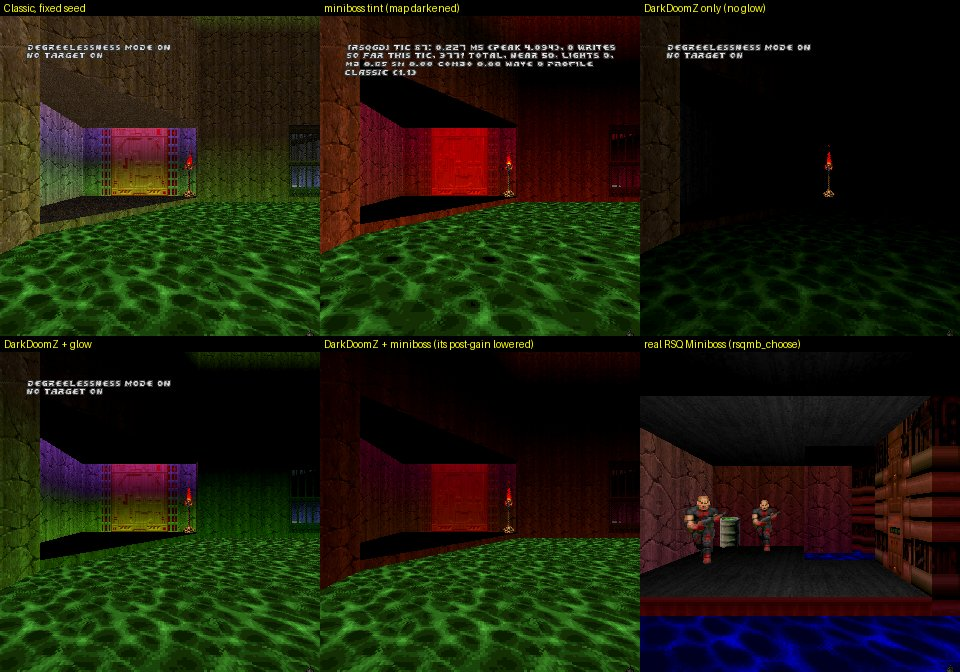
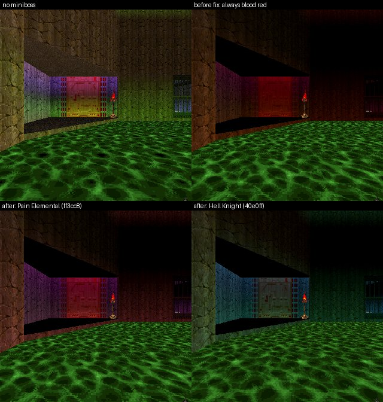
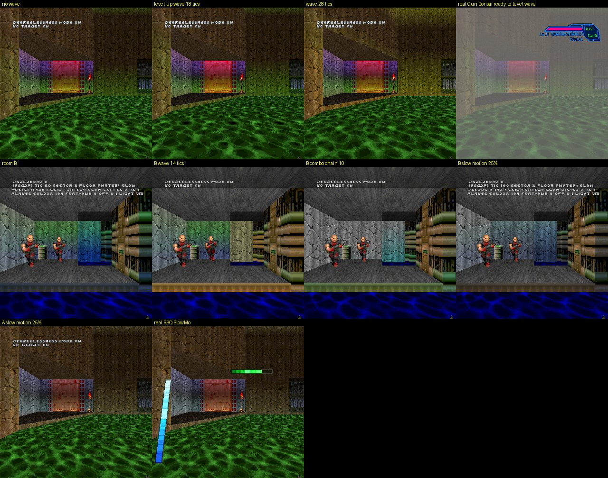

# RSQ Glow In The Dark
### Doom Arcade VR · coloured light up every wall, liquids that breathe, and a darkness that makes it all shine

Every room's walls glow in colour from the floor up and the ceiling down. Pools of lava, nukage and blood breathe in
their own colours, locked doors glow in their key's colour, and the big moments of the game (a miniboss, a level-up,
going down) wash over the whole map. Two great mods are built in: **More Lights**' glowing flats, so screens, blood
falls and signs glow alongside the liquids, and **DarkDoomZ**'s darkness, so the glow has a dark to shine in.

*Rig frames from an earlier build (2026-11-06): the same room in twelve of the profiles. Not captures from the headset.*

---

## What it feels like

- **Every room has a colour.** A band of colour rises up the walls from the floor and hangs down from the ceiling,
  a new mix every map.
- **Pick a mood.** 35 named profiles, from Classic Doom tans to Neon Arcade, Blood Moon, Vaporwave or Abyss. Some sit
  still; others breathe, beat like a heart, flicker like a candle, drift through the colours or roll out in slow waves.
- **Liquids are alive.** Lava, nukage, slime, blood, water glow in their own colour and breathe at their own pace.
  Something dies in a pool and the pool flares.
- **More Lights, merged in.** SnakieJakie's More Lights glow list is part of this one: computer screens, blood falls,
  exit signs and the rest of its glowing flats light up next to the liquids, all in one list, no extra mod to load.
- **Find your way in the dark.** Locked doors glow in their key's colour and pulse faster once someone holds that key.
  Exits glow green, switches warm amber, teleporter pads shimmer cyan. Keys and powerups are drawn at full brightness.
- **It really is dark.** The DarkDoomZ darkness is built in and on from the start, and the glow grows stronger and
  taller in the darkest rooms.
- **The map reacts.** A miniboss turns the whole map its colour and beats like a heart. A level-up sends a gold wave
  rolling out from you. A kill chain makes the glow climb. Slow motion drains it grey, and going down turns every room
  blood red.
- **One button for new colours.** **Randomize Colours Now** on this pack's page reshuffles the map's colours.

---

## How to play

There is nothing to hold or wear: load it and play. The rest is choices.

| Do this | What happens |
|---|---|
| Start a map | Every room gets its colours (with the default Classic (1.1) profile, any colour, one per group of rooms) |
| Finish the map | The next one gets new colours (Re-roll Colours: Every Map) |
| Press **Randomize Colours Now** on the menu | New colours now, same profile. During a miniboss's tint, the Red Map or another mod's timed tint, it does nothing and says "Glow In The Dark: colours held during a miniboss fight or sequence" |
| Step the **Profile** row left or right | A different named look |
| **Shuffle Profile Now** | Another named profile, picked at random, with new colours |
| **Randomize Current Look** | A look of its own, made at random and kept on the Custom Profile rows |
| **Use DarkDoomZ Pairing** | The darkness is set to the profile's own pairing |
| **Darkness (DarkDoomZ)** | How dark the maps are |

It is a button on this pack's page, not a key (owner 11-10: keys are precious in VR).

*[GIF to come: a room's glow changing colour when Randomize Colours Now is pressed]*

---

## Controls

- **No keys.** The old **Randomize colours** key went on 2026-11-10: it is now the menu button **Randomize Colours
  Now**.
- **No hands, no buttons, no gestures.** Nothing here reads a trigger, a grip or your hands.
- **Menu buttons:** **Shuffle Profile Now**, **Randomize Colours Now**, **Randomize Current Look**, **Reset All**.
- DarkDoomZ's flashlight key is not in this pack (its flashlight was left out on 2026-11-09; RSQ FnF's is the
  series' one). The darkness has no key.

---

## The glow

### Rooms

The colour sits in two bands on the walls: one rising from the floor, one hanging from the ceiling. That is how the
engine draws a floor's or a ceiling's glow; the floor itself does not light up.

- **One colour per:** by default the profile decides. Classic (1.1) and Custom give every group of rooms that share a
  tag one colour (and all untagged rooms another), the way Glow In The Dark 1.1 did. The other profiles colour each
  room on its own. You can force either.
- **Blend Rooms** (off by default) pulls each room's floor colour halfway toward its neighbours', so a room built from
  several pieces reads as one colour.
- **Stronger in the Dark** (on): the darker a room, the brighter (up to 60% more) and taller (up to 40% more) its
  glow.
- **Glow Height** and **Strength** scale every profile.
- A glow the map already had stays where the profile gives none, and comes back when you switch the pack off.

### Liquids

*Rig frames from an earlier build (2026-11-06). Top: lava with Living Liquids off, on, and a splash flare. Bottom: the
Lights Over Pools in Normal and Subdued style, and Quest's default (no lights). Not captures from the headset.*

- **The Glow list:** 591 flat and texture names glow in their own colour: Glow In The Dark 1.1's every liquid in Doom
  (water, nukage, slime, sludge, lava and magma, blood, blue fire, purple and green water, grey and brown poison, snow,
  the HD liquids and Brutal Doom's liquid splashes), merged with **More Lights**' glowing flats by SnakieJakie
  (computer screens, blood falls, exit signs and the rest of its glow entries). One list, one pass: you don't load
  More Lights separately.
- **Living Liquids** (on): each kind breathes in its own colour and rhythm, lava slow and heavy, water and screens
  quicker.
- **Liquid Colour:** Room Colour (the room's colour paints over them, like 1.1), Profile Decides (the default: each
  profile keeps them, leans them toward its colours, or paints them its own), or Always Their Own.
- **Guess Liquids by Name** (on): in map packs the list doesn't know, a flat whose name says NUKAGE, ACID, TOXIC, OOZE,
  LAVA, MAGMA, BLOOD, WATER, SLIME, SLUDGE or POISON, or that the map's terrain calls liquid, glows too.
- **Splash Flares** (on): something dies on a liquid floor and the pool flares in its colour for about half a second.
- A floor that changes to a liquid during play (a tagged floor rising into nukage, say) is noticed within a second.

*[GIF to come: nukage and lava breathing in a dark room, then an imp dying in the nukage and the pool flaring]*

### Things that matter

*Rig frames from an earlier build (2026-11-06) on MAP04: the door off, the red locked door glowing, and the same door
once the red key is held. Not captures from the headset.*

- **Locked doors** glow in their key's colour (red, blue, yellow; violet for any other lock) and slowly breathe. Once
  any player holds that key, they glow brighter and pulse quicker.
- **Exits** you press or shoot glow green and breathe.
- **Switches** (any wall you press, shoot or push to make something happen) glow a dim warm amber.
- **Ordinary doors** get a faint cool edge (**Ordinary Doors Too**, on).
- **Teleporter pads** (gate floors) send a cyan shimmer up the walls round them.
- **Floors that hurt** and are not a known liquid throb a slow red warning (**Hurt Floors Throb Red**, on).
- **Secret rooms** shimmer gold until you find them (**Secret Rooms Shimmer**, off by default).
- **Keys and pickups** are drawn at full brightness, so the darkness never hides them: keys and powerups by default;
  add health and armour, then ammo and weapons, with **Keys and Pickups**.

*[Still to come: a switch, an exit and an ordinary door glowing in a dark room]*
*[Still to come: a teleporter pad's cyan shimmer, and a hurt floor throbbing red]*
*[Still to come: a key and a soul sphere drawn bright in a pitch-dark room]*

### Real lights (PCVR)

The glow itself costs no lights. On top of it you can add a few real lights: **Lights Over Pools** (over the largest
pools, in their colour) and **Lights on Items** (on the most important items first: keys, then powerups, then health
and armour, then ammo and weapons). Both are 0 by default, for Quest. **Light Style: Subdued** (the default) doubles
their reach at half the brightness.

---

## Profiles and colours

*Rig frames from an earlier build (2026-11-06): Re-roll Colours at work. Not captures from the headset.*

A profile is a whole look: the colours for floors and ceilings, how far up the walls they reach, how floor and ceiling
balance, how it moves, what happens to liquids, and a darkness it pairs with. **Profile** steps through them; two more
choices sit before the named ones: **Custom** (your own, the Custom Profile rows) and **Random Profile** (a named one
drawn at random, drawn again at every re-roll).

| Profile | Look | Darkness pairing |
|---|---|---|
| Classic (1.1) | Glow In The Dark 1.1: any colour, one per tag group (the default) | Compress, Dismal |
| Classic Doom | Warm tans and greys, the way id lit it | Compress, Murky |
| Hellfire | Flame orange that flickers | Crush, Oppressive |
| Toxic Waste | Sick green, breathing | Compress, Oppressive |
| Neon Arcade | Hard neon in every room | Clamp, Inky |
| Synthwave | Pink floors under blue ceilings | Compress, Oppressive |
| Vaporwave | Pastels that turn slowly | Compress, Dismal |
| Blood Moon | Deep red with a slow heartbeat | Crush, Inky |
| Deep Ocean | Sea blues, the ceiling dark | Compress, Inky |
| Arctic | Ice white and pale blue | Clamp, Dismal |
| Radioactive | Everything glows green, liquids too | DarkDoom Classic |
| Gothic Candle | Low candlelight that gutters | Crush, Inky |
| Lava Lamp | Warm blobs of colour swelling outward | Compress, Oppressive |
| Ultraviolet | Blacklight purple | DarkDoom Classic |
| Matrix Green | Green code rolling down the walls | Crush, Stygian |
| Sunset | Orange floors, violet sky | Compress, Murky |
| Monochrome | Greys only | Clamp, Oppressive |
| Inferno | Tall, hot, restless fire | Crush, Stygian |
| Aurora | Northern lights along the ceilings | Compress, Inky |
| Cyberpunk | Magenta, cyan, a little yellow | Clamp, Inky |
| Witching Hour | Witch purple and swamp green | DarkDoom Classic |
| Sepia | An old photograph | Compress, Dismal |
| Ghost | Pale mist rising off the floors | Crush, Stygian |
| Toxic Rainbow | Every colour, drifting | Compress, Dismal |
| Ember | Coals glowing low on the floor | Crush, Inky |
| Abyss | Barely there, in the dark | DarkDoom Black |
| Overcast | Flat grey daylight | Compress, Murky |
| Holy | Gold light from above | Clamp, Murky |
| Corruption | Flesh tones with a pulse | Crush, Inky |
| Biohazard | Warning yellow-green | Compress, Oppressive |
| Martian | Red planet dust | Compress, Dismal |
| Glacier | Blue ice, deep and cold | Clamp, Oppressive |
| Firefly | Small warm lights near the floor | Crush, Stygian |
| Disco (slow) | Colours turn once every 10 seconds, smoothly | Compress, Dismal |
| Minimal | A faint grey line along the floors | Off |

The pairing is only applied when you press **Use DarkDoomZ Pairing**; changing profile never touches the darkness on
its own. With Random Profile the button does nothing; with Custom (which has no pairing) it switches the darkness off.

*[GIF to come: a hue-drift profile (Vaporwave or Disco) turning, and a ripple profile (Lava Lamp) swelling out]*

### When the colours change

**Re-roll Colours** picks when a map gets new colours:

| Choice | New colours |
|---|---|
| Never | Never: the colours come from the Colour Seed (Test and Debug), so the same seed gives the same map |
| Every Map (default) | Each new map |
| On Each Death | After you die (also when you load a save after dying); in co-op, when any player dies |
| On Each Level-Up | When Gun Bonsai says a gun is ready to level up |
| Every N Minutes | Every **Re-roll Every** minutes of play on the map (5) |

A setting you move re-tints the map within a second without reshuffling it: the colours come from a seed, and the same
seed gives the same rooms the same colours.

### Your own look

**Randomize Current Look** draws every Custom Profile setting at random, inside the ranges the named profiles use,
switches the profile to Custom and re-rolls. The result stays on the Custom Profile rows, to keep or change.

The **Custom Profile** rows build a look by hand: **Floor Glow** and **Ceiling Glow** each take Any Colour (1.1's
random), Fixed (the Red, Green and Blue sliders), A Profile's Colours (from **Colours From**) or Off; **Custom
Strength**; a **Pulse** (Steady, Breathe, Heartbeat, Candle, Hue Drift, Ripple); and **Custom Liquids** (Own Colour,
Lean to the Room's, The Room's Colour). Its fine numbers (Colour Wander, Floor and Ceiling Balance, Pulse Speed, Pulse
Depth) are under Test and Debug.

---

## Randomize Colours Now

One press, new colours for the whole map, the profile kept. With Re-roll Colours on Never, the new seed is written to
Colour Seed, so it stays. With Random Profile, a new seed also draws a new profile.

It stands down while a sequence owns the map's glow: a miniboss's tint (RSQ Miniboss), the Red Map while you are down
(RSQ SlowMo), or a timed tint another mod has asked for (RSQ Miniboss's fight colours, for one). Then it does nothing
and the console says **"Glow In The Dark: colours held during a miniboss fight or sequence"**.

*[Still to come: the "colours held" line on screen during a miniboss fight]*

---

## Darkness (DarkDoomZ)

*Rig frames, 2026-11-09, MAP01: the built-in darkness at its default, switched live to DarkDoom Black, to Disable (the
map at its own light), and back. The glow bands stay on the walls throughout. The log of the same run: 58 of 59
sectors darker at the default (average light 173 down to 108), every sector at 0 in DarkDoom Black, every sector back
to its own light with Disable, and 108 again on the way back, all without reloading the map.*

Caligari87's DarkDoomZ lives inside this pack. It darkens every map from the start, and its settings change the map
live. Find it at **Options → Radiant Silvergun Options → RSQ Glow In The Dark → Darkness (DarkDoomZ)**.

- **Darkness Mode:** Disable, Subtract, Compress (the default), Clamp, Crush, DarkDoom Lite, DarkDoom Classic,
  DarkDoom Black. The three DarkDoom modes take a fixed amount of light off every room and ignore Darkness Level.
- **Darkness Level:** Disable, Dim, Murky, Dismal (the default), Oppressive, Inky, Stygian, Pitch, Pure.
- **Advanced Settings:** Pre-Gain and Post-Gain (light added before and after), Min. Lightlevel (nothing darker than
  this), Sky Sectors (how much the darkness applies under the sky) and Sector Light Effects (keep or remove flickering
  and pulsing room lights; takes effect on the next map or a reload).
- **Fog Settings:** the engine's Fog Mode and DarkDoomZ's Fog Density.

**No flashlight here.** DarkDoomZ's own flashlight and its key are left out: RSQ FnF's flashlight is the series' one
flashlight, and its DarkDoomZ Beam Look gives you DarkDoomZ's beam.

**Do not load the original DarkDoomZ pk3 as well.** Both define the same settings, and the engine stops at start-up
("cvar 'ddz_mode' already exists"). The settings keep DarkDoomZ's own names, so mods that read them (RSQ SlowMo,
RSQ Miniboss) work with this one.

**Glow and darkness are one.** Turn **Glow In The Dark** off and the darkness goes with it: every room gets the map's
own light back. To keep the glow but light the map, set Darkness Mode to Disable.

---

## Big moments

The map's glow answers what is happening in the game. Each of these needs the other mod; without it, nothing happens.

### A miniboss (RSQ Miniboss)

*Rig frames from earlier builds (2026-11-06, before DarkDoomZ was built in): the tint and the darkening, and the tint in
two minibosses' own colours (top right: an older build that always tinted blood red). Not captures from the headset.*

- **While a miniboss lives,** the whole map's glow turns its colour, beating like a heart (72 a minute) and reaching
  higher up the walls on every beat. **Tint Colour** is the miniboss's own (the default), blood red, or your **Custom
  Tint**. When it dies, the colour fades back.
- **Darken the Map** (on): meanwhile the map loses **Darken By** (48) of its light, through DarkDoomZ's Post-Gain, and
  gets it back exactly afterwards (even after a quit mid-fight, at the next map start).
- **Landing in the dark:** with RSQ Miniboss's Landing In The Dark on, the darkness drops to DarkDoom Black for the
  few seconds of a miniboss fight landing, then goes back to your own setting. Single player only.
- **The fight's colours:** during a fight RSQ Miniboss leans the map's glow its own way: a cold grey while the shield
  is up, gold in its windows, red when a life is lost. When it dies a wave in its colour rolls across the map, and
  after a miniboss fight the colours re-roll two seconds later.

*[GIF to come: a miniboss landing in DarkDoom Black, then the map beating in its colour]*

### The Red Map (RSQ SlowMo)

While you are **DOWN** in RSQ SlowMo with its **Red Map** row on (the default), every room turns deep blood red and
beats slowly like a heart, the glow climbing high up the walls. It comes in fast and drains back over about a second
when you are back up. RSQ SlowMo's **DarkDoomZ When Down** also drops this pack's darkness to DarkDoom Black while you
are down (single player).

*[GIF to come: going DOWN, the map turning blood red and beating, then the colour draining back on revive]*

### A level-up (Gun Bonsai)

*Rig frames from an earlier build (2026-11-06): the level-up wave rolling out, a kill chain of 10, and slow motion at a
quarter speed. Not captures from the headset.*

When a gun's XP bar fills, a **gold wave** (**Wave Colour**) rolls out across the map's glow from where you stand,
about a thousand map units a second. With RSQ Gun Bonsai VR each hand's gun counts; with plain Gun Bonsai, its own
level-up signal does it.

*[GIF to come: the level-up wave rolling out through several rooms]*

### A kill chain (RSQ Score)

Each kill RSQ Score counts within 4 seconds of the last makes the glow brighter and taller, up to a chain of 10. Stop
killing and it settles back.

### Slow motion (RSQ SlowMo)

While time is slowed, the glow drains toward a cold grey; the slower the world, the greyer, mostly grey at half speed
or slower.

---

## Plays well with

- **RSQ Miniboss:** the tint in its colour and the darkening while it lives; its Landing In The Dark asks this pack for
  DarkDoom Black; its fight colours, its death wave and the re-roll after. Randomize Colours Now waits while its
  colours are on.
- **RSQ SlowMo:** the grey drain in slow motion; the Red Map while you are down; its DarkDoomZ When Down uses this
  pack's darkness. If a miniboss landing is holding the darkness at Black when you go down, SlowMo asks this pack for
  your own setting and puts that back afterwards, not the landing's.
- **RSQ Score:** the kill chain makes the glow climb.
- **RSQ Gun Bonsai VR** and **Gun Bonsai:** the level-up wave, and Re-roll Colours On Each Level-Up.
- **RSQ Grenade:** its Explosion Colour **Room Complement** paints a blast in the opposite colour of the room's glow.
- **RSQ FnF:** the one flashlight; its DarkDoomZ Beam Look draws DarkDoomZ's beam types. This pack carries no flashlight.
- **RSQ Accessibility:** its Reset Every Mod resets this pack too, and its Simple menus hide the Test and Debug link.
- **Brutal Doom:** its liquid splashes are on the Glow list.
- **Map packs:** a map's own glowing flats are kept; unknown liquids are found by name or by the map's terrain.
- **The original DarkDoomZ:** don't load it with this pack (the game stops at start-up). Everything it does is here.
- **Any other mod** can ask this pack for a wave, a flare, a timed tint, new colours or a few seconds of darkness, and
  ask what it is showing (see Under the hood).

---

## Options

*Options → Radiant Silvergun Options → RSQ Glow In The Dark.* One page, with Darkness (DarkDoomZ) and Test and Debug
below it. Defaults in brackets.

| Section | Rows |
|---|---|
| (top) | Glow In The Dark (On) · Profile (Classic (1.1)) · Shuffle Profile Now · Randomize Colours Now (a button) · Randomize Current Look · Darkness (DarkDoomZ) · Use DarkDoomZ Pairing · Re-roll Colours (Every Map; Never, On Each Death, On Each Level-Up, Every N Minutes) · Re-roll Every (5 min) · Strength (1.00) · Glow Height (64) |
| Glow Types | Floor and Ceiling Glow (On) · Liquids Glow (On) · Liquid Colour (Profile Decides; Room Colour, Always Their Own) · Living Liquids (On) · Splash Flares (On) · Guess Liquids by Name (On) · Hurt Floors Throb Red (On) · Secret Rooms Shimmer (Off) · Stronger in the Dark (On) · One Colour Per (Profile Decides; Tag Group, Each Room) · Blend Rooms (Off) |
| Things That Matter | Switches, Exits, Locks (On) · Ordinary Doors Too (On) · Things Strength (1.0) · Keys and Pickups (Keys and Powerups; Off, + Health and Armour, + Ammo and Weapons) |
| Reactions | Miniboss Tint (Miniboss) (On) · Tint Colour (The Miniboss's Own; Blood Red, Custom) · Custom Tint (red) · Darken the Map (On) · Darken By (48) · Level-Up Wave (Gun Bonsai) (On) · Wave Colour (gold) · Combo Glow (RSQ Score) (On) · SlowMo Drain (RSQ SlowMo) (On) |
| Custom Profile | Floor Glow (Any Colour; Fixed (Sliders), A Profile's Colours, Off) · Ceiling Glow (Any Colour) · Colours From (Hellfire) · Floor Red, Green, Blue (135 each) · Ceiling Red, Green, Blue (135 each) · Custom Strength (1.00) · Pulse (Steady; Breathe, Heartbeat, Candle, Hue Drift, Ripple) · Custom Liquids (Own Colour; Lean to the Room's, The Room's Colour) |
| Dynamic Lights | Light Style (Subdued; Normal) · Lights Over Pools (0, up to 8) · Lights on Items (0, up to 12) |
| Darkness (DarkDoomZ) | Darkness Mode (Compress) · Darkness Level (Dismal). Advanced Settings: Pre-Gain (0) · Post-Gain (0) · Min. Lightlevel (0) · Sky Sectors (1.0) · Sector Light Effects (Keep; Remove). Fog Settings: Fog Mode (the engine's) · Fog Density (0) |
| Test and Debug | Rooms per Tic (128) · Colour Seed (1337) · Combo Per Kill (0.08). Custom Profile: Colour Wander (0.00) · Floor Balance (1.0) · Ceiling Balance (1.0) · Pulse Speed (10 /min) · Pulse Depth (0.30). Debug Log (Off; One Line per Map, + Every Second) |

The page ends with **Reset All**: every setting on the page, on Test and Debug and on the Darkness pages goes back to
its default, both Profile rows included (the engine's Fog Mode stays).

All the settings are the host's (one setting for everyone in netplay), except Debug Log, which is each player's own.

---

## Status

| | |
|---|---|
| **rig only, not headset-confirmed** (2026-11-10, the batched rig test) | Every launch loaded every RSQ pk3 with no script error from our packs, on doom2, brutal22test6, BD_VoxelPack, BD22 VR Reloaded 2.0.4f, LOB, Champions, Gun Bonsai and the series (`design/rigtest_2026-11-10/RESULTS.md`). Nothing of this pack was exercised |
| **rig only, not headset-confirmed** (2026-11-10 night, RSQ SlowMo's S3 and RSQ Miniboss's B1: `design/rigtest_2026-11-10/RESULTS_P3.md`) | **DarkDoomZ's fog goes off with Glow In The Dark:** with `ddz_fog 64`, both sectors fogged with Glow In The Dark on, none with it off, fogged again when it was back on. **The landing's darkness** dropped once for a miniboss landing that retried twice (`[RSQGD] drop darkness`). Logs only, no frames (`design/rigtest_2026-11-10/evidence/P3A_log.txt`) |
| **rig only, not headset-confirmed** (2026-11-09; `design/rigtest_2026-11-09/logs/main_A-G_I.log`, frames `I_ddz_*`) | The built-in DarkDoomZ: MAP01 darker from the start at its defaults (58 of 59 sectors, average light 173 to 108); Darkness Mode switched live to DarkDoom Black (every sector 0), to Disable (every sector back to its own light) and back to the default (108 again) without a reload; no DarkDoomZ flashlight or spotlight in the game. Darkness (DarkDoomZ) on this pack's page, under Radiant Silvergun Options (the menu as loaded, row by row). The pack loaded with no script error of its own on doom2, brutal22test6, BD_VoxelPack, BD22 VR Reloaded and the rest of the series. That run was on the build of 18:49; the core, reactions and service code and CVARINFO.txt changed after it (19:40) |
| **Headset-confirmed** | Nothing yet |
| **code only, not shown** | The 11-09 evening changes (commit 4fcfcbbe): the darkness switching off with Glow In The Dark (only its fog shown, above), and Randomize Colours deciding the same way on every machine in netplay. The 11-10 change (commit 5d1d02b8): Randomize Colours Now as a menu button, its key gone |
| **code only, not shown** | Everything else on this page: the glow, the liquids, the things that matter, the profiles and re-rolls, Randomize Colours Now and its stand-down, the pairing, the reactions (miniboss, landing darkness beyond the one log line above, Red Map, wave, combo, slow motion), the lights, Reset All |
| **not yet run** | Nothing. The batched rig test of 2026-11-10 had no check of its own for this pack (S3 and B1 touched it, above) |

The frames on this page from 2026-11-06 are pictures of what an earlier build did. They are not proof of the current
build.

---

## Under the hood

- **What the engine allows, and what this uses.** Stock QuestZDoom 17.3 gives each floor and ceiling a glow colour and
  height, drawn on the walls next to it; each wall part an added colour (the doors, switches and exits); room light
  levels (the darkness); and dynamic lights (capped extras, 0 on Quest). Keys and pickups are simply drawn full bright.
  ZScript and data only. No engine changes.
- **Cheap on Quest.** One pass over the map at map start (which rooms are liquids, the map's own glow, the colours).
  After that a still look writes nothing per tic. An animated look or a reaction re-writes up to **Rooms per Tic**
  (128) rooms a tic, two thirds of them the rooms near the players and the rest of the map in sixteenths; the liquids
  every 3 tics; flares and the wave only the rooms they cover. A glow is written only when its colour or height
  changed. Settings are read once a second, so a change shows within a second.
- **Seeded colours.** Every random colour is a hash of the seed, the room and the plane, so the same seed always gives
  the same colours. Re-roll Colours decides when the seed changes.
- **Netplay.** The settings are the host's. The menu buttons (Randomize Colours Now among them) travel as network events.
  Plain Gun Bonsai's level-up signal names no player, so in co-op only the first player's copy counts and the wave
  rolls from that player. The Red Map is asked for each machine's own player, so in co-op it shows only on the screen
  of the player who is down.
- **Darkness held and given back.** The miniboss darkening lowers DarkDoomZ's Post-Gain, and the landing darkness
  holds Darkness Mode at DarkDoom Black; both keep your own value and put it back, also at the next map start after a
  quit or crash mid-fight.
- **No hard links.** Every other mod is found by name while the game runs (RSQ Miniboss, RSQ SlowMo, RSQ Score, RSQ Gun
  Bonsai VR, Gun Bonsai). The pack loads and plays alone.
- **For other mods: RSQGD_Service**, found by name. It answers `enabled`, `planes`, `liquids`, `liquid` (is this
  sector a liquid, or how many are), `darkdoomz`, `profile` (and its name), and `ddz.original` (your own Darkness Mode
  while a landing holds it). It takes `event.wave` (a wave from an actor, in a colour), `event.flare` (a flare on a
  sector), `event.tint` (the whole map leans to a colour for some seconds), `event.reroll` (new colours) and
  `event.dark` (DarkDoom Black for some seconds, single player).
- **Console test triggers** for the rig: `netevent rsqgd_test_mb 1|0` (a miniboss alive or gone), `rsqgd_test_wave`,
  `rsqgd_test_combo N`, `rsqgd_test_slowmo P` (speed in permille), `rsqgd_test_flare`, `rsqgd_test_reroll`.
- **The Glow list** is GLDEFS.txt; `tools/gen_liquids.py` writes the same names into the ZScript so the pack knows
  which floors are liquids. Edit GLDEFS.txt, then run the tool.

## Credits

The full list, with every file and licence, is in **CREDITS.txt**.

- **presidentkoopa:** Glow In The Dark 1.1 (October 2021): the idea, the menu, the floor and ceiling glow as he modified
  it, and the Glow list (every liquid in Doom, the HD liquids and Brutal Doom's splashes), shipped unchanged as
  GLDEFS.txt. RS Radiance (his later direction for the idea): colour policies from a seed, seamless rooms, waves, looks
  and reactive lighting, carried over as ideas where QuestZDoom 17.3 allows.
- **ColorfulMaps** (Solid_Head; NightFright's "Lite" version): the floor and ceiling glow behaviour 1.1 grew from. No ACS
  is carried; the ZScript is new.
- **GlowingLiquids** by Finder153: what 1.1's liquid glow was built off.
- **More Lights** by Jakie (GitHub: SnakieJakie, https://github.com/SnakieJakie/More-Lights): its glowing-flat list,
  merged into the Glow list by the owner. Glow In The Dark grew into what it is when More Lights went into it (1.1's
  own readme recommended playing the two together). Jakie gave full permission to use and build on More Lights;
  credited here with thanks. No More Lights dynamic lights are shipped.
- **Subdued Lights:** the idea of the Subdued light style (double reach, half brightness), applied to this pack's own
  lights; nothing of that mod is used.
- **DarkDoomZ** by Sterling Parker (Caligari87), (C) 2018, zlib licence; this copy from the 2022 release (commit
  bcaaab8). A ZScript clone of Josh771's (SidDoyle's) Dark Doom. **This is an altered version, not the original:** its
  classes and sound are renamed so nothing can clash, its Options entry is moved under this pack's page, and its
  flashlight and its key are left out. Each altered file says so in its first lines, and DarkDoomZ's licence, credits, readme and
  text ship unchanged in DarkDoomZ/ inside the pk3. DarkDoomZ's own credits: Josh771's Dark Doom (inspiration, no code
  used); Kinsie (Fancy Doom), Gutawer (per-sector iteration), FishyClockwork (lighting adjustment), phantombeta and
  Marisa Kirisame (sector light effect removal), Accensus (iterator, addon support, logo) for code; mshahen's
  "Flashlight On/Off Clicks" (freesound.org 271109, modified, CC BY 3.0) for sound; Fort of Hard Knox, a1337spy and
  Orange Bomb for testing. The pairing, the miniboss darkening, the landing darkness and the rest of this pack's use of
  DarkDoomZ are ours.
- **QuestZDoom** (Emawind and Team Beef): the engine.
