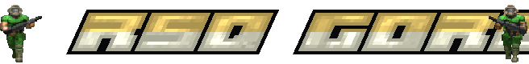

# RSQ Gore

Brutal Doom 22's and XMVE's gore, just as brutal, at a fraction of the cost. RSQ Gore takes their gore over by name as
it spawns, without editing either mod, and every hit and death still plays with Brutal Doom's own sprites, sounds and
decals. Blood sprays, mist and jets are replayed by light visual effects instead of actors; the blood that stays is kept
but never ticks; meat and limbs fly as Brutal Doom's do, then rest, the oldest recycled past a cap; a death's whole
spray is replayed in one call; and XMVE's head and leg hit targets become one sensor each in RSQ Score. In a
100-monster fight on the test rig it ran at 71-75 fps where Brutal Doom's own gore ran at 46-56. It is on by default.

## How to play

| Do this | What happens | Needs |
|---|---|---|
| Shoot a Brutal Doom or XMVE monster | Brutal Doom's hit blood plays: its sound, its spray, its mist and arterial jets, drawn from Brutal Doom's own frames by visual effects that are not actors. A drop that lands leaves Brutal Doom's floor spot where and when it would have; one that hits a wall paints Brutal Doom's decal | Brutal Doom 22; RSQ Gore: On (default) |
| Stand by a hit | Brutal Doom's blood splashes on your view | Screen Blood: On (default) |
| Kill one | Its death plays as Brutal Doom's or XMVE's does, its whole spray replayed in one call. Its meat and limbs fly and land as Brutal Doom's, still shootable and kickable, then rest; past the cap the oldest go | Gore: All (default); Some keeps every second piece, None none |
| Let blood land on the floor or ceiling | Brutal Doom's spots, pools and ceiling spots stay, never ticking, still carried by lifts. A spot inside or near one of its colour grows it instead of adding another. Past the cap the oldest go | Blood That Stays: All (default); Merge Spots: On (default) |
| Stand under a ceiling spot | Blood drips from it as Brutal Doom's does, and a drip that lands leaves its spot | Ceiling Drips: On (default) |
| Walk through blood | Bloody boots, as Brutal Doom gives them: to the player the spot saw first | Smear Everyone: Off (default); On gives them to every player who walks through |
| Shoot an XMVE monster's head or legs | RSQ Score judges the hit with one head sensor and one leg sensor on the monster instead of XMVE's helper actors | RSQ Score; XMVE Hit Sensors: On (default) |
| Turn RSQ Gore off | Brutal Doom's own gore runs exactly as before: the pk3 changes nothing | RSQ Gore: Off |

## Keys

<!-- GEN:keys -->
This mod has no keys.
<!-- /GEN:keys -->

## Options

<!-- GEN:options -->
Options > Radiant Silvergun Options > RSQ Gore

| Option | Default | What it does |
|---|---|---|
| RSQ Gore | On | RSQ Gore takes Brutal Doom's blood over with the same look at a fraction of the cost; Off is Brutal Doom's own gore. |
| Gore | All | A death's meat and limbs: All every piece, Some every second one, None none. |
| Spray And Mist | All | Blood sprays, mist and jets on your screen only: All is Brutal Doom's look, Some half, None a puff and one drop a hit. |
| Blood That Stays | All | Floor blood left where drops land: All keeps every spot, Some fewer, None lets each fade after a few seconds. |
| Ceiling Drips | On | Blood drips from ceiling splats. |
| Screen Blood | On | Blood splashes on your view when you stand by a hit. |
| Platform | PC | Picks the budget set: PC, or Quest (smaller budgets and the frame-time guard). |
| Test and Debug | (page) | Blood level, particle budgets, the frame-time guard, residue budgets and the debug log. |
| Reset All | (button) | Puts every RSQ Gore setting back to its default. |

RSQ Gore: Test And Debug (23 rows)

| Option | Default | What it does |
|---|---|---|
| **Blood** | | |
| Blood Level | Normal | Brutal Doom's blood level a hit plays: Normal is its level 2 (today's look); Lots, Extreme and Comical add its extras. |
| **Particles** | | |
| Share All (%) | 50 (5 to 100) | Most live particles at Spray And Mist All on PC, as a share of the engine's particle pool. |
| Share Some (%) | 25 (5 to 100) | The same at Some on PC. |
| Share Quest (%) | 25 (5 to 100) | The same at All on Quest. |
| Share None (%) | 5 (0 to 50) | The same at None. |
| Frame Guard PC | Off | Thins sprays and mist when frames run slow, on PC. |
| Frame Guard Quest | On | Thins sprays and mist when frames run slow, on Quest. |
| **Budgets** | | |
| Flying All | 192 (0 to 512) | Flying meat and limbs at once, PC All. |
| Flying Some | 96 (0 to 512) | Flying meat and limbs at once, PC Some. |
| Flying Quest | 96 (0 to 512) | Flying meat and limbs at once, Quest. |
| Floor All | 512 (0 to 2048) | Floor spots and pools kept, PC All. |
| Floor Some | 192 (0 to 2048) | Floor spots and pools kept, PC Some. |
| Floor Quest | 160 (0 to 2048) | Floor spots and pools kept, Quest. |
| Floor Fade (s) | 10 (1 to 60) | At None, a floor spot fades after this many seconds. |
| Ceiling All | 128 (0 to 512) | Ceiling spots kept, PC All. |
| Ceiling Some | 48 (0 to 512) | Ceiling spots kept, PC Some. |
| Ceiling Quest | 48 (0 to 512) | Ceiling spots kept, Quest. |
| Merge Spots | On | A new floor spot inside or near one of its colour grows that spot instead of adding another. |
| Smear Everyone | Off | Bloody boots for every player who walks through a spot, not only the one it saw first. |
| Meat All | 160 (0 to 512) | Landed meat and limbs kept, PC All. |
| Meat Some | 64 (0 to 512) | Landed meat and limbs kept, PC Some. |
| Meat Quest | 64 (0 to 512) | Landed meat and limbs kept, Quest. |
| **Debug** | | |
| Debug Log | Off | A console line every 10 seconds: takeovers by class, particles, Brutal Doom spawns avoided. |

<!-- /GEN:options -->

## Works with

| Mod | What changes |
|---|---|
| Brutal Doom 22 (brutal22test6) | Its gore classes are taken over by name as they spawn (`RSQGO_Manager.CheckReplacement`); none of its files are edited. Without it RSQ Gore does nothing |
| XMVE Monster Expansion | Its gore and death classes are taken over the same way |
| RSQ Score | Its head bloods and hitboxes are never touched. XMVE's head and leg helpers become Score's sensors (Score's XMVE Hit Sensors row) |

## Limits

- Load it after Brutal Doom 22 and XMVE.
- 13 of Brutal Doom's hit-blood classes stay Brutal Doom's own: the metal and bone "bloods", the player's bloods and the
  md3 water spots.
- Brutal Doom's own Blood Level option never reaches the blood on this setup, so RSQ Gore has its own (Test and Debug,
  default Normal: Brutal Doom's level 2).
- Spray And Mist, Screen Blood, Ceiling Drips and the particle shares are your screen only; everything else is the same
  for every player.
- Quest tuning and the frame-time guard (phase 6) are not finished: Platform: Quest picks smaller budgets and the guard
  is on there, but neither has been tuned in a Quest headset.
- How it was built, the phases and the tools: [docs/BUILD_AND_TOOLS.md](docs/BUILD_AND_TOOLS.md); the full design:
  [design/GORE_SYSTEM_DESIGN.md](../design/GORE_SYSTEM_DESIGN.md).

## Credits

- **Sergeant Mark IV** (Brutal Doom 22, brutal22test6): the gore itself. Every frame RSQ Gore ships is cut from Brutal
  Doom's own, and it plays Brutal Doom's sounds, decals and translations; the hit blood, spots, chunks and deaths are
  read from Brutal Doom's DECORATE.
- **XV117** (XMVE Monster Expansion): its gore, deaths and head and leg helpers, read from its DECORATE.
- **presidentkoopa:** the series, the design and its choices (Blood Level Normal, the budgets, Gore on once the
  side-by-side check passed).
- **QuestZDoom** (Emawind and Team Beef): the engine.

---
Written from the code at main 2796bbc88, 2026-11-27 (phases 1 to 5 built).
