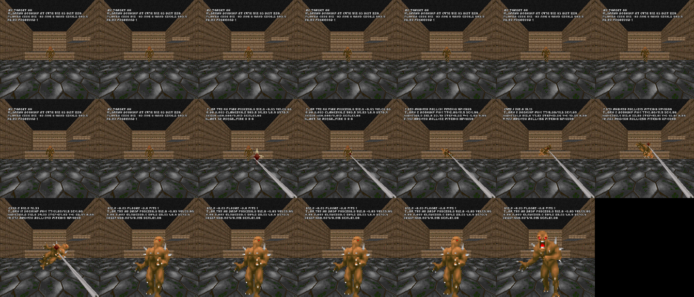
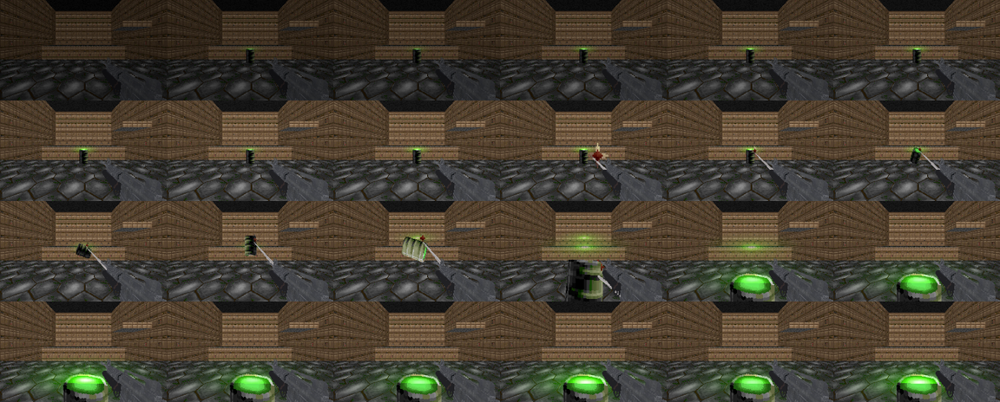

# RSQ Grapple
### Doom Arcade VR · a hookshot in your hand: fire it at a wall and fly, fire it at an imp and it flies to you

> **Waiting on Grapple 2.0.** This page describes the Grapple as it is today. Its known bugs and the next version are
> held for the Grapple 2.0 update (owner, 2026-11-10).

Point a hand, press Fire Hook, and a claw flies from that hand on a chain. If it bites a wall, a floor or a ceiling, you
are thrown at it. If it bites a monster light enough to come, the monster is thrown at you. Whatever is too heavy to
come (a boss, or anything heavier than a baron) becomes something you fly to instead. That is jpalomo's grappling hook,
number for number, from your real hand.

This is a hookshot, not a swing. Swinging on a pendulum is RSQ Whip's job. A swing rope is still here, as an option
that is off.

*[GIF to come: the claw out of the off hand, biting a far wall, the player flung across a pit]*

---

## What it feels like

- **It leaves your hand.** The claw starts at the controller and flies the way it points, about 41 m a second, out to
  about 23 m. If your hand is pushed through a wall, it starts at your eyes instead.
- **Walls throw you.** On a bite you get one hard shove toward the claw, as jpalomo's hook gives: the gap's width
  divided by 12 per tic sideways, a share of the height up or down. Nothing holds you after that. You fly, you land,
  your speed is kept until you have almost stopped.
- **Monsters come to you.** A hooked imp gets the same kind of shove toward you and slides in to land at your feet.
  The claw stays shut where it bit for about half a second, then reels back.
- **Heavy things are anchors.** A boss, anything over 1000 mass, a dormant monster, or an RSQ Miniboss with
  **Can't Be Yanked** on doesn't come. You go to it instead.
- **A chain you can see.** jpalomo's chain links, the same size and spacing as his, from your hand to the claw. No link
  is drawn within 15 units of your own eyes.
- **A thump in the hand** when the claw bites.
- **Fire again at once.** With the OG modes, a new press fires a new claw as soon as the last one has bitten, even
  while you are still flying. A press while a claw is still flying calls it back.

---

## How to play

Bind **Fire Hook** first (*Radiant Silvergun Options → RSQ Grapple → Controls*). It has no default bind. **Fire Hook
From** picks the hand: the **Off Hand** (default) or the **Main Hand**.

| Do this | What happens |
|---|---|
| Point the hand and press Fire Hook | The claw flies from that hand along where it points |
| The claw bites a wall, floor or ceiling | You are flung toward it (**Wall Hook: OG**, the default) |
| The claw bites a light monster | It is thrown toward you and slides to your feet (**Monster Hook: OG**, the default) |
| The claw bites a boss or a heavy monster | You are flung toward it |
| Press again while the claw is still flying | It turns back |
| Press again after it bit (OG modes) | A new claw goes out |
| The claw reaches its range | It comes back empty |

With **Wall Hook: Rope**, **Swing and Momentum** or one of the other **Monster Hook** modes the key does more (hold to
reel, tap to let go): see those sections.

With RSQ Gun Bonsai VR loaded, the hook has to be learned first. Until then a press shows *"Grapple: learn it in Gun
Bonsai"* (at most every 3 seconds) and nothing fires.

---

## Controls

- **Keys: one, Fire Hook.** No default bind. Bind it on this mod's page (Controls) or in Customize Controls, under
  "RSQ Grapple". Since 2026-11-10 it replaces four keys: Fire Hook (Main), Fire Hook (Off), Grab Rope (Main) and Grab
  Rope (Off).
- **Which hand:** **Fire Hook From**, a menu row, picks it: the **Off Hand** (default) or the **Main Hand**. It took
  the place of the two per-hand Fire Hook keys. The claw leaves that controller along where it points.
- **Fire Hook, press:** fire. Press again while the claw is flying: it comes back. With the OG modes, press again
  after a bite: a new claw.
- **Fire Hook, hold** (Wall Hook Rope, Swing and Momentum, Lasso): reel in. **Tap** (let go within 8 tics): let go of
  the rope or the monster. With **Whip Instead of Hook** on, the same key cracks the whip.
- **Taking hold of the rope** (to climb): an empty hand within 16 units of the rope, then any of three:
  - **the controller's grip**, read by key code (**Main Grip Keys** 446, **Off Grip Keys** 443 436); let go of the grip
    to let go of the rope;
  - **RSQ Distance Grab's grab keys**, **Grab / pull (main hand)** and **(off hand)** (with **Grab Keys Hold Rope** on;
    they have no default bind since 2026-11-10);
  - **touch** (**Touch Holds Rope**, on): bring the hand to the rope, at least 0.3 m out along it from your body, and
    hold it still a moment (6 tics, under 0.4 m/s). No button. Move the hand about 1 m off the rope (twice Grab Reach)
    to let go. A hand already lying on the rope when the hook bit doesn't take it: it has to come to the rope.
  A key's hold and a touch hold are kept apart: letting go of a key never drops a touch hold, or the reverse. After a
  key's hold the hand must leave the rope before touch takes it again.
- **Movement stick** (Swing and Momentum): lean to pump a swing, pull back past half to calm it, push forward under a
  lip to mantle.
- **Gestures:** two. In Lasso mode, a hard flick of the arm (3 m/s) throws the held monster that way; and the touch
  hold above. The trigger and Use are not read by this mod.
- RSQ Accessibility's **Hold to Toggle** turns the Fire Hook key into press on, press off.

---

## Hooking a wall

**Wall Hook** has two settings. **Swing and Momentum** on overrides both.

| Wall Hook | What a bite does |
|---|---|
| **OG** (default) | jpalomo's Hook_HitWall: one shove toward where his claw would have come to rest (14.8 units short of a wall met head on, 14 under a ceiling, on a floor). You are never held |
| **Rope** | A taut line pulls you straight at the claw at jpalomo's speed (the distance at the bite divided by 12, per tic: about 12 tics for any gap). You stop when you are 32 units from the claw or can get no closer for 4 tics. Then the rope lets go by itself, and you keep none of the pull's speed: you drop from where you are |

In **Rope** mode a tap (press and release within 8 tics) lets go early. A tap that lets go of a wall claw above you,
within about 56 units of it, gives a small hop (**Ledge Hop**, 6) to get a foot over a lip. The rope lets go if its
line to the claw is blocked three checks in a row, or bends round a corner (**Wraps Corners**). It lets go if the
wall it bit goes away (a door rising, say).

A ceiling or floor claw rides a moving ceiling or floor. A ceiling that closes to the floor lets go.

---

## Hooking a monster

Anything the claw can bite: shootable, alive, not a missile and not a player. Barrels too.

| Monster Hook | What a bite does |
|---|---|
| **OG** (default) | jpalomo's Hook_HitEnemy: one shove toward you (its distance / 12 per tic) and a lift toward your height. Then it is the engine's: floor friction slows it, and it may act on the way |
| **Slide** | It slides to you along the floor at 10 units a tic and stops 16 units from you. A floating monster comes to your height. If it gets no closer for 1.5 s, or goes more than one and a half times the range away, it is let go |
| **Yank** | It is thrown through the air in an arc to land in front of you, held in its pain frame all the way (no attack in the air). Then it stays stunned for 8 tics |
| **Lasso** | It is held at the rope's length out along where your hand points, and follows your arm at up to 24 units a tic. Hold the key to reel it in. Tap to let it go: it flies on from its own speed. Flick the arm hard (3 m/s) and it is thrown that way (**Lasso Flick Throw**, on) |

**The Yank and the Lasso in detail:**

- **The arc.** The flight takes the distance at 15 m/s (6 to 70 tics), and its height is 0.15 of the distance, kept
  under the lowest ceiling on the way. Heavier monsters fly slower and lower: a 400-mass demon takes 1.4 times as long
  on an arc 0.7 as high as an imp's.
- **Too big to throw:** over **Heaviest Thrown** (1000), wider than 64 or taller than 110 units, or one that can't be
  pushed. It slides instead.
- **Tumble** (Spin): it turns round once in the air and lands facing you. **Flip** turns it end over end and lands it on
  its feet; voxel monsters flip too. **Both** does both.
- **Throw Damage** (on): it is hurt by how fast it lands or hits a wall or a monster: (speed - 8) x 0.8, at most 40.
  What it hits takes half. You are the source.
- **Let go mid-throw** (a tap) and it flies on, falling at 0.27 of Doom's gravity.
- **Split Pull by Weight** (Slide only, off): you share the pull by weight. An imp (100) and you (100) meet halfway. A
  400-mass demon comes a fifth of the way and you go the rest.

Monsters that are too heavy (**Heaviest Pulled**, 1000), bosses, dormant monsters and protected minibosses are
anchors in every mode. If a monster turns heavy or unshootable on the line (a Champions champion waking up, a dark red
champion going down), the line lets go.

*Rig frames from the 10-27 monster-side test (an older build): Monster Hook Yank with Tumble Flip, the cable rope look,
flat screen. Not a capture from a headset. `test/evidence/frames_flip.png`.*

*Same test: a BD_VoxelPack barrel, found to be a voxel and flipped by pitch, thrown to the player. Rig frames, flat
screen. `test/evidence/frames_voxel_barrel.png`.*

---

## Swing and Momentum (off)

Turn it on and every wall bite hangs you from a rope instead, whatever **Wall Hook** says. With RSQ Gun Bonsai VR it
also has to be learned (its **Momentum** upgrade).

- **Hold to reel.** Holding the key takes in 12 units of rope a tic, down to 32 units. The press that fired keeps
  reeling the moment the claw bites, so hold it to zip in. A later press reels only once it outlasts a tap.
- **Tap to let go** (released within 8 tics, **Tap to Let Go**).
- **Swing.** Step off a ledge and you swing from where the rope is. On your feet the rope pays out and takes in with
  you, so the swing starts at once.
- **Pump** it with the movement stick (**Swing Lean**, 0.25). **Calm Swing** (on): the stick pulled back past half
  brakes the swing, to a stop in about a second.
- **It dies down** by itself: air drag and a little rope friction, about 12% of the swing each half swing, and it stops
  hanging straight under the claw.
- **Keep Momentum** (on): you keep your speed when you let go in the air, and for 18 tics after (so the landing
  doesn't stop you dead).
- **Wraps Corners** (on): swing past a corner and the rope bends round it (up to six bends) instead of letting go. When
  you can see past the bend again, it straightens out and gives back the length.
- **Mantle Over Ledges** (on): hanging on a wall rope under a lip, push the stick forward (a quarter of the way is
  enough). If the lip is between 8 units and one and a half times your height above your feet, with room to stand and
  a clear way over, the rope lets go, you hop up over it and step on.
- **Slack Rope Lets Go** (on): standing with the rope lying slack on the floor (the claw no higher than where the rope meets you), not
  reeling and not holding it, for 3 seconds: it lets go.
- **The rope catches you.** After it has hung at least 12 units slack, a fall that pulls it taut gives a thump.
- **Top Speed** (30 units a tic) caps the swing and the reel.

### Climbing hand over hand

Hanging on a swing rope, take hold of it with an empty hand and pull down to climb, push up to lower yourself.

- **Take hold with the controller's grip, RSQ Distance Grab's grab keys** (**Grab Keys Hold Rope**, on) **or a touch**
  (**Touch Holds Rope**, on: the hand held still on the rope a moment). See Controls.
- The hand must be within 16 units of the rope (**Grab Reach**).
- **Empty Hand Only** (on): Brutal Doom VR's fists, its free off hand showing a closed fist, Doom's Fist or an empty
  slot. Never a hand holding a gun.
- **1:1.** The body moves exactly as far as the hand moves along the rope, up to 8 units a tic (**Climb Speed Cap**);
  faster and the rope slips through the hand. A still hand holds you still.
- **Two Hands on Rope** (on): both hands may hold it; the climb is the average of the two. Off: a new hand takes it
  over.

*[GIF to come: hanging from a ceiling rope, climbing it hand over hand]*

---

## The whip instead of the hook (off)

**Whip Instead of Hook** makes Fire Hook crack a whip from the same hand.

- **The crack.** The lash goes out for 4 tics along where the hand points, cracks at full reach (192 units, about
  5.6 m), and falls back in 4 more. It follows your wrist on the way out.
- **A hit** does 12 damage and, with **Whip Stun** (on), knocks the monster into its pain frame whatever its pain
  chance, which breaks off an attack it was winding up.
- **A snag** (**Whip Snag**, on): if the tip meets something at least 16 units above the hand (a ledge, a beam, a
  ceiling edge), it wraps round it and becomes the hook's rope. See Status: with **Swing and Momentum** off this does
  not do what it should.

This is not RSQ Whip, the series' own whip mod. The two load together.

*[GIF to come: the whip cracking an imp out of its attack]*

---

## Small helpers

- **Aim Dot** (off): a faint dot where the claw would bite, shown only while an empty hand points out at least 8 units
  ahead of you and has no claw out. Warm on a monster, cool on a wall. Only you see it.
- **Hook Uses Switches** (off): a claw that hits a switch or a door works it, as Use would (keys and locks included), and
  comes back.
- **Hook Thump** (on): the engine's own hit buzz in the firing hand when the claw bites, at most once in 10 tics.
- **Score Stunts** (on): a gap crossed on the rope pays RSQ Score's **Indiana Jones** (see Plays well with).

---

## The look and the sound

- **Rope Look: Chain** (default): jpalomo's chain link, 5 units across, every 5 units, from 15 units out from the hand,
  at most 160 links (past that they spread out). **Cable:** a grey tube, one piece when taut, up to 12 when it sags.
- A slack rope sags in a curve deep enough for its spare length. A climbing hand holds the rope above you, and the
  tail hangs from the hand that fired it.
- **Art and Sound:** **JP** (default) is jpalomo's claw and sounds. **Combat FX** uses the owner's RS_CombatFX draw,
  holster and foley sounds (hits stay JP's). **Ballistics** uses RS_Ballistics' near-miss whiz and crack, flies the
  claw as a tracer streak and throws four small streaks off a wall hit.
- With RSQ Accessibility's High Contrast colour setting, the claw and the chain are drawn at full brightness.

---

## Plays well with

- **RSQ Gun Bonsai VR:** the hook becomes a tree you learn. The page then says *"GunBonsaiOVR detected. Mod features
  unlocked via upgrades."* and greys **Grapple** and **Swing and Momentum** until they are learned. Learning one
  turns its row on; the row can still turn it off.
  - **Grapple:** the unlock. The hook fires only once it is learned.
  - **Momentum:** unlocks Swing and Momentum.
  - **Long Line:** 20% more range a level.
  - **Fast Reel:** the claw, the OG fling and the OG throw 10% faster a level (and the rope modes' reel and slide).
  - **Heavy Haul:** the weight limits half again a level, the size limits 15%; a boss bitten is staggered (once every
    3 s).
  - **Get Over Here:** what the hook brings you arrives staggered.
  - **Bowling:** what the hook brings you strikes, staggers and shoves aside what is in its way, and comes on.
  - **Barbed Claw:** the bite hurts, and tearing it out of a living monster hurts more.
  - **Slingshot:** letting go of a swing in the air is faster.
  - **Steady Line:** hanging with the stick centred, the swing settles faster.
  - **Double Hook:** a monster on each hand's hook: they are slammed into each other.
  - **Zip Kick:** arriving on a monster by rope at 3 m/s or more hurts it and knocks it on (an OG fling counts).
  - **Scorpion:** a monster the hook brings you is punched at full power by an empty fist, through RSQ Melee.
  - **Twin Lines:** a wall rope from each hand at once (without it, under the patch, one at a time); then holding one
    rope's reel pulls you toward that one; then letting one go flings you along the other.
  - The hook also keeps a running count of its bites, throws, swinging, slams and kills it was in on, and its own damage
    is marked as the hook's, so Gun Bonsai VR can pay XP for them to the player rather than to the gun in your hand.
- **RSQ Score:** **Indiana Jones**, a gap crossed on the rope: leave one floor, pass over a floor at least 64 units
  below both ends, and land at least 192 units away. 150 points, plus half a point for each unit past 192, at most
  500. Once per gap per map. Score also reads the hook for its own rows: Reeled In, Ping-Pong, Bowling, Hard Landing,
  Fly Ball, Swinging, Dismount, Boarding Party, Zip Kick, Scorpion, and the hook combos (Fish Out of Water, Harpoon,
  Come Here! and the rest). Swinging, Dismount and Indiana Jones need a rope that holds you (see Status).
- **RSQ Distance Grab:** its grab keys are how you take hold of the rope.
- **RSQ Melee:** Melee hears nothing as a swing while you climb, swing or reel. Scorpion punches through Melee.
- **RSQ SlowMo:** the claw, the rope and you run at full speed; a monster the hook moves comes at the slowed pace, on the
  same arc.
- **RSQ Accessibility:** Off-Hand Modifier (the main controller plays the off hand's hook), Steady Hands (the claw and
  the Aim Dot leave along the smoothed aim), Gesture Ease (Grab Reach up to twice as wide), Slower Taps (the tap window
  x1.5), Hold to Toggle (a press latches the key on, the next press lets go), Comfort Vignette (while the rope moves
  you), Rumble Strength (0 turns the thump off; the thump has one strength), Text Size (the "learn it" message in the big
  font), High Contrast.
- **RSQ Miniboss:** **Can't Be Yanked** (on) makes a miniboss an anchor.
- **Brutal Doom VR (BD22 VR):** its fists and its free off hand count as empty hands for climbing. Nothing of it is
  needed.
- **Champions and LegenDoom Lite:** a champion that turns heavy or unshootable on the line is let go.
- **RSQ Whip:** a separate mod, forked from this one's rope. Both load together.

---

## Options

*Radiant Silvergun Options → RSQ Grapple.* One page with every option, and a **Test and Debug** page with the raw
numbers. **Reset All** (at the foot of the main page) resets every setting on both pages, Fire Hook From included.

| Section | Rows |
|---|---|
| (top) | Grapple (On) · Wall Hook (OG / Rope; OG) · Swing and Momentum (Off) · Range (780) · Hook Thump (On) · Aim Dot (Off) · Hook Uses Switches (Off) · Score Stunts (On) |
| Rope | Rope Climbing (On) · Two Hands on Rope (On) · Empty Hand Only (On) · Grab Keys Hold Rope (On) · Touch Holds Rope (On) · Wraps Corners (On) · Mantle Over Ledges (On) · Calm Swing (On) · Slack Rope Lets Go (On) · Keep Momentum (On) · Rope Look (Chain / Cable; Chain) |
| Monsters | Monster Hook (OG / Slide / Yank / Lasso; OG) · Split Pull by Weight (Off) · Lasso Flick Throw (On) · Tumble (Off / Spin / Flip / Both; Spin) · Throw Damage (On) · Art and Sound (JP / Combat FX / Ballistics; JP) |
| Whip | Whip Instead of Hook (Off) · Whip Stun (On) · Whip Snag (On) |
| Controls | Fire Hook (no default bind) · Fire Hook From (Main Hand / Off Hand; Off Hand) |
| Test and Debug: Hook | Hook Speed (40) · Return Speed (64) · Tap to Let Go (tics) (8) |
| Test and Debug: Rope | Reel Speed (12) · Shortest Rope (32) · Rope Height (0.60) · Ledge Hop (6) · Grab Reach (16) · Climb Speed Cap (8) · Top Speed (30) · Swing Lean (0.25) · Air Drag (0.0020) · Rope Friction (0.025) |
| Test and Debug: Rope Look | Chain Links (160) · Link Size (0.125) · Rope Pieces (12) · Rope Thickness (0.6) |
| Test and Debug: Monsters | Heaviest Pulled (1000) · Slide Speed (10) · Stop Distance (16) · Heaviest Thrown (1000) · Widest Thrown (64) · Tallest Thrown (110) · Throw Air (0.27) · Throw Turns (1) · Throw Stun (8) · Lasso Speed (24) |
| Test and Debug: Whip | Whip Reach (192) · Whip Damage (12) · Snag Height (16) |
| Test and Debug | Debug Log (Off) |

Distances are map units (34 to a metre), speeds units a tic (35 tics a second).

**Greyed rows** keep their setting; they only do nothing until their mode is on:

- **Rope Climbing, Two Hands on Rope, Empty Hand Only, Grab Keys Hold Rope, Touch Holds Rope, Mantle Over Ledges, Calm Swing, Slack Rope
  Lets Go, Keep Momentum** and **Swing Lean, Air Drag, Rope Friction:** greyed without Swing and Momentum.
- **Wraps Corners** and **Shortest Rope, Ledge Hop, Grab Reach, Climb Speed Cap:** greyed while no rope is ever made
  (Wall Hook OG with Swing and Momentum off).
- **Split Pull by Weight** and **Slide Speed:** Slide only. **Lasso Flick Throw** and **Lasso Speed:** Lasso only.
  **Tumble, Throw Damage** and **Heaviest / Widest / Tallest Thrown, Throw Air, Throw Turns, Throw Stun:** Yank or
  Lasso. **Stop Distance:** Slide, Yank or Lasso.
- **Whip Stun, Whip Snag, Whip Reach, Whip Damage, Snag Height:** greyed while Whip Instead of Hook is off.
- With RSQ Gun Bonsai VR: **Grapple** and **Swing and Momentum** until learned.

Every setting but Fire Hook From is the host's (a server setting). Fire Hook From is your own.

*[picture to come: the RSQ Grapple options page]*

---

## Status

**Waiting on Grapple 2.0.** The code-read findings below, and the next version, are held for the Grapple 2.0 update
(owner, 2026-11-10; `design/PLANNED_PROJECTS.md`, `Grapple/ROADMAP.md`).

| | |
|---|---|
| **rig only, not headset-confirmed** (2026-11-10, the batched rig test) | Every launch loaded every RSQ pk3 with no script error from our packs, on doom2, brutal22test6, BD_VoxelPack, BD22 VR Reloaded 2.0.4f, LOB, Champions, Gun Bonsai and the series (`design/rigtest_2026-11-10/RESULTS.md`). No hook was fired. Those launches came before the KEYCONF fix that packs the one Fire Hook key (commit 09243dd8) |
| **rig only, not headset-confirmed** (2026-11-10, the touch hold; `design/rigtest_2026-11-10/evidence/ROPE_GR_*`) | Swing and Momentum on, a ceiling rope on MAP01 (run without RSQ Gun Bonsai VR, whose unlock gates the hook): the empty off hand by your side, 0.25 m off the rope at its root, was not taken; swept across the rope at 1.75 m/s, not taken; brought onto it and held still, taken in 6 tics; a grip key's press and release (sent as its event) left the touch hold on; pulled in along the rope, the rope shortened 251 to 233 and you were drawn toward the claw; moved 1 m away, let go. A key's hold: taken by the key, not by touch, let go by the key up, and the still hand then not taken back. The grip keys themselves can't be pressed on the rig |
| **rig only, not headset-confirmed** (2026-11-09, the build before the 11-10 key change, full series load order) | The pack loaded with no script error of its own, and its page is listed under Radiant Silvergun Options (`design/rigtest_2026-11-09/logs/main_A-G_I.log`). No hook was fired in that run |
| **rig only, not headset-confirmed** (2026-11-03, older build, doom2 and the full order; `test/evidence/og_1103.txt`) | Wall Hook OG and Monster Hook OG against jpalomo's own pk3 on the same rig: seven wall, ceiling and floor shots and six monster shots gave his launch speeds to 0.001, the player's path after the fling matched his for 71 to 80 tics, a miss flew as his did. Bosses as anchors. With Gun Bonsai VR, the Grapple unlock refused to fire until learned. No script errors from the pack |
| **rig only, not headset-confirmed** (2026-11-03, older build; `test/evidence/gb_1103.txt`) | Gun Bonsai VR: Fast Reel on the claw, the fling and the throw; Twin Lines with Momentum; Scorpion on the OG throw |
| **rig only, not headset-confirmed** (2026-10-31, older build, logs; `test/evidence/qol_1031.txt`, `sweep_1031.txt`) | Calm Swing, Slack Rope Lets Go, the tap window, Hook Uses Switches (a switch lowered a ceiling), Lasso Flick Throw, the Aim Dot (in the log only: the dot could not be made out in frames at its real size), the press held back while both hands read as one point, Two Hands on Rope, the thump being sent (not felt on the rig), the Lasso, Split Pull |
| **rig only, not headset-confirmed** (10-27, older build; `test/evidence/` w_*, ev_*, sl_*, fr_*, gb_*, frames_*.png) | The whip's hit and snag, the Yank's arc full speed and slowed, tumble frames (sprite and voxel), Gun Bonsai VR's first nine upgrades |
| **Headset-confirmed** | Nothing yet. The owner has played earlier builds in his headset (his notes ask for changes, e.g. `BUGS_1.0.md` #27 and BUGS_0.99a item 18), but the repo records no feature confirmed working there |
| **code only, not shown** | Everything about the current build: the one Fire Hook key and Fire Hook From (load-checked when committed, not run on the rig), taking the rope with the grip's key codes or Distance Grab's grab keys (the touch hold is in the rig row above). Wall Hook Rope pulling at jpalomo's speed and letting go on arrival (the 11-06 commit says a rig log showed it; no such log is in the repo). Wraps Corners, Mantle Over Ledges, Indiana Jones, Hold to Toggle, the Comfort Vignette, the Combat FX set, the High Contrast look, Reset All |
| **not yet run** | Nothing else. The batched rig test of 2026-11-10 (`design/rigtest_2026-11-10/PLAN.md`) has no other Grapple check: it waits on 2.0 |
| **Known not to work (from reading the code; held for 2.0)** | **Whip Snag** with Swing and Momentum off (the default): the snag goes through Wall Hook OG's fling, aimed at a point the whip never sets, so you are shoved toward the map's origin instead of the snag. **Indiana Jones, Swinging and Dismount** can't pay with the default Wall Hook OG: they need a rope that holds you, and the OG fling never makes one (they can with Wall Hook Rope or Swing and Momentum). **Reel Speed** does nothing to the Rope wall pull (its speed is the distance / 12), and **Grab Reach** and **Climb Speed Cap** stay live in Rope mode, where nothing climbs |

---

## Under the hood

- **Stock QuestZDoom 17.3:** ZScript and data only, no engine change. Every other mod is found by name while the game
  runs (`ServiceIterator`, class names), never linked. The pack plays alone.
- **The key** is a KEYCONF alias, `+rsqgr_hook`, not a usercmd button (Brutal Doom Quest uses all four `BT_USER` bits).
  Its press and release are local console events (`rsqgr_presskey` / `rsqgr_releasekey`), turned into the chosen hand
  (`rsqgr_key_hand`). The hand's pose is read on the machine that holds the controller and packed into the network
  event `rsqgr_fire` (yaw, pitch and the hand's offset from the body), so every machine fires the same claw from the same
  hand. `rsqgr_up` is the release. A press while both hands read as one point (a menu just closed, a level just began)
  waits up to 10 tics for a real pose instead of firing from the chest.
- **The climb's hand** is streamed every rendered frame as `rsqgr_pose` while a hand holds the grab, its height taken
  against that frame's own eye. The grab itself is RSQ Distance Grab's `rsqdg_press` / `rsqdg_release`, heard here too.
- **The OG math** is jpalomo's ACS (`jp_original/scripts/hook.acs`) redone in ZScript: his distance rounding, his
  256-step angle, his thrust added with no cap, `keepmomentum` set as his ThrustThing does, and the spot where his
  10-radius projectile would come to rest.
- **The rope is solved in `WorldTick`,** after the player's own input and before anything moves, by setting the
  velocity the engine is about to move him by. He is never placed by position, so the rope can't put him inside a wall.
  The claw's own `Tick` only draws the rope, after the player has moved that tic.
- **Thrown monsters** (Yank, Lasso) are placed every tic by `TryMove` and `SetZ` on a path, never given a velocity, so
  RSQ SlowMo's scaling can't throw them too high. Borrowed flags (no gravity, roll, model pitch) are put back on landing,
  on death and on leaving the level. A save mid-throw loads mid-throw.
- **Handlers:** `RSQGR_Core` (every decision), `RSQGR_Input`, `RSQGR_Flight` (the throws, the Lasso, the OG watch),
  `RSQGR_Whip`, `RSQGR_Voxels`, `RSQGR_Perks` (Gun Bonsai VR levels, read once a second through
  `RSQ_MeleeUpgradeService` "plevel"), `RSQGR_Events` (the ledger).
- **For other mods: `RSQGR_Service`.** About a player: `hook.phase` (per hand), `swinging`, `reeling`, `climbing`,
  `airborne`, `released`, `released.speed`, `landed`, `rope.speed`, `flight.dist`, `flight.drop`, `gaps`. About a
  monster: `hooked`, `hooked.by`, `hooked.heavy`, `bites`, `volleys`, `yanked`, `landing`, `struck`, `struck.by`,
  `pin`, `whipped`, `stunned`. Gun Bonsai VR's: `xp.bites`, `xp.yanks`, `xp.kills`, `xp.killhp`, `xp.slams`,
  `xp.swing`, `hook.dealing`. Objects: `hook.victim`, `hooked.by`, `struck.ball`. Menu: `menu.locked`. Blows are noted
  before they land, so a scorer hearing the death already knows the hook did it.
- **It asks:** `RS_ScoreService` (`award`, `touch`), `RSQML_Service` (`autopunch`), `RSQ_MeleeUpgradeService`
  (`plevel`, `stagger`), `RSQSM_Service` (`scale`), `RSQA_Service` (`swap`, `steady`, `vignette`), `RSQMB_Service`
  (`bossfor` "yank").
- **The thump** is a 0.1-unit `LineAttack` that touches nothing: the engine buzzes the firing hand for any player
  hitscan.
- **Saves:** the claws and their ropes are rebuilt from the level after a load; no hand holds the rope after a load and
  no key reads as held (its release may never come).
- **Settings:** all server cvars (`rsqgr_*`) except `rsqgr_key_hand`, a user cvar. **Debug Log** prints every hook tic
  (`T_GR` lines; `T_GRM` the throws, `T_GRW` the whip, `T_GRS` the ledger, `T_GRP` the upgrades).

---

## Credits

The full list, with every file and where it came from, is in **CREDITS.txt**.

- **jpalomo:** the grappling hook in his mod pack (jp_grapple.pk3, kept unmodified in `jp_original/` of the source,
  not shipped). Its claw sprites (open and shut), its chain link and its five sounds ship here under this mod's names.
  The OG wall and monster modes reproduce his `Hook_HitWall` and `Hook_HitEnemy` and his HookShot's flight. Thank you,
  jpalomo. His art and sound are the default until the owner's own replace them.
- **presidentkoopa:** the series and this rebuild. RS_CombatFX (the Combat FX sounds) and RS_Ballistics (the whiz and
  crack sounds and the tracer mesh). The Yank's path is RSQ Distance Grab's, from his RS_WorldHands design.
- **Brutal Doom VR (BD22 VR Reloaded):** its free-hand test was read from its code. Nothing of it ships here.
- **QuestZDoom** (Emawind and Team Beef): the engine and its VR hand API.
