

# RSQ Grapple
### Doom Arcade VR · the off hand's hook: fly to the big ones and kick off them, drag the small ones to you

<a href="../README.md#grapple">&larr; RSQ UBQ Series</a>

One button fires a hook from your off hand, wherever it points. What it bites decides what happens.

**What it does:**

- **Fires a claw on a chain** from your off hand, out to about 23 m, at the speed of jpalomo's original ([The hook](#the-hook))
- **Flings you at walls and floors**, and keeps your momentum
- **Lifts you onto ledges:** bite just under the top of a step and you are set down on top
- **GET OVER HERE:** a small monster is yanked across the room to your feet ([Small ones](#small-ones-get-over-here))
- **Flies you to the big ones**, and arriving is a **kick:** 30 damage, a knockback, a stun, and slow motion ([Big ones](#big-ones-the-kick))
- **The kick-chain:** bounce off, hook the next one in the air, kick again: **KICK! x2**, x3... ([The kick-chain](#the-kick-chain))
- **Hangs you in the air** while the claw is out, so a chain is aimed, not rushed
- **Double jump** after a kick: more air, more slow motion, and time markers over the monsters in reach
- **The air spike:** hold a small one up in the air and swing both hands down to drive it into the floor ([The air spike](#the-air-spike))
- **Runs at full speed in slow motion:** the world slows, your hook does not
- **Aim Assist** in the air, and an optional **Scorpion Pull** that waits for you to yank

Three things make it more than a way to get around:

- **It is a fighting move.** The hook does not swing or reel. It brings the fight to you or you to the fight, and
  the kick on arrival starts slow motion.
- **Small and big are different.** A zombie comes to you. A Baron takes you to it. You learn to read a room by what
  the hook will do to each thing in it.
- **The kick-chain.** After a kick you are in the air with time slowed. Hook another big one and you kick again,
  and again, each link a little shorter, until you land or miss.

*[GIF to come: a hook to a Baron, the kick, a double jump, and a second hook in the air]*

*The pictures on this page are captures from the rig, not from the headset. [Status](#status) says which run each is from.*

**Works on plain Doom II with nothing else loaded.** The slow motion is RSQ SlowMo's, and the air spike's blast is
RSQ Grenade's: without them the hook still flies, yanks, flings and kicks.

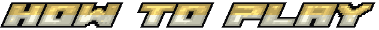

| Do this | What happens |
|---|---|
| Point your off hand and press **Fire Hook** | The claw flies out along that line and bites the first thing it reaches, up to about 23 m away |
| ... and nothing is there | It comes back empty |
| Press again while a claw is still flying | Another claw flies too, as in jpalomo's (each acts on what it reaches) |
| ... at a wall or the floor | You are flung toward it (jpalomo's shove) and keep your momentum |
| ... just under the top of a step (up to about 1.2 m below it) with room above | You are carried up and set down on top |
| ... at a small monster, standing on the floor | **GET OVER HERE**: it lands in front of you |
| ... at a big one | You fly to it; arriving is the **kick**, and then you bounce away and up |
| In the air after a kick, press **Fire Hook** | You hang where you are, not falling, until the claw bites; then the bite plays |
| ... and it bites another big one | Another kick: the chain goes up by one, **KICK! x2** (however far it flew) |
| ... and it bites nothing (its reach, or the sky) | **Chain Cancelled!**: the chain ends and you fall in slow motion until you land |
| ... press **Fire Hook** again while you hang | The claw comes back: **Chain Cancelled!**, the same as a miss |
| In the air after a kick, press **jump** | The double jump: more air, +0.5 s of slow motion, time markers over up to 5 monsters |
| Hook a monster with a time marker | +0.25 s or +0.5 s more slow motion |
| In the air, hook a small one, then swing both hands down hard together | **The air spike**: Neon Crescent, blood, fire, a shockwave, Grapple-Slam slow motion |
| Land | The kick-chain ends; the markers go |

**Aim Assist** (on by default): after your double jump, the hook snaps only to the monsters the double jump marked
(+0.25 / +0.5 sec): the one nearest your off hand's line, within 10 degrees, if you can see it. None of them near your
line, or no double jump: the claw flies where you aim and may hit nothing, another monster or a barrel.

**A guarded Boss** (RSQ Miniboss: its shield is up, or it just lost a life): you still fly to it and bounce
off, but the kick does no damage. Its own GUARD! shows instead, and there is no stagger, no slow motion and no chain
link.

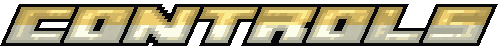

| Bind | Where | Default |
|---|---|---|
| **Fire Hook** | Options → Customize Controls → RSQ Grapple, or the **Controls** row on this mod's page | none: bind it yourself |
| **Jump** (the double jump) | the engine's own Jump | yours |

The hook fires from the **off hand** unless you pick the other: **Hook Hand** (Off Hand; Main Hand) on this mod's page, under Controls (2026-11-16, owner: "Let me pick the hand"). With Main Hand the claw, its aim, Aim Assist's line and Scorpion Pull's yank all follow the main hand. The air spike needs nothing in particular in your hands.

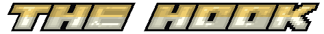

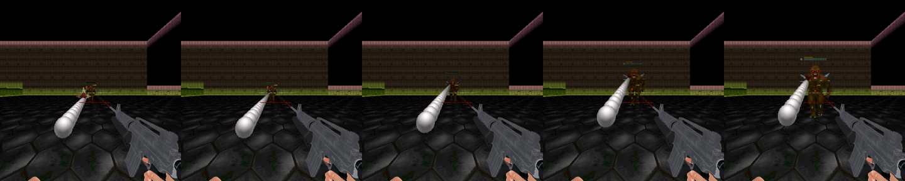

- **One press.** The claw leaves your off hand along the line it points and flies at about 41 m a second, out to
  about 23 m. It bites the first wall, floor, ceiling or monster it reaches. Nothing there, or the sky: it comes back
  empty.
- **The chain** is alive while the claw flies: gunmetal links with a small ripple that dies away.
- **No rope.** It does not reel, swing or climb. Those are RSQ Whip's.

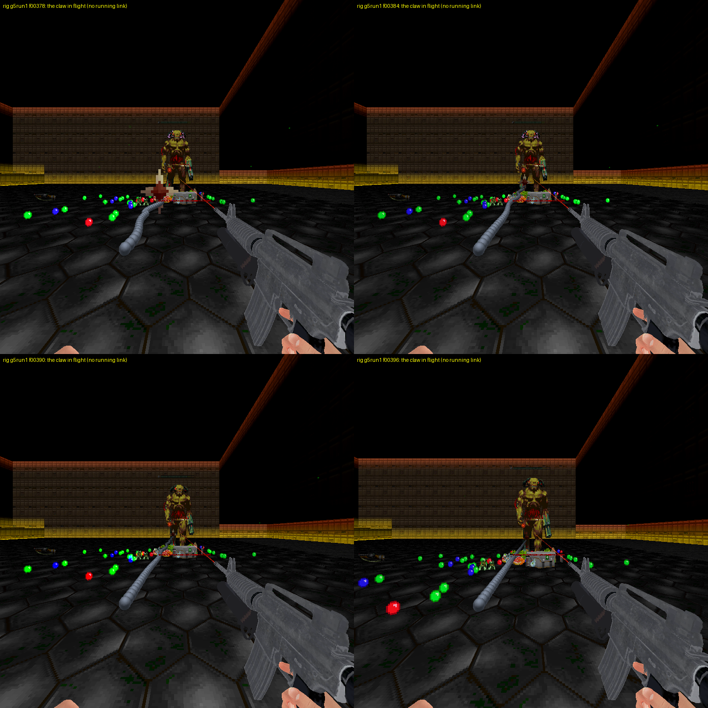

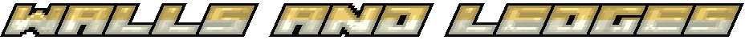

- **A wall or a floor:** you are flung toward where it bit, with jpalomo's own shove added to whatever speed you had.
- **A ledge:** bite the face of a step just under its top, or the top of a floor too high to step onto, with room
  to stand up there, and you are carried up and set down on it.

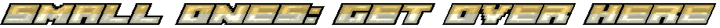

A monster that is not heavy is yanked along the chain and lands in front of you. You do not catch it: shoot it,
punch it, shove it, saw it. In the air it is pulled up to you and held there for a moment
([The air spike](#the-air-spike)).

**Scorpion Pull** (off): the monster stays on the chain until you yank your off hand back, then it comes.

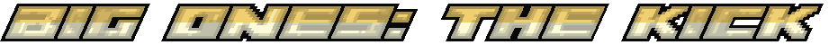

**Heavy** is a boss, anything with a mass over 1,000, any Baron of Hell, or a monster that has not woken up. The hook
cannot move it, so it moves you: straight at its face, and arriving is the kick.

- **The kick:** 30 damage, the monster knocked back by its weight and stunned, a gold cross, **KICK!** over it, and
  the kick's own sound.
- **Slow motion on contact:** 1.5 seconds, with RSQ SlowMo.
- **The kick-off:** you bounce away from it and about 1.5 m up, less under a low ceiling.
- **The stun** lasts as long as that slow motion, with RSQ Melee's stars circling its head.

A guarded Boss (RSQ Miniboss, its shield up): you still fly to it and bounce off, but the kick does nothing and its
GUARD! shows.

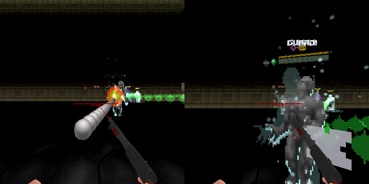

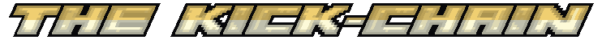

After a kick-off you are in the air and time is slow. Fire the hook again:

| It bites | What happens |
|---|---|
| Another big one | Another kick, the chain one higher: **KICK! x2**, x3... Each link's slow motion is 0.3 s shorter (1.5, 1.2, 0.9, 0.6, 0.3) |
| A small one | It comes up to you |
| A wall or a ledge | You land there |
| Nothing | **Chain Cancelled!** and you fall in slow motion until you land |

- **You hang while the claw is out.** Press in the air and you stop where you are until it bites. Press again while
  hanging and the claw comes back: Chain Cancelled!
- **The double jump:** one per kick-off. Press jump in the air for more height and half a second more slow motion,
  and up to five monsters in reach get a time marker: +0.25 s for a near one, +0.5 s for a far one, paid when you
  hook it.
- **Aim Assist** (on): after a double jump the hook snaps to the marked monster nearest your off hand's line, within
  10 degrees. With none near your line it flies where you aim.

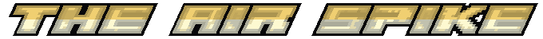

Hook a small monster while you are in the air and it is held up in front of you for a second. Swing **both hands
down hard together** and it is spiked straight down. You hang until it hits the floor, where RSQ Grenade's Neon
Crescent goes off with blood, fire and a shockwave, and RSQ SlowMo slows your way down.

*[GIF to come: an imp hooked in mid-air and spiked into the floor]*

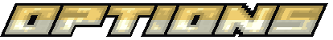

*Radiant Silvergun Options → RSQ Grapple.* **Reset All** at the foot resets both pages. All are the host's.

| Section | Rows |
|---|---|
| Top | **Aim Assist** (on) · **Scorpion Pull** (off: when on, a monster you hook is held on the chain until you yank your off hand back (2 m/s); then it comes, or you go) |
| Controls | Hook Hand (Off Hand; Main Hand) · Fire Hook |
| Test and Debug | Range (780 map units) · Debug Log (off: every bite, kick, slow-motion request and event goes to the console as `T_G2` lines; the claw's flight logs its position every tic) |

Comfort versions (a lower hop, a vignette) belong in RSQ Accessibility: this mod reports every tic it moves you to
Accessibility's **Comfort Vignette** (`RSQA_Service "vignette"`), which only shows when that row is on. Its strength
follows your speed: about a third at a crawl, full at about 31 m a second and over (2026-11-16).

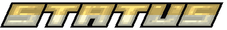

All rows below come from the series' rig on the owner's full load order (doom2, brutal22test6, BD_VoxelPack, BD22 VR
Reloaded 2.0.4t, the monster and environment packs, Gun Bonsai, every RSQ pk3) plus a test probe and a test arena
(`docs/rig/probe/`: a 2048-unit room with a 64-unit ledge and a 90-unit-high low ceiling). No new script errors:
only BD_VoxelPack's four voxeldef errors, which were already there. Logs and scripts are in `docs/rig/`.

| | |
|---|---|
| **rig only, not headset-confirmed** (2026-11-16, runs `slowfx_fx_old3` / `slowfx_fx_new2`, frames in `SlowMo/docs/rig_2026-11-16_slowfx/followup_before_after_world025.jpg`) | **The kick's puff and the shockwave ring slow with the world** (owner 11-16 06:15): engine particles cannot be slowed once made, so they are made slowed when RSQ SlowMo is slowing the world (its `scale`, by name): velocity and shrink x the world's speed, lifetime / it. At 0.25 the ring was still rolling out 30 real tics after, where before it was gone. The spike's fire was already slowed by SlowMo itself. The marker over a monster is redrawn every tic and is unchanged |
| **rig only, not headset-confirmed** (2026-11-16, run `snd_kick`, the owner's load order with BD22 VR Reloaded 2.0.4x and a sound probe; design/MELEE_SOUNDS.md) | **The kick's sound.** Fire Hook at a Baron 300 units ahead: the pull (254 units at 21.2 a tic), "SOUND whoosh: 85 units from its face (4.0 tics)" at t104 and the probe saw `rsqgr/whoosh` start that tic; "pull arrived", **KICK 1** and "SOUND kick" at t108, the probe saw `rsqgr/kick` start at t108 (the preview he approved: whoosh 4 tics before the kick). The kick now plays the owner's kick (punch7 with its thump 9 ms in, + thud) in place of jpalomo's meat hit and RSQ Melee's thud. No script errors from this pack |
| **rig only, not headset-confirmed** (2026-11-13, run `g6run2`, script `docs/rig/g6run2_script.txt`, log `docs/rig/g6run2.txt`; BD22 VR Reloaded 2.0.4u) | **Marked-only Aim Assist and the dizzy stun:** Baron kicked (KICK 1, "DIZZY: RS_CommonBaron stunned 53 tics, RSQ Melee's chicks and stars -> 1"), double jump, "MARKERS: 2 of 2", the probe fired 6 degrees off the marked Cyberdemon: "aim assist: snapped 6.5 degrees to marked RS_CommonCybie", hung 14 tics, bit, "MARKER HOOKED ... +0.5 sec", **KICK 2** ("KICK! x2", dizzy 42 tics). **No double jump, no snap:** three kicks with no jump, then a fire: "aim assist: no marked monster near your line: the claw flies where you aim". **A miss:** "MISS IN THE AIR", "CHAIN CANCELLED ... g2.slow -> 1", SlowMo's cause line "Chain Cancelled!"; the fall from z 38 took 28 tics (8 before this change, at full speed). **The cancel press:** hanging for a claw, a second press 6 tics in: "1 claw reeled in", "CANCEL PRESS", Chain Cancelled!, a 35-tic slow fall from z 55. **Until you land:** in the last case the kick's own slow motion ended at t819; Chain Cancelled kept the world at 25% to the landing at t825, and it began to speed up at t831 (6 tics later). No new script errors (BD_VoxelPack's four voxeldef errors only). (Run `g6run1`, the same script: everything but the slow fall, which was still at full speed; fixed) |
| **rig only, not headset-confirmed** (2026-11-13, run `g5run1`, script `docs/rig/g5run1_script.txt`, log `docs/rig/g5run1.txt`; BD22 VR Reloaded 2.0.4u) | **Hang until it bites.** **The far one, after the old landing time:** Fire Hook (the key) at a Baron 400 units ahead, **KICK 1** at t101, kick-off from the floor; the probe's press 8 tics later, in the air, at a Cyberdemon 21 m away (the same set-up as `g4run2`'s edge case, where you landed first): "HANG: fired in the air in kick-chain 1: you hang at z 48.5", and every tic t109 to t125 logged "HANG tic n: z 48.45 (held at 48.45)" (the probe's own track: z 48.5 every tic, vel 0, the world at 25%); the claw flew 18 tics (703 units) and bit at t126; on its old ballistic path (z 46.2 and vel.z 2.2 at t108) you would have landed about t121, 5 tics before the bite. Then "HANG over: claw #2 bit after 17 tics of hanging", the pull (697 units, 13 tics), **KICK 2** (**"KICK! x2"**, SlowMo "merged 1200 ms ... KICK! x2"), kick-off, landed at t161: "the kick-chain ends at 2". **A miss in the air:** a Baron kicked (KICK 1, t285), 3 tics later the probe fired along an empty line (north, 5 degrees up): HANG at z 30.9, held 19 tics (30.88 every tic), the claw reached the end of its reach ("reached nothing in 20 tics (780 units)"), then "HANG over: no claw bit (a miss) ... you fall from z 30.9", "MISS IN THE AIR: the kick-chain ends at 1" (event `chain.end`, the service's chain 0 the same tic), and the fall: z 29.9, 27.9, 24.9 ... on the floor 8 tics later. **No white orb:** the claw in flight at a Cyberdemon 400 units away (frames below, 720 px, your own view): the gunmetal links and jp's claw at the end, nothing white; every chain line of the run (61) logged "larger 0, fullbright 0, not gunmetal 0". No new script errors (BD_VoxelPack's four voxeldef errors only) |
| **rig only, not headset-confirmed** (2026-11-13, run `g4run2`, script `docs/rig/g4run2_script.txt`, log `docs/rig/g4run2.txt`) | **The air rows again, with the flying claw** (they were shown with the instant bite before). **Kick a heavy:** Fire Hook (the key) at a Cyberdemon 400 units ahead: the claw flew 9 tics and bit (346 units), pull 12 tics, **KICK 1** (3622 → 3592, MLK4, KICK!, SlowMo "started 1514 ms at 25%, cause line KICK!"), **kick-off** from z 27 (vel.z 9.22). **Retarget mid-air:** 3 tics after the kick the probe aimed 5 degrees off a second Cyberdemon; **Aim Assist** "snapped 5.9 degrees"; claw #2 fired **in the air** at z 85, flew 11 tics (409 units) and bit at t113 with you at z 65 and falling (vel.z -3.4: you would have landed about t121, 8 tics later), pull 12 tics, **KICK 2** ("KICK! x2", a kill, SlowMo "merged 1200 ms ... KICK! x2"). **Double jump** 6 tics after (the jump button, pressed by the probe): vel.z 9.22, "DoubleJump!" +18 tics, **5 markers** of 6 in reach (one +0.25 at 301 units, four +0.5 from 417 to 574). **Marker hooked:** 3 tics later Aim Assist "snapped 3.0 degrees" to the +0.25 imp; claw #3 flew 7 tics (276 units), "MARKER HOOKED ... +0.25 sec (9 tics)", AIR PULL (12 tics), AIR HOLD at 54 units. **Air spike:** both hands down 5.25 m/s → AIR SPIKE, 4 tics later "SPIKE LANDED: Neon Crescent g2.neon -> 1, blood x4, fire x6, Grapple-Slam g2.slam -> 1" (SlowMo "merged 3000 ms ... Grapple-Slam!"). **Landed:** "the kick-chain ends at 2". **The timing at the edge** (the same run): a Baron kicked (kick-off from the floor), the press 8 tics later at a Cyberdemon 21 m away: the claw flew 18 tics (699 units); you **landed first** (t381, "the kick-chain ends at 1"), it bit 5 tics later and pulled you in as a new chain (**KICK!**, not x2). (Fixed since: the hang, `g5run1`.) **The chain** (look 2, the only one now): drawn in every flight, with the running link logged each tic ("RUNNING LINK #n ... scale 0.125 (the others 0.042), glint, fullbright 1"; removed since: `g5run1`). No new script errors (BD_VoxelPack's four voxeldef errors only). (Run `g4run1`, the same script, stopped at load on a ZScript error of this change, fixed) |
| **rig only, not headset-confirmed** (2026-11-13, run `g3run2`) | **The claw flies** (`docs/rig/g3run2.txt`): Fire Hook (the key) at an imp 400 units ahead: the claw logged every tic at 50, 90, 130 ... 330 units (40 a tic, jp's Speed 40), and on tic 9 "BITES RS_CommonImp" 357 units out (its box against his radius-10 claw: 356.7 / 40 = 9 tics), then GET OVER HERE as before, landed 56 units in front of you. **Miss:** nothing ahead: 20 tics, 780 units, "the end of its reach: nothing bitten", the claw comes back. **A press while it flies:** a second press 4 tics later launched claw #3 while #2 flew ("1 other claw still flying: jp fires another"); both flew their 20 tics and came back. **Baron, low mass:** RSQ Monsters' `RS_CommonBaron` set to mass 200: "baron 1 -> HEAVY", the pull (358 units, 13 tics), **KICK 1** (1077 → 1047, MLK4, KICK!, slow motion 53 tics), the kick-off, landed, the chain ends at 1. **A Hell Knight by mass:** `RS_CommonHK` (species BaronOfHell) set to mass 200: "baron 0 -> LIGHT", GET OVER HERE, landed 57 units in front. **Imps still come** (masses 88 to 142). **Ledge lip** after a 5-tic flight: on top at z 68 after 22 tics. **Wall bites** at about 11 m: 10 tics, 363 units, jp's fling. The claw in flight in the frames below. No new script errors (BD_VoxelPack's four voxeldef errors only). (Run `g3run1`, the same script, stopped at load on a ZScript error of this change, fixed) |
| **rig only, not headset-confirmed** (2026-11-13, runs `g2run1`, `g2run2`) | **Fire Hook and the off hand:** the key (`+rsqgr_hook`) with the off hand level and forward fired along (1.00 0.00 0.00) from the hand. **Miss:** nothing within 780 units, so "miss" and the claw comes back. **GET OVER HERE:** an imp at 400 units, yanked in 12 tics, "landed: RS_CommonImp 51 units in front of you" (49 in `g2run2`). **Floor fling:** jp's thrust, f 345, vel (23.3 15.6 0). **Wall fling** (a bite 54 units below the top of the ledge, too low for a lip): vel (16.0 20.5 0.5). **Ledge lip:** a bite 14 units under the top of the 64-unit ledge: "on top at z 68 (top 64) after 22 tics", then standing at 64 (`g2run2`; in `g2run1` it overshot to z 138, fixed). **Heavy by the OG rule:** RSQ Monsters' Baron (mass 1055) and Cyberdemons (boss) pulled you in; imps (mass 66 to 130) came to you; a dormant imp was heavy |
| **rig only, not headset-confirmed** (2026-11-13, runs `g2run1`, `g2run2`, **with the instant bite**, before the claw flew) | **The kick-chain**, one go in the arena: hook a Cyberdemon 400 units away, pull 12 tics, **KICK 1** (health 5903 → 5873, knockback, its Pain state, RSQ Melee's MLK4 burst drawn gold, VisualRewards' word "KICK!" → 1), RSQ SlowMo "g2.slow" 53 tics → 1 ("started 1514 ms at 25%, cause line KICK!"). **Kick-off** out and up 42.5 units (1.5 m, vel.z 9.22). Four tics later, in the air, the probe aimed 5 degrees off a second Cyberdemon and **Aim Assist** snapped it ("snapped 6.3 degrees"). Pull 495 units at 41 a tic **while the world ran at 25%** (SlowMo's scale 250 each tic of the pull), **KICK 2** ("KICK! x2", slow 42 tics, the Cyberdemon set to 25 health killed it: **a kill still kicks you off**). **Double jump** (`+jump` mid-air): vel.z 9.22, "g2.addtime" +18 tics → 1 with cause line "DoubleJump!", **5 markers** of 6 monsters in reach (one +0.25 at 302 units, four +0.5 from 447 to 577; the sixth, 1293 away, none), seen over the imps in the frames. **Marker hooked:** +0.25 s, "g2.addtime" 9 tics → 1. **Air pull:** the imp pulled up in front of you (50 units), you hanging still. **Air spike:** both hands swung down 10.5 m/s ("AIR SPIKE"); the same swing during the pull, before the hold, did nothing ("not the air spike's moment"). **Impact:** "g2.neon" → 1 (the Neon Crescent in the frames), blood x4, fire x6, "g2.slam" → 1 ("Grapple-Slam!", 3000 ms). **Landed:** "the kick-chain ends at 2", markers cleared |
| **rig only, not headset-confirmed** (2026-11-13, run `g2run1`) | **Low ceiling:** a kick under a 90-unit ceiling: "up 27.0 of 42.5 units (room 27.0) CEILING CUT at launch", then cut again on the way up ("CEILING CUT: rising 2.36 ... vel.z -> 1.27", "-> 0.00"). **Scorpion Pull** on: the bite held ("scorpion.hold"), the off hand pulled back 0.3 m over 2 tics ("yanked back at 5.28 m/s after 21 tics"), then GET OVER HERE, landed 49 units in front |
| **rig only, not headset-confirmed** (2026-11-13, run `g2run3`) | **A guarded Boss:** a called-in RSQ Miniboss fight (an RS_GreenImp, mass 80, with 4 thralls, "shielded 1", Can't Be Yanked 1) was heavy; you flew to it and bounced ("GUARD ... health 168 -> 168, bounce"), and Miniboss's own **GUARD!** showed on it (frame below). No chain link |
| **rig only, not headset-confirmed** (2026-11-13, runs `g2run1`, `g2run2`, `g2run3`) | **For other mods:** a probe read every event back through `RSQGR_Service` the tic it happened (`g2.events`, `g2.event`, `g2.event.tic`, `g2.chain`, `g2.kicks`, `g2.lastkick`, `g2.air`, `g2.doublejump`, `g2.mode`, `g2.chain.best` 2, `g2.last`) and per monster (`g2.kicked`, `g2.yanked`, `g2.spiked`, `g2.by`); the old grapple's request names (`hooked`, `swinging`, `xp.bites`) answer -1 |
| **Headset-confirmed** | Nothing yet |
| **code only, not run** (2026-11-23, owner: "hold all rig checks until code is in and we talk") | **Aim Dot and Aim Trim** (owner 11-23: "grapple does not fire forward it fires slightly off to the right?"). Read from the code: the claw flies exactly along the hook hand's controller, its yaw and pitch (the angles the engine aims a gun in that hand by; on the rig the two read the same), so nothing in the code turns it right; a bare hand shows no barrel, and where the drawn hand seems to point can differ from the controller by a few degrees. **Aim Dot** (On): while the hook is ready, a small dot where the claw would bite (the claw's own tracer and reach; cyan on the world, gold on a monster it would bite), on your own machine. **Aim Trim Left/Right** and **Up/Down** (0; -15 to 15 degrees, + left / up): the claw's line and the dot turned together, your own setting |
| **code only, not shown** | **A true side-on view of the chain** (`g4run2` viewed it from a camera beside it, but from a camera that is not your eye the series' hand sync puts the chain's hand end about 100 units low, under the floor: the claw half in those frames is true, the hand half is not; next run: the camera at your eye's height); a second claw arriving while a bite plays (it lets go); Without RSQ Melee (the gold particle puff instead of MLK4), without RSQ VisualRewards (no KICK!; particle markers), without RSQ Grenade (no Neon Crescent) or SlowMo; the hook in a real map's geometry (3D floors, slopes, portals); the collapsed-pose hold after a menu closes; two hooks on one tic; netplay; **the hang** ended by a wall, floor, ledge or light-monster bite, by a sky miss, with two claws out (a second press while hanging), with Scorpion Pull on, and a jump pressed while hanging (only the heavy bite and the end-of-reach miss were shown, `g5run1`) |

*Rig frames (run `g5run1`, 720 px): the chain as it is now, flying at a Cyberdemon 400 units away: the fine gunmetal
links, jp's claw at the end, and no bright link on it.*

*Rig frames (run `g3run2`, before the chain was chosen): the claw flying out on jpalomo's chain as it was to an imp
400 units away; it bites on its ninth tic.*

*Rig frames (run `g2run2`): the air spike landing, the Neon Crescent and the blood, with "+0.5 sec" markers over the other imps.*

*Rig frames (run `g2run3`): the hook in a shielded Boss, then RSQ Miniboss's own GUARD! when you bounce off it.*

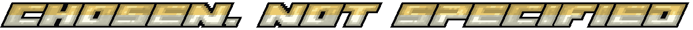

The plan gives the design and the numbers above. Where it said nothing, the simplest thing was chosen:

- **The flight** (owner 2026-11-13: "the claw flies, like the OG mod"): jpalomo's HookShot, a FastProjectile with
  Speed 40, Radius 10, Height 14, living 10 frames x 2 tics. The claw moves 40 units a tic along the line it was fired
  on (it does not follow your hand or its target once fired, Aim Assist included), from the off hand out to the Range
  (780 units: 20 tics). A monster is bitten when his claw's box (radius 10, height 14) touches its box; a wall, floor or
  ceiling by the hook's tracer; the sky is a miss. The claw is open in flight and shuts when it bites. In the air or on
  the ground is decided when it bites, not when you press.
- **A press while a claw is flying:** jpalomo's `Hook_Check` (`hook.acs`) fires a new HookShot on every fresh press
  and never checks for one already out, so here too another claw flies and each one acts on what it reaches. A claw
  that arrives while an earlier bite is still playing (a pull, a yank, a ledge, the air hold, Scorpion's hold) lets go
  and comes back. No cap on claws in the air (his has none; at 20 tics a flight, few can be out at once).
- **A press while a bite is playing** (pulling you, the air hold, the spike, the ledge, Scorpion's hold) is ignored;
  during GET OVER HERE a new press lets that monster drop where it is and fires again.
- **The chain:** jp's tenda0 link at 1.67 units (a third of his 5), 1.67 apart from 15 units off the hand, at most 480
  (past that they spread); tinted gunmetal, all the same size, none fullbright. In flight: a sideways ripple of 2.5
  units at most that dies away over about 8 tics. Shut or coming back, the chain is still. (The bright running link
  and its glint tint are removed: owner 2026-11-13, "a white orb on the hook".)
- **The hang** (owner 2026-11-13: "Hang until it bites"): a press in the air while a kick-chain is going (after a
  kick-off, before you land) holds you where you are from that press: no velocity, your height held each tic, RSQ
  SlowMo's full speed asked each tic. It ends the moment a claw from it bites (the bite then plays as built: a pull, an
  air pull with its own hang, a fling from rest, a ledge), or when no claw from it is still flying ("we drop": the end
  of its reach, the sky, or it is gone). A second press while hanging reels every claw from it back in (owner
  2026-11-13: "Cancel and drop"). A miss and that press both CANCEL THE CHAIN (owner: "fall in slow mo. HUD message in
  our font, Chain Cancelled!"): the chain ends as landing does (`chain.end`, the markers go, no double jump left), then
  `chain.cancel`; "Chain Cancelled!" is the reason line under RSQ SlowMo's world bar (`g2.slow`), asked again every tic
  of the fall for 6 tics, so the slow motion lasts until you land and ends 6 tics after; the kick-off's full-speed air
  is over, so your own fall slows with the world (RSQ SlowMo's Slow Me Too, on by default). Jump does nothing while you
  hang (the order is kick, kick-off, double jump, then the hook). A press in the air with no chain going (after a wall
  fling, say) does not hang you; you keep falling.
- **The dizzy stun** (owner 2026-11-13: "dizzy / bird sprites ... for an extended stun"): a kicked monster is held in its
  Pain state for that kick's slow motion (53 tics on the first kick, 42 on the second ..., never under 15), with RSQ
  Melee's chicks and stars (its Heavy Hands sprites, `RSQML_Service` "dizzy") circling its head as long.
- **Wall fling point:** jp's thrust toward a point 15 units short of the bite (his claw stopped short of a wall).
  The claw stays shut his 16 tics, then comes back at 64 units a tic.
- **Baron of Hell** (owner 2026-11-13: "barons are always heavy"): a class built on `BaronOfHell` (Doom's, Brutal
  Doom's `BaronofHell2` and what is built on it, XMVE's Cyberbaron, Bruiser Demon, Pyro Demon, Belphegor, RSQ Monsters'
  `RS_CommonBaron`, `RS_GreenBaron` ...), or a monster whose species is `BaronOfHell` (RSQ Monsters' Actor-based barons
  such as `RS_BrownBaron2`, `RS_RedBaron1`). Doom's Hell Knight is itself built on `BaronOfHell` and shares its
  species, and RSQ Monsters' knights (`RS_CommonHK`, `RS_BrownHK2` ...) say species `BaronOfHell` too, so anything built
  on `HellKnight`, or with "Knight" (or, for an `RS_` class, "HK") in its class name, is not a Baron here: Hell Knights
  stay by mass. XMVE's Terminator says species `BaronofHell` too, so it counts (its mass, 1030, is heavy anyway).
- **Ledge lip:** a wall bite no more than 40 units under the top of a step, or the top of a floor more than a step
  above you; room = floor at that height and your whole height under the ceiling. Carried up at 12 a tic, then over
  at 12 a tic; it gives up after 45 tics.
- **GET OVER HERE:** lands on the line between you and it, 16 units from touching you; it takes jp's distance / 12 a
  tic (at most 12 tics, at least 8 units a tic), with a small hop of up to 32 units. It is moved by position, so it
  comes at full speed in slow motion.
- **The pull to a big one:** jp's distance / 12 a tic, at least 20; it stops if it gets no closer for 6 tics (a wall)
  or after 2 s; your body ends against the side of it facing you, at its middle height.
- **The kick-off's direction:** away from the monster's centre, out toward where you hit it (its face when it faces
  you); 8 units a tic outward.
- **Aim Assist:** only in the air, only the monsters your double jump marked (owner 2026-11-13), a 10-degree cone, the
  marked one nearest the line (smallest angle), in sight.
- **Air pull and hold:** a small monster hooked while you are in the air (not only after a double jump) is pulled
  up to chest height in front of you; you hang still while it comes and while it is held; the hold lasts 1 s, then
  it drops and you fall.
- **The swing:** both hands at least 3 m/s down, measured over 2 tics, each hand moving mostly downward.
- **The spike:** it falls 30 units a tic; the Neon Crescent is asked with `"safe"` (it does not hurt you) and credits
  you. The shockwave is a ring of particles out to 160 units that pushes and staggers monsters there; it does no damage.
  The fire is Doom II's FIRE flame from the IWAD.
- **The double jump** rises 1.5 m, like the kick-off. **Markers:** nearer = within half the reach (390 units), farther
  beyond; they go when you land, when the monster dies, or when you hook it.
- **Slow motion** from the sixth link on: none (1.5 - 0.3 x 5 = 0).
- **Scorpion Pull** waits 3 s for the yank (2 m/s straight back from the claw) and applies to monster bites only;
  walls fling at once. A light monster held on the chain is kept from walking.
- **A guarded Boss:** the kick still goes through RSQ Miniboss's guard (so its GUARD! and its greed rule work as
  for any hit); you bounce; no slow motion, no chain link; the bounce does give you a double jump.
- **The yellow cross:** RSQ Melee's MLK4 drawn AddShaded in gold (`0xFFC83C`) at 1.5x; without Melee, a gold
  particle star.

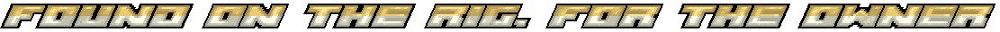

- **The claw against the fall after a kick-off** (decided 2026-11-13: (b), "Hang until it bites"; done and shown in
  `g5run1`: the same 21 m press now hangs you 17 tics and bites into **KICK! x2**). After a kick-off you are in the air about 20 tics (kicked off a
  Baron, from near the floor) to 22 tics (off a Cyberdemon, from higher up), and the claw flies 40 units a tic. So the
  next press reaches, before you land, about (22 - the tics you took to press - 1) x 40 units: pressing 3 tics after the
  kick, up to about 18 tics of flight, about 720 units, nearly the whole 780 reach (`g4run2`: 409 units arrived with 8
  tics to spare). Pressing late at something far fails: 8 tics after a Baron kick at a Cyberdemon 21 m away, you landed
  5 tics before the claw bit; landing ended the chain at 1, and the bite then started a new one (KICK!, not x2).
  Proposal, for the owner to choose: (a) while a claw fired in the air is still flying, landing does not end the chain
  until it bites or misses (at most 20 tics; jp's speed kept); or (b) you hang where you are from the press until it
  bites (as the air hold does); or (c) the claw flies faster when fired in a chain.
- **The running link creeps** (decided 2026-11-13: removed, with its glint; `g5run1`). It is drawn every flight (logged and seen), but its place is worked out against a chain
  that grows 40 units a tic, so it moves out only about 10 to 20 units a tic: the claw outruns it, and it never reaches
  the claw (`g4run2` claw #1: 25, 62, 72, 82 ... 122 units out over 8 tics). As said, it should run from your hand out
  to the claw. Proposal: keep its own distance along the chain, +90 units a tic, and start again at the hand when it
  reaches the claw (about 4 tics a run on a 10 m chain). Not changed: it could not be shown on the rig in this pass.

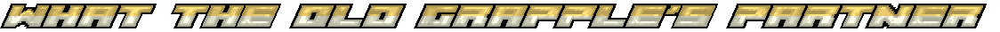

Every pack still loads (the owner's load order: no new script error). They asked the old grapple by name, so now
they get "no answer", as if it were not loaded:

- **RSQ Score:** every hook row and combo reading the old ledger: *Indiana Jones* gaps, *Swinging*, *Hanging Shot*,
  *Dismount*, *Hooked* kills, *Ping-Pong* volleys, *Bowling* / pins, thrown-body landings, the *Hooked Keg*, the
  hook combos (*Wrestlemania*, *Suplex City*, *Hook, Line and Sinker*, *Fetch!*, *Drop In*, *Swoop*), the
  `hook.yank` / `hook.bite` tool tags. These wait for Score's Big Pass (the `g2.*` service above).
- **RSQ VisualRewards:** the HP bar's "hooked" and "stunned" markers for the grapple.
- **RSQ Gun Bonsai VR:** the whole hook tree (`up_hook.zs`: the Grapple unlock, Momentum, Fast Reel, Heavy Haul,
  Get Over Here, Zip Kick, Twin Lines, ...) is no longer offered (it checks for `RSQGR_Perks`, which is gone);
  learning *Grapple* / *Swing and Momentum* would set cvars that no longer exist (it skips them); the hook's XP
  ledger (`xp.*`) and Bonsai's `hook.dealing` damage credit answer -1, so the hook earns no XP of its own.
- **RSQ Melee, RSQ Accessibility (Gestures):** their "quiet on the rope" check (two-hand gestures and the shove kept
  off while climbing / swinging / reeling) never fires: there is no rope now.
- **RSQ Whip:** loses nothing it uses (its rope is its own fork). The old **Whip Instead of Hook** row was part of the
  old grapple and is gone with it.
- **RSQ Miniboss:** Can't Be Yanked still works (asked the same way).
- **RSQ Accessibility:** One-Handed (the Off-Hand Modifier), Steady Hands and Hold to Toggle no longer apply to the
  hook (not part of the new design); the Comfort Vignette does.
- **RSQ Wheel, RSQ ShieldSaw, RSQ Tactical Rig:** comments and name prefixes only; nothing lost.
- **tools/rsmenu/presets.py** still lists the old grapple presets (Range / Swing / Pull); no page uses them.

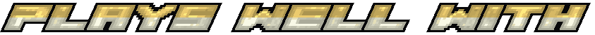

Everything is asked by name: this mod loads and plays alone, and the parts that need a missing mod don't happen.

- **RSQ SlowMo:** the kick-chain's slow motion (`g2.slow`, the reason under its bar: KICK!, KICK! x2 ...), the
  double jump's and the markers' extra time (`g2.addtime`), Grapple-Slam (`g2.slam`, its own row on SlowMo's Triggers
  page), and full speed for you while the hook moves you (`g2.fullspeed`, asked every tic before your velocity is set).
- **RSQ Grenade:** the air spike's Neon Crescent (`g2.neon`).
- **RSQ Melee:** the MLK4 hit burst and the thud for the kick.
- **RSQ VisualRewards:** KICK! and the time markers.
- **RSQ Miniboss:** Can't Be Yanked makes a Boss heavy; a guarded Boss is a bounce with its own GUARD!.
- **RSQ Accessibility:** the Comfort Vignette while the hook moves you.
- **RSQ Whip:** the rope, the reel, the swing and the climb are the whip's.
- **Brutal Doom 22 and RSQ Monsters:** works on their monsters (light or heavy by the same rule).

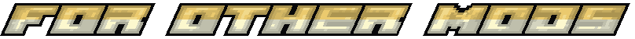

`RSQGR_Service` (found by name), for RSQ Score's Big Pass. The full list is at the top of
`zscript/rsqgr/service.zs`. The pawn is `objectArg`:

- `GetInt`: `g2.chain`, `g2.chain.best`, `g2.kicks`, `g2.lastkick` (a tic), `g2.mode`, `g2.air`, `g2.doublejump`,
  `g2.events`, `g2.event.tic` (intArg n), `g2.last` (stringArg an event name → its tic); for a monster:
  `g2.kicked`, `g2.yanked`, `g2.spiked` (tics), `g2.by` (player number).
- `GetString("g2.event", "", n, 0, pawn)`: the n-th latest event's name: `miss`, `bite.wall` / `bite.floor` /
  `bite.ceiling`, `bite.ledge`, `ledge.land`, `ledge.fail`, `bite.light`, `getoverhere`, `getoverhere.land`, `airpull`,
  `airhold`, `airspike`, `spike.land`, `air.drop`, `bite.heavy`, `kick`, `kick.kill`, `guard`, `pull.lost`,
  `pull.blocked`, `doublejump`, `markers`, `marker`, `hang` (fired in the air in a kick-chain: you hang until it bites),
  `chain.end` (you landed, or the chain was cancelled), `chain.cancel` (a miss while you hung, or a press while you
  hung: Chain Cancelled!), `scorpion.hold`, `scorpion.yank`, `scorpion.timeout`.
- Anything else answers -1 or "".

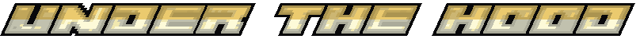

- **One handler** (`RSQGR_Core`) decides everything in WorldTick, the claw's flight first (so a bite's result plays
  the same tic, and at full speed in slow motion); the claw is an actor so the chain is laid after
  you have moved each tic (jpalomo's link a third the size, 1.67 units apart from 15 units off the hand, at most 480).
- **The press** reads the off hand on the machine that holds it and sends its pose in the network event
  (`rsqgr_fire`); the hands in play come through the series' hand sync (`tools/handsync`), so a hand read while you
  fly 30 units a tic is where your body is now.
- **Netplay:** the press is synced; the two gestures (the spike's swing, Scorpion's yank) read the hands in play
  code, which is right only for the machine's own player: single player for now (the series' netplay is parked).
- **A dormant monster** counts as heavy (the OG rule) but the engine gives a dormant monster no damage, so its kick
  hurts nothing (seen on the rig: 69 → 69).
- **Stock QuestZDoom 17.3:** ZScript and data only. No engine changes.

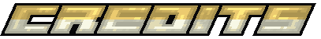

The full list is in **CREDITS.txt**.

- **presidentkoopa:** the design (the off hand's hook and its three results, the kick-chain, the double jump
  and its markers, the air spike, Scorpion Pull).
- **jpalomo** (*jp_grapple*): the hookshot this is rebuilt from: its feel (the claw's flight, the wall thrust, number for number, the
  23 m reach, its speed), its claw and chain art and its sounds. Kept unmodified in `jp_original/`.
- **id Software:** Doom II's flame (FIRE), read from the IWAD.
- GET OVER HERE is named after a fighting-game move; no Mortal Kombat sound, voice, art or other asset is used.
- **QuestZDoom** (Emawind and Team Beef): the engine and its VR hand API.
