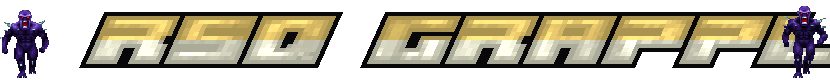

# RSQ Grapple

A hook on a chain, fired from one hand with one key. Hook a wall and you are thrown toward it; hook a ledge and you are carried onto it; hook a monster and you fly to it, kick it, and are thrown back up into the air, where you can hook the next one. There is no rope to hold: every bite is one move, then the claw lets go.

## How to play

| Do this | What happens | Needs |
|---|---|---|
| Press Fire Hook (you bind it: Customize Controls > RSQ Grapple) | A claw flies from the off hand along the line a gun in that hand would fire, 40 units a tic, out to 780 units (about 23 m). It bites the first wall, floor, ceiling or live monster it reaches | Hook Hand: Off Hand (default), Firing Line: On (default), Range (default 780) |
| Let go of Fire Hook | Nothing. The hook is one press | |
| Hold the hook hand out while the hook is ready | A small dot sits where the claw would bite: cyan on the world, gold on a monster | Aim Dot: On (default) |
| Hook a wall, floor or ceiling | One shove toward the bite is added to your speed, harder the farther away it is and upward when it is above you. The claw stays shut 16 tics, then comes back | |
| Hook the face of a step within 40 units under its top, or the top of a floor too high to step onto, with room to stand there | You are lifted up the face and set down on top. It gives up after 45 tics | |
| Hook a live monster | You fly straight to it. Arriving is a kick: 30 damage, it is knocked back and stunned, and you are thrown off it, away and about 1.5 m up | |
| Swing both hands down hard together (each at 3 m/s or more) while you are in the air and flying to a hooked monster | The air spike. You stop and hang where you are, the claw lets go, and the monster is driven straight down, 30 units a tic, to the floor under it. Where it lands: blood, six flames, and a ring that shoves and stuns every live monster within 160 units. Then you fall. There is no kick | Both hands tracked in VR. The explosion needs RSQ Grenade and the slow motion RSQ SlowMo (see Works with) |
| Swing both hands down the same way within 15 tics (0.43 s) after a kick, while you are in the air | The same air spike, on the monster you just kicked. Not if the kick killed it, and not while you hang for a claw | Both hands tracked in VR |
| Swing both hands down while you stand on the ground | Nothing | |
| Aim at the sky, or at nothing within reach | The claw comes back empty | |
| Press Fire Hook again while a claw is still flying | Another claw flies as well. Each one acts on what it reaches | |
| Press Fire Hook while flying to a monster, being lifted onto a ledge, or while a spiked monster falls | Nothing: the press is ignored. A claw that arrives during any of them lets go and comes back | |
| Kick a second monster before you land | The kick counts up (2, 3, ...). Landing sets the count back to none | |
| Press Fire Hook in the air after a kick, before you land | You stop and hang where you are until the claw bites, then the bite plays as usual. If it reaches nothing you drop and the kick count ends | |
| Press Fire Hook again while hanging | Every claw you hang for is reeled in, you drop, and the kick count ends | |
| Press jump in the air after a kick, before you land | A double jump: up to about 1.5 m more, once for each kick. Up to five monsters in reach and in sight are marked | |
| Fire the hook in the air with a marked monster within 10 degrees of your aim | The claw turns to the marked monster nearest your line | Aim Assist: On (default) |
| Hook a marked monster | Its mark is taken off (and pays its time, see RSQ SlowMo below) | |
| Press jump in the air in any jump or fall | One double jump, up to about 1.5 m, until you land. Not under water, flying or with noclip | Double Jump Always: On (default) |
| Hold a gun with both hands and press Fire Hook | The claw flies down the steadied gun's line. Aim Trim is not applied | Firing Line: On (default) |
| Land | The kick count ends, the marks are cleared, and the double jump is yours again | |
| Die | The claw is removed and the kick count ends | |
| Press Fire Hook with Hook Hand set to Main Hand | The claw flies from the main hand and along its line | Hook Hand: Main Hand (default Off Hand) |
| Move Aim Trim Sideways or Aim Trim Vertical | The claw's line and the dot turn left or right, up or down, by up to 15 degrees | Aim Trim Sideways, Aim Trim Vertical (default 0) |
| Press Fire Hook with Firing Line off | The claw follows the hand's own yaw and pitch instead of the gun's line; two-handing, it flies where you look | Firing Line: Off (default On) |
| Move Range | The claw reaches that far, and the dot, the double jump's marks and Aim Assist reach as far | Range (default 780, 256 to 2048) |
| Type `rsqgr_apex_hover 1` in the console, then kick off, or double jump after a kick-off | At the top of the rise a slow motion is asked for (1 s after a kick-off, 0.7 s after the double jump). Double Jump Always's own jump gets none. There is no menu row for this | RSQ SlowMo; rsqgr_apex_hover (default off) |
| Type `netevent rsqgr_fire` in the console | The hook fires from the hand as it is now, the same as the key | |

## Keys

<!-- GEN:keys -->
Options > Customize Controls > RSQ Grapple

| Key | Default bind | Command |
|---|---|---|
| Fire Hook | none | `+rsqgr_hook` |
<!-- /GEN:keys -->

## Options

<!-- GEN:options -->
Options > Radiant Silvergun Options > RSQ Grapple

| Option | Default | What it does |
|---|---|---|
| Aim Assist | On | In the air, the hook snaps to the valid target nearest your hook hand's line. |
| Double Jump Always | On | One double jump in any jump or fall until you land, with no slow motion. |
| **Controls** | | |
| Hook Hand | Off Hand | Which hand fires the hook. |
| Aim Dot | On | While the hook is ready, a small dot shows where the claw would bite. |
| Fire Hook | (key) | The key or button that fires the hook. |
| Test and Debug | (page) | Aim trims, range and the debug log. |
| Reset All | (button) | Puts every RSQ Grapple setting back to its default. |

RSQ Grapple: Test And Debug (6 rows)

| Option | Default | What it does |
|---|---|---|
| **Aim** | | |
| Aim Trim Sideways | 0 (-15 to 15) | Turns the claw's line left (+) or right (-) of the hook hand's, in degrees. |
| Aim Trim Vertical | 0 (-15 to 15) | Turns the claw's line up (+) or down (-), in degrees. |
| Firing Line | On | The claw rides the line a gun in the hook hand fires, its roll included. |
| Gun Bore | On | The firing line uses Brutal Doom VR's bore offset, as its guns and lasers do. |
| **Tuning** | | |
| Range | 780 (256 to 2048) | How far the hook reaches, in map units. |
| Debug Log | Off | Prints every bite, kick and slow-motion event to the console. |

<!-- /GEN:options -->

## Works with

| Mod | What changes |
|---|---|
| RSQ Wheel | While the wheel is open a press of Fire Hook is ignored |
| RSQ SlowMo | Each kick asks for slow motion: 1.5 s for the first, 0.3 s shorter for each next kick before you land, none from the sixth. The double jump after a kick adds 0.5 s. A marked monster you hook adds its mark's time (0.25 s near, 0.5 s far). An air spike's landing asks for its Grapple-Slam slow motion. A hang that ends without a bite shows "Chain Cancelled!" and you fall in slow motion until you land. Whenever the hook moves you, you move at full speed. Without it: no slow motion |
| RSQ Melee | A kicked monster gets Melee's chicks and stars for as long as it is stunned, and the kick shows Melee's hit burst in gold. Without it: a puff of gold particles and the stun alone |
| RSQ VisualRewards | "KICK!" (then "KICK! x2" ...) stands over the kicked monster, or over where it stood if the kick killed it. A marked monster carries "+0.25 sec" or "+0.5 sec". Without it: no word, and a mark is four small cyan dots turning over the monster's head |
| RSQ Miniboss | A kick on a guarded miniboss does not count, does not knock it back, stun it or ask for slow motion. You bounce off it all the same. A guarded miniboss is not air-spiked, in the fly-to or after the bounce |
| Brutal Doom VR Reloaded | With its muzzle handler running, the claw's line takes its guns' bore (3.85 degrees left, 3.36 up), so the hook lands where a gun in that hand would. Gun Bore: Off turns this off |
| Brutal Doom | Its head hitboxes, gibs and dying bodies are not bitten |
| RSQ Gun Bonsai VR | Nothing. No Grapple option is locked behind an upgrade |
| RSQ Grenade | Where an air spike lands, its Neon Crescent explosion is asked for, credited to you and sparing you. Without it: the blood, the flames and the shockwave only, and the spiked monster itself is not hurt |
| Any mod that asks | RSQ Grapple answers a service, `RSQGR_Service`, with the kick count, the best count and the kicks this map, what the hook is doing, the last events by name, and when a monster was last kicked. It answers only names that start `g2.`; every older name gets "no grapple" |

## Limits

- There is no rope. Nothing in the code reads a grip, a trigger, alt fire, Use or a stick: the mod reads the Fire Hook key and the jump button and nothing else. You cannot hold on, climb, reel in or swing.
- One hand gesture does something: both hands swung down hard together, in the air, during the fly-to or just after a kick (the air spike). No other hand movement is read: you cannot yank a monster to you.
- The air spike itself deals no damage. The shockwave shoves and stuns; the damage is RSQ Grenade's explosion.
- A monster already standing on the floor is spiked where it stands: it lands at once.
- Fire Hook has no default bind.
- The claw bites only live, hostile monsters that count as kills (or bosses). It passes through items, barrels, decorations, corpses, friends and other players and bites the wall behind.
- The sky and a portal are a miss.
- Just after a menu closes or a level starts the game reports both hands at one point. A press then waits up to 10 tics for a real hand, and is dropped if none comes.
- Without a VR hand pose the claw leaves from just under your eyes and flies where you look, and there is no aim dot.
- A pull to a monster ends short, and you fall, if the monster dies first, if you make no headway for 6 tics (a wall in the way), or after 2 seconds.
- Under a low ceiling the kick-off and the double jump rise only as far as there is room.
- The aim dot does not show while a bite is playing or while you hang.

## Credits

The full list is in **CREDITS.txt**.

- **presidentkoopa:** the design (the off hand's hook and its three results, the kick-chain, the double jump
  and its markers, the air spike).
- **jpalomo** (*jp_grapple*): the hookshot this is rebuilt from: its feel (the claw's flight, the wall thrust, number for number, the
  23 m reach, its speed), its claw and chain art and its sounds. Kept unmodified in `jp_original/`.
- **id Software:** Doom II's flame (FIRE), read from the IWAD.
- **QuestZDoom** (Emawind and Team Beef): the engine and its VR hand API.

---
Written from the code at commit b95023e8e, 2026-11-27. The air spike's rows were added the same day, from the code as changed after that commit.
