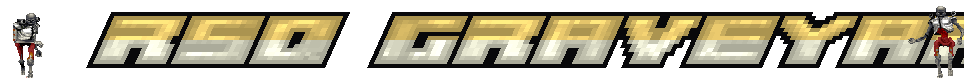
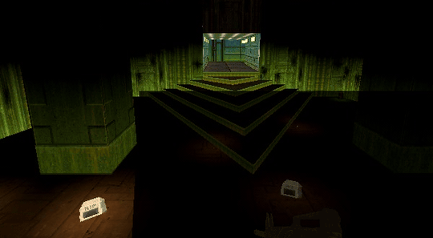
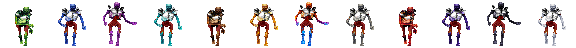
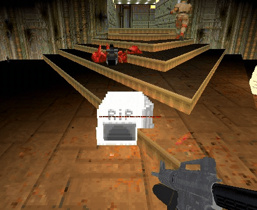
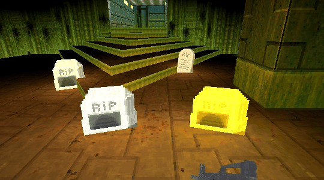
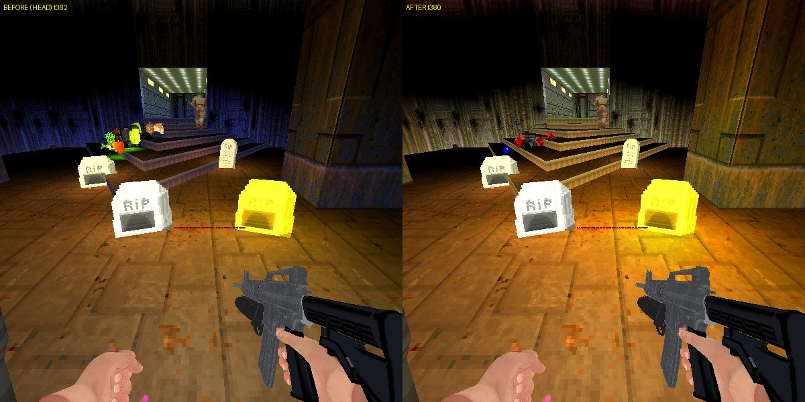
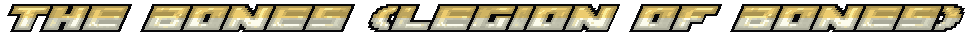
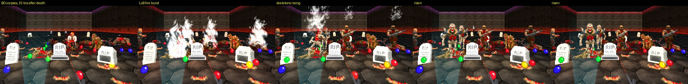
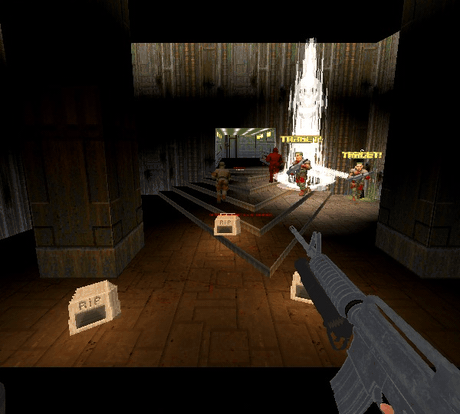
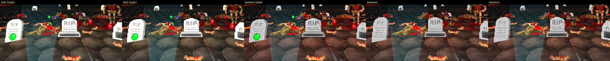

# RSQ Graveyard
### Doom Arcade VR · a gravestone where you died, waiting for you the next time you play the map

<a href="../README.md#graveyard">&larr; RSQ UBQ Series</a>

m8f's **Graveyards**, RSQ Edition: die, and a gravestone stands at the spot the next time you play that map.

**What it does:**

- **Remembers every death:** a stone where you fell, kept from one play session to the next, map by map ([The stones](#the-stones))
- **Reads you the obituary:** press Use on a stone and its words stand over it for 4 seconds: who, killed by what, when
- **Stones that come up out of the ground** and breathe, each at its own point in the breath
- **A candle on every grave** that fades in as you come near
- **Gold stones** for a life spent with RSQ Score, with a brighter, steadier glow
- **Living Stones:** candles and stones breathe in colour, in step, in a wave, or each to its own
- **The Bones** (needs Legion of Bones): a Brutal Doom monster you kill may get back up as its Legion of Bones undead ([The Bones](#the-bones-legion-of-bones))
- **Graves Rise** (RSQ Miniboss's row, off): a Boss fight landing wakes the stones and they raise undead
- **The heartbeat:** while a Boss waits to be called in, every candle beats with the map's red pulse
- **Two remove buttons:** this map's stones, or all of them

Three things set it apart:

- **Your deaths outlive your saves.** The stones live in the engine's config, keyed to the exact map file, and are
  made again on every map start and every save loaded.
- **The stones are a stage for other mods.** RSQ Score turns one gold, a Boss's heartbeat beats in every candle, and a
  Boss fight can wake the graves.
- **Brutal Doom's monsters stay, and Legion of Bones' undead rise from them.** A table of 90 monster classes hands
  Legion of Bones' map-start replacements back to Brutal Doom, so the skeletons only come when something dies.

*MAP01 loaded again after five deaths: the stones pop in one after another where you fell, and their candles light (rig capture, not headset)*

**On plain Doom II with nothing else loaded:** the stones, the store, the pop-in, the breathing, the candles, Living
Stones, the obituary on the console and both remove buttons. The candles are dynamic lights: with the engine's dynamic
lights off there are none.

| Do this | What happens |
|---|---|
| Die | The spot is stored. In a netgame the stone appears at once; alone, it is there the next time the map loads |
| Start the map again (new game or loaded save) | A stone stands at every death stored for this map |
| Spend an RSQ Score life | A gold stone appears at once where you stood, and is stored like any other |
| Press Use on a stone | Its obituary stands over it in words for about 4 s (Use again: another 4 s). Without RSQ VisualRewards, or with its Monster Words row off, it prints to the console |
| Choose **Remove Gravestones on This Map** | This map's stones are gone, here and from the store |
| Choose **Remove All Gravestones** | Every stored stone on every map is gone |

*Walk up, press Use: HERE LIES PLAYER, KILLED BY IMP, the date and the map time stand over the stone. Use again 2.6 s later keeps them up; 4 s after that they fade. Screen Size 12, no text scale: the words are in the world, not on the HUD (rig capture, not headset)*

The words are RSQ VisualRewards' words (its "word.hold", asked by name), in RS Score's font: the name in bone white
(gold on a gold stone), the killer in red, the date and map time in grey at two thirds the size. Lines longer than 20
characters wrap at a space. They sit just over the stone and turn to face you. Everyone in a netgame sees them, as they
see every VisualRewards word (the Use happens in the game, on every machine). Its **Word Size** row scales them, and
its **Monster Words** row off hides them: then the console line prints instead, on your machine.

No keys. This pack binds nothing (owner 2026-11-10: keybinds are a precious resource in VR).

- **Remove Gravestones on This Map** and **Remove All Gravestones** are menu buttons on this pack's page (Options →
  Radiant Silvergun Options → RSQ Graveyards, Controls). Each prints a line to the console when it is done.
- The console aliases still work: `gy_remove_map` and `gy_remove_all` do the same as the buttons.

- **Four stones.** Each spot gets one of four tombstone sprites, picked from its position, so the same death always
  gets the same stone.
- **Stored by map.** A stone is kept with the map's checksum, so it comes back on that exact map file, whichever
  episode or session you are in.
- **Kept outside the save.** The store lives in three settings in your engine's config (not in savegames). Loading an
  old save still shows every stone stored since.
- **Pop-in.** 24 tics: from 5% size it eases up to 35% past full a third of the way in, then settles to full in a
  swing that dips once just under full (about 6%) and comes to rest. Stones placed at a map's start wait a
  random-looking delay of up to 35 tics first (from their position). A loaded save keeps the stones that were
  standing (no pop, no candle fade); a stone new since the save pops. **Pop In on Spawn** off: they are simply there.
- **At most 200 a map.** Past 200 stones on one map the oldest of that map's go, from the store and from the map. Other
  maps keep theirs.
- **Breathing.** **Bounce Amount** (0.05) is how far a stone squashes; **Bounce Speed** (1.5) is degrees of the breath
  per tic, so 1.5 is about 6.9 seconds a breath. **Animate Gravestones** off: the stones stand still at full size.

### The candle

- One point light per stone, 24 map units above its foot, in a warm tone made from **Light Brightness** (210).
- **Light Radius** (72) is its size. **Candle Flicker** (on) wobbles it by up to 8% with two out-of-step waves, no
  randomness. RSQ Accessibility's Photosensitive Mode holds it steady.
- **Light Cull Distance** (640 map units): inside it the candle fades up, outside it fades down, 5% a tic, so about
  20 tics from dark to full. At zero the light is removed.
- **Grave Light** off: no candles.

### Gold stones

With RSQ Score loaded, a life Score spends on a killing blow is a death too. The stone is the same tombstone tinted
gold, its candle gold, and its flicker a third as strong. Its candle (2026-11-11, owner: "brighter / warmer glow") is a deeper amber,
a quarter brighter than a grey candle (full red at the default Light Brightness), 2.2 times the radius, with a second
light half that size on the same spot, so the glow round the stone is about twice as strong. Its line reads "Here <name> lost
a life, killed by <killer>." with the map time. Without RSQ Score every stone is a normal one.

*A grey stone from a death beside a gold stone from an RSQ Score life spent on a killing blow: the gold stone's amber glow on the floor and the pillar (rig capture, not headset)*

*Rig frames, 2026-11-11, the same script and tic: left the build before this change, right after (the walls' glow
colour is RSQ Glow In The Dark's own pick each load). Simulated headset on the Linux rig, not a capture from a real headset.*

### Living Stones

**Living Stones** (on): each stone's candle colour and its tint breathe once every 2 seconds, from calm blue
(110, 170, 230) to warm yellow (250, 240, 140), the same breath as RSQ Score's "Score:" label. A gold stone breathes
from deep gold (200, 135, 25) to bright gold (255, 230, 110). **Light Brightness** still scales it. The tint moves in
8 steps.

| Living Stones Mode | |
|---|---|
| **Uniform** (default) | Every stone breathes together |
| **Wave** | A wave rolls out from you: one breath for every 512 map units of distance |
| **Chaos** | Each stone its own pace (0.55 to 1.6 times) and its own starting point |

With RSQ Accessibility's Photosensitive Mode on, the breath is held still at its middle.

*[GIF to come: Living Stones in Wave mode across a graveyard]*

Everything here waits for **Legion of Bones** (SpacemanStrife, LOB_v1.05) to be loaded. Without it these rows do
nothing.

### Bones Bridge

**Bones Bridge** (on; it does nothing without Legion of Bones, and its rows are greyed then): Brutal Doom's monsters stay Brutal Doom's. A while after one dies, its Legion of Bones undead
rises from the corpse, the way Legion of Bones does it:

- **Which undead.** The dead monster's class, then its parents, are looked up in a table of 90 Brutal Doom and XMVE
  classes, then the 13 vanilla monsters. Zombieman, shotgun guy, chaingunner, imp, demon, spectre, cacodemon, hell
  knight, baron, revenant, mancubus, arachnotron and arch-vile each have their undead. Lost souls, pain elementals,
  the Cyberdemon and the Spider Mastermind stay dead, and so do Brutal Doom's 31 death helpers (a crawling half-dead
  zombie, a cast-call actor). Legion of Bones' own monsters and undead rise or die by Legion of Bones' own
  states (Rise Chance and Random Delay still apply to its monsters, below).
- **Whether.** **Rise Chance** (below): rolled once, when it dies. A corpse that loses stays a Brutal Doom corpse for
  good.
- **When.** 25 tics for the death, then Legion of Bones' own **Respawn Delay** (its menu): Instant, 5, 10 (its
  default), 15 or 20 seconds (0, 170, 345, 520 or 695 tics). With **Random Delay** on (below), the corpse's own delay,
  one of those five, instead.
- **The rising.** Legion of Bones' fire burst on the corpse, the teleport sound, and its rising actor (the undead's
  death backwards), turned to face whoever made the kill, which it then comes for. The Brutal Doom corpse is removed.
  A corpse already gone (gibbed away) rises where it lay.
- **What Stops a Rise** (greyed while the bridge is off):
  - **Something On It (LoB)** (default): Legion of Bones' rule. If something solid stands on the corpse when the wait
    ends, the whole wait starts again (at least a second, even at Instant; with Random Delay, the corpse's own delay
    again, not a new one). After 4 such holds it rises at the nearest
    free spot beside the corpse instead, or stays dead if none is free.
  - **Nothing**: it rises anyway.
- A corpse that came back to life by then (an arch-vile, RSQ Miniboss's revive) is left alone; killed again, it is one
  corpse waiting (its wait counts from the new death), so it gives one undead, never two. Switch the bridge off and the
  corpses already waiting stay dead.

*[GIF to come: Brutal Doom corpses, the fire burst, skeletons rising and turning to the player]*

*Rig frames, 2026-11-06, that day's build (before the 11-07 and 11-10 changes, which did not touch the bridge): Brutal
Doom corpses 25 tics after death, Legion of Bones' fire, the skeletons rising, risen. Simulated headset on the Linux
rig, not a capture from a real headset.*

### Rise Chance and Random Delay

The owner, 2026-11-18: *"having each and every monster rise is irritating, it should be not guaranteed."* Both rows
are for every rise from a corpse: the Bones Bridge's, and Legion of Bones' own monsters' (its Double Death skills),
whether the bridge is on or off. Graves Rise (RSQ Miniboss), RSQ Miniboss's revive and Arch-vile resurrections are
not touched.

- **Rise Chance** (50%; 0 to 100 in steps of 5): the share of corpses that rise. Each corpse rolls **once, when it
  dies**, and keeps the result; nothing rolls it again. A monster brought back to life and killed again rolls for its
  new death.
  - **A Bones Bridge corpse that loses** is never queued: its Brutal Doom corpse lies there for good.
  - **A Legion of Bones corpse that loses** plays its own death, then, the tic its wait begins, it is **held on its
    last corpse frame for good**. It never reaches the check for something on it or its rising, so it never vanishes
    without an undead: it stays a corpse. Held, it is an ordinary still corpse, so an Arch-vile can raise it like any
    other.
  - 100% is Legion of Bones' every-corpse rise; 0% is none.
- **Random Delay** (On): each corpse that rises rolls its own Respawn Delay when it dies, one of Legion of Bones' five
  (Instant, 5, 10, 15 or 20 seconds, each as likely), and keeps it, its waits after a hold included. Legion of Bones'
  own Respawn Delay setting is never changed; with Random Delay off, every corpse waits that setting again.
  - **Bones Bridge corpses:** the bridge waits the rolled delay in place of Legion of Bones' setting.
  - **Legion of Bones' own monsters** read their delay from Legion of Bones' setting in their death states. This pack
    does not edit them: when a corpse's wait begins, it is moved onto the frame of that same wait that its own delay
    would have picked, and again each time the wait starts over because something stood on it.
  - This is the **Legion of Bones respawn-delay randomizer** (som_lobrnd) folded in. That small pk3 wrote a new random
    Respawn Delay into Legion of Bones' setting every tic. With Random Delay on, you can leave it out of the load order.
    Left in, it does no harm (the rolls here do not read the setting) but it keeps changing Legion of Bones' menu value.

*Code only, not run (the owner's call, 2026-11-18: "code only no rig checks till i say").*

### Load order with Legion of Bones

Load Legion of Bones **after** Brutal Doom (and XMVE), before the RSQ pk3s, as in the owner's order. Both packs
define a bullet with the same name, and whichever loads first wins it for both: Legion of Bones first would give
Brutal Doom's monsters its weaker bullet.

Loaded after Brutal Doom, Legion of Bones turns every monster on the map into a skeleton from the start. **With the
Bones Bridge on**, this pack hands each of those spawns back to the monster Brutal Doom or XMVE would have placed, so
the skeletons only come when something dies. **Bridge off:** Legion of Bones plays as it ships.

### Graves Rise (RSQ Miniboss)

With RSQ Miniboss's **Graves Rise (Legion of Bones)** row on, when a Boss fight lands the tombstones wake and raise Legion of Bones
undead: every stone on the map or within Miniboss's radius, the nearest to the fight first, a few tics apart. RSQ
Miniboss's **Graves Rise Mode** says one undead a stone or one for each thrall a stone, on the whole map or within
its radius (four choices). Graves Rise needs Legion of Bones but not Bones Bridge, and its risers ignore What Stops a Rise. Several risers on one stone
stand in a ring 40 map units round it, 12 tics apart. Each riser is the undead for one of the fight's thrall types,
taken in turn (Skull Zombies when none of them maps; a type the Bones table marks never-raised is skipped, as the
bridge leaves it dead). There is no cap.

A riser whose spot is taken (a wall, an undead already up, you standing there) looks for the nearest free spot round
it: two rings of 8 spots, 40 and 80 map units out (one and two risers wide), each in clear sight of the planned spot
and within a step of its floor. If none is free, it looks again a second later, 5 tries in all (about 4 seconds), then
it is given up (logged with `gy_bones_debug`). *Code only, not shown: on the 11-07 rig run (before this change) 20 of
31 planned risers had risen when the log ended, the rest retrying the same spot.*

*A Boss fight lands at the far end of the room and Graves Rise wakes three stones, Thralls Per Stone: Legion of Bones' fire on each stone, then nine undead stand up and come for you (rig capture, not headset)*

### The heartbeat

While a Boss fight waits to be called in, RSQ Miniboss beats the map's light red, and every stone beats with it:
on each beat the candle grows up to 1.6 times its radius and leans 85% to the beat's colour, fading over the beat, and
the stone itself goes full-bright at the peak. With Photosensitive Mode on there is no beat: the candle holds a steady
half lean, and the stones stay full-bright, while the beats keep coming.

*Rig frames, 2026-11-06, that day's build: the stones bright on the beat, then between beats. Simulated headset on the
Linux rig, not a capture from a real headset.*

- **RSQ Score:** a life it spends leaves a gold stone (it asks this pack by name).
- **RSQ VisualRewards:** the obituary's words over a stone (this pack asks it by name; without it, the console line).
- **RSQ Miniboss:** Graves Rise and the heartbeat (it asks this pack by name). Graves Rise needs Legion of Bones for the
  undead; the heartbeat works without it.
- **Legion of Bones** (LOB_v1.05): the Bones Bridge and Graves Rise use its undead, its fire, its rising actors and its
  Respawn Delay setting, by name. Nothing of it ships here.
- **Brutal Doom (brutal22test6) and XMVE:** the bridge's table was read from their DECORATE.
- **RSQ Accessibility:** Photosensitive Mode holds the Living Stones breath and the heartbeat still. Its Reset Every
  Mod also resets this page.
- **RSQ SlowMo:** its DOWN holds you at 1 HP, so going down is not a death and leaves no stone. A stone is left only by
  a death or by a Score life spent.
- **Every RSQ pack:** this page sits in the shared Radiant Silvergun Options menu.

*Options → Radiant Silvergun Options → RSQ Graveyards.* One page. Defaults in brackets, ranges as the sliders allow.

| Section | Rows |
|---|---|
| Animation | Animate Gravestones (On) · Pop In on Spawn (On) · Bounce Amount (0.05; 0.00 to 0.25) · Bounce Speed (1.5; 0.2 to 8.0) |
| Grave Light | Grave Light (On) · Candle Flicker (On) · Light Radius (72; 16 to 256) · Light Brightness (210; 32 to 255) · Light Cull Distance (640; 128 to 2048) · Living Stones (On) · Living Stones Mode (Uniform; Wave, Chaos; greyed while Living Stones is off) |
| Bones (Legion of Bones) | Bones Bridge (On; greyed without Legion of Bones) · What Stops a Rise (Something On It (LoB); Nothing; greyed while Bones Bridge is off or without Legion of Bones) · Rise Chance (50; 0 to 100, in %; greyed without Legion of Bones) · Random Delay (On; greyed without Legion of Bones) |
| Controls | Remove Gravestones on This Map (a button) · Remove All Gravestones (a button) |
| (foot) | Reset All |

**Reset All** asks first, then puts every setting on the page back to its default. The stored stones are kept.

The animation and light rows are each player's own setting, but in a netgame every machine draws the stones with the
host's (the arbitrator's) settings, and a candle lights for the nearest player: the stones' look is part of the game's
state and must come out the same on every machine. Alone, they are simply yours. The four Bones rows are the game's
(the host's in a netgame).

| | |
|---|---|
| **rig only, not headset-confirmed** (2026-11-06, the 11-06 build; log `tools/rigtest/evidence_1106/log_final.txt`, frames `rising.jpg`, `stones_pulse.jpg`, `stones_photosafe.jpg`, run by `tools/rigtest/run_batch.sh` on doom2, brutal22test6, BD_VoxelPack, BD22 VR 2.0.4a, XMVE, Legion of Bones 1.05 and the RSQ pk3s) | The Bones Bridge: Brutal Doom and XMVE monsters (imp, nightmare imp, chainsaw zombie, rifle zombie, shotgunner) rising as their undead 195 tics after death at Respawn Delay 5 s and 25 tics at Instant; a lost soul staying dead; a block on a corpse restarting the wait, then the rise once it was taken off; gibbed corpses rising where they lay; the risen turned to the player. Legion of Bones' spawns handed back to XMVE's and Brutal Doom's (a ZombieMan spawning XMVE's spawner with the bridge on, Legion of Bones' with it off). The heartbeat: all 9 stones pulsing on every beat, bright on the beat, and held steady in Photosensitive Mode. Graves Rise in that build (then with a cap): 5 stones within 640 woken, 9 map-wide, risers that did not fit tried again. No script error from the pack |
| **rig only, not headset-confirmed** (2026-11-06, RSQ SlowMo's run, log `SlowMo/tools/rigtest/build/logs/v2main.log`) | A spent Score life placing a gold stone (Score and Graveyard log lines). Living Stones' colour and tint steps for both kinds in Uniform, Wave and Chaos (log lines; that run's frames were not checked for this README) |
| **rig only, not headset-confirmed** (2026-11-07, SlowMo's run, log `SlowMo/tools/rigtest/build/logs/v3c.log`) | Graves Rise with no cap: 31 tombstones woken map-wide, 31 risers planned. Only 20 had risen when the log ended; the rest were still being retried ("did not fit"). So "31 raised 31" was not shown |
| **rig only, not headset-confirmed** (2026-11-09 and 2026-11-10, the series runs) | The pack loading on the owner's order (doom2, brutal22test6, BD_VoxelPack, BD22 VR, Legion of Bones, Champions, Gun Bonsai, every RSQ pk3) with no script error from it; the 11-10 runs used the current build. Its row under Radiant Silvergun Options (11-09 log `design/rigtest_2026-11-09/logs/main_A-G_I.log`) |
| **rig only, not headset-confirmed** (2026-11-10 night, the packed batch: `design/rigtest_2026-11-10/RESULTS_P3.md` B5 and N3) | **Graves Rise Mode, all four** (5 stones placed, a radius of 400): One Per Stone map-wide woke 5 stones, 5 undead; One Per Stone in the radius 1 stone, 1 undead; Thralls Per Stone map-wide 5 stones, 15 undead; Thralls Per Stone in the radius 1 stone, 3 undead. **A riser that does not fit finds a spot near it:** a pillar put on a stone, and the Skull Zombie rose 40 units from its planned spot. Logs only (`design/rigtest_2026-11-10/evidence/P3A_log.txt`) |
| **rig only, not headset-confirmed** (2026-11-11, the README GIFs, `docs/readme/`, the owner's order with dynamic lights on) | A stone at each death (five deaths to an Imp), all five back when MAP01 loaded again, popping in one after another, candles fading up. A Score life spent placing a gold stone beside a grey one. The obituary printing on Use (that build's console line; replaced by the words on 11-11). Graves Rise, Thralls Per Stone: 3 stones woken, 9 Skull Zombies risen (log lines `RSQ Graveyard bones ... RISES`) |
| **rig only, not headset-confirmed** (2026-11-11, the obituary words and the gold glow; log `tools/rigtest/evidence_1111/log_GA2.txt`, frames `obituary_words_t640.jpg`, `obituary_words_t502-782.jpg`, `gold_before_after.jpg`, and the two README GIFs; the owner's order, dynamic lights on, Screen Size 12, no text scale) | Use on a stone: HERE LIES PLAYER, KILLED BY IMP, the date and the map time over the stone, readable from where you press Use, and no console line. Use at tic 515, the words up in the next saved frame (t532); a second Use at t607 kept them up (still there at t738, past 515 + 140), then they faded (fading at t751, gone at t767, about 4.3 s after the second Use). Without RSQ VisualRewards loaded (a separate run), the console line printed instead. The gold stone's candle against the build before, same script and tic: a bright amber pool on the floor and pillar where before there was hardly any. No script error from the pack |
| **rig only, not headset-confirmed** (2026-11-16, the check E fixes; the owner's order, BD22 VR Reloaded 2.0.5a, MAP01, a scratch probe asking the pack's own service; logs in the fix report's evidence, `GY1_pop_GY2_saveload_log.txt`, `GY11_cap_log.txt`, `GY3_one_undead_new_log.txt` / `_old_log.txt`) | **The pop:** a stone's scale per tic 0.05, 0.34, 0.60, 0.81, 0.99, 1.14, 1.24, 1.31, **1.347** (tic 8), 1.32, 1.25 ... 0.94 (tic 16) ... 1.000 (tic 24). **A loaded save:** the stone standing at the save was kept ("1 stone in the store, 1 kept standing, 0 removed"), and no pop ran after the load. **The cap:** 210 gold stones asked on MAP01: 200 standing, 200 in the map's store, the oldest 10 removed one at a time. **One undead a corpse:** a zombieman killed, raised and killed again before its wait ended: one Skull Zombie (the build before: two, the second rising where the first corpse lay). Its corpse was the stock ZombieMan's (Brutal Doom's deaths swap their actor out at random) and What Stops a Rise was Nothing. Not run: the hold limit, Photosensitive Mode, the greyed rows, the rings, a netgame |
| **code only, not shown** | The words on a gold stone (the gold first line), long names wrapping, Monster Words off falling back to the console line, the words in a netgame |
| **code only, not shown** | Both remove commands. The breathing (too slow to see in a 3-second loop). Reset All. The 11-10 code-read fixes (92bd8ba9), each load-checked only: a riser given up after 5 tries without a free spot (and logged); the two remove commands are menu buttons, the key section gone; the boss markers and their art removed (nothing placed them); the stones' look read the same on every machine (the arbitrator's settings, the nearest player); a never-raised thrall type is skipped by Graves Rise as by the bridge. The 11-10 stone keys (load-checked only): each new death and spent life is stored with a key made from sim data (player number, game and map tics, spot, kind) |
| **code only, not run** (2026-11-18, the owner's call: "code only no rig checks till i say") | **Rise Chance** and **Random Delay**: the bridge's roll and delay at the death, a Legion of Bones corpse held on its last corpse frame, a Legion of Bones corpse put on the wait its own delay picks, the two rows and Reset All. Not loaded, not compiled on the rig, not shown |
| **not yet run** | Netgames, all of it: no two-player game has been run. That includes the 11-10 rule, everyone's stones (every machine sends its own stored stones at map load, the dying player's machine sends a new death's stone, and a stone whose key is already on the map is skipped, so each comes once) |

From reading the code: alone, a death's stone is not shown until the map loads again (m8f's design: a netgame shows it
at once). In a netgame, a death's obituary keeps the real date and time of the machine whose copy came first, so the
date line can differ by a few seconds from what another machine stored. The two remove buttons clear every
machine's store in a netgame, not only the presser's (m8f's design).

- **Stock QuestZDoom 17.3:** ZScript and data only, no engine changes. Root lumps: `zscript.zs`, `cvarinfo.txt`,
  `menudef.txt`, `keyconf.txt`, `mapinfo.txt`, `language.txt`, `textures.txt`, `trnslate.txt`.
- **Handlers** (mapinfo): `gy_EventHandler` (stones and the store), `gy_VmAbortHandler` (m8f's Zabor: on a VM abort, or
  `event zabor`, it prints the map, time, player class, skill, compat and dm flags, every event handler and the real
  time, to paste into a bug report), `gy_BonesHandler` (the corpses and graves waiting to rise, and Legion of Bones'
  corpses being held or given their own delay, saved with the game; the rolls use their own random stream, `RSQGY_Rise`),
  `gy_BonesReplacer` (static; hands Legion of Bones' spawns back while the bridge is on).
- **The store:** `gy_hashes`, `gy_locations`, `gy_obituaries` (string settings in the engine config, not in saves),
  one record per stone, keyed by map checksum. A gold stone adds a 4th field to its location (the kind); a record with a
  key (2026-11-10) has the kind and the key as 4th and 5th fields. Older records read as normal stones with no key.
- **Network events:** `gy_spawn<key>@<x:y:z:obituary>` (a stone), `gy_spawk<...>` (a gold stone), `gy_remove_map`,
  `gy_remove_all` (the two menu buttons run the aliases `gy_remove_map` / `gy_remove_all`, which send them).
- **Everyone's stones in a netgame (2026-11-10, code only, not shown; no netgame run yet).** Each machine keeps its own
  store and records every death it sees. At map load every machine sends the stones in its own store (your solo deaths
  on that map come too). Only the dying player's machine sends a new death's stone. Each stone carries a key made from
  sim data only, never the real clock: the dead player's number, the game's total tics, the map's tics, the spot in whole
  map units and the kind (`n<player>.<totaltime>.<maptime>.<x>.<y>.<z>.<kind>`), so every machine that saw a netgame
  death stored the same key. The spawns are handled in the same order on every machine; the first with a key is made,
  any later copy is skipped (logged with `gy_bones_debug`). **Records stored before keys** are sent with a key made from
  their exact stored spot and kind (`p<x>/<y>/<z>/<kind>`): m8f's code stored a netgame death at the same spot on every
  machine, so those copies meet as one too; two old stones at the very same spot become one stone.
- **Settings with no row:** `gy_living_debug` (the host's: logs the Living Stones colour every 10 tics),
  `gy_bones_debug` (the game's, not saved: logs the bridge, the graves and the heartbeat).
- **Asked by name, optional:** `RSQVR_Service` (RSQ VisualRewards) `word.hold` for the obituary's words, held on a
  `gy_StoneWords` anchor (an invisible actor 18 units tall at the stone's foot) that removes itself after 140 tics; the
  words fade with it. `rsqvr_words` (VisualRewards' Monster Words, your own) is read to know whether to print the line.
- **Settings (2026-11-18):** `gy_bones_chance` (Rise Chance, 0 to 100, default 50), `gy_bones_random` (Random Delay,
  default on). Both the game's.
- **Legion of Bones' own raisers, by class name:** `LOBZombieMan`, `LOBShotgunGuy`, `LOBChaingunGuy`, `LOBDoomImp`,
  `LOBDemon`, `LOBSpectre`, `LOBCacodemon`, `LOBHellKnight`, `LOBBaronOfHell`, `LOBRevenant`, `LOBMancubus`,
  `LOBArachnotron`, `LOBArchvile` (its Double Death skills) and `LOBSpiderMastermind` (same states, no skill uses it).
  Their wait is read from their `DeadLoop` / `XDeadLoop` labels (each a `Goto` onto the first of the four zero-tic
  `A_JumpIf` on `LOB_Respawn`): then the corpse frame for 175, 175, 175 and 170 tics, `A_SetSolid` (1 tic),
  `A_CheckBlock`, `Respawn`. A chain not shaped like that is never touched.
- **Read by name from other packs, each one optional:** `LOB_Respawn` (Legion of Bones), `rsqa_photosafe` (RSQ
  Accessibility, only while its menu class `RSQA_Menu` exists), `rs_score_debug` (RSQ Score, logs the gold stone).
- **For other mods: `gy_RSQService`,** found by name. `GetInt("stone.life", "", player, 0, pawn)`: a gold stone at the
  pawn, stored and spawned on every machine (RSQ Score). `GetInt("bones.graves", "thrall,classes", player * 1000 +
  per stone, radius (0 = whole map), spot)`: Graves Rise; returns how many undead are on their way (RSQ Miniboss).
  `GetInt("stones.pulse", "", 0xRRGGBB, seconds)`: one heartbeat; returns how many stones beat.
- **The Bones table:** `zscript/rsqgy/bones_table.zs` is generated by `tools/gen_bones_table.py` from brutal22test6 and
  XMVE's DECORATE (90 classes mapped, 31 never raised). Do not edit it by hand.
- **The tints:** `trnslate.txt` holds the gold tint and the 16 Living Stones steps (8 blue-to-warm, 8 gold).
- **No hard links.** Legion of Bones, RSQ Score, RSQ Miniboss and RSQ Accessibility are found by name at run time; the
  pack loads and plays alone.
- **The folder ships** as `RSQ_Graveyard.pk3` (`tools/build_all.py`), with the licence (`copying.txt`), `credits.txt`
  and this README (it replaced m8f's `Readme.md` on 11-10; his is in the original release at github.com/mmaulwurff/graveyard).
  Not in the pk3: `tools/` (the Bones table generator, the rig tests), `docs/` (the README's GIFs), `.gitignore` and `add-ons/`.
- **m8f's soulsphere add-on** (`add-ons/soulsphere`) stays in the source folder as m8f made it, but it is not part of
  the pk3 and nothing loads it.

- **m8f** (Alexander Kromm, github.com/mmaulwurff/graveyard): **Graveyards**, the mod this edition is built on: the
  stones, the store across sessions, the obituaries, the remove commands, netgame support, and the Zabor VM abort handler.
  Copyright 2020 to 2021, GPLv3. Part of m8f's toolbox (mmaulwurff.github.io/pages/toolbox).
- **Captain J:** the tombstone sprites (gy_tomb1 and gy_tomb3 with minor edits by m8f, gy_tomb2 mirrored from gy_tomb1
  by m8f, gy_tomb4), per `credits.txt`.
- m8f's own thanks, carried over from his README: Dr_Cosmobyte for feature suggestions; mamaluigisbagel and Colerx for
  bug reports; 3saster for real time access in GZDoom.
- **presidentkoopa:** the RSQ Edition: the pop-in, the breathing, the candle light, gold stones, Living Stones, the
  Bones Bridge, Graves Rise, the heartbeat, the options page, the netgame fixes. Each of m8f's files it changed says
  so in its header (GPLv3 section 5a).
- **SpacemanStrife:** **Legion of Bones** (LOB_v1.05), used by name only: its rising actors, fire and Respawn Delay.
  None of it ships here.
- **Legion of Bones respawn-delay randomizer (som_lobrnd):** the idea behind Random Delay (a random Respawn Delay,
  Instant to 20 seconds). Its pk3 names no author. None of it ships here; Random Delay is written anew.
- **Sergeant Mark IV** (Brutal Doom, brutal22test6) and **XV117** (XMVE Monster Expansion): the DECORATE the Bones table
  was read from. None of it ships here.
- **QuestZDoom** (Emawind and Team Beef): the engine.

**Licence:** GPLv3 (`copying.txt`). The RSQ Edition's changes are GPLv3 too. You may share and change this pack under
that licence; keep m8f's copyright and the licence with it.
