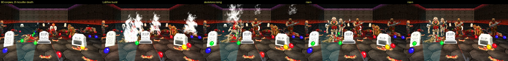
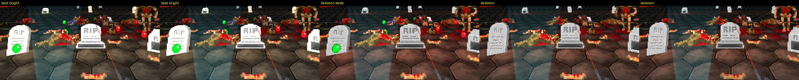

# RSQ Graveyard
### Doom Arcade VR · a gravestone where you died, waiting for you the next time you play the map

m8f's **Graveyards**, RSQ Edition. Die, and the spot is remembered. Start that map again, in a new game or from a save,
and a gravestone stands where you fell. The stones keep from one play session to the next, map by map. In this
edition they pop up out of the ground, breathe, and burn a small candle. A life you spend with RSQ Score leaves a gold
stone. With Legion of Bones loaded, Brutal Doom's dead can get back up as Legion of Bones undead, and RSQ Miniboss can
wake the graves.

*[GIF to come: a map loading with its old graves popping up one after another, candles coming on as you walk up]*

---

## What it feels like

- **Your deaths stay on the map.** Every death leaves a stone at the spot. Load the map again and they are all there.
- **Each stone says who lies there.** Press Use on a stone and the console prints its line: who died, what killed
  them, the real date and time, and the map time.
- **They come up out of the ground.** A stone pops in with a little bounce past full size. When a map loads, its
  stones pop one after another over about a second, not all at once.
- **They breathe.** A slow squash and stretch, about seven seconds a breath, each stone at its own point in the breath.
- **A candle on every grave.** A warm, flickering light that fades in as you come near and fades out as you leave.
  Past the cull distance it is gone.
- **Gold for a spent life.** With RSQ Score, a life spent on a killing blow leaves a gold stone with a steadier, gold,
  slightly larger candle.
- **Living Stones (off).** The candles and stones breathe in colour, calm blue to warm yellow, gold stones within a
  gold range.
- **The Bones (off, needs Legion of Bones).** A Brutal Doom monster you kill rises again as its Legion of Bones undead,
  and comes for you.

---

## How to play

| Do this | What happens |
|---|---|
| Die | The spot is stored. In a netgame the stone appears at once; alone, it is there the next time the map loads |
| Start the map again (new game or loaded save) | A stone stands at every death stored for this map |
| Spend an RSQ Score life | A gold stone appears at once where you stood, and is stored like any other |
| Press Use on a stone | Its obituary prints to the console |
| Choose **Remove Gravestones on This Map** | This map's stones are gone, here and from the store |
| Choose **Remove All Gravestones** | Every stored stone on every map is gone |

## Controls

No keys. This pack binds nothing (owner 2026-11-10: keybinds are a precious resource in VR).

- **Remove Gravestones on This Map** and **Remove All Gravestones** are menu buttons on this pack's page (Options →
  Radiant Silvergun Options → RSQ Graveyards, Controls). Each prints a line to the console when it is done.
- The console aliases still work: `gy_remove_map` and `gy_remove_all` do the same as the buttons.

---

## The stones

- **Four stones.** Each spot gets one of four tombstone sprites, picked from its position, so the same death always
  gets the same stone.
- **Stored by map.** A stone is kept with the map's checksum, so it comes back on that exact map file, whichever
  episode or session you are in.
- **Kept outside the save.** The store lives in three settings in your engine's config (not in savegames). Loading an
  old save still shows every stone stored since.
- **Pop-in.** 24 tics from 5% size to full, easing out with a bounce of up to 35% past full that dies away. Stones
  restored at map load wait a random-looking delay of up to 35 tics first (from their position). **Pop In on Spawn**
  off: they are simply there.
- **Breathing.** **Bounce Amount** (0.05) is how far a stone squashes; **Bounce Speed** (1.5) is degrees of the breath
  per tic, so 1.5 is about 6.9 seconds a breath. **Animate Gravestones** off: the stones stand still at full size.

### The candle

- One point light per stone, 24 map units above its foot, in a warm tone made from **Light Brightness** (210).
- **Light Radius** (72) is its size. **Candle Flicker** (on) wobbles it by up to 8% with two out-of-step waves, no
  randomness.
- **Light Cull Distance** (640 map units): inside it the candle fades up, outside it fades down, 5% a tic, so about
  20 tics from dark to full. At zero the light is removed.
- **Grave Light** off: no candles.

### Gold stones

With RSQ Score loaded, a life Score spends on a killing blow is a death too. The stone is the same tombstone tinted
gold, its candle gold, its radius 1.25 times as big and its flicker a third as strong. Its line reads "Here <name> lost
a life, killed by <killer>." with the map time. Without RSQ Score every stone is a normal one.

*[Image to come: a grey stone and a gold stone side by side, candles lit]*

### Living Stones

**Living Stones** (off): each stone's candle colour and its tint breathe once every 2 seconds, from calm blue
(110, 170, 230) to warm yellow (250, 240, 140), the same breath as RSQ Score's "Score:" label. A gold stone breathes
from deep gold (200, 135, 25) to bright gold (255, 230, 110). **Light Brightness** still scales it. The tint moves in
8 steps.

| Living Stones Mode | |
|---|---|
| **Uniform** (default) | Every stone breathes together |
| **Wave** | A wave rolls out from you: one breath for every 512 map units of distance |
| **Chaos** | Each stone its own pace (0.55 to 1.6 times) and its own starting point |

With RSQ Accessibility's Photosensitive Mode on, the breath is held still at its middle.

*[GIF to come: Living Stones in Wave mode across a graveyard]*

---

## The Bones (Legion of Bones)

Everything here waits for **Legion of Bones** (SpacemanStrife, LOB_v1.05) to be loaded. Without it these rows do
nothing.

### Bones Bridge

**Bones Bridge** (off): Brutal Doom's monsters stay Brutal Doom's. A while after one dies, its Legion of Bones undead
rises from the corpse, the way Legion of Bones does it:

- **Which undead.** The dead monster's class, then its parents, are looked up in a table of 90 Brutal Doom and XMVE
  classes, then the 13 vanilla monsters. Zombieman, shotgun guy, chaingunner, imp, demon, spectre, cacodemon, hell
  knight, baron, revenant, mancubus, arachnotron and arch-vile each have their undead. Lost souls, pain elementals,
  the Cyberdemon and the Spider Mastermind stay dead, and so do Brutal Doom's 31 death helpers (a crawling half-dead
  zombie, a cast-call actor). Legion of Bones' own monsters and undead are left to Legion of Bones.
- **When.** 25 tics for the death, then Legion of Bones' own **Respawn Delay** (its menu): Instant, 5, 10 (its
  default), 15 or 20 seconds (0, 170, 345, 520 or 695 tics).
- **The rising.** Legion of Bones' fire burst on the corpse, the teleport sound, and its rising actor (the undead's
  death backwards), turned to face whoever made the kill, which it then comes for. The Brutal Doom corpse is removed.
  A corpse already gone (gibbed away) rises where it lay.
- **What Stops a Rise** (greyed while the bridge is off):
  - **Something On It (LoB)** (default): Legion of Bones' rule. If something solid stands on the corpse when the wait
    ends, the whole wait starts again.
  - **Nothing**: it rises anyway.
- A corpse that came back to life by then (an arch-vile, RSQ Miniboss's revive) is left alone. Switch the bridge off
  and the corpses already waiting stay dead.

*[GIF to come: Brutal Doom corpses, the fire burst, skeletons rising and turning to the player]*

*Rig frames, 2026-11-06, that day's build (before the 11-07 and 11-10 changes, which did not touch the bridge): Brutal
Doom corpses 25 tics after death, Legion of Bones' fire, the skeletons rising, risen. Simulated headset on the Linux
rig, not a capture from a real headset.*

### Load order with Legion of Bones

Load Legion of Bones **after** Brutal Doom (and XMVE), before the RSQ pk3s, as in the owner's order. Both packs
define a bullet with the same name, and whichever loads first wins it for both: Legion of Bones first would give
Brutal Doom's monsters its weaker bullet.

Loaded after Brutal Doom, Legion of Bones turns every monster on the map into a skeleton from the start. **With the
Bones Bridge on**, this pack hands each of those spawns back to the monster Brutal Doom or XMVE would have placed, so
the skeletons only come when something dies. **Bridge off:** Legion of Bones plays as it ships.

### Graves Rise (RSQ Miniboss)

With RSQ Miniboss's **Graves Rise** row on, when a miniboss fight lands the tombstones wake and raise Legion of Bones
undead: every stone on the map or within Miniboss's radius, the nearest to the fight first, a few tics apart. RSQ
Miniboss's **Graves Rise Mode** says one undead a stone or one for each thrall a stone. Several risers on one stone
stand in a ring 40 map units round it, 12 tics apart. Each riser is the undead for one of the fight's thrall types,
taken in turn (Skull Zombies when none of them maps; a type the Bones table marks never-raised is skipped, as the
bridge leaves it dead). There is no cap.

A riser whose spot is taken (a wall, an undead already up, you standing there) looks for the nearest free spot round
it: two rings of 8 spots, 40 and 80 map units out (one and two risers wide), each in clear sight of the planned spot
and within a step of its floor. If none is free, it looks again a second later, 5 tries in all (about 4 seconds), then
it is given up (logged with `gy_bones_debug`). *Code only, not shown: on the 11-07 rig run (before this change) 20 of
31 planned risers had risen when the log ended, the rest retrying the same spot.*

### The heartbeat

While a miniboss fight waits to be called in, RSQ Miniboss beats the map's light red, and every stone beats with it:
on each beat the candle grows up to 1.6 times its radius and leans 85% to the beat's colour, fading over the beat, and
the stone itself goes full-bright at the peak. With Photosensitive Mode on there is no beat: the candle holds a steady
half lean while the beats keep coming.

*Rig frames, 2026-11-06, that day's build: the stones bright on the beat, then between beats. Simulated headset on the
Linux rig, not a capture from a real headset.*

---

## Plays well with

- **RSQ Score:** a life it spends leaves a gold stone (it asks this pack by name).
- **RSQ Miniboss:** Graves Rise and the heartbeat (it asks this pack by name). Both need Legion of Bones for the
  undead; the heartbeat works without it.
- **Legion of Bones** (LOB_v1.05): the Bones Bridge and Graves Rise use its undead, its fire, its rising actors and its
  Respawn Delay setting, by name. Nothing of it ships here.
- **Brutal Doom (brutal22test6) and XMVE:** the bridge's table was read from their DECORATE.
- **RSQ Accessibility:** Photosensitive Mode holds the Living Stones breath and the heartbeat still. Its Reset Every
  Mod also resets this page.
- **RSQ SlowMo:** its DOWN holds you at 1 HP, so going down is not a death and leaves no stone. A stone is left only by
  a death or by a Score life spent.
- **Every RSQ pack:** this page sits in the shared Radiant Silvergun Options menu.

---

## Options

*Options → Radiant Silvergun Options → RSQ Graveyards.* One page. Defaults in brackets, ranges as the sliders allow.

| Section | Rows |
|---|---|
| Animation | Animate Gravestones (On) · Pop In on Spawn (On) · Bounce Amount (0.05; 0.00 to 0.25) · Bounce Speed (1.5; 0.2 to 8.0) |
| Grave Light | Grave Light (On) · Candle Flicker (On) · Light Radius (72; 16 to 256) · Light Brightness (210; 32 to 255) · Light Cull Distance (640; 128 to 2048) · Living Stones (Off) · Living Stones Mode (Uniform; Wave, Chaos; greyed while Living Stones is off) |
| Bones (Legion of Bones) | Bones Bridge (Off) · What Stops a Rise (Something On It (LoB); Nothing; greyed while Bones Bridge is off) |
| Controls | Remove Gravestones on This Map (a button) · Remove All Gravestones (a button) |
| (foot) | Reset All |

**Reset All** asks first, then puts every setting on the page back to its default. The stored stones are kept.

The animation and light rows are each player's own setting, but in a netgame every machine draws the stones with the
host's (the arbitrator's) settings, and a candle lights for the nearest player: the stones' look is part of the game's
state and must come out the same on every machine. Alone, they are simply yours. The two Bones rows are the game's
(the host's in a netgame).

---

## Status

| | |
|---|---|
| **rig only, not headset-confirmed** (2026-11-06, the 11-06 build; log `tools/rigtest/evidence_1106/log_final.txt`, frames `rising.jpg`, `stones_pulse.jpg`, `stones_photosafe.jpg`, run by `tools/rigtest/run_batch.sh` on doom2, brutal22test6, BD_VoxelPack, BD22 VR 2.0.4a, XMVE, Legion of Bones 1.05 and the RSQ pk3s) | The Bones Bridge: Brutal Doom and XMVE monsters (imp, nightmare imp, chainsaw zombie, rifle zombie, shotgunner) rising as their undead 195 tics after death at Respawn Delay 5 s and 25 tics at Instant; a lost soul staying dead; a block on a corpse restarting the wait, then the rise once it was taken off; gibbed corpses rising where they lay; the risen turned to the player. Legion of Bones' spawns handed back to XMVE's and Brutal Doom's (a ZombieMan spawning XMVE's spawner with the bridge on, Legion of Bones' with it off). The heartbeat: all 9 stones pulsing on every beat, bright on the beat, and held steady in Photosensitive Mode. Graves Rise in that build (then with a cap): 5 stones within 640 woken, 9 map-wide, risers that did not fit tried again. No script error from the pack |
| **rig only, not headset-confirmed** (2026-11-06, RSQ SlowMo's run, log `SlowMo/tools/rigtest/build/logs/v2main.log`) | A spent Score life placing a gold stone (Score and Graveyard log lines). Living Stones' colour and tint steps for both kinds in Uniform, Wave and Chaos (log lines; that run's frames were not checked for this README) |
| **rig only, not headset-confirmed** (2026-11-07, SlowMo's run, log `SlowMo/tools/rigtest/build/logs/v3c.log`) | Graves Rise with no cap: 31 tombstones woken map-wide, 31 risers planned. Only 20 had risen when the log ended; the rest were still being retried ("did not fit"). So "31 raised 31" was not shown |
| **rig only, not headset-confirmed** (2026-11-09 and 2026-11-10, the series runs) | The pack loading on the owner's order (doom2, brutal22test6, BD_VoxelPack, BD22 VR, Legion of Bones, Champions, Gun Bonsai, every RSQ pk3) with no script error from it; the 11-10 runs used the current build. Its row under Radiant Silvergun Options (11-09 log `design/rigtest_2026-11-09/logs/main_A-G_I.log`) |
| **code only, not shown** | m8f's base in this edition: a stone at a death, stones coming back on the next load, the obituary on Use, both remove commands. The pop-in, the breathing and the candle fade (frames show stones and candles, but none were checked for these). Graves Rise Mode (one per stone or one per thrall, the 40-unit ring; changed 11-10, load-checked only). Reset All. The 11-10 code-read fixes (92bd8ba9), each load-checked only: a riser that does not fit looks for a free spot near it (5 tries, then given up and logged); the two remove commands are menu buttons, the key section gone; the boss markers and their art removed (nothing placed them); the stones' look read the same on every machine (the arbitrator's settings, the nearest player); a never-raised thrall type is skipped by Graves Rise as by the bridge. The 11-10 stone keys (load-checked only): each new death and spent life is stored with a key made from sim data (player number, game and map tics, spot, kind) |
| **not yet run** | Netgames, all of it: no two-player game has been run. That includes the 11-10 rule, everyone's stones (every machine sends its own stored stones at map load, the dying player's machine sends a new death's stone, and a stone whose key is already on the map is skipped, so each comes once) |

From reading the code: alone, a death's stone is not shown until the map loads again (m8f's design: a netgame shows it
at once). In a netgame, a death's obituary keeps the real date and time of the machine whose copy came first, so the
date line can differ by a few seconds from what another machine stored. The two remove buttons clear every
machine's store in a netgame, not only the presser's (m8f's design).

---

## Under the hood

- **Stock QuestZDoom 17.3:** ZScript and data only, no engine changes. Root lumps: `zscript.zs`, `cvarinfo.txt`,
  `menudef.txt`, `keyconf.txt`, `mapinfo.txt`, `language.txt`, `textures.txt`, `trnslate.txt`.
- **Handlers** (mapinfo): `gy_EventHandler` (stones and the store), `gy_VmAbortHandler` (m8f's Zabor: on a VM abort, or
  `event zabor`, it prints the map, time, player class, skill, compat and dm flags, every event handler and the real
  time, to paste into a bug report), `gy_BonesHandler` (the corpses and graves waiting to rise, saved with the game),
  `gy_BonesReplacer` (static; hands Legion of Bones' spawns back while the bridge is on).
- **The store:** `gy_hashes`, `gy_locations`, `gy_obituaries` (string settings in the engine config, not in saves),
  one record per stone, keyed by map checksum. A gold stone adds a 4th field to its location (the kind); a record with a
  key (2026-11-10) has the kind and the key as 4th and 5th fields. Older records read as normal stones with no key.
- **Network events:** `gy_spawn<key>@<x:y:z:obituary>` (a stone), `gy_spawk<...>` (a gold stone), `gy_remove_map`,
  `gy_remove_all` (the two menu buttons run the aliases `gy_remove_map` / `gy_remove_all`, which send them).
- **Everyone's stones in a netgame (2026-11-10, code only, not shown; no netgame run yet).** Each machine keeps its own
  store and records every death it sees. At map load every machine sends the stones in its own store (your solo deaths
  on that map come too). Only the dying player's machine sends a new death's stone. Each stone carries a key made from
  sim data only, never the real clock: the dead player's number, the game's total tics, the map's tics, the spot in whole
  map units and the kind (`n<player>.<totaltime>.<maptime>.<x>.<y>.<z>.<kind>`), so every machine that saw a netgame
  death stored the same key. The spawns are handled in the same order on every machine; the first with a key is made,
  any later copy is skipped (logged with `gy_bones_debug`). **Records stored before keys** are sent with a key made from
  their exact stored spot and kind (`p<x>/<y>/<z>/<kind>`): m8f's code stored a netgame death at the same spot on every
  machine, so those copies meet as one too; two old stones at the very same spot become one stone.
- **Settings with no row:** `gy_living_debug` (yours: logs the Living Stones colour every 10 tics),
  `gy_bones_debug` (the game's, not saved: logs the bridge, the graves and the heartbeat).
- **Read by name from other packs, each one optional:** `LOB_Respawn` (Legion of Bones), `rsqa_photosafe` (RSQ
  Accessibility, only while its menu class `RSQA_Menu` exists), `rs_score_debug` (RSQ Score, logs the gold stone).
- **For other mods: `gy_RSQService`,** found by name. `GetInt("stone.life", "", player, 0, pawn)`: a gold stone at the
  pawn, stored and spawned on every machine (RSQ Score). `GetInt("bones.graves", "thrall,classes", player * 1000 +
  per stone, radius (0 = whole map), spot)`: Graves Rise; returns how many undead are on their way (RSQ Miniboss).
  `GetInt("stones.pulse", "", 0xRRGGBB, seconds)`: one heartbeat; returns how many stones beat.
- **The Bones table:** `zscript/rsqgy/bones_table.zs` is generated by `tools/gen_bones_table.py` from brutal22test6 and
  XMVE's DECORATE (90 classes mapped, 31 never raised). Do not edit it by hand.
- **The tints:** `trnslate.txt` holds the gold tint and the 16 Living Stones steps (8 blue-to-warm, 8 gold).
- **No hard links.** Legion of Bones, RSQ Score, RSQ Miniboss and RSQ Accessibility are found by name at run time; the
  pack loads and plays alone.
- **The folder ships** as `RSQ_Graveyard.pk3` (`tools/build_all.py`), with the licence (`copying.txt`), `credits.txt`
  and m8f's `Readme.md`. Not in the pk3: `tools/` (the Bones table generator, the rig tests), this draft, `.gitignore`
  and `add-ons/`.
- **m8f's soulsphere add-on** (`add-ons/soulsphere`) stays in the source folder as m8f made it, but it is not part of
  the pk3 and nothing loads it.

---

## Credits

- **m8f** (Alexander Kromm, github.com/mmaulwurff/graveyard): **Graveyards**, the mod this edition is built on: the
  stones, the store across sessions, the obituaries, the remove commands, netgame support, and the Zabor VM abort handler.
  Copyright 2020 to 2021, GPLv3. Part of m8f's toolbox (mmaulwurff.github.io/pages/toolbox).
- **Captain J:** the tombstone sprites (gy_tomb1 and gy_tomb3 with minor edits by m8f, gy_tomb2 mirrored from gy_tomb1
  by m8f, gy_tomb4), per `credits.txt`.
- m8f's own thanks, carried over from his README: Dr_Cosmobyte for feature suggestions; mamaluigisbagel and Colerx for
  bug reports; 3saster for real time access in GZDoom.
- **presidentkoopa:** the RSQ Edition: the pop-in, the breathing, the candle light, gold stones, Living Stones, the
  Bones Bridge, Graves Rise, the heartbeat, the options page, the netgame fixes. Each of m8f's files it changed says
  so in its header (GPLv3 section 5a).
- **SpacemanStrife:** **Legion of Bones** (LOB_v1.05), used by name only: its rising actors, fire and Respawn Delay.
  None of it ships here.
- **Sergeant Mark IV** (Brutal Doom, brutal22test6) and **XV117** (XMVE Monster Expansion): the DECORATE the Bones table
  was read from. None of it ships here.
- **QuestZDoom** (Emawind and Team Beef): the engine.

**Licence:** GPLv3 (`copying.txt`). The RSQ Edition's changes are GPLv3 too. You may share and change this pack under
that licence; keep m8f's copyright and the licence with it.
