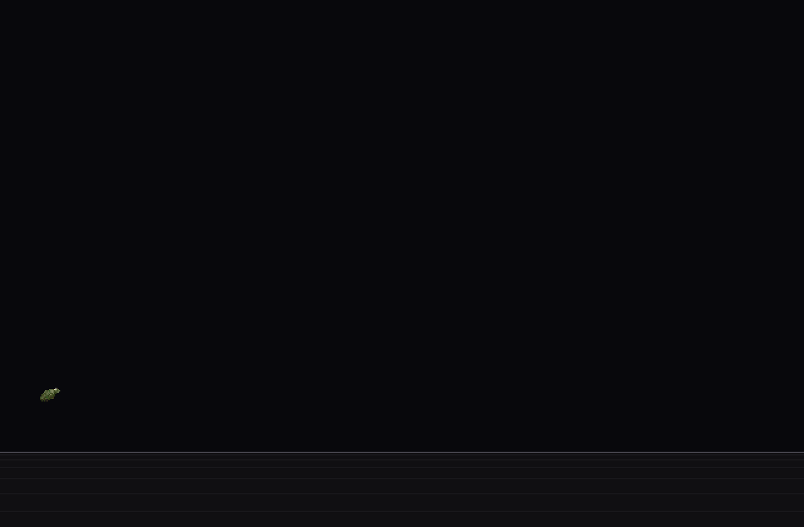
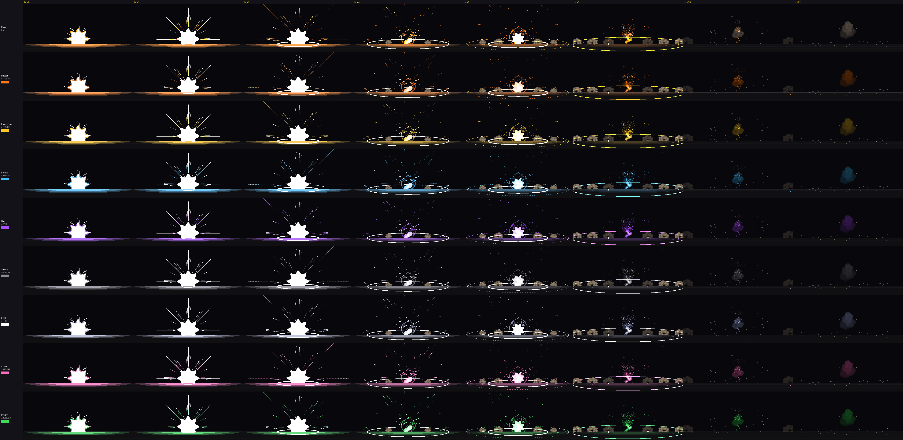
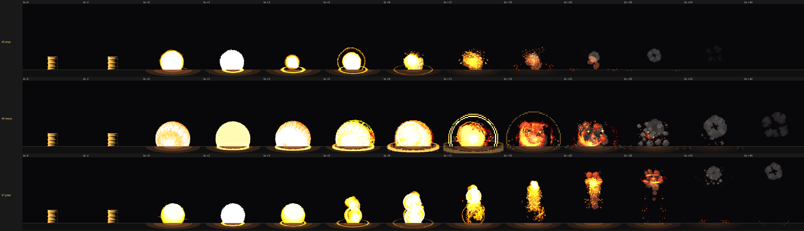
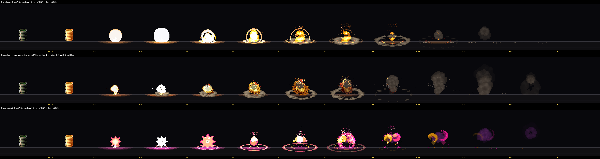
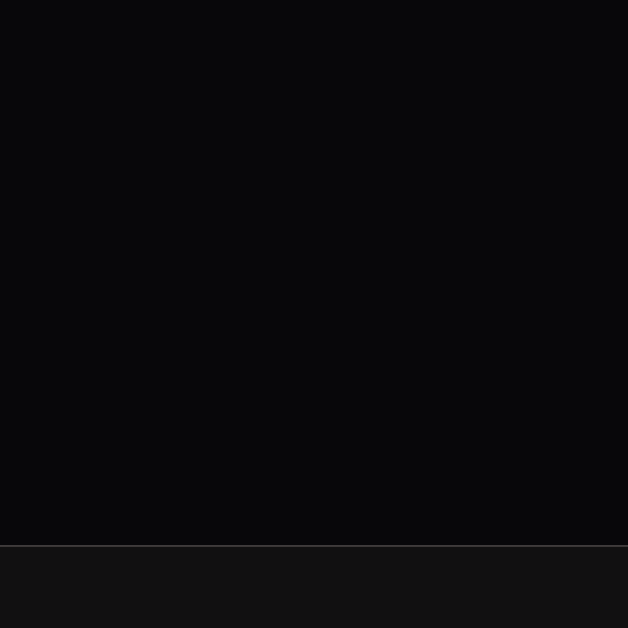
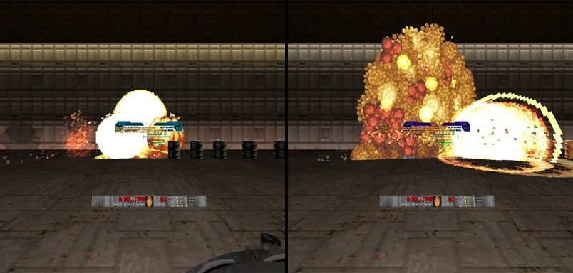
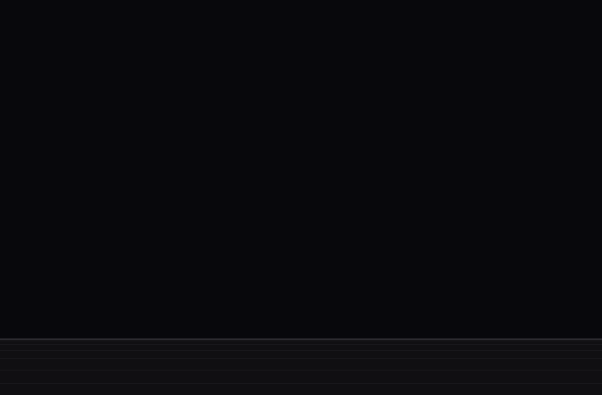
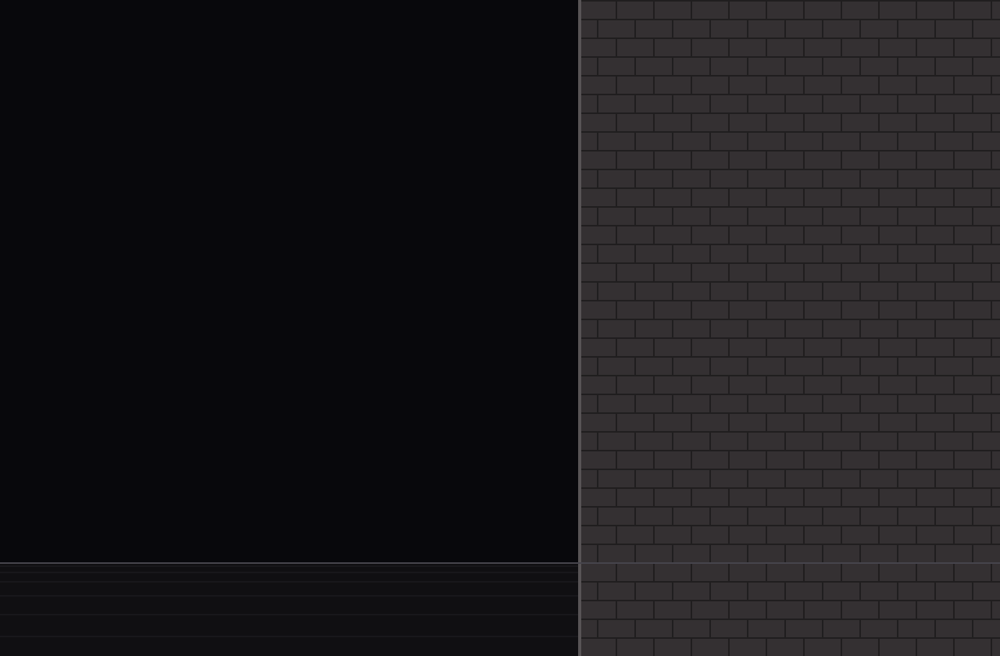
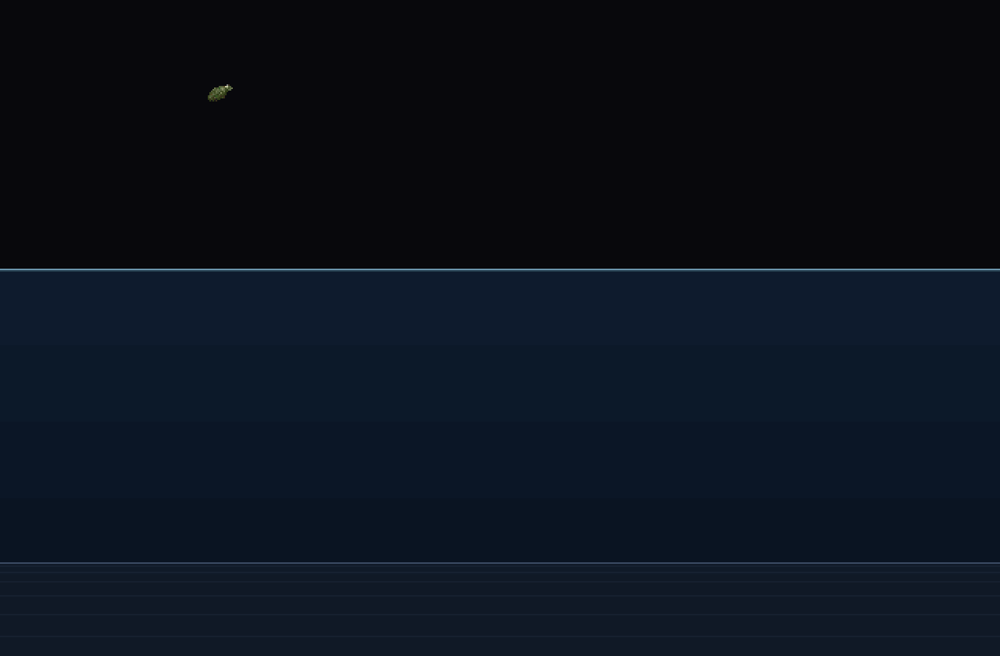
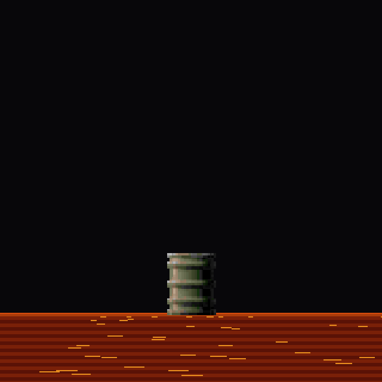

# RSQ Grenade
### Doom Arcade VR · a real hand grenade, nine kinds of trouble, and barrels that go off like fireworks

Reach for your belt, pull the pin, cook it as long as you dare, and throw it with your own arm. The grenade flies the
way your hand moved. It bounces off walls, floors and monsters, and goes off when the fuse runs out. You can also shoot
it out of the air.

---

## What it feels like

- **Grab one off your belt buckle.** Pull the ring with your other hand, or pull it with your teeth.
- **Throw it with your own arm.** The swing is the throw: how hard and which way you swung is how it flies.
- **Cook it.** Let go of the spoon without swinging and the fuse starts in your hand. It flashes red, faster and
  faster, ticking as it goes. Hold it too long and it goes off in your hand.
- **Shoot it mid-air.** Skeet a thrown grenade with any gun and it goes off where it is. The kill is yours, even if a
  friend threw it.
- **Pick your poison.** Alt fire flips through nine kinds, from a plain frag to one that turns a monster onto your side.
- **Barrels are a show now.** Six new explosions, chain reactions that grow with every link, and blasts that change
  with the room: fire fanning along a wall, rolling under a low ceiling, bubbling under water.

---

## How to play

| Do this | What happens |
|---|---|
| Reach to the front of your belt (with RSQ Tactical Rig) or pick slot 9 | A grenade in your hand |
| Other hand's trigger on the ring, pull away | Pin out. Bring the ring back to the top to put it in again |
| Or: squeeze and hold the grenade at your mouth | Pin out with your teeth |
| Hold the trigger (or alt fire) and swing, let go mid-swing | Thrown, along your swing |
| Let go of the squeeze while holding still | The spoon flies and it starts cooking. Squeeze again and swing to throw |
| Alt fire with the pin still in | Next grenade kind (the grenade changes colour) |
| Shoot a grenade in flight | It goes off on the spot |
| Press Brutal Doom's Toss Grenade key (G), or bind **Quick Grenade** | A quick throw, whatever is in your hands: the same timing, speed and arc as Brutal Doom 22's toss. With RSQ SlowMo the world slows so you can shoot it in the air. With Brutal Doom VR loaded it needs **Replace Brutal Doom's Grenade** on, or BD22 VR's own **Use RSQ Grenade Instead** (otherwise G throws Brutal Doom's own) |

You start each game with 3. They turn up lying in levels beside other items, singly or in packs of three. You carry 8,
or 16 with a backpack.

---

## Controls

- **Keys: one, Quick Grenade.** No default bind: bind it on this pack's page (**Quick Grenade Key**) or in Customize
  Controls, under "RSQ Grenade". Brutal Doom's own **Toss Grenade** key (`+user1`, G by default in Brutal Doom) does
  the same quick throw while this pack is in play. **Quick Grenade (BD22's Toss Grenade key)** on the page turns both
  off. With BD22 VR loaded, both need **Replace Brutal Doom's Grenade** on (or BD22 VR's **Use RSQ Grenade
  Instead**); otherwise this pack stands down and BD22's own toss is the quick throw.
- **The hand holding the grenade** (either hand):
  - **trigger or alt fire, held:** the squeeze on the spoon. Swing and let go to throw; let go with the hand still and
    it starts cooking.
  - **alt fire, pin still in:** the next grenade kind (**Alt Fire Changes Type**).
- **The other hand's trigger:** on the ring, then pull away: the pin comes out.
- **Gestures:** the throw is your swing; squeeze and hold the grenade at your mouth to pull the pin with your teeth
  (**Pin With Your Teeth**).
- **Taking one:** pick slot 9, or with RSQ Tactical Rig reach to the front of your belt (the rig's grip).
- No key of this pack became a menu button.

---

## The nine kinds

| Kind | What it does |
|---|---|
| **Frag** | The classic. A big blast and a fireball |
| **Impact** | Goes off the instant it touches anything. No fuse to wait for |
| **Incendiary** | Leaves the ground burning; monsters standing in it keep taking damage |
| **Freeze** | Frozen solid in an ice tint for a few seconds. With Gun Bonsai VR, the next hard hit shatters them |
| **Stun** | Staggered, stuck in their pain frames |
| **Smoke** | A cloud that makes monsters lose their target, inside it or looking through it |
| **Flash** | A pure white burst: staggered, and they lose their target |
| **Charm** | A monster fights for you for a while, then turns back |
| **Infight** | A monster turns on its nearest neighbour |

**Every kind has its own colour,** on the grenade in your hand and in its blast. Impact and Incendiary use the big
fireball in their colour. The others have their own effect: frost for Freeze, sparks for Stun, smoke, a white bloom,
a coloured haze for Charm and Infight. Set **Explosion Colour** to **Grenade Kind** and every kind gets the full
fireball in its colour as well.

Bosses can't be charmed or turned. Without RSQ Gun Bonsai VR they can't be frozen or stunned either; with it, Freeze
slows them instead. Without Gun Bonsai VR every kind is yours from the start; with it, you learn them one by one.

---

## Barrels and explosions

Barrels live here too. Every barrel blinks hot, then goes off as one of **six explosions** (#5 Snap, #6 Heavy,
#7 Pillar, #8 Groundbreaker, #9 Slag Column, #10 Neon Crescent), at random or the one you pick. Chain them: each link
blows bigger and blinks faster, and from the third link the screen kicks and the blast reaches further (160, 192,
then 224 units against the stock 128). Every third barrel down a chain is **the mega blast**; every fifth is **the
mushroom cloud**, half again as big (both counts are options).

*A chain of nine barrels: the first links going off with the rest still standing (left), then a finale blast down the line, the mega blast or the mushroom cloud (the frame does not say which link) (rig capture, not headset).*

**They sound like they look.** Every blast is one boom and then a run of short pops on the tics its bursts land: two for a
barrel (one more for each link down a chain, up to five), each sound ending as its fire does, three for a grenade, two for a rocket, six or seven under
the mega and mushroom's long roll. The sounds are the owner's set, cleaned, trimmed and level-matched (Barrel Sound and
Grenade Sound: Kinetic, the default; the old sounds are still there to pick).

**Brutal Doom's rockets and launcher grenades get the treatment too.** With Brutal Doom loaded, its rockets play our
rocket blast (a floor version and an air version) and its launcher grenades play this grenade's blast. Brutal Doom's
own damage, sounds, quake, craters and scorch stay exactly as they are.

**The room changes the blast.** Every grenade and barrel reads where it went off:

| | |
|---|---|
| **Against a wall:** the fire fans along it and leaves a scorch that fades away |  |
| **Under water:** a white flash, no fire, bubbles and a gas dome |  |
| **On lava, nukage or blood:** a crown of drops, waves, a stain, light in the liquid's colour |  |

Also: **low ceilings** hold the fire under them, **open sky** gives a taller column, and a blast that kills a **crowd**
bursts every one of them.

*These pictures are design renders, drawn from the same sequences the game plays. They are not captures from the
headset.*

---

## Plays well with

- **RSQ Gun Bonsai VR:** your grenade levels up. Cook Sense (a tick in your hand every second, and an amber warning
  before the red), Short Fuse, Sticky, Flat Arc, Strong Arm, Bounce, Bandolier (carry more), Cluster (bomblets scatter
  from the blast), Big Bang (a bigger fireball), Teeth (a teeth pull makes the throw hit harder), Skeet and Skeet Window
  (slow motion after a throw so you can shoot it).
- **RSQ SlowMo:** a blast that kills a crowd slows the world. Thrown grenades can run faster than the slowed world, and
  you can choose to make skeet shots work only in slow motion.
- **RSQ Tactical Rig:** the grenade's own spot on your belt buckle; it never takes a holster.
- **RSQ Glow In The Dark:** explosions can take the opposite colour of the room's glow.
- **RSQ Accessibility:** Photosensitive Mode or a comfort vignette turns off the chain-reaction screen kick.
- **Brutal Doom VR Reloaded:** by default this grenade steps aside for Brutal Doom VR's own. Turn on **Replace Brutal
  Doom's Grenade** and this one takes over. Barrels are ours by default (**Replace Brutal Doom's Barrels** on), so
  Brutal Doom's barrels grow down a chain too; turn it off to keep Brutal Doom's own barrel kick and spilled fire.

---

## Options

*Radiant Silvergun Options → RSQ Grenade.* Everything is on one page; the fine-tuning numbers are under Test and Debug.

| Section | Rows |
|---|---|
| Grenades | Grenades on/off · Replace Brutal Doom's Grenade · Start With (3) · Grenades in Levels · Singles a Map (4) · Packs of Three a Map (2) |
| Throwing | Quick Grenade (BD22's Toss Grenade key) (on) · Quick Grenade Key · Pin With Your Teeth · Alt Fire Changes Type · Grenade Types (All / Frag Only) · Your Fire Burns You (Auto: yes with Brutal Doom) |
| Barrels | Barrels on/off · Explosion (Random, or #5 Snap, #6 Heavy, #7 Pillar, #8 Groundbreaker, #9 Slag Column, #10 Neon Crescent) · Barrel Sound (Kinetic / Combat FX / Test Candidate) · Replace Brutal Doom's Barrels (on) |
| Explosions | Grenade Explosion (New / Original) · Grenade Sound (Kinetic / Original) · Brutal Doom's Launchers · Explosion Colour (Normal, Room Complement, Kill Colour, Grenade Kind) · Explosion Lights (Off, Simple, Full) · Debris · Contexts: Wall, Low Ceiling, Open Sky, Water, Liquid Floors, Chain, Crowd · Chain Escalation · Chain Mega Every (3) · Chain Mushroom Every (5) · Screen Kick on Chains |
| Shooting | Shoot Thrown Grenades · Only in Slow-Mo · Faster in Slow-Mo · Skeet Slow-Mo (Gun Bonsai VR) |
| Test and Debug | Fuse (3 s) · Throw Speed · Throw Strength · Arc · Gravity · Floor and Wall Bounce · Ground Drag · Shot Reach · Slow-Mo Speed · the teeth's reach and hold · Effects Cap · Debug Log |

---

## Status

| | |
|---|---|
| **rig only, not headset-confirmed** (2026-11-10, G1: `design/rigtest_2026-11-10/evidence/L9_log.txt`) | The quick throw on Brutal Doom's Toss Grenade (`+user1`): out 17 tics after the press, 45.3 units a tic, one grenade spent. The **Quick Grenade** key did nothing at first (the engine marks a key's network event as typed by hand, and this pack dropped those); fixed in commit ae089395, then the key threw the same way, 17 tics out at the same speed. With BD22 VR loaded and Replace Brutal Doom's Grenade on. The pin and toss sounds and the side-by-side with BD22's own toss were not logged |
| **rig only, not headset-confirmed** (2026-11-10, the batched rig test) | Every launch loaded every RSQ pk3 with no script error from our packs, on doom2, brutal22test6, BD_VoxelPack, BD22 VR Reloaded 2.0.4f, LOB, Champions, Gun Bonsai and the series (`design/rigtest_2026-11-10/RESULTS.md`). Nothing of this pack was exercised |
| **rig only, not headset-confirmed** (2026-11-09; `design/rigtest_2026-11-09/logs/`, frames `A1_*`, `A3_*`) | Throwing with the trigger, with alt fire, and cook-then-throw, with and without Replace Brutal Doom's Grenade |
| **Headset-confirmed** | Nothing yet |
| **code only, not shown** | Everything else on this page. Among it, the 11-10 changes: RSQ SlowMo's Quick Grenade slow, Replace Brutal Doom's Barrels on by default (4f5280c1), the chain's mega blasts (0c80b1d0), the Kinetic sounds |
| **not yet run** | G2 (Brutal Doom's barrels replaced by default; a chain of six or more growing; the mega blast) waits in the batched rig test (`design/rigtest_2026-11-10/RESULTS.md`, "Not yet run"). From G1, still not logged: the pin and toss sounds, the speed against BD22's own toss measured the same way, RSQ SlowMo's slow |

---

## Under the hood

- **Netplay-safe.** Your hands are read on your own machine only; what they decide (pin out, cooking, the throw)
  travels as network events, and every machine runs the rest the same way. Grenade scattering is deterministic, and
  barrel effects never touch the game's sync.
- **The throw** is the hand's own motion: the fastest two-tic window of the last seven, measured in the body's frame
  so walking and turning are never a swing.
- **Damage** is the grenade's own (85 over 200, then 75 over 255), credited to whoever threw it, or to whoever shot it.
- **Barrels** keep the stock barrel's health, size, damage and timing to the tic, so chain reactions run at stock pace;
  only the look and sound change. They stay ExplosiveBarrels, so every mod that looks for barrels still finds them.
- **Quest-friendly:** one light per blast and at most 8 at once, no shadow maps, and a cap on effect actors (600) so a
  long chain stays cheap. Scorch marks fade out on their own instead of crowding out bullet holes.
- **Stock QuestZDoom 17.3:** ZScript and data only. No engine changes.

## Credits

The full list, with every file and licence, is in **CREDITS.txt**.

- **presidentkoopa:** the handling, from his Brutal Doom 22 VR Reloaded grenade and his RS_Grenade (the teeth, the
  flight); RS Combat FX.
- **UAC Survival Pack** by JohnnyDoom (its grenade by Froon, Saegiru and Pa1nki113r): the sounds, the pickups, the
  original explosion, the ammo rules and the scatter.
- **Gomuz:** the grenade model.
- **Reactorcore** (Explosion Spriteanim Sheet Minipack), **Magma MK-II** (Rufaswan's sheet), **Sergeant Mark IV**
  (Meatgrinder's blood, via RSQ Monsters): explosion art.
- **QuestZDoom** (Emawind and Team Beef): the engine and its VR hand API.
- End of Starchild: the barrel death's timing, as a reference only (none of its art, sound or code).
