
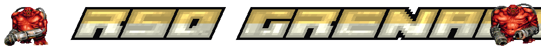

# RSQ Grenade
### Doom Arcade VR · a real hand grenade, nine kinds of trouble, and barrels that go off like fireworks

<a href="../README.md#grenade">&larr; RSQ UBQ Series</a>

Reach for your belt, pull the pin, cook it as long as you dare, and throw it with your own arm.

**What it does:**

- **A grenade you handle, in VR:** pull the ring with your other hand, or with your teeth ([How to play](#how-to-play))
- **Throws with your arm:** how hard and which way you swung is how it flies
- **Cooks:** let go of the spoon without swinging and the fuse burns in your hand, 3 seconds, flashing red faster and faster
- **Bounces** off walls, floors and monsters, and goes off when the fuse runs out
- **Skeet:** shoot a thrown grenade, with a bullet or a projectile, and it goes off where it is; the kill goes to whoever shot it
- **Nine kinds:** Frag, Impact, Incendiary, Freeze, Stun, Smoke, Flash, Charm, Infight; alt fire picks ([The nine kinds](#the-nine-kinds))
- **Quick Grenade:** one key throws one, with no handling (out of VR it is the only way to throw)
- **Grenades in the levels:** you start with 3 and carry 8, and each map has a few more lying beside its items
- **New barrels:** a barrel blinks hot before it blows, with one of five explosions each time ([Barrels and explosions](#barrels-and-explosions))
- **Chains that grow:** each barrel down a chain blows bigger and reaches further; every third is a mega blast, every fifth a mushroom
- **Blasts that read the room:** fire fans along a wall, rolls under a low ceiling, bubbles under water, and three or more kills at once burst every body
- **Explosion colours:** fire, the room's opposite colour, the colour of what it killed, or the grenade's kind
- **Brutal Doom's rockets and launcher grenades** go off with these blasts too

Three things make it more than a grenade key:

- **You do every step.** The ring, the spoon, the cook and the throw are yours. Hold it too long and it goes off in
  your hand.
- **Nine kinds change what a throw is for.** Five of them do no damage at all: one freezes a room, one blinds it,
  one hides you in smoke, one turns every monster in it onto your side, and one sets them on each other.
- **The explosions are a show.** Barrels, grenades and Brutal Doom's launchers share one set of hand-drawn blasts
  that change with the room and grow down a chain.

*[GIF to come: an in-game grenade throw and blast, and a barrel chain growing to the mega blast]*

**Works on plain Doom II with nothing else loaded.** With Brutal Doom VR Reloaded loaded, this grenade takes the place
of that pack's own (**Replace Brutal Doom's Grenade**, on since 2026-11-16; turn it off and Brutal Doom VR's grenade
is the grenade again, with none of these handed out or scattered). The barrels and explosions are these either way
(**Replace Brutal Doom's Barrels**, on).

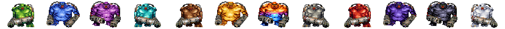

| Do this | What happens |
|---|---|
| Reach to the front of your belt (with RSQ Tactical Rig) or pick slot 9 | A grenade in your hand |
| Other hand's trigger on the ring, pull away | Pin out. Bring the ring back to the top to put it in again |
| Or: squeeze and hold the grenade at your mouth | Pin out with your teeth |
| Hold the trigger (or alt fire) and swing, let go mid-swing | Thrown, along your swing |
| Let go of the squeeze while holding still | The spoon flies and it starts cooking. Squeeze again and let go to throw: once it is cooking any release throws, however slow |
| Alt fire with the pin still in | Next grenade kind (the grenade changes colour) |
| Shoot a grenade in flight | It goes off on the spot |
| Press Brutal Doom's Toss Grenade key (G), or bind **Quick Grenade** | A quick throw, whatever is in your hands: the same timing, speed and arc as Brutal Doom 22's toss. With RSQ SlowMo the world slows so you can shoot it in the air. With Brutal Doom VR loaded it needs **Replace Brutal Doom's Grenade** on, or BD22 VR's own **Use RSQ Grenade Instead** (otherwise G throws Brutal Doom's own) |

You start each game with 3. They turn up lying in levels beside other items, singly or in packs of three. You carry 8,
or 16 with a backpack.

- **Keys: one, Quick Grenade.** No default bind: bind it on this pack's page (**Quick Grenade Key**) or in Customize
  Controls, under "RSQ Grenade". Brutal Doom's own **Toss Grenade** key (`+user1`, G by default in Brutal Doom) does
  the same quick throw while this pack is in play. **Quick Grenade (BD22's Toss Grenade key)** on the page turns both
  off. With BD22 VR loaded, both need **Replace Brutal Doom's Grenade** on (the default since 2026-11-16) or BD22 VR's
  **Use RSQ Grenade Instead**; with both off this pack stands down and BD22's own toss is the quick throw.
- **The hand holding the grenade** (either hand):
  - **trigger or alt fire, held:** the squeeze on the spoon. Swing and let go to throw; let go with the hand still and
    it starts cooking.
  - **alt fire, pin still in:** the next grenade kind (**Alt Fire Changes Type**).
- **The other hand's trigger:** on the ring, then pull away: the pin comes out.
- **Gestures:** the throw is your swing; squeeze and hold the grenade at your mouth to pull the pin with your teeth
  (**Pin With Your Teeth**).
- **Taking one:** pick slot 9, or with RSQ Tactical Rig reach to the front of your belt (the rig's grip).
- No key of this pack became a menu button.

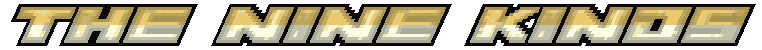

| Kind | What it does |
|---|---|
| **Frag** | The classic: 85 damage out to 200 units, then 75 out to 255, and a fireball. It hurts you too |
| **Impact** | Goes off on the first thing it touches. Full damage, no fuse to wait for |
| **Incendiary** | Full damage, then the ground burns for 4 seconds over 200 units: 5 damage a second to monsters standing in it (to you too with Brutal Doom, **Your Fire Burns You**) |
| **Freeze** | No damage. Every monster in sight within 200 units is frozen solid in an ice tint for 3 seconds. With Gun Bonsai VR, the next hard hit shatters them |
| **Stun** | Half damage, and they are stuck in their pain frames for 3 seconds |
| **Smoke** | No damage. A 2 m cloud for 12 seconds: monsters inside it, or looking through it, lose their target |
| **Flash** | No damage. A pure white burst: staggered for 3 seconds, and they lose their target |
| **Charm** | No damage. Every monster in sight within 200 units fights for you for 15 seconds, then turns back |
| **Infight** | No damage. Each of them turns on the monster nearest it for 15 seconds |

**Every kind has its own colour,** on the grenade in your hand and in its blast. Impact and Incendiary use the big
fireball in their colour. The others have their own effect: frost for Freeze, sparks for Stun, smoke, a white bloom,
a coloured haze for Charm and Infight. Set **Explosion Colour** to **Grenade Kind** and every kind gets the full
fireball in its colour as well.

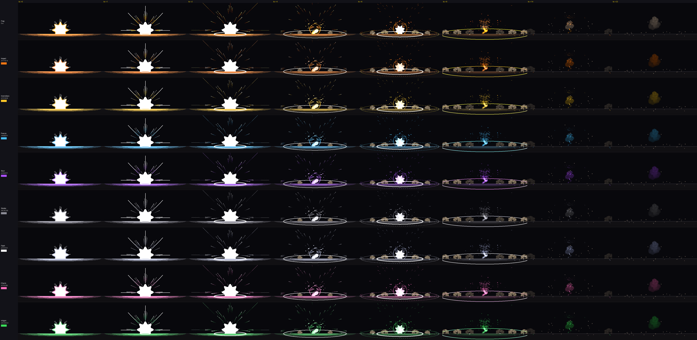

Bosses can't be charmed or turned. Without RSQ Gun Bonsai VR they can't be frozen or stunned either; with it, Freeze
slows them instead. Without Gun Bonsai VR every kind is yours from the start; with it, you learn them one by one.

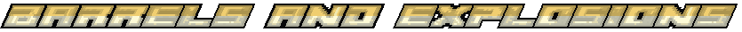

Barrels live here too. Every barrel blinks hot, then goes off as one of **five explosions** (#5 Snap, #6 Heavy,
#7 Pillar, #8 Groundbreaker, #9 Slag Column), at random or the one you pick. The sixth, **#10 Neon Crescent**, is no
longer a barrel's: it is Grapple 2.0's air spike's own explosion (a pick of it saved from an older build reads as Random).
Chain them: each link
blows bigger and goes off sooner, and from the third link the screen kicks and the blast reaches further (a lone
barrel reaches 192 units, against the stock 128; the third, fourth and fifth links reach 240, 288 and 336). Every third barrel down a chain is **the mega blast**; every fifth is **the
mushroom cloud**, half again as big (both counts are options).

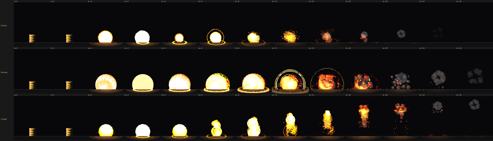
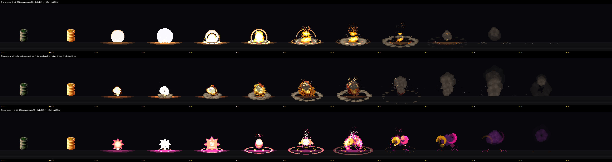

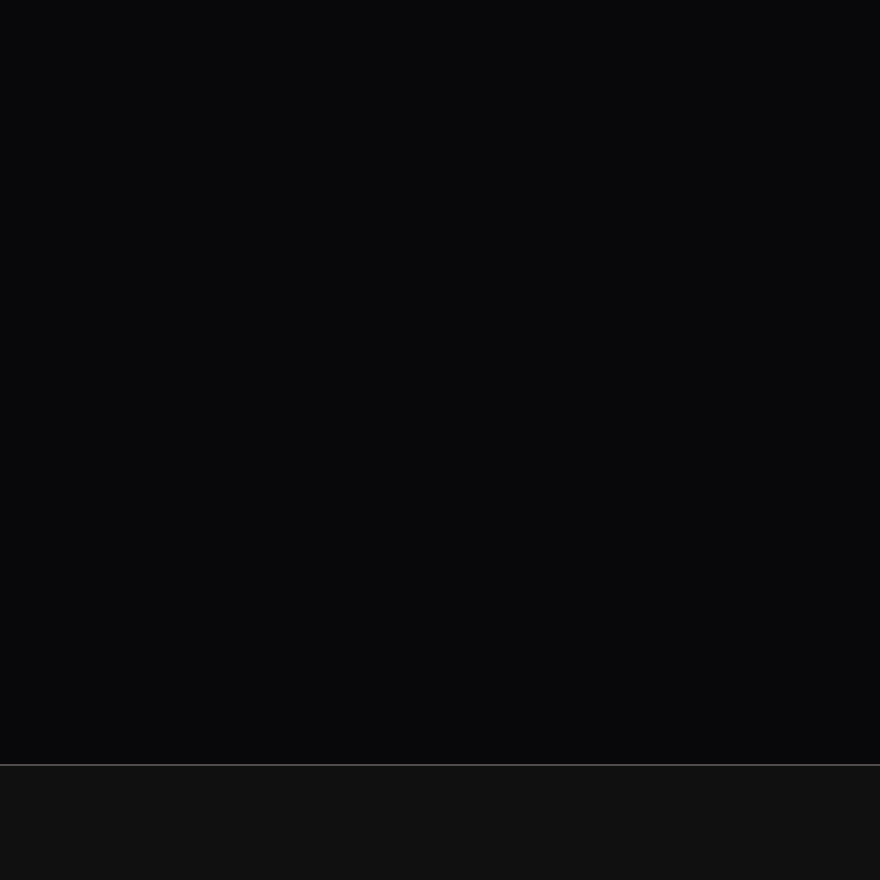

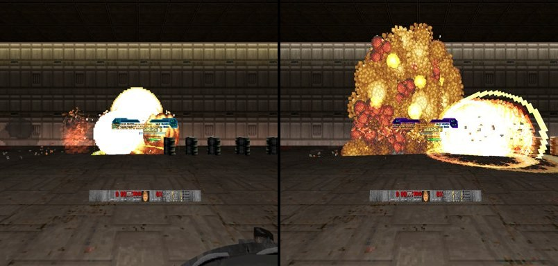

*A chain of nine barrels: the first links going off with the rest still standing (left), then a finale blast down the line, the mega blast or the mushroom cloud (the frame does not say which link) (rig capture, not headset).*

**They sound like they look.** Every blast is one boom and then a run of short pops on the tics its bursts land: two for a
barrel (one more for each link down a chain, up to five), each sound ending as its fire does, three for a grenade, two for a rocket, six or seven under
the mega and mushroom's long roll. The sounds are the owner's set, cleaned, trimmed and level-matched (Barrel Sound and
Grenade Sound: Kinetic, the default; the old sounds are still there to pick).

**Brutal Doom's rockets and launcher grenades get the treatment too.** With Brutal Doom loaded, its rockets play our
rocket blast (a floor version and an air version) and its launcher grenades play this grenade's blast. Brutal Doom's
own damage, sounds, quake, craters and scorch stay exactly as they are.

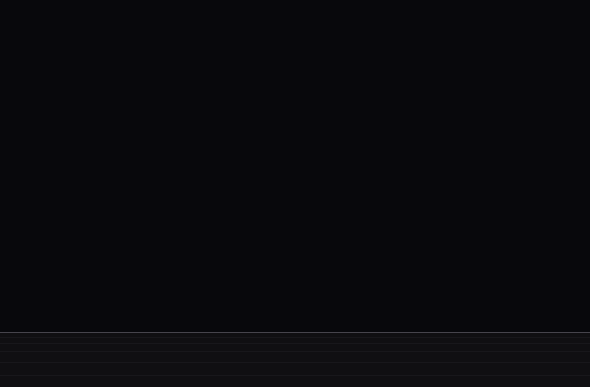

**The room changes the blast.** Every grenade and barrel reads where it went off:

| | |
|---|---|
| **Against a wall:** the fire fans along it and leaves a scorch that fades away | 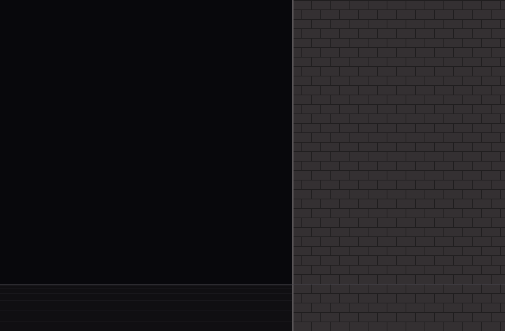 |
| **Under water:** a white flash, no fire, bubbles and a gas dome | 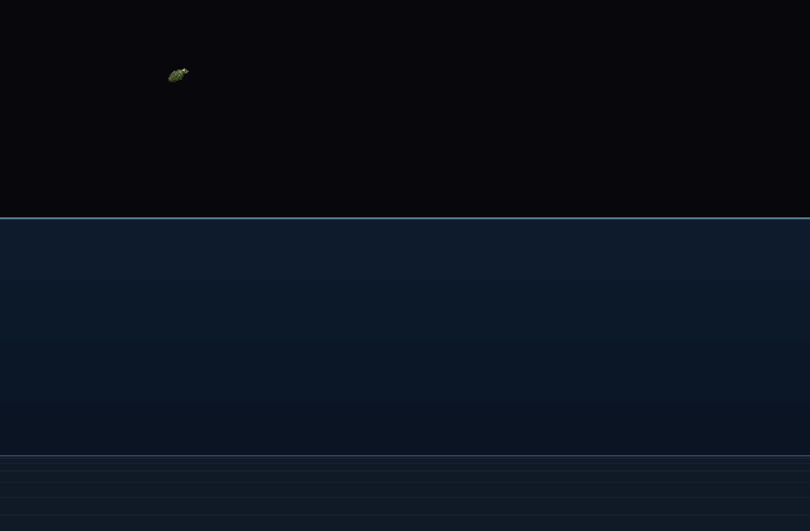 |
| **On lava, nukage or blood:** a crown of drops, waves, a stain, light in the liquid's colour | 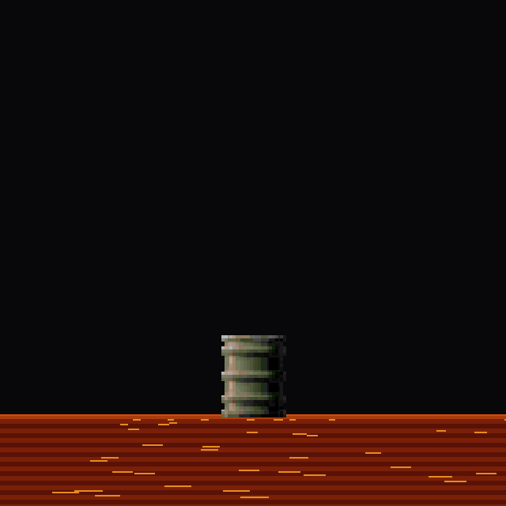 |

Also: **low ceilings** hold the fire under them, **open sky** gives a taller column, and a blast that kills a **crowd**,
three or more at once, bursts every one of them.

*These pictures are design renders, drawn from the same sequences the game plays. They are not captures from the
headset.*

- **RSQ Gun Bonsai VR:** your grenade levels up. Cook Sense (a tick in your hand every second, and an amber warning
  before the red), Short Fuse, Sticky, Flat Arc, Strong Arm, Bounce, Bandolier (carry more), Cluster (bomblets scatter
  from the blast), Big Bang (a bigger fireball), Teeth (a teeth pull makes the throw hit harder), Skeet and Skeet Window
  (slow motion after a throw so you can shoot it).
- **RSQ SlowMo:** a blast that kills a crowd slows the world. Thrown grenades can run faster than the slowed world, and
  you can choose to make skeet shots work only in slow motion. **In slow motion the barrels and the blasts slow too**
  (2026-11-16), as Brutal Doom's do: a barrel's blink, its blast, the fire, smoke, embers, debris and shrapnel, the
  light, the pops, the fire and smoke grenades' fields, and the sparks (they are spawned slower and live longer). At full
  speed, or without SlowMo, nothing changes.
- **RSQ Tactical Rig:** the grenade's own spot on your belt buckle; it never takes a holster.
- **RSQ Gun Cards:** the grenade has its small card in either hand, with its count (and Cook Sense 3's countdown). The
  off hand's card comes in this pk3 (2026-11-16; GunCards/tools/gen_modelcard.py writes it here), so there is no extra
  pk3 to load; without Gun Cards it draws nothing. *Rig only, not headset-confirmed.*
- **RSQ Glow In The Dark:** explosions can take the opposite colour of the room's glow.
- **RSQ Accessibility:** Photosensitive Mode or a comfort vignette turns off the chain-reaction screen kick.
- **Grapple 2.0** (being built): the air spike's landing sets off the Neon Crescent by name (`g2.neon`, below). It goes
  off as a barrel's blast does (the room's colour, the light, the sound, the barrel's damage), credited to you. RSQ
  SlowMo treats it as a barrel blast for Chain Reaction and Barrel Multi-Kill, but never as Barrel Near You: its slow
  motion is SlowMo's Grapple-Slam. Rig only, not headset-confirmed.
- **Brutal Doom VR Reloaded:** by default this grenade steps aside for Brutal Doom VR's own. Turn on **Replace Brutal
  Doom's Grenade** and this one takes over. Barrels are ours by default (**Replace Brutal Doom's Barrels** on), so
  Brutal Doom's barrels grow down a chain too; turn it off to keep Brutal Doom's own barrel kick and spilled fire.

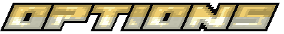

*Radiant Silvergun Options → RSQ Grenade.* Everything is on one page; the fine-tuning numbers are under Test and Debug.

| Section | Rows |
|---|---|
| Grenades | Grenades on/off · Replace Brutal Doom's Grenade (On) · Start With (3) · Grenades in Levels · Singles a Map (4) · Packs of Three a Map (2) |
| Throwing | Quick Grenade (BD22's Toss Grenade key) (on) · Quick Grenade Key · Pin With Your Teeth · Alt Fire Changes Type · Grenade Types (All / Frag Only) · Your Fire Burns You (Auto: yes with Brutal Doom) |
| Barrels | Barrels on/off · Explosion (Random, or #5 Snap, #6 Heavy, #7 Pillar, #8 Groundbreaker, #9 Slag Column) · Barrel Sound (Kinetic / Combat FX / Test Candidate) · Replace Brutal Doom's Barrels (on) |
| Explosions | Grenade Explosion (New / Original) · Grenade Sound (Kinetic / Original) · Brutal Doom's Launchers · Explosion Colour (Normal, Room Complement, Kill Colour, Grenade Kind) · Explosion Lights (Off, Simple, Full) · Barrel Explosion Size (2.0) · Barrel Blast Radius (1.5) · Neon Crescent: Room Colour (On) · Debris · Contexts: Wall, Low Ceiling, Open Sky, Water, Liquid Floors, Chain, Crowd · Chain Escalation · Chain Mega Every (3) · Chain Mushroom Every (5) · Screen Kick on Chains |
| Shooting | Shoot Thrown Grenades · Only in Slow-Mo · Faster in Slow-Mo · Skeet Slow-Mo (Gun Bonsai VR) |
| Test and Debug | Fuse (3 s) · Throw Speed · Throw Strength · Arc · Gravity · Floor and Wall Bounce · Ground Drag · Shot Reach · Slow-Mo Speed · the teeth's reach and hold · Effects Cap · Debug Log |

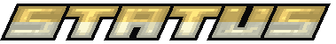

| | |
|---|---|
| **rig only, not headset-confirmed** (2026-11-16, runs `slowfx_old2` / `slowfx_new2`, `slowfx_nade_old` / `slowfx_nade_new`; logs and frames in `SlowMo/docs/rig_2026-11-16_slowfx/`; the owner's full order, no script error from our packs) | **Barrels and blasts in slow motion.** At world speed 0.25 this pack's barrel used to blow 12 real tics after it was hit and be gone 100 real tics after (the same as at full speed), beside a Brutal Doom 22 barrel whose effects lasted 479. Now it blows 49 real tics after it is hit and its effects last 407 real tics (103 at full speed). A frag blast's shrapnel at 0.25: 15 real tics before, 64 now; its particles (the shrapnel streaks, the sparks, the kinds' ring) spawned slowed. Frames side by side: `barrels_before_after_world025.jpg`, `grenade_particles_before_after_world025.jpg`. Not shown: the fire and smoke grenades' fields, the mega and mushroom flipbooks, under-water blasts and the Neon Crescent in slow motion (the same clock, not run) |
| **rig only, not headset-confirmed** (2026-11-13, runs `g2sup1` and `g2sup2` in rig/work/runs, probes rig/work/g2probe and g2probe2; owner's order with BD22 VR Reloaded 2.0.4t, no script error from our packs) | **#10 Neon Crescent out of the barrels:** 20 barrels set off one by one with the Explosion row's value at 10 (an old Neon Crescent pick) rolled only #5 to #9 (8, 3, 4, 3, 2 of them); the row's list has no #10. **`g2.neon`:** each call set off the Neon Crescent (in the room's Glow In The Dark hue, its light on) where the actor stood; the zombies there died to 128 damage credited to the player (his kill count went up), through intArg (1 + his number) or through the monster's target; two killed set off RSQ SlowMo's Barrel Multi-Kill, a barrel beside it went off as a Chain Reaction, and Barrel Near You was never seen for it. Not shown: whether the plain call hurts the player who set it off (he took no damage at 48 units with or without `"safe"`), and the Explosion row resetting a saved 10 to Random when a map loads |
| **code only, not shown** (2026-11-11, `design/rigtest_2026-11-10/RESULTS_DOWNSHOT.md`; not run, by the owner's order "no rig test, code only until i say"; not load-checked either) | Your eyes as this pack reads them (the mouth the pin is pulled at) use the engine's fixed standing eye height (the player class's ViewHeight), not the pawn's ViewHeight. RSQ SlowMo's DOWN scales the pawn's ViewHeight to 40%, which put them about 0.9 m too high while you were down. Standing and crouching are unchanged |
| **rig only, not headset-confirmed** (2026-11-10, G1: `design/rigtest_2026-11-10/evidence/L9_log.txt`) | The quick throw on Brutal Doom's Toss Grenade (`+user1`): out 17 tics after the press, 45.3 units a tic, one grenade spent. The **Quick Grenade** key did nothing at first (the engine marks a key's network event as typed by hand, and this pack dropped those); fixed in commit ae089395, then the key threw the same way, 17 tics out at the same speed. With BD22 VR loaded and Replace Brutal Doom's Grenade on. The pin and toss sounds and the side-by-side with BD22's own toss were not logged |
| **rig only, not headset-confirmed** (2026-11-10, the batched rig test) | Every launch loaded every RSQ pk3 with no script error from our packs, on doom2, brutal22test6, BD_VoxelPack, BD22 VR Reloaded 2.0.4f, LOB, Champions, Gun Bonsai and the series (`design/rigtest_2026-11-10/RESULTS.md`). Nothing of this pack was exercised in them beyond G1 (above) |
| **rig only, not headset-confirmed** (2026-11-10 night, the packed batch: `design/rigtest_2026-11-10/RESULTS_P3.md` G2, `RESULTS_P1.md` M5) | **Barrels:** Brutal Doom's barrels replaced by default (both its barrel classes became this pack's barrel). A chain of 9: the blast radius growing 128, 128, 160, 192, 224 over links 1 to 5, the blink quickening, the mega blast at link 3 and the mushroom at link 5, and RSQ SlowMo's Chain Reaction slow (`design/rigtest_2026-11-10/evidence/P3C_log.txt`, `P3B_log.txt`, `P3_G2_chain_mega_blast.jpg`). RSQ Melee's uppercut kicking this pack's barrel, and a shotgun blast then setting it off (`P1_B_log.txt`, `P1_F_log.txt`) |
| **rig only, not headset-confirmed** (2026-11-09; `design/rigtest_2026-11-09/logs/`, frames `A1_*`, `A3_*`) | Throwing with the trigger, with alt fire, and cook-then-throw, with and without Replace Brutal Doom's Grenade |
| **code only, not shown** (2026-11-11, RSQ Monsters' ladder renumbered by strength; owner: "no rig test, code only until i say") | Kill Colour's tier tints (`RSQGN_T01`-`T13`) re-ordered to the new tier numbers, each colour keeping its tint; a blast now takes the colour of the strongest monster it kills (the highest tier) |
| **Headset-confirmed** | Nothing yet |
| **code only, not shown** | Everything else on this page. Among it, the 11-10 changes: RSQ SlowMo's Quick Grenade slow, the Kinetic sounds, the rumble route to RSQ Accessibility and Rumble Strength |
| **not yet run** | G2 has run (above). From G1, still not logged: the pin and toss sounds, the speed against BD22's own toss measured the same way, RSQ SlowMo's slow |

- **Netplay-safe.** Your hands are read on your own machine only; what they decide (pin out, cooking, the throw)
  travels as network events, and every machine runs the rest the same way. Grenade scattering is deterministic, and
  barrel effects never touch the game's sync.
- **Slow motion (RSQ SlowMo, by name).** SlowMo slows the state-driven blasts itself. The barrel and blast players keep
  their own clock in script, so each asks SlowMo's `scale` once a tic (`upg.zs` `RSQGN_Clock`) and runs at it: ages,
  lives and fuses advance by it, velocity and gravity are scaled the way SlowMo scales any actor, and a layer between
  two tics of its track is drawn between them, so a slowed blast still moves every tic. Engine particles cannot be
  slowed after they are made, so they are spawned slowed.
- **The throw** is the hand's own motion: the fastest two-tic window of the last seven, measured in the body's frame
  so walking and turning are never a swing.
- **Damage** is the grenade's own (85 over 200, then 75 over 255), credited to whoever threw it, or to whoever shot it.
- **Barrels** keep the stock barrel's health, size, damage and timing to the tic, so chain reactions run at stock pace;
  only the look and sound change. They stay ExplosiveBarrels, so every mod that looks for barrels still finds them.
- **Other mods ask by name** (`RSQGN_Service`): `cooked`, `teeth`, `skeet`, `impact`, `turned.by`, `kinds.owned`,
  `kind`, `kind.set`, `kind.colour`, `kind.colour.of`, `fuse.count`, `fuse.amber`, and for Grapple 2.0 **`g2.neon`**:
  `GetInt("g2.neon", "", 0, 0, actorAtSpot)` sets off #10 Neon Crescent where that actor stands, through the barrels'
  own blast (128 at the heart over Barrel Blast Radius, 192 units at the default). Credit: intArg 1 + a player's number
  names him; with 0, the actor itself if it is a player, else its target if that is a player, else nobody. stringArg
  `"safe"` spares the credited player (a barrel's blast hurts whoever set it off). Answers 1 gone off, 0 no actor or
  Barrels off. From synced play code.
- **Quest-friendly:** one light per blast and at most 8 at once, no shadow maps, and a cap on effect actors (600) so a
  long chain stays cheap. Scorch marks fade out on their own instead of crowding out bullet holes.
- **Stock QuestZDoom 17.3:** ZScript and data only. No engine changes.

The full list, with every file and licence, is in **CREDITS.txt**.

- **presidentkoopa:** the handling, from his Brutal Doom 22 VR Reloaded grenade and his RS_Grenade (the teeth, the
  flight); RS Combat FX.
- **UAC Survival Pack** by JohnnyDoom (its grenade by Froon, Saegiru and Pa1nki113r): the sounds, the pickups, the
  original explosion, the ammo rules and the scatter.
- **Gomuz:** the grenade model.
- **Reactorcore** (Explosion Spriteanim Sheet Minipack), **Magma MK-II** (Rufaswan's sheet), **Sergeant Mark IV**
  (Meatgrinder's blood, via RSQ Monsters): explosion art.
- **QuestZDoom** (Emawind and Team Beef): the engine and its VR hand API.
- End of Starchild: the barrel death's timing, as a reference only (none of its art, sound or code).
