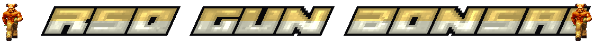
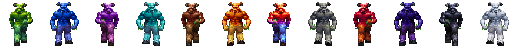
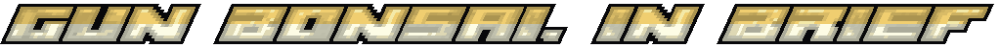
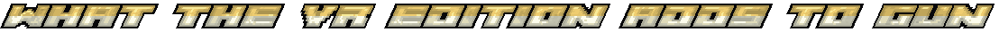

# RSQ Gun Bonsai VR
### Doom Arcade VR · two hands, two guns that level

<a href="../README.md#gun-bonsai-vr">&larr; RSQ UBQ Series</a>

ToxicFrog's Gun Bonsai made to work with two hands in VR. Nothing is added to Gun Bonsai's game: its upgrades, its
levels and its player levels are exactly as it ships them (2026-11-25: every tree, player upgrade, Style XP and the
stock-pool pruning of ours is gone).

**What it does:**

- **Two guns that level:** each hand's gun earns its own XP and gets its own upgrades
- **Every hit credited to the right gun,** even when both hands fire at once
- **Two HUD gauges,** one a hand, placed and mirrored as you like, with an ammo and health row ([The HUD](#the-hud))
- **Its own status screen and level-up cards** (or Gun Bonsai's own, one row away)
- **A LegenDoom pickup card and gauge row** in the same style

**Needs Gun Bonsai.** Works on plain Doom II with Gun Bonsai.

| Do this | What happens |
|---|---|
| Fight | The gun (or fist, blade, grenade) that did the damage earns XP |
| A gauge glows | That weapon has a level waiting |
| Press Gun Bonsai's **Display Info** key (I by default) | A waiting level opens its cards: the main hand's first, then the off hand's, then a player level. Nothing waiting: the status screen |
| Close it and open it again | The status screen steps to the other hand's gun |
| On the cards: left / right (or up / down), Enter, or 1-4 | Move between the cards and pick one |
| On the cards: Back | Refuses the level (Gun Bonsai's own rule) |
| On the status screen: up / down | Walk the list: main gun, its upgrades, off-hand gun, its upgrades, your player upgrades |
| On an upgrade: Enter / left / right | Switch it off or on, or change the level it plays at |

Seven weapon levels make one player level (Gun Bonsai's default). A player level offers player upgrades: the
grapple, the rig, slow motion, criticals, the Guard and the rest below.

### Controls

| Control | Where it comes from |
|---|---|
| **Display Info** (I by default; Controls, section "Gun Bonsai") | Gun Bonsai's own key (its KEYCONF: `bonsai-show-info`). The only key this pack uses |
| **Debug: Add All**, **Debug: Add Incremental** | Menu buttons on *RSQ Gun Bonsai VR → Test and Debug* (MENUDEF Command rows), not keys |
| **Reset All** | Menu button at the foot of the RSQ Gun Bonsai VR page |

This pack adds no key of its own. Its `keyconf.txt` holds console aliases only (`bonsai-hands`, `rsqgb_add_all`,
`rsqgb_add_step`), with no key section and no default bind. (Gun Bonsai's own LegenDoom key, Cycle Legendoom Weapon
Effect, is Gun Bonsai's and only matters with LegenDoom loaded.)

Gun Bonsai is **Rebecca "ToxicFrog" Kelly's** mod (MIT licence). Your weapons gain XP from the damage they do (more
against monsters with a lot of health). When a weapon levels up you pick one of several random upgrades
(four by default) for it; picking one you have raises its level. Every seven weapon levels you pick a player
upgrade, which works whatever you hold. Its own options page, its upgrades and its LegenDoom support are untouched.

This pack needs Gun Bonsai 0.10.6 loaded **before** it. It replaces ten of Gun Bonsai's files by path
(under `ca.ancilla.bonsai/`) and adds its own code beside them. No Gun Bonsai art or sound is shipped here.

### Two live hands
- Stock Gun Bonsai knows one weapon: the one in your main hand. Here both hands are live. A weapon held only in the
  off hand still gets a HUD.
- Each hand's upgrades work only on that hand's shots. The chaingun's upgrades never fire on the other hand's
  rounds.
- Upgrades that tick (Rapid Fire, Juggler) run on the hand that holds their weapon. Defensive upgrades on either
  hand's gun protect you.
- A weapon live in one hand is never rebound to the other hand's record, in every Gun Bonsai binding mode.

### Who gets the XP
For each hit the pack works out which weapon caused it, in this order:
1. a burn (Gun Bonsai's damage over time) pays the guns that lit it, in proportion to how much each lit;
2. the Force (RSQ Saber) pays the Force hand's record, and only the Force's own blows do;
3. a gun you threw away (RSQ Tactical Rig) pays its own record, or the player pool if it has none;
4. damage a mod brackets for a weapon (the ShieldSaw's bash and grind, the whip's hit) pays that weapon;
5. a shot a mod claimed for a weapon (a grenade, Melee's glove helpers, the ShieldSaw's returned bullet);
6. a weapon that is itself the inflictor (a saber cut, a glove punch);
7. something spawned by one of these (a rocket's blast, fragments, a batted shot) inherits it;
8. a hitscan by you, from the hand the engine says fired it, or a Brutal Doom VR round born in the tic one hand fired;
9. otherwise a guess from both hands' position, aim, firing state and buttons. The bare Force hand is never guessed.

**The player pool.** A Distance Grab throw (and a barrel blast it sets off), a Headlock throw and the grappling
hook's own blows pay no weapon. Their XP goes to a pool, and every 1200 of it (Gun Bonsai's base level cost) is one
player XP.

**Score XP** (Gun Bonsai's XP from Score setting) goes to the weapon credited with the kill, split by the victims'
health when several kills land together.

### Smaller fixes
- The XP bars fill in VR. Gun Bonsai cut the fill with a screen clip that misses the HUD in the headset; here it
  is cropped from the art instead.
- Gun Bonsai's level-up flash and its elemental flashes are dimmed and slowed under RSQ Accessibility's
  Photosensitive Mode.
- Gun Bonsai's own status screen (with GBOVR Menus and HUD off) says which hand it shows ("Mainhand" / "Offhand").
- `netevent bonsai-debug,hands` (console alias `bonsai-hands`) prints each hand's record and the credit counters.

*[picture to come: both hands' gauges in the headset, the off hand's top left, the main hand's top right]*

- **Dual HUD** (on): each hand's gun gets Gun Bonsai's own gauge. The main hand's is top right, the off hand's top
  left, mirrored as a pair. An empty hand draws no gauge. A left-hander (RSQ Accessibility's handedness, else
  QuestZDoom's Control Scheme) gets the pair swapped.
- **Single HUD** (Dual HUD off): one gauge in Gun Bonsai's own place, following **Single HUD Follows** (Main Hand,
  Off Hand, or the Last to Earn XP), falling back to whichever hand holds a gun. The row is greyed while Dual HUD is
  on.
- **HUD Position**: each gauge's place across and down, and its mirror (None, Left-Right, Up-Down, Both). Dual HUD
  only: the six rows are greyed while it is off.
- **HUD Colour Cycle** (on for both): the gauge's frame and its two bars cycle through Gun Bonsai's level-up
  rainbow all the time. Speed, Spread (the gap between frame and bars) and Intensity per hand; 1.0 each is Gun
  Bonsai's own. A waiting level-up cycles whatever the switch.
- **The bars breathe** (with GBOVR Menus and HUD on): each XP bar pulses slowly around its own colour, warms toward
  amber and quickens past 60% full, flashes toward white when XP comes in, and flares when a level is ready.
- **The words breathe too** (2026-11-13, with GBOVR Menus and HUD on): the gauge's words and numbers (your level and
  XP, the gun's name, its level and XP) take their bar's colour letter by letter, each letter a step on from the
  last, like RSQ Score's Score word. Still in Photosensitive Mode. *Loads only, not shown.*
- **No HUD over a menu** (owner 11-11): while any menu is open (the options, the status screen, the level-up cards),
  the gauges and the Ammo and Health Row are not drawn. RSQ Score's line and RSQ Miniboss's meter
  hide the same way.
- **RSQ Score's line** sits centred just below the two gauges (it moves down until it clears the lower gauge, in
  Dual HUD or single HUD; Score's own Across and Down rows still place it below that).
- (The ShieldSaw Gauge, a third gauge for the ShieldSaw on the shoulder, was removed on 11-11 by the owner: its row
  and setting are gone.)
  **Gauge Animation** (on): a band of light rising through it, a breathing edge, a glint when full.
- **Ammo and Health Row** (on, with GBOVR Menus and HUD on): along the bottom, each hand's reserve and magazine on
  its own side, health, the face and armour in the middle. While it is on, Brutal Doom's own HUD is switched to a
  type that draws nothing (put back when the row goes off).
- **Gauge Size** (1.5) sizes the Ammo and Health Row; **HUD Inset** keeps the screens and that
  row clear of the headset's edge. Gun Bonsai's own gauge size is on Gun Bonsai's page.
- **Colour-blind modes** (RSQ Accessibility): the two bars take the series' colour pair for that vision, a waiting
  level makes the whole gauge pulse in brightness, the Colour Cycle and the warming are off.
  **Photosensitive Mode**: no cycling, breathing or flashes.

### The LegenDoom HUD (direction D)

With LegenDoom loaded, this pack draws LegenDoom's weapon powers in Gun Bonsai VR's style, as the owner chose on 11-11
(`design/mockups/legendoom_hud/README.md`, "Direction D" and "Owner's decision"):

- **The pickup card.** When you take a LegenDoom weapon power, one Gun Bonsai VR card appears on the HUD for about 3 s, in
  the power's rarity colour (Common green, Uncommon blue, Rare purple, Epic orange). No key closes it. It shows:
  - the power's name as a two-tone SOTN word that flashes between two looks;
  - the rarity and the gun the power is on ("EPIC  RIFLE"): the name of the gun in your hand;
  - LegenDoom's description (without its joke quote);
  - LegenDoom's own icon for the power.

  While the card is up, LegenDoom's own pickup screen is taken off the HUD, so Fire no longer has to close it. Its jingle
  still plays.
- **The fold.** Then the card shrinks into the row under the gauge of the hand that holds the power's gun.
- **The gauge row.** Under each hand's gauge, for a gun that carries a power: LegenDoom's icon and the power's name in its
  rarity colour. While the power's timed buff runs, a drain line runs under the name. For Murderous it also shows X3, its
  3x damage. A rarity tick runs along the gauge's outer top corner. The row starts at the gauge's octagon and runs
  outward; where the screen ends first, it slides back in.
- Not drawn over a menu or the automap. A colour-blind mode draws every rarity in the series' HAVE colour (the card still
  names the rarity). Photosensitive Mode stops the title flashing.
- **LegenDoom: Pickup Card** (On) and **LegenDoom: Gauge Row** (On) turn each part off. Pickup Card off brings
  LegenDoom's own pickup screen back. LegenDoom's buff row at the top of the view always stays (see Status).
- LEGENDARY over a legendary monster once it rises is RSQ VisualRewards' (its monster words).

### The screens

With **GBOVR Menus and HUD** on, Gun Bonsai's status screen and level-up menus are replaced by the owner's mockups.
Off, Gun Bonsai's own menus come back unchanged.

*[picture to come: the status screen with both guns]*
*[picture to come: the level-up cards]*

- **The status screen**: PLAYER STATUS (your level, XP and player upgrades) on the left; a card for each hand's gun
  (its picture, name, level, XP) with its WEAPON STATUS list beside it; a DESCRIPTION box with the selected
  upgrade's text and numbers along the bottom. Upgrades you switched off show as [OFF]. **Display Info** opens it
  on the main hand's gun first; pressing it again steps to the other gun.
- **Gun pictures:** the gun's icon or pickup sprite. A blank one (a 1x1 or TNT1 sprite) counts as none. The whip
  shows the series' whip icon (a copy of RSQ Wheel's, shipped in this pack). The bare fist shows Brutal Doom's own fist
  sprite (FISTD0), then RSQ Melee's glove icon for that hand (RMICA0 / RMICB0), then RSQ Wheel's fist icon. RSQ
  Melee's gloves show their own icons. Anything with no picture at all shows "?".
- **The level-up cards**: the gun's name (or "LEVEL n" for a player level) as the title, then up to four cards in
  orange, cyan, magenta and green, each with the upgrade's name, its text and the level it takes it to. More than
  four: page with left and right.
- The mockup's ITEMS slots and WEAPON BOND panel are not drawn: no feature fills them.

- **RSQ Gun Cards** and **RSQ Wheel:** show each gun's Gun Bonsai level and XP, read from this pack's service.
- **RSQ Score:** its line sits centred just below the hand gauges (it asks this pack where they end).
- **RSQ VisualRewards:** its damage numbers read each hand's gun level from this pack.
- **RSQ Glow In The Dark:** a gold wave at a level-up, read from this pack's service.
- **RSQ Accessibility:** handedness, colour-blind modes, Photosensitive Mode, Text Size on the screens.
- **Brutal Doom VR (BD22 VR):** its True Bullets rounds pay the hand that fired them.
- **LegenDoom:** its weapon powers get the pickup card and the gauge row (The LegenDoom HUD, above).
- No RSQ mod's feature is gated or unlocked by this pack (2026-11-25): each one acts as it does without it.

*Radiant Silvergun Options → RSQ Gun Bonsai VR* (also at the foot of Gun Bonsai's own options page). **Reset All**
resets every setting on both pages.

| Page | Rows (default) |
|---|---|
| HUD | GBOVR Menus and HUD (On) · Ammo and Health Row (On) · Gauge Size (1.50) · Dual HUD (On) · Single HUD Follows (Main Hand) · Main / Off HUD Colour Cycle (On) |
| More Settings | LegenDoom Card (On) · LegenDoom Gauge Row (On) · HUD Inset (0.04) · HUD Position (Main / Off: Across, Down, Mirror) · HUD Colour Cycle (Speed, Spread, Intensity per hand) |

| | |
|---|---|
| **rig only, not headset-confirmed** (2026-11-25, the strip) | Compiles alone on Doom II with Gun Bonsai 0.10.6 and in the owner's full order with no script error of its own; no RSQ upgrade registers ("Registered RSQ_" 0 times). Dual pistols, one imp killed by each hand: the main pistol's record 14 XP, the off pistol's 70 XP (`netevent bonsai-debug,hands`) |
| **loads only, not shown** (2026-11-13, run `main1`: the owner's full order with BD22 VR Reloaded 2.0.4x, no script error from our packs) | **The HUD's words breathe letter by letter** with GBOVR Menus and HUD on (owner 11-13) |
| **rig only, not headset-confirmed** (2026-11-12, runs axp1 and axp2 with BD22 VR Reloaded 2.0.4r; `../TacticalRig/tools/rigtest/axepool/evidence/`) | **Brutal Doom VR's axe is one weapon** (owner 11-12): with the axe in both hands, both hands read the same record ("same record 1"); a level and XP put on the main hand's axe (level 2) read the same from the off hand's; the throws' hits paid into it (XP 25 -> 745, "Your Axe is ready to level up!"); with every axe thrown (0 axes, both versions gone) the record stayed ("bound nothing level 2 XP 745") instead of being pruned. Only the axe: every other weapon, including BD22 VR's off-hand gun versions, keeps one record per weapon as before (`ca.ancilla.bonsai/WeaponInfo.zsc` Holds / OneWeaponKey, `PerPlayerStats.zsc`, `rsq/zscript/service.zs`). Not shown: the record taken up again by a new axe after 0 (code: bound to it on first sight), upgrades chosen on it and used from the other hand |
| **rig only, not headset-confirmed** (2026-11-11, rig run LDH1: the owner's order with LegenDoom 3.0 right after doom2, BD22 VR 2.0.4h's LD mode; a probe hands over an Epic Murderous chaingun-slot drop through LD mode's own pickup; `design/rigtest_2026-11-10/RESULTS_LDH.md`) | **The LegenDoom pickup card** (V3) in Epic orange, "EPIC  RIFLE", LegenDoom's description and icon, the title in its two looks on alternate frames (`evidence/LDH_3_card_look1.jpg`, `LDH_3_card_look2.jpg`). **LegenDoom's own pickup screen not on screen** while the card is up, and **back with LegenDoom: Pickup Card off** (`LDH_7_card_off_legendoom_screen.jpg`). The card folding away (`LDH_4_fold.jpg`). **The gauge row:** MURDEROUS, X3 and the drain line while the buff runs, the line shorter later (`LDH_5_row_X3_drain.jpg`, `LDH_5_row_drain_later.jpg`). No card, row or gauge over the options page, which shows the two LegenDoom rows (`LDH_6_menu_rows_no_hud.jpg`). No script error from this pack (`LDH_log.txt`) |
| **code only, not shown** (2026-11-11, after LDH1) | **Where the row, the tick and the card sit.** In LDH1 they were drawn through the wrong virtual-to-screen mapping: the row and the rarity tick about 12 px too low at 480 px (the tick on the octagon's lower corner) and the card at 0.75 of its size. Fixed to the mapping the gauge itself is drawn with; not run since. Also not shown: the colour-blind and Photosensitive versions, the off hand's row, the row under the single HUD, LegenDoom: Gauge Row turned off |
| **open (for the owner)** | **LegenDoom's buff row stays.** Its boxes at the top of the view (LEGENDPLY.acs LDPlayerLoop) are HudMessages with no id, so they cannot be taken off without taking every other mod's id-less HUD messages too. Only the pickup screen (ids 12300-12303) is hidden. **The row's room.** The mockup put the row outward of the main gauge. On the rig the main gauge sits at the HUD's right edge, so the row slides back in under the gauge, where it may meet RSQ Score's line once it sits at its intended height. Needs a look. **Not built:** Direction D's words over the glowing drop (EPIC and the power's name), which the build brief left out |
| **rig only, not headset-confirmed** (2026-11-11, rig batch R1, `design/rigtest_2026-11-10/RESULTS_R1.md`) | The owner's five HUD decisions, shown: the ShieldSaw Gauge row and bar gone; no gauge over any open menu (status screen, options; with slow motion running too); the whip's picture on the status screen, and the bare fist's (Brutal Doom's fist, after a fix: BD22 VR's `rsq_hands` is lower case, names now compare case-blind); Display Info opens on the main hand first, the off hand on the second press. `gauges.bottom` answers 166 permille for Score's line |
| **code only, not shown** (2026-11-11, the owner's five HUD decisions, `design/rigtest_2026-11-10/RESULTS_HUD11.md`; not run on the rig by the owner's order "no rig test, code only until i say") | The ShieldSaw Gauge removed (drawing, row, setting, service band). No gauge or Ammo and Health Row while a menu is open. The `gauges.bottom` service that puts RSQ Score's line centred under the gauges. Display Info opening on the main hand first. The whip's and the bare fist's pictures on the status screen. The pack compiles in the owner's order with no script error or warning of its own (load check before the order) |
| **rig only, not headset-confirmed** (2026-11-10, design/rigtest_2026-11-10, the owner's order with BD22 VR 2.0.4f, Legion of Bones, Champions and Gun Bonsai; the pk3 built 2026-11-09, before the 11-10 fixes below) | Loads with no script error of its own. Both hands' Gun Bonsai gauges drawn, the off hand's ("Fist") top left and the main hand's ("Rifle") top right, their frames changing colour from frame to frame (evidence/A4_score_wrist_steps_aside.jpg, A4_remote_wrist_panel_full.jpg) |
| **rig only, not headset-confirmed** (2026-11-03, VisualRewards/test/evidence/merge_vr_gbnodes.txt, doom2 and a probe that grants nodes) | The Kill Rewards path offered by its parents (Gastropub alone, then Rich Bits and Magnet, then Lucky Kill), VisualRewards reading each level, a Lucky Kill; Bandolier and Scavenger granted on the grenade and ammo bits giving grenades |
| **code only, not shown** | Everything else on this page: the Ammo and Health Row (in the 11-10 frames the base status bar is drawn at the bottom instead), the bars' breathing, the HUD Colour Cycle switches and sliders. Commit 756de18c's message reports the Colour Cycle on the rig on 11-07; none of their logs or frames are in the repo, so they are not counted as shown |
| **not yet run** | On the screens: refusing a level (Back), toggling or tuning an upgrade on the status screen, paging past four cards, keys 1-4, and the screens with GBOVR Menus and HUD off. Seen in the 11-11 frames, for the owner: Score's line sat on the main gauge's weapon name; the gauges drew over the options page's top rows; the whip had no picture on the status screen; Display Info opened on the off hand (all four changed 11-11, code only, above) |

Known gaps (from reading the code): Gun Bonsai's other stock upgrades can still be offered on all the series
weapons. Only the whip's gun picture ships for the status screen; the rest fall back to each gun's icon or pickup sprite.

- **Stock QuestZDoom 17.3, ZScript and data only.** Gun Bonsai 0.10.6 must load first. The console's start line
  reads "Initializing Gun Bonsai v0.10.6+RSQ..." (Gun Bonsai 0.10.6, this pack's build). Two ZSCRIPT lumps: the
  shadowed Gun Bonsai files compile in Gun Bonsai's own tree; `zscript.txt` adds new classes only. Every other mod
  is found by class or service name while the game runs; nothing links.
- **Shadowed Gun Bonsai files:** `EventHandler.zsc`, `HUD.zsc`, `PerPlayerStats.zsc`, `WeaponInfo.zsc`,
  `WeaponTypeInference.zsc`, `debug.zsc`, `menu/StatusDisplay.zsc`, `upgrades/Dot.zsc`, `upgrades/Juggler.zsc`,
  `upgrades/RapidFire.zsc`.
- **Credit:** a provenance record per spawned shot (a weighted list of weapon records), a hitscan bracket opened in
  `WorldHitscanPreFired` and closed in `WorldHitscanFired`, a claim bracket for script damage, and a scored guess.
  Mods can claim a shot with `TFLV_VR_Attribution.Claim(shot, weapon, hint)`; the hint (hitscan, projectile, melee)
  keeps Gun Bonsai's type guess right for a gun whose bullets travel.
- **Services:**
  - `RSQ_MeleeUpgradeService`: `loaded`, `level` / `unlocked` (a node on a weapon, or the best on anything carried),
    `plevel` / `punlocked` (player nodes), `weapon.level` / `weapon.xp`, `claim`, `credit.push` / `credit.pop`,
    `stagger`, `freeze`, `knockdown`, `whip.mark`, `ram`, `is.melee`, `kr.luckyfx`; GetString `kr.lucky`; GetDouble
    `upgrade.num` (0: the trees are gone), `force.start`. "loaded" is always 0 now, so no mod gates anything on it.
  - `RSQGB_Service`: a gun's `level`, `xp`, `xp.next`, `xp.permille`, `count`, `hand`, `player.level`, and the
    strings `upgrades` ("Name:level:max:Class:on:Colour|...") and `name`.
  - `RSQ_HudService` (ui): `gauges.bottom` (permille of the screen's height, the lowest hand gauge drawn; -1 while
    none is drawn).
  - `RSQTHP_MarkerGBVR`: `stunned`, for the monster bars.
- **Network events:** Gun Bonsai's `bonsai-show-info`, `bonsai-choose-level-up-option`, `bonsai-toggle-upgrade` and
  `bonsai-tune-upgrade`; this pack's `rsqui-menu-hand` (which hand the status screen acts on), `bonsai-debug,hands`.
  QuestZDoom has no netplay.
- **Event handlers** (MAPINFO): `RSQUI_Handler` (the screens, the settings version), `RSQGB_LDHud` (the LegenDoom HUD).
- **Server and user settings:** GBOVR Menus and HUD, Gauge Size, HUD Inset and Ammo and Health Row are server
  settings; the hands' HUD rows and the LegenDoom rows are your own.
- **Saves:** a save made with the old trees learned names their upgrade classes, which are gone (2026-11-25): start a
  new game with this version.
- **Removing the pack** while the Ammo and Health Row is on leaves Brutal Doom's `bd_sbartype` at 5: turn the row off
  first, or set it back by hand.

- **Rebecca "ToxicFrog" Kelly:** Gun Bonsai (MIT). The ten shadowed files are derived from Gun Bonsai 0.10.6;
  its licence is in COPYING.md. Gun Bonsai's HUD art (Sungraphica, CC-BY-4.0, with Craneo), item and effect sprites
  (Willibab), Freedoom sprites and sounds (GameSupplyGuy) stay in Gun Bonsai's pk3 and are drawn from there.
- **presidentkoopa:** this pack, its trees and screens (from his mockups), and SuperPunchOut, whose sounds it uses:
  the hit and the knock from Punch Out Doom / Virtual Punch Out, and the Super Punch-Out!! announcer's count
  (Punch-Out!! is Nintendo's). The HUD Colour Cycle's tuning is from his earlier fork.
- **coldcite:** the Top HP Bars bar art the Berserk gauge is made from ("feel free to use this in your mods").
- **RSQ Melee's** bursts (kiddolink's "VFX Hit Impact", bought for this series) and sparks are played by name, not
  shipped here.
- **id Software / GZDoom:** stock sounds played by name (the item pickup, the ice break).
- **QuestZDoom** (Emawind and Team Beef): the engine and its two-hand weapon API.
