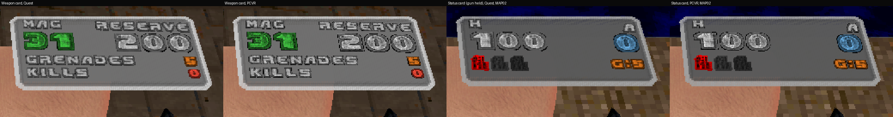
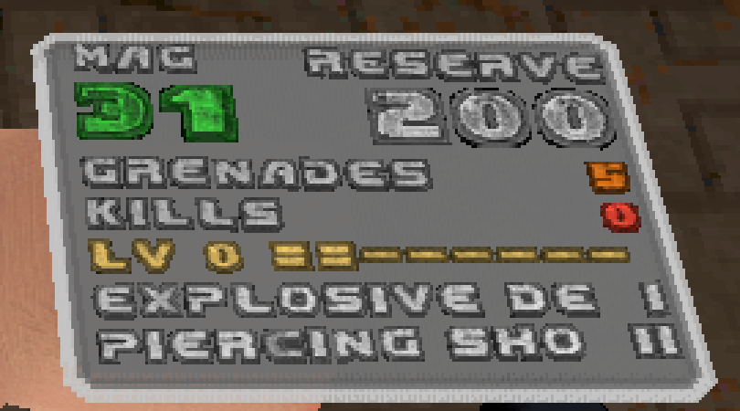
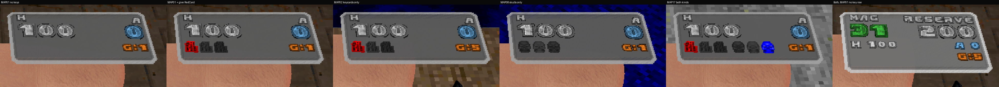

# RSQ Gun Cards
### Doom Arcade VR · your ammo on the gun, and the full card on your wrist when you check your watch

A small card sits beside each wrist and shows the rounds in the gun, big, and the rounds in reserve, small. Turn the
back of your wrist to your face, as if you were checking a watch, and a bigger card lies flat on that wrist. It shows
the magazine and reserve, your grenades, this gun's kills on this map, and, if you want them, its Gun Bonsai level and
upgrades. Check your watch with an empty hand, or with a melee weapon, and the card shows your health, armour and keys
instead. The art is Ermac's Force Unleashed holo HUD.

*[GIF to come: the small card counting down as the pistol fires, then the watch check bringing up the full card]*

---

## What it feels like

- **Ammo where you look anyway.** The small card rides beside the wrist stub: right of it on the main hand, left of it
  on the off hand. It is drawn as part of the hand, in the same frame as the gun, so it does not lag behind.
- **Colour tells you when to reload.** The magazine count is green above half a magazine, yellow from half down to a
  quarter, red at a quarter or less. The reserve is gold.
- **RELOAD when it matters.** An empty magazine with rounds left to load shows RELOAD, then a red 0, taking turns
  every 1.5 seconds.
- **"+N" on a pickup.** Pick up ammo for the gun in your hand and the reserve's place shows "+20" (or however many)
  for 1.5 seconds.
- **The watch check.** Back of the wrist to your face, hold it still for a moment, and the full card appears on that
  wrist. It stays for one second after you let go.
- **A card for every hand.** Empty hand, fists, saber, whip, shield or gloves: the watch check shows the status card
  (health, armour, keys, grenades).
- **Only the keys this map has.** The key icons show keycards, skulls, or both, depending on what the map uses. A key
  you hold is lit; a key you are missing is dark grey.
- **Each gun its own colour,** by weapon slot, or one colour for all, or a colour by ammo type.
- **Left-handed too.** The cards follow QuestZDoom's handedness setting and the mirrored left hand, and the R and L on
  the world card follow the hands as you hold them.

---

## How to play

There is nothing to bind and nothing to hold. Load it and pick up a gun.

| Do this | What happens |
|---|---|
| Hold a gun | The small card shows by its wrist: rounds in the gun big, reserve small (with **Show Cards: Always**, the default) |
| Fire until the magazine is empty, with rounds to load | RELOAD and a red 0 take turns on the small card |
| Pick up ammo for the gun you hold | "+N" in the reserve's place for 1.5 s |
| Turn the back of your wrist to your face and hold it still | The full watch card lies on that wrist |
| Do the same with an empty hand or a melee weapon | The status card: health, armour, keys, grenades |
| Cook an RSQ Grenade with Gun Bonsai VR's Cook Sense 3 | The grenade's card counts the seconds left, amber then red |

**The watch check, exactly** (the numbers RSQ Accessibility's watch check uses by default; Gun Cards has its own copy
of that reader, so it works without Accessibility): the hand 15 to 65 cm in front of your eyes, from 30 cm below them
to 20 cm above, no more than 35 cm to the side, pointing no more than 60 degrees up or down, the back of the wrist
turned toward you at least 35 degrees, and the hand still. Held for 6 tics (about a sixth of a second), it counts.
It lets go when the twist drops under 20 degrees.

---

## The small card

*[Image to come: the small card on the pistol, main hand and off hand]*

- **What it says.** The word MAGAZINE on a gun with a magazine, AMMO on one without. Under it the rounds you can fire
  now, big and centred, and the reserve, small, in gold. A gun without a separate magazine shows its one count and no
  reserve.
- **Count colours** (**Low Ammo Colour**, on): green above half a magazine, yellow from half down to **Low Below**
  (a quarter), red at or below it, and red at 0. A gun with no magazine only turns red at 0.
- **RELOAD and 0.** With an empty magazine and rounds in reserve, RELOAD stands in the count's place, then a red 0,
  switching every 52 tics (1.5 s) from the tic it emptied.
- **"+N".** A rise in the gun's ammo pile is a pickup. "+N" stands in the reserve's place for **Pickup +N** tics (52).
  Pickups within that time add up.
- **AMMO Word** (on): turn it off for a shorter card with only the numbers.
- **Both Guns on One Card** (off): the main hand's small card shows its own rounds big and the off-hand gun's rounds
  in the small row; the off hand's small card stands down. A main hand with nothing to count carries the off-hand gun
  alone.
- **Small Card Font:** JFO (the default) or Ermac's own digits and words.
- **Small Card Colours:** Ermac's (the default) or the Wheel Palette: RSQ Wheel's palette colours for the panel and
  digits (its Standard colours without RSQ Wheel).
- **Text Quality:** Quest (JFO glyphs at half resolution) or PCVR (full resolution).
- Numbers stop at 999; "+N" stops at +99.

### When the small card shows

**Show Cards** picks when:

| Choice | The small card shows |
|---|---|
| **Always** (default) | Whenever the hand holds a gun with ammo |
| **When I Look** | When the gun is within 0.7 m of your eyes and within 30 degrees of where you look (**Look: Reach**, **Look: Cone**) |
| **Inspect Gesture** | On the watch-check pose, and for 35 tics after (**Stays After**). With **Watch Card** on, the watch card takes its place during the pose, so this choice matters mainly with Watch Card off |
| **On Reload** | While that hand's reload button (or the shared reload) is held, and 35 tics after |
| **Off** | Never (the watch card still works) |

- **Hide at Your Eye** (off): the small card hides while the gun is up at your eye, the hand within 0.30 m of the
  eye (**Eye Reach**) and pointing within 25 degrees of where you look. For iron sights and scopes.
- A cooking grenade's countdown shows whatever Show Cards says, unless it says Off.

### Where it sits

- **Small Card Up / Side** turn the card about the hand, -60 to 60 degrees; **Small Card In** moves it along the
  forearm, -6 to 6 cm, in steps of 1.5 cm (the card is baked in 9 places).
- **Tilt to Your Eyes** (off): every tic the card turns toward your eyes, at most **Tilt: Most** (20 degrees) each
  way. Turning it also swings it a little round the wrist.
- **A spot for each gun** (*Advanced: This Gun's Small Card*). **Edit Spot For** picks the hand (Main Hand Gun, the
  default, or Off-Hand Gun); the rows below edit the gun in that hand: its name, and whether it has its own spot, its
  gun's spot or the Placement spot. Move **Up (pitch)**, **Side (yaw)** or **In (cm)** and that gun gets its own spot.
  Every other gun keeps the Placement sliders. BD22 VR's off-hand copy of a gun uses that gun's spot until you give
  the copy its own, so a spot set once serves the gun in either hand (the off-hand card is drawn mirrored, so it lands
  in the mirrored place); any other pack's gun is the same gun in either hand and has one spot. **Reset This Gun's Card** and **Reset All Saved
  Spots** put them back (each asks first). Spots are kept on this machine and survive saves, maps and sessions; up to
  4000 characters of them (about 120 guns), the oldest dropped past that. Reset All does not clear them.
- The card cannot be rolled or turned about its own centre; the engine gives a hand layer only two turns.

*[GIF to come: moving the Up slider with the pistol in hand, then switching to the shotgun and its own spot]*

---

## The watch card

*Rig frames, 2026-11-03 (an earlier build): the Weapon card and the Status card, each at Quest and PCVR text quality.
Simulated headset on the Linux rig, not a capture from a real headset.*

The full card lies flat on the back-of-the-hand side of the wrist. It turns itself the right way up from how you hold
your arm.

**Watch Card:** When I Check My Watch (default), Always On, or Off. With Always On the watch card is always on both
wrists, and the small card still shows beside it as Show Cards says.

**Watch Card Shows** picks the card for a hand holding a gun:

| Card | What it says |
|---|---|
| **Weapon Card** (default) | MAG (or AMMO) and RESERVE, the two counts big; GRENADES n in orange; KILLS n in red (this gun, this map); Gun Bonsai's rows if **Gun Bonsai on Card** is on |
| **Status Card** | H and A: your health big (red at 25 or less) and armour in blue; the key icons; G:n (grenades) |
| **Both on One Card** | MAG / RESERVE and the counts; "H 100" and "A 50" in blue; the key icons; G:n |

An empty hand, fists or a melee weapon always shows the Status card. On the off hand that needs an off-hand weapon
(Brutal Doom VR's off-hand fist counts); with **Draw in the World** it needs none.

- **RELOAD** in red takes MAG's place on an empty magazine with rounds to load; **+N** in green takes the reserve's
  place after a pickup. The magazine count uses the same green / yellow / red as the small card.
- **Grenades** are Brutal Doom's hand grenades (not its mines), or RSQ Grenade's without Brutal Doom. With neither,
  the row is left out.
- **Kills** count kills by the gun in that hand on this map, starting at 0 each map. A kill goes to the hand that
  fired last within one second (its rounds went down). If both hands fired on the same tic, or neither did, it goes
  to neither. Only guns with ammo count.
- **Gun Bonsai on Card** (off): with Gun Bonsai and RSQ Gun Bonsai VR loaded, "LV n" and a bar of XP to the next
  level, then up to 4 upgrades with their levels in Roman numerals, in Gun Bonsai's colours (grey when switched off),
  then "+N MORE".

*Rig frame, 2026-11-03 (an earlier build), the full load order with Gun Bonsai: LV 0, the XP bar and two upgrades.
Simulated headset, not a capture from a real headset.*

### The keys

- **Key Icons** (on): red, yellow and blue keycards, red, yellow and blue skulls. Held ones lit, missing ones dark grey.
  Other keys (no colour in their name) show as "+N" after the icons.
- **Only This Map's Keys** (on): when a map starts, Gun Cards looks for keys lying in it, keys monsters can drop, and
  locked lines, and shows only the kinds it found (keycards, skulls). A key spawned later, or one you pick up, adds its
  kind. Classic Doom doors that take either kind count as keycards when nothing else was found. Off: all six, always.
- **The icons** are BD_VoxelPack's own key voxels when the voxel pack is loaded, Freedoom's status-bar keys without it.

*Rig frames, 2026-11-03 (an earlier build): MAP01 no keys, MAP01 with a red card given, MAP02 keycards only, MAP08
skulls only, MAP17 both kinds, and the Both card. Simulated headset, not a capture from a real headset.*

---

## Draw in the World

**Draw in the World** (off) draws the same cards as flat pieces in the world at your hand, every tic, facing your
eyes. No gun model, however big, can cover them, but they can trail a fast hand a little. **World Card Size** (1.40)
scales them.

They are not the same cards as the hand-drawn ones (from reading the code; see Status):

- The small card shows MAG / AMMO, RELOAD or "+N" as its top line, the count and the reserve. The count is white, red
  at 0; Low Ammo Colour, the fonts, Text Quality, AMMO Word and Tilt to Your Eyes do not apply. With **Both Guns on
  One Card** the small number is the off-hand gun's rounds, as on the hand-drawn card.
- The full card has a title with the hand (R or L) and the gun's name, then up to 7 lines, as **Watch Card Shows**
  says: the Weapon card (MAGAZINE / RESERVE, PICKED UP +N, GRENADES, KILLS, and the Gun Bonsai rows with **Gun Bonsai
  on Card**), the Status card, or Both on One Card (MAGAZINE / RESERVE, PICKED UP +N, HEALTH and ARMOUR, the key lines,
  GRENADES).
- The status card says HEALTH and ARMOUR, then one line per key ("RED KEYCARD", "BLUE SKULL", a dash when missing),
  KEYS +N and GRENADES.
- **Watch Card Up / Side** move the world watch card up and sideways as it reads; **Material** and **Card Opacity**
  apply as on the hand-drawn cards (Solid drawn solid, Glass and No Background see-through, Glow added light).
- Their look follows RSQ Wheel's palette, font set and plate when the Wheel is loaded.

*[Image to come: the world small card over the wrist, and the world watch card]*

---

## The look

- **Card Colour:** Each Gun Its Own (one of Ermac's 18 panels by weapon slot), By Ammo Type (bullets gold, shells red,
  rockets and grenades orange, cells and plasma cyan, fuel green, souls purple, any other ammo a fixed colour of its
  own), or one of White, Grey, Red, Gold, Green, Blue, Cyan, Purple, Orange, Pink for every card.
- **Material:** Solid, Glass (the default), Glow (added light), or No Background (the panel left out, only the text,
  as glass). **Card Opacity** (0.85) sets how see-through Glass, Glow and No Background are.
- **Card Glow:** Off (the cards are lit by the room, like the gun), Quest (the cards are fullbright and keep their
  colours in the dark; nothing extra is drawn), PCVR (fullbright, plus a small light at each hand whose card shows, in
  the card's colour, fading with it; needs the renderer's dynamic lights).

*[Image to come: Glass, Glow and No Background side by side in a dark room]*

---

## Plays well with

Nothing else is needed. Every other mod is found by name while the game runs.

- **RSQ Accessibility** (which carries RSQ Gestures' reader): with it loaded, its watch check is the one the cards
  use, so its **Watch Check** switch and its **Watch Check Twist** sliders change when the watch card appears. With
  its Watch Check off, Gun Cards falls back to a looser pose of its own (the forearm across the body, the wrist 15 to
  50 cm before the eyes, the back of the wrist turned 45 degrees), and Show Cards: Inspect Gesture behaves as When I
  Look. Its **Off-Hand Modifier** (one controller playing both hands) is followed by Gun Cards' own reader. Its
  **Simple** menus hide the Test and Debug link; its **Reset Every Mod** runs this page's Reset All.
- **RSQ Gun Bonsai VR** with **Gun Bonsai:** the Weapon card's Gun Bonsai rows. Gun Bonsai VR's **Cook Sense** upgrade
  goes to level 3 only with Gun Cards loaded; level 3 is the grenade's countdown on its card.
- **RSQ Grenade:** its grenade's fuse countdown on the small card (with Cook Sense 3); its grenades on the cards when
  Brutal Doom's are not there.
- **RSQ Wheel:** its own watch card stands down while Gun Cards' Watch Card is not Off. The Wheel colours each gun the
  way Gun Cards' Card Colour does. Gun Cards' Wheel Palette and the world cards follow the Wheel's palette, font set
  and plate.
- **RSQ Tactical Rig** and **RSQ Miniboss:** without RSQ Accessibility, both read the watch check from Gun Cards' copy
  (the Rig's move-a-gun-at-the-watch-check, Miniboss's Bossfight call-in), so the card and their action answer to the
  same pose.
- **Brutal Doom (brutal22test6), BD_VoxelPack and BD22 VR:** Brutal Doom's guns keep their magazine apart from their
  reserve, so they get MAGAZINE, RESERVE, RELOAD and the count colours. BD22 VR's off-hand copies go by the gun they copy
  in the world card's title. BD_VoxelPack's key voxels are the key icons.

---

## Options

*Options → Radiant Silvergun Options → RSQ Gun Cards.* One page, with Test and Debug below it. Defaults in brackets.

| Section | Rows |
|---|---|
| (top) | Show Cards (Always; Off, When I Look, Inspect Gesture, On Reload) · Watch Card (When I Check My Watch; Off, Always On) · Watch Card Shows (Weapon Card; Status Card, Both on One Card) · Gun Bonsai on Card (Off) |
| Look | Card Colour (Each Gun Its Own; By Ammo Type, White, Grey, Red, Gold, Green, Blue, Cyan, Purple, Orange, Pink) · Small Card Colours (Ermac's; Wheel Palette) · Small Card Font (JFO; Ermac) · Text Quality (Quest; PCVR) · Material (Glass; Solid, Glow, No Background) · Card Opacity (0.85; 0.10 to 1.00) · Card Glow (Off; Quest, PCVR) · AMMO Word (On) · Low Ammo Colour (On) · Key Icons (On) · Only This Map's Keys (On) · Both Guns on One Card (Off) |
| Behaviour | Draw in the World (Off) · Tilt to Your Eyes (Off) · Hide at Your Eye (Off) |
| Placement | Small Card Up (0; -60 to 60) · Small Card Side (0; -60 to 60) · Small Card In (0; -6 to 6, steps of 1.5) · Watch Card Up (0; -30 to 30) · Watch Card Side (0; -30 to 30) · World Card Size (1.40; 0.50 to 2.50) |
| Advanced: This Gun's Small Card | Edit Spot For (Main Hand Gun; Off-Hand Gun) · This gun / Off-hand gun: (its name; its own spot, its gun's spot or the Placement spot) · Up (pitch) · Side (yaw) · In (cm) · Reset This Gun's Card · Reset All Saved Spots |
| Test and Debug | Panel (0 = per gun) (0; 0 to 18) · Low Below (share) (0.25) · Fade (tics) (4) · Look: Reach (m) (0.70) · Look: Cone (deg) (30) · Watch Check Shows (Once It Is Held; As the Twist Starts) · Stays After (tics) (35) · Tilt: Most (deg) (20) · Eye Reach (m) (0.30) · Pickup +N (tics) (52) · Hand Numbers on Screen (Off) · Debug Log (Off) |

- The Advanced rows are greyed with no gun with ammo in the hand Edit Spot For picks.
- **Watch Card Side** is greyed unless Draw in the World is on: it moves only the world watch card. The hand-drawn
  watch card cannot move sideways; its pieces have one turn, and that turn places the rows.
- **Panel** picks one of Ermac's 18 panels for every gun; 0 gives each gun its own by slot.
- **Hand Numbers on Screen** prints what the engine says about both hands (position, yaw, pitch, roll, guns) and the
  watch check as the cards read it (RSQ Accessibility's, or Gun Cards' own reader's, marked "own"), for a screenshot
  when something sits wrong.
- **Debug Log** prints each kill the cards count, the keys found on a map, the fuse count, the RELOAD / 0 switches,
  saved spots and the watch check's states.

The page ends with **Reset All**: every setting on the page and on Test and Debug goes back to its default. Saved gun
spots are kept (use Reset All Saved Spots).

*[Still to come: the options page]*

---

## Status

| | |
|---|---|
| **Shown on the rig** (2026-11-03 and 2026-11-05, frames in `test/evidence/`, an earlier build than today's) | The small card's count colours at a full, half, quarter and empty magazine, in JFO Quest, JFO PCVR and Ermac's font (`20261103_small_*_full_half_quarter_empty.png`); RELOAD and the red 0 taking turns, frames and a log of the switch every 52 tics (`20261103_small_reload_0_alternating.png`, `20261103_small_reload_0_switch_tics.txt`); the reserve in gold; AMMO Word on and off; the short card's numbers centred (`20261105_small_short_centred_before_after.png`, main and off hand). The watch card's Weapon, Status and Both cards at Quest and PCVR text (`20261103_watch_weapon_status.png`, `20261103_watch_both_empty.png`); the Gun Bonsai rows on the full load order; all six key icons; the key row by map on MAP01, MAP02, MAP08 and MAP17 (`20261103_watch_keys_by_map.png`); Freedoom's keys on plain Doom 2; the left hand's status card |
| **Shown on the rig** (2026-10-31, log `tools/rigtest/qolprobe/evidence_1031.txt`, an earlier build) | "+20" after a clip pickup; the RELOAD state on an empty rifle magazine; the By Ammo Type colour on the rifle (gold); a kill counted to the main hand's rifle |
| **Shown on the rig** (2026-11-09, log `design/rigtest_2026-11-09/logs/main_A-G_I.log`) | The pack loaded with no script error of its own on doom2, brutal22test6, BD_VoxelPack, BD22 VR Reloaded 2.0.4e (not 2.0.4f), LOB, Champions, Gun Bonsai and the rest of the series, and its page sits under Radiant Silvergun Options. No card was exercised in that run |
| **Headset-confirmed** | Nothing recorded. All of the above is rig only (simulated headset and controllers), not headset-confirmed. The old README and the 2026-11-09 handoff say the owner has played Gun Cards in his headset, but no record of which features he confirmed is in the repo. The owner's 2026-11-02 headset report (the watch card upside down) led to the card turning itself the right way up; that fix is not confirmed |
| **Code only, not yet shown** | Everything else on this page: Gun Cards' own watch-check reader (added 2026-11-04, after the frames above), Show Cards' When I Look, Inspect Gesture and On Reload, Watch Card: Always On, Hide at Your Eye, Tilt to Your Eyes, Draw in the World, Both Guns on One Card, the Wheel Palette, Solid / Glow / No Background, Card Glow, the per-gun spots and the Placement sliders, the grenade's fuse countdown, the status card on melee weapons, Hand Numbers on Screen, Reset All |
| **Fixed 2026-11-10, code only, not shown** | Loads with no script error on the full order; nothing below has been seen in a frame or a log. With **Draw in the World** on: Watch Card Shows is followed (Status Card, Both on One Card), the Gun Bonsai rows follow Gun Bonsai on Card, Both Guns on One Card shows the off-hand gun's rounds in the small number, Material sets the world cards' render style (Solid, Glass / No Background, Glow), the small number (reserve or armour) follows Card Opacity and the fade, Watch Card Up moves the world watch card up as it reads (it moved it off the skin) and Watch Card Side sideways as it reads (it moved along the forearm, flipping with the card). **Edit Spot For** lets the off-hand gun's spot be set, and BD22 VR's off-hand copies use their gun's spot until given their own. Debug Log now prints the keys found; Hand Numbers on Screen shows Gun Cards' own reader without Accessibility; When I Look follows `vr_vunits_per_meter` |
| **Known not to work** (from reading the code) | **Watch Card Side** cannot move the watch card drawn with the hand (its row is greyed unless Draw in the World is on). With Draw in the World and Watch Card: Always On, a hand shows only its watch card, not the small card beside it. Solid draws the world cards solid, so, as on the hand-drawn cards, they do not fade |

Commit messages of 2026-11-06 say the per-gun spots, the looser watch check, the wider Up / Side sliders, No
Background, Card Glow and the status card on melee weapons (all but the ShieldSaw) were shown on the rig. Those logs
and frames are not in the repo, so they are not counted here.

---

## Under the hood

- **Stock QuestZDoom 17.3:** ZScript and data only, no engine changes. It needs no other mod.
- **How the hand-drawn cards draw.** Every piece (panel, word, each digit or letter) is a weapon layer drawn as a voxel
  at the hand. The engine draws a layer on the off hand when its owner is the off-hand gun, so the main hand's card is
  owned by an inventory item (`RSQGC_CardItem`) and the off hand's by the off-hand gun itself. The pieces are VOXELDEF
  voxels with their place on the hand baked in (`tools/gen_cards.py`, `tools/gen_side.py`; the Card Glow twins from
  `tools/gen_bright.py`), mirrored twins for the left hand, two turns of the watch card, and the small card at 9 depths.
  A tic only decides which piece each layer shows; Up / Side and Tilt are the layer's two turns about the model origin.
- **The world cards** are quad and text-strip models (`models/rsqgc`) placed every tic, coloured by palette
  translations, with their own fonts in `TEXTURES.txt` (the loaded IWAD's small font for words, Ermac's digits for
  numbers) and Ermac's plate (the IWAD's status bar instead when RSQ Wheel's plate setting asks for it).
- **Event handlers** (MAPINFO, in this order): `RSQGC_HandSync` (each frame's hand positions carried to where the body
  is this tic), `RSQGC_GCopy` (the watch-check reader), `RSQGC_GunCard` (decides and draws the cards), `RSQGC_BB` (lays
  out the world quads in the same tic).
- **Network event:** `RSQGC_hs`, the controllers' offsets from the body, sent by the machine with the hands when they
  change (and every 2 tics while unchanged). The cards are drawn for the console player only.
- **For other mods: `RSQGC_GCopyService`,** found by name. `GetInt("reader")` answers 1; `"inspect"` (intArg the hand:
  0 not, 1 entering, 2 held), `"inspect.tics"` and `"inspect.any"` answer the watch check, or -1 when RSQ Accessibility
  is loaded (ask its `RSQG_Service` instead) or its Watch Check is off.
- **What it asks, by name:** `RSQG_Service` "inspect" (RSQ Accessibility); `RSQGB_Service` "level", "xp.permille",
  "upgrades" (RSQ Gun Bonsai VR), or the older `RSQ_MeleeUpgradeService` "weapon.level", "weapon.xp" (level only);
  `RSQGN_Service` "fuse.count", "fuse.amber" (RSQ Grenade); `RSQA_Service` "swap" when `rsqa_onehand` is on. It reads
  RSQ Wheel's `wr_palette`, `wr_fontset` and `wr_ring_art` and its WRPALS / WRFONTS lumps, Accessibility's `rsqg_*`
  watch-check and body-fit cvars, and the engine's `vr_control_scheme` (left-handed play), `vr_vunits_per_meter`,
  `vr_height_adjust` and `vr_crouch_use_button`. Classes it looks for by name: `GrenadeAmmo`, `RSQGN_Ammo`,
  `RSQGN_Grenade`, the empty hands `Melee_Attacks`, `RSQ_Hands` and `Fist`, and BD22 VR's `RSQ_Off_<gun>` copies.
- **Read by other mods:** `rsqgc_watch` (RSQ Wheel's watch card), `rsqgc_color` (RSQ Wheel's gun colours), the class
  `RSQGC_CardItem` (Gun Bonsai VR's Cook Sense), `RSQGC_GCopyService` (Tactical Rig, Miniboss).
- **Settings:** every row is your own (user cvars, `rsqgc_*`). The saved spots are one string, `rsqgc_spots`, kept on
  this machine and out of the userinfo, as is `rsqgc_spot_hand` (Edit Spot For).
- **Size:** the pk3 is about 16.4 MB, 32,927 lumps, nearly all of them the card voxels.

---

## Credits

The full list is in **CREDITS.txt**.

- **Ermac:** the cards are his Force Unleashed holo HUD, used with the owner's blessing: the ammo panels, the AMMO /
  MAGAZINE / CHAMBER words and the digits, from his doom-force-unleashed devbuild. They are turned into voxels here;
  the design is his.
- **JFO**, the JDUI font by **Zedas**, in **Blackmore1014**'s edit "JDUI Brutal Doom Ultimate Edition": the cards'
  text.
- **The key icons:** BD_VoxelPack's key voxels (keycards by **Ghostpilot**, skull keys by **Voxelbro**), and
  Freedoom's status-bar keys (BSD licence) without the voxel pack.
- **The world cards** use the loaded IWAD's small font and status bar, by lump name.
- **Gun Bonsai** is **ToxicFrog**'s; the card only reads it, through RSQ Gun Bonsai VR.
- **presidentkoopa:** the Radiant Silvergun Quest series. Gun Cards moved out of RSQ Wheel, his RS_WeaponSelectionSystem
  port, on 2026-10-31.
- **QuestZDoom** (Emawind and Team Beef): the engine and its VR hand API.
