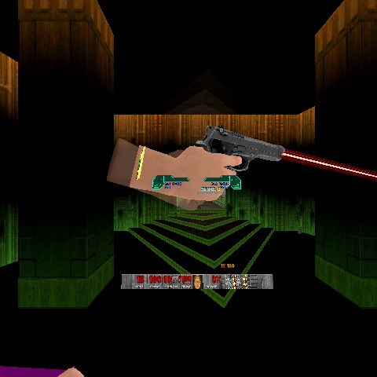
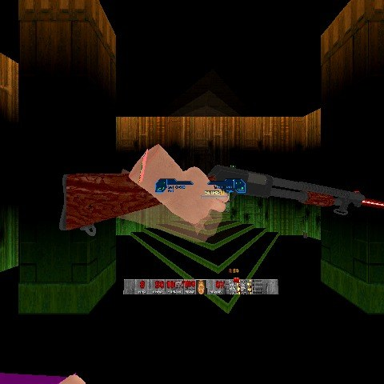
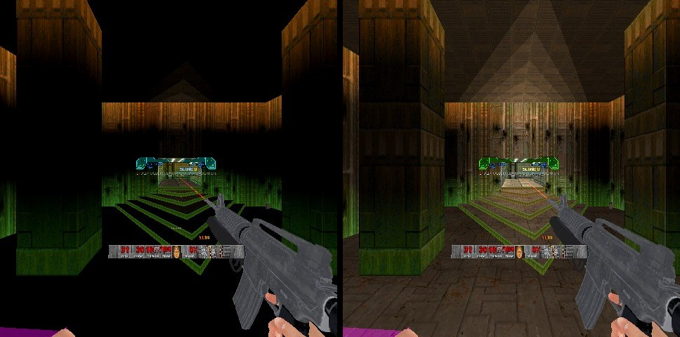

# RSQ Laser Sight
### Doom Arcade VR · a laser out of every barrel, both hands, painted right where your shot will land

Every Brutal Doom gun in your hand throws a beam from its own muzzle, down its own barrel, and paints a dot on whatever
it touches: flat on a wall, flat on the floor, on a monster's body. The beam is drawn as part of the gun every frame
the headset draws, so it moves with your hand instead of trailing it. Lock onto a demon and the dot bites; line up a headshot and it flashes.
Pick up a grenade launcher and the laser bends into the arc your grenade will fly.

*Rig frame, 2026-11-09, current build: the pistol's PC VR laser (white-hot core in a soft red glow) staying on through
a fire frame. Simulated headset on the Linux rig, not a capture from a real headset.*

---

## What it feels like

- **A laser on each hand.** Main hand red, off hand green by default; each hand switches on and off on its own in the menu.
- **It comes out of the barrel.** The beam starts at the gun's real muzzle and runs along its real barrel, measured from
  the gun's own 3D model. It fades to nothing over three metres and stops exactly where it hits.
- **It stays glued to the gun.** The beam is drawn as part of the gun, so it moves at the headset's frame rate, not the
  game's. It stays on between shots and through the kick, and steps aside while you reload.
- **The dot sits on things.** On a wall it lies flat on the wall; on a floor or ceiling, flat on that; on a monster, on
  its body. It keeps the same size on screen near or far, glows, and lights the spot it lands on.
- **Two looks.** **Quest:** a clean, cheap beam. **PC VR:** a white-hot core inside a soft coloured glow.
- **Target lock.** Over a live enemy the dot swells and pulses, and the beam burns brighter.
- **Headshot reaction.** Dot on the top fifth of an enemy and it flashes your headshot colour.
- **Grenades get an arc.** Fire a lobbing weapon once and the laser learns its throw: a dotted arc to where it will
  land, with the beam bent along it.
- **Your colours.** Any colour from a picker, per hand, beam and dot apart, per weapon slot, or a rainbow cycle.
- **Night-vision laser.** Infrared Only hides it from the naked eye; pick up light amplification goggles to see it.
- **It gets out of the way.** Point the gun at the floor, reload, switch guns or die and it goes out; punch, saw or
  slice and there is no laser at all.

---

## How to play

There is nothing to hold: load it, pick up a gun.

| Do this | What happens |
|---|---|
| Hold a Brutal Doom gun | Beam from its muzzle, dot where it lands |
| Hold any other gun | No beam (it has no measured muzzle), but the dot still shows where you aim |
| Point the gun down past 55 degrees | The laser goes out until you raise it |
| Switch guns | The main hand's laser goes out at once, until the new gun is up |
| Reload, or raise or lower the gun | The beam goes out until the gun is steady again |
| Aim at a live enemy | The dot swells and pulses (Target Lock) |
| Fire a grenade launcher once | From then on: a dotted arc to the landing point, beam bent along it |
| Pick up light amplification goggles with Infrared Only on | The laser appears while they last |

There are no keys to bind. Each hand's laser is switched on or off on this pack's page (**Main Hand**, **Off Hand**;
greyed while **Laser Sight** is off).

---

## The beam

*Rig frame, 2026-11-09, current build: the pump shotgun's PC VR laser still on while the pump runs. Simulated headset,
not a capture from a real headset.*

- **From the gun's own muzzle.** Every placement of every gun was measured from its 3D model: where the barrel ends and
  which way it points, frame by frame (the pistol with and without a round chambered, each step of a kick). The beam is
  laid on that line. A gun nobody measured gets no beam rather than a wrong one.
- **It rides the gun.** It is drawn as a layer of the gun, so the renderer moves it with the controller every frame,
  turns it with every kick and raise, and carries it to whichever hand holds the gun. If your weapon scale is changed,
  the beam's start moves with the gun.
- **Stays on between shots.** For a second after any trigger press, frames that were never measured (fire, kick,
  pump) keep the gun's last measured pose, so the beam does not blink off on every shot.
- **Hides while you reload.** Past that second, an unmeasured frame is a reload or the gun going up or down, and the
  beam hides until the gun is back in a measured pose. Starting a weapon switch puts the main hand's beam out at once.
- **Fades and stops.** Brightest at the muzzle, gone at **Beam Fade Length** (3 m). It comes in 72 lengths from 10 cm
  to 6 m, and the longest one that does not pass what the laser hits is drawn, so it never shows through a wall.
- **Real beams show in the dark.** In full light the beam is 35% as bright as in the dark (**Beam in Daylight**); a
  live enemy under Target Lock makes it 35% brighter.

*Rig frames, 2026-11-09, current build: the rifle's laser in the same room darkened and lit (from the Glow In The Dark
test in the same run, before the test switched Laser to PC VR). How bright the beam was in each was not logged.
Simulated headset, not a capture from a real headset.*

### Quest or PC VR

The **Laser** row picks one look for every beam, both hands, straight or bent along an arc:

| | |
|---|---|
| **Quest** (default) | One thin rod in your colour |
| **PC VR** | The core pushed most of the way to white, half again as bright, holding bright longer before it fades, inside a soft halo in your colour that thins out from the beam |

*[Image to come: the same gun with Quest and PC VR side by side]*

**Beam Sparkle (Quest)** (off): now and then a tiny spark glints on the Quest beam's outer edge, in your colour
whitened, gone in a third of a second. Almost too faint to notice, on purpose. Photosensitive Mode dims the sparks and
halves how often they come. Code only, not shown yet.

### Which guns have a beam

25 of Brutal Doom's guns, as BD22 VR Reloaded holds them: pistol, revolver, SMG, MP40, rifle, sniper rifle,
machine gun, minigun, MG42, shotgun, super shotgun, assault shotgun, grenade launcher, incendiary launcher, rocket
launcher, Devastator, nuke launcher, hellish missile launcher, flamethrower, flame cannon, plasma gun, railgun,
Unmaker, BFG 9000 and BFG 10k. Their Purist versions too, and BD22 VR's off-hand copies (pistol, revolver, SMG, MP40,
rifle, plasma gun, shotgun, super shotgun, assault shotgun, railgun).

Any other gun gets the dot without a beam: traced from your hand along the shot's own line, or from the muzzle a
weapon pack tells this pack about.

---

## The dot

- **Painted on the surface.** Turned to the wall it lands on, lying on floors and ceilings, a hair in front so it never
  sinks in. On a monster it sits on the body, even seen from the side.
- **Always the same size on screen,** about half a degree across, with a floor so it never vanishes up close.
  **Dot Size** scales it.
- **Dot Glow:** a soft bloom around the dot, a real light in the dot's colour on what it touches, or both (the
  default). **Glow Intensity** (Test and Debug) above 1 brightens the bloom and also widens the light.
- **It knows what it is on** (**Dot Reacts to Surface**, on): on water, nukage, lava, blood or slime it swims and goes a
  little see-through; on metal, doors, pipes and platforms its glow spreads wider.
- **Dot Only on Enemies** (off): the dot shows only on a live hostile monster.
- **Dot Range Limit** (Test and Debug): no dot past that distance. The trace looks 2048 map units (about 60 m) by
  default.

*[GIF to come: the dot sliding from a wall onto the floor and up an imp, keeping its size]*
*[Image to come: the dot swimming on nukage, and glinting on a metal door]*

### Following Brutal Doom's shots

BD22 VR Reloaded 2.0 fires each gun from its own muzzle a few degrees left of and above the controller's straight
line, down the drawn barrel. With **Follow Brutal Doom Shots** on (the default), the dot is traced along exactly that
line, from that muzzle, so it lands where the bullet lands.

---

## Targets

- **Target Lock** (on): over a live hostile monster the dot grows by a quarter and pulses (2.2 times a second), and the
  beam brightens. **Lock Tighten** (Test and Debug) shrinks it onto the target instead.
- **Colour on Target** (off): the dot and beam turn the **Target Colour** (yellow) on a locked enemy. Its row is greyed
  unless Target Lock is on.
- **Headshot Reaction** (off): with the dot in the top fifth of a live enemy, the laser pulses toward the **Headshot
  Colour** (white), 4 times a second; turn **Headshot Pulse** off for a steady colour.

With RSQ Gun Bonsai VR and RSQ Tactical Rig loaded, these three are upgrades you learn (see Plays well with).

*[GIF to come: the dot locking onto an imp, swelling and pulsing, then flashing white on its head]*

---

## Grenade arc

- **Learned from the gun.** The first time a weapon throws something that falls, the laser watches it leave: its speed,
  its gravity, the angle it left at. From then on it draws that weapon's flight. Guns that fire bullets or straight
  shots (plasma, rockets) are never treated as lobbers, whatever sparks they throw.
- **The path, tic by tic.** Up to four seconds of flight, exactly as the game will move it, stopping at the first wall,
  floor or body. 24 dots along it, and the dot where it lands.
- **Arc With Beam** (on): the beam itself bends along the arc as one unbroken line, in Quest or PC VR look.
- What was learned lasts the whole session; after loading a saved game each gun relearns on its next shot.

*[GIF to come: a grenade launcher's dotted arc with the bent beam, then the grenade landing on the dot]*

---

## Extras

- **Spread Ring** (off): a ring around the dot showing where this gun's shots can land: the cone 95% of its shots
  fell inside, measured from its own shots after it has fired three. Sideways and up-down spread are measured apart, so
  a shotgun's ring can be an oval. Below 0.75 degrees no ring is drawn.
- **Show Range** (off): the distance to what the laser is on, on a little screen **By the Gun** or floating **At the
  Dot** (bigger the further it is), in the dot's colour. **Range Units:** metres (one decimal under 10 m), feet or map
  units (counted along the laser's own line, so steep shots read true). It shows the main hand's, or the off hand's when the main hand has nothing.

*[Image to come: the spread ring around the dot on a wall, shotgun]*
*[Image to come: the range readout by the gun and at the dot]*

---

## Colours

The laser can be any colour from a picker. In order, each one over the last:

1. **Colour Mode:** One Colour (the main hand's for both), **Per Hand** (the default: red main, green off), or Beam and
   Dot (separate colours for each hand's dot).
2. **Colour per Slot** (off): a colour for each weapon slot 1 to 0 (red, orange, yellow, green, cyan, blue, purple,
   pink, white, red).
3. A colour the weapon itself asks for, if a weapon pack sets one.
4. **Cycle Colours** (off): a rainbow, 60 degrees of hue a second, the two hands half a turn apart; **Dot Cycles Too**
   (on).
5. On a locked enemy, the **Target Colour**; on a headshot, the **Headshot Colour**.

*[GIF to come: Cycle Colours on both hands]*

---

## When it shows

- **Show on Melee** (No): fists, chainsaw, saber, shield and an empty hand get no laser. Brutal Doom's off-hand gun
  copies are guns and always get one.
- **Off When Aimed Down** (55 degrees): pointed down past this, the laser goes out; the main hand's also goes out
  while you switch guns. 0 keeps it on always (the beam still goes out during a switch or a reload, see The beam).
- **Only When Ready** (No): the laser shows only while the gun is ready to fire, not while firing, reloading or
  switching.
- **Infrared Only** (off): invisible to the naked eye; visible while the light amplification goggles last.
- Gone while you are dead.
- On PC VR with SteamVR, bracing a gun in both hands hands the off hand's gun to the main hand, and the off hand's laser
  goes with it until you let go of the grip.

*[Image to come: Infrared Only, the room without goggles and with them]*

---

## Plays well with

- **RSQ Gun Bonsai VR** with **RSQ Tactical Rig:** Target Lock (two levels: the lock, then its colour) and Headshot
  Reaction (two levels: the headshot colour, then a gun hit with your dot on a monster's head counts as a headshot for
  Critical Hits) become upgrades that grow from the Rig's Quick Draw. Until learned the feature is off and its row is
  greyed, with one line at the top of the page saying so; once learned the row turns it on or off. With Gun Bonsai VR
  but no Tactical Rig nothing is gated.
- **RSQ Distance Grab:** asks whether a hand has a laser beam; with its **Yield to Laser Sight** on (off by default there), its
  own grab beam stands down on that hand.
- **RSQ Accessibility:** **Colour Blind Mode** swaps the two hands' colours for the series' pair for your vision and
  shows the lock by a deeper pulse instead of a colour; **Photosensitive Mode** keeps the lock and headshot pulses at
  2.5 a second or less; **Cue Size** scales the dot, its glow, the arc and the bent beam; **Text Size** scales the range
  readout; **Steady Hands** smooths the dot's line (the beam stays on the gun as drawn); its **Reset Every Mod** resets
  this page too.
- **BD22 VR Reloaded 2.0:** Follow Brutal Doom Shots uses its own shot line; its off-hand copies of the pistol,
  revolver, SMG, MP40, rifle, plasma gun, shotguns and railgun get their own beams.
- **Brutal Doom (brutal22test6) and BD_VoxelPack:** their guns, as BD22 VR holds them, are the measured guns.
- **QuestZDoom's own laser sight** (M8F's Laser Sight, the launcher's add-on): with it loaded, **Which Laser** picks one.
  RSQ Laser Sight switches M8F's off; QuestZDoom's (M8F) switches it on and this pack's laser hides. Without M8F's mod
  the row does nothing.
- **Any weapon pack** can tell this pack each gun's laser colour or muzzle point, and any mod can ask what the laser
  is doing (see Under the hood).

---

## Options

*Options → Radiant Silvergun Options → RSQ Laser Sight.* One page, with Test and Debug below it. Defaults in brackets.

| Section | Rows |
|---|---|
| (top) | Laser Sight (On) · Which Laser (RSQ Laser Sight; QuestZDoom's (M8F)) · Main Hand (On) · Off Hand (On) |
| Beam and Dot | Show Beam (On) · Laser (Quest; PC VR) · Beam Sparkle (Quest) (Off) · Show Dot (On) · Dot Only on Enemies (Off) · Dot Size (1.00) · Dot Glow (Bloom and Light; Off, Bloom, Light) · Dot Reacts to Surface (On) · Infrared Only (Off) |
| When It Shows | Show on Melee (No) · Only When Ready (No) · Off When Aimed Down (55 degrees; 0 = never) · Follow Brutal Doom Shots (On) |
| Targets | Target Lock (On) · Colour on Target (Off) · Target Colour (yellow) · Headshot Reaction (Off) · Headshot Colour (white) · Headshot Pulse (On) |
| Extras | Grenade Arc (On) · Arc With Beam (On) · Spread Ring (Off) · Show Range (Off; By the Gun, At the Dot) · Range Units (Metres; Feet, Map Units) |
| Colours | Colour Mode (Per Hand; One Colour, Beam and Dot) · Main Hand Colour (red) · Off Hand Colour (green) · Main Hand Dot (red) · Off Hand Dot (green) · Cycle Colours (Off) · Dot Cycles Too (On) · Colour per Slot (Off) · Slot 1 to Slot 0 (red, orange, yellow, green, cyan, blue, purple, pink, white, red) |
| Test and Debug | Beam and Dot: Beam Fade Length (3.0 m) · Beam Brightness (0.80) · Beam in Daylight (0.35) · Dot Brightness (1.00) · Glow Size (1.80) · Glow Intensity (1.00) · Trace Range (2048) · Dot Range Limit (0 = the trace range) · Dot Lead (0 tics). Targets and Colours: Cycle Speed (60 degrees a second) · Lock Tighten (0.00) · Lock Pulse Rate (2.2 a second) · Headshot Pulse Rate (4.0 a second). Extras: Arc Dot Size (1.00) · Arc Brightness (0.80) · Ring Minimum Spread (0.75 degrees) · Ring Brightness (0.60) · Readout Size (1.00). Debug Log (Off) |

A row that only matters with another row on is greyed while that one is off: Main Hand and Off Hand with Laser Sight;
Laser with Show Beam; Dot Only on Enemies, Dot Size, Dot Glow, Dot Reacts to Surface and the two dot colours with Show
Dot; Colour on Target with Target Lock; Range Units with Show Range; Glow Intensity with Dot Glow; Arc With Beam with
Grenade Arc; the slot colours with Colour per Slot; and so on.

The page ends with **Reset All**: every setting on the page and on Test and Debug goes back to its default.

---

## Status

| | |
|---|---|
| **Shown on the rig** (2026-11-09, current build) | The beam staying on between shots: the pistol's fire frames and the pump shotgun's pump frames, none of them measured, kept the beam and the PC VR glow up every tic (log: `design/rigtest_2026-11-09/logs/main_A-G_I.log`, sections BR_B_PISTOL and BR_B_SHOTGUN; frames: `design/rigtest_2026-11-09/frames/B_pistol_PISTB_rawrow-1_beam_on_f466.jpg`, `B_shotgun_pump_beam_on_f519.jpg`). The rifle's beam drawn in the same run (frames `I_ddz_mode2_default_t40_f028.jpg`, `I_ddz_mode0_t232_relit_f076.jpg`). The pack loaded with no script error or warning of its own on doom2, brutal22test6, BD_VoxelPack, BD22 VR Reloaded 2.0.4e, LOB, Champions, Gun Bonsai and the rest of the series, and its page sits under Radiant Silvergun Options (same log). Rig only, not headset-confirmed |
| **Headset-confirmed** | Nothing yet |
| **Code only, not yet shown** | Everything else on this page: the dot and where it sits, its glow and light, surfaces, Dot Only on Enemies, Follow Brutal Doom Shots, Target Lock, Colour on Target, Headshot Reaction and its Gun Bonsai VR levels, the grenade arc and the bent beam, the spread ring, the range readout, every colour option, Infrared Only, the Main Hand / Off Hand rows, Which Laser with M8F's mod, the beam hiding during a reload or raise / lower and at a weapon switch (and its one-second hold after a trigger press), the greyed rows, Glow Intensity widening the light, the Map Units readout, Off When Aimed Down, Only When Ready, the Quest look's beam, Reset All |

Earlier commit messages (2026-11-06) say Dot Only on Enemies and the bent arc beam (with a test lobber, not BD22's
launcher) were shown on the rig; those logs and frames are not in the repo, so they are not counted here.

---

## Under the hood

- **What the engine allows, and what this uses.** Stock QuestZDoom 17.3: ZScript and data only, no engine changes. The
  beam is a weapon-layer voxel handed to the gun as its caller, so the engine draws it on that gun's controller at
  frame rate; one voxel rod per gun placement and length (102 placements x 72 lengths), found by sprite frame alone so
  it loads with or without Brutal Doom. The fade is a colour table built at run time: the rod's colours encode the
  distance from the muzzle, so one rod serves every colour and fade length. The dot, glow, ring, arc and readout are
  world actors moved 35 times a second.
- **Measured, not guessed.** `tools/gen_beams.py` reads each gun's MODELDEF and held mesh from the load order's pk3s and
  writes the voxel rods, `VOXELDEF.txt`, `zscript/rsqls/muzzles.zs` and `docs/MUZZLES.txt`; its Ready frames come from
  `tools/readyprobe` (dump in `tools/ready_bd22q.txt`). `tools/gen_halo.py` writes the PC VR halo rods
  (`VOXELDEF.halo`, a second VOXELDEF lump). `tools/gen_bdbore.py` parses BD22 VR's own muzzle table and bore into
  `zscript/rsqls/bdbore.zs`. `tools/gen_assets.py` makes the dot, glow, ring, arc segment and readout meshes and
  `MODELDEF.txt`. `tools/aimprobe` is a test map handler that logs the dot against an imp's billboard.
- **The hands.** Each hand's muzzle is carried from the controller's model frame into the map the way the renderer
  carries the gun (yaw, pitch, roll, 34 map units a metre, the 1.2 vertical stretch), mirrored for a left-hand model.
- **Learning.** A static handler watches the console player's hitscans (spread histogram per weapon and fire mode)
  and missiles (the fastest one each hand puts out in a tic decides; a straight missile marks the gun straight). Kept
  for the session, not saved.
- **Colour.** Translations are built at run time from the palette's own brightness (read from PLAYPAL), cached, and
  stepped (36 hues, 8 pulse steps) so a cycling laser reuses them.
- **Single player.** Drawn for the console player only; every option except Which Laser, Off When Aimed Down, Dot
  Reacts to Surface, Follow Brutal Doom Shots and Debug Log is a server setting.
- **Size.** The pk3 is about 25.7 MB, nearly all of it the beam and halo voxels; the halo voxels load whichever Laser
  look is picked (Quest memory use not measured).
- **No hard links.** Every other mod is found by name at run time (Gun Bonsai VR, Tactical Rig, Accessibility, BD22
  VR's muzzle handler, M8F's `m8f_ls_EventHandler` and its `m8f_wm_ShowLaserSight` switch for Which Laser). The pack loads and plays alone.
- **For other mods: `RSQLS_SightService`,** found by name. `GetInt("laser.active", "", hand)` and `"laser.beam"`: did
  that hand draw a laser (or a beam) last tic; `GetDouble("laser.line", "x"|"y"|"z"|"dx"|"dy"|"dz", hand)`: the line
  that hand's beam was drawn on; `GetInt("head.on", "", 0, 0, monster)`: your dot sat on its head this tic or the last
  (Headshot Reaction 2 only); `GetIntUI("menu.locked" / "menu.gated")` for the greyed rows.
- **For weapon packs:** a Service whose class name contains `LaserColorService` answering `GetInt("laser.color",
  class, hand, isDot)` with 0xRRGGBB colours that gun; one containing `LaserMuzzleService` answering
  `GetString("laser.muzzle", class, hand)` with "forward up side" in metres from the grip places the dot's start for a
  gun with no measurement.
- **Debug Log** prints what the arc learner saw (`[RSQLS] LEARNED`, `STRAIGHT`, each missile).

## Credits

The full list is in **CREDITS.txt**.

- **presidentkoopa:** the project, and the options carried over from his UZDXREMA laser (pointer and beam apart,
  glow, colour pickers per hand, per slot, cycling, target and headshot reactions, infrared).
- **Laser Sight** by m8f (Alexander Kromm, github.com/mmaulwurff/laser-sight, GPLv3), the laser sight bundled with
  QuestZDoom: the inspiration. None of its code or sprites is used; with both loaded, Which Laser picks one.
- **Brutal Doom** and **BD22 VR Reloaded:** the gun models the muzzles were measured from, and BD22 VR's shot line.
  None of their files ship in this pack.
- **Generated for this pack:** the beam and halo voxels, the muzzle table, the sprites and meshes (the tools above).
- **QuestZDoom** (Emawind and Team Beef): the engine and its VR hand API.
