
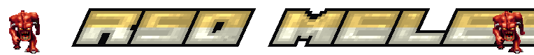

# RSQ Melee
### Doom Arcade VR · fight with your fists, slap fireballs aside, shove with the gun butt, and grab an imp by the collar

<a href="../README.md#melee">&larr; RSQ UBQ Series</a>

Swing your fists and you are fighting. No attack button, no canned animation: what your hands did is what happens.

**What it does:**

- **Real punches, light and strong:** the swing is the punch, and a fast one hits twice as hard as a slow one ([The punch](#the-punch))
- **Jab, hook, uppercut:** read from how your hand moved, each with its own spark and its own sound
- **The uppercut lifts:** monsters leave the floor, and barrels fly at the nearest monster ([Barrels](#barrels))
- **Any fist:** Doom's, Brutal Doom's, an empty hand, or the mod's own hands and boxing gloves
- **The open palm:** tap the trigger to open your hand, and slap fireballs and bullets out of the air ([The open palm](#the-open-palm))
- **The gun as a club:** the gun-butt shove, the pistol whip and the two-handed butt strike, all on from the start ([The gun as a club](#the-gun-as-a-club))
- **Slow motion after a shove**, and the **F.E.A.R. Effect:** finish it with a shotgun and it bursts into a red mist
- **The Headlock:** grab a monster with your off hand, hold it, punch it, throw it ([The Headlock](#the-headlock))
- **Counter punches:** hit a monster in its wind-up for a red spark
- **Punch a switch** or a door and it works
- **Six more moves**, off until you turn them on: Guard, Hadouken, Wall Splat, Heavy Hands, Ground Pound, Clear Out ([More moves](#more-moves))
- **Slappers Only:** fists only, GoldenEye's way
- **A whole upgrade tree** for each glove with RSQ Gun Bonsai VR ([Plays well with](#plays-well-with))

Three things make it worth your arms:

- **It tracks a real punch.** A swing has to travel and has to be moving to count. The slowest punch that counts does
  10 damage and a full-speed one does 20, so a light jab and a strong one are different blows because you threw them
  differently.
- **The uppercut changes the fight.** Rise into the punch and the monster is lifted off the floor, stuck in its pain
  until it lands. Do it to a barrel and the barrel flies at the nearest monster while the world slows down to watch.
- **The Headlock.** Squeeze your off hand's grip beside a monster and it is stuck at your hand, facing you, while your
  other fist works it over. Then swing that arm and throw it across the room.

*[GIF to come: a jab, a hook and an uppercut on an imp, then an uppercut sending a barrel into a crowd]*

**Works on plain Doom II with nothing else loaded.** With Brutal Doom VR Reloaded (2.0.4u or later) its pistol whip and
butt strike are Melee's, measured on that pack's gun models ([The gun as a club](#the-gun-as-a-club)).

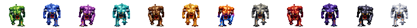

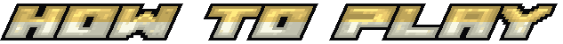

| Do this | What happens |
|---|---|
| Swing a fist into a monster | A punch: a jab, hook or uppercut, from 10 damage at the slowest to 20 at full speed |
| Swing up into it | An uppercut: it flies up and back, stuck in its pain frames until it lands |
| Punch it while it winds up its attack | A counter, with a red spark |
| Tap that hand's trigger (press and let go quickly) | That hand opens (or closes again). A soft click tells you which way it went |
| Swing an open palm through a monster's fireball or bullet | Knocked aside. It is yours now, so it can hurt monsters but not you |
| Turn on **Hadouken**, then punch a fireball | It flies back at whoever fired it, faster and harder |
| Turn on **Guard**, wear the boxing gloves and hold both fists up at your face | Blows from in front are softened |
| A gun in your main hand, thrust it forward fast | The gun-butt shove, then a short slow-down (with RSQ SlowMo) |
| With Brutal Doom VR: both hands on a long gun, drive the stock forward | Its butt strike, now Melee's (**Two-Handed Butt Strike**, on) |
| With Brutal Doom VR: swing a pistol or revolver down into something, either hand | Its pistol whip, now Melee's (**Pistol Whip**, on) |
| Off-hand grip on a monster within a hand's width of your palm | Headlock: it is held at your hand |
| Holding one, swing your off hand forward hard | Thrown |
| Let go of the grip | It drops |
| Any punch or shove into a switch or a door | It works, as if you'd pressed Use |

The punches, the swat and the Headlock work with whatever is in your hands, from the first map. Melee's own hands are
optional: turn on **Start With Melee Hands** and you get a pair in your inventory at every level start. You still start with BD22's own start weapon, and the off hand keeps BD22 VR's hands (owner 11-11).

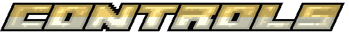

- **No keys**, and no menu button stands in for one.
- **Either hand:** swing the fist to punch. **Tap the trigger** (press and let go quickly) to open the hand or close it
  again (not in boxing gloves). With Gun Bonsai VR's Star Punch, an uppercut with that hand's trigger or alt fire
  squeezed spends a banked star.
- **Off hand:** **the grip** (read raw from QuestZDoom's grip keys; their codes are on Test and Debug) next to a monster
  is the Headlock; let go of the grip and it drops.
- **Main hand, holding a gun:** thrust it forward hard for the gun-butt shove.
- **Gestures:** the jab, hook and uppercut (read from the fist's path); the open-palm swat; both fists up at your face
  (Guard); both fists swung down together (Ground Pound); both palms thrust forward (Clear Out); a hard forward swing
  of the off hand while holding a monster (the Headlock throw). With RSQ Accessibility loaded, its reader supplies the
  two-hand gestures; without it, Melee reads them with its own copy.

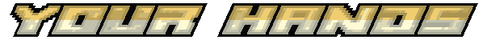

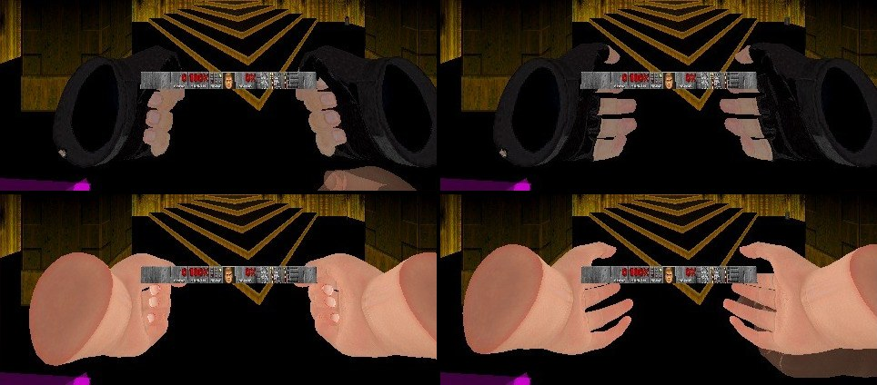

*Ermac's hand, fist then open (top), and the FBX hand, fist then open (bottom), both hands up (rig capture, not headset).*

When Melee's own hands are up, you see them:

- **Ermac's hand** or **the FBX hand** from Brutal Doom VR. Each has a fist and an open hand, and changes when you tap
  the trigger. **Hand Model: Auto** picks the FBX hand when Brutal Doom VR is loaded and Ermac's otherwise. The FBX
  hand wears Brutal Doom VR's Hand Skin Tone (single player).
- **Boxing Gloves**, SuperPunchOut's. Always fists, never an open palm. Drawn at the hands' size, where the fist is
  (11-10: they drew about 1.4 times the fist across, nearer your eye).

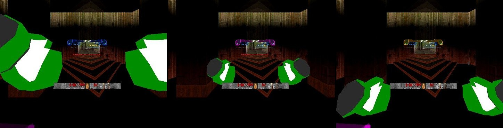

*The boxing gloves at their new size: at the guard, held out, and at rest (rig capture, not headset).*

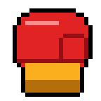

*The hands' item icon, as drawn in the pack.* The gloves are in no weapon slot (owner 11-11), so weapon next stops on
Brutal Doom's Fist only. The Wheel shows one fist card, and picking it gives you the gloves when you have them.

With any other fist (Doom's, Brutal Doom's, an empty hand) the open-hand tap still works, but the fist looks the
same either way, so the click is your only cue.

**Slappers Only** is GoldenEye's: fists only. It puts the boxing gloves on both hands right away and takes every other
weapon from you, sabers and the ShieldSaw included: the ones you carry go into a stash, weapons lying in the level vanish,
and one you're given later goes into the stash within a quarter of a second. Your ammo stays. It is done again at every level start. RSQ Saber's Start With Saber stands down while it is on. Turn it
off and your guns come back, with the gun you had in your hand back in it, but no free ammo.

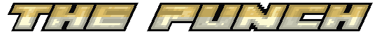

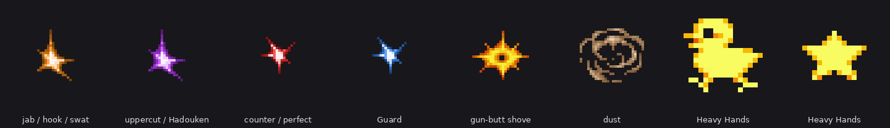

Swing a fist into a monster. The punch lands where your fist meets the body.

| The punch | How you throw it | What it does |
|---|---|---|
| **Jab** | Drive straight in | 10 to 20 damage by your speed; an orange spark |
| **Hook** | Swing across | The same damage; an orange spark, and a different sound for each hand |
| **Uppercut** | Rise into it | The same damage, and the monster is lifted off the floor; a violet spark |
| **Counter** | Any of them, while the monster winds up its own attack | A red spark |

- **Speed is power.** A punch counts from 2 m/s and is at full strength at 7 m/s. The spark is small, medium or
  large by the same speed.
- **A Berserk pack** makes every punch five times as hard.
- **One blow a swing.** A fist waits a moment (6 tics) before it can hit the same monster again.
- **The lift has a ceiling:** no uppercut sends a monster more than 3 m into the air.
- **Rumble** in the hand that hit, every time.

### The sounds (2026-11-16)

The owner's own punch sounds, one per kind of blow, each landing on the tic the blow does:

- **Jab:** three sounds in turn, each a little higher or lower each time (±5%), so a flurry never repeats.
- **Hook:** one for the right hand, one for the left (by the hand you swing, left-handed play included).
- **Uppercut:** the heaviest, the same as RSQ Grapple's kick (a barrel launched by an uppercut too).
- **The swing:** a short whoosh as a fist swing becomes a punch (about two tics before it lands at arm's length), hit or
  miss. Pulling the fist back after a punch makes none.
- **Pistol whip:** a punch with a small metal clank. **Gun-butt shove:** a punch with a thud. Brutal Doom's own hit sound
  under those two is silenced, so one blow is one sound.
- The star punch, the Hadouken, the open palm's swat and the guard keep their sounds.

*Rig only, not headset-confirmed (2026-11-16, the owner's load order with BD22 VR Reloaded 2.0.4x, all logged on the tic):
jabs at t150, t184, t218 played jab1, jab2, jab3 at pitch 1.020, 0.954, 1.003, then jab1 again, each whoosh 2-4 tics
before; the right hook played hookr and the left hookl on their hit tics; an uppercut with Brutal Doom's fists played the
uppercut sound, and one into a barrel too; the pistol whip (t171, t204) and the butt strike (t163) played theirs on the
hit tic while Brutal Doom's attack actor stayed silent (an unmuted one, launched as a control, played Melee/Flesh); the
gun-butt shove without BD22 VR played its sound at t163. No script errors from this pack.*

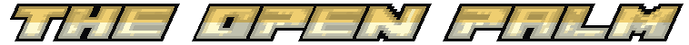

Tap a hand's trigger, a quick press and let go, and that hand opens. Tap again and it is a fist. An open palm does not
punch:

- **Open-Palm Swat:** swing the palm through a monster's fireball and it is knocked aside. It is yours now: it can
  hurt monsters, not you.
- **Swat Bullets:** the same for a monster's bullet.

Boxing gloves stay fists.

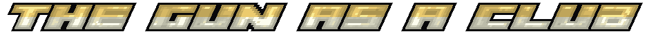

Which moves you have depends on what you load.

| With | The move | How | Default |
|---|---|---|---|
| Any guns | **Gun Butt Shove** | Thrust the gun in your main hand forward, hard (3.6 m/s) | On |
| Brutal Doom VR Reloaded 2.0.4u or later | **Pistol Whip** | Swing a pistol or revolver down into something, either hand | On |
| Brutal Doom VR Reloaded 2.0.4u or later | **Two-Handed Butt Strike** | Both hands on a long gun, drive the stock forward | On (since 2026-11-16) |

With Brutal Doom VR Reloaded loaded, Melee's own shove stands down and the pistol whip and butt strike take its place:
they are that pack's moves, now Melee's, measured on the stock and the muzzle of the gun you see. The shove does 14
damage (62 with a Berserk pack) and knocks the monster back.

**Slow motion.** A shove or butt strike that lands slows the world for one second, with RSQ SlowMo loaded (**Always
Slow Time on Shove**).

### The F.E.A.R. Effect

While that slow motion lasts, every shotgun hit of yours bleeds twice, and a kill makes the monster burst into a cloud
of blood mist (**F.E.A.R. Blood Mist**). RSQ Score pays it as a combo of its own.

*[GIF to come: a butt shove on an imp, the world slowing, a shotgun blast and the red mist]*

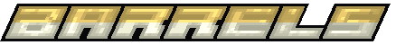

**Barrel Launch:** an uppercut or a gun-butt shove into a barrel sends it, fast and tumbling, at the nearest monster
the barrel can see. It goes off on the first thing it meets, and the kills are yours. With RSQ SlowMo the world slows
until it blows, three seconds at most, and the barrel itself is not slowed (**Barrel Launch Slow-Mo**).

With RSQ Distance Grab's Barrel Lock-On holding a lock, the barrel goes to the lock instead.

**Uppercut Kicks Barrels** (off) is the gentler version: an uppercut lifts a barrel up and away without setting it off.

*[GIF to come: an uppercut launching a barrel into three imps, in slow motion]*

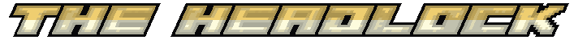

Put your off hand within a hand's width of a monster and squeeze the grip.

- **Held:** it is frozen at your hand for up to 3 seconds. Punch it, and each punch draws more blood than the last.
- **How heavy:** up to a Pinky Demon. A Baron is too heavy.
- **Thrown:** swing your off hand forward hard while you hold it. With RSQ Distance Grab loaded the throw is that
  mod's, with its aim help and its impact.
- **Let go** of the grip and it drops.
- **Human Shield** (off): it is held for as long as you grip, turned to face away from you.

*[GIF to come: an imp caught by the collar, punched three times, then thrown into another]*

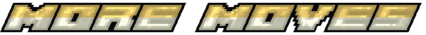

Six moves that are **off until you turn them on**. With RSQ Gun Bonsai VR loaded they are upgrades you learn, and
the rows of Guard, Wall Splat, Ground Pound and Clear Out stay greyed until you have.

| Move | How | What it does |
|---|---|---|
| **Guard** | Both empty hands or gloves up at your face | A blow from in front does 60%, and pushes you back a step. A blow over 35 breaks the guard |
| **Hadouken** | Punch a monster's fireball | It flies back at whoever fired it |
| **Wall Splat** | Punch a monster into a wall | It slams, takes more damage, and reels |
| **Heavy Hands** | Any punch | The monster freezes for a beat and is knocked further |
| **Ground Pound** | Both fists swung down together | A shockwave round you |
| **Clear Out** | Both palms thrust forward together | Everything in front of you is shoved back |

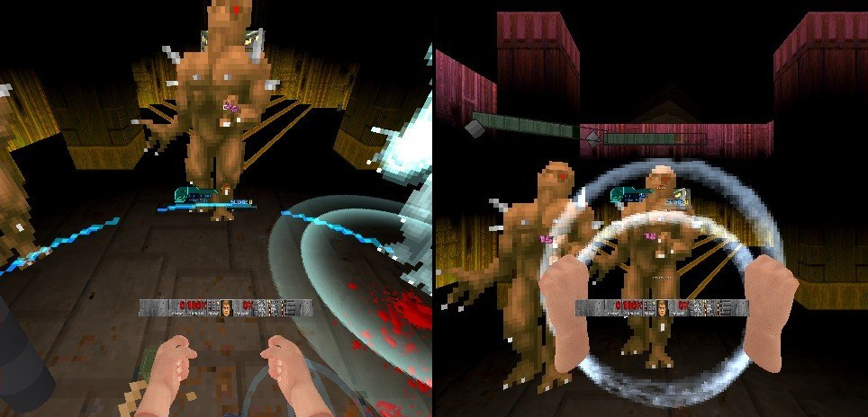

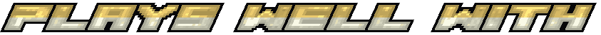

- **RSQ Gun Bonsai VR:** Guard, Wall Splat (its Wallflower), Ground Pound, Clear Out and Human Shield become
  upgrades you earn. Their rows grey out until learned, and the page says *"GunBonsaiOVR detected. Mod features
  unlocked via upgrades."* Learning one turns its row on; the row can still turn it off. **Start With Guard** gives
  you Guard at its first level before you learn it. Melee's own hands learn **Hadouken** and **Heavy Hands**; any
  other fist plays those rows as they are. With Gun Bonsai VR, Melee's hands learn the **uppercut** too (until then
  a rising punch lands as a jab). Then the fists tree adds to Melee's moves: **Launcher**, **Juggle**, **Meteor**,
  **Dempsey**, **Star Punch**, **Catch**, **Swat Back**, **Bullet Time Fists** (with RSQ SlowMo), **Knockdown**,
  **Rage**, **Parry**, **Reflect Guard**, **Absorb and Release**, **Taunt**, **Pistol Whip**, **Rifle Butt**, and
  the off hand's grapples: **Heavier Headlock**, **Slam**, **Throw Into**, **Chokehold**, **Headlock Uppercut**.
  Gun Bonsai VR's own elemental fists, criticals and finishers use Melee's bursts and sounds.
- **RSQ Score:** Melee tells Score which punch landed and which moves touched a monster, so its melee rows pay:
  Shoryuken (an uppercut kill), Liver Shot, Glass Jaw, Textbook, Triple Threat, Dempsey Roll, Air Combo, Counter,
  Flurry, Knockdown, Bouncer (Clear Out), Release, Toss, Piledriver, Cut Loose, Butt Stroke, and the combos
  Headlock, Pistol Whip and **F.E.A.R. Effect**. The newer rows read Melee too: Swatted, Rope-a-Dope, Seismic, Out
  of My Way, Full Release, Meat Shield, Human Shield, Field Goal, Seeing Stars, Meteor, Star Punch, Down for the
  Count, Bare Knuckle (a kill with Slappers Only on) and Red Mist. Brutal Doom's fists and an empty hand are read as
  punches as well, not as plain hits.
- **RSQ SlowMo:** the shove's slow-down and the F.E.A.R. window (SlowMo's **Melee Gun Butt Shove** row can turn
  that trigger off). A slowed bullet punched with Bullet Time Fists goes home to its shooter.
- **RSQ Distance Grab:** a monster thrown out of the Headlock flies through its throw (strength, aim assist, the
  impact). The two share the off-hand grip: a press goes to whichever has the nearer target, never both. Its
  **Barrel Lock-On** also turns on the uppercut barrel kick and sends the kicked barrel at the locked monster.
- **RSQ Grenade:** its barrels are barrels to the uppercut kick. Slappers Only stashes its hand grenade with the
  guns (it uses ammo).
- **Brutal Doom VR (BD22 VR):** its fists punch with Melee's reader (**Punch With Brutal Doom's Fists**, on); turn
  that off and Brutal Doom punches as it ships. Its butt strike, pistol whip and VR punch are Melee's (2.0.4u and later:
  *The gun as a club*), and its own stand down while Melee is loaded. With **VR Punching (BD22 VR's Punch)** on, that
  punch does the damage and Melee adds the rest (which punch, the lift, the moves). The axe, the Dragonslayer and the
  chainsaw stay Brutal Doom VR's: they are those weapons' own attacks. Its FBX hand and skin tone are Melee's FBX look.
- **RSQ Accessibility** (which carries RSQ Gestures): Rumble Strength scales every knock in your hands. The Off-Hand
  Modifier lets the main controller play the off hand. Seated Play lowers the Guard. Its two-hand gesture rows
  (Both Hands Down, Both Palms Thrust) are the ones Ground Pound and Clear Out use. Without it, Melee reads both hands
  itself with a copy of the same reader.
- **RSQ Tactical Rig:** a grip press at a holster is the holster's, never the Headlock's.
- **RSQ Grapple** and **RSQ Wheel:** no shove while you're on the rope or the Wheel is open. Grapple's Scorpion (Gun
  Bonsai VR) punches the monster it pulls in through Melee.
- **RSQ Miniboss:** its **Can't Be Headlocked** row (on) refuses minibosses.

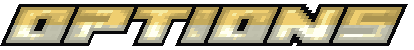

*Radiant Silvergun Options → RSQ Melee.* Everything is on one page; the raw numbers are under Test and Debug.
**Reset All** (on both pages) resets every Melee setting.

| Section | Rows |
|---|---|
| Hands | Start With Melee Hands (Off) · Punch With Brutal Doom's Fists (On) · VR Punching (BD22 VR's Punch) (Off) · Whip, Butt, VR Punch Open Switches (On) · Hand Model (Auto / Ermac / FBX (BD22 VR); Auto) · Boxing Gloves (Off) · Slappers Only (Off) · Open-Palm Swat (On) · Swat Bullets (On) · Uppercut Kicks Barrels (Off) · Hit Spark Size (1.0) |
| Gun Butt Shove | Gun Butt Shove (On) · Two-Handed Butt Strike (BD22 VR) (On) · Butt Strike: Swing Needed (2.4 m/s) · Pistol Whip (BD22 VR) (On) · Pistol Whip: Swing Needed (5.0 m/s) · Always Slow Time on Shove (On) · F.E.A.R. Blood Mist (On) |
| Headlock | Headlock (On) · Human Shield (Off) · Extra Blood (On) |
| Moves | Guard (Off) · Start With Guard (Gun Bonsai VR) (Off) · Hadouken (Off) · Wall Splat (Off) · Heavy Hands (Off) · Ground Pound (Off) · Clear Out (Off) |
| Test and Debug | Punch: Punch Damage (10), Min Speed (2.0 m/s), Full Speed (7.0 m/s), Re-Hit Wait (6 tics), Uppercut Rise (0.50), Lift Cap (3.0 m), Extra Reach (4) · Gun Butt Shove: Shove Speed (3.6 m/s), Slow Time Length (1000 ms), Gun Club Swing Strength (1.0), Butt Strike: Forward Share (0.50), Pistol Whip: Must Swing Down (0.25) · Headlock: Reach (0.30 m), Heaviest (400), Seconds (3.0), Throw At (3.0 m/s), Throw Weight % (30), Off Grip Keys (443 436) · Debug Log (Off / Each Decision / Also F.E.A.R. Hits) |

**Swat Bullets** covers the fist's Hadouken on bullets too. No keys to bind.

*[picture to come: the RSQ Melee options page]*

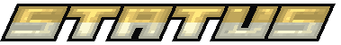

| | |
|---|---|
| **code only, not run** (2026-11-23, owner: "hold all rig checks until code is in and we talk") | **The arcade impact** (owner 11-23: "i was really hoping we could get some nicer visuals in for our melee impacts, we have the art somewhere we just arne't using it well. it really needs to be impactful and arcade-y"). The art was already here: kiddolink's VFX Hit Impact bursts played only on special moments. Now every landed punch, pistol whip and butt strike is layered by how hard it was, on top of its spark: hot shards fly out of every hit; a mid or hard blow adds a kiddolink burst (impact 1 a jab or hook, impact 3 an uppercut or a strike; a counter, impact 2 in red); a hard blow or a kill adds impact 5 big, a hit-stop (the monster holds 2 to 5 tics, then the knock throws it) and an arcade world word over it, POW!, BAM!, WHAM! or SMASH!, COUNTER! on a counter, K.O.! on a punch that kills (one word a player every 0.4 s at most; RSQ VisualRewards draws it). **Melee Impact** (Classic: the spark alone; Arcade, the default), **Impact Words** (On), **Hit-Stop** (On) |
| **rig only, not headset-confirmed** (2026-11-16, runs `slowfx_fx_old2` / `slowfx_fx_new2`, logs and frames in `SlowMo/docs/rig_2026-11-16_slowfx/`; the owner's full order, no script error from our packs) | **The ring and the pixel wave slow with the world** (owner 11-16 06:15). They keep their own clock, so each asks RSQ SlowMo's `scale` by name every tic (`sparks.zs` `RSQML_Clock`). At world speed 0.25 the ring lived 18 real tics before, 69 now; the pixel wave 22 before, 88 now. At full speed both unchanged (18, 22). The hit sparks and dust were already slowed by SlowMo itself |
| **rig only, not headset-confirmed** (2026-11-13, run `club1`: the owner's full load order with BD22 VR Reloaded 2.0.4u, `/home/claude/rig/work/runs/club1/run.log`) | **The gun as a club, in RSQ Melee.** BD22 VR's settings were copied in once at the map's start. With a Rifle held in both hands (the engine's steadying on), a straight forward shove of both hands (3.4 m/s) was Melee's butt strike: BD22's KickAttack hit a frozen Baron for 14, Melee asked RSQ SlowMo for its pulse and SlowMo slowed, and BD22 VR logged its own butt strike standing down. The same shove into a barrel launched it at a zombie, where it went off. A downward swing of a BrutalPistol (7.5 m/s at the muzzle) was Melee's pistol whip: MeleeStrikeNormal for 10, with the buzz. The off hand's pistol whip did the same (7.2 m/s), and BD22 VR logged its own standing down in both hands. A forward jab with BD22's fists (4.9 m/s) was Melee's port of BD22 VR's VR punch (one MeleeStrikeNormal for 10; Melee's punch reader called it a jab and dealt nothing of its own). Only the 4 voxeldef.txt errors from 02_BD22_VoxelPack.pk3, which were there before. Not shown: a switch worked by the whip or the butt, the Revolver / Moonlight / the other seven long guns, a Berserk blow, the feel in a headset. After the run, only the condition "Brutal Doom is loaded" (`BrutalWeapon`) was added to when the club runs (always true on that load order), for the weapon sets; it was compile-checked, not run. On the rig the one 4-tic shove counted as two swings (t161 and t165, two hits and two pulses): the rig drew no frame on some tics, and BD22 VR's code, ported unchanged, ends a swing after 3 tics without speed |
| **code only, not shown** (2026-11-11, `design/rigtest_2026-11-10/RESULTS_DOWNSHOT.md`; not run, by the owner's order "no rig test, code only until i say"; not load-checked either) | The eyes the hands and gestures are read against, and the watch check's own gesture copy use the engine's fixed standing eye height (the player class's ViewHeight), not the pawn's ViewHeight. RSQ SlowMo's DOWN scales the pawn's ViewHeight to 40%, which put them about 0.9 m too high while you were down. Standing and crouching are unchanged |
| **code only, not shown** (2026-11-11, `design/rigtest_2026-11-10/RESULTS_HUD11.md`; not run, by the owner's order "no rig test, code only until i say"; not load-checked either) | The gesture-name line is not drawn while any menu is open (owner 11-11) |
| **code only, not shown** (2026-11-11; loads clean on the full order, not run) | Start With Melee Hands puts the gloves in your inventory only (BD22's start weapon and BD22 VR's off-hand hands stay); the gloves are out of weapon slot 1 again, so weapon next has one fist. The rows below about slot 1 are history |
| **rig only, not headset-confirmed** (2026-11-11, the last checks, `design/rigtest_2026-11-10/RESULTS_LAST.md`) | **The gloves in weapon slot 1 by this pack** (its KEYCONF, no console addslot): Start With Melee Hands gave both gloves, slot 1 lists RSQ_Glove and RSQ_GloveOff, and the Wheel showed their two cards with RMICA0 / RMICB0 (`design/rigtest_2026-11-10/evidence/LAST_WHEEL_glove_cards_slot1.jpg`, `_log.txt`) |
| **rig only, not headset-confirmed** (2026-11-10 night and 11-11, the rig batch's fixes, `design/rigtest_2026-11-10/RESULTS_FIX.md`) | **Boxing gloves a glove's size:** first shrunk to the fists' size (scale 0.86; `design/rigtest_2026-11-10/evidence/FIX_2_boxing_glove_before_after.jpg`), then, the owner's call, scale 1.0, about 1.17x the fist and centred on it (commit 18043e65; `FIX_2b_boxing_glove_scale1_vs_fist.jpg`). **Gloves in weapon slot 1** on BD's order (commit 18043e65; slot readout `FIX_3b_gloves_in_slot1_log.txt`). **Slappers Only with RSQ Saber: found BROKEN in M8, then fixed and shown.** Before, the saber flickered in and out of the inventory and Slappers Only off left the saber in the main hand; after, the saber stays out while it is on, and off puts the Shotgun back in the main hand (`FIX_B_log.txt`). **The glove icons (M9): not shown at first** (the Wheel drew its own glove, and the gloves were in no slot); **fixed and shown:** the Wheel's MELEE HANDS cards wear this pack's RMICA0 / RMICB0 (`FIX_3_wheel_glove_cards_RMIC.jpg`; for that frame the gloves were put in slot 1 from the console, before the slot 1 change) |
| **rig only, not headset-confirmed** (2026-11-10 night, the packed batch, P1: `design/rigtest_2026-11-10/RESULTS_P1.md`; run without RSQ Gun Bonsai VR, so each move at level 1) | **M1:** Ermac's hand and the FBX hand, fist and open; the trigger tap opening and closing each hand; a jab, a hook and an off-hand uppercut landing on a held imp, the uppercut lifting it (`design/rigtest_2026-11-10/evidence/P1_M1_hand_models_fist_open.jpg`, `P1_M1_punches_160px.jpg`, `P1_B_log.txt`, `P1_C_log.txt`). **M2:** the boxing gloves on both hands (`P1_M2_M7_boxing_gloves_guard.jpg`; their size changed since, row above). **M3, the Headlock:** an imp held at the off hand, punched three times, then thrown at 6.6 m/s (`P1_M3_headlock_hold.jpg`, `P1_M3_headlock_held_punched_160px.jpg`, `P1_D_log.txt`); the grip was sent as its event (the real grip can't be pressed on the rig). **M4, the swat:** an imp fireball knocked aside (frames, `P1_M4_swat_fireball_160px.jpg`); a zombie's bullet knocked away, no damage taken (log only). **M5:** the off-hand fist beside a shotgun landing a jab; Uppercut Kicks Barrels sending a barrel up and away, then the shotgun setting it off (`P1_M5_barrel_kick.jpg`, `P1_E_log.txt`, `P1_F_log.txt`). **M6:** Ground Pound's rainbow ring and Clear Out's burst and two Force Push rings, by gesture and in frames; the shove moving an imp (`P1_M6_pound_clearout_rings.jpg`). **M7, Guard:** gloves up at the face, a 20 blow soaked to 12, a 40 blow breaking it; bare hands or hands down, no guard (`P1_C_log.txt`). **M8, Slappers Only:** everything stashed, gloves in both hands, a gun given later taken away, every gun back when off (`P1_A_log.txt`, `P1_B_log.txt`; its bug with RSQ Saber is in the row above). **N6:** this pack's rumbles sent through RSQ Accessibility's Rumble Backup (`P1_C_log.txt`). Not shown: the Headlock's throw striking anything |
| **rig only, not headset-confirmed** (2026-11-10, the batched rig test, full series load order with Brutal Doom 22 and BD22 VR Reloaded 2.0.4f) | Every launch loaded every RSQ pk3 with no script error from our packs (`design/rigtest_2026-11-10/RESULTS.md`). No Melee move was exercised in them (the packed batch, row above, did) |
| **rig only, not headset-confirmed** (2026-11-09, full series load order with Brutal Doom 22) | The pack loads with no script error of its own, and its page is listed under Radiant Silvergun Options (`design/rigtest_2026-11-09/logs/main_A-G_I.log`). No Melee move was exercised in that run |
| **Headset-confirmed** | Nothing yet |
| **code only, not shown** | Everything else on this page, among it the moves above level 1 (the batch ran without Gun Bonsai VR) and the Headlock's throw striking something |
| **not yet run** | Nothing from the rig test: M1 to M9, N6 and the Wheel frame with the gloves in slot 1 by this pack have run (above) |

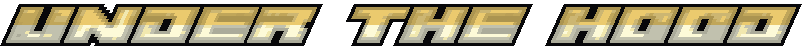

- **Stock QuestZDoom 17.3:** ZScript and data only. No engine changes. No other mod is required; every other mod is
  found by name while the game runs (`ServiceIterator`, class names), never linked.
- **The punch reader** is SuperPunchOut's Arcade reader: a punch arms on a slow hand, counts after 0.15 m of travel
  on consecutive tics at 2.0 m/s (Min Speed) or more on average, and its power is that average between Min
  Speed and Full Speed. Which punch it is comes from the swing's whole path in real metres (the vertical scaled by the
  level's pixel stretch), so a rising punch is not squashed into a jab. Snap turns and one-tic jumps are dropped.
- **Hands carried to the body** (`RSQML_HandSync`): QuestZDoom writes the controllers only when it renders a frame,
  so on a slow frame a still hand read against a walking body looked like a swing. Each frame's controller offset is
  added to where the body is this tic. Swings are measured from the body at the view's height, so stairs and landings
  are not swings.
- **Contact:** the fist is a 9 cm sphere plus Extra Reach, swept along its path this tic against each body's
  cylinder; one `LineTrace` from the fist (not `CheckSight`, which starts at the eyes and rolls the playsim's random
  numbers) confirms no wall is in between.
- **Missiles** are not in the blockmap, so Melee lists monsters' damaging missiles as they spawn. The swat and the
  Hadouken test the fist's path against the missile's path from 2.5 tics behind to 2 ahead, because Brutal Doom's
  imp fireball is drawn by a trail that lags the real one. **Bullets** are caught in `WorldHitscanPreFired`, before
  the trace, with the hand between the shooter and you.
- **Who deals the blow:** Melee's own hands are the inflictor (Gun Bonsai VR credits the weapon). Any other fist's
  punch goes through a per-hand helper, `RSQ_GloveFist`, that carries the punch's record, so RSQ Score can tell a jab
  from a hook. `RSQML_Service` answers `punch.*`, `guard`, `headlock.*`, `returned.by`, `launch.age`, `autopunch`, `dizzy` (chicks and stars over a monster for some tics: RSQ Grapple's kick stun),
  `guarded`, `barrel.kicked` and `fear` to any mod that asks.
- **The Headlock** freezes the monster (`freezetics`, re-applied every tic) and moves it to the hand with eased
  `SetOrigin`, never into you or a wall. The flags it borrows (no gravity, forced infighting) are kept on the monster
  itself, so a save taken mid-hold gives them back.
- **F.E.A.R. extreme death:** a killing shotgun blow inside the window is replaced by one blow of damage type
  `Extreme`, so the monster's XDeath runs (Brutal Doom's gib burst). The kill keeps the same source and inflictor, so
  Score still reads a shotgun kill.
- **The gun as a club** (`club.zs`) is BD22 VR Reloaded's own code under Melee's names: its per-frame hand sync
  (`RSQML_ClubSync`, event `RSQML_cs`), its stamped pose history (`RSQML_ClubPose`, event `rsqml-cpose`), the gun's
  striking points on its model and the move to the FBX hand. It runs only with Brutal Doom (`BrutalWeapon`) and BD22 VR
  Reloaded 2.0.4u or later (`RSVR_MeleeHandler`, `RSVR_MeleeYield`), found by name. `RSQML_Service` answers
  `owns` `club` / `punch` with 1 then, which is how that pack knows to stand its own down. With a weapon set
  (WoS_Reloaded, GNRC_Reloaded: BD22 VR's hands without Brutal Doom's guns) the club stays off and Melee's own shove is
  the one (since 2026-11-13).
- **Network events:** the shove (`rsqml_buttshove`), the F.E.A.R. window (`rsqml_fear`), the Headlock's grip
  (`rsqml_hgrip`) and the two-hand moves (`rsqg_pair`) are sent as events and applied on every machine. The punch,
  the swat, the Guard pose and the Headlock's hold and throw are read from the hands on your own machine. QuestZDoom
  has no netplay.
- **Saves:** the classes a save can hold keep their old Gun Bonsai VR names (`RSQ_Glove`, `RSQ_GloveOff`,
  `RSQ_Splat`, `RSQ_SlapperStash`, `RSQ_Buzz`...), and the two old handlers stay as empty shells, so a game saved
  before Melee existed still loads. Melee's own handlers are static and never saved.
- **Server and user settings:** the Hands rows (but Hand Model), the punch numbers, the moves and F.E.A.R. Blood Mist
  are server settings; Hand Model, the shove, the Headlock, Hit Spark Size and the debug log are your own.
- **Rumble** goes through `A_QuakeEx` waves on one controller at a time, scaled by RSQ Accessibility's Rumble
  Strength.

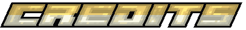

The full list, with every file and its source, is in **CREDITS.txt**.

- **presidentkoopa:** SuperPunchOut (the glove weapons, the Arcade punch reader, Star Punch's banking), BD22 VR
  Reloaded's butt strike (ported twice: the shove read at the hand, and since 2026-11-13 the butt strike, the pistol
  whip and the VR punch line for line, `zscript/rsqml/club.zs`), RSQ Distance Grab's Headlock and throw, RS Gestures' swing reader, and the sounds
  from his RS Combat FX and RS Ballistics. The FBX hand is Brutal Doom VR's free hand.
- **Ermac** (iAmErmac): the hand model (Rusted Legacy / Doom Force Unleashed, MIT; licence in
  `credits/Ermac_RustedLegacy_LICENSE.txt`) and the boxing glove mesh and fit (PunchOutVR / Virtual Punch Out).
- **The punch sounds** (the jab, hooks, uppercut, pistol whip, butt shove and the swing's whoosh, 2026-11-16): the
  owner's punch1-punch11, from **Streets of Rage 2** (Sega, 1992; owner 2026-11-17).
- **DerrickDavison** (Punch Out Doom): the star sound and the punch sound the Hadouken and the guard still use, through
  Virtual Punch Out. Punch-Out!! is Nintendo's.
- **Sergeant Mark IV** (Brutal Doom): the punch, kick and knock numbers, parsed, not shipped; its mist and sounds are
  played by name when it is loaded.
- **shezzor:** the community sprite sheet the hit sparks, dust and dizzy chicks are cut from (non-commercial).
- **kiddolink:** "VFX Hit Impact", the impact bursts (a paid pack, bought for this series).
- **Rebecca "ToxicFrog" Kelly:** Gun Bonsai (MIT), which RSQ Gun Bonsai VR extends.
- **id Software:** stock Doom's sounds played by name (the revenant's slap, the chat tick, the swing, the punch).
- **QuestZDoom** (Emawind and Team Beef): the engine and its VR hand API.
