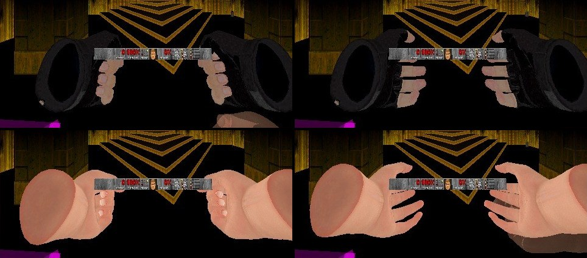
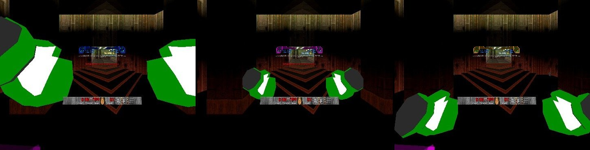
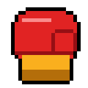
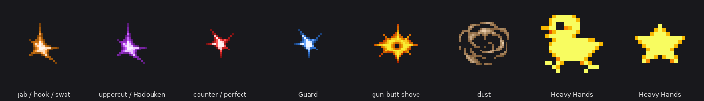
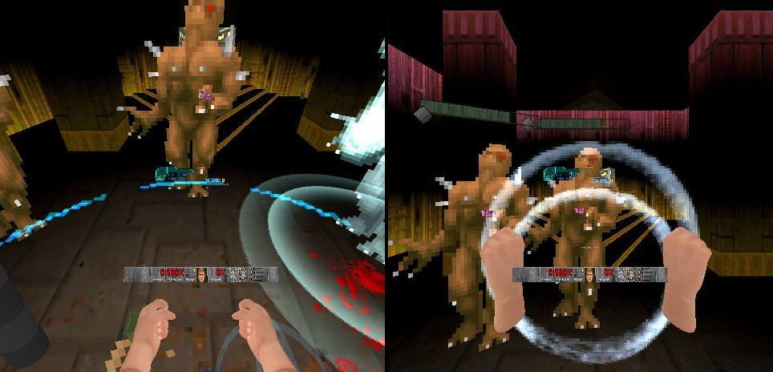

# RSQ Melee
### Doom Arcade VR · fight with your fists, slap fireballs aside, shove with the gun butt, and grab an imp by the collar

Swing your fists to punch. Jabs, hooks and uppercuts are each read from how your hand moved, and a fast punch hits
twice as hard as a slow one. Open your hand and you can slap a fireball out of the air. Put a gun butt into a face and
time slows down for a moment. Grab a monster with your off hand, hold it, punch it, then throw it.

*[GIF to come: a jab, a hook, then an uppercut launching an imp]*

---

## What it feels like

- **Any fist punches.** Melee's own hands, Doom's fist, Brutal Doom's fists, Brutal Doom VR's free off hand, or an
  empty hand. Swing it into a monster and the punch lands where your fist meets the body.
- **Three punches, read from your swing.** Drive straight in for a jab, swing across for a hook, rise into it for an
  uppercut. The uppercut lifts the monster off the floor.
- **Speed is power.** The slowest punch that counts does 10 damage and a full-speed one does 20. A Berserk pack makes
  it five times that.
- **Open hand, closed hand.** Tap a hand's trigger to open it. An open palm doesn't punch: it slaps a monster's
  fireball (or bullet) out of the way.
- **The gun butt.** Thrust the gun in your hand forward, hard. The stock hits whatever is in front of it, and time
  slows down so you can bring the gun round and finish the job. Kill it with a shotgun in that slow-down and it
  bursts into a red mist.
- **The Headlock.** Squeeze your off hand's grip next to a monster and it's stuck at your hand, facing you, while
  your other fist works it over. Swing your off hand hard and you throw it.
- **Hits you can see and feel.** Every blow has its own spark, every hit gives a rumble in that hand, and
  punching a switch flips it.

---

## How to play

| Do this | What happens |
|---|---|
| Swing a fist into a monster | A punch: a jab, hook or uppercut, from 10 damage at the slowest to 20 at full speed |
| Swing up into it | An uppercut: it flies up and back, stuck in its pain frames until it lands |
| Punch it while it winds up its attack | A counter, with a red spark |
| Tap that hand's trigger (press and let go quickly) | That hand opens (or closes again). A soft click tells you which way it went |
| Swing an open palm through a monster's fireball or bullet | Knocked aside. It is yours now, so it can hurt monsters but not you |
| Turn on **Hadouken**, then punch a fireball | It flies back at whoever fired it, faster and harder |
| Turn on **Guard**, wear the boxing gloves and hold both fists up at your face | Blows from in front are softened |
| A gun in your main hand, thrust it forward fast | The gun-butt shove, then a short slow-down (with RSQ SlowMo) |
| Off-hand grip on a monster within a hand's width of your palm | Headlock: it is held at your hand |
| Holding one, swing your off hand forward hard | Thrown |
| Let go of the grip | It drops |
| Any punch or shove into a switch or a door | It works, as if you'd pressed Use |

The punches, the swat and the Headlock work with whatever is in your hands, from the first map. Melee's own hands are
optional: turn on **Start With Melee Hands** and you get a pair in your inventory at every level start. You still start with BD22's own start weapon, and the off hand keeps BD22 VR's hands (owner 11-11).

---

## Controls

- **No keys**, and no menu button stands in for one.
- **Either hand:** swing the fist to punch. **Tap the trigger** (press and let go quickly) to open the hand or close it
  again (not in boxing gloves). With Gun Bonsai VR's Star Punch, an uppercut with that hand's trigger or alt fire
  squeezed spends a banked star.
- **Off hand:** **the grip** (read raw from QuestZDoom's grip keys; their codes are on Test and Debug) next to a monster
  is the Headlock; let go of the grip and it drops.
- **Main hand, holding a gun:** thrust it forward hard for the gun-butt shove.
- **Gestures:** the jab, hook and uppercut (read from the fist's path); the open-palm swat; both fists up at your face
  (Guard); both fists swung down together (Ground Pound); both palms thrust forward (Clear Out); a hard forward swing
  of the off hand while holding a monster (the Headlock throw). With RSQ Accessibility loaded, its reader supplies the
  two-hand gestures; without it, Melee reads them with its own copy.

---

## Your hands

*Ermac's hand, fist then open (top), and the FBX hand, fist then open (bottom), both hands up (rig capture, not headset).*

When Melee's own hands are up, you see them:

- **Ermac's hand** or **the FBX hand** from Brutal Doom VR. Each has a fist and an open hand, and changes when you tap
  the trigger. **Hand Model: Auto** picks the FBX hand when Brutal Doom VR is loaded and Ermac's otherwise. The FBX
  hand wears Brutal Doom VR's Hand Skin Tone (single player).
- **Boxing Gloves**, SuperPunchOut's. Always fists, never an open palm. Drawn at the hands' size, where the fist is
  (11-10: they drew about 1.4 times the fist across, nearer your eye).

*The boxing gloves at their new size: at the guard, held out, and at rest (rig capture, not headset).*

*The hands' item icon (the Wheel shows it on the gloves' cards), as drawn in the pack.* The gloves are in weapon slot 1,
beside the fists (this pack's KEYCONF adds them, since Brutal Doom rebuilds slot 1), so the Wheel shows them on slot 1's
cards (rig only, not headset-confirmed: `design/rigtest_2026-11-10/evidence/FIX_3b_gloves_in_slot1_log.txt`).

With any other fist (Doom's, Brutal Doom's, an empty hand) the open-hand tap still works, but the fist looks the
same either way, so the click is your only cue.

**Slappers Only** is GoldenEye's: fists only. It puts the boxing gloves on both hands right away and takes every other
weapon from you, sabers and the ShieldSaw included: the ones you carry go into a stash, weapons lying in the level vanish,
and one you're given later goes into the stash within a quarter of a second. Your ammo stays. It is done again at every level start. RSQ Saber's Start With Saber stands down while it is on. Turn it
off and your guns come back, with the gun you had in your hand back in it, but no free ammo.

---

## The punch

*The hit sparks as they are drawn in the pack (the first frame of each, not to scale). Not a capture from the game.*

- **Jab, hook or uppercut** comes from the whole path your fist took, not where you were looking. A swing that
  rises more than 30° is an uppercut.
- **The spark tells you which:** orange for a jab or hook, violet for an uppercut, red for a counter. A faster
  punch gets a bigger spark. **Hit Spark Size** scales them all.
- **Knockback by weight.** An imp or a zombieman is knocked well back, a demon about a quarter as far, a baron a
  tenth.
- **The uppercut** lifts it: about half a metre to 1.4 m of air for an imp, never more than the
  **Lift Cap** (3 m). It is stuck in its pain frames for the flight, so it can't attack from the air.
- **Walls block punches.** A monster behind a thin wall, or a pillar between your fist and its body, isn't hit.
- **Switches and doors.** Any punch that meets a switch, a door or anything else with an action works it, keys and
  locks included, as a Use press would.
- **Uppercut Kicks Barrels** (off): an uppercut into a barrel does no damage. It sends the barrel flying up and away
  from you, and the blast is yours when it goes off.

*[GIF to come: an uppercut launching an imp, with the dust puff]*

---

## The open palm

- **The swat** (on): an open palm moving at a brisk swing through a monster's fireball knocks it to the side, past
  you. It now belongs to you.
- **Swat Bullets** (on): a zombie's bullet that your open palm meets on its way to you is stopped. With **Hadouken**
  on, a fist that meets it sends a visible round back at the shooter for one and a half times the shot's damage.
- The swat plays Doom's revenant slap and a knock in that hand.

*[GIF to come: an open palm slapping an imp's fireball aside]*

---

## The moves

Each of these is **off** by default. Turn it on and you have it at its first level. With RSQ Gun Bonsai VR loaded,
you earn them instead (see Plays well with).

| Move | What it does |
|---|---|
| **Hadouken** | Punch a monster's fireball and it flies back at whoever fired it, 15% faster, hitting for 150% |
| **Guard** | The boxing gloves on both hands, both fists up at your face for a moment. A blow from in front (within about 55° of where you face) is soaked: you take 60% and are pushed back a step. A blow of 35 or more breaks the guard: full damage, and no guard for 0.4 s. A blue spark and a tick where it is stopped |
| **Wall Splat** | A monster your punch knocks into a wall slams into it: 10 to 20 damage, bounces off and reels |
| **Heavy Hands** | A punch freezes the monster for a beat and knocks it 25% further. Chicks and stars circle its head while it is frozen |
| **Ground Pound** | Melee's hands in both hands, swing both fists down hard together (3 m/s or more), ending low: a rainbow pixel shockwave rolls out along the floor round you, 30 damage to everything within 2.5 m, knocked out, up and staggered. The floor shakes |
| **Clear Out** | Both palms thrust forward together (the Force Push ring rolls out in front), hands apart and turned up and out, with Melee's hands up (one hand may be empty) and no gun: everything in front of you within 2.5 m (a quarter circle) takes 15 damage, is shoved back hard and staggered. With Wall Splat, shoved into a wall it splats |

**Guard** is the boxing gloves' move: it needs Melee's hands with **Boxing Gloves** (or Slappers Only) on both hands.
Bare hands, Brutal Doom's fists and sabers don't guard.
Seated (RSQ Accessibility's Seated Play), the guard height follows your eyes down.

*Ground Pound's pixel ring rolling out along the floor round you (left), and Clear Out's Force Push ring rolling out in front (right) (rig capture, not headset).*

*[GIF to come: Guard up, an imp's claw soaked with the blue spark]*
*[GIF to come: Hadouken, a fireball punched back into the imp]*
*[GIF to come: Wall Splat, a zombieman punched into a wall]*
*[picture to come: Heavy Hands, chicks and stars over a frozen imp]*
*[GIF to come: Ground Pound, a ring of monsters thrown back]*
*[GIF to come: Clear Out, the palm thrust shoving a crowd]*

---

## The gun-butt shove

With a gun in your main hand, drive it forward hard (on average 3.6 m/s or more). Swinging it down or pulling it
back doesn't count. The stock hits everything in front of the gun up to about a metre and three quarters, once each,
as long as no wall is in the way.

- **14 damage** (62 with a Berserk), as Brutal Doom's kick does. Brutal Doom's monsters react to it the way they
  react to its kick, and plain Doom's get the same push.
- Wakes monsters nearby, and needs a short wait (about a third of a second) before the next.
- An orange starburst where the stock hits. A shove that hits no monster can still work a switch or a door.
- **Always Slow Time on Shove** (on): a landed shove asks RSQ SlowMo for one second at 35% speed.
- With **Brutal Doom VR** loaded, its own butt strike is the one and this shove stands down. A landed Brutal Doom VR
  butt strike still gets the slow-down.

*[GIF to come: a shotgun butt into a zombieman's face, the orange starburst]*

### The F.E.A.R. Effect

While the slow-down from your shove lasts, **every shotgun hit you land bleeds twice**. A monster you kill with a
shotgun in that window dies its most violent death and, with **F.E.A.R. Blood Mist** on, bursts into a cloud of
blood mist that hangs in the slow motion: Brutal Doom's own red, green or blue mist when it is loaded, the monster's
own blood without it. The words **F.E.A.R. Effect** show low in your view for a moment.

Brutal Doom VR's own butt strike opens the window too. The window needs RSQ SlowMo: without it, there's no slow-down
and no window.

*[GIF to come: shove, slow-down, shotgun, an imp bursting into blood mist, "F.E.A.R. Effect" low in view]*

---

## The Headlock

Squeeze your off hand's grip with your palm within 30 cm of a living monster. It's held at your hand, its face at
your hand's height, turned to you, frozen. It's still solid, so shots can hit it.

- **What you can hold:** anything up to a demon's weight (imps, zombies, demons). Not a baron, not a boss, and not
  an RSQ Miniboss with **Can't Be Headlocked** on.
- **How long:** 3 seconds, or until you let go.
- **Punch it.** Each blow shows its pain frame and its cry. With **Extra Blood**, the first punch bleeds 1.3 times,
  the second 1.6 times, the third and on twice.
- **Throw it.** Swing your off hand forward hard (3 m/s and more, within 60° of where you face) and it leaves your
  hand as the swing slows. It is thrown as if it weighed 30% of what it does. What it slams into, a wall or a
  monster, takes the impact, and so does the thrown monster. With RSQ Distance Grab loaded, its throw does the
  flying.
- **Human Shield** (off): held for as long as you keep gripping (a minute at most), turned to face away from you.
- Your off hand doesn't punch while it holds one.

*[GIF to come: an imp held by the collar and punched three times, the blood growing]*
*[GIF to come: a held imp thrown into a zombieman]*

---

## Plays well with

- **RSQ Gun Bonsai VR:** Guard, Wall Splat (its Wallflower), Ground Pound, Clear Out and Human Shield become
  upgrades you earn. Their rows grey out until learned, and the page says *"GunBonsaiOVR detected. Mod features
  unlocked via upgrades."* Learning one turns its row on; the row can still turn it off. **Start With Guard** gives
  you Guard at its first level before you learn it. Melee's own hands learn **Hadouken** and **Heavy Hands**; any
  other fist plays those rows as they are. With Gun Bonsai VR, Melee's hands learn the **uppercut** too (until then
  a rising punch lands as a jab). Then the fists tree adds to Melee's moves: **Launcher**, **Juggle**, **Meteor**,
  **Dempsey**, **Star Punch**, **Catch**, **Swat Back**, **Bullet Time Fists** (with RSQ SlowMo), **Knockdown**,
  **Rage**, **Parry**, **Reflect Guard**, **Absorb and Release**, **Taunt**, **Pistol Whip**, **Rifle Butt**, and
  the off hand's grapples: **Heavier Headlock**, **Slam**, **Throw Into**, **Chokehold**, **Headlock Uppercut**.
  Gun Bonsai VR's own elemental fists, criticals and finishers use Melee's bursts and sounds.
- **RSQ Score:** Melee tells Score which punch landed and which moves touched a monster, so its melee rows pay:
  Shoryuken (an uppercut kill), Liver Shot, Glass Jaw, Textbook, Triple Threat, Dempsey Roll, Air Combo, Counter,
  Flurry, Knockdown, Bouncer (Clear Out), Release, Toss, Piledriver, Cut Loose, Butt Stroke, and the combos
  Headlock, Pistol Whip and **F.E.A.R. Effect**. The newer rows read Melee too: Swatted, Rope-a-Dope, Seismic, Out
  of My Way, Full Release, Meat Shield, Human Shield, Field Goal, Seeing Stars, Meteor, Star Punch, Down for the
  Count, Bare Knuckle (a kill with Slappers Only on) and Red Mist. Brutal Doom's fists and an empty hand are read as
  punches as well, not as plain hits.
- **RSQ SlowMo:** the shove's slow-down and the F.E.A.R. window (SlowMo's **Melee Gun Butt Shove** row can turn
  that trigger off). A slowed bullet punched with Bullet Time Fists goes home to its shooter.
- **RSQ Distance Grab:** a monster thrown out of the Headlock flies through its throw (strength, aim assist, the
  impact). The two share the off-hand grip: a press goes to whichever has the nearer target, never both. Its
  **Barrel Lock-On** also turns on the uppercut barrel kick and sends the kicked barrel at the locked monster.
- **RSQ Grenade:** its barrels are barrels to the uppercut kick. Slappers Only stashes its hand grenade with the
  guns (it uses ammo).
- **Brutal Doom VR (BD22 VR):** its fists punch with Melee's reader (**Punch With Brutal Doom's Fists**, on); turn
  that off and Brutal Doom punches as it ships. With Brutal Doom VR's own **VR Punching** on, its punch does the
  damage and Melee adds the rest (which punch, the lift, the moves). Its butt strike replaces Melee's shove; its FBX
  hand and skin tone are Melee's FBX look.
- **RSQ Accessibility** (which carries RSQ Gestures): Rumble Strength scales every knock in your hands. The Off-Hand
  Modifier lets the main controller play the off hand. Seated Play lowers the Guard. Its two-hand gesture rows
  (Both Hands Down, Both Palms Thrust) are the ones Ground Pound and Clear Out use. Without it, Melee reads both hands
  itself with a copy of the same reader.
- **RSQ Tactical Rig:** a grip press at a holster is the holster's, never the Headlock's.
- **RSQ Grapple** and **RSQ Wheel:** no shove while you're on the rope or the Wheel is open. Grapple's Scorpion (Gun
  Bonsai VR) punches the monster it pulls in through Melee.
- **RSQ Miniboss:** its **Can't Be Headlocked** row (on) refuses minibosses.

---

## Options

*Radiant Silvergun Options → RSQ Melee.* Everything is on one page; the raw numbers are under Test and Debug.
**Reset All** (on both pages) resets every Melee setting.

| Section | Rows |
|---|---|
| Hands | Start With Melee Hands (Off) · Punch With Brutal Doom's Fists (On) · Hand Model (Auto / Ermac / FBX (BD22 VR); Auto) · Boxing Gloves (Off) · Slappers Only (Off) · Open-Palm Swat (On) · Swat Bullets (On) · Uppercut Kicks Barrels (Off) · Hit Spark Size (1.0) |
| Gun Butt Shove | Gun Butt Shove (On) · Always Slow Time on Shove (On) · F.E.A.R. Blood Mist (On) |
| Headlock | Headlock (On) · Human Shield (Off) · Extra Blood (On) |
| Moves | Guard (Off) · Start With Guard (Gun Bonsai VR) (Off) · Hadouken (Off) · Wall Splat (Off) · Heavy Hands (Off) · Ground Pound (Off) · Clear Out (Off) |
| Test and Debug | Punch: Punch Damage (10), Min Speed (2.0 m/s), Full Speed (7.0 m/s), Re-Hit Wait (6 tics), Uppercut Rise (0.50), Lift Cap (3.0 m), Extra Reach (4) · Gun Butt Shove: Shove Speed (3.6 m/s), Slow Time Length (1000 ms) · Headlock: Reach (0.30 m), Heaviest (400), Seconds (3.0), Throw At (3.0 m/s), Throw Weight % (30), Off Grip Keys (443 436) · Debug Log (Off / Each Decision / Also F.E.A.R. Hits) |

**Swat Bullets** covers the fist's Hadouken on bullets too. No keys to bind.

*[picture to come: the RSQ Melee options page]*

---

## Status

| | |
|---|---|
| **code only, not shown** (2026-11-11, `design/rigtest_2026-11-10/RESULTS_DOWNSHOT.md`; not run, by the owner's order "no rig test, code only until i say"; not load-checked either) | The eyes the hands and gestures are read against, and the watch check's own gesture copy use the engine's fixed standing eye height (the player class's ViewHeight), not the pawn's ViewHeight. RSQ SlowMo's DOWN scales the pawn's ViewHeight to 40%, which put them about 0.9 m too high while you were down. Standing and crouching are unchanged |
| **code only, not shown** (2026-11-11, `design/rigtest_2026-11-10/RESULTS_HUD11.md`; not run, by the owner's order "no rig test, code only until i say"; not load-checked either) | The gesture-name line is not drawn while any menu is open (owner 11-11) |
| **rig only, not headset-confirmed** (2026-11-11, the last checks, `design/rigtest_2026-11-10/RESULTS_LAST.md`) | **The gloves in weapon slot 1 by this pack** (its KEYCONF, no console addslot): Start With Melee Hands gave both gloves, slot 1 lists RSQ_Glove and RSQ_GloveOff, and the Wheel showed their two cards with RMICA0 / RMICB0 (`design/rigtest_2026-11-10/evidence/LAST_WHEEL_glove_cards_slot1.jpg`, `_log.txt`) |
| **rig only, not headset-confirmed** (2026-11-10 night and 11-11, the rig batch's fixes, `design/rigtest_2026-11-10/RESULTS_FIX.md`) | **Boxing gloves a glove's size:** first shrunk to the fists' size (scale 0.86; `design/rigtest_2026-11-10/evidence/FIX_2_boxing_glove_before_after.jpg`), then, the owner's call, scale 1.0, about 1.17x the fist and centred on it (commit 18043e65; `FIX_2b_boxing_glove_scale1_vs_fist.jpg`). **Gloves in weapon slot 1** on BD's order (commit 18043e65; slot readout `FIX_3b_gloves_in_slot1_log.txt`). **Slappers Only with RSQ Saber: found BROKEN in M8, then fixed and shown.** Before, the saber flickered in and out of the inventory and Slappers Only off left the saber in the main hand; after, the saber stays out while it is on, and off puts the Shotgun back in the main hand (`FIX_B_log.txt`). **The glove icons (M9): not shown at first** (the Wheel drew its own glove, and the gloves were in no slot); **fixed and shown:** the Wheel's MELEE HANDS cards wear this pack's RMICA0 / RMICB0 (`FIX_3_wheel_glove_cards_RMIC.jpg`; for that frame the gloves were put in slot 1 from the console, before the slot 1 change) |
| **rig only, not headset-confirmed** (2026-11-10 night, the packed batch, P1: `design/rigtest_2026-11-10/RESULTS_P1.md`; run without RSQ Gun Bonsai VR, so each move at level 1) | **M1:** Ermac's hand and the FBX hand, fist and open; the trigger tap opening and closing each hand; a jab, a hook and an off-hand uppercut landing on a held imp, the uppercut lifting it (`design/rigtest_2026-11-10/evidence/P1_M1_hand_models_fist_open.jpg`, `P1_M1_punches_160px.jpg`, `P1_B_log.txt`, `P1_C_log.txt`). **M2:** the boxing gloves on both hands (`P1_M2_M7_boxing_gloves_guard.jpg`; their size changed since, row above). **M3, the Headlock:** an imp held at the off hand, punched three times, then thrown at 6.6 m/s (`P1_M3_headlock_hold.jpg`, `P1_M3_headlock_held_punched_160px.jpg`, `P1_D_log.txt`); the grip was sent as its event (the real grip can't be pressed on the rig). **M4, the swat:** an imp fireball knocked aside (frames, `P1_M4_swat_fireball_160px.jpg`); a zombie's bullet knocked away, no damage taken (log only). **M5:** the off-hand fist beside a shotgun landing a jab; Uppercut Kicks Barrels sending a barrel up and away, then the shotgun setting it off (`P1_M5_barrel_kick.jpg`, `P1_E_log.txt`, `P1_F_log.txt`). **M6:** Ground Pound's rainbow ring and Clear Out's burst and two Force Push rings, by gesture and in frames; the shove moving an imp (`P1_M6_pound_clearout_rings.jpg`). **M7, Guard:** gloves up at the face, a 20 blow soaked to 12, a 40 blow breaking it; bare hands or hands down, no guard (`P1_C_log.txt`). **M8, Slappers Only:** everything stashed, gloves in both hands, a gun given later taken away, every gun back when off (`P1_A_log.txt`, `P1_B_log.txt`; its bug with RSQ Saber is in the row above). **N6:** this pack's rumbles sent through RSQ Accessibility's Rumble Backup (`P1_C_log.txt`). Not shown: the Headlock's throw striking anything |
| **rig only, not headset-confirmed** (2026-11-10, the batched rig test, full series load order with Brutal Doom 22 and BD22 VR Reloaded 2.0.4f) | Every launch loaded every RSQ pk3 with no script error from our packs (`design/rigtest_2026-11-10/RESULTS.md`). No Melee move was exercised in them (the packed batch, row above, did) |
| **rig only, not headset-confirmed** (2026-11-09, full series load order with Brutal Doom 22) | The pack loads with no script error of its own, and its page is listed under Radiant Silvergun Options (`design/rigtest_2026-11-09/logs/main_A-G_I.log`). No Melee move was exercised in that run |
| **Headset-confirmed** | Nothing yet |
| **code only, not shown** | Everything else on this page, among it the moves above level 1 (the batch ran without Gun Bonsai VR) and the Headlock's throw striking something |
| **not yet run** | Nothing from the rig test: M1 to M9, N6 and the Wheel frame with the gloves in slot 1 by this pack have run (above) |

---

## Under the hood

- **Stock QuestZDoom 17.3:** ZScript and data only. No engine changes. No other mod is required; every other mod is
  found by name while the game runs (`ServiceIterator`, class names), never linked.
- **The punch reader** is SuperPunchOut's Arcade reader: a punch arms on a slow hand, counts after 0.15 m of travel
  on consecutive tics at 2.0 m/s (Min Speed) or more on average, and its power is that average between Min
  Speed and Full Speed. Which punch it is comes from the swing's whole path in real metres (the vertical scaled by the
  level's pixel stretch), so a rising punch is not squashed into a jab. Snap turns and one-tic jumps are dropped.
- **Hands carried to the body** (`RSQML_HandSync`): QuestZDoom writes the controllers only when it renders a frame,
  so on a slow frame a still hand read against a walking body looked like a swing. Each frame's controller offset is
  added to where the body is this tic. Swings are measured from the body at the view's height, so stairs and landings
  are not swings.
- **Contact:** the fist is a 9 cm sphere plus Extra Reach, swept along its path this tic against each body's
  cylinder; one `LineTrace` from the fist (not `CheckSight`, which starts at the eyes and rolls the playsim's random
  numbers) confirms no wall is in between.
- **Missiles** are not in the blockmap, so Melee lists monsters' damaging missiles as they spawn. The swat and the
  Hadouken test the fist's path against the missile's path from 2.5 tics behind to 2 ahead, because Brutal Doom's
  imp fireball is drawn by a trail that lags the real one. **Bullets** are caught in `WorldHitscanPreFired`, before
  the trace, with the hand between the shooter and you.
- **Who deals the blow:** Melee's own hands are the inflictor (Gun Bonsai VR credits the weapon). Any other fist's
  punch goes through a per-hand helper, `RSQ_GloveFist`, that carries the punch's record, so RSQ Score can tell a jab
  from a hook. `RSQML_Service` answers `punch.*`, `guard`, `headlock.*`, `returned.by`, `launch.age`, `autopunch`,
  `guarded`, `barrel.kicked` and `fear` to any mod that asks.
- **The Headlock** freezes the monster (`freezetics`, re-applied every tic) and moves it to the hand with eased
  `SetOrigin`, never into you or a wall. The flags it borrows (no gravity, forced infighting) are kept on the monster
  itself, so a save taken mid-hold gives them back.
- **F.E.A.R. extreme death:** a killing shotgun blow inside the window is replaced by one blow of damage type
  `Extreme`, so the monster's XDeath runs (Brutal Doom's gib burst). The kill keeps the same source and inflictor, so
  Score still reads a shotgun kill.
- **Network events:** the shove (`rsqml_buttshove`), the F.E.A.R. window (`rsqml_fear`), the Headlock's grip
  (`rsqml_hgrip`) and the two-hand moves (`rsqg_pair`) are sent as events and applied on every machine. The punch,
  the swat, the Guard pose and the Headlock's hold and throw are read from the hands on your own machine. QuestZDoom
  has no netplay.
- **Saves:** the classes a save can hold keep their old Gun Bonsai VR names (`RSQ_Glove`, `RSQ_GloveOff`,
  `RSQ_Splat`, `RSQ_SlapperStash`, `RSQ_Buzz`...), and the two old handlers stay as empty shells, so a game saved
  before Melee existed still loads. Melee's own handlers are static and never saved.
- **Server and user settings:** the Hands rows (but Hand Model), the punch numbers, the moves and F.E.A.R. Blood Mist
  are server settings; Hand Model, the shove, the Headlock, Hit Spark Size and the debug log are your own.
- **Rumble** goes through `A_QuakeEx` waves on one controller at a time, scaled by RSQ Accessibility's Rumble
  Strength.

---

## Credits

The full list, with every file and its source, is in **CREDITS.txt**.

- **presidentkoopa:** SuperPunchOut (the glove weapons, the Arcade punch reader, Star Punch's banking), BD22 VR
  Reloaded's butt strike (ported), RSQ Distance Grab's Headlock and throw, RS Gestures' swing reader, and the sounds
  from his RS Combat FX and RS Ballistics. The FBX hand is Brutal Doom VR's free hand.
- **Ermac** (iAmErmac): the hand model (Rusted Legacy / Doom Force Unleashed, MIT; licence in
  `credits/Ermac_RustedLegacy_LICENSE.txt`) and the boxing glove mesh and fit (PunchOutVR / Virtual Punch Out).
- **DerrickDavison** (Punch Out Doom): the punch and star sounds, through Virtual Punch Out. Punch-Out!! is
  Nintendo's.
- **Sergeant Mark IV** (Brutal Doom): the punch, kick and knock numbers, parsed, not shipped; its mist and sounds are
  played by name when it is loaded.
- **shezzor:** the community sprite sheet the hit sparks, dust and dizzy chicks are cut from (non-commercial).
- **kiddolink:** "VFX Hit Impact", the impact bursts (a paid pack, bought for this series).
- **Rebecca "ToxicFrog" Kelly:** Gun Bonsai (MIT), which RSQ Gun Bonsai VR extends.
- **id Software:** stock Doom's sounds played by name (the revenant's slap, the chat tick, the swing, the punch).
- **QuestZDoom** (Emawind and Team Beef): the engine and its VR hand API.
