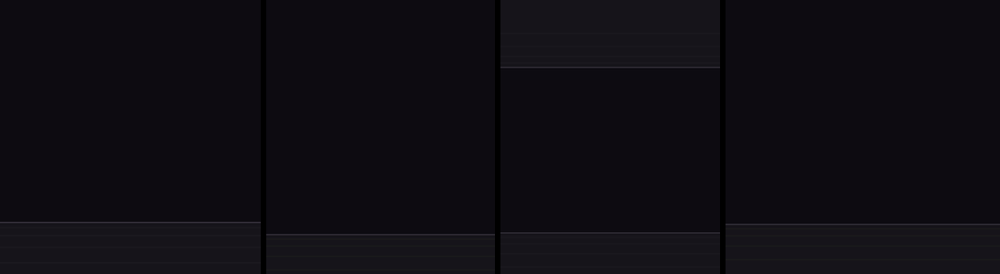
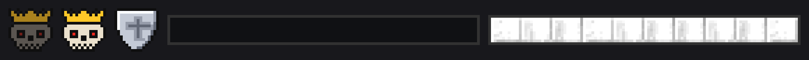
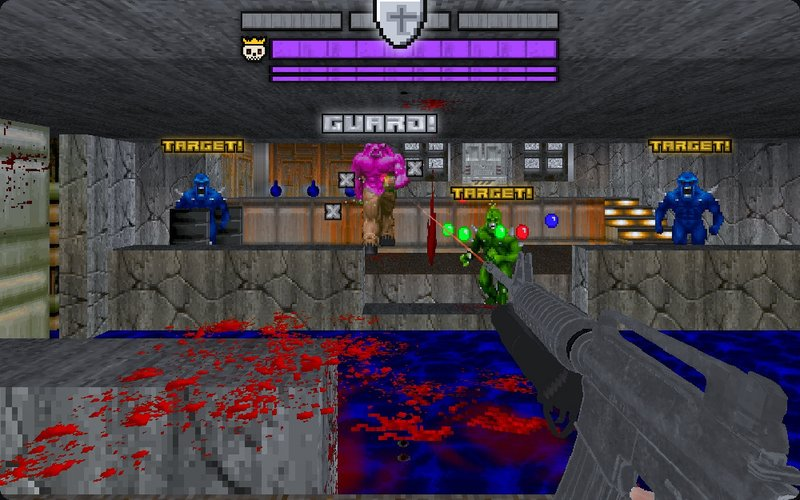
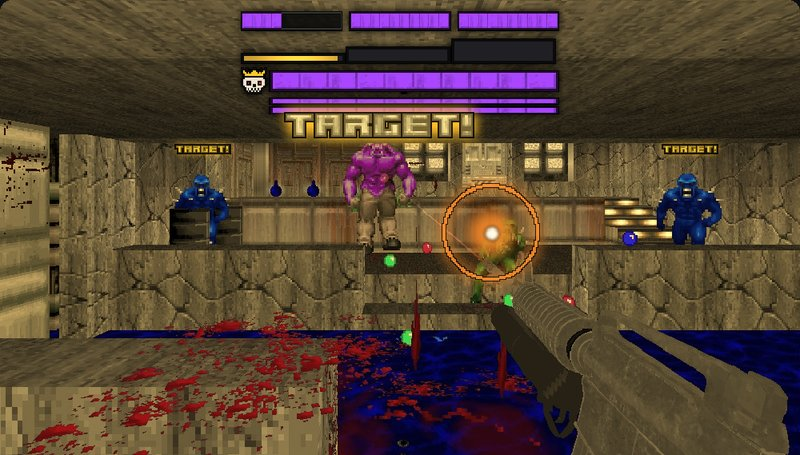
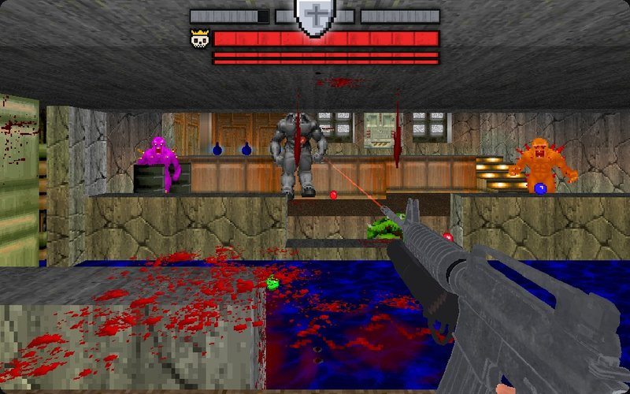
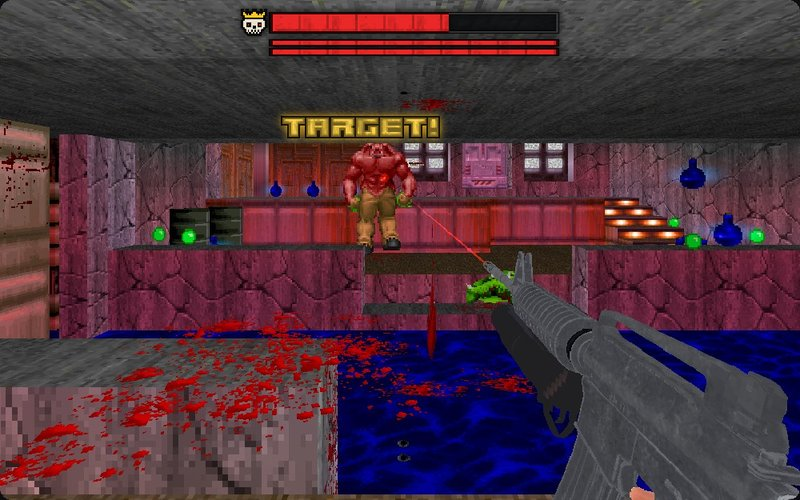
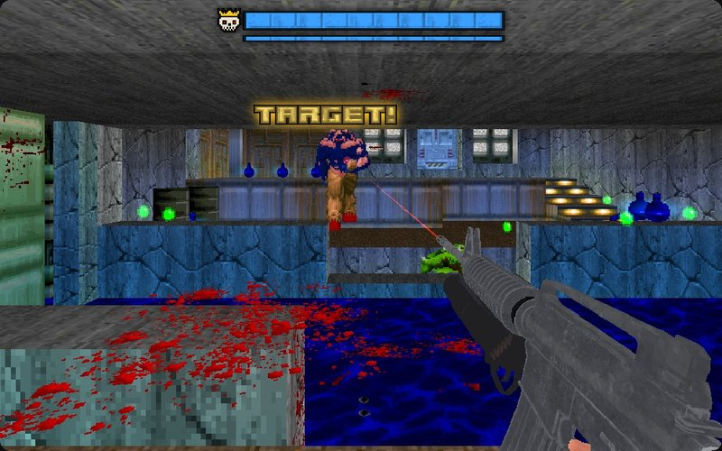
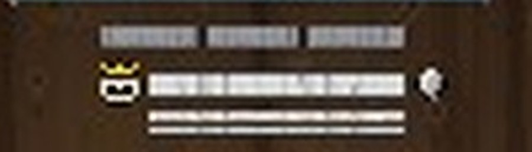
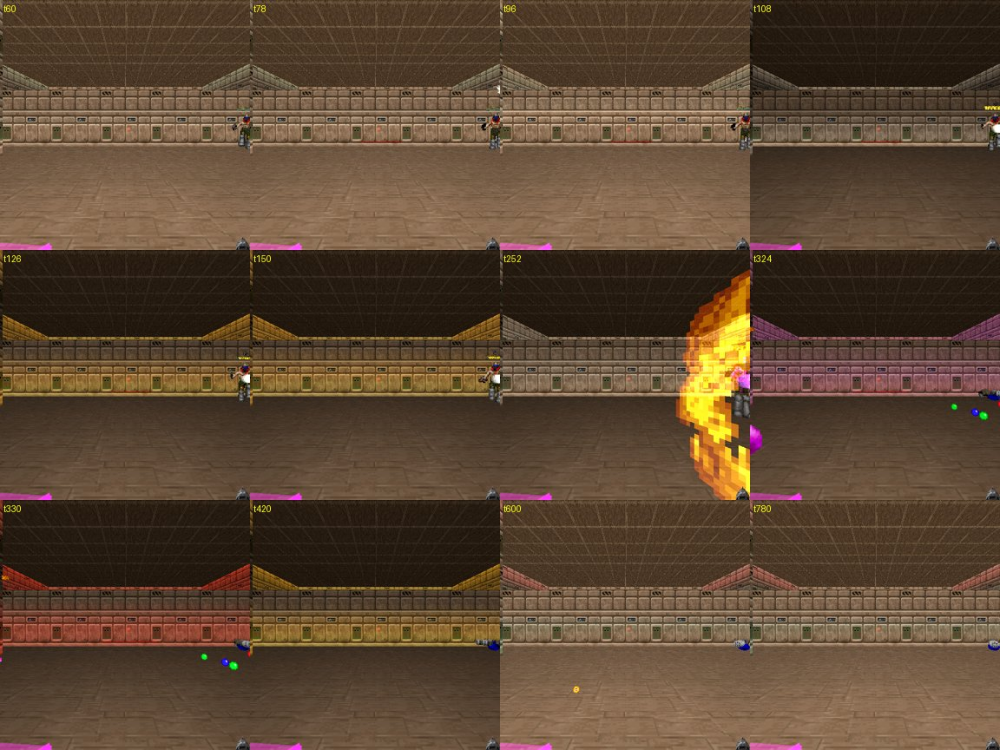

# RSQ Miniboss
### Doom Arcade VR · fill the meter, call the fight in, break the shield one thrall at a time

Built on Tartlman's **Minibosses!** (a miniboss and its thralls, the tethers and the flames) and rebuilt for Doom
Arcade VR. Fight well and a meter fills under your score. When it is full, glance at your watch and press Use, and a miniboss
lands in front of you in slow motion with its thralls around it, each one arriving on a beam of light. While its
thralls stand it cannot be hurt: kill one, and for a few seconds its shield is down. Break it in time, or everything
gets stronger.

*The arrival beams, from RSQ VisualRewards (its design renders; its README has each beam on its own).*

---

## What it feels like

- **Your play fills the meter.** Kills, quick kill chains, style points from RSQ Score, weapon XP from RSQ Gun Bonsai VR and
  simply pushing on through the map fill the Miniboss meter.
- **You call it in.** When the meter is full it turns gold and beats like a heart, and the room's light beats red with
  it. Look at your watch and press Use, and it comes. Or wait, and it comes by itself a minute later.
- **It arrives where you can see it.** A few metres ahead of you, in your view, never on top of you. The world drops
  into its slowest slow motion and the room goes dark, the thralls land one after another, then the miniboss, bigger,
  faster and keener to shoot than its kind. Its own music starts.
- **Its thralls are its shield.** While a thrall lives, shots on the miniboss do nothing: "GUARD!" pops over it and grey
  Xs bounce off. "TARGET!" hangs over every thrall.
- **Kill a thrall and the shield drops.** The world slows, the power that thrall gave the miniboss leaves it, and you
  get one second for every thrall it came with to break one piece of its shield bar. The faster you break it, the more
  RSQ Score points you get.
- **Miss and they grow.** If the window runs out with that piece unbroken, the miniboss and its thralls move one to three
  colours up RSQ Monsters' ladder, and by default so does every monster on the map.
- **Then it is you and the miniboss.** With the shield bar gone, its own bar takes the hits. It has three lives: each
  time a bar empties it refills, burns with flames for five seconds and comes back a colour higher. Beside its bar:
  its colour gem and an icon for every Champion power it carries, its own and the ones it took from its thralls.
- **Don't shoot it first.** Shoot it while its thralls live, and if a thrall is still standing a few seconds later, every
  monster on the map goes into a rage: twice as fast and twice as keen to attack, until the miniboss dies.
- **When it dies.** A gun you don't have yet (or a power-up), a fountain of RSQ VisualRewards bits, RSQ Score's
  Miniboss row.

---

## How to play

| Do this | What happens |
|---|---|
| Kill monsters, chain kills, play with style, keep moving | The meter under your score fills (red) |
| Fill it | A sting, the meter turns gold and beats, the room's light beats red |
| Hold a watch check and press Use (or just wait 60 s) | The miniboss fight is called in |
| Look ahead | It lands in view, 12 to 32 metres away, in slow motion |
| Shoot the miniboss while its thralls live | "GUARD!", grey Xs, no damage, and its greed is armed |
| Kill a thrall | The shield drops: a window of 1 s for each thrall it came with |
| Hit the miniboss inside the window | The open piece of the shield bar drains; break it before the window ends |
| Break every piece | One-on-one: its own bar takes the damage, life by life |
| Kill it | A gun or power-up, bits and Score rows; the level's music comes back |

**The watch check** comes from RSQ Accessibility (which carries what was RSQ Gestures). Without it, RSQ Gun Cards'
copy or this mod's own copy does the same check, so the call-in always works.

**When it won't come,** a small line under the full meter says why: *No Miniboss: Too Early* (the map's first minute),
*Map Limit* (two a map), *Cooldown* (90 s after the last), *Low Health* (under 40), *Near Exit*, *Too Busy* (more than
three awake monsters after you), *No Room* (nowhere in view to land) or *No Monsters*. It tries again as soon as the
reason goes. **Ignore Spawn Restrictions** brings it regardless of Too Early, Low Health, Near Exit, Too Busy and No Room.

*The mod's own HUD art from graphics/, enlarged (an earlier set: the shield icon has since gone from the HUD).*

*[Still to come: the meter filling red under the score, then gold and beating, with a wait line under it]*

---

## Controls

- **No keys**, and no menu button stands in for one.
- **Calling the fight in:** hold a watch check with either hand (the back of the wrist turned to your face, held still)
  and press **Use** while it holds, or a moment after. **Call It In: Watch Check + Use** on the page switches this off;
  the fight still comes by itself 60 s after the meter is full (**Arrives By Itself**).
- **Or from the inside of your wrist.** Turn the inside of either wrist to your face and look at it: a card lies along it.
  Once the meter is full it is gold, **START (skull) FIGHT?**, and **Use** calls the fight in at once: none of the rules
  below hold it back (only a map with no monster types, or no room to land, can). Until the meter is full, or while a
  fight is running, it is grey: **FIGHT (skull) NOT READY**. **Inner-Wrist Card: Start Fight?** on the page switches it off. *Rig only, not
  headset-confirmed (2026-11-12).*
- **The fight itself** is your guns, fists and the other mods: this mod reads no trigger, grip or gesture of its own.
- **Menu buttons:** Reset All. The console commands listed in Under the hood are for testing.

---

## The meter

The meter goes from empty to full and stays with you from map to map, and in your save.
The meter and the fight's stack are not drawn while a menu is open (owner 11-11).

- **A kill** adds 4 when Score's style points are filling it, otherwise 10 plus a share of the monster's health (at
  most 30).
- **A chain** (kills within 3 s of each other) adds 6 more for every link, up to 30.
- **Score's style points** add a quarter of each kill's style (at most 120 a kill).
- **Gun Bonsai VR's weapon XP** adds a fifth of the XP your gun earns.
- **Moving on** adds 2 every two seconds in which you covered 3 metres.
- Everything is times **Meter Speed**. The meter stands still while a miniboss fight arrives or is being fought, and the
  miniboss fight's own monsters never fill it.

**Miniboss Meter Fills From** picks Score, Gun Bonsai or Both. Kills, chains and time always count. If the mod you
picked is not loaded, the other one is used; with neither, kills, chains and time fill it alone.

While a miniboss fight runs the meter hides, and the fight's own bars take its place.

---

## Who comes

**The miniboss and its thralls are monster types already in this map,** picked by how tough they are. Class names are
never used, so it works the same on Doom's monsters, Brutal Doom's or any monster pack's. Bosses and the Champions
that rise again (Dark Red, Undying) are never sent.

Two things decide how hard a fight is, and they are separate: the **pick level** (0 to 4) picks which monster types
come; the **colour** (RSQ Monsters' ladder) makes each of them stronger.

**The pick level, 0 to 4, picks the types.** By default it is your RSQ Gun Bonsai VR player level or the RSQ Score lives
you hold, whichever is larger (past 4 counts as 4). Level 0 sends a middling type, level 4 the strongest in the map. The
thralls are weaker types (the same type when there is nothing weaker). From level 3 there is one more thrall. **Tier
From** sets where the pick level comes from: only the Gun Bonsai VR level, only Score's lives, whichever is larger, or
the old sum (Set: half your Gun Bonsai level, plus one for every 4,000 Score points this map (**Score Per Tier**), plus
half the miniboss fights you have won).

### The colours

**Miniboss From and Thralls From** (on RSQ Monsters' own page) turn the picks into ColorfulHell monsters of the same
family. With RSQ Monsters loaded and both left at their defaults, a miniboss from Brutal Doom or plain Doom gets
ColorfulHell thralls.

**The start colour.** A thrall keeps the colour it had on the map (Common when it had none); a miniboss picked from a
set starts one place above its strongest thrall on RSQ Monsters' ladder.

**The ladder is the strength order** (owner, 11-11: the tier number IS the strength). RSQ Monsters numbers its 13
colours weakest first, so the colour bonus below and every tier-up in a fight simply add to the number:

| Tier | 1 | 2 | 3 | 4 | 5 | 6 | 7 | 8 | 9 | 10 | 11 | 12 | 13 |
|---|---|---|---|---|---|---|---|---|---|---|---|---|---|
| Colour | Common | Green | Blue | Purple | Cyan | Brown | Yellow | FireBlu | Gray | Red | Abyss | Black (boss) | White (boss) |
| Mean health rank | 1.1 | 2.3 | 3.5 | 5.2 | 5.0 | 6.7 | 7.2 | 7.2 | 7.6 | 9.4 | 10.9 | 12.1 | 12.9 |

Measured from the health of every colour of all 17 ColorfulHell families (each family's colours ranked by health,
then the ranks averaged; EX forms left out; `design/rigtest_2026-11-10/evidence/MB_TIER2_strength.py`). Purple and Cyan
tie; Yellow, FireBlu and Gray are about even. (Before 11-11 RSQ Monsters numbered the colours in Colourful Hell's
listing order and this mod kept a separate strength list; that list is gone.)

**The colour bonus** (with RSQ Monsters and RSQ Gun Bonsai VR both loaded), once, when the fight arrives:
- **The miniboss** goes up **one tier for each Gun Bonsai VR player level** you have, all the way to Black and then
  White. On Black it can come out as an EX form, as RSQ Monsters rolls it (the Shotgunner's and the Lost Soul's EX is
  on White).
- **Each thrall** goes up **a quarter of a tier for each weapon level** in your hands: the main hand's gun level plus
  the off hand's, rounded half up (5 levels give 1 tier, 6 give 2). An empty hand, fists or gloves count 0. Thralls
  **stop at Abyss**: never Black, White or EX.
- **The miniboss stays at least one tier above its strongest thrall** (raised if needed, never lowered).

Who sets what: this mod sets the arrival colours; RSQ Monsters makes the monsters of each colour; Gun Bonsai VR gives
the levels. Without Gun Bonsai VR there is no bonus; without RSQ Monsters there are no colours at all. Champions and
LegenDoom boosts are added as before. The colour changes during the fight (a missed window, a life lost, the whole map)
move up RSQ Monsters' ladder numbers, so since 11-11 each step up is a step stronger.

**Everything that arrives is boosted:** a Champion (it is given one of Champions' colours if it did not roll one),
legendary with LegenDoom (when **Legendary Thralls** is on), lit in its own colour and full-bright. The thralls are drawn
a little larger, and get half their health again when they are not made legendary. The miniboss is 1.25x as big (its hitbox too), 1.25x as fast, and far
keener to shoot. It becomes legendary when any of its thralls is.

---

## The arrival

- **Where:** a spot in front of you (within 55 degrees of where you face), between 12 and 32 metres away, that you can
  see, and with room for the miniboss and at least half of its thralls round it. The map's own monster start spots are
  tried first, then points along your view.
- **When it lands:** the world and you slow to SlowMo's slowest for 4 seconds, and the room drops to DarkDoom Black
  (with RSQ Glow In The Dark). The thralls land about 0.3 s apart, then the miniboss. Each one is hidden and frozen
  until its RSQ VisualRewards arrival beam shows it, and an RSQ SlowMo edge arrow points to it while it is out of view.
  The beams are picked at random each time: V1 thralls and a V3 miniboss, or V2 thralls and a V4 miniboss. When the
  miniboss appears, a wave of its colour rolls out across the map.
- **Without VisualRewards' beams** each one lands at once in the original Minibosses! teleport flash, with Doom's
  teleport sound.
- **If the miniboss cannot land,** whatever already came is taken back out, the meter stays full, and it tries again.

---

## The fight

**The miniboss bar.** While a miniboss is on the map its bar is on your HUD, under the score: its head with a crosshair
over it, its name in gold, and a slanted bar in its colour with a dark red trail where health just went. `X2` at the
bar's end means it has two bars. `GUARD` in grey over a greyed bar means it cannot be hurt right now. Under it, each
thrall has a small bar of its own with its crosshair and its Champion power icon over it.

**It charges up.** The bar appears as a sliver and grows outward, empty. Each thrall's bar pops in as it lands. When
the miniboss lands its bar fills over three seconds while an LED clock beside it counts down from 03:00; until the
clock runs out nobody in the encounter moves and nobody can be hurt. The same clock shows how long a window stays open
after a thrall dies.

**The thrall bar.** Above the miniboss's own bar sits one segment for every thrall it came with. Together they hold as
much health as the miniboss itself, so you have to wear down the thrall bar before you ever touch its own.

**Shield up.** While a thrall lives, a segment is left and no window is open, the miniboss takes no damage at all. The
thrall bar is grey, "GUARD!" pops over the miniboss when you hit it (and while it is invulnerable after losing a life), and grey Xs (Doom's own
small X) bounce off where the shot landed. The room's light holds a steady cold grey.

**A thrall killed.** The power that thrall gave the miniboss leaves it, a pop in that power's colour bursts where the
thrall died (RSQ VisualRewards; without it the original's burst), and its tether breaks. The world slows, and the
shield drops: **a window of one second for every thrall it came with** (three thralls: three seconds) opens on the first
unbroken segment. A stepped gold bar under the segments drains, the room's light pulses gold, a big "TARGET!" hangs
over the miniboss and the thralls' shrink. The window closes early when the segment breaks. A thrall killed while a
window is open waits its turn: the next window opens when this one closes.

**Broken in time,** the segment scores RSQ Score's **Thrall Slow Kill**: 100 points for every second still left in the
window, so the fastest break scores the most.

**Window missed.** If the window runs out with the segment still standing, the miniboss and its living thralls move up
RSQ Monsters' ladder, with RSQ Monsters' own flash: one colour if only a sliver was left, two if about half, three if it
was untouched. With **Tier-Up Hits the Whole Map** on (the default) every monster on the map that has an RSQ Monsters
colour moves up with them. Then the shield is back up. (Without RSQ Monsters nothing climbs.)

**One-on-one.** Once every segment is broken (or no thrall is left standing) the hits go where they land: into any
segment that is left, then into its own bar, in its colour. "TARGET!" hangs over it, and the room glows its colour.
After it loses a life it cannot be hurt for a few seconds: "TARGET!" goes, and "GUARD!" pops when you hit it, until it
can be shot again.

**Its lives.** It has three lives by default (thin bars under its own, one for each life to spare). When a bar empties
it stops at the last point, spends a life and refills, bursts, and burns with circling flames for five seconds in which
nothing hurts it. With **Tier Up Each Life** on it comes back one colour higher. The room flashes red, then takes its new
colour. No thralls rise again.

*These five pictures are design mockups drawn on a rig frame before the reworked fight was built. They show the HUD and
the words as the code now draws them, but they are not captures of the mod running.*

**Its death.** A wave of its colour rolls across the map, and two seconds later Glow In The Dark's colours re-roll. Its
thralls are free monsters again.

**What it inherits from its thralls** (with Champions, **Inherit Powers** on): Yellow's faster shots, White's slowing
hits, Dark Green's poison, Cyan's knockback and Titan's three-way shots are handed to it; Dark Red and Undying give it
an extra life each (two at most); Black makes it hit 50% harder; any other colour or mutation makes it 50% tougher (twice
as tough at most). It takes at most four powers (**Power Cap**), the same colour counts once, and being legendary does
not count. **Each power goes with the thrall it came from.**

**Its colour** is its RSQ Monsters colour. A monster off the ladder takes pink, cyan, amber or violet, in turn.
The tethers, bursts, flames, bars and the room's glow all wear it, and it changes as it climbs.

---

## Greed

Hit the miniboss while its shield is up and its greed is armed. One window's length later (one second for every thrall
it came with, or when a running window ends) it is checked: if the miniboss lives and a thrall still stands,
**every monster on the map is enraged** until the miniboss dies. They move at twice their speed (**Rage Speed**), attack
twice as readily and react at once, a red spark rises off each one near you, and a roar sounds. Monsters that spawn or
are raised meanwhile are enraged too. Kill every thrall before then and nothing happens. When the miniboss dies
or you leave the level, every monster is put back exactly as it was.

---

## The rewards

**A miniboss fight's miniboss killed:**

- **A drop:** a gun from the guns lying in this map that you don't have yet. If there is none (Brutal Doom's map
  pickups are not guns until you touch them), a gun from your weapon slots no higher than one slot above your best;
  otherwise a Megasphere, Soulsphere, Berserk or Blur Sphere.
- **RSQ VisualRewards' Kill Rewards:** it counts as a boss, so it always drops bits, a boss's fountain of them.
- **RSQ Score:** the **Miniboss** row at 3x the kill (a miniboss in the map pays it at 1x): one row, one reward.
- **A win counted** (it adds to the pick level under Tier From's "Set").

*(The extra x3 bits and Score's life crate are gone for now: the drops will be balanced once the arcade systems are designed.)*

**Any miniboss killed** scores RSQ Score's **Miniboss** row.

---

## Graves Rise

With **Graves Rise** on, Legion of Bones and RSQ Graveyard loaded, the moment a miniboss fight has landed the tombstones wake.
**Graves Rise Mode** picks how many and where:

| Mode | What rises |
|---|---|
| One Per Stone, Whole Map (default) | Every tombstone on the map raises one undead |
| One Per Stone, Within Radius | Every tombstone within **Graves Radius** of the fight raises one |
| Thralls Per Stone, Whole Map | Every tombstone raises one undead for each thrall the fight came with (five thralls: five a stone) |
| Thralls Per Stone, Within Radius | The same, only the tombstones within **Graves Radius** |

Each undead is a thrall's own type, Skull Zombies when none fits. The tombstones' candles also beat with the full meter's
heartbeat.

---

## The classic pick

The original Minibosses! way, kept off under Test and Debug. With **Classic Pick at Level Load** on, a moment after a
level starts one miniboss (**Per Map**, up to 4, **Map Chance**) is picked from the strongest third of the level's own
monsters, favouring the toughest, with up to **Thralls** monsters within **Thrall Range** of it, none stronger:
Champions first, then legendaries, then the nearest. With LegenDoom and **Legendary Thralls** on, its thralls are made
legendary. A classic miniboss fights by the same rules (the shield, the windows, the lives, greed, the tethers, the
words) and shows the same HUD bars (the nearest one, when there are several), but it does not arrive boosted, has no
room glow and none of the miniboss fight's extra drops.

*A classic pick's HUD bars: the thrall row, the crowned skull with the miniboss's bar and its colour gem, two life bars under it (rig capture, not headset).*

---

## Plays well with

Everything is asked by name: every mod still loads and plays alone, and the parts that need a missing mod simply don't
happen.

- **RSQ Score:** its style points fill the meter, its lives can set the pick level, and the meter sits centred under its bar.
  Miniboss sends it the **Miniboss** and **Thrall Slow Kill** rows; Score values Miniboss as a share of the miniboss
  kill's worth (3x for the one you called in, 1x for one in the map). Score also reads Miniboss for its own rows: **Chain Gang** (thralls
  killed in one window), **Rage Quit**, **Riot Control**, and combos that ask for a thrall
  or the miniboss.
- **RSQ Monsters:** the colours, the colour changes on a missed window and on each life lost (with its flash), the
  bodies it swaps on a colour change (Miniboss finds the new one and dresses it again), the EX roll, and **Miniboss
  From / Thralls From** on Monsters' page. Re-entering a hub level puts back every colour Miniboss gave.
- **RSQ VisualRewards:** the arrival beams, "GUARD!", "TARGET!" and the pops; the miniboss fight music scene (its Scene Music
  row turns it off for you; **Miniboss Music** here turns it off for everyone); Kill Rewards' boss fountain; Top HP Bars draws a crown over the miniboss's bar, with a pip for each pick level, and a chain link over each
  thrall.
- **RSQ Glow In The Dark:** the red heartbeat of a full meter, the landing in DarkDoom Black, the cold grey, gold and
  red of the fight room, the colour waves at the landing and the death, and the colour re-roll after. Its own **Miniboss
  Tint** rows turn the map the miniboss's colour and darken it while any miniboss lives.
- **RSQ SlowMo:** the landing's slow motion (a game slow with its countdown bar and MINIBOSS INCOMING line, under its Triggers
  page's **Miniboss** switch, outside its shared cooldown), the slow motion of every window, and the edge arrows to
  monsters out of view. Its countdown bar sits under the meter at the same width. **Slow Depth** at -1 uses SlowMo's own
  World Speed.
- **Champions and LegenDoom (LegenDoom Lite 4.2 or LegenDoom 3.0):** boosted legendary champions, the inherited powers,
  and **Legendary Boss Health**: a miniboss made legendary gets the higher of LegenDoom's boss and normal legendary
  health. RSQ Gun Bonsai VR and RSQ ShieldSaw read that and size their own numbers on it. With Brutal Doom 22 VR's
  LegenDoom Lite patch, legendary weapons drop only from a miniboss fight's monsters.
- **RSQ Gun Bonsai VR:** its weapon XP fills the meter, its player level sets the pick level, and (with RSQ Monsters)
  its player level and your weapons' levels raise the arrival colours (the colour bonus).
- **RSQ Accessibility and RSQ Gun Cards:** the watch check for the call-in (this mod carries its own copy too).
- **RSQ Tactical Rig:** while a miniboss fight can be called, the watch check's Use press is the call-in's and the gun stays
  put; killing a miniboss fills your cigarette pocket.
- **RSQ Grapple and RSQ Whip:** with **Can't Be Yanked** on, they refuse to yank or throw a miniboss: the line pulls you
  to it instead, as with a boss.
- **RSQ Melee:** with **Can't Be Headlocked** on, its headlock refuses a miniboss.
- **RSQ Graveyard and Legion of Bones:** Graves Rise, and the candles beating with the full meter.
- **RSQ Accessibility:** Photosensitive Mode stills the meter's glint and edge, caps and dims its beat, holds the shield
  icon and the window bar still, and keeps the room's gold steady. Text Size grows the meter through Score's scale.
- **Brutal Doom:** works on its monsters, and the drop knows its map pickups are not guns until touched.

---

## Options

*Radiant Silvergun Options → RSQ Miniboss.* One page of choices; the numbers are under Test and Debug. **Reset All** at
the foot resets both pages. Effects, Effects Density, Effects Range, Show Meter and Meter Size are yours; everything else
is the host's.

| Section | Rows |
|---|---|
| Top | Minibosses · Meter Speed (1) · Miniboss Meter Fills From (Score, Gun Bonsai, Both) · Call It In: Watch Check + Use · Ignore Spawn Restrictions (off) · Effects · Effects Density (Low, Medium, High) |
| Fight | Thralls (3) · Lives (3) · Tier From (Set, Gun Bonsai VR Level, Score Lives, Whichever Is Larger) · Graves Rise (Legion of Bones) (off) · Graves Rise Mode (One or Thralls Per Stone; Whole Map or Within Radius) · Graves Radius (1024) |
| Rules | Legendary Thralls (LegenDoom) · Tier-Up Hits the Whole Map · Tier Up Each Life · Inherit Powers · Greed Enrages Monsters · Score Awards |
| Other Mods Treat It as a Boss | Boss Kill Rewards · Legendary Boss Health · Can't Be Yanked · Can't Be Headlocked · Can't Be Morphed (off) · Map-wide Roar (off) |
| Test and Debug: Miniboss | Arrives By Itself (60 s; 0 only when called) · Map Start Wait (60 s) · Cooldown (90 s) · Per Map Cap (2) · Wait Under Health (40) · Wait Over Awake Monsters (3) · Nearest Arrival (384) · Farthest Arrival (1024) · Exit Distance (768) · Landing Slow Motion (4 s) · Landing At Slowest · Landing In The Dark · Miniboss Music · Score Style Fill (0.25) · Gun Bonsai XP Fill (0.2) · Score Per Tier (4000) · Show Meter · Meter Size (1.5) |
| Test and Debug: Classic | Classic Pick at Level Load (off) · Per Map (1) · Map Chance (100) |
| Test and Debug: Fight | Thrall Range (1024) · Power Cap (4) · Invulnerable (5 s) · Slow Depth (-1: SlowMo's own) · Rage Speed (2) · Effects Range (4000) |
| Test and Debug | Debug Log (off) |

The rows named Tier are of two kinds: **Tier From** and **Score Per Tier** set the pick level (which types come);
**Tier-Up Hits the Whole Map** and **Tier Up Each Life** are about colours.

Rows not marked (off) are on by the default; the default choices are Both, Low, Whichever Is Larger and Map. Distances
are in map units (32 to a metre).

*[Still to come: the options page]*

---

## Status

| | |
|---|---|
| **rig only, not headset-confirmed** (2026-11-12, runs `bbar3`, `bbar5`; called in by console) | The miniboss bar: the empty bar first, thrall bars with their icon pairs, the head, name, GUARD on a grey bar charging, X2, the LED clock counting down, then the bar in its colour and the clock on a window. During the charge the thralls stood still and the player took no damage. Not seen: the sliver's first frames, the white flash, the trail, Photosensitive Mode, the bar without RSQ VisualRewards or RSQ SlowMo loaded |
| **rig only, not headset-confirmed** (2026-11-11, rig batch R2, `design/rigtest_2026-11-10/RESULTS_R2.md`) | Tier-ups climb in strength: a Red miniboss losing a life goes to Abyss, then Black; a missed window takes it to White and Cyan thralls to FireBlu. A Black EX lands in its own colour and goes to White when it loses a life. |
| **code only, not shown** (2026-11-11, `design/rigtest_2026-11-10/RESULTS_DOWNSHOT.md`; not run, by the owner's order "no rig test, code only until i say"; not load-checked either) | Its own copy of the gesture reader (its eyes) use the engine's fixed standing eye height (the player class's ViewHeight), not the pawn's ViewHeight. RSQ SlowMo's DOWN scales the pawn's ViewHeight to 40%, which put them about 0.9 m too high while you were down. Standing and crouching are unchanged |
| **code only, not shown** (2026-11-11; not run on the rig by the owner's order "no rig test, code only until i say") | The meter and the stack hidden while any menu is open. Compiles in the owner's order with no script error of its own (load check before the order) |
| **rig only, not headset-confirmed** (2026-11-11, the colour bonus in the strength order, run before the owner's "no rig test" order: `design/rigtest_2026-11-10/RESULTS_MBTIER.md` part 3) | A called-in fight on MAP01 with the levels set by a test probe; the debug line and each arriving monster's colour from RSQ Monsters agree: weapons 30 + 30 (+15 steps) stopped the thralls at Abyss and raised the miniboss (player level 0) from Green to Black, one step above; player level 10 took the miniboss from Green to Black, 20 to White; with RSQ Monsters' EX setting on Always, Black came out as the imp's EX form; weapons 4 + 2 (1.5) gave the thralls +2 (Common to Blue) and player level 3 took the miniboss from Green to Cyan (`MB_TIER2_*`) |
| **code only, not shown** (2026-11-11, the ladder renumbered by strength; owner: "no rig test, code only until i say") | The colour bonus on RSQ Monsters' new numbers (no separate strength list); the tier-ups in a fight climbing in strength (a missed window, a life lost, the whole map); the ladder colours and tier gems (RSQMBG01-13) in the new order; an EX miniboss going up a colour when it loses a life (RSQ Monsters now finds an EX body's family; a Black EX goes to White). The rig run above was on the old numbers with the old strength list |
| **code only, not shown** (2026-11-11, after the owner's "no rig test" order) | An EX miniboss lands in Black's colour (in the run above it read no colour on its landing tic and took the pink fallback); the EX roll only for a boss colour this mod gave; earlier: player level 3, weapons 3 + 2 = 5 (1.25) gave +1 and without Gun Bonsai VR there is no bonus (shown for the first version, `MB_TIER_*`, same code paths) |
| **rig only, not headset-confirmed** (2026-11-10 night, the packed batch, P3: `design/rigtest_2026-11-10/RESULTS_P3.md`, on rig02) | **B1:** a landing blocked on purpose tried again quietly and landed on its third try, with one slow motion, one music start and one darkness drop across the three (`design/rigtest_2026-11-10/evidence/P3A_log.txt`). **B2:** during the landing the life bars count an inherited life (3 bars; 2 without it) (`P3_B2_landing_life_bars.jpg`, `P3C_log.txt`). **B3:** the classic pick shows the HUD bars (`P3_B3_classic_stack.jpg`). **B4:** Legendary Thralls off: no thrall and not the miniboss legendary, each thrall at 1.5x health; on: all legendary. Run with LegenDoom 3.0 added, which is not in the owner's order (`P3D_log.txt`). **B5:** Graves Rise in all four modes, each with the count it should give (`P3A_log.txt`). **B6:** the kill drops a gun and pays "Miniboss Called", no life crate, and Kill Rewards' bits are not tripled again (`P3A_log.txt`). **A bug found, then fixed and shown:** a Bossfight's first landing often failed and landed again with nothing in the way (a thrall pushed aside on a diagonal still overlapped the miniboss); fixed (commit 2c390a65); after, 7 of 7 landings landed on the first try (`P3C_log.txt`, `P3D_log.txt`) |
| **rig only, not headset-confirmed** (2026-11-10, the batched rig test: `design/rigtest_2026-11-10/RESULTS.md` and `evidence/`) | The rename: the menus read Minibosses, Miniboss Meter Fills From and Other Mods Treat It as a Boss (`B7_miniboss_menu.jpg`); RSQ SlowMo's landing line MINIBOSS INCOMING, and the called-in kill paying one Score row, "Miniboss Called" (`L1_log.txt`). The HUD stack: the thrall bar, the miniboss's bar with its tier gem and Champion icon on its right, three life bars (`B8_stack_before_shield_removed.png`; the shield icon in that frame was taken off the HUD afterwards). "GUARD!" on a shielded hit and during the invulnerability after a life is lost, "TARGET!" over the miniboss while it can be shot and gone when a life is lost, following it into a new body (`L5_log.txt`). Graves Rise Mode greyed with Graves Rise off (`menus_new_rows.jpg`). The fight was called in by console command in these runs, not by the watch check. Zero script errors from our packs on doom2, brutal22test6, BD_VoxelPack, BD22 VR Reloaded 2.0.4f, LOB, Champions, Gun Bonsai and the series |
| **rig only, not headset-confirmed** (2026-11-09, logs and a frame sheet from a test probe: `TestRig/bossfight_rig/evidence_2026-11-09`) | The reworked fight, called in, with RSQ Monsters: three thralls landing one by one on V2 beams and the miniboss on a V4 beam; three segments; a shot on the shield doing no damage; a thrall kill opening a three-second window; the window missed and +3 tiers asked on 11 monsters map-wide, with the swapped bodies found again; a hit in the window breaking a segment; two lives lost, each refilled with five seconds of invulnerability and +1 tier; the death and its drop. Run twice: ColorfulHell monsters, and (since removed) a MeatGrinder miniboss with ColorfulHell thralls through Miniboss From / Thralls From. The same day the reworked pack loaded on the series' load order with no script error from it (miniboss fights off in those runs) |
| **rig only, not headset-confirmed** (2026-11-05, logs; flat and a VR eye) | The meter filling from kills, chains and Score's style; full; called in by the watch check (this mod's own copy) and Use; arriving by itself 60 s after full; waiting on Low Health with its line drawn under the meter; a spot found in view; the drop (a map gun, the weapon-slot fallback, a power-up); the miniboss fight and Miniboss rows reaching Score; the bits fountain; legendary weapons only from a miniboss fight (with Brutal Doom 22 VR's LegenDoom patch); the meter's look, red and gold, its band and glint, Photosensitive Mode's look, its place under Score's bar, and hiding while a miniboss fight runs |
| **rig only, not headset-confirmed, before the 11-09 rework** (2026-11-03 and 11-04, logs) | The Counts as a Boss rows: Map-wide Roar and Can't Be Morphed, Boss Kill Rewards, Legendary Boss Health (LegenDoom Lite 4.2 and LegenDoom 3.0), Can't Be Yanked (Grapple and Whip), Can't Be Headlocked; the classic pick with Champions and LegenDoom: legendary thralls and inherited powers; greed enraging every monster on the map (its timing has changed since) |
| **Headset-confirmed** | Nothing yet |
| **code only, not shown** | Everything else on this page, among it: the grey Xs and the pops, the Thrall Slow Kill points of the new windows, powers lost with their thrall, the edge arrows, the landing's darkness and music beyond the log lines above, Ignore Spawn Restrictions, Tier From, the Gun Bonsai VR fill, the tethers and flames since the rework, the rage since the rework, the hub colour reset |
| **not yet run** | Nothing from the batched rig test: B1 to B8 have run (above) |

---

## Under the hood

- **The set piece** is one handler per level, saved with it; each miniboss is a thinker holding its thralls, segments,
  window, lives and inherited powers. Tokens on the monsters (a ward on the miniboss, a mark on each thrall and on
  everything a miniboss fight brought) ride the save with them.
- **All the damage rules live in the ward's damage hook,** never in the monster's damage factor (Champions writes that
  itself), so they stack with Champions, LegenDoom and the monster's own. A fraction of a point carries to the next
  blow, so weak shots still count against a tough miniboss. Its lives come from holding it at 1 HP, never from the
  engine's BOSS flag: a miniboss counts as a boss only for the systems switched on under Other Mods Treat It as a Boss.
- **The arrival's room test** uses an invisible probe the size of each monster (1.25x for the miniboss): floor, ceiling,
  walls and things, plus your line of sight. The idea of trying the map's own monster start spots comes from Dynamic
  Enemy Reinforcements v3.
- **Netplay:** each player has their own meter; the call-in is your machine reading your own hands and sending a
  network event. Settings that change the game are the host's; the effects and the meter's look are each player's.
- **Quest-friendly effects:** the original's IWAD sprites (APLS tether beads, 30 a tether, BFE1 and APBX bursts, FIRE
  flames) drawn as a small pool of non-ticking visual thinkers made once a map and reused, capped by Effects Density
  (280, 320 or 380), placed once a tic after everything has moved, and only within Effects Range of you. If the IWAD's
  sprites are missing, plain particles stand in. The HUD bars are quads cropped from their art, with no clip rectangle
  and no screen dim (neither shows on the VR HUD).
- **Console:** `netevent rsqmb_state` prints every miniboss and the meter; `netevent rsqmb_fill 1000` fills the meter;
  `netevent rsqmb_callin` calls a full meter in; `netevent rsqmb_choose` runs the classic pick now. **Debug Log**
  prints every rule as it fires.
- **For other mods:** `RSQMB_Service` answers `miniboss`, `thrall`, `wasboss`, `enraged`, `lives`, `invulnerable`,
  `shield`, `segments`, `shielded`, `greed`, `window`, `living`, `legendary`, `colour`, `bossfor` (`rewards`,
  `rewards.x`, `yank`, `headlock`, `ldhealth`), `bossfight`, `tier`, `bossfights`, `meter`, `meter.ready`, `callin`,
  and for HUDs `meter.bottom`, `meter.x`, `meter.w`, `meter.h`; objects `boss` and `thrall`; the string `powers`.
- **Stock QuestZDoom 17.3:** ZScript and data only. No engine changes.

## Credits

The full list is in **CREDITS.txt**.

- **Tartlman** (*Minibosses!* v0.1.1, 2019): the mod this rebuilds (a miniboss with extra lives and thralls tied to it
  by trails) and its effects' design in the IWAD's own sprites. Kept unmodified in original/; its code is not copied.
- **presidentkoopa:** the set piece's design, the miniboss fight (the meter, the call-in, the arrival, the drops) and the
  reworked fight (the staggered arrival, the shield and its windows, the colour changes, the HUD bars, the words).
- **Joshua Hard** (*Dynamic Enemy Reinforcements* v3, MIT): the idea of landing reinforcements on the map's own
  monster start spots (none of its code).
- **coldcite** (*Top HP Bars*): the bar art, via RSQ VisualRewards.
- **id Software:** the sprites, sounds and small-font X, read from the IWAD (not shipped).
- **QuestZDoom** (Emawind and Team Beef): the engine and its VR hand API.
