
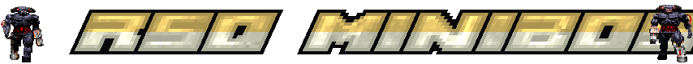

# RSQ Miniboss
### Doom Arcade VR · fill the meter, call the fight in, break the shield one thrall at a time

Built on Tartlman's **Minibosses!** (a miniboss and its thralls, the tethers and the flames) and rebuilt for Doom
Arcade VR. Fight well and a meter fills under your score. When it is full, glance at your watch and press Use, and a miniboss
lands in front of you in slow motion with its thralls around it, each one arriving on a beam of light. While its
thralls stand it cannot be hurt: kill one, and for a few seconds its shield is down. Break it in time, or everything
gets stronger.

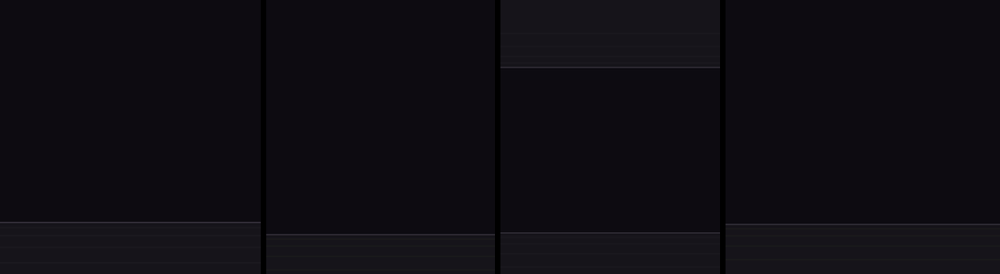

*The arrival beams, from RSQ VisualRewards (its design renders; its README has each beam on its own).*

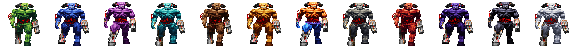

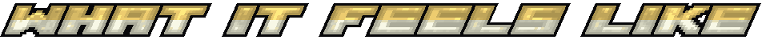

- **Your play fills the meter.** Kills, quick kill chains, style points from RSQ Score, weapon XP from RSQ Gun Bonsai VR and
  simply pushing on through the map fill the Miniboss meter.
- **You call it in.** When the meter is full it turns gold and beats like a heart, and the room's light beats red with
  it. Look at your watch and press Use, and it comes. Or wait, and it comes by itself a minute later.
- **It arrives where you can see it.** A few metres ahead of you, in your view, never on top of you. The world drops
  into its slowest slow motion and the room goes dark, the thralls land one after another, then the miniboss, bigger,
  faster and keener to shoot than its kind. Its own music starts.
- **Its thralls are its shield.** While a thrall lives, shots on the miniboss do nothing: "GUARD!" pops over it and grey
  Xs bounce off. "TARGET!" hangs over every thrall.
- **Kill a thrall and the shield drops.** The world slows, the power that thrall gave the miniboss leaves it, and you
  get one second for every thrall it came with to break one piece of its shield bar. The faster you break it, the more
  RSQ Score points you get.
- **Miss and they grow.** If the window runs out with that piece unbroken, the miniboss and its thralls move one to three
  colours up RSQ Monsters' ladder, and by default so does every monster on the map.
- **Then it is you and the miniboss.** With the shield bar gone, its own bar takes the hits. It has three lives: each
  time a bar empties it refills, burns with flames for five seconds and comes back a colour higher. Beside its bar:
  its colour gem and an icon for every Champion power it carries, its own and the ones it took from its thralls.
- **Don't shoot it first.** Shoot it while its thralls live, and if a thrall is still standing a few seconds later, every
  monster on the map goes into a rage: twice as fast and twice as keen to attack, until the miniboss dies.
- **When it dies.** A legendary weapon (Brutal Doom 22 VR Reloaded's, of some rarity), a fountain of RSQ VisualRewards
  bits, its Champion's own drops, one cigarette (RSQ Tactical Rig), RSQ Score's Miniboss row. A thrall drops only its
  Champion's bundle, armour and ammo: no gun, no health bits.

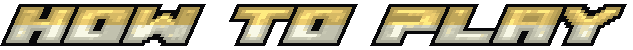

| Do this | What happens |
|---|---|
| Kill monsters, chain kills, play with style, keep moving | The meter under your score fills (red) |
| Fill it | The meter turns gold and beats, the room's light beats red |
| Hold a watch check and press Use (or just wait 60 s) | The miniboss fight is called in |
| Look ahead | It lands in view, 12 to 32 metres away, in slow motion |
| Shoot the miniboss while its thralls live | "GUARD!", grey Xs, no damage, and its greed is armed |
| Kill a thrall | The shield drops: a window of 1 s for each thrall it came with |
| Hit the miniboss inside the window | The open piece of the shield bar drains; break it before the window ends |
| Break every piece | One-on-one: its own bar takes the damage, life by life |
| Kill it | A legendary weapon, bits, its Champion's drops, cigarettes and a Score row; the level's music comes back |

**The watch check** comes from RSQ Accessibility (which carries what was RSQ Gestures). Without it, RSQ Gun Cards'
copy or this mod's own copy does the same check, so the call-in always works.

**When it won't come,** a small line under the full meter says why: *No Boss: Too Early* (the map's first minute),
*Map Limit* (two a map), *Cooldown* (90 s after the last), *Low Health* (under 40), *Near Exit*, *Too Busy* (more than
three awake monsters after you), *No Room* (nowhere in view to land) or *No Monsters*. It tries again as soon as the
reason goes. **Ignore Spawn Restrictions** brings it regardless of Too Early, Low Health, Near Exit, Too Busy and No Room.

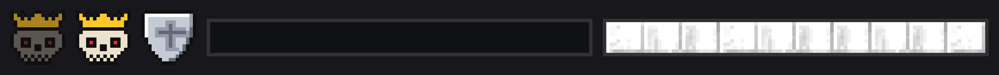

*The mod's own HUD art from graphics/, enlarged (an earlier set: the shield icon has since gone from the HUD).*

*[Still to come: the meter filling red under the score, then gold and beating, with a wait line under it]*

- **No keys**, and no menu button stands in for one.
- **Calling the fight in:** hold a watch check with either hand (the back of the wrist turned to your face, held still)
  and press **Use** while it holds, or a moment after. **Call It In: Watch Check + Use** on the page switches this off;
  the fight still comes by itself 60 s after the meter is full (**Arrives By Itself**).
- **Or from the Start Fight card on the inside of your off-hand wrist.** Do the watch check with the inside of your off
  wrist instead of the back, as if checking your pulse (the same pose reader as the watch check, twisted the other way),
  and **START (skull) FIGHT?** lies flat on the inside of that wrist, drawn with the hand the way Gun Cards draws its
  watch card on the back of the wrist (it follows the hand every frame; it turns itself the right way up, and it stays a
  second after you let go). With Gun Cards' **Watch Card: Always On** it also shows whenever its face is turned to you.
  It is always there: **grey** until the fight can be called, **gold**
  once the meter is full and no fight is called, running or on its way (owner 2026-11-15: "always shown, but greyed until
  it can be used"). **Use** on the gold card calls the fight in at once: none of the rules below hold it back (only a map
  with no monster types, or no room to land, can); Use on the grey card does nothing. The watch check (the back of the
  wrist) keeps your Gun Cards watch card; the two no longer take turns. **Start Fight Card (Inside Off-Hand Wrist)** on the
  page switches it off. (11-12 it was on the inside of either wrist; 11-13 to 11-15 it took turns with the watch card on
  the back of the off wrist.)
- **The fight itself** is your guns, fists and the other mods: this mod reads no trigger, grip or gesture of its own.
- **Menu buttons:** Reset All. The console commands listed in Under the hood are for testing.

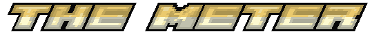

The meter goes from empty to full and stays with you from map to map, and in your save.
The meter and the miniboss bar are not drawn while a menu is open (owner 11-11).

- **A kill** adds 4 when Score's style points are filling it, otherwise 10 plus a share of the monster's health (at
  most 30).
- **A chain** (kills within 3 s of each other) adds 6 more for every link, up to 30.
- **Score's style points** add a quarter of each kill's style (at most 120 a kill).
- **Gun Bonsai VR's weapon XP** adds a fifth of the XP your gun earns.
- **Moving on** adds 2 every two seconds in which you covered 3 metres.
- Everything is times **Meter Speed**. The meter stands still while a miniboss fight arrives or is being fought, and the
  miniboss fight's own monsters never fill it.

**Miniboss Meter Fills From** picks Score, Gun Bonsai or Both. Kills, chains and time always count. If the mod you
picked is not loaded, the other one is used; with neither, kills, chains and time fill it alone.

While a miniboss fight runs the meter hides, and the fight's own bars take its place.

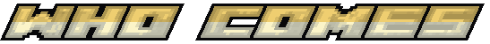

**The miniboss and its thralls are monster types already in this map,** picked by how tough they are. Class names are
never used, so it works the same on Doom's monsters, Brutal Doom's or any monster pack's. Bosses and the Champions
that rise again (Dark Red, Undying) are never sent.

Two things decide how hard a fight is, and they are separate: the **pick level** (0 to 4) picks which monster types
come; the **colour** (RSQ Monsters' ladder) makes each of them stronger.

**The pick level, 0 to 4, picks the types.** By default it is your RSQ Gun Bonsai VR player level or the RSQ Score lives
you hold, whichever is larger (past 4 counts as 4). Level 0 sends a middling type, level 4 the strongest in the map. The
thralls are weaker types (the same type when there is nothing weaker). From level 3 there is one more thrall. **Tier
From** sets where the pick level comes from: only the Gun Bonsai VR level, only Score's lives, whichever is larger, or
the old sum (Set: half your Gun Bonsai level, plus one for every 4,000 Score points this map (**Score Per Tier**), plus
half the miniboss fights you have won).

### The colours

**Miniboss From and Thralls From** (on RSQ Monsters' own page) turn the picks into ColorfulHell monsters of the same
family. With RSQ Monsters loaded and both left at their defaults, a miniboss from Brutal Doom or plain Doom gets
ColorfulHell thralls.

**The start colour.** A thrall keeps the colour it had on the map (Common when it had none); a miniboss picked from a
set starts one place above its strongest thrall on RSQ Monsters' ladder.

**The ladder is the strength order** (owner, 11-11: the tier number IS the strength). RSQ Monsters numbers its 13
colours weakest first, so the colour bonus below and every tier-up in a fight simply add to the number:

| Tier | 1 | 2 | 3 | 4 | 5 | 6 | 7 | 8 | 9 | 10 | 11 | 12 | 13 |
|---|---|---|---|---|---|---|---|---|---|---|---|---|---|
| Colour | Common | Green | Blue | Purple | Cyan | Brown | Yellow | FireBlu | Gray | Red | Abyss | Black (boss) | White (boss) |
| Mean health rank | 1.1 | 2.3 | 3.5 | 5.2 | 5.0 | 6.7 | 7.2 | 7.2 | 7.6 | 9.4 | 10.9 | 12.1 | 12.9 |

Measured from the health of every colour of all 17 ColorfulHell families (each family's colours ranked by health,
then the ranks averaged; EX forms left out; `design/rigtest_2026-11-10/evidence/MB_TIER2_strength.py`). Purple and Cyan
tie; Yellow, FireBlu and Gray are about even. (Before 11-11 RSQ Monsters numbered the colours in Colourful Hell's
listing order and this mod kept a separate strength list; that list is gone.)

**The colour bonus** (with RSQ Monsters and RSQ Gun Bonsai VR both loaded), once, when the fight arrives:
- **The miniboss** goes up **one tier for each Gun Bonsai VR player level** you have, all the way to Black and then
  White. On Black it can come out as an EX form, as RSQ Monsters rolls it (the Shotgunner's and the Lost Soul's EX is
  on White).
- **Each thrall** goes up **a quarter of a tier for each weapon level** in your hands: the main hand's gun level plus
  the off hand's, rounded half up (5 levels give 1 tier, 6 give 2). An empty hand, fists or gloves count 0. Thralls
  **stop at Abyss**: never Black, White or EX.
- **The miniboss stays at least one tier above its strongest thrall** (raised if needed, never lowered).

Who sets what: this mod sets the arrival colours; RSQ Monsters makes the monsters of each colour; Gun Bonsai VR gives
the levels. Without Gun Bonsai VR there is no bonus; without RSQ Monsters there are no colours at all. Champions and
LegenDoom boosts are added as before. The colour changes during the fight (a missed window, a life lost, the whole map)
move up RSQ Monsters' ladder numbers, so since 11-11 each step up is a step stronger.

**Everything that arrives is boosted:** a Champion (it is given one of Champions' colours if it did not roll one),
legendary with LegenDoom (when **Legendary Thralls** is on), lit in its own colour and full-bright. The thralls are drawn
a little larger, and get half their health again when they are not made legendary. The miniboss is 1.25x as big (its hitbox too), 1.25x as fast, and far
keener to shoot. It becomes legendary when any of its thralls is.

- **Where:** a spot in front of you (within 55 degrees of where you face), between 12 and 32 metres away, that you can
  see, and with room for the miniboss and at least half of its thralls round it. The map's own monster start spots are
  tried first, then points along your view.
- **When it lands:** the world and you slow to SlowMo's slowest for 4 seconds, and the room drops to DarkDoom Black
  (with RSQ Glow In The Dark). The thralls land about 0.3 s apart, then the miniboss. Each one is hidden and frozen
  until its RSQ VisualRewards arrival beam shows it, and an RSQ SlowMo edge arrow points to it while it is out of view.
  The miniboss always lands on V4; each thrall lands on V1, V2 or V3, picked at random for each one. When the
  miniboss appears, a wave of its colour rolls out across the map.
- **Without VisualRewards' beams** each one lands at once in the original Minibosses! teleport flash, with Doom's
  teleport sound.
- **If the miniboss cannot land,** whatever already came is taken back out, the meter stays full, and it tries again.

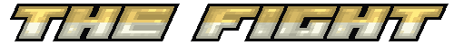

**The miniboss bar.** While a miniboss is on the map its bar is on your HUD where Be Quick or Be Dead's panel stands
(low and centred under your gaze, half your view wide; it steps aside while you are DOWN): the crowned skull with a
crosshair over it, its name in gold, and a slanted bar in its colour with a dark red trail where health just went. `X2` at the
bar's end means it has two bars. `GUARD` in grey over a greyed bar means it cannot be hurt right now. Under it, each
thrall has a small bar of its own with its crosshair and its Champion power icon over it.

**It charges up.** The bar appears as a sliver and grows outward, empty. Each thrall's bar pops in as it lands. When
the miniboss lands its bar fills over three seconds while an LED clock beside it counts down from 03:00; until the
clock runs out nobody in the encounter moves and nobody can be hurt. The same clock shows how long a window stays open
after a thrall dies.

Every monster of the encounter is a full Champion, whatever Champions' own options say: for the landing this mod sets
Champions' Override Chance to always and puts it back after. Each lands on a beam in its Champion colour. No two thralls share a Champion power: a thrall that lands with a power another thrall already has (or that Champions
did not make a Champion) is taken out inside its beam and lands again. Each thrall's bar is in its own Champion colour. Shoot the miniboss while it is guarded and `GUARD` on its bar shakes
and flashes gold, so you know the hit landed and did nothing.

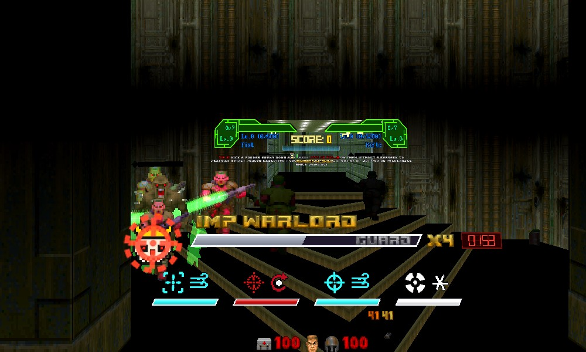

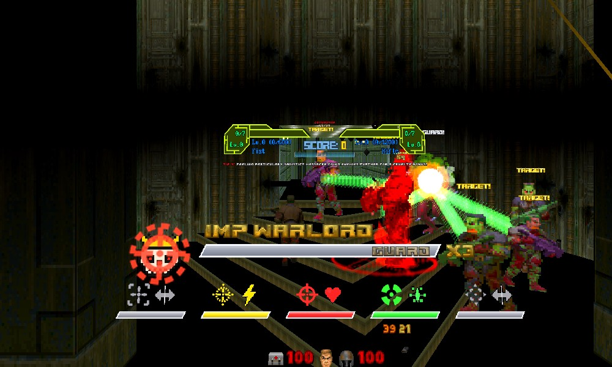

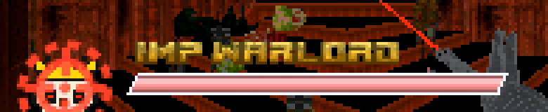

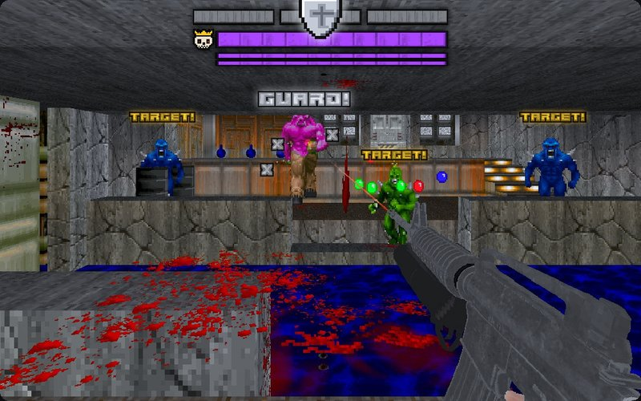

**The thrall bar, on the Boss bar** (owner 2026-11-16 16:5x: "Show them on the Boss bar"). One segment for every thrall
it came with; together they hold as much health as the Boss itself, so you have to break them before you ever touch its
own bar. They are drawn as a row of small slanted bars right under the Boss bar, in the same glass tube, rim and lean,
across its width: **grey** while the shield is up, the open one **gold and draining** while a window is open (the LED
beside the bar counts that window's seconds down, with or without RSQ SlowMo), in the Boss's colour when no thrall stands
(they take hits freely), and **gone** once broken (the others keep their places). When the last one breaks the row is gone
and the Boss bar itself drains. The bar's own art, size, colours, animation, skull, name and X3 are unchanged. Up to eight
thrall bars are drawn under it (Thralls 4 and up can bring six to eight): past five the row gets narrower, never longer.

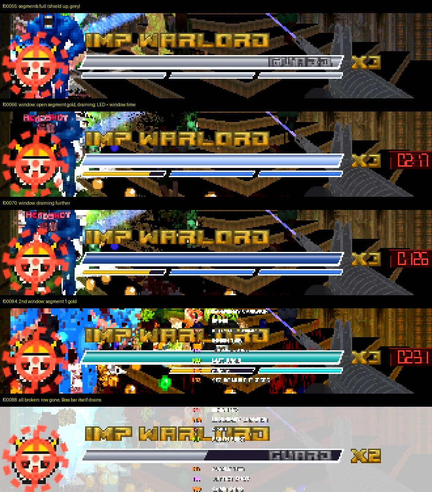

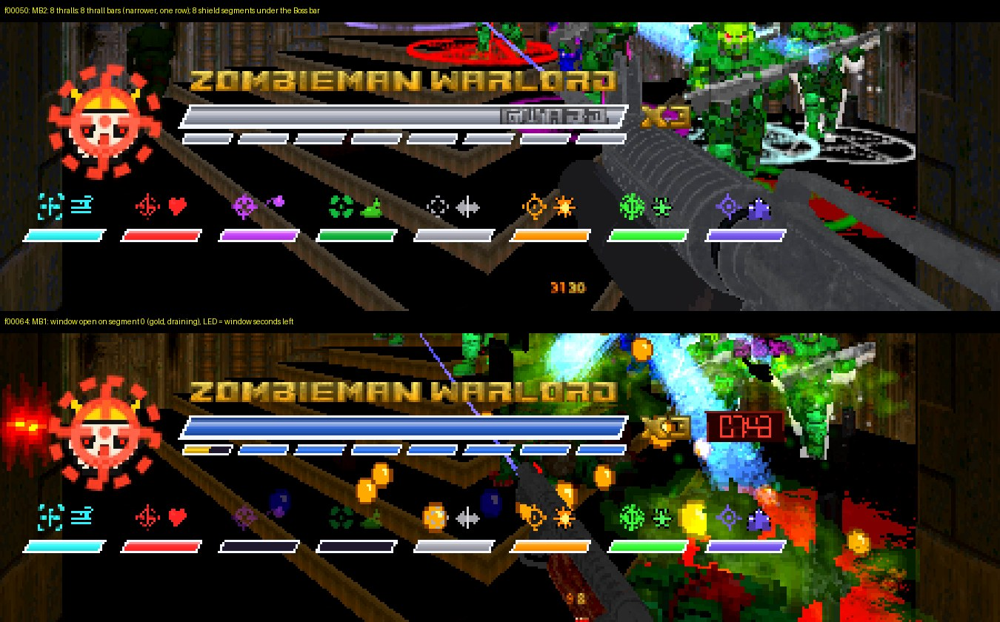

**Shield up.** While a thrall lives, a segment is left and no window is open, the miniboss takes no damage at all. The
thrall bar is grey, "GUARD!" pops over the miniboss when you hit it (and while it is invulnerable after losing a life), and grey Xs (Doom's own
small X) bounce off where the shot landed. The room's light holds a steady cold grey.

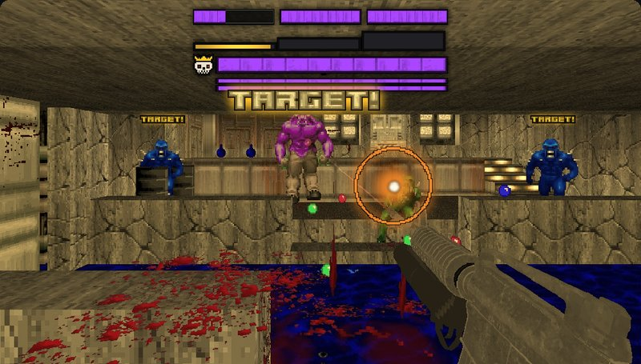

**A thrall killed.** The power that thrall gave the miniboss leaves it, a pop in that power's colour bursts where the
thrall died (RSQ VisualRewards; without it the original's burst), and its tether breaks. The world slows, and the
shield drops: **a window of one second for every thrall it came with** (three thralls: three seconds) opens on the first
unbroken segment. A stepped gold bar under the segments drains, the room's light pulses gold, a big "TARGET!" hangs
over the miniboss and the thralls' shrink. The window closes early when the segment breaks. A thrall killed while a
window is open waits its turn: the next window opens when this one closes.

**Broken in time,** the segment scores RSQ Score's **Thrall Slow Kill**: 100 points for every second still left in the
window, so the fastest break scores the most.

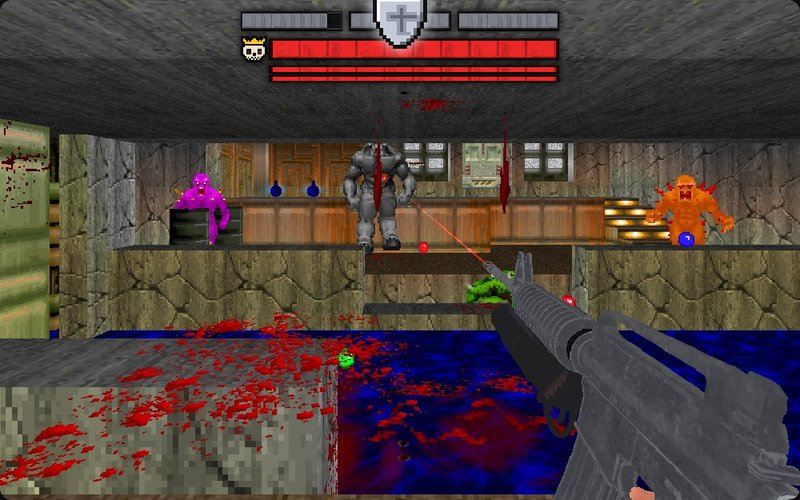

**Window missed.** If the window runs out with the segment still standing, the miniboss and its living thralls move up
RSQ Monsters' ladder, with RSQ Monsters' own flash: one colour if only a sliver was left, two if about half, three if it
was untouched. With **Tier-Up Hits the Whole Map** on (the default) every monster on the map that has an RSQ Monsters
colour moves up with them. Then the shield is back up. (Without RSQ Monsters nothing climbs.)

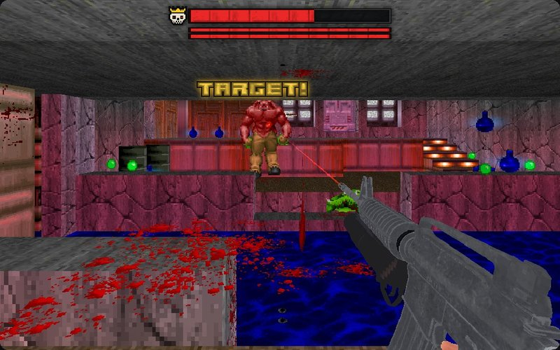

**One-on-one.** Once every segment is broken (or no thrall is left standing) the hits go where they land: into any
segment that is left, then into its own bar, in its colour. "TARGET!" hangs over it, and the room glows its colour.
After it loses a life it cannot be hurt for a few seconds: "TARGET!" goes, and "GUARD!" pops when you hit it, until it
can be shot again.

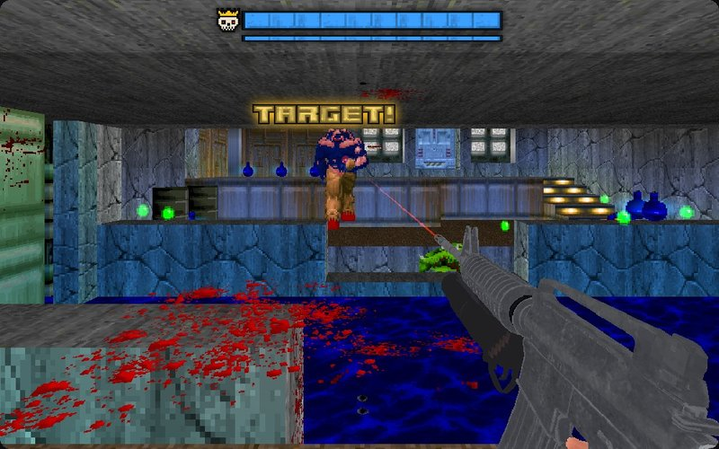

**Its lives.** It has three lives by default (thin bars under its own, one for each life to spare). When a bar empties
it stops at the last point, spends a life and refills, bursts, and burns with circling flames for five seconds in which
nothing hurts it. With **Tier Up Each Life** on it comes back one colour higher. The room flashes red, then takes its new
colour. No thralls rise again.

*These five pictures are design mockups drawn on a rig frame before the reworked fight was built. They show the HUD and
the words as the code now draws them, but they are not captures of the mod running.*

**Its death.** A wave of its colour rolls across the map, and two seconds later Glow In The Dark's colours re-roll. Its
thralls are free monsters again.

**Every miniboss you kill tiers the monsters up** (**Miniboss Kills Tier Up Monsters**, on; owner 2026-11-15: "every
miniboss we kill, tiers up monsters 1, and we have that as an on / off. just for now so I have something to play").
When you kill a called-in fight's miniboss, **BOSS DEFEATED!** stands in gold over where it died, and a second later
**ENEMIES TIER UP!** in red above it (RSQ VisualRewards' words), as RSQ Monsters' world tier goes up by one. Every living
monster on the map then climbs one colour with RSQ Monsters' tier flash, the miniboss's thralls too. A thrall's death,
a miniboss killed by something other than you, or one gone without dying, raises nothing. At White (13) the world tier
stays where it is and only BOSS DEFEATED! shows. Without RSQ Monsters (or with its colour ladder off) nothing happens.

**The fight's rule (2026-11-16, design/DOWN_LIVES_MINIBOSS_TIERS.md 4).** The miniboss arrives at **world tier + 2** and
its thralls at **world tier + 1**, no cap but White (Tier From is gone). A **win** also drops RSQ Score's gold **life
crate** where the miniboss died (+1 Score life when you touch it). **Spending a Score life during the fight, or leaving
the map with it on, loses it:** the miniboss and its thralls leave on their beams, **BOSS WINS!** in red, then
**ENEMIES TIER DOWN!** and the world tier goes down one (at least 1); no legendary. While you are DOWN in a fight your
target is one of its remaining thralls (else the miniboss). Rig only, not headset-confirmed.
*Just for now:* the world tier is RSQ Monsters' **World Tier (test)** setting, and settings are saved, so it carries into
your next game until you set it back on RSQ Monsters' page. A miniboss fight still arrives in its own colours: the
world tier does not set them, as before (rig run `tuBase`, see Status).

**What it inherits from its thralls** (with Champions, **Inherit Powers** on): Yellow's faster shots, White's slowing
hits, Dark Green's poison, Cyan's knockback and Titan's three-way shots are handed to it; Dark Red and Undying give it
an extra life each (two at most); Black makes it hit 50% harder; any other colour or mutation makes it 50% tougher (twice
as tough at most). It takes at most four powers (**Power Cap**), the same colour counts once, and being legendary does
not count. **Each power goes with the thrall it came from.**

**Its colour** is its RSQ Monsters colour. A monster off the ladder takes pink, cyan, amber or violet, in turn.
The tethers, bursts, flames, bars and the room's glow all wear it, and it changes as it climbs.

Hit the miniboss while its shield is up and its greed is armed. One window's length later (one second for every thrall
it came with, or when a running window ends) it is checked: if the miniboss lives and a thrall still stands,
**every monster on the map is enraged** until the miniboss dies. They move at twice their speed (**Rage Speed**), attack
twice as readily and react at once, a red spark rises off each one near you, and a roar sounds. Monsters that spawn or
are raised meanwhile are enraged too. Kill every thrall before then and nothing happens. When the miniboss dies
or you leave the level, every monster is put back exactly as it was.

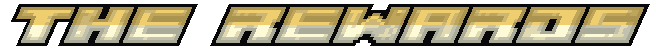

**The miniboss killed** (owner 2026-11-12: every drop is another mod's; this mod has no drop of its own):

- **A legendary weapon** (or, with the Boss kiosk, the kiosk in its place: below) from Brutal Doom 22 VR Reloaded (its LegenDoom drop, RSLD): the miniboss's rarity is rolled
  Common 50 / Uncommon 30 / Rare 15 / Epic 5 at the first tier, rarer ones more likely at higher tiers. It asks this mod
  whether the monster came with a miniboss fight, the fight's tier and whether it was the miniboss ("bossfight", "tier",
  "wasboss"). Its thralls' legendary weapons are taken away.
- **Bits** from RSQ VisualRewards' Kill Rewards: with **Boss Kill Rewards** on it counts as a boss, so it always drops
  bits, a boss's fountain of them.
- **Its Champion's drops:** Champions' own item bundle (with Champions' **Spawn Item Bundles?** on, its default).
- **A cigarette:** RSQ Tactical Rig gives you one (owner 2026-11-12: "change to +1 cigarette, cigarettes are massively
  powerful now"; it filled the pocket before), never past your pocket's size (with its cigarettes on, they are off by
  default, and **Miniboss Kill Gives a Cigarette** on).
- **RSQ Score:** the **Miniboss** row at 3x the kill: one row, one reward.
- **A win counted** (and RSQ Score's life crate where it died, 2026-11-16).

*(The gun or power-up this mod used to drop was cut 2026-11-12: the legendary weapon is the drop. The extra x3 bits and
Score's life crate went earlier: the drops will be balanced once the arcade systems are designed.)*

### The Boss kiosk (2026-11-16, design/KIOSK.md)

With Brutal Doom 22 VR Reloaded (2.0.4y or later), LegenDoom 3.0 and RSQ Score loaded, a Boss you kill drops **a kiosk**
in place of its one legendary weapon, beside the 1UP crate:

- **Stand still near it.** Within 3 m, still for 2 seconds (never mid-fight: while a Boss fight lands or runs it stays
  shut, and an open one folds up), it opens: three legendary weapons, each on
  its own gun, rolled at the Boss's tier the way its own legendary would have been, each with a gold price by rarity
  (Common 150, Uncommon 250, Rare 500, Epic 900 to start). Walk away and it folds up; it stays until you leave the map.
- **Point at an offer** with either hand (or put your hand in it): its card pops up with the gun, the rarity, the effect,
  and what you hold on that gun now. **Pull that hand's trigger** to buy it, if your gold covers it: the legendary is
  yours. Buy as many as you can afford, each once. While a hand points at an offer, its trigger is the kiosk's, not the gun's.
- **LUCKY:** point at the LUCKY button on the counter and pull the trigger, then pull it on an offer: one Score life
  spent, that offer one rarity up (its price follows). Once per kiosk. Alt fire on an offer does the same.
- **The look** is the approved mockup's: every word and number in the owner's SOTN letters, gold words shimmering, the
  card popping in with its rows one by one, and on LUCKY a life flying to the offer, then LUCKY! and the new rarity.
- **Gold** comes from RSQ VisualRewards' gold bits (a share of every kill's bits, a fountain from a Boss) and is banked by
  RSQ Score, shown on your off hand's watch card (RSQ Gun Cards) and the kiosk's counter, kept across maps and on death.
- **REPAIR** (with RSQ Gun Cards' Weapon Condition on and a gun worn): a REPAIR button on the counter, left of LUCKY, with
  its price. Point at it and pull the trigger: every gun you carry goes back to 100, for **Repair Gold per Point** (1) a
  missing point, at least **Repair Minimum** (10). Too little gold: refused, with a toast of how much more. *Rig only,
  not headset-confirmed (design/condition/rig/).*
- Without BD22 VR Reloaded, LegenDoom or RSQ Score, or with **Boss Kiosk** off, the Boss drops its legendary as before.

*Rig only, not headset-confirmed (2026-11-16, runs `kq_e2e3`, `kq_in7`: design/mockups/kiosk/rig/).*

### The Big Boss (2026-11-16, design/BIG_BOSS.md)

- **The Big Boss bar** sits beside the Boss meter, the same size and made the same way, **black with a red edge** (the
  Boss meter is red, gold when full) with a black skull edged red: every Boss you beat fills it **25%**. It is kept across
  maps, saves and a death's reload.
- **Full, a Big Boss is due: call it in as you call a Boss** (the watch check + Use, or the Start Fight card on the
  inside of your off wrist, which then reads **BIG (skull) BOSS!** in black and red instead of the gold START (skull)
  FIGHT?), **or it comes by itself** Arrives By Itself (60 s) after the bar filled. While it is due the call is always the
  Big Boss's (it goes before a full Boss meter). Then **BIG BOSS INCOMING!** with the siren, an **EX monster** of RSQ
  Monsters with thralls, its health on the Boss bar. The bar empties as the fight starts.
- **Beat it:** **BIG BOSS DEFEATED!**, the world tier up, the 1UP crate, and **the kiosk with five offers, every one
  Epic**, on five different guns where it can (no LUCKY).
- **Lose it** (a Score life spent, or leaving the map): **BIG BOSS WINS!**, as a lost Boss fight; the bar stays empty.
- **Options:** RSQ Boss > Big Boss (on). Test and Debug: Big Boss Bar +25% (Test) / Empty.
- New EX bosses join the Big Boss pool by themselves when RSQ Monsters names them `*EX` at a boss colour; any other
  monster class joins by a line in an `RSQBIGBS` lump.

*Rig only, not headset-confirmed (2026-11-16: Miniboss/docs/rig_2026-11-16_bigboss/, rig_2026-11-16_bigboss_v2/).*

**A thrall killed** (owner 2026-11-12: "no gun drop, no red bits drop. just champion bundle, armor and ammo."):

- **Its Champion's drops:** Champions' own item bundle.
- **Armour and ammo bits** from RSQ VisualRewards' Kill Rewards: a thrall's bits are never health bits (the red ones).
- **Its ammo:** the ammo its monster drops.
- **No gun.** The weapon its monster would drop (a zombie's chaingun, Brutal Doom's replacer for it, any Brutal Doom
  weapon spawner) is taken away by this mod the tic after it appears (`thralldrops.zs`); its legendary weapon is taken
  away by Brutal Doom 22 VR Reloaded. A thrall killed after its miniboss counts too (in the code; not shown on the rig).

*Rig only, not headset-confirmed (2026-11-12, runs `mbdrop1` and, for the thralls and the one cigarette, `mbthrall2`):
see Status.*

With **Graves Rise** on, Legion of Bones and RSQ Graveyard loaded, the moment a miniboss fight has landed the tombstones wake.
**Graves Rise Mode** picks how many and where:

| Mode | What rises |
|---|---|
| One Per Stone, Whole Map (default) | Every tombstone on the map raises one undead |
| One Per Stone, Within Radius | Every tombstone within **Graves Radius** of the fight raises one |
| Thralls Per Stone, Whole Map | Every tombstone raises one undead for each thrall the fight came with (five thralls: five a stone) |
| Thralls Per Stone, Within Radius | The same, only the tombstones within **Graves Radius** |

Each undead is a thrall's own type, Skull Zombies when none fits. The tombstones' candles also beat with the full meter's
heartbeat.

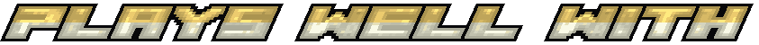

Everything is asked by name: every mod still loads and plays alone, and the parts that need a missing mod simply don't
happen.

- **RSQ Score:** its style points fill the meter, its lives can set the pick level, and the meter sits centred under its bar.
  Miniboss sends it the **Miniboss** and **Thrall Slow Kill** rows; Score values Miniboss as a share of the miniboss
  kill's worth (3x). Score also reads Miniboss for its own rows: **Chain Gang** (thralls
  killed in one window), **Rage Quit**, **Riot Control**, and combos that ask for a thrall
  or the miniboss.
- **RSQ Monsters:** the colours, the colour changes on a missed window and on each life lost (with its flash), the
  bodies it swaps on a colour change (Miniboss finds the new one and dresses it again: the same Champion, rebuilt by
  Champions' own code, its LegenDoom legendary, risen again, and the share of health the old body had left), the EX roll, and **Miniboss
  From / Thralls From** on Monsters' page. Re-entering a hub level puts back every colour Miniboss gave.
- **RSQ VisualRewards:** the arrival beams, "GUARD!", "TARGET!" and the pops; the miniboss fight music scene (its Scene Music
  row turns it off for you; **Miniboss Music** here turns it off for everyone); Kill Rewards' boss fountain; Top HP Bars draws a crown over the miniboss's bar, with a pip for each pick level, and a chain link over each
  thrall.
- **RSQ Glow In The Dark:** the red heartbeat of a full meter, the landing in DarkDoom Black, the cold grey, gold and
  red of the fight room, the colour waves at the landing and the death, and the colour re-roll after. Its own **Miniboss
  Tint** rows turn the map the miniboss's colour and darken it while any miniboss lives.
- **RSQ SlowMo:** the landing's slow motion (a game slow with its countdown bar and MINIBOSS INCOMING line, under its Triggers
  page's **Miniboss** switch, outside its shared cooldown), the slow motion of every window, and the edge arrows to
  monsters out of view. Its countdown bar sits under the meter at the same width. **Slow Depth** at -1 uses SlowMo's own
  World Speed.
- **Champions and LegenDoom (LegenDoom Lite 4.2 or LegenDoom 3.0):** boosted legendary champions, the inherited powers,
  and **Legendary Boss Health**: a miniboss made legendary gets the higher of LegenDoom's boss and normal legendary
  health. RSQ Gun Bonsai VR and RSQ ShieldSaw read that and size their own numbers on it. With Brutal Doom 22 VR's
  LegenDoom Lite patch, legendary weapons drop only from a miniboss fight's monsters.
- **RSQ Gun Bonsai VR:** its weapon XP fills the meter, its player level sets the pick level, and (with RSQ Monsters)
  its player level and your weapons' levels raise the arrival colours (the colour bonus).
- **RSQ Accessibility and RSQ Gun Cards:** the watch check for the call-in (this mod carries its own copy too).
- **RSQ Tactical Rig:** while a miniboss fight can be called, the watch check's Use press is the call-in's and the gun stays
  put; killing a miniboss gives you one cigarette (its cigarettes are off by default: Tactical Rig's own page).
- **RSQ Grapple and RSQ Whip:** with **Can't Be Yanked** on, they refuse to yank or throw a miniboss: the line pulls you
  to it instead, as with a boss.
- **RSQ Melee:** with **Can't Be Headlocked** on, its headlock refuses a miniboss.
- **RSQ Graveyard and Legion of Bones:** Graves Rise, and the candles beating with the full meter.
- **RSQ Accessibility:** Photosensitive Mode stills the meter's glint and edge, caps and dims its beat, holds the shield
  icon and the window bar still, and keeps the room's gold steady. Text Size grows the meter through Score's scale.
- **Brutal Doom 22 VR Reloaded (2.0.4y), LegenDoom 3.0 and RSQ Score:** the Boss kiosk (its offers and the legendary you
  buy are BD22 VR's, asked by name; the gold and the life LUCKY spends are Score's). RSQ VisualRewards drops the gold bits.
- **Brutal Doom:** works on its monsters.

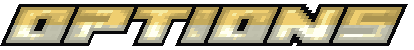

*Radiant Silvergun Options → RSQ Miniboss.* One page of choices; the numbers are under Test and Debug. **Reset All** at
the foot resets both pages. Effects, Effects Density, Effects Range, Show Meter and Meter Size are yours; everything else
is the host's.

| Section | Rows |
|---|---|
| Top | Minibosses · Meter Speed (1) · Miniboss Meter Fills From (Score, Gun Bonsai, Both) · Call It In: Watch Check + Use · Ignore Spawn Restrictions (off) · Effects · Effects Density (Low, Medium, High) |
| Fight | Thralls (3) · Lives (3) · Graves Rise (Legion of Bones) (off) · Graves Rise Mode (One or Thralls Per Stone; Whole Map or Within Radius) · Graves Radius (1024) |
| Rules | Legendary Thralls (LegenDoom) · Tier-Up Hits the Whole Map · Tier Up Each Life · Miniboss Kills Tier Up Monsters · Inherit Powers · Greed Enrages Monsters · Score Awards |
| Boss Kiosk | Boss Kiosk · Kiosk Range (3 m) · Kiosk Wait (2 s) · Common / Uncommon / Rare / Epic Price (150 / 250 / 500 / 900 gold) · Repair Gold per Point (1) · Repair Minimum (10 gold); Test and Debug: Kiosk Log |
| Other Mods Treat It as a Boss | Boss Kill Rewards · Legendary Boss Health · Can't Be Yanked · Can't Be Headlocked · Can't Be Morphed (off) · Map-wide Roar (off) |
| Test and Debug: Miniboss | Arrives By Itself (60 s; 0 only when called) · Map Start Wait (60 s) · Cooldown (90 s) · Per Map Cap (2) · Wait Under Health (40) · Wait Over Awake Monsters (3) · Nearest Arrival (384) · Farthest Arrival (1024) · Exit Distance (768) · Landing Slow Motion (4 s) · Landing At Slowest · Landing In The Dark · Miniboss Music · Score Style Fill (0.25) · Gun Bonsai XP Fill (0.2) · Show Meter · Meter Size (1.5) |
| Test and Debug: Fight | Power Cap (5) · Invulnerable (5 s) · Slow Depth (-1: SlowMo's own) · Rage Speed (2) · Effects Range (4000) |
| Test and Debug | Debug Log (off) |

The fight's tier comes from RSQ Monsters' world tier only (2026-11-16: Tier From and Score Per Tier are gone);
**Tier-Up Hits the Whole Map** and **Tier Up Each Life** are about colours. **Miniboss Kills Tier Up Monsters** raises
RSQ Monsters' world tier by one for each miniboss you kill (at most 13, White); that tier is a saved setting, so it stays
until you reset **World Tier (test)** on RSQ Monsters' page.

Rows not marked (off) are on by the default; the default choices are Both, Low, Whichever Is Larger and Map. Distances
are in map units (32 to a metre).

*[Still to come: the options page]*

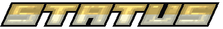

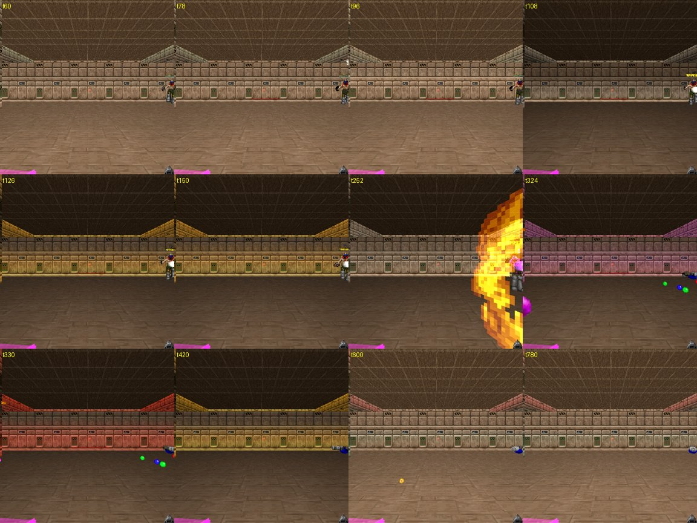

| | |
| **code only, not run (owner's call, 2026-11-17: no rig checks); not headset-confirmed** | **The Start Fight card on the inside of the wrist, as Gun Cards' watch card** (owner 11-17: "it's the exact same fucking logic as the fucking guncards. on the inside of the god damn wrist"). Why it was not there: it was a quad in the world, moved to the controller's point once a tic, 15 cm back and 4 cm off the palm side, then pulled 24 cm toward the eyes and turned to face them: a strip floating between the hand and the face, a tic behind the hand. Now it is drawn as Gun Cards draws its watch card: voxel pieces on layers owned by the off-hand weapon, so the engine draws them with the hand every frame, flat on the wrist measured from BD22 VR's hand mesh (tools/gen_wristcard.py, which imports Gun Cards' gen_side.py): Gun Cards' card on the back of the wrist (model X -4.5), this one on the inside (X +5.3), from 1 cm over the wrist up the forearm, so the two never overlap. Gun Cards' rules copied: its which-way-up and mirrored twin, not while the off hand steadies the gun, Gun Cards' linger, and its Watch Card: Always On. The card's look, its grey / gold / BIG BOSS! and Use on the gold card are unchanged; with no off-hand weapon it falls back to the world quad |
| **rig only, not headset-confirmed** (2026-11-16, runs `fix_mbgcgd_*`: the owner's full order with his saved settings, Black Metal, gate_rel4 with these packs, BD22 VR Reloaded 2.0.5a, MAP01; a test probe; each fix run against gate_rel4's own packs too) | **Bug check E fixes.** The shield segments drawn on the Boss bar with the window's LED (frames above; `docs/rig_2026-11-16_fix_mbgcgd/`). Start Fight card after a watch-check call held by Too Early: gold, and Use on it lands the fight (before: grey, nothing). Bosses switched off mid-landing: six held monsters let go, Champions' Override Chance back to -1 at once (before: held dormant and frozen, 256 until switched on again); mid-fight: the fight ended, no win, no loss (before: it ran on with no bar). Show Meter off: the Boss bar still drawn in a fight (before: hidden). The Big Boss bar at 75 % at a death, the save from 50 % loaded: back to 75 % (it was kept in a server cvar, which the load itself put back as saved). Eight thralls: eight bars. A gun born at the player near a fresh thrall death is kept (before: destroyed); one at the death spot is still taken. No script error from our packs |
| **rig only, not headset-confirmed** (2026-11-16, runs `boss_mb1`-`3`, `docs/rig_2026-11-16_win_loss/`; the owner's full order with his saved settings, Black Metal) | **The fight's rule:** at world tier 3 the miniboss arrived Cyan (5) and its thralls Purple (4); a lethal hit from a map monster during the fight put the player DOWN with a thrall as the target, and killing it got him up; the miniboss killed by the player dropped RSQ Score's life crate on its death spot, the world tier went 3 -> 4, and touching the crate gave +1 Score life; a Score life spent during the fight (a fall) lost it: all five left on beams and were removed 10 tics later, the world tier went 3 -> 2; leaving for MAP02 with the fight on took the tier 3 -> 2 and the BOSSLOSS banner was asked on MAP02. With RSQ VisualRewards' banners from main (run `boss_mb1b`, `win_frames.jpg`): REVIVE, BOSS DEFEATED! with TIER UP and the +1UP drawn; BOSS INCOMING! is asked at the arrival (VisualRewards does not draw it yet). Not shown: a DOWN target being the miniboss once no thrall is left; the beam-out and the words in frames |
|---|---|
| **rig only, not headset-confirmed** (2026-11-15, runs `tuH`, `tuOff`, `tuMax`, `tuBase`, and `tuA` for a second fight; the owner's full order with his saved settings, Black Metal, BD22 VR Reloaded 2.0.4x, MAP01, god and notarget; Debug Log and RSQ Monsters' debug on; probe and log lines in `docs/tierup_2026-11-15/`) | **Miniboss Kills Tier Up Monsters** (owner 11-15 19:41, "just for now"). A called-in fight, its miniboss killed by the probe as the player. On (`tuH`): "RSQMB tier-up on kill t251: miniboss RS_GreenZombie killed by a player, world tier 1 now", then at t286 "world tier 1 -> 2 (Green(2))", RSQ Monsters "world tier 2: 26 kit monsters and 3 ColorfulHell monsters follow"; every living monster on the map by its ladder tier: before "t1:31 t2:1" (the miniboss Green), after "t2:29". The words: MINIBOSS DEFEATED! alone, then ENEMIES TIER UP! above it, a thrall gone green in front (`docs/tierup_2026-11-15/defeated_then_tier_up_tuH.png`, frames 59, 62, 64; the words partly hidden by what stands in front of them). Off (`tuOff`): "tier-up on kill: off", the world tier stayed 1 and every monster at 1. At 13 (`tuMax`): "world tier 13, already at the top (13): no tier-up", no ENEMIES TIER UP!. **A fight's own colours do not follow the world tier, before this change or after:** at world tier 13, with every map monster White, a fight still arrived as a Green miniboss with Common thralls, on origin/main's pack (`tuBase`) and on this one (`tuMax`); in `tuA` the second fight, called in at world tier 2, arrived Green with Common thralls like the first. Its monsters alive when the world tier moves do follow (the thralls above). No script error from our packs (only BD_VoxelPack's four voxeldef lines) |
| **rig only, not headset-confirmed** (2026-11-15 16:30, runs `sf2`, `sf3`, `sf4`; the owner's full order with his saved settings, Black Metal) | **The Start Fight card redone on the watch check's own logic** (owner 16:08: "it's literally the same logic as the watch card just inside the wrist"; the 07:35 card was a long strip laid along the forearm, read by its own pose test, and needed the wrist bent to see it). The pose is RSQ Accessibility's inspect reader (the copy in gestcopy.zs: position, pitch, still, twist 35 to enter / 20 to keep, held 6 tics) with the twist the other way (the inside of the wrist), lingering 35 tics; the card floats 8 units toward the eyes from the inside of the wrist, faces them, upright. Rig, the off hand where the watch check reads at roll 90, turned to roll -90: "inside check HELD, SHOWN GREY"; the meter filled: "SHOWN GOLD"; Use: "CALLED IN (the fight card: no rules)", grey again; turned back to the watch check: "inside check no", gone after the linger. Frames: `docs/startfight_2026-11-15/inside_wrist_watch_logic_grey_gold_grey.png`, `inside_wrist_watch_logic_gold.png`. No script error from our packs. Replaces the row below |
| **rig only, not headset-confirmed** (2026-11-15, runs `wc4`, `wc5`, `wc7`; the owner's full order with his saved settings, Black Metal, BD22 VR Reloaded 2.0.4x; Debug Log on; the off hand posed by the rig's `qz_lhand`) | **The Start Fight card on the inside of the off-hand wrist** (owner 11-15: "always shown, but greyed until it can be used", "like looking at pulse"). The inside of the off wrist turned to the eyes (inner wrist 0.82, gaze 15 degrees): the card shown at once and held ("SHOWN GREY, meter 0%"), the grey card reading FIGHT NOT READY; the meter filled: "SHOWN GOLD (Use calls it in)", START FIGHT? in gold; Use on it: "MINIBOSS FIGHT CALLED IN (the fight card: no rules)", ARRIVING, and the card grey again ("meter called"). Frames: `docs/startfight_2026-11-15/inside_wrist_grey_gold_grey.png`. Roll sweep (`wc4`): shown from an inner-wrist reading of 0.35 (about 70 degrees; 0.5 before, 11-12); the back of the wrist (the watch check) never shows it. It no longer takes turns with Gun Cards' watch card. No script error from our packs |
| **rig only, not headset-confirmed** (2026-11-15, runs `fixA`, `longOld` / `longNew` / `longNewHi`, `live1` / `live2`, `tth5`, `tthB`, `abA`, `tthL`, `tthS`, `og1`; the owner's full order with his saved settings, Black Metal, BD22 VR Reloaded 2.0.4x; Debug Log on; probe and log in `docs/tethers_2026-11-15/`) | **The tethers and the flames, shown in frames.** A called-in fight draws a chain of APLS beads in the fight's colour from the miniboss to every living thrall, every tic; a killed thrall's link bursts and is gone; a lost life lights the flames round it (`docs/tethers_2026-11-15/3_fight_tethers_break_flames.jpg`). On this order every sprite the pool uses is found, so the particle fallback is never used. Before this date they drew too on the rig (green, cyan, white, Black and Abyss fights, with lights and bloom on as in his ini, after a save and load), the same beads as the original Minibosses! loaded on the same order (`5_original_vs_ours.jpg`), but **with the original's fixed 30 beads a link, a long link broke into a row of separate dots** (`1_long_links_before_after.jpg`, `4_live_fight_before_after.jpg`): in the live rig fight (`live1`, the thralls free to move) the thralls ran off from it and their links read as loose dots. Whether that is what reads as missing in his headset is not known. **Now a link gets a bead every 9 units** (30 at the least, its share of the Effects Density cap at the most, then bigger beads so they still touch), so it is a solid chain at any length (`2_after_1440_crop.jpg`, 1440 pixels per eye). The cap is unchanged; the script cost with Debug Log on went from about 0.11 to 0.15 ms a tic (4 to 5 long links). Debug Log's "sprites shown" now counts each link's dark slots too. **Not reproduced: the tethers missing outright.** The rig is Quest's OpenXR path; his saved ini has `vr_mode 10` (OpenVR, the PC build), which the rig cannot run. No script error from our packs |
| **rig only, not headset-confirmed** (2026-11-12, runs `trio1` and `trio2`, the owner's full order with BD22 VR Reloaded 2.0.4t; probe `rig/work/trio1probe`; Debug Log on) | **The old HUD stack is cut** (design/MINIBOSS_CLEANUP_AUDIT.md 3.2: the thrall row, window bar and life bars under Score that the miniboss bar replaced; nothing in any pack called it). After the cut, `netevent rsqmb_fill 1000` then `netevent rsqmb_callin 1`: "RSQMB MINIBOSS FIGHT CALLED IN (the fight card: no rules)", "ARRIVING: tier 0, RS_GreenImp + 3 thralls", "LANDED", and the miniboss bar drawn from t809, the first tic of the arrival (the probe saw the bar's own draw start, `DrawBossBar`), through the end of the run with the miniboss alive (`trio2`; with the rig's default `screenblocks 12` the HUD draws nothing, as for every HUD of this pack: `trio1`). **The word Bossfight is gone from what you see:** the debug lines read "MINIBOSS FIGHT" / "miniboss fight", and no menu row of this pack, RSQ Monsters or BD22 VR Reloaded's LegenDoom page has "Bossfight" in it (the probe listed every row). No script error from our packs |
| **rig only, not headset-confirmed** (2026-11-16, runs `bb_tdA` / `bb_tdB`, the owner's full order; Miniboss/docs/rig_2026-11-16_bigboss_v2/run_log.txt; owner 11-16 09:58, Monsters/docs/ASSEMBLY_AUDIT_2026-11-16.md item 8) | **Thrall drops, two faults fixed.** (1) A Brutal Doom thrall's gun put on another monster's older death and kept (a LabguyB's BrutalAxe, with a ShotgunSpawner at its death): a thrall's death within reach now owns a gun before any other monster's, and every gun born while a fight is on is judged a tic later, so a drop spawned in the dying tic itself is caught (`thralldrops.zs`). Shown on BD thralls (PistolZombiePatch, RifleZombie, Imp, LabguyB): every thrall gun removed (PistolSpawner, RifleSpawner, BrutalAxe x3 "a thrall's recent death near it (thralls first)"); kept only a map RifleZombie's own and the miniboss's. (2) A health bit at a Colorful Hell thrall's death: across 24 thrall deaths in both runs RSQ VisualRewards burst 0 health bits from a thrall ("0 health ... N health bits left out: a thrall drops none"); every health bit born near a thrall death came from the miniboss (same tic, 1-6 units from it) or a map monster (SkullZombie, RS_BrownImpShieldMini); the audit's probe puts any item within 512 units and 140 tics on the nearest set-piece death, so the miniboss's health bits landed on a thrall's list. Hardened anyway: a Lucky Kill's extra bits (a tic later) use the thrall reading taken at the death, not the body then (`killrewards.zs`) |
| **rig only, not headset-confirmed** (2026-11-12, run `mbthrall2`, the owner's full order with BD22 VR Reloaded 2.0.4q; probe `rig/work/mbprobe_td`, a copy of `mbprobe` that also lists what lies at each thrall's death; `mbthrall1` before the last fix) | **What a thrall drops** (a called-in fight, an RS_GreenImp miniboss with 4 RS_CommonZombie thralls, killed by the probe as the player). Each of the 4 thrall deaths: Champions' `champion_Bundle` (its health and armour bonuses), clips and shells, and RSQ VisualRewards' bits with **no health bit** ("RS_CommonZombie (42 hp, miniboss thrall) burst into 1 bits of 4 rolled: 0 health, 1 armour, 0 ammo"; across the 4: 0 health, 1 armour, 3 ammo, the probe's spawn count 0 `RSQ_KRHealthBit`). Each zombie's gun drop (`ChaingunSpawnerReplacer`, 16 to 82 tics after the death) taken away the tic after it appeared: 4 of 4, "RSQMB thrall drop: ChaingunSpawnerReplacer removed, a thrall's gun", so no `ChaingunSpawner` (the gun) came of them. Their legendary weapons still taken by BD22 VR Reloaded ("suppressed (a thrall's)"). **The miniboss's drops unchanged:** "kept (the miniboss's)" legendary weapon, its bits with health ("burst into 29 bits of 29 rolled: 4 health, 4 armour, 21 ammo"), its Champion's bundle; nothing of the miniboss's taken. **One cigarette:** pocket set to 1, the miniboss killed, "T_RIG cigarettes +1 (miniboss): 2 of 3" (Tactical Rig's cigarettes switched on for the run). No script error from the series (only BD_VoxelPack's four voxeldef errors). In `mbthrall1` one gun of 3 was missed: the killing blow threw the body 132 units from where it died; the gun is now matched to the body where it lies too. Seen, not this mod's: a chaingun and its spawner lying near one thrall's death came from a map zombie that died before any thrall did (no thrall had died when they spawned). Not shown: a thrall of another monster type (a shotgunner's, an imp's), a thrall killed after its miniboss, a save loaded within the tic between a gun appearing and its removal |
| **rig only, not headset-confirmed** (2026-11-12, run `mbdrop1`, the owner's full order with BD22 VR Reloaded 2.0.4q; probe `rig/work/mbprobe`) | **The miniboss's death drops** (a called-in fight, an RS_GreenImp miniboss with 5 thralls, killed by a probe as the player): BD22 VR Reloaded's legendary weapon ("RSLD drop: LDFistsPickupLegendary kept (the miniboss's)", "miniboss, tier 1, rolls Common", an `RSLD_LegendaryPickup` on the floor 43 units from the body); RSQ VisualRewards' boss fountain ("RS_GreenImp (64 hp, miniboss as boss) burst into 19 bits": 2 health, 7 armour, 10 ammo bits); Champions' bundle (a `champion_Bundle` at the body: 5 health bonuses, 3 armour bonuses); RSQ Tactical Rig's refill (pocket set to 0 first, then "cigarettes +3 (miniboss): 3 of 3"; with its cigarettes switched on for the run, they are off by default; one cigarette since, run `mbthrall2`); RSQ Score's "Miniboss Called" row. No drop of this mod's own ("no drop of its own"). **The classic pick is gone:** with the old `rsqmb_classic 1`, `rsqmb_per_map 4`, `rsqmb_map_chance 100` set and the map loaded again, no miniboss at load and none after `netevent rsqmb_choose`; the engine's own copy of the two menus has no Classic, Per Map, Map Chance or Thrall Range row. No script error from the pack (only BD_VoxelPack's four voxeldef errors). Seen, then changed (run `mbthrall2`, the row above): the **thralls** still dropped Champions' bundles, Kill Rewards bits with health bits and Brutal Doom's gun drops (their legendary weapons were taken away). Not shown: a save from before the cut loaded |
| **rig only, not headset-confirmed** (2026-11-12, runs `mbkeep0` before, `mbkeep5` after; probe `rig/work/mbprobe`) | A colour change keeps the miniboss and its thralls boosted legendary Champions. Before: each new body lost its Champion's controller (a Dark Green miniboss came back with a random Violet, a Black thrall came back plain or Pink) and was no longer risen. After: the miniboss stayed Indigo through four body swaps (three missed windows and a life lost) and a Bronze thrall through two, each with exactly one Champions controller of its own colour, `LDLegendaryMonsterTransformed` (risen again in 2 tics), and its share of health (0.85 and 0.41 of the new body's full). Map monsters swapped by the same windows were not touched: Champions' Override Chance stayed -1 and the only champions among them were Champions' own single rolls (10 of 19 in `mbkeep5`, 4 of 19 in the earlier `mbkeep3`, 6 of 19 before in `mbkeep0`). No script errors from the pack. Not shown: a hybrid or mutated Champion carried, Champions' Dormant option on, a save loaded mid-swap |
| **rig only, not headset-confirmed** (2026-11-12, run `force1`, Champions' Legendoom Compatibility OFF) | Every monster of the encounter a real Champion (all four carry Champions' own record): thralls Green, Indigo, Violet after two repeats landed again; each beam in its Champion colour; Champions' Override Chance back to its own -1 after the landing |
| **rig only, not headset-confirmed** (2026-11-12, runs `rise4`, `rise5`) | Miniboss and every thrall arrive already risen: LegenDoom's own rise (healed, stat boost, `LDLegendaryMonsterTransformed`, so Champions boosts them too) happens during the 3-second charge, 10 of 10 thralls and both minibosses risen; extra health (Champions' Red, our boost) given back after; no script errors from the pack |
| **rig only, not headset-confirmed** (2026-11-12, runs `arr5`, `arr5r`) | The arrival is five seconds and the LED counts it from the bar's first frame (owner 19:20): the clock is on from the frame the sliver appears until the fight starts, the landings inside it, the charge filling the rest; gone in the fight. Digits not read at the rig's resolution |
| **rig only, not headset-confirmed** (2026-11-12, run `mbwatch4`) | Fixed: the rise took the miniboss to 1 HP, which its lives read as a life lost (two lives gone and two tier-ups at every arrival, runs `mbtube2`, `mbwatch2`). It now goes to 2 and a pending rise never counts as a life: no life lost, miniboss and all three thralls risen |
| **rig only, not headset-confirmed** (2026-11-12, runs `mbtube1`, `mbtube2`) | Miniboss bar in the SOTN boss-bar style (Richter's fight): a glass tube, dark at the edges with a bright streak along it, the live fill stepping through shades of the miniboss's colour every 3 tics (Photosensitive Mode: a slow drift instead); seen gold and red. Thrall bars unchanged.  |
| **rig only, not headset-confirmed** (2026-11-12, runs `diff1`, `diff2`) | Every thrall a different Champion: run diff2 rolled a repeat, landed it again, and bound 5 thralls with 5 different powers (White, Grey, Indigo, Yellow, Blue) |
| **rig only, not headset-confirmed** (2026-11-12, runs `charge2`, `mb9`, `beams1`, with Champions' Legendoom Compatibility, Dormant and Booster on) | Thralls are real Champions (LegenDoom legendaries that Champions turns into Champions): 5 thralls, 5 different powers; a thrall that does not fit tries the spots round its own; the clock only during the charge; the bar raised; thrall bars in their Champion colours; GUARD lit on blocked hits. The Start Fight card on the off-hand wrist only: loads, not shown |
| **rig only, not headset-confirmed** (2026-11-12, run `bbar6`; called in by console) | The miniboss bar moved to Be Quick or Be Dead's place and size, and drawn as the mockup: skull and crosshair, gold name, GUARD in silver, X3, the clock counting down, thrall bars with their crosshair and Champion icon. On the rig at HUD size 11 the status bar's health and armour numbers sit over the thrall row |
| **rig only, not headset-confirmed** (2026-11-12, runs `bbar3`, `bbar5`; called in by console) | The miniboss bar: the empty bar first, thrall bars with their icon pairs, the head, name, GUARD on a grey bar charging, X2, the LED clock counting down, then the bar in its colour and the clock on a window. During the charge the thralls stood still and the player took no damage. Not seen: the sliver's first frames, the white flash, the trail, Photosensitive Mode, the bar without RSQ VisualRewards or RSQ SlowMo loaded |
| **rig only, not headset-confirmed** (2026-11-11, rig batch R2, `design/rigtest_2026-11-10/RESULTS_R2.md`) | Tier-ups climb in strength: a Red miniboss losing a life goes to Abyss, then Black; a missed window takes it to White and Cyan thralls to FireBlu. A Black EX lands in its own colour and goes to White when it loses a life. |
| **code only, not shown** (2026-11-11, `design/rigtest_2026-11-10/RESULTS_DOWNSHOT.md`; not run, by the owner's order "no rig test, code only until i say"; not load-checked either) | Its own copy of the gesture reader (its eyes) use the engine's fixed standing eye height (the player class's ViewHeight), not the pawn's ViewHeight. RSQ SlowMo's DOWN scales the pawn's ViewHeight to 40%, which put them about 0.9 m too high while you were down. Standing and crouching are unchanged |
| **code only, not shown** (2026-11-11; not run on the rig by the owner's order "no rig test, code only until i say") | The meter and the stack hidden while any menu is open. Compiles in the owner's order with no script error of its own (load check before the order) |
| **rig only, not headset-confirmed** (2026-11-11, the colour bonus in the strength order, run before the owner's "no rig test" order: `design/rigtest_2026-11-10/RESULTS_MBTIER.md` part 3) | A called-in fight on MAP01 with the levels set by a test probe; the debug line and each arriving monster's colour from RSQ Monsters agree: weapons 30 + 30 (+15 steps) stopped the thralls at Abyss and raised the miniboss (player level 0) from Green to Black, one step above; player level 10 took the miniboss from Green to Black, 20 to White; with RSQ Monsters' EX setting on Always, Black came out as the imp's EX form; weapons 4 + 2 (1.5) gave the thralls +2 (Common to Blue) and player level 3 took the miniboss from Green to Cyan (`MB_TIER2_*`) |
| **code only, not shown** (2026-11-11, the ladder renumbered by strength; owner: "no rig test, code only until i say") | The colour bonus on RSQ Monsters' new numbers (no separate strength list); the tier-ups in a fight climbing in strength (a missed window, a life lost, the whole map); the ladder colours and tier gems (RSQMBG01-13) in the new order; an EX miniboss going up a colour when it loses a life (RSQ Monsters now finds an EX body's family; a Black EX goes to White). The rig run above was on the old numbers with the old strength list |
| **code only, not shown** (2026-11-11, after the owner's "no rig test" order) | An EX miniboss lands in Black's colour (in the run above it read no colour on its landing tic and took the pink fallback); the EX roll only for a boss colour this mod gave; earlier: player level 3, weapons 3 + 2 = 5 (1.25) gave +1 and without Gun Bonsai VR there is no bonus (shown for the first version, `MB_TIER_*`, same code paths) |
| **rig only, not headset-confirmed** (2026-11-10 night, the packed batch, P3: `design/rigtest_2026-11-10/RESULTS_P3.md`, on rig02) | **B1:** a landing blocked on purpose tried again quietly and landed on its third try, with one slow motion, one music start and one darkness drop across the three (`design/rigtest_2026-11-10/evidence/P3A_log.txt`). **B2:** during the landing the life bars count an inherited life (3 bars; 2 without it) (`P3_B2_landing_life_bars.jpg`, `P3C_log.txt`). **B3:** the classic pick shows the HUD bars (`P3_B3_classic_stack.jpg`; the classic pick was cut 2026-11-12). **B4:** Legendary Thralls off: no thrall and not the miniboss legendary, each thrall at 1.5x health; on: all legendary. Run with LegenDoom 3.0 added, which is not in the owner's order (`P3D_log.txt`). **B5:** Graves Rise in all four modes, each with the count it should give (`P3A_log.txt`). **B6:** the kill drops a gun (this mod's own drop, cut 2026-11-12) and pays "Miniboss Called", no life crate, and Kill Rewards' bits are not tripled again (`P3A_log.txt`). **A bug found, then fixed and shown:** a miniboss fight's first landing often failed and landed again with nothing in the way (a thrall pushed aside on a diagonal still overlapped the miniboss); fixed (commit 2c390a65); after, 7 of 7 landings landed on the first try (`P3C_log.txt`, `P3D_log.txt`) |
| **rig only, not headset-confirmed** (2026-11-10, the batched rig test: `design/rigtest_2026-11-10/RESULTS.md` and `evidence/`) | The rename: the menus read Minibosses, Miniboss Meter Fills From and Other Mods Treat It as a Boss (`B7_miniboss_menu.jpg`); RSQ SlowMo's landing line MINIBOSS INCOMING, and the called-in kill paying one Score row, "Miniboss Called" (`L1_log.txt`). The HUD stack: the thrall bar, the miniboss's bar with its tier gem and Champion icon on its right, three life bars (`B8_stack_before_shield_removed.png`; the shield icon in that frame was taken off the HUD afterwards). "GUARD!" on a shielded hit and during the invulnerability after a life is lost, "TARGET!" over the miniboss while it can be shot and gone when a life is lost, following it into a new body (`L5_log.txt`). Graves Rise Mode greyed with Graves Rise off (`menus_new_rows.jpg`). The fight was called in by console command in these runs, not by the watch check. Zero script errors from our packs on doom2, brutal22test6, BD_VoxelPack, BD22 VR Reloaded 2.0.4f, LOB, Champions, Gun Bonsai and the series |
| **rig only, not headset-confirmed** (2026-11-09, logs and a frame sheet from a test probe: `TestRig/bossfight_rig/evidence_2026-11-09`) | The reworked fight, called in, with RSQ Monsters: three thralls landing one by one on V2 beams and the miniboss on a V4 beam; three segments; a shot on the shield doing no damage; a thrall kill opening a three-second window; the window missed and +3 tiers asked on 11 monsters map-wide, with the swapped bodies found again; a hit in the window breaking a segment; two lives lost, each refilled with five seconds of invulnerability and +1 tier; the death and its drop. Run twice: ColorfulHell monsters, and (since removed) a MeatGrinder miniboss with ColorfulHell thralls through Miniboss From / Thralls From. The same day the reworked pack loaded on the series' load order with no script error from it (miniboss fights off in those runs) |
| **rig only, not headset-confirmed** (2026-11-05, logs; flat and a VR eye) | The meter filling from kills, chains and Score's style; full; called in by the watch check (this mod's own copy) and Use; arriving by itself 60 s after full; waiting on Low Health with its line drawn under the meter; a spot found in view; the drop (a map gun, the weapon-slot fallback, a power-up; cut 2026-11-12); the miniboss fight and Miniboss rows reaching Score; the bits fountain; legendary weapons only from a miniboss fight (with Brutal Doom 22 VR's LegenDoom patch); the meter's look, red and gold, its band and glint, Photosensitive Mode's look, its place under Score's bar, and hiding while a miniboss fight runs |
| **rig only, not headset-confirmed, before the 11-09 rework** (2026-11-03 and 11-04, logs) | The Counts as a Boss rows: Map-wide Roar and Can't Be Morphed, Boss Kill Rewards, Legendary Boss Health (LegenDoom Lite 4.2 and LegenDoom 3.0), Can't Be Yanked (Grapple and Whip), Can't Be Headlocked; the classic pick (cut 2026-11-12) with Champions and LegenDoom: legendary thralls and inherited powers; greed enraging every monster on the map (its timing has changed since) |
| **Headset-confirmed** | Nothing yet |
| **code only, not shown** | Everything else on this page, among it: the grey Xs and the pops, the Thrall Slow Kill points of the new windows, powers lost with their thrall, the edge arrows, the landing's darkness and music beyond the log lines above, Ignore Spawn Restrictions, Tier From, the Gun Bonsai VR fill, the rage since the rework, the hub colour reset |
| **not yet run** | Nothing from the batched rig test: B1 to B8 have run (above) |

- **The set piece** is one handler per level, saved with it; each miniboss is a thinker holding its thralls, segments,
  window, lives and inherited powers. Tokens on the monsters (a ward on the miniboss, a mark on each thrall and on
  everything a miniboss fight brought) ride the save with them.
- **All the damage rules live in the ward's damage hook,** never in the monster's damage factor (Champions writes that
  itself), so they stack with Champions, LegenDoom and the monster's own. A fraction of a point carries to the next
  blow, so weak shots still count against a tough miniboss. Its lives come from holding it at 1 HP, never from the
  engine's BOSS flag: a miniboss counts as a boss only for the systems switched on under Other Mods Treat It as a Boss.
- **A thrall's gun drop** is found by its own handler (`RSQMB_ThrallDrops`): every monster death is kept for five
  seconds while a thrall's is recent, and a weapon pickup born then (a Weapon, a pickup that replaces one, a Brutal Doom
  weapon spawner; never LegenDoom's or RSLD's) is judged the next tic, by the actor that spawned it or else the nearest
  death (its spot or the body where it lies now). A thrall's is destroyed. With Debug Log on, a line for each.
- **The arrival's room test** uses an invisible probe the size of each monster (1.25x for the miniboss): floor, ceiling,
  walls and things, plus your line of sight. The idea of trying the map's own monster start spots comes from Dynamic
  Enemy Reinforcements v3.
- **Netplay:** each player has their own meter; the call-in is your machine reading your own hands and sending a
  network event. Settings that change the game are the host's; the effects and the meter's look are each player's.
- **Quest-friendly effects:** the original's IWAD sprites (APLS tether beads, one every 9 units and at least 30 a tether, BFE1 and APBX bursts, FIRE
  flames) drawn as a small pool of non-ticking visual thinkers made once a map and reused, capped by Effects Density
  (280, 320 or 380), placed once a tic after everything has moved, and only within Effects Range of you. If the IWAD's
  sprites are missing, plain particles stand in. The HUD bars are quads cropped from their art, with no clip rectangle
  and no screen dim (neither shows on the VR HUD).
- **Console:** `netevent rsqmb_state` prints every miniboss and the meter; `netevent rsqmb_fill 1000` fills the meter;
  `netevent rsqmb_callin` calls a full meter in. **Debug Log**
  prints every rule as it fires.
- **For other mods:** `RSQMB_Service` answers `miniboss`, `thrall`, `wasboss`, `enraged`, `lives`, `invulnerable`,
  `shield`, `segments`, `shielded`, `greed`, `window`, `living`, `legendary`, `colour`, `bossfor` (`rewards`,
  `rewards.x`, `yank`, `headlock`, `ldhealth`), `bossfight`, `tier`, `bossfights`, `meter`, `meter.ready`, `callin`,
  and for HUDs `meter.bottom`, `meter.x`, `meter.w`, `meter.h`; objects `boss` and `thrall`; the string `powers`.
- **Stock QuestZDoom 17.3:** ZScript and data only. No engine changes.

The full list is in **CREDITS.txt**.

- **Tartlman** (*Minibosses!* v0.1.1, 2019): the mod this rebuilds (a miniboss with extra lives and thralls tied to it
  by trails) and its effects' design in the IWAD's own sprites. Kept unmodified in original/; its code is not copied.
- **presidentkoopa:** the set piece's design, the miniboss fight (the meter, the call-in, the arrival, the drops) and the
  reworked fight (the staggered arrival, the shield and its windows, the colour changes, the HUD bars, the words).
- **Joshua Hard** (*Dynamic Enemy Reinforcements* v3, MIT): the idea of landing reinforcements on the map's own
  monster start spots (none of its code).
- **coldcite** (*Top HP Bars*): the bar art, via RSQ VisualRewards.
- **id Software:** the sprites, sounds and small-font X, read from the IWAD (not shipped).
- **QuestZDoom** (Emawind and Team Beef): the engine and its VR hand API.
