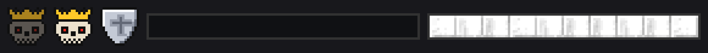
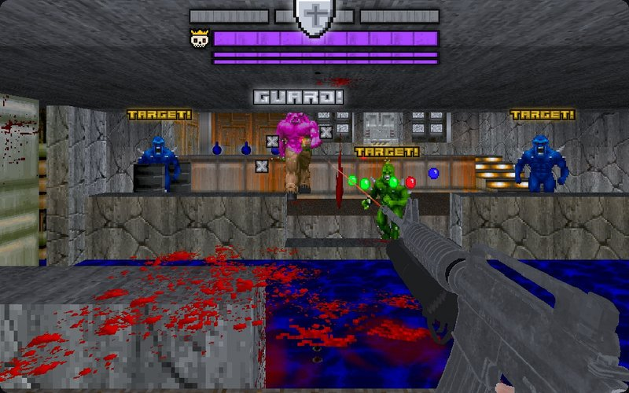
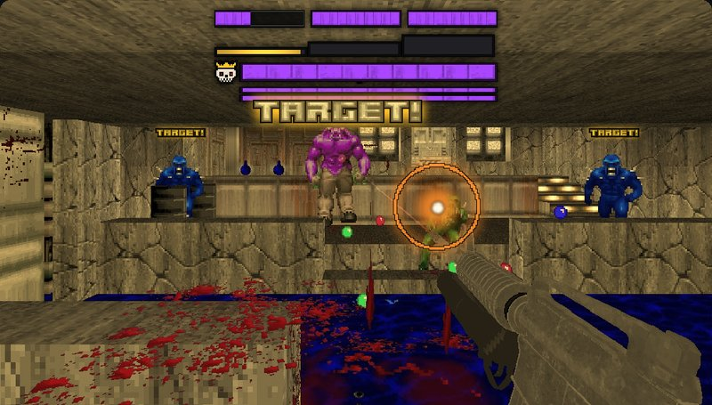
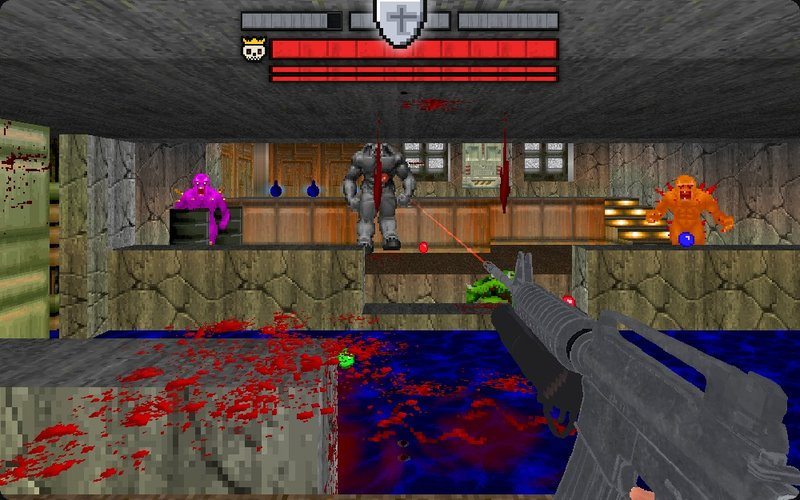
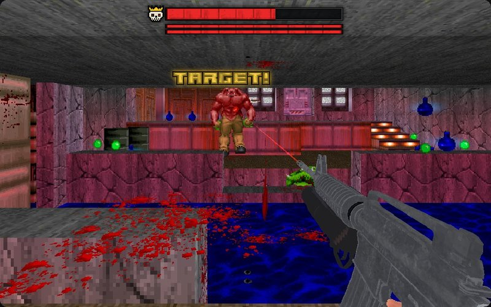
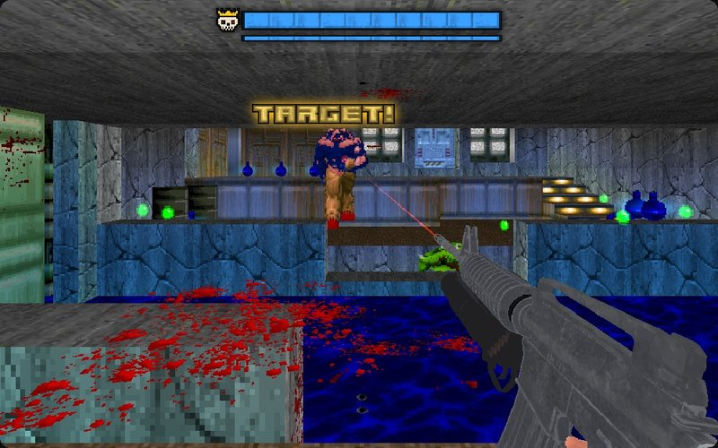
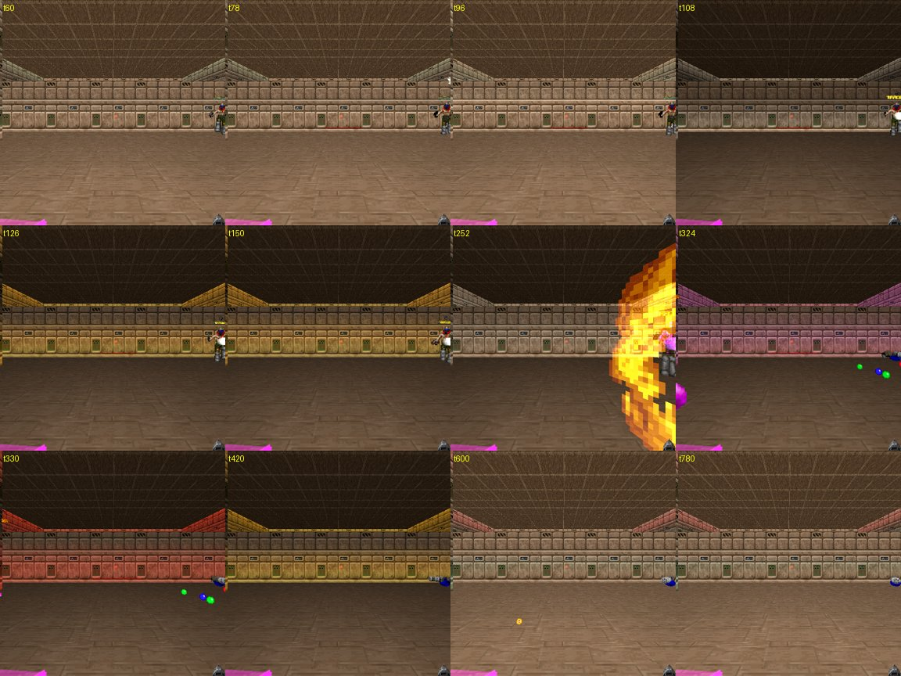

# RSQ Miniboss
### Doom Arcade VR · fill the meter, call the fight in, break the shield one thrall at a time

Fight well and a meter fills under your score. When it is full, glance at your watch and press Use, and a miniboss
lands in front of you in slow motion with its thralls around it, each one arriving on a beam of light. While its
thralls stand it cannot be hurt: kill one, and for a few seconds its shield is down. Break it in time, or everything
gets stronger.

*[GIF to come: a Bossfight landing, the thralls one by one on their beams, then the miniboss, in slow motion]*

---

## What it feels like

- **You earn the fight.** Kills, quick kill chains, style points from RSQ Score, weapon XP from RSQ Gun Bonsai VR and
  simply pushing on through the map fill the Bossfight meter.
- **You call it in.** When the meter is full it turns gold and beats like a heart, and the room's light beats red with
  it. Look at your watch and press Use, and it comes. Or wait, and it comes by itself a minute later.
- **It arrives where you can see it.** A few metres ahead of you, in your view, never on top of you. The world drops
  into its slowest slow motion and the room goes dark, the thralls land one after another, then the miniboss, bigger,
  faster and keener to shoot than its kind. Its own music starts.
- **Its thralls are its shield.** While a thrall lives, shots on the miniboss do nothing: "GUARD!" pops over it and grey
  Xs bounce off. "TARGET!" hangs over every thrall.
- **Kill a thrall and the shield drops.** The world slows, the power that thrall gave the miniboss leaves it, and you
  get one second for every thrall it came with to break one piece of its shield bar. Break it fast and RSQ Score pays
  more.
- **Miss and they grow.** If the window runs out with that piece unbroken, the miniboss and its thralls climb the RSQ
  Monsters colour ladder by one to three steps, and by default so does every monster on the map.
- **Then it is you and the miniboss.** With the shield bar gone, its own bar takes the hits. It has three lives: each
  time a bar empties it refills, burns with flames for five seconds and comes back a colour higher.
- **Greed has a price.** Shoot it while its thralls live, and if a thrall is still standing a few seconds later, every
  monster on the map goes into a rage: twice as fast and twice as keen to attack, until the miniboss dies.
- **The payoff.** A gun you don't have yet (or a power-up), a fountain of RSQ VisualRewards bits, RSQ Score's
  Miniboss and Bossfight rows, and RSQ Score's gold life crate where it fell.

---

## How to play

| Do this | What happens |
|---|---|
| Kill monsters, chain kills, play with style, keep moving | The meter under your score fills (red) |
| Fill it | A sting, the meter turns gold and beats, the room's light beats red |
| Hold a watch check and press Use (or just wait 60 s) | The Bossfight is called in |
| Look ahead | It lands in view, 12 to 32 metres away, in slow motion |
| Shoot the miniboss while its thralls live | "GUARD!", grey Xs, no damage, and its greed is armed |
| Kill a thrall | The shield drops: a window of 1 s for each thrall it came with |
| Hit the miniboss inside the window | The open piece of the shield bar drains; break it before the window ends |
| Break every piece | One-on-one: its own bar takes the damage, life by life |
| Kill it | Its loot, its rewards, the level's music back |

**The watch check** comes from RSQ Gestures. Without Gestures, RSQ Gun Cards' copy or this mod's own copy does the same
check, so the call-in always works.

**When it won't come,** a small line under the full meter says why: *No Miniboss: Too Early* (the map's first minute),
*Map Limit* (two a map), *Cooldown* (90 s after the last), *Low Health* (under 40), *Near Exit*, *Too Busy* (more than
three awake monsters after you), *No Room* (nowhere in view to land) or *No Monsters*. It tries again as soon as the
reason goes. **Ignore Spawn Restrictions** brings it regardless of Too Early, Low Health, Near Exit, Too Busy and No Room.

*The mod's own HUD art from graphics/, enlarged. The shield icon is placeholder art.*

*[Still to come: the meter filling red under the score, then gold and beating, with a wait line under it]*

---

## The meter

The meter goes from empty to full and stays with you from map to map, and in your save.

- **A kill** adds 4 when Score's style points are filling it, otherwise 10 plus a share of the monster's health (at
  most 30).
- **A chain** (kills within 3 s of each other) adds 6 more for every link, up to 30.
- **Score's style points** add a quarter of each kill's style (at most 120 a kill).
- **Gun Bonsai VR's weapon XP** adds a fifth of the XP your gun earns.
- **Moving on** adds 2 every two seconds in which you covered 3 metres.
- Everything is times **Meter Speed**. The meter stands still while a Bossfight arrives or is being fought, and the
  Bossfight's own monsters never fill it.

**Bossfight Meter Fills From** picks Score, Gun Bonsai or Both. Kills, chains and time always count. If the mod you
picked is not loaded, the other one is used; with neither, kills, chains and time fill it alone.

While a Bossfight runs the meter hides, and the fight's own bars take its place.

---

## Who comes

**The miniboss and its thralls are monster types already in this map,** picked by how tough they are. Class names are
never used, so it works the same on Doom's monsters, Brutal Doom's or any monster pack's. Bosses and the Champions
that rise again (Dark Red, Undying) are never sent.

**The tier, 0 to 4, decides how strong.** By default it is your RSQ Gun Bonsai VR player level or the RSQ Score lives
you hold, whichever is larger (past 4 counts as 4). Tier 0 sends a middling type, tier 4 the strongest in the map. The
thralls are weaker types (the same type when there is nothing weaker). From tier 3 there is one more thrall. **Tier
From** can also use only the Gun Bonsai VR level, only Score's lives, or the old sum (half your Gun Bonsai level, plus
one for every 4,000 Score points this map, plus half the Bossfights you have won).

**Miniboss From and Thralls From** (on RSQ Monsters' own page) turn the picks into ColorfulHell or MeatGrinder monsters
of the same family, or a mix. Picked from a set, the miniboss stands at least one colour above its strongest thrall.
With RSQ Monsters loaded and both left at their defaults, a miniboss from Brutal Doom or plain Doom gets ColorfulHell
thralls.

**Everything that arrives is boosted:** a Champion (it is given one of Champions' colours if it did not roll one),
legendary with LegenDoom, lit in its own colour and full-bright. The thralls are drawn a little larger, and get half
their health again when LegenDoom is not loaded. The miniboss is 1.25x as big (its hitbox too), 1.25x as fast, and far
keener to shoot. It becomes legendary when any of its thralls is.

---

## The arrival

- **Where:** a spot in front of you (within 55 degrees of where you face), between 12 and 32 metres away, that you can
  see, and with room for the miniboss and at least half of its thralls round it. The map's own monster start spots are
  tried first, then points along your view.
- **When it lands:** the world and you slow to SlowMo's slowest for 4 seconds, and the room drops to DarkDoom Black
  (with RSQ Glow In The Dark). The thralls land about 0.3 s apart, then the miniboss. Each one is hidden and frozen
  until its RSQ VisualRewards arrival beam shows it, and an RSQ SlowMo edge arrow points to it while it is out of view.
  The beams are picked at random each time: V1 thralls and a V3 miniboss, or V2 thralls and a V4 miniboss. When the
  miniboss appears, a wave of its colour rolls out across the map.
- **Without VisualRewards' beams** each one lands at once in the original Minibosses! teleport flash, with Doom's
  teleport sound.
- **If the miniboss cannot land,** whatever already came is taken back out, the meter stays full, and it tries again.

---

## The fight

**The thrall bar.** Above the miniboss's own bar sits one segment for every thrall it came with. Together they hold as
much health as the miniboss itself, so you have to wear down the thrall bar before you ever touch its own.

**Shield up.** While a thrall lives, a segment is left and no window is open, the miniboss takes no damage at all. The
thrall bar is grey under a big shield icon, "GUARD!" pops over the miniboss when you hit it, and grey Xs (Doom's own
small X) bounce off where the shot landed. The room's light holds a steady cold grey.

**A thrall killed.** The power that thrall gave the miniboss leaves it, a pop in that power's colour bursts where the
thrall died (RSQ VisualRewards; without it the original's burst), and its tether breaks. The world slows, and the
shield drops: **a window of one second for every thrall it came with** (three thralls: three seconds) opens on the first
unbroken segment. A stepped gold bar under the segments drains, the room's light pulses gold, a big "TARGET!" hangs
over the miniboss and the thralls' shrink. The window closes early when the segment breaks. A thrall killed while a
window is open waits its turn: the next window opens when this one closes.

**Broken in time,** the segment pays RSQ Score's **Thrall Slow Kill**: 100 points for every second still left in the
window, so the fastest break pays the most.

**Window missed.** If the window runs out with the segment still standing, the miniboss and its living thralls climb
the RSQ Monsters colour ladder, with RSQ Monsters' own tier flash: one step if only a sliver was left, two if about half,
three if it was untouched. With **Tier-Up Hits the Whole Map** on (the default) every monster on the map that RSQ
Monsters can tier climbs with them. Then the shield is back up. (Without RSQ Monsters nothing climbs.)

**One-on-one.** Once every segment is broken (or no thrall is left standing) the hits go where they land: into any
segment that is left, then into its own bar, in its colour. "TARGET!" hangs over it, and the room glows its colour.

**Its lives.** It has three lives by default (thin bars under its own, one for each life to spare). When a bar empties
it stops at the last point, spends a life and refills, bursts, and burns with circling flames for five seconds in which
nothing hurts it. With **Tier Up Each Life** on it comes back one colour higher. The room flashes red, then takes its new
colour. No thralls rise again.

*These five pictures are design mockups drawn on a rig frame before the reworked fight was built. They show the HUD and
the words as the code now draws them, but they are not captures of the mod running.*

**Its death.** A wave of its colour rolls across the map, and two seconds later Glow In The Dark's colours re-roll. Its
thralls are free monsters again.

**What it inherits from its thralls** (with Champions, **Inherit Powers** on): Yellow's faster shots, White's slowing
hits, Dark Green's poison, Cyan's knockback and Titan's three-way shots are handed to it; Dark Red and Undying give it
an extra life each (two at most); Black makes it hit 50% harder; any other colour or mutation makes it 50% tougher (twice
as tough at most). It takes at most four powers (**Power Cap**), the same colour counts once, and being legendary does
not count. **Each power goes with the thrall it came from.**

**Its colour** is its RSQ Monsters ladder colour. A monster off the ladder takes pink, cyan, amber or violet, in turn.
The tethers, bursts, flames, bars and the room's glow all wear it, and it changes as it climbs.

*[GIF to come: shooting the shield, "GUARD!" and the grey Xs, then a thrall killed and the window bar draining]*

*[GIF to come: a missed window, the whole map flashing up a colour]*

---

## Greed

Hit the miniboss while its shield is up and its greed is armed. One window's length later (one second for every thrall
it came with, or when a running window ends) the bill comes due: if the miniboss lives and a thrall still stands,
**every monster on the map is enraged** until the miniboss dies. They move at twice their speed (**Rage Speed**), attack
twice as readily and react at once, a red spark rises off each one near you, and a roar sounds. Monsters that spawn or
are raised meanwhile are enraged too. Kill every thrall before it comes due and nothing happens. When the miniboss dies
or you leave the level, every monster is put back exactly as it was.

*[GIF to come: the rage: every monster on the map sparking red and charging]*

---

## The rewards

**A Bossfight's miniboss killed:**

- **A drop:** a gun from the guns lying in this map that you don't have yet. If there is none (Brutal Doom's map
  pickups are not guns until you touch them), a gun from your weapon slots no higher than one slot above your best;
  otherwise a Megasphere, Soulsphere, Berserk or Blur Sphere.
- **RSQ VisualRewards' Kill Rewards:** it counts as a boss, so it always drops bits, a boss's fountain of them, and
  three times that again (**Bits Multiplier**).
- **RSQ Score:** the **Miniboss** row and the **Bossfight** row on top of the kill.
- **RSQ Score's gold life crate** where it died (**Bossfight Kill Drops a Life Crate**): touch it for one more life.
- **A win counted** (it adds to the tier under Tier From's "Set").

**Any miniboss killed** pays RSQ Score's **Miniboss** row.

*[GIF to come: the miniboss dying, the colour wave, the gun and the bits fountain, the gold crate]*

---

## Graves Rise

With **Graves Rise** on, Legion of Bones and RSQ Graveyard loaded, the moment a Bossfight has landed the tombstones wake:
in the whole map, or within **Graves Radius** of the fight. They raise as many undead as the fight has thralls plus its
tier (three thralls at tier 2: five), spread over the stones nearest the fight first, every stone at least one. Each is
the undead of a thrall's own type, Skull Zombies when none fits. The tombstones' candles also beat with the full meter's
heartbeat.

---

## The classic pick

The original Minibosses! way, kept off under Test and Debug. With **Classic Pick at Level Load** on, a moment after a
level starts one miniboss (**Per Map**, up to 4, **Map Chance**) is picked from the strongest third of the level's own
monsters, favouring the toughest, with up to **Thralls** monsters within **Thrall Range** of it, none stronger:
Champions first, then legendaries, then the nearest. With LegenDoom and **Legendary Thralls** on, its thralls are made
legendary. A classic miniboss fights by the same rules (the shield, the windows, the lives, greed, the tethers, the
words), but it does not arrive boosted, has no HUD bars, no room glow and no Bossfight payoff.

---

## Plays well with

Everything is asked by name: every mod still loads and plays alone, and the parts that need a missing mod simply don't
happen.

- **RSQ Score:** its style points fill the meter, its lives can set the tier, and the meter sits centred under its bar.
  Miniboss sends it the **Miniboss**, **Bossfight** and **Thrall Slow Kill** rows; Score pays the first two as a
  share of the miniboss kill's worth (1x, 2x). Score also reads Miniboss for its own rows: **Chain Gang** (thralls
  killed in one window), **Rage Quit**, **Riot Control**, and combos that ask for a thrall
  or the miniboss. Miniboss drops Score's gold life crate after a Bossfight.
- **RSQ Monsters:** the ladder colours, the tier-ups on a missed window and on each life lost (with its tier flash), the
  bodies it swaps on a tier change (Miniboss finds the new one and dresses it again), and **Miniboss From / Thralls
  From** on Monsters' page. Re-entering a hub level puts back every tier Miniboss gave.
- **RSQ VisualRewards:** the arrival beams, "GUARD!", "TARGET!" and the pops; the Bossfight music scene (its Scene Music
  row turns it off for you; **Bossfight Music** here turns it off for everyone); Kill Rewards' boss fountain times the
  Bits Multiplier; Top HP Bars draws a crown over the miniboss's bar, with a pip for each tier, and a chain link over each
  thrall.
- **RSQ Glow In The Dark:** the red heartbeat of a full meter, the landing in DarkDoom Black, the cold grey, gold and
  red of the fight room, the colour waves at the landing and the death, and the colour re-roll after. Its own **Miniboss
  Tint** rows turn the map the miniboss's colour and darken it while any miniboss lives.
- **RSQ SlowMo:** the landing's slow motion (a game slow with its countdown bar and BOSSFIGHT line, under its Triggers
  page's **Miniboss** switch, outside its shared cooldown), the slow motion of every window, and the edge arrows to
  monsters out of view. Its countdown bar sits under the meter at the same width. **Slow Depth** at -1 uses SlowMo's own
  World Speed.
- **Champions and LegenDoom (LegenDoom Lite 4.2 or LegenDoom 3.0):** boosted legendary champions, the inherited powers,
  and **Legendary Boss Health**: a miniboss made legendary gets the higher of LegenDoom's boss and normal legendary
  health. RSQ Gun Bonsai VR and RSQ ShieldSaw read that and size their own numbers on it. With Brutal Doom 22 VR's
  LegenDoom Lite patch, legendary weapons drop only from a Bossfight's monsters.
- **RSQ Gun Bonsai VR:** its weapon XP fills the meter and its player level sets the tier.
- **RSQ Gestures and RSQ Gun Cards:** the watch check for the call-in (this mod carries its own copy too).
- **RSQ Tactical Rig:** while a Bossfight can be called, the watch check's Use press is the call-in's and the gun stays
  put; killing a miniboss fills your cigarette pocket.
- **RSQ Grapple and RSQ Whip:** with **Can't Be Yanked** on, they refuse to yank or throw a miniboss: the line pulls you
  to it instead, as with a boss.
- **RSQ Melee:** with **Can't Be Headlocked** on, its headlock refuses a miniboss.
- **RSQ Graveyard and Legion of Bones:** Graves Rise, and the candles beating with the full meter.
- **RSQ Accessibility:** Photosensitive Mode stills the meter's glint and edge, caps and dims its beat, holds the shield
  icon and the window bar still, and keeps the room's gold steady. Text Size grows the meter through Score's scale.
- **Brutal Doom:** works on its monsters, and the drop knows its map pickups are not guns until touched.

---

## Options

*Radiant Silvergun Options → RSQ Miniboss.* One page of choices; the numbers are under Test and Debug. **Reset All** at
the foot resets both pages. Effects, Effects Density, Effects Range, Show Meter and Meter Size are yours; everything else
is the host's.

| Section | Rows |
|---|---|
| Top | Bossfights · Meter Speed (1) · Bossfight Meter Fills From (Score, Gun Bonsai, Both) · Bossfight Kill Drops a Life Crate · Call It In: Watch Check + Use · Ignore Spawn Restrictions (off) · Effects · Effects Density (Low, Medium, High) |
| Fight | Thralls (3) · Lives (3) · Tier From (Set, Gun Bonsai VR Level, Score Lives, Whichever Is Larger) · Graves Rise (Legion of Bones) (off) · Graves Area (Map, Radius) · Graves Radius (1024) |
| Rules | Legendary Thralls (LegenDoom) (the classic pick only) · Tier-Up Hits the Whole Map · Tier Up Each Life · Inherit Powers · Greed Enrages Monsters · Score Awards |
| Counts as a Boss | Boss Kill Rewards · Legendary Boss Health · Can't Be Yanked · Can't Be Headlocked · Can't Be Morphed (off) · Map-wide Roar (off) |
| Test and Debug: Bossfight | Arrives By Itself (60 s; 0 only when called) · Map Start Wait (60 s) · Cooldown (90 s) · Per Map Cap (2) · Wait Under Health (40) · Wait Over Awake Monsters (3) · Nearest Arrival (384) · Farthest Arrival (1024) · Exit Distance (768) · Landing Slow Motion (4 s) · Landing At Slowest · Landing In The Dark · Bossfight Music · Bits Multiplier (3) · Score Style Fill (0.25) · Gun Bonsai XP Fill (0.2) · Score Per Tier (4000) · Show Meter · Meter Size (1.5) |
| Test and Debug: Classic | Classic Pick at Level Load (off) · Per Map (1) · Map Chance (100) |
| Test and Debug: Fight | Thrall Range (1024) · Power Cap (4) · Invulnerable (5 s) · Slow Depth (-1: SlowMo's own) · Rage Speed (2) · Effects Range (4000) |
| Test and Debug | Debug Log (off) |

Rows not marked (off) are on by the default; the default choices are Both, Low, Whichever Is Larger and Map. Distances
are in map units (32 to a metre).

*[Still to come: the options page]*

---

## Status

| | |
|---|---|
| **Shown on the rig** (2026-11-09, logs and a frame sheet from a test probe: TestRig/bossfight_rig/evidence_2026-11-09) | The reworked fight, called in, with RSQ Monsters: three thralls landing one by one on V2 beams and the miniboss on a V4 beam; three segments; a shot on the shield doing no damage; a thrall kill opening a three-second window; the window missed and +3 tiers asked on 11 monsters map-wide, with the swapped bodies found again; a hit in the window breaking a segment; two lives lost, each refilled with five seconds of invulnerability and +1 tier; the death and its drop. Run twice: ColorfulHell monsters, and a MeatGrinder miniboss with ColorfulHell thralls through Miniboss From / Thralls From. The same day the reworked pack loaded on the series' load order with no script error from it (Bossfights off in those runs) |
| **Shown on the rig** (2026-11-05, logs; flat and a VR eye) | The meter filling from kills, chains and Score's style; full; called in by the watch check (this mod's own copy) and Use; arriving by itself 60 s after full; waiting on Low Health with its line drawn under the meter; a spot found in view; the drop (a map gun, the weapon-slot fallback, a power-up); the Bossfight and Miniboss rows reaching Score; the bits fountain; legendary weapons only from a Bossfight (with Brutal Doom 22 VR's LegenDoom patch); the meter's look, red and gold, its band and glint, Photosensitive Mode's look, its place under Score's bar, and hiding while a Bossfight runs |
| **Shown on the rig before the 11-09 rework** (2026-11-03 and 11-04, logs) | The Counts as a Boss rows: Map-wide Roar and Can't Be Morphed, Boss Kill Rewards, Legendary Boss Health (LegenDoom Lite 4.2 and LegenDoom 3.0), Can't Be Yanked (Grapple and Whip), Can't Be Headlocked; the classic pick with Champions and LegenDoom: legendary thralls and inherited powers; greed enraging every monster on the map (its timing has changed since) |
| **Headset-confirmed** | Nothing yet |
| **Code only, not yet shown** | Everything else on this page, among it: the HUD bars of the fight (seen only in the design mockups), "GUARD!", "TARGET!", the grey Xs and the pops, the slow motion and Thrall Slow Kill pay of the new windows, powers lost with their thrall, the edge arrows, the landing's darkness and music, the life crate, Graves Rise, Ignore Spawn Restrictions, Tier From, the Gun Bonsai VR fill, the tethers and flames since the rework, the rage since the rework, the hub tier reset |

---

## Under the hood

- **The set piece** is one handler per level, saved with it; each miniboss is a thinker holding its thralls, segments,
  window, lives and inherited powers. Tokens on the monsters (a ward on the miniboss, a mark on each thrall and on
  everything a Bossfight brought) ride the save with them.
- **All the damage rules live in the ward's damage hook,** never in the monster's damage factor (Champions writes that
  itself), so they stack with Champions, LegenDoom and the monster's own. A fraction of a point carries to the next
  blow, so weak shots still count against a tough miniboss. Its lives come from holding it at 1 HP, never from the
  engine's BOSS flag: a miniboss counts as a boss only for the systems switched on under Counts as a Boss.
- **The arrival's room test** uses an invisible probe the size of each monster (1.25x for the miniboss): floor, ceiling,
  walls and things, plus your line of sight. The idea of trying the map's own monster start spots comes from Dynamic
  Enemy Reinforcements v3.
- **Netplay:** each player has their own meter; the call-in is your machine reading your own hands and sending a
  network event. Settings that change the game are the host's; the effects and the meter's look are each player's.
- **Quest-friendly effects:** the original's IWAD sprites (APLS tether beads, 30 a tether, BFE1 and APBX bursts, FIRE
  flames) drawn as a small pool of non-ticking visual thinkers made once a map and reused, capped by Effects Density
  (280, 320 or 380), placed once a tic after everything has moved, and only within Effects Range of you. If the IWAD's
  sprites are missing, plain particles stand in. The HUD bars are quads cropped from their art, with no clip rectangle
  and no screen dim (neither shows on the VR HUD).
- **Console:** `netevent rsqmb_state` prints every miniboss and the meter; `netevent rsqmb_fill 1000` fills the meter;
  `netevent rsqmb_callin` calls a full meter in; `netevent rsqmb_choose` runs the classic pick now. **Debug Log**
  prints every rule as it fires.
- **For other mods:** `RSQMB_Service` answers `miniboss`, `thrall`, `wasboss`, `enraged`, `lives`, `invulnerable`,
  `shield`, `segments`, `shielded`, `greed`, `window`, `living`, `legendary`, `colour`, `bossfor` (`rewards`,
  `rewards.x`, `yank`, `headlock`, `ldhealth`), `bossfight`, `tier`, `bossfights`, `meter`, `meter.ready`, `callin`,
  and for HUDs `meter.bottom`, `meter.x`, `meter.w`, `meter.h`; objects `boss` and `thrall`; the string `powers`.
- **Stock QuestZDoom 17.3:** ZScript and data only. No engine changes.

## Credits

The full list is in **CREDITS.txt**.

- **Tartlman** (*Minibosses!* v0.1.1, 2019): the mod this rebuilds (a miniboss with extra lives and thralls tied to it
  by trails) and its effects' design in the IWAD's own sprites. Kept unmodified in original/; its code is not copied.
- **presidentkoopa:** the set piece's design, the Bossfight (the meter, the call-in, the arrival, the payoff) and the
  reworked fight (the staggered arrival, the shield and its windows, the tier-ups, the HUD bars, the words).
- **Joshua Hard** (*Dynamic Enemy Reinforcements* v3, MIT): the idea of landing reinforcements on the map's own
  monster start spots (none of its code).
- **coldcite** (*Top HP Bars*): the bar art, via RSQ VisualRewards.
- **id Software:** the sprites, sounds and small-font X, read from the IWAD (not shipped).
- **QuestZDoom** (Emawind and Team Beef): the engine and its VR hand API.
