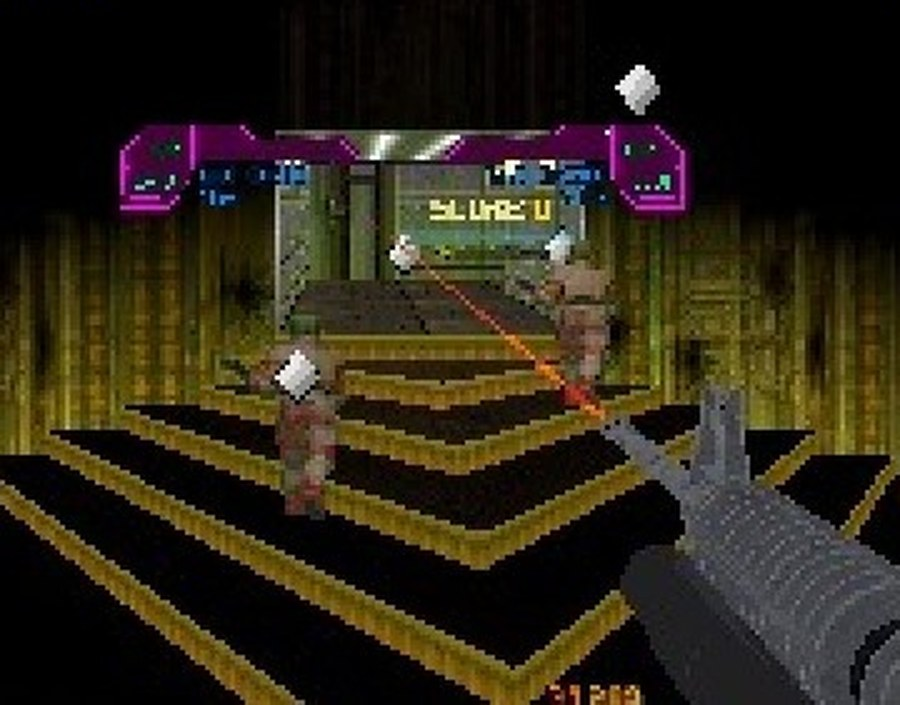
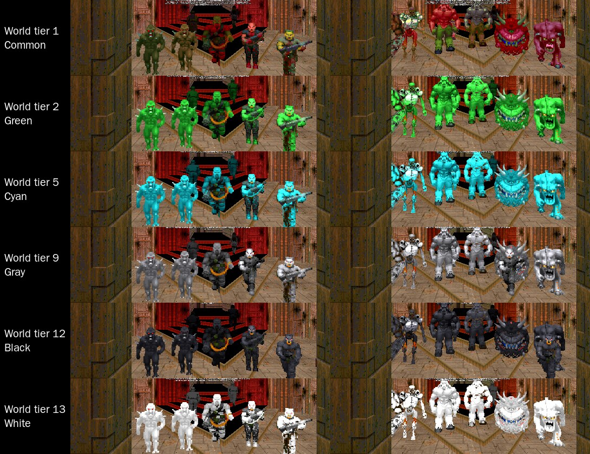

# RSQ Monsters
### Doom Arcade VR · Colourful Hell's thirteen-colour ladder, and monsters that flash up a tier mid-fight

Pick the monsters your maps are made of: Colourful Hell's colour tiers, Brutal Doom's own, or plain Doom. Every RSQ
monster stands on one ladder of thirteen colours, and when one changes tier you see it coming: it strobes white for a
moment, then it is something worse.

**New 2026-11-13:** Brutal Doom's, XMVE's and plain Doom's monsters on the colour ladder, the same body (see *Brutal
Doom's monsters on the ladder*). Every monster enters at Common and its colour is the world tier (the owner's order).
Loaded on the Linux rig with the owner's full order and settings at Black Metal (no script errors from our packs; at
six world tiers on MAP01 and MAP10 every monster's colour, health and damage were as the tables say). Its colour
behaviours were run on plain monsters only. Rig only, not headset-confirmed.

*[GIF to come: a monster strobing white, then standing up a tier higher in its new colour]*

---

## What it feels like

- **Your maps, your monsters.** One setting decides what every map's monsters become: ColorfulHell, Brutal Doom's,
  or the id originals. It takes hold on the next map.
- **A ladder you can read.** Thirteen colours, numbered by strength: Common, Green, Blue, Purple, Cyan, Brown, Yellow,
  FireBlu, Gray, Red, Abyss, and the two boss colours, Black and White. A higher tier is a stronger monster.
- **The flash.** A monster that changes tier blinks white against its own colour for a beat (black, when it is
  becoming White), then turns. A tier change you are meant to watch always comes with it.
- **ColorfulHell is a bestiary.** Every colour of every Doom monster is its own creature, with its own name, health and
  tricks: a Green Imp is not just a tougher imp, and "Smoking Black Imp" is a boss.

---

## How it plays

### Controls

**No keys.** Nothing to hold or press: the monsters change as they spawn and as fights change their tier.

- **Menu buttons:** the **Monster Diagnostics** page (a row on this mod's page) has God Mode and the test spawns; see
  *Status* for what answers them.

### Which monsters a map gets

**Select Monster Set** decides what each Doom monster in a map becomes as it spawns. A change takes hold on the next
map, or when the map restarts.

**The default set is BD22 + XMVE Tiers** (owner, 2026-11-13 19:30: "this will be our default monster set going forward
and we will use the CH stuff for encounters and minibosses n setpieces"): Brutal Doom 22's and XMVE's own monsters on
the colour tiers, drawn from the painted colour art (`pk3/RSQ_BDXMTiers_<Colour>.pk3`, one per colour, loaded after
RSQ_Monsters). ColorfulHell stays selectable, and is the default for minibosses (**Miniboss From: ColorfulHell**).

| Set | What spawns |
|---|---|
| **ColorfulHell** (the default) | Colourful Hell's colour tiers. Doom's stock fireballs, plasma and rockets become Colourful Hell's versions too |
| **BD22** | Nothing is replaced: Brutal Doom's own monsters. Without Brutal Doom loaded, the same as Vanilla |
| **Vanilla** | The id monsters themselves, even with Brutal Doom loaded |

**Out of the box every ColorfulHell monster spawns at Common**, which plays close to vanilla Doom. The colours come in
when monsters change tier: a miniboss fight from RSQ Miniboss tiers the whole map up when you miss its window. A
setting saved from an older version that picked MeatGrinder (now removed) reads as ColorfulHell.

### The ladder

The ladder is ordered by strength (owner, 2026-11-11): the tier number IS the strength. Each colour's place was
measured from its health in every family (mean rank over the 17 families, EX forms left out; RSQ Miniboss commit
7c50d118, `design/rigtest_2026-11-10/evidence/MB_TIER2_strength.py`).

| # | Colour | | # | Colour |
|---|---|---|---|---|
| 1 | Common | | 8 | FireBlu (extra) |
| 2 | Green | | 9 | Gray (extra) |
| 3 | Blue | | 10 | Red |
| 4 | Purple | | 11 | Abyss (extra) |
| 5 | Cyan (extra) | | 12 | **Black** (boss; the EX roll) |
| 6 | Brown (extra) | | 13 | **White** (boss) |
| 7 | Yellow (Colourful Hell's names call it Orange) | | | |

Only the numbering changed on 11-11: every colour keeps its monsters, health, look and boss status. Before, the numbers
were Colourful Hell's listing order (5 Yellow, 6 Red, 7 FireBlu, 8 Gray, 9 Abyss, 10 Black, 11 White, 12 Cyan,
13 Brown). A tier change one step up is now always one step stronger; the tier gems are in this order too.

### Changing tier, and the flash

A monster changes tier when something asks it to: RSQ Miniboss's miniboss fight, or the test commands under the hood.

- **The flash.** The monster waits a moment (a random 5 to 25 tics, so a room full of them ripples instead of
  turning at once), and every 3 tics it swaps between white (the sprite's own shading, in white) and its own colour. The white is
  full-bright, so it reads as a light white-grey in a dark room or a coloured light, not as the room's dim grey. A monster becoming White
  flashes black instead. Then it turns.
- **ColorfulHell swaps the creature.** Every colour is its own monster, so the old body steps out and the new one
  steps in on the same spot, facing the same way, still after you. The old body does not count as a kill.
- **One flash.** It is the owner's Hackfraud (HF) flash, and it is how every RSQ monster changes tier while you
  watch. A change asked to be instant (a miniboss fight's own setting-up, say) skips it.
- **Health on a tier change** (*On tier change*): by default an instant change (one with no flash) brings full
  health, and a change with the flash keeps the share of health already lost, so a hurt Common imp turns into an
  equally hurt Red one. You can keep the share always, or give full health always.
- **Tier Icons Above Monsters** (off by default, as Colourful Hell ships it): the tier's gem floats up off each
  ColorfulHell monster, so the ladder reads as a shape and not only as a colour (Colourful Hell's colour-blind aid).

*Tier Icons Above Monsters on: the gems floating up over MAP01's zombies (rig capture, not headset).*

### Brutal Doom's monsters on the ladder

The rule is `design/BD_XMVE_TIERING.md`. A Brutal Doom, XMVE or plain Doom monster keeps its own body and class; an
item on it (`RS_BDKit`, `RS_BDTier.zs`) holds its colour.

- **Its colour is the World Tier** (owner, 2026-11-13: "0 is neutral, 1 is green, etc ... i told you what my order
  is"). Every monster as its mod ships it is the neutral step, Common, and each World Tier is the next colour: Common,
  Green, Blue, Purple, Cyan, Brown, Yellow, FireBlu, Gray, Red, Abyss, Black, White. No monster starts higher because
  it is stronger: a Juggernaut and a zombie stand on the same colour. At World Tier 1 every monster is exactly as its
  mod ships it: no tint, no change. (The design's table of higher entry colours is no longer used.)
- **Black and White stay different on purpose** (owner, 2026-11-13: "Leave them different"): ColorfulHell keeps its
  huge Black and White bosses; on Brutal Doom's, XMVE's and plain monsters they are a mild grade, health x1.25 and
  x1.5 of Abyss (a Black Metal Imp: 64 at Common, 400 at Black, 480 at White).
- **Which monsters get it:** every monster whose family is found (its own row, its parents, what it replaces), Legion
  of Bones' own monsters included. In the owner's order Legion of Bones' spawners lose to XMVE's, so its monsters only
  come from maps that place them. The ACS health-bar bosses get the health curve only.
- **World Tier (test)** is a row on this mod's page. It stands in for the gun turn-ins, which do not exist yet. Move it
  during a map and every monster follows with the tier flash. ColorfulHell's monsters follow it too: a map loads with
  each one that many colours above its roll, and a ColorfulHell body that is on the ladder by a tier change or a world
  tier above 1 gets *ladder health*, so no step up loses health (a Yellow Imp is 226, not Colourful Hell's 145).
- **Each colour up** raises health, damage, speed and lowers pain chance by the design's tables, tints the sprite, and
  brings the colour's behaviour: Green acid patches, Blue faster shots with a zap, Purple one more shot, Cyan a hop
  off your aim and a slowing hit, Brown heals and shields its allies, Yellow sets alight, FireBlu twin shots and a
  death blast, Gray stone skin, Red rage and death bolts, Abyss phases, blinks and rises once, Black and White take
  less, call two of their kind and (White) blink. Past White every step is +10% health and +5% damage.
- **Painted colour art** (branch `wip/2026-11-13-recolour`, not on main; rig only, not headset-confirmed). Where a
  frame has a hand-made copy in its colour (`pk3/RSQ_BDXMTiers_<Colour>.pk3`, one pk3 per colour, made in
  `../MonsterRecolour/`), the monster, its corpse and its pieces are drawn from that art; everywhere else they keep the
  tier tint. No sprite frames are added (the art is drawn through `picnum`). RSQ Monsters > Painted Colour Art turns it
  off. Today the Imp family is painted; the other families are being painted.
- **The colour follows the body** onto Brutal Doom's dying bodies, corpses, crawlers, limbs and gibs: each piece holds
  its body's colour (`RS_BDHue`). Blood, blood mist, smoke, fire, casings, pickups and other mods' things (Champions'
  icons and auras, LegenDoom's) keep their own look. Generic gore (guts, chunks, organs, brains, teeth) takes the tint,
  so on FireBlu its red turns blue: an open choice for the owner (paint it, or leave it uncoloured).
  Since the dying-body census (2026-11-13, rig only, not headset-confirmed; `../MonsterRecolour/README.md`, "Every dying
  body"): also the crawlers and corpses a body spawns while it lies there (Brutal Doom's men end a death on an invisible
  body that never goes away), death stages that are monsters of the family (the Arch-vile's armless crawler; friendly
  ones such as the burning Cacodemon), a monster born again on the spot (a captured marine's Taunt), bodies thrown as
  missiles that hurt, a player's fatality (its gore, its corpse and the player's own fatality frames), and pieces named
  like effects whose sprites are painted (the Revenant's bone dust). Craters, metal shards, scrap, ice chunks and Legion
  of Bones' risers keep their own look.
- **RSQ Miniboss and RSQ Score** now get a tier for these monsters, so a miniboss fight's tier-ups reach them (the same
  flash, no new body: a champion power or a legendary stays).
- **Not built from the design:** the by-kind variants (hitscan spread, Arch-Vile flames and raises, bite and charge
  versions), and everything in its section 8 (the ColorfulHell fixes).

*Brutal Doom's and XMVE's own monsters on the owner's full order and settings, Black Metal, MAP01, at world tiers 1, 2,
5, 9, 12 and 13 (rig capture, the floor lit for the picture; rig only, not headset-confirmed). Left: RifleZombie,
ShotgunGuy1, ChaingunGuy1, Imp, SuperImp. Right: BullDemon, Cacodemon_, HellKnight2, BaronofHell2, Revenant1, Mancubus.*

### Colourful Hell's own surprises

ColorfulHell keeps the original's own rules. They decide which colour a spawn gets once its family is allowed past
Common (out of the box it is not; see Under the hood):

- **Five extra colours** (FireBlu, Gray, Abyss, Cyan, Brown) are switched off by default. A spawn that rolls one rolls
  again.
- **The Black and White bosses** are on, and rare: in the imp family they are 2 and 1 in every 1,843 rolls.
- **EX forms:** a Black boss roll has about a 1 in 11 chance (24 in 256) of an even nastier EX build, in eight
  families. The Shotgunner and the Lost Soul have theirs on the White boss instead.
- **The Red Baron and Red Arch-Vile** each have two forms; by default they come as the Power Baron of Red and the
  Grand Redfirevile.
- **Some monsters change others.** Some Colourful Hell monsters change the monsters around them the way the
  original does: for example, the Abyss Pain Elemental's pulse can turn the monsters it hits into their Abyss form.

## Miniboss picks

With RSQ Miniboss loaded, a miniboss fight can take its miniboss and its thralls from ColorfulHell, whatever the map's
monsters are:

- **Miniboss From:** the map's own monsters (Same as Monster Set) or ColorfulHell.
- **Thralls From:** the miniboss's set (Same as Miniboss), ColorfulHell, or the Map's Own Monsters. With Same as
  Miniboss, a Brutal Doom or Vanilla miniboss gets ColorfulHell thralls.
- A saved MeatGrinder or Mixed pick from an older version reads as ColorfulHell.

The pick keeps the Doom family: an imp in the map becomes a ColorfulHell imp, at the tier the miniboss fight asks for.

---

## The rosters

<b>ColorfulHell: 17 families, 13 colours each</b> (each colour's name, with its health)

Names are Colourful Hell's own, as the game shows them. Common monsters keep the id monster's health. FireBlu, Gray,
Abyss, Cyan and Brown are the extra colours, off by default. The ColorfulHell Spectre borrows the Pinky's FireBlu and
Abyss forms.

- **Zombieman.** Common: Zombieman (20) · Green: Green Zombie (40) · Blue: Blue Zombieman (60) · Purple: Purple Zombieman (95) · Yellow: Orange Zombiewoman (140) · Red: Red ZombieUnman (186) · FireBlu: FireBlu Zombie (70) · Gray: Gray Zombieman (110) · Abyss: Abyss Infected Zombie (200) · Cyan: Cyan Zombieman (30) · Brown: no name (100) · Black boss: Player 9 (2,500) · White boss: UNDERTAKER (2,800)
- **Shotgunner.** Common: Former Sergeant (30) · Green: Green Former Sergeant (45) · Blue: Blue Former Sergeant (55) · Purple: Purple Former Sergeant (75) · Yellow: Yellow Former Sergeant (85) · Red: Red RNG Former Sergeant (150) · FireBlu: Gun guy with skin condition (225) · Gray: snipah (155) · Abyss: Shotgun of the abyss (300) · Cyan: Cyan Shotgun dood (60) · Brown: Muddy guy (155) · Black boss: Shotgun Crew Commander (1,950) · White boss: BENELLUS,GOD OF SHOTGUNS (5,000)
- **Chaingunner.** Common: Former Captain (70) · Green: Green Chaingunner (85) · Blue: Blue Chaingunner (105) · Purple: Purple Chaingunner (120) · Yellow: Orange Former Captain (200) · Red: Red Chaingunner (300) · FireBlu: Bad makeup day (450) · Gray: That is bad camo (275) · Abyss: Abyss Captain (500) · Cyan: Jetpack Larry (125) · Brown: Brown Noise Maker (250) · Black boss: ITS MR GENERAL TO YOU,MAGGOT (4,500) · White boss: The crazy lady scientist (7,777)
- **Imp.** Common: Imp (60) · Green: Green Imp (70) · Blue: Blue Imp (83) · Purple: pImp (105) · Yellow: Orange Imp (145) · Red: Red Imp (200) · FireBlu: Now THATS ugly (125) · Gray: Stoned Imp (265) · Abyss: Abyss Imp (300) · Cyan: Cyanide Imp (125) · Brown: medium evil imp (215) · Black boss: Smoking Black Imp (3,800) · White boss: Imp Master (6,666)
- **Demon (Pinky).** Common: Pinky (150) · Green: Greeny (170) · Blue: Bluey (205) · Purple: Purply (260) · Yellow: Yellowy (325) · Red: Red-y (400) · FireBlu: FireBluey (205) · Gray: Coiling menace (700) · Abyss: Bad dog (600) · Cyan: Ice Worm (270) · Brown: Brownie (420) · Black boss: FRESH MEAT (4,500) · White boss: YOU KNOW WHO I AM (8,000)
- **Spectre.** Common: Spectre (150) · Green: Green Spectre (175) · Blue: Blue Spectre (210) · Purple: Purple Spectre (250) · Yellow: Yellow Spectre (320) · Red: Red Spectre (394) · FireBlu: FireBluey (205) · Gray: Uhm (450) · Abyss: Bad dog (600) · Cyan: Ice Worm II (270) · Brown: Brown hide (300) · Black boss: Backstabber (3,000) · White boss: Tentacle monster? (7,500)
- **Cacodemon.** Common: Cacodemon (400) · Green: Green Cacodemon (450) · Blue: Blue Cacodemon (480) · Purple: Purple Cacodemon (528) · Yellow: Yellow Cacolich (720) · Red: Red Cacodemon (830) · FireBlu: One Ugly Tomatoe (800) · Gray: Stone Cold Cacodemon (650) · Abyss: Abyssmal Tomatoe quality (1,100) · Cyan: FrostBaller (500) · Brown: Gruelsome (500) · Black boss: SHOCKMASTER (5,000) · White boss: PLEASE NO (5,000)
- **Lost Soul.** Common: LostSoul (100) · Green: Green LostSoul (120) · Blue: Blue LostSoul (145) · Purple: Purple LostSoul (150) · Yellow: Yellow LostSoul (180) · Red: Bloody Red LostSoul (240) · FireBlu: Charred skull (175) · Gray: A hive (50) · Abyss: beetlejuice (380) · Cyan: Cyan LostSoul (80) · Brown: THE CUBE (125) · Black boss: Queen Bee (1,500) · White boss: The shifter (4,500)
- **Pain Elemental.** Common: Pain elemental (400) · Green: Bad Gas Green Pain elemental (500) · Blue: Blue Pain elemental (610) · Purple: Purple Pain elemental (790) · Yellow: Volcanic Orange Pain elemental (900) · Red: Red rage elemental (1,111) · FireBlu: the fuck is that (800) · Gray: The nasty hive (1,450) · Abyss: Spooky Skull! (1,600) · Cyan: Icey weird Pain elemental (963) · Brown: Ball of fleshy bits (800) · Black boss: Hell Soul Elemental (5,000) · White boss: Against thee wicked (5,000)
- **Hell Knight.** Common: HellKnight (500) · Green: Green HellKnight (600) · Blue: Blue HellKnight (666) · Purple: Royal Purple HellKnight (730) · Yellow: Orange Bruiser (999) · Red: Red Knightmare (1,300) · FireBlu: Knight with clown armor (900) · Gray: Gray knight (800) · Abyss: Abyss Bruiser (1,850) · Cyan: Cyanide HellKnight (700) · Brown: Lion? (700) · Black boss: Terminator (5,555) · White boss: Ghost of 1993 (5,000)
- **Baron of Hell.** Common: BaronOfHell (1,000) · Green: Green BaronOfHell (1,170) · Blue: Blue Blood Baron (1,309) · Purple: Royal BaronOfHell (1,500) · Yellow: Grand Orange BaronOfHell (1,888) · Red: Power Baron of Red (2,100) · FireBlu: How awkward! (2,300) · Gray: Statue? (2,000) · Abyss: no name (3,333) · Cyan: Cyanide bitten BaronOfHell (1,666) · Brown: Brown Baron Boi (2,250) · Black boss: Baron from Abyss (8,907) · White boss: Hell's Slice and Dicer (13,069)
- **Revenant.** Common: Revenant (300) · Green: Green Revenant (360) · Blue: Blue Revenant (420) · Purple: Purple Revenant (515) · Yellow: Terrifying Orange (NoClip?) Revenant (666) · Red: a Bloody Red Revenant (830) · FireBlu: Skeleton on fire! (720) · Gray: Punchout master (660) · Abyss: Abyss Revenant (1,000) · Cyan: Cyan Revenant chains (480) · Brown: Mummy mummy (666) · Black boss: The Black Knight (4,500) · White boss: Lichest Lich (8,866)
- **Mancubus.** Common: Mancubus (600) · Green: Green Mancubus (750) · Blue: Blue Mancubus (850) · Purple: Purple Mancubus (950) · Yellow: Orange Mancubus (1,250) · Red: Red Horned Mancubus (1,600) · FireBlu: Big blob of fireblu (1,400) · Gray: Big Gray and Ugly (1,000) · Abyss: Ralph Bluetawn (2,150) · Cyan: Crystal Fatso (720) · Brown: What big hands you got (850) · Black boss: The thing from the swamp (9,001) · White boss: Angry Mama (15,000)
- **Arachnotron.** Common: Arachnotron (500) · Green: Green Arachnotron (600) · Blue: Blue Arachnotron (700) · Purple: Purple Arachnotron (800) · Yellow: Orange Brainchoton (777) · Red: Red Rage Arachnotron (1,000) · FireBlu: Ugly floater (999) · Gray: Metal Spider? (600) · Abyss: Eye see (1,850) · Cyan: Cyan Flying Spider (777) · Brown: Brown Recluse (600) · Black boss: Macross Missile Spam (5,342) · White boss: White Spider (7,000)
- **Arch-Vile.** Common: Archvile (700) · Green: Green Archvile (750) · Blue: Blue Archvile (860) · Purple: Purple Archvile (1,001) · Yellow: Golden Archvile (1,333) · Red: Grand Redfirevile (3,200) · FireBlu: Horrible sight (1,000) · Gray: Like a stone (1,400) · Abyss: Aliens? (2,500) · Cyan: Barnie (1,200) · Brown: That's a messy vile (1,400) · Black boss: Void Gazes Back (7,750) · White boss: Here I am (13,000)
- **Cyberdemon.** Common: CyberDemon (4,000) · Green: Green CyberDemon (5,000) · Blue: Blue CyberDemon (5,800) · Purple: Purple CyberDemon (6,400) · Yellow: Less cyber yellow Cybie (7,777) · Red: Red Overlord (10,000) · FireBlu: no name (7,777) · Gray: Stoner Cybie (8,888) · Abyss: Unholy diver (12,000) · Cyan: Akinator (8,083) · Brown: ComposterDemon (7,557) · Black boss: He Will Smith You (14,500) · White boss: It runs doom (21,000)
- **Spider Mastermind.** Common: Spider MasterMind (3,000) · Green: Green Spider MasterMind (4,200) · Blue: Frosty Blue Spider MasterMind (5,600) · Purple: Purple Spider MasterMind (6,666) · Yellow: Yellow MasterMind (7,777) · Red: Red MasterMind (10,000) · FireBlu: It's horrifying! (8,007) · Gray: Rocky Road Spider (8,007) · Abyss: Abys$|<%#¤e£Mind (12,222) · Cyan: Cyanide Master(Mind) (7,777) · Brown: Death N Decay Master (8,858) · Black boss: Pseudo Old God (11,111) · White boss: Heavily Armed Spidey (15,000)

<b>ColorfulHell: the EX bosses</b> (a rarer build of the boss roll)

- **Black:** Player X, Zombieman (5,000) · LET ME SEE YOUR WARFACE, Chaingunner (8,999) · Smoking Black Imp EX
  (8,600) · SHOCKMASTER RETURNS, Cacodemon (10,000) · Terminator MK II, Hell Knight (11,000) · The Black Knight
  unleashed, Revenant (7,500) · The thing from the bog, Mancubus (18,000) · Macross Missile Spam EX, Arachnotron
  (12,000)
- **White:** BENELLUS, GOD OF SHOTGUNS, ANGRIER, Shotgunner (12,537) · The vengeful soul, Lost Soul (12,500)

---

## Plays well with

RSQ Monsters asks the other mods by name and answers them by name: every mod still loads and plays alone.

- **RSQ Score:** a kill pays the monster's own starting health, so a ColorfulHell colour pays its own health. Score's
  20 Monster Roster rows read this mod: the colour of what you killed, an EX boss, how rare its roll was, a kill in
  the middle of its flash or just after a tier change. When a ColorfulHell monster changes tier, its place in Score's
  map count passes to the new body, so it still pays in full once.
- **RSQ Miniboss:** the miniboss fight is where tiers change. A missed window tiers the miniboss and its thralls up by one
  to three (the whole map with Tier-Up Hits the Whole Map), and each life it loses tiers it up once more, with the
  flash each time; Miniboss follows a ColorfulHell monster into its new body. **Miniboss From** and **Thralls From** can pick ColorfulHell.
- **RSQ VisualRewards and RSQ Glow In The Dark** (through RSQ Miniboss): a miniboss fight takes each monster's colour from
  the ladder: its arrival beam, the light on the miniboss and its thralls, and the miniboss's colour wherever the
  miniboss fight shows it.
- **RSQ SlowMo's DOWN:** its target plate names a monster by its own name, so a ColorfulHell boss comes in as "Smoking
  Black Imp" or "Imp Master".
- **RSQ Grenade:** with **Explosion Colour** on Kill Colour, a blast takes the colour of the highest-tier monster it
  kills.
- **Champions and LegenDoom:** this mod does not talk to them. They work on whatever monsters spawn. A ColorfulHell
  monster that changes tier is a new body, and what the old one carried (a champion power, a legendary) does not come
  with it.
- **Brutal Doom (BD22):** **BD22** hands every spawn to Brutal Doom; **Vanilla** brings back the id monsters with
  Brutal Doom loaded. With ColorfulHell, its monsters replace Brutal Doom's; Brutal Doom's guns and the rest stay.

---

## Options

*Radiant Silvergun Options → RSQ Monsters.* One page. The Monster Set takes hold on the next map; the rest act on the
next monster that needs them.

| Section | Rows |
|---|---|
| Top | Select Monster Set (Vanilla, **BD22 + XMVE Tiers**, ColorfulHell) · On tier change (Keep health fraction, **Full health (instant only, HF)**, Always full health) · Tier Icons Above Monsters (**Off**, On) |
| Brutal Doom's Monsters | Colour Ladder On Brutal Doom's Monsters (Off, **On**) · World Tier (test) (**1** to 20) · Painted Colour Art (Off, **On**; branch only: on, the frames that have painted art in their colour are drawn from it, the rest keep the tint; off, the tint everywhere) |
| Miniboss | Miniboss From (Same as Monster Set, **ColorfulHell**) · Thralls From (**Same as Miniboss**, ColorfulHell, Map's Own Monsters) |
| Monster Diagnostics | A test page. Today only God Mode works: Spawn hostile, the fourteen chaingunner buttons, Spawn All Fourteen, Remove them all, DIAG and WAKE are on the page but nothing answers them |

Defaults are in bold.

*[Still to come: the options page]*

---

## Status

| | |
|---|---|
| **rig only, not headset-confirmed** (2026-11-13, runs `monA_m01_w*`, `monA_m10_w*`, `monA_final`, `monA_lob2`; the owner's full order with his saved settings, Monster Set BD22, Black Metal) | **Brutal Doom's and XMVE's monsters on the ladder, every one entering at Common.** No script error from our packs. At world tiers 1, 2, 5, 9, 12 and 13 on MAP01 (27 map monsters, 33 with the test row) and MAP10 (279): every kit monster's entry 1 and its colour the world tier; health, damage, speed and pain chance as the tables say for all of them (a few speeds differ where a monster spawned with its own speed). 0 living monsters left without a kit. Frames: the picture above. A world tier raised mid-map (1 to 4) moved all 27 MAP01 monsters. Legion of Bones' monsters, spawned by hand, take the tint and the kit |
| **rig only, not headset-confirmed** (2026-11-13, branch `wip/2026-11-13-recolour`, runs `rcE_final`, `rcE_final2`, `rcE_cost2_*`; the owner's full order with his saved settings, Black Metal; sheets `../MonsterRecolour/docs/integ_0*.jpg`) | **The painted colour art, drawn by this pack** (`RS_BDArt.zs`) from `RSQ_BDXMTiers_<Colour>.pk3`: the Imp's twelve colours alive and dead; Champions' and Universal Entropy's tints still under the tier colour (7 of 7 put back, 0 left), the tier flash and the colour after it, the Painted Colour Art row off (tint) and on (art). **Three faults fixed:** Brutal Doom's blood mist keeps its red (0 blood or mist things wearing a tier tint in a census of 93 coloured things); a thrown imp arm (`XDeathImpArm`) takes its imp's colour; imps 36 units apart, killed together, keep their own colours on their corpses and pieces (0 wrong). No script error from our packs. Cost (rig CPU, not Quest): 0.17 to 0.24 ms a tic for the art driver on MAP10 at World Tier 4 with the Imp and the three men's families painted (279 monsters, 174 drawn from art), 0.41 the second after killing them all, 0.05 to 0.07 at World Tier 1 |
| **rig only, not headset-confirmed** (2026-11-12, runs axp1 and axp2, logged every tic; `../TacticalRig/tools/rigtest/axepool/evidence/` FL lines) | **The tier flash in Photosensitive Mode** (RSQ Accessibility loaded): with `rsqa_photosafe 0` an aimed zombie's tier change flickered -- 3 tics in the flash colour and full-bright, 3 tics its own look, over and over; with `rsqa_photosafe 1` it held the flash colour full-bright every tic of the wait (22 and 24 tics), no flicker, then changed tier. Loaded with no script error |
| **rig only, not headset-confirmed** (2026-11-11, rig batch R2, `design/rigtest_2026-11-10/RESULTS_R2.md`) | The ladder renumbered by strength: the zombie family's 13 tiers each read their own number; no map monster's class is off its colour; with the colour-blind aid every gem's frame is its monster's tier, all 13 colours (frame `R2_gems_line_crop.jpg`). |
| **rig only, not headset-confirmed** (2026-11-10, the batched rig test, `design/rigtest_2026-11-10/RESULTS.md`) | Every launch on the owner's order (with BD22 VR Reloaded 2.0.4f) had no script error from our packs. **The floating tier gems** (`rs_ch_colorblind`, set from the console in that run): drawn over the monsters (they drew nothing before 11-10: no art), busy with the colour-blind aid on (`evidence/V3_hpbar_icons_on_off_on.jpg`). ColorfulHell was the Monster Set in the miniboss runs (`evidence/L1_log.txt`, `L2_log.txt`) |
| **rig only, not headset-confirmed** (2026-11-12, runs `candle4` before, `candle5` after) | Brutal Doom's floor candle no longer wears a floating monster: our Wicked Archvile's sprite had the name its candle flame draws (WICK, now RVWK). Three effects (the spider's and zombieman's blasts, the Hell Knight's blood burst) no longer flash Brutal Doom's barrel voxel for a frame as they appear (their first frames were the barrel sprite, which the voxel pack draws as a barrel) |
| **rig only, not headset-confirmed** (2026-11-12, runs `flashfb2` and `flashfb3`; the owner's complaint was seen in `flash1`) | **The tier-change flash is full-bright.** In a dark room (sector light 40) the flashing imp's white phase is a light white-grey against the dark, where an imp in the same white translation without full-bright (the pre-fix look, put beside it by the test probe) is a dim olive-grey and in a red-lit room all but vanishes (`docs/readme/monsters_flash_fullbright.png`). The log shows bBRIGHT on with the flash translation on every flash phase and the monster's own translation and brightness back on every own-colour phase and after the swap, in the dark room, in the red-lit room and for the black flash (target White). The red-room and black flashes are log only (flame effects hid the imp in those frames); a monster killed mid-flash getting its own look back is code only (the test kill landed in an own-colour phase) |
| **rig only, not headset-confirmed** (2026-11-12, runs `ice0` before and `ice1` after) | A monster of this pack killed by ice damage (LegenDoom's Freezing guns, a cyan monster's hit) dies its own death. Before, it stood where it died as a dark blue statue for good (owner: "dies as a frozen purple imp") |
| **rig only, not headset-confirmed** (2026-11-10 night, the packed batch: `design/rigtest_2026-11-10/RESULTS_P3.md` R1, `RESULTS_P4.md` N5) | **R1:** a Monster Set saved as 2 (the old MeatGrinder pick) read as ColorfulHell: every monster a ColorfulHell class with a tier; in a miniboss fight the tier-ups swapped bodies and the miniboss was followed into each (`design/rigtest_2026-11-10/evidence/P3A_log.txt`). **N5:** Tier Icons Above Monsters on the RSQ Monsters page, off by default; off, no gems; on, the gems float up over MAP01's zombies (`P4_N5_menu_row_and_gems_off_on.jpg`, `P4_A_log.txt`) |
| **rig only, not headset-confirmed** (2026-11-09, the TestRig miniboss-fight log `b4_own.txt`, run before MeatGrinder was removed) | ColorfulHell spawned a map's monsters at Common. A missed window in an RSQ Miniboss fight turned every ColorfulHell monster on the map (eleven) from Common to Purple, and the miniboss and thralls were found again in their new bodies; each life the miniboss lost took it up once more (Purple Imp to Yellow to Red, under the old numbering; on the strength ladder the same steps go Purple to Cyan to Brown, code only). This was a log: the flash itself was not looked at in frames |
| **rig only, not headset-confirmed** (2026-11-09, RSQ Score's head-shot frames and log) | A ColorfulHell imp judged head against chest |
| **Headset-confirmed** | Nothing yet |
| **Known not to work** (from reading the code) | The **Monster Diagnostics** page: only God Mode works. The chaingunner spawns, Spawn All, Remove, DIAG and WAKE send commands nothing in the pk3 answers, and Spawn hostile changes nothing. |
| **code only, not shown** | Everything else on this page: the flash beyond the full-bright row above, On tier change, the Vanilla and BD22 sets, Brutal Doom's load order, Colourful Hell's extra colours, bosses and EX forms, its fireball swaps, other old saved settings reading as ColorfulHell |
| **code only, not shown** (2026-11-11, owner: "no rig test, code only until i say") | The ladder numbered by strength: the ladder table, every colour's tier, the caps, the spawn odds, the boss and EX numbers, the flash's White, the gems' order, an older save's tiers moved once on load; an EX form changing tier (it could not before: its class was in no table) |
| **not yet run** | Nothing from the batched rig test: R1 and N5 have run (above) |

**Tier Icons Above Monsters** (`rs_ch_colorblind`) is on the RSQ Monsters page since 11-10 (rig only, not headset-confirmed:
the row and the gems in frames, N5 above).

---

## Under the hood

- **The Monster Set** is `rsq_monster_set`: 0 Vanilla, 1 BD22, 3 ColorfulHell; a saved 2 (MeatGrinder, removed
  2026-11-10) reads as ColorfulHell. `rsq_mon_bf_boss` (0, 1) and `rsq_mon_bf_thralls` (0, 1, 4) read an old 2 or 3
  as ColorfulHell.
- **One choice, at every spawn.** The set is picked in one place, the game's replacement hook, as each Doom monster
  spawns, and the pick is marked final, so a later replacement does not change it. Brutal Doom is found by class name at run
  time, never linked. The monster classes themselves replace nothing, so every set stays spawnable by name.
- **The per-family caps.** How far up its ladder each ColorfulHell family may spawn is a server setting per family,
  1 (Common) to 13 (all): `rs_roster_zombieman` ... `rs_roster_mastermind`, all 1 by default, and `rs_roster_enable`
  (on). They have no menu row in this build; set them in the console. A cap reads each colour from its class name, by
  the strength ladder (a cap of 7 allows Common to Yellow, Cyan and Brown included). The pack has no settings-version
  step, so a cap saved before 11-11 above 1 now counts by strength.
- **Colourful Hell's switches** are server settings too, with Colourful Hell's own values and no menu rows:
  `rs_ch_fireblu`, `rs_ch_gray`, `rs_ch_abyss`, `rs_ch_cyan`, `rs_ch_brown` (1 = off, the default), `rs_ch_blackboss`,
  `rs_ch_whiteboss` (1 = on), `rs_ch_exboss` (1 = the 24-in-256 EX share), `rs_ch_nerfredboss`, `rs_ch_yellowrev`,
  `rs_ch_intercept`, `rs_ch_cyanbounce`, `rs_ch_rawket`, `rs_ch_abyssmark`, `rs_ch_colorblind` (tier icons: the series'
  tier gems floating up off a monster, a colour-blind aid; the RSQ Monsters page's Tier Icons Above Monsters row), and the drop
  settings `rs_ch_healthdrops`, `rs_ch_backpackdrops`, `rs_ch_ammodrops`, `rs_ch_extradrops`, `rs_ch_weapondrops`,
  `rs_ch_powerupdrops`, `rs_ch_armordrops`.
- **The six projectile swaps** (imp fireball, Cacodemon ball, Baron ball, Mancubus shot, Arachnotron plasma, rocket)
  apply to every one of those shots in a ColorfulHell map, whoever fires it, as they did in Colourful Hell: a Hell
  Knight's ball and a stock rocket launcher's rocket too.
- **The ladder table** (`RS_TierLadder`) names the class for each of 17 families × 13 tiers, recovered from the
  classes themselves (each ColorfulHell colour states its tier when it spawns), numbered by strength since 11-11. An
  EX form has its gate's family and tier (`RS_BlackImpEX` is the imp at 12), so it can change tier too: a Black EX
  asked one step up becomes the family's White.
- **A save from before 11-11** is moved to the new numbers once, when each of its levels loads (a mark per level,
  `RS_LadderMark`): every monster's tier token, a running flash and a fresh tier stamp. A new map needs nothing.
- **The tier gems** (`TI3R` A to M) are in ladder order, A = 1 Common to M = 13 White. The gem actors keep Colourful
  Hell's names (`RS_ColorTierIconCH5` is Yellow), and each shows its own colour's gem.
- **A ColorfulHell tier change** spawns the new class on the spot and carries angle, pitch, velocity, target, master,
  tracer, special and arguments, ambush, friendliness and TID; it carries no inventory. The old body's kill count is
  cleared before it is removed. With RSQ Score loaded, the old body's census place moves to the new one
  (`RS_ScoreService` "census.take", then "census.add").
- **The flash** is a job per monster (`RS_RetierJob`): a second request while it flashes re-aims it instead of
  queueing another. The two flash colours are plain translations (`rs_tier_flashwhite`, `rs_tier_flashblack`), drawn
  full-bright (`bBRIGHT` on for the flash phase, so the sector's light does not dim it); no dynamic lights. The
  monster's own `bBRIGHT` and translation are saved when the job starts and given back on each own-colour phase and
  whenever the job ends: the swap, the monster dying mid-flash, or the job destroyed (`OnDestroy`).
- **The service** `RSQMN_RosterService`, asked by name: `set`, `tier`, `ex`, `spawn.odds`, `tier.next`, `tier.ago`,
  `tier.from`, `headshot`, `retier`, `class.set`,
  `class.tier`, and the strings `set.class` and `set.class.ex`. Every tier number it gives or takes is the strength
  ladder's. RSQ Score, RSQ Miniboss and RSQ Grenade use it. MeatGrinder's `mg.death`,
  `mg.behave`, `split.group`, `split.child` and `family` went with it on 2026-11-10 and are no longer answered.
- **Test commands** (console): `netevent rs_tierof` (what the aimed monster is), `netevent rs_retier N`,
  `netevent rs_retier_up`, `netevent rs_retier_all N`. All go through the flash.
- **Settings that change what spawns or how a monster fights are server settings**, and tier changes run in play code,
  from network events, so every machine does the same thing.
- **Also in the pk3**, carried over from the RS mod this was cut from and not part of the sets above: the old RS
  Monsters option pages (Monster Control Center, Elites, Reserve Squads, Health Bars, No More Hitscans, Monster
  Tiers), defined but with no row that opens them, and most of their settings read by nothing; settings comments,
  sounds (`SNDINFO`, many pointing at files not in the pk3), strings and font colours from RS_Main's weapon, Gun Bonsai
  and Score systems; voxel models for pickups and decorations (`VOXELDEF.txt`), brightmaps, health-bar pictures and
  decal pictures.
- **The painted colour art** (`RS_BDArt.zs`, branch `wip/2026-11-13-recolour`). A Brutal Doom monster's colour is its
  kit's; a piece's is its `RS_BDHue` (put on by Carry in `RS_BDTier.zs`: its master; else, for a thing that is not a
  monster, its target, the body that threw it, and a maker that holds no colour gives none; else the nearest body
  removed within 64 units across the floor in the last 3 tics, or that died there in the last 4 s and still lies there,
  coloured or not; else, for what a player throws during a Brutal Doom fatality, the colour of that player's last kill).
  A family monster rising out of a body mid-map (a death stage with no kill of its own, or one of the same family born
  on the spot) takes the body's rung, not the world tier's. The translation is only what is shown:
  the tier tint where no painted frame exists, none where one is drawn. After every actor has moved (a Thinker at
  statnum 120) the driver asks the engine which lump each tracked actor's frame shows from the console player's view
  (`State.GetSpriteTexture`) and points `picnum` at `rsrecolour/<colour>/<LUMP>.png` (X-flip when the engine mirrors).
  It draws only over the actor's own tier look (never over the flash or a colour from another mod); the flash's
  own-colour phase puts back the tier tint (`RS_BDKit.tierTrans`). An actor whose frame, colour and rotation are
  unchanged is skipped; a sprite with no art in its colour (each art pk3's `sprites.txt`) costs one Map lookup. Which
  things keep their own look is by class name (`KeepsOwnLook`: by words, so `DeadChaingunGuy` is a body and
  `ChaingunDrop` a gun; checked over every BD22 + XMVE class with `tools/recolour/rig/ownlook_names.py`).
  `rsq_mon_art` (Painted Colour Art), `rsq_mon_art_debug` (RSART lines: what is drawn, its time a tic, the art's texture
  memory). Single player: the art is picked for the console player's view.
- **Stock QuestZDoom 17.3:** ZScript, DECORATE and data only. No engine changes.

## Credits

Its CREDITS.txt says the same. From its code and data:

- **Colourful Hell** by **Hege Cactus** ([its thread](https://forum.zdoom.org/viewtopic.php?t=47980)): every
  ColorfulHell monster, its colours, names, numbers, attacks, sounds and switches, rebuilt in ZScript from its
  DECORATE. The code also follows its CHP (Colourful Hell Plus) edition in places; that edition's author is still to
  be credited.
- **presidentkoopa:** his Hackfraud (HF) tree, where the tier-change flash and the On tier change rule come from;
  RS Monsters.
- **coldcite** (*Top HP Bars*): the health-bar pictures in the pk3 (unused here).
- **id Software:** the Doom monsters, sprites and sounds the Common forms use, read from the IWAD.
- **QuestZDoom** (Emawind and Team Beef): the engine.
- The voxel models, the brightmaps and the decal pictures in the pk3 carry no credit in this mod's files.
