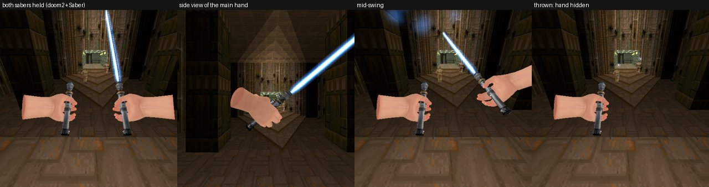
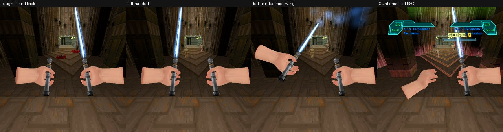
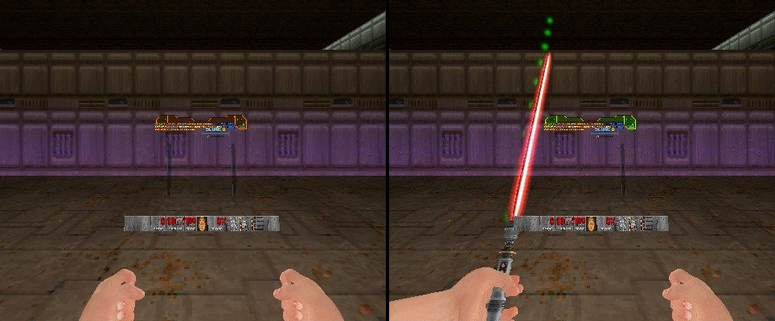
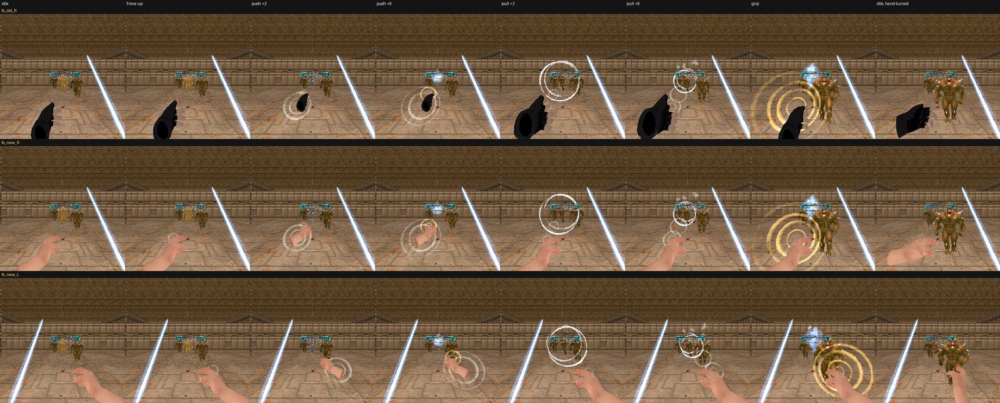
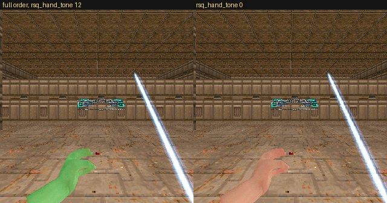
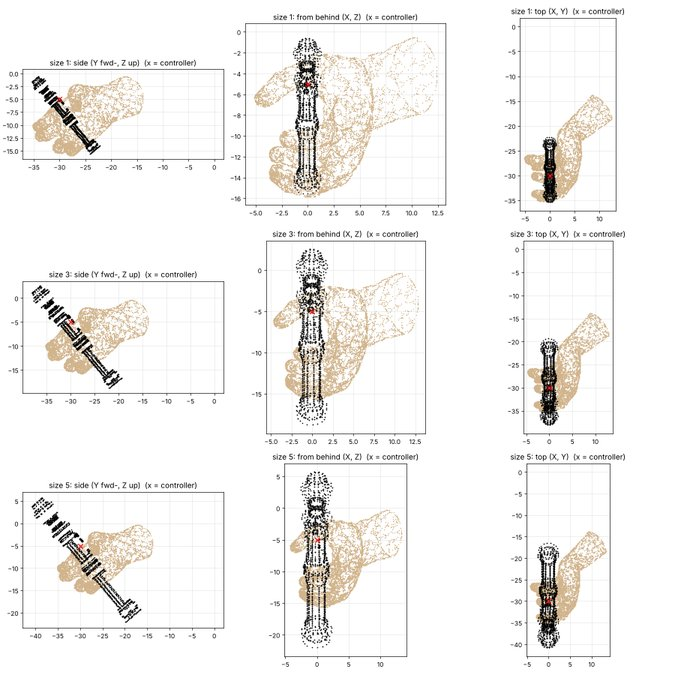
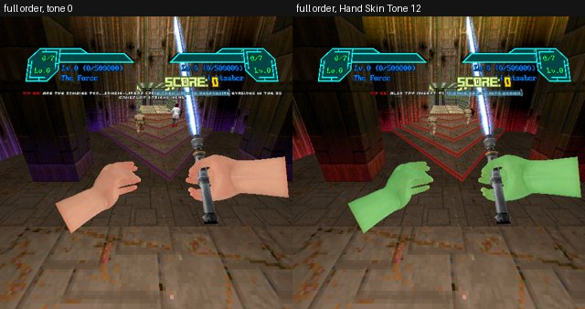

# RSQ Saber
### Doom Arcade VR · a lightsaber in each hand, the Force in your fingers, and every shot in Hell sent back

Light it, swing it with your own arm, and cut through whatever the blade passes through. Hold it across a bullet and the
bullet stops. Meet a fireball and it goes back where you are looking. Throw it, and it flies to every enemy you marked,
cutting each one, then comes home to your hand. Put a second saber in your other hand, or leave that hand free for the
Force: push, pull, choke, fling, and jump higher than Doomguy ever could.

*Rig frames, 2026-11-03, doom2 with this pack (an earlier build; the code has changed since): both sabers held, a side
view of the main hand, a swing, and the main saber thrown, its hilt and the hand on it gone until it comes back. The
second saber's blade is off because that build drew it dark the first time; it now lights whenever it is drawn. Not
captures from the headset.*

---

## What it feels like

- **The swing is the attack.** There is no attack button: the blade cuts whatever your real swing drives it through.
  Swing harder and it hits harder and throws the body further.
- **Stab, slash or lean in.** A thrust along the blade is a stab: one body, half again the damage, no shove. A slow
  push into a monster still cuts.
- **Hold it in the way.** A blade held across a bullet's path stops the bullet at the muzzle's line, not in your chest.
  A blade held across a claw stops the claw, and the monster reels.
- **Parry.** Move the blade *into* the shot as it arrives and a block becomes a parry: a white starburst, a double
  knock in your controller, a faster bolt back at the shooter, and (with RSQ SlowMo) half a second of slow motion.
- **Send it back.** Fireballs, rockets and plasma that cross the blade turn round: where you look, back at the shooter,
  or mirrored off the blade.
- **Mark, then throw.** Hold the trigger and sweep your hand over up to five enemies. A ring in your blade's colour
  marks each one. Let go and the saber flies to each in turn, spinning and cutting, then comes home.
- **Two blades crossed are a wall.** Cross them in front of you and nothing from the front gets past where they cross.
  Bring them together and they clash and lock, crackling, until you pull them apart.
- **The Force.** Thrust your free hand out to push, yank it back to pull, hold it still on a monster to lift it and
  choke it. Swing while you hold it and let go: it is flung, and hurts when it hits.
- **It sounds like a lightsaber.** The hum comes from the blade, not from your head, and bends as the blade passes
  your ear. The whoosh comes from the tip. Every hit is heard where it happened. Three sound sets to pick from.
- **A training remote.** Summon the little drone from *A New Hope*: it circles you and stings. Bat its bolts back into
  it for points; four hits knock it down and give you 25 health, and it comes back harder.

---

## How to play

| Do this | What happens |
|---|---|
| Start a game | A saber in slot 1, lit as you draw it. With Dual Sabers on, a second one for the off hand |
| Swing the saber | It cuts what the blade passes through, harder the faster you swing |
| Thrust it straight along the blade | A stab: the first body only, 1.5 times the damage, no shove |
| Hold the blade across an attack | Bullets, shots and claws that would cross the blade are stopped |
| Hold the trigger and sweep the hand over enemies | Up to five marks, a ring over each |
| Let go of the trigger (after marking, or with the hand snapping forward) | Thrown: it flies to the marks, or straight out along your throw |
| Trigger or alt with the saber out of your hand | It comes back to you, lighting as it lifts |
| Walk over a saber lying on the floor | You pick it back up |
| Main saber's alt | Force push (or, with Force Push on Alt off, its second blade on and off) |
| Off hand: thrust out, yank back, or hold still on an enemy (alt on a second saber or a fist; either trigger on the bare Force hand) | Push, pull, grip |
| Hold jump with a saber or the Force hand out | A Force jump: higher, and a floating fall while jump is held |
| Twist the wrist of a saber hand, quickly, hand still | That saber's second blade out of the pommel, or back in. With it lit, the saber twirls in your hand when idle |
| **Training Remote: Summon / Send Away** (on the menu) | Summon the remote, or send it away (with a saber in hand) |

### Controls

**No keys** (owner, 2026-11-10: keys are precious in VR). Everything is the saber's own buttons, your swing and three
gestures.

- **Saber hand, trigger:** hold to mark, let go to throw; with the saber out of your hand, it calls it back.
- **Main saber, alt:** Force push. With **Force Push on Alt** off, or **The Force** off, it lights and puts out the
  second blade instead. With the saber out of your hand, it calls it back.
- **Off hand:** the Force by gesture, through alt on a second saber or a fist, or through either trigger on the bare
  Force hand.
- **Jump**, with a saber or the Force hand out: the Force jump.
- **Gestures:** the swing (cut, stab, block); the throw (let go with the arm snapping forward, at least **Throw Speed
  (m/s)**, 2.5); thrust out, yank back or hold still for push, pull and grip; a quick **twist of the wrist** (75° or
  more in a fifth of a second, the hand still) for that saber's second blade.
- **Menu button:** **Training Remote: Summon / Send Away**, on this pack's page under Controls. It replaced the remote's
  key.

Gone on 2026-11-10: the **Second blade on / off**, **Blade on / off** and **Summon / dismiss training remote** keys, and
the **RSQ Saber** section in Customize Controls. The blade stays lit; the second blade is the wrist twist.

*[GIF to come: a slash through two imps, the flash, sparks and smoke where the blade went in]*

---

## The blade

### Cutting

- **Your arm is the weapon.** A swing that moves the blade tip fast enough (**Swing to Cut**) cuts. Below that the
  blade passes through and nothing happens, so walking, strafing and turning never cut. A snap turn or a teleport is
  never a swing.
- **The swing is followed through the whole tic,** along the arc the blade really travelled, so a hard swing through a
  small monster cannot slip past it.
- **Damage** is **Damage** (30) times the swing: half for a slow cut, double for a fast one. The same monster can be
  cut again about four times a second.
- **What you cut moves.** It is shoved along your swing and lifted a little, so it staggers, by its weight: an imp
  flies, a Cyberdemon barely moves, and anything that cannot be moved is not.
- **A cut cauterizes.** A white-hot flash in the blade's colour where it went in, sparks thrown back the way the blade
  came, and three puffs of smoke off the wound.
- **No cutting through walls.** The blade only cuts what you can see.
- **Hit-Stop** (off by default): what you cut freezes for a beat. Light, Medium or Heavy.

### Stopping attacks

*Rig frames, 2026-11-03 (an earlier build): the saber caught and back in the hand, the left-handed layout and a
left-handed swing, and the full series loaded with RSQ Gun Bonsai VR's level cards. The dark second hilt in the first
three is that build's dark first draw (it now lights when drawn); in the Gun Bonsai VR frame the off hand is empty
because its Two Sabers upgrade was not learned yet. Not captures from the headset.*

- **Bullets.** Every hitscan shot a monster fires is tested against your blade before it is traced. If the blade is in
  the shot's own line, in front of you, it stops there. The blade's real width counts (**Block Width**, Test and
  Debug), so where you hold it is the whole of it.
- **Shots and blasts.** Brutal Doom fires missiles, not bullets: its zombies' tracers, its fireballs, its rockets. A
  shot that reaches a blade really in its way is turned back off the blade, not exploded on you.
- **Claws.** Brutal Doom's bites and claws are short missiles; the pack tells them from shots by how far they can
  travel. A blade across the claw's line stops it, and the monster that swung reels back.
- **Every stop has a return.** A blocked bullet comes back as a bolt in your blade's colour at whoever fired it.
- **The parry.** When the blade is moving into the shot as it lands, the block is a parry: a brighter clash, a bigger
  spark burst, a white starburst, a double knock in the controller, and the return bolt flies faster. A parried
  attacker reels twice as hard. **Perfect Parry Slow-Mo** (off) adds half a second of RSQ SlowMo.

### Deflecting

Fireballs, plasma and rockets in flight are watched every tic. One that crosses the blade (tested a few tics along its
own path, **Shot Lookahead**) is sent back a fifth faster than it came. **Turned Shots Go:**

| Choice | Where it goes |
|---|---|
| Where I Look (default) | Where you are looking, helped onto an enemy within a small cone of your gaze |
| At the Shooter | Back at whoever fired it |
| Mirrored | Straight off the blade, like light off a mirror |

A turned shot is yours: its kill is yours, and a homing shot homes on the one that fired it.

*[GIF to come: an imp's fireball meeting the blade and flying back into the imp]*
*[GIF to come: a parry: the white starburst, the faster bolt back at a zombieman]*

### Two blades

- **Dual Sabers** (on): a second saber for the off hand, with its own colour and length. With RSQ Gun Bonsai VR loaded,
  the second saber comes only once its **Two Sabers** upgrade is learned.
- **Second Saber Starts** (Put Away): with RSQ Tactical Rig, it starts in its holster and your off hand starts free;
  without the Rig it starts in the off hand. **In Hand**: in the off hand from the start. Either way it lights whenever
  it is drawn, like the first.
- **The clash.** Bring the two blades together and they clash: a crack, a white starburst, sparks. Hold them there and
  they lock: a looping electric snarl, a flickering light where they cross, a fresh snap now and then, until you pull
  them apart. Hilts knocking together do not count; only the beams.
- **The cross guard.** While the blades are crossed in front of you, an X or a +, nothing from in front gets past
  either blade: shots, bolts, claws or blasts. From behind, it does not help.

*The second saber's first draw from its RSQ Tactical Rig holster: the off hand empty (left), and the first frame after the draw, the red blade already lit (right) (rig capture, not headset).*

*[GIF to come: two blades meeting, locking and crackling, then pulled apart]*

### The second blade and the staff

A quick twist of the wrist (a roll of 75° or more in a fifth of a second, the hand held still) lights a blade out of
the pommel of that hand's saber, and puts it out again (code only, not shown: the rig cannot pass a controller's
roll to ZScript). With RSQ
Gun Bonsai VR loaded, the second blade needs its **Double-Bladed** upgrade.

The spinning staff is not a button of its own. With the second blade lit, the saber **twirls in your hand** when idle:
a disc of blade as wide as the blade is long, square to where your hand points. It turns every shot that crosses it
and cuts what it touches (0.8 of a cut); under Gun Bonsai VR the twirl cuts only from Double-Bladed 3, and turns shots
either way. Throw a saber and its second blade lights as it leaves your hand.

*[GIF to come: the staff spinning in the hand, a fireball turned off the disc]*

### Burning

Push a lit blade into a wall or the floor and it spits sparks and embers, sizzles, and leaves a scorch mark. A thrown
saber burns a trail into whatever its blades touch.

*[Still to come: a scorch trail across a wall]*

---

## The throw

- **Marking.** Hold the trigger and sweep your hand over enemies: the one nearest your hand's line inside a narrow cone
  is marked, one every few tics, up to **Lock-On Targets** (5). Each mark is a ring in your blade's colour round a
  white centre, over the monster's head. Marking reads your hand's steadied aim when RSQ Accessibility's Steady Hands
  is on.
- **Throwing.** Let go of the trigger: with marks, it flies to each in turn, cutting each as it passes (1.5 times a
  cut). With no marks, the throw needs your hand snapping forward, out where you are looking; a hard throw flies faster
  and further, along the way your arm moved. Let go with the hand still and nothing marked, and nothing happens: the
  marks stay for a moment in case you pick them back up.
- **In flight** it spins (end over end with your hand upright, flat like a disc with your hand on its side), turns
  shots it passes, burns walls it touches, and slips past a wall on its way to a mark rather than drop the route.
- **Home.** When the route is done, or it has flown far enough, it comes back to your hand, cutting on the way. Trigger
  or alt calls it back early, a Force pull: it lights, lifts and flies to you, through walls if it must. A saber that
  cannot get home falls, lies flat and goes dark; walk over it to take it back.

*[GIF to come: five rings painted across a room, the throw, the saber visiting each and coming home]*

---

## The Force

*Rig frames, 2026-11-03, the full load order (an earlier build): top row Ermac's hand (Force Hand: Original), middle
and bottom rows Brutal Doom 22 VR Reloaded's hand (Force Hand: Our Hand), right- and left-handed. Columns: idle, Force
up, two push frames, two pull frames, a grip, the hand turned. The saber is in the other hand. Not captures from the
headset.*

The Force lives in your off hand. It answers through the **alt** of a second saber or of an off-hand fist (Brutal Doom
VR's hands, Doom's fist, RSQ Melee's off glove, anything named a fist), or through **either trigger** of the bare Force hand,
which fills the off hand when it holds nothing else. Drawing the saber with an empty off hand (BD22 VR's hands, or RSQ
Melee's off glove from Start With Melee Hands) puts the Force hand there; put the saber away and the glove comes back. While the Force is up, your hand glows and the monster a grip would take is
outlined in warm gold.

| Gesture (with the Force up) | Power |
|---|---|
| Thrust the hand out | **Push.** Everything in a cone in front is thrown back by its weight, hurt a little, and dust rolls down the cone. Fireballs and rockets in the cone are turned back, onto the enemy you are looking at |
| Yank it back toward you | **Pull.** Monsters fly off the floor toward you; pickups fly to your hand and are taken; a thrown saber comes home |
| Hold it still on a monster | **Grip.** It rises, choking, held in blue, and hangs where your hand points. Move the hand and it moves. Let go mid-swing and it is flung; it hurts when it hits something |
| Hold jump | **Force jump.** Higher, and a floating fall while jump is held |

- **Push and pull answer to the same switches:** The Force on the menu and, with RSQ Gun Bonsai VR loaded, its Force
  Sensitive upgrade (and each its own Force Push or Force Pull upgrade).
- **The main saber's alt is a Force push** too (**Force Push on Alt**), sharing the push's cooldown (1.5 s).
- **Grip limits:** monsters up to a weight of 600 (an imp, a demon, a Revenant, an Arachnotron; not a Baron or a Mancubus), not bosses, not things that cannot be moved. A
  monster that changes mid-grip (a legendary's transformation, a Champions champion waking) is let go.
- **Force Only With Saber** (on): the bare Force hand is in your off hand only while the saber is in your main hand.
  Switch the main hand to a gun and the off hand goes back to Brutal Doom VR's hands that same tic, so its reloads and
  supports work. A gun you put in the off hand yourself is left alone.
- **Force Hand:** **Our Hand** (Brutal Doom 22 VR Reloaded's hand in one steady pose, toned by its Hand Skin Tone) or
  **Original** (Ermac's hand: open as you reach, a fist as you grip).

*Rig frames, 2026-11-03, full load order (an earlier build): the Force hand with Brutal Doom 22 VR Reloaded's Hand Skin
Tone at 12 and at 0. Not captures from the headset.*

*[GIF to come: a push turning two imp fireballs back into the imps]*
*[GIF to come: a grip lifting a zombieman, then a swing and a fling into a wall]*
*[GIF to come: a Force jump onto a ledge, the floating fall]*

### Force Lightning (RSQ Gun Bonsai VR)

With RSQ Gun Bonsai VR and its Force Lightning learned: hold your off hand palm out at a monster for half a second,
then flick. Lightning pours from your hand for a second, into it and on to the next one near it (as many as its level allows), drawn as a writhing blue-white beam with crackle on top (**Lightning Beam**).

*[GIF to come: Force Lightning chaining across three imps]*

---

## Hands, holsters and the hip

*Tool plot (docs/hilthand/gen_hilthand.py): the hand's mesh round the hilt's mesh for blade lengths 1, 3 and 5, seen
from the side, from behind and from above. A design check, not a game frame.*

- **Hand on the Hilt** (on): Brutal Doom 22 VR Reloaded's hand, in its magazine hold, wrapped round each held saber's
  hilt, fitted for each blade length. It follows the hand's skin tone, hides while the saber is thrown and comes back
  on the catch.
- **With RSQ Tactical Rig,** the second saber has its own holster: reach for it with your off hand to put the saber
  away or take it out. Drawn from the holster it lights with the ignition of the Saber Sound you picked. Put away
  stays put away across levels and saves.
- **Show Sabers** (on): a saber you own and do not hold is drawn in its Tactical Rig holster; without the Rig, at your
  hip in the same spot, the main saber on your main hand's side.

*Rig frames, 2026-11-03, full load order (an earlier build): the hand on the hilt and the Force hand at Hand Skin Tone 0
and 12. Not captures from the headset.*

*[Still to come: the two sabers at the hip without RSQ Tactical Rig]*
*[Still to come: the second saber drawn from and put back in its Tactical Rig holster]*

---

## Looks and sounds

- **Eight colours** for each blade: Blue, Green, Red, Purple, Yellow, Orange, Cyan, White.
- **Five lengths:** 54, 65, 76 (the default), 88 and 99 cm. The off blade can match the main one or be its own (a
  short one in the off hand, say).
- **Blade Light:** each blade lights the room in its colour. Low (one light a blade, for Quest), Medium, High, or Off.
  The off blade's light has its own switch. Hits, blocks and clashes flash whatever the blade light is set to.
- **Saber Sound:** **Graflex** (the original saber, the default), **Vader** (heavier and slower, a lower hum, a lock
  that grinds) or **Rogue Rebel** (the set this pack first shipped with).
- **Sound in space.** The hum is on the blade and rises a little with a hard swing (**Swing Hum Boost**). The whoosh
  comes from the tip and sweeps past your head. Both bend in pitch as the blade comes at you and goes away. Cuts,
  clashes, scorches and turned shots are heard where they happened.
- **Rumble** on the saber's controller: a tick when you mark, a pulse when the blade goes through a body (once a
  swing), a short buzz for a block, a double knock for a parry or a clash, a steady buzz while the blades are locked.

*[Still to come: the eight colours and five lengths side by side]*

---

## The training remote

The **Training Remote** button on the menu summons the little drone about 3.3 m in front of you. It circles all the way round you,
from about 3 to 9 m out (104 to 300 units, picked afresh as it goes; the rig read 4.6 to 8.1 m over eight readings), high and low, beeps, glows for a moment and stings (2 damage). Bat its bolts
back into it:

- **Each deflect** pays points, and a **streak** of deflects without being stung multiplies what a hit pays, up to
  double.
- **Four hits** in a round knock it out of the air for a big award and give you 25 health. After a breath it rises
  again one round harder: faster bolts, then shorter gaps between them, for as long as you last.
- **With RSQ SlowMo** and its **Training Remote** trigger on, the world slows for 0.3 s on every bolt you send back and
  for 1.5 s when the remote goes down.
- **A block counts too.** With Gun Bonsai VR, until Deflector is learned the blade stops a bolt dead instead of
  sending it back. For the remote that block counts as a deflect: the streak, the deflect's points and the 0.3 s slow.
  It lights no pip, so blocks never knock the remote down; only a bolt sent back into it is a hit.
- **A round lasts 30 seconds.** Land four hits before the clock runs out or the training is over: the remote leaves and
  tells you the rounds you cleared, your best streak and your points. The clock stops while the remote is down and
  starts again from :30 when it rises.
- **On your off-hand wrist** (in VR): the round's clock big on top, four pips under it that light red for each hit you
  land, and the round (blue) and your streak (gold) below. While the remote is out it takes the place of RSQ Score's
  wrist digits. Out of VR it keeps score in lines of text on screen instead.
- **A saber game.** The remote comes only with a saber in your hand. Switch the saber away and the training is over.
- It pays into RSQ Score when that is loaded. **Remote Start Level** (Test and Debug) sets how hard it starts. Press the
  menu button again to send it away.

*[GIF to come: the remote circling, a bolt batted back into it, the wrist panel lighting a pip, "REMOTE DOWN!"]*

---

## Plays well with

- **RSQ Tactical Rig:** the second saber's holster (put away, take out), the sabers drawn in their holsters (Show
  Sabers), and the off hand left empty at the start when the second saber starts put away.
- **RSQ Gun Bonsai VR:** the saber and the Force level up. Its Saber tree turns this pack's own rows into upgrades
  (Two Sabers, Double-Bladed, Deflector, Battle Meditation for more marks, Strike True for hit-stop, Kyber Attunement
  for blade length) and adds Momentum, Riposte Edge, Piercing Return, Saber Throw, Saber Barrage, Returning Blade,
  Point Taken, Run Through (a stabbed monster stays on the blade), Return to Sender, Guided Return, Precognition, Cross
  Guard and Clash (a shockwave when the blades lock). Its Force tree: Force Sensitive (no Force until it is learned),
  Force Push, Force Pull, Force Choke, Chain Choke, Force Jump, Force Speed (slow motion) and Force Lightning. Under it,
  there is no second saber until Two Sabers is learned and no second blade on a hilt until Double-Bladed is learned
  (the spinning staff cuts from Double-Bladed 3), push and pull both wait for Force Sensitive, a blocked shot stops
  dead on the blade until Deflector is learned, and the rows behind an unlearned upgrade grey out.
- **RSQ Score:** the training remote's rounds and knock-downs, and the saber's moves named for its combos (stab, lunge,
  staff spin, run through, cross guard, clash, barrage, Force slam, Force lightning, Force speed, return to sender).
  It can also ask what the saber blocked, parried or pulled, and which way a thrown saber is flying.
- **RSQ SlowMo:** Perfect Parry Slow-Mo, the training remote (its own Training Remote trigger), and Gun Bonsai VR's
  Force Speed.
- **RSQ Accessibility:** Photosensitive Mode (the clash flicker and flashes calmed), Steady Hands (marking and gripping
  aim), Gesture Ease (the push, pull, grip, throw and flick reload are easier), One-Handed (the Force from the main hand,
  and gesture buttons for push, pull, grip and flick reload), Hold to Toggle (the Force), Slower Taps, Rumble Strength,
  Cue Size (the marks, the grip outline, the hand flare), Colour-Blind colours (the outlines and the hand flare), Text
  Size (the remote's messages) and the Comfort Vignette on a Force jump.
- **RSQ Distance Grab:** an off hand holding a dark hilt may still reach and grab.
- **RSQ Melee:** with **Slappers Only** on, Start With Saber stands down (no saber, second saber or Force is handed out)
  and you get them back when it goes off. Melee's off glove counts as your empty off hand: the Force hand takes its
  place while the saber is drawn, and its alt raises the Force if you switch back to it.
- **RSQ Wheel:** the same saber picture on its card.
- **RSQ TopHPBars:** can mark the monster your Force grip is holding.
- **Brutal Doom 22 VR Reloaded:** its hand on the hilt and as the Force hand, its Hand Skin Tone on both, its hands back
  in your off hand whenever a gun is in the main one, and its flick-down reload for the main gun while a saber or the
  Force hand is in your off hand.
- **Brutal Doom:** its sword becomes the saber (**Sword Becomes Saber**), its claws and bites are blocked as melee, its
  tracers and fireballs are turned.
- **Champions:** a champion that cannot be moved is cut, pushed and pulled without moving.
- **Other saber mods:** Wardust's Lightsaber, Xim's Star Wars Doom (whose saber is Doom's chainsaw, so the chainsaw is replaced only while Xim's is loaded) and the earlier
  Quest saber are replaced by this one, on the map and in your hands.

---

## Options

*Options → Radiant Silvergun Options → RSQ Saber.* One page; the raw numbers are under Test and Debug. Defaults in
brackets. The host's settings are one setting for everyone in netplay; the rest are each player's own.

| Section | Rows |
|---|---|
| Sabers | Sabers (On) · Start With Saber (On) · Dual Sabers (On) · Second Saber Starts (Put Away; In Hand) · Show Sabers (On) · Hand on the Hilt (On) · Sword Becomes Saber (On) |
| Blades | Main Colour (Blue) · Main Length (76 cm; 54 to 99) · Off Colour (Red) · Off Length (Same as Main) · Blade Light (Low; Off, Medium, High) · Off Blade Light (On) · Saber Sound (Graflex; Vader, Rogue Rebel) |
| Fighting | Damage (30; 15 to 60) · Swing to Cut (8.0; 3 to 20) · Turned Shots Go (Where I Look; At the Shooter, Mirrored) · Hit-Stop (Off; Light, Medium, Heavy) · Perfect Parry Slow-Mo (Off) · Lock-On Targets (5; 1 to 5) · Rumble (On) |
| The Force | The Force (On) · Force Push on Alt (On) · Force Jump (On) · Force Only With Saber (On) · Force Hand (Our Hand; Original) · Lightning Beam (Gun Bonsai VR) (On) |
| Controls | Training Remote: Summon / Send Away (a button). No keys: the second blade is a wrist twist |
| Test and Debug | Block Width (1.5) · Shot Lookahead (3 tics) · Throw Speed (m/s) (2.5) · Swing Hum Boost (1.1) · Gesture Sharpness (2.0) · Gesture Straightness (0.55) · Remote Start Level (2) · Rumble Hand (Auto; Right, Left) · Debug View (Off; Blade Line, Glow Readout) |

- **The host's:** Sabers, Start With Saber, Dual Sabers, Second Saber Starts, Sword Becomes Saber, Damage, Swing to
  Cut, Hit-Stop, Perfect Parry Slow-Mo, The Force, Force Jump, Force Only With Saber, Lightning Beam, Block Width, Shot
  Lookahead. **Yours:** everything else.
- **Swing to Cut** is the one to tune first: how hard a swing must be depends on your arm, sitting or standing, and the
  room. Lower it if your slashes do nothing; raise it if gentle moves cut.
- With RSQ Gun Bonsai VR loaded, a line at the top of the page says some rows are upgrades. Turned Shots Go is then
  always greyed (the Deflect upgrades decide), and Hit-Stop, Lock-On Targets, Force Push on Alt, Force Jump and
  Lightning Beam grey out until their upgrade is learned. Learned, the row still decides: Off is off, and Hit-Stop and
  Lock-On Targets cap what the upgrade gives.
- **Turning the Force off** also turns the off-hand saber's alt into its second-blade switch, so the button is never
  dead.
- **Reset All**, on both pages, puts every row back to its default.

---

## Status

| | |
|---|---|
| **code only, not shown** (2026-11-11, `design/rigtest_2026-11-10/RESULTS_HUD11.md`; not run, by the owner's order "no rig test, code only until i say"; not load-checked either) | The diagnostic lines (ubqs_diag 2) are not drawn while any menu is open (owner 11-11) |
| **code only, not shown** (2026-11-11 evening; loads clean on the full order, not run) | A remote bolt BLOCKED on the blade (Deflector not learned) pays no points now (owner: "Pay nothing"); it still counts toward the streak and gives the 0.3 s slow. A bolt sent back still pays the deflect's points |
| **rig only, not headset-confirmed** (2026-11-11, owner's call: a block counts for the remote as streak and slow only, `design/rigtest_2026-11-10/RESULTS_SEATREMOTE.md`) | Gun Bonsai VR loaded, Deflector not learned: five of the remote's bolts stopped dead on the blade (`SBX_BLOCK ... stopped on the blade (Deflector not learned)`); each the same tic: deflects +1, streak +1 (1 to 5), the deflect's 20 points; RSQ SlowMo got `rsm_pulse (300 35)` and `ubqs_remoteslowmo` 1 to 2 tics later and started 300 ms at 35% (pulse 11 tics). Pips (round hits) stayed 0, struck 0, no knock-down, nothing sent back, stung 0 (`design/rigtest_2026-11-10/evidence/REMOTE_BLOCK_log.txt`; the remote held just past the blade tip). The wrist panel was not looked at in frames |
| **rig only, not headset-confirmed** (2026-11-11, the last checks, `design/rigtest_2026-11-10/RESULTS_LAST.md`) | **The training remote's slow, sent by the saber:** the remote's own bolts turned by the blade (`SBX_DEFLECT ... DEFLECTED`, the saber's log), each counted as a deflect in the same tic and RSQ SlowMo starting 300 ms at 35% two to four tics later; the fourth knocked it down (1500 ms). With Gun Bonsai VR, only once Deflector is learned: before that the blade stops the bolt and nothing was sent (changed 11-11, row above: a block now counts; `design/rigtest_2026-11-10/evidence/LAST_SABER_remote_deflect_slow_log.txt`; the rig held the remote just past the blade tip, as it cannot turn to face it) |
| **rig only, not headset-confirmed** (2026-11-10 night, the rig batch's fixes, `design/rigtest_2026-11-10/RESULTS_FIX.md`) | **Both found BROKEN in the batch (P1's M8, P2's A2), then fixed and shown. Slappers Only:** the saber not in the inventory on any of 48 tics with it on (it flickered in every 5 tics before); off, the Shotgun back in the main hand and the saber back in the inventory (`design/rigtest_2026-11-10/evidence/FIX_B_log.txt`, FX WATCH / FX INV). **Melee's gloves:** with Start With Melee Hands, drawing the saber turned the off glove into the Force hand (`UBQS COMBO ... off RSQ_GloveOff -> UBQS_ForceHand`), a Force pull then took a medikit from 200 to 105 units; the Shotgun drawn, the glove came back; with the glove picked beside the saber, its alt pulled too (`FIX_B_log.txt`; before: `FIX_A_log.txt` t382, the glove kept). Loads clean on the owner's order |
| **rig only, not headset-confirmed** (2026-11-10 night, the packed batch, P2: `design/rigtest_2026-11-10/RESULTS_P2.md`) | **A1:** the second saber, put away in its Tactical Rig holster and drawn by the holster's own draw, lit in the first frame and stayed lit (`design/rigtest_2026-11-10/evidence/P2_A1_second_saber_lit_first_draw.jpg`, `P2B_log.txt`). **A2:** Force Pull refused without Force Sensitive learned and with the Force off, and pulling a medikit in once both were on (`P2E_log.txt`). **A3:** the remote 4.6 to 8.1 m out over eight readings, about 2 m up; four hits knocked it down and gave +25 health (60 to 85); RSQ SlowMo's 1.5 s slow the tic it went down (`P2A_log.txt`) |
| **rig only, not headset-confirmed** (2026-11-10, the batched rig test, `design/rigtest_2026-11-10/RESULTS.md`) | Every launch on the owner's order (with BD22 VR Reloaded 2.0.4f) had no script error from our packs. **A saber game:** with the rifle the remote is refused ("draw your saber first"); with the saber it is summoned; switched to the rifle, TRAINING OVER and the remote is gone (`evidence/L7_log.txt`). **The wrist panel and the round:** :30 and :28 in gold, a pip lit per hit (3 of 4 at tic 250), the knock-down at 4, round 1 to round 2, the clock held while the remote is down and back to :30 when it rises; the clock running out ends the training and the remote leaves; RSQ Score's wrist digits hidden while it is out and back after (`evidence/A4_*`, `L6_log.txt`, `L7_log.txt`). **One throw:** the same posed swing released at 2.06 m/s did not throw (it needs 2.50) and at 3.09 m/s threw (`evidence/L8_log.txt`, rig02, no monsters). The Saber Throw Speed (m/s) row at 2.50 (`evidence/menus_new_rows.jpg`) |
| **rig only, not headset-confirmed** (2026-11-09) | The pack loaded on doom2, brutal22test6, BD_VoxelPack, BD22 VR Reloaded 2.0.4e, LOB, Champions, Gun Bonsai and the whole RSQ series with no script error of its own (the only script errors in the log are BD_VoxelPack's). On MAP01 of that run the saber was in the main hand and the Force hand in the off hand. Files: design/rigtest_2026-11-09/logs/main_A-G_I.log, design/rigtest_2026-11-09/batch2/launch1_main.log (the MAP01 state line) |
| **rig only, not headset-confirmed** (2026-11-03, earlier build) | Force Only With Saber: the Force hand arriving in the off hand when the saber came into the main hand and leaving the same tic when it went, a pistol kept in the off hand, the same across level changes and saves; on the full order, Brutal Doom VR's hands back with the rifle and its hand reload working (docs/forcecomboprobe/log_doom2_saber.txt, log_full_A_reload_m203.txt, log_full_B_levels_saves.txt, log_full_newgame_before_after.txt). The Force hand's two meshes drawn idle, with the Force up, pushing, pulling and gripping, both hands (docs/forcehand_1103/saber_alone.png, full_order.png; in saber_alone.png's Original left-handed row two frames came out dark). Hand Skin Tone on the Force hand (docs/forcehand_1103/tone.png). Hand on the Hilt on both sabers, in a swing, hidden while thrown and back on the catch, left-handed, with Gun Bonsai VR and with Hand Skin Tone (docs/hilthand/rig_1103/sheet.png) |
| **Headset-confirmed** | Nothing yet |
| **code only, not shown** | **The wrist twist** (the second blade): the rig does not pass a posed controller's roll to ZScript, so the twist cannot be shown there (tried in `evidence/L8_log.txt`); with Gun Bonsai VR loaded it also needs Double-Bladed. **The 11-10 key change:** no keys, and the remote's menu button itself (the rig summoned the remote with the button's command, `netevent ubqs_remote`; the menu was not clicked). The other 11-10 changes: the second saber lighting on draws other than the holster's, the Two Sabers and Double-Bladed gates refusing under Gun Bonsai VR, the twirl's Double-Bladed 3 cut, and the remote's 0.3 s slow on a deflect made with the saber. Everything else on this page: cutting, stabs and shoves, blocking, parrying, deflecting, the return bolt, marking, the staff, the clash, lock and cross guard, burning, the sounds and their placement, the lights, the rumble, push, pull, grip, fling and Force jump, Force Lightning, Second Saber Starts, the holster and the hip display, Sword Becomes Saber, the flick reload, every Gun Bonsai VR upgrade and every RSQ Accessibility setting |
| **not yet run** | Nothing from the rig test: A1 to A5 and the remote's deflect slow have run (above) |

A blade turning an imp fireball is recorded only as one line in the header of the test probe TestRig/saberprobe
(2026-11-03); the log itself is not in the repo, so it is listed as code only. The 2026-11-03 frames show what an
earlier build did; the code has changed since.

---

## Under the hood

- **Stock QuestZDoom 17.3:** ZScript and data only. No engine changes. The whole pack is built on the engine's off-hand
  weapon and its hand position and angle script fields.
- **The blade is a line.** Every tic the blade's base, direction and length are worked out from the controller pose
  and the drawn frame. Cutting, blocking, deflecting, clashing and burning all use that one line, so what you see is
  what cuts. **Debug View: Blade Line** draws dots along it.
- **Swings are measured in the body's frame:** the hand against the body, turned with the tracking space, the hand's
  height corrected for the engine's vertical squash. Walking, head turns, snap and smooth turns and stairs add nothing.
  The hand is carried to where the body is this tic, so a tic with no rendered frame does not read as a swing.
- **Cuts are swept.** The blade's travel through the tic is cut into steps of at most 15 degrees along its arc and
  each step is tested, nearest first, with a sight check.
- **The block runs before the shot.** Monster hitscans are tested in the engine's pre-fire event against the shot's
  own ray from the muzzle, against where the blade was over the last tic. Missiles are tested again on contact; a shot
  turned on contact flies on through you, the player briefly lent the engine's reflect flags.
- **The parry reads the tic before.** Players think before monsters, so the blade's step is measured from the last
  full tic, not from this one.
- **Rumble through the engine's quake hook**, as a smooth wave each tic on the right controller, which is the only
  rumble route on this engine that is net-safe and demo-safe.
- **Netplay.** Your look and your alt choice are your own; what the saber does to the game is the host's. QuestZDoom
  17.3 only knows the hands of the player on the machine it runs on, so on your machine another player's saber is
  treated as unlit. Not tested in netplay.
- **No hard links.** RSQ Tactical Rig, RSQ Gun Bonsai VR, RSQ Score, RSQ SlowMo, RSQ Accessibility and Brutal Doom VR
  are all found by name while the game runs. The pack loads and plays alone, on plain Doom too.
- **For other mods: UBQS_SaberService**, found by name. It answers `saber.lit` (is the saber in this hand lit, doused
  or thrown), `gripped` (is this monster in a Force grip), `blocked`, `perfect` and `pulled` (how long since the saber
  did that to this monster) and `thrown.leg`, and `menu.locked` for the menu's Gun Bonsai VR rows.
- **Netevents:** `ubqs_twist` (the wrist twist: the second blade of that hand), `ubqs_blade2` and `ubqs_ignite` (console only, no key), `ubqs_remote` (the menu button), `ubqs_dual_out` and `ubqs_dual_in` (the
  Tactical Rig holster), and `rsqa_alt` (RSQ Accessibility's gesture buttons). Sent, by name: `rsm_pulse` (RSQ
  SlowMo's slow) and `ubqs_remoteslowmo` (marks a training remote slow for SlowMo's Training Remote trigger).
- **Console-only settings** (in CVARINFO, not on the menu): `ubqs_world_saber` (draw the hilt as a world model; it is
  drawn that way anyway while a SteamVR two-hand brace hides the off hand), `ubqs_deflect_lead`, `ubqs_force_gesture`
  and the rest of the Test and Debug numbers. Everything else is a fixed number in the code: over a hundred names the code
  used to read but CVARINFO never defined are now written in as fixed numbers (marked `fixed: was ubqs_..., never a
  setting`), and nothing changed in play.
- **Tools:** docs/hilthand/gen_hilthand.py bakes the hand onto the hilt for each blade length (check_fit.py checks it);
  the probes under docs/ (forcecomboprobe, forcehandprobe, parryprobe, rigprobe) are rig tests and never ship.

## Credits

The full list is in **CREDITS.txt**.

- **presidentkoopa:** the saber itself, its design and its handling.
- **Ermac** (RS_Main, DXR, Rusted Legacy): the combat effect sprites used for the Force and the blade's impacts (the
  choke's lightning arcs, the blast smoke, the hand flare), the Force choke loop, and the Original Force hand.
- **Brutal Doom 22 VR Reloaded** (presidentkoopa): the hand on the hilt and Our Hand, from its FBX hand in its magazine
  hold. The FBX's own author and licence are not recorded.
- **QuestZDoom** (Emawind): the engine, and the off-hand weapon and hand API this pack is built on.
- **danger_doughnut52** (dinopixel.com): the saber's icon, "Jedi Lightsaber (Star Wars)" pixel art.
- **li-gnrcwpn:** the training remote's ready beep.
- **The saber model** is believed to come from Star Wars Jedi Outcast (Raven Software / LucasArts), and **the saber
  sounds** from a lightsaber sound font library; their authors are not recorded. Force Lightning's crackle is from the
  owner's RS Ballistics sounds. The blade and glow shapes and the generated sounds are this pack's own.
