

Intended to bring a sense of arcade-ness to Doom, RS leverages the strengths of a number of existing mods in tandem
with nearly two dozen modular aspects of itself.

<table>
<tr>
<td align="center" width="14%"><a href="Melee/README.md"> <b>Melee</b></a></td>
<td align="center" width="14%"><a href="Grapple/README.md"> <b>Grapple</b></a></td>
<td align="center" width="14%"><a href="DistanceGrab/README.md"> <b>Distance Grab</b></a></td>
<td align="center" width="14%"><a href="Grenade/README.md">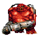 <b>Grenade</b></a></td>
<td align="center" width="14%"><a href="TacticalRig/README.md"> <b>Tactical Rig</b></a></td>
<td align="center" width="14%"><a href="Wheel/README.md"> <b>Wheel</b></a></td>
<td align="center" width="14%"><a href="SlowMo/README.md"> <b>SlowMo</b></a></td>
</tr>
<tr>
<td align="center" width="14%"><a href="VisualRewards/README.md">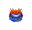 <b>Visual Rewards</b></a></td>
<td align="center" width="14%"><a href="GunCards/README.md"> <b>Gun Cards</b></a></td>
<td align="center" width="14%"><a href="GunBonsaiOffhandVR/README.md"> <b>Gun Bonsai VR</b></a></td>
<td align="center" width="14%"><a href="QuestSaber/README.md"> <b>Saber</b></a></td>
<td align="center" width="14%"><a href="ShieldSaw/README.md">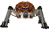 <b>ShieldSaw</b></a></td>
<td align="center" width="14%"><a href="Whip/README.md">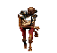 <b>Whip</b></a></td>
<td align="center" width="14%"><a href="FlashFlare/README.md">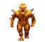 <b>Flash and Flare</b></a></td>
</tr>
<tr>
<td align="center" width="14%"><a href="GlowInTheDark/README.md"> <b>Glow In The Dark</b></a></td>
<td align="center" width="14%"><a href="Miniboss/README.md">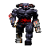 <b>Miniboss</b></a></td>
<td align="center" width="14%"><a href="Monsters/README.md"> <b>Monsters</b></a></td>
<td align="center" width="14%"><a href="Graveyard/README.md">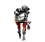 <b>Graveyard</b></a></td>
<td align="center" width="14%"><a href="Score/README.md">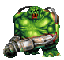 <b>Score</b></a></td>
<td align="center" width="14%"><a href="LaserSight/README.md"> <b>Laser Sight</b></a></td>
<td align="center" width="14%"><a href="Controls/README.md">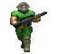 <b>Controls</b></a></td>
</tr>
</table>

<a href="#in-short"><b>In short</b></a> &middot; <a href="#keys"><b>Keys</b></a> &middot; <a href="#its-all-connected">It's all connected</a> &middot; <a href="#load-order-and-install">Load order and install</a> &middot; <a href="#the-pk3s-list">The pk3s</a> &middot; <a href="#what-needs-what">What needs what</a> &middot; <a href="#radiant-silvergun-options">Options</a> &middot; <a href="#where-it-stands">Where it stands</a> &middot; <a href="#credits">Credits</a>

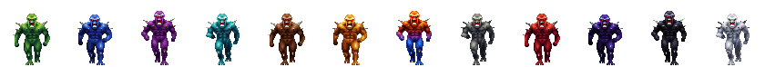

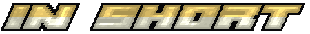

### What Doom Arcade is

**A reactive level rewards and punishes you for your performance.** All of Brutal Doom's monsters, as well as the
community-developed XMVE add-on, have been tiered in a way which allows them to present a larger or smaller challenge
depending on how you play.

Your weapons level up with the damage they do, and your skill and style score points for lives, gold and a Boss
fight you call in yourself.

### The mods it brings together

Doom Arcade stands on other people's mods and ties them into one game: **Brutal Doom 22** (Sergeant Mark IV) and its
voxel pack, **BD22 VR Reloaded** (the owner's VR-first weapon set for it: hands on every gun, reloads by hand),
**LegenDoom 3.0** (legendary weapons and their effects), **XMVE** (the community's extra Brutal Doom monsters),
**Gun Bonsai** (ToxicFrog) and **Legion of Bones** (SpacemanStrife), on **QuestZDoom 17.3**. On top of them sit the
Series' own mods. Each one loads and plays alone, and each has a section below and a page of its own.

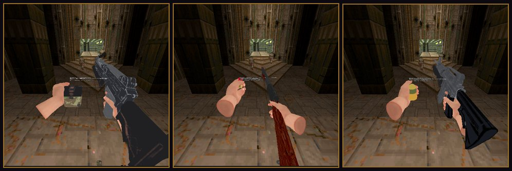

### VR first

Every one of them was designed for two tracked hands and a body in a room. From that standpoint, the Series gives you:

**Hands in the world.** Alyx-esque environmental interaction. Grab and lift doors. Lay your hand on a switch and it
flips. Put out your palm, light up what you want, and flick it back to you. Pull barrels to you and throw them at a
monster. Your guns hang on your body, and every move with a fist, a blade, a whip or a shield is the move your arm
makes.

Fighting with your body. A hand that holds a fist punches when you swing it: jab, hook and uppercut, harder the
faster you swing, and the uppercut lifts the monster off the floor. A fist swung through a monster's shot knocks it
away. Drive a gun in your main hand forward and it shoves; land the shove and the world slows. The off hand's grip
takes a monster in a Headlock: punch it three times and the third blow sends it flying. Hold a hand's trigger on a
monster, then uppercut, shove, whip or throw a barrel, and the barrel flies to it. No keys: every move is a swing, a
grip or a held trigger.

The previews play here without sound; **click one to play the clip with sound.**

| [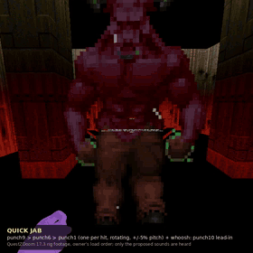](https://cdn.jsdelivr.net/gh/presidentkoopa/RSQ_UBQSeries@main/design/media/sounds/jab.mp4) |  |  |  |
|---|---|---|---|
| **Jab** | **Hook** | **Pistol whip** | **Gun-butt shove** |

<b><a href="Melee/README.md">RSQ Melee: the full page &rarr;</a></b> &nbsp;&middot;&nbsp; <a href="#contents">contents &uarr;</a>

A hook on a chain, fired from the off hand with one key, Fire Hook (you bind it). Hook a wall and you are thrown
toward it; hook a ledge and you are carried onto it; hook a monster and you fly to it, kick it, and are thrown back up
into the air, where you can hook the next one. Jump in the air for a double jump. Flying to a monster, or just after
the kick, swing both hands down hard: the air spike drives the monster into the floor. There is no rope to hold:
every bite is one move, then the claw lets go.

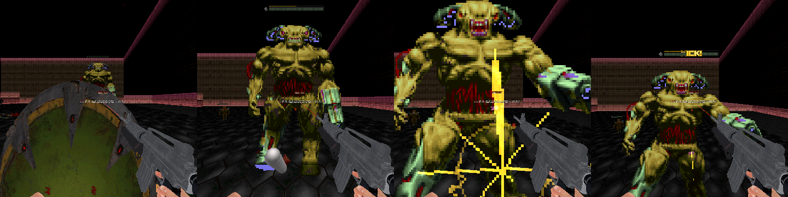 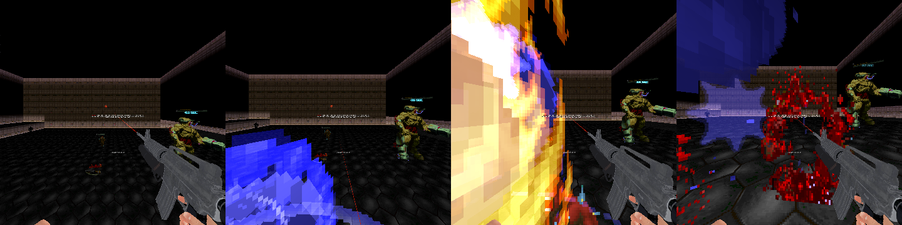

<b><a href="Grapple/README.md">RSQ Grapple: the full page &rarr;</a></b> &nbsp;&middot;&nbsp; <a href="#contents">contents &uarr;</a>

Point an open palm at a pickup, a gun or a barrel across the room and it glows green. Flick your wrist and it flies
to your hand. Pickups are used as they land; one you cannot use says AMMO FULL, HEALTH FULL or ARMOR FULL and is put at
your feet. Barrels are carried, swung into monsters, held up as a shield and thrown. Up close the grip takes things
straight off the floor, a hand on a door lifts it, and a palm laid on a switch flips it.

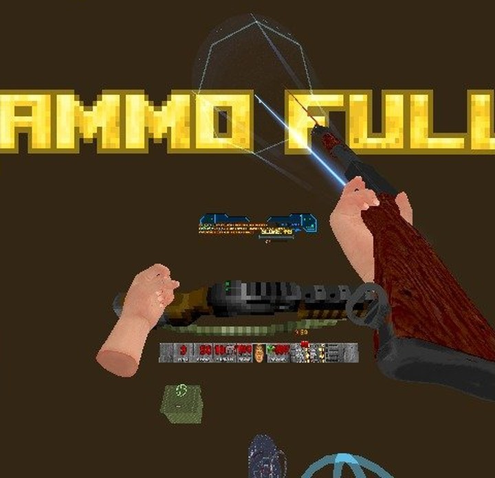

<b><a href="DistanceGrab/README.md">RSQ Distance Grab: the full page &rarr;</a></b> &nbsp;&middot;&nbsp; <a href="#contents">contents &uarr;</a>

A hand grenade you hold, arm and throw with your own hands: pull the ring with the other hand or with your teeth,
squeeze, swing and let go. Let go slowly and it cooks in your hand. Nine types: Frag, Impact, Incendiary, Freeze,
Stun, Smoke, Flash, Charm and Infight; alt fire with the pin in changes it, and the type's name shows on the grenade in
your hand. Quick Grenade throws one from your body whatever your hands hold. Shoot a thrown grenade out of the air for
a skeet. The same mod gives Doom's barrels a lit blink and new explosions, and chains of barrels that grow.

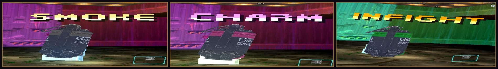

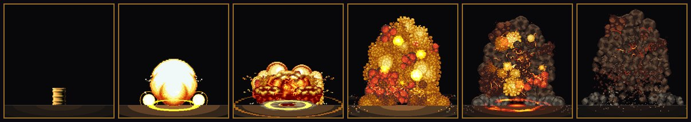

|  |  |
|---|---|
| **Skeet** | **Over lava** |

<b><a href="Grenade/README.md">RSQ Grenade: the full page &rarr;</a></b> &nbsp;&middot;&nbsp; <a href="#contents">contents &uarr;</a>

<a href="TacticalRig/README.md">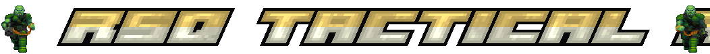</a>

Your guns hang on your body. Six holsters (both hips, both sides of the chest, over each shoulder) each hold the one
gun you put there. Squeeze a hand's grip, or press Use, in a holster: a gun goes in, an empty hand draws. Holster with
one hand and draw with the other to move a gun across. The belt carries a grenade spot, your keys on a ring and an
ammo pouch, and there are spots for the saber, the whip and the flare when those mods are loaded. You wear a torso
the holsters sit on, and a pocket of cigarettes on the chest: light one with the Zippo and the world slows (with RSQ SlowMo). Hold both
hands on your chest to turn the torso to where you face.

<b><a href="TacticalRig/README.md">RSQ Tactical Rig: the full page &rarr;</a></b> &nbsp;&middot;&nbsp; <a href="#contents">contents &uarr;</a>

A ring of cards that opens in the air in front of your hand, one card for each weapon slot or weapon you carry, and
time stops while it is up. Press Open Wheel (left stick click) to open and close it. Point either hand at a card:
primary fire on either hand takes the gun and closes the ring, the off hand's secondary fire takes it and keeps the
ring open, and the main hand's secondary fire opens the holster assignment (with RSQ Tactical Rig). A data sheet in
the middle tells you about the gun you point at.

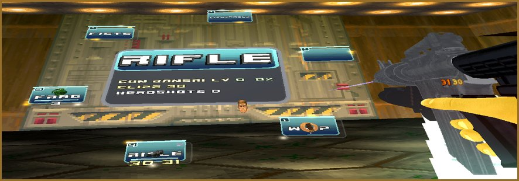

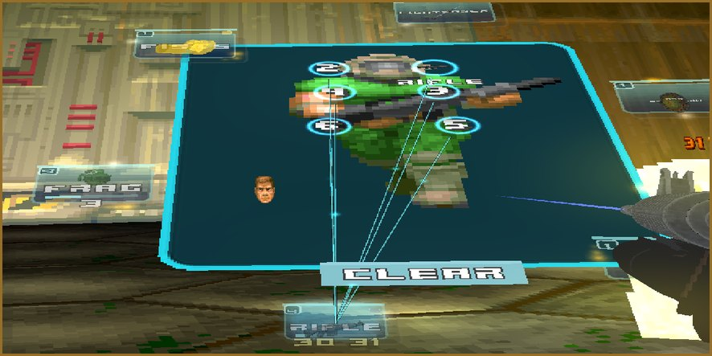

<b><a href="Wheel/README.md">RSQ Wheel: the full page &rarr;</a></b> &nbsp;&middot;&nbsp; <a href="#contents">contents &uarr;</a>

<a href="SlowMo/README.md">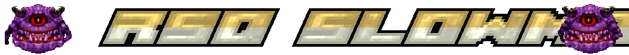</a>

The world slows down while you, your hands and your guns stay at full speed. Cross your wrists in front of your face
(or press its key) and it stays on until you cross them again, paid for from an adrenaline meter that kills, near misses
and hits taken fill. **Crisis Dive** throws you into a leap with the world at a tenth of its speed, and you hang in the air
one and a half times as long to shoot. Light a **time smoke** from RSQ Tactical Rig's chest pocket and you get 15 seconds
at a quarter speed. While it is slowed, monsters' bullets become rounds you can see and step out of. The game slows on its
own at big moments, other mods ask for it by name, and Be Quick or Be Dead (Last Stand in the menu) turns a monster's
killing hit into 1 HP and a few seconds to kill a marked TARGET and get up.

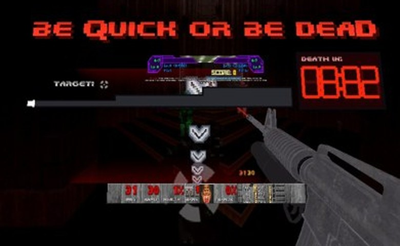

<b><a href="SlowMo/README.md">RSQ SlowMo: the full page &rarr;</a></b> &nbsp;&middot;&nbsp; <a href="#contents">contents &uarr;</a>

<a href="VisualRewards/README.md">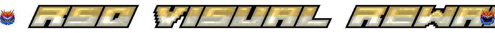</a>

RSQ Visual Rewards is several mods' worth of feedback in one. Health bars stand over every monster you hit (built on
coldcite's Top HP Bars), with a running total and an xN combo that heats from white to red. Damage numbers (built on
Xaser's damnums) jet off every hit, with HEADSHOT in gold on a Brutal Doom head, OVERKILL past zero, and a slam on the
killing blow. Kill rewards (built on SoM's Universal Kill Rewards) burst every dead monster into small bits of health,
armour and ammo that fly to you: one ammo bit in five is light green, for the guns you carry but don't hold, bosses
and legendary champions drop gold for RSQ Score's bank, and there are steel bits for RSQ Gun Cards' condition and
batteries for RSQ FnF. Every health, armour and ammo pickup sends a "+N" to your wrist. And it is the series' stage:
Symphony of the Night style banners and words (LEVEL UP!, BOSS INCOMING!, REVIVE!, REVENGE!, 1UP), toasts low in the
view, legendary drop names, the invulnerability bar with Doomguy's god face, and the arrival beams of RSQ Miniboss's
bosses: whatever the other RSQ mods ask it to show.

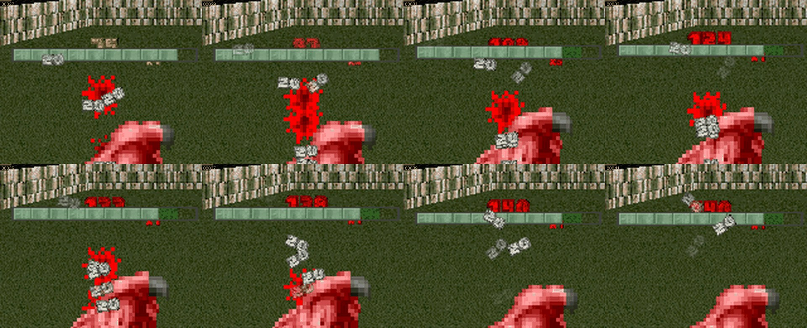 

<b><a href="VisualRewards/README.md">RSQ Visual Rewards: the full page &rarr;</a></b> &nbsp;&middot;&nbsp; <a href="#contents">contents &uarr;</a>

<a href="GunCards/README.md">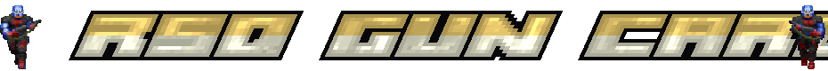</a>

Cards on your hands that say what you hold. A small card beside the wrist shows the rounds in the gun, green, then
yellow, then red as it empties, RELOAD when the magazine is out, and the reserve. Turn the back of a wrist to your eyes
and look at it: the watch card lies on that wrist, with no hold and no wait, and stays two seconds after. With a gun it
shows the magazine, the reserve, grenades and this gun's kills; with an empty hand, your health, armour and keys. The
same mod holds Weapon Condition (off by default): big hits wear the guns in your hands.

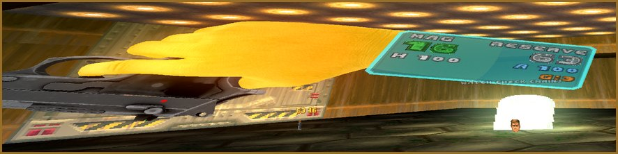 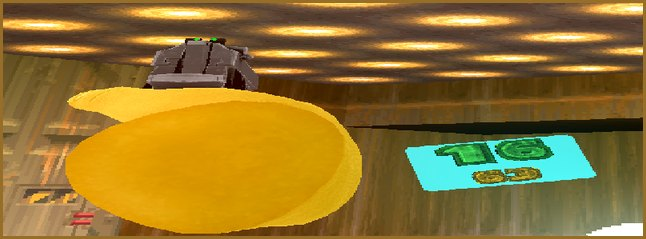

<b><a href="GunCards/README.md">RSQ Gun Cards: the full page &rarr;</a></b> &nbsp;&middot;&nbsp; <a href="#contents">contents &uarr;</a>

ToxicFrog's Gun Bonsai, where each weapon earns XP, levels up and picks upgrades, made to work with a weapon in each
hand. Each hand's weapon has its own level and its own XP gauge at the top of the view, and is paid only for the damage
it did: a kill with the off-hand pistol pays the pistol, not the rifle in your other hand. It draws Gun Bonsai's status
screen and level-up choices as its own screens (Gun Bonsai's info key opens them), adds an ammo and health row, and
shows LegenDoom weapon powers in the same style. Every upgrade offered is Gun Bonsai's.

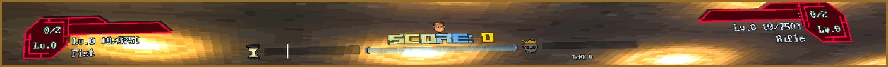

<b><a href="GunBonsaiOffhandVR/README.md">RSQ Gun Bonsai VR: the full page &rarr;</a></b> &nbsp;&middot;&nbsp; <a href="#contents">contents &uarr;</a>

<a href="QuestSaber/README.md">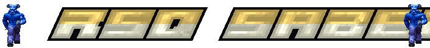</a>

A lightsaber for your own hands. It cuts what your real swing passes it through, harder the faster, and a blade held
in the way stops shots, bolts and claws: a fireball goes where you look, a bullet comes back as a bolt. Hold a hand's
fire to lock on to monsters and let go on a swing to throw the saber round them and back to your hand. A second saber
comes up in the empty off hand, and two blades brought together clash. The Force comes with the saber on alt fire:
Push, Pull, Grip, and a Force jump on jump. A training remote, from the menu, stings you for practice.

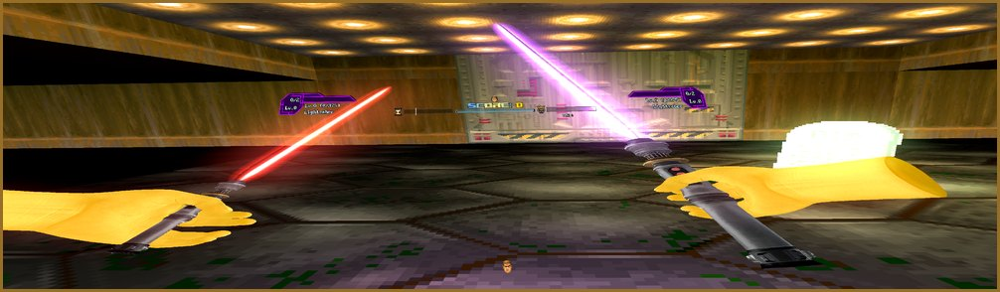 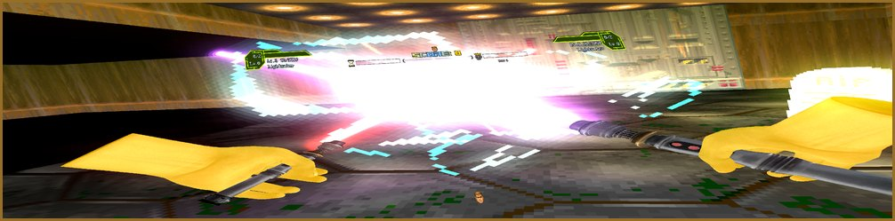

<b><a href="QuestSaber/README.md">RSQ Saber: the full page &rarr;</a></b> &nbsp;&middot;&nbsp; <a href="#contents">contents &uarr;</a>

A round shield with a saw in its rim, held in your off hand. One key, ShieldSaw (you bind it), puts it in the off hand
or swaps back to the weapon you had; pressed while the disc is out, it calls it home. Hold the main hand's trigger and
point to ring up to five monsters; the off hand's trigger revs the saw. Swing the off arm forward and it is thrown: to
each ringed monster in turn, or along the swing, then home, faster and harder the harder you swing. In the hand it
blocks shots, bullets and claws and sends them back, bashes what you shove it into, and grinds what you hold it against
while the saw runs. Taken from the Wheel it goes to the off hand, and the holster assignment can mount it on the off
shoulder.

 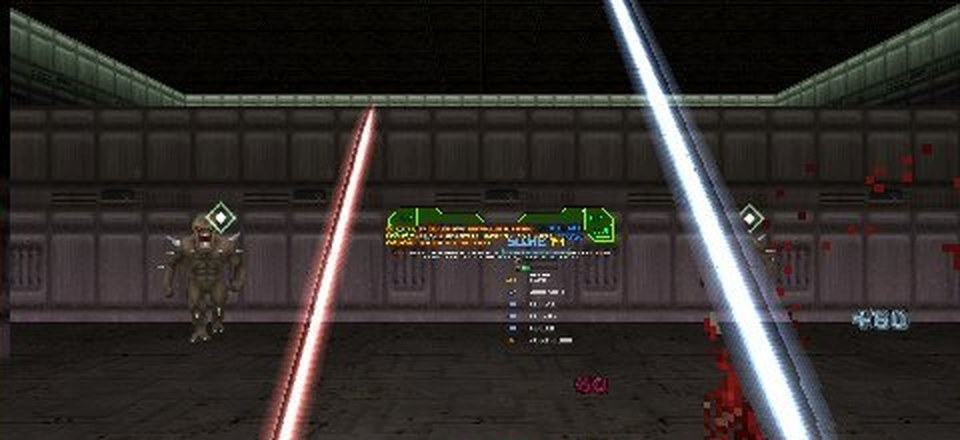

<b><a href="ShieldSaw/README.md">RSQ ShieldSaw: the full page &rarr;</a></b> &nbsp;&middot;&nbsp; <a href="#contents">contents &uarr;</a>

A bullwhip you hold as a weapon in slot 1. Its thong is simulated: it hangs coiled from the handle and follows your
hand. It has two moves, both made with the whip hand and no button. The Wide Swing: a wide level arc hits every monster
in the 120 degrees in front of the swing and pushes it away. The Ground Crack: flick the whip hand hard down, the thong
hits the floor, and the impact throws nearby monsters into the air. Each move that reaches a monster asks RSQ SlowMo
for a moment of slow motion.

<b><a href="Whip/README.md">RSQ Whip: the full page &rarr;</a></b> &nbsp;&middot;&nbsp; <a href="#contents">contents &uarr;</a>

<a href="FlashFlare/README.md">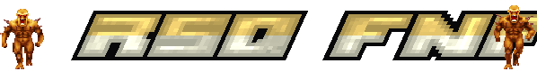</a>

A road flare and a flashlight you take off your own body with the off hand's grip. The flare is lit by a flick down or
the trigger, held up for light, and thrown with a swing; it burns for a minute wherever it lies, and with Brutal Doom
a flare thrown into a small monster sets it burning. The flashlight hangs on a clip, switches with the trigger and runs
on a battery that drains while it is on and refills while it is off.

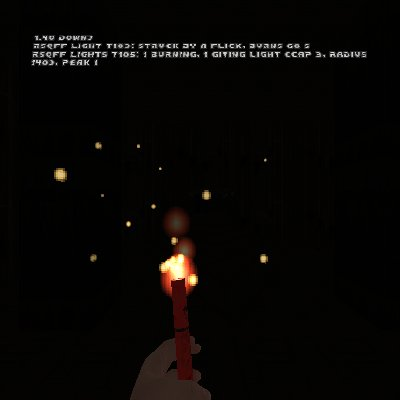 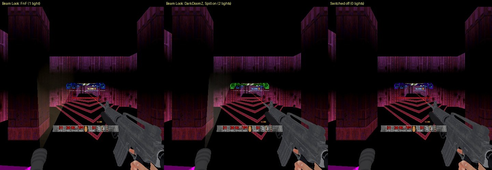

<b><a href="FlashFlare/README.md">RSQ FnF: the full page &rarr;</a></b> &nbsp;&middot;&nbsp; <a href="#contents">contents &uarr;</a>

<a href="GlowInTheDark/README.md">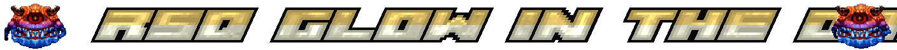</a>

Every room's walls glow in colour, from the floor up and the ceiling down; liquids glow and breathe in their own
colours; switches, exits and locked doors are lit so you can find them, a locked door in its key's colour. The map is
darker (DarkDoomZ is built in), and the glow answers what happens: a Boss, slow motion, a kill chain, a level up. Pick
Classic (1.1) or one of 34 named looks, or shuffle them from the menu.

<b><a href="GlowInTheDark/README.md">RSQ Glow In The Dark: the full page &rarr;</a></b> &nbsp;&middot;&nbsp; <a href="#contents">contents &uarr;</a>

<a href="Miniboss/README.md">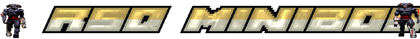</a>

A Boss fight you earn and call in (the menu calls the mod RSQ Boss). Killing, chaining kills and moving through the
map fill the Boss meter. When it is full, turn the inside of your off-hand wrist to your eyes and press Use on the gold
Start Fight card, or wait, and a Boss lands with its thralls around you. While its thralls live the Boss takes only
part of each blow. Beat it for a world tier step, a Score life crate and a kiosk: up to three legendary offers for the
guns you carry, bought with Score gold. Four Boss fights fill the Big Boss bar, and a Big Boss comes alone.

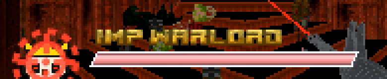

<b><a href="Miniboss/README.md">RSQ Miniboss: the full page &rarr;</a></b> &nbsp;&middot;&nbsp; <a href="#contents">contents &uarr;</a>

...Monsters. Every monster stands on one ladder of thirteen colours, numbered by strength: Common, Green, Blue, Purple,
Cyan, Brown, Yellow, FireBlu, Gray, Red, Abyss, and the two boss colours, Black and White. One setting, the Monster
Tier, moves the whole map at once, and a Boss beaten in RSQ Miniboss raises it. When a monster changes tier you see it
coming: it flashes, full bright, in the colour it is becoming, then it is something worse. Brutal Doom's and XMVE's
monsters keep their own bodies and take each colour's numbers and power (Green's acid, Cyan's ice, Brown's healing,
Red's rage, Abyss's phasing) and its painted colour art where a frame is painted; or play Colourful Hell's 219 monsters,
with their Black and White bosses and 16 EX bosses. Sooner or later one of them gets you, and when it does...

 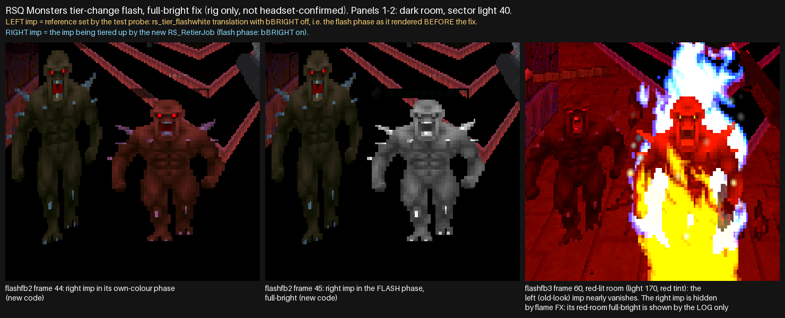

<b><a href="Monsters/README.md">RSQ Monsters: the full page &rarr;</a></b> &nbsp;&middot;&nbsp; <a href="#contents">contents &uarr;</a>

...a gravestone stands where you fell, the next time that map comes up, with a small candle light. The stones are kept
between games; they pop up and breathe. Press Use on a stone to read who died there and what killed
them. A Score life spent leaves a gold stone. With Legion of Bones loaded, a dead monster can get up again as its
undead.

|  |  |  |
|---|---|---|
| **Your stones, next time** | **Who lies there** | **A gold stone** |

<b><a href="Graveyard/README.md">RSQ Graveyard: the full page &rarr;</a></b> &nbsp;&middot;&nbsp; <a href="#contents">contents &uarr;</a>

Score turns every kill into points and names how you made it. It is several systems in one: base points and bonus rows
in five families under the score line; named combos for the right moves in order on one monster; Score lives from a full
reward bar, which catch a killing hit (you are held at 1 health, set to full, and a blast goes off round you); head shots
and critical shots that double a hit; the gold bank the Boss kiosk spends; and the Glossary of every row, which is also
How To Play's SCORE tab.

<b><a href="Score/README.md">RSQ Score: the full page &rarr;</a></b> &nbsp;&middot;&nbsp; <a href="#contents">contents &uarr;</a>

<a href="LaserSight/README.md">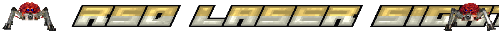</a>

A laser on the gun in each hand: a beam from the muzzle along the barrel, and a dot where it lands. It only draws: it
changes no shot, no damage and no aim. The dot lies flat on what it touches and grows on a live monster. Fire a
grenade launcher once and its beam bends along the path the shot will fly. Check your watch and a laser goes off on a
gun you are not aiming where you look.

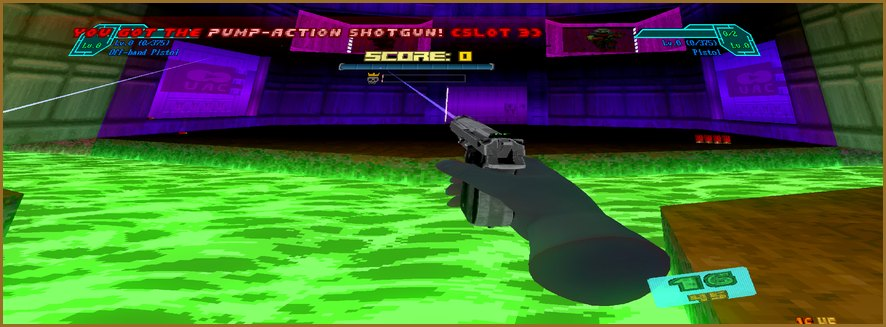 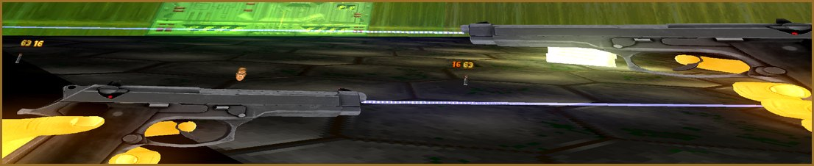

<b><a href="LaserSight/README.md">RSQ Laser Sight: the full page &rarr;</a></b> &nbsp;&middot;&nbsp; <a href="#contents">contents &uarr;</a>

<a href="Controls/README.md"><b>RSQ Controls</b></a>

RSQ_Controls.pk3 sets the buttons and holds How To Play. The first time it loads, a screen offers RSQoopaControls, the
owner's controller layout (below, under Keys): Yes sets every button and turns natural crouch on, No changes nothing,
and it does not ask again. Yes saves your own buttons first: **Options > Radiant Silvergun Options > Controls** shows
which set is on (RSQoopaControls or My Own) and switches between them, both ways, as often as you like. Its How To
Play page (F1, or the first row of Radiant Silvergun Options) opens on a CONTROLS tab that shows the whole layout, then
a BODY tab, then a tab for every series mod you loaded.

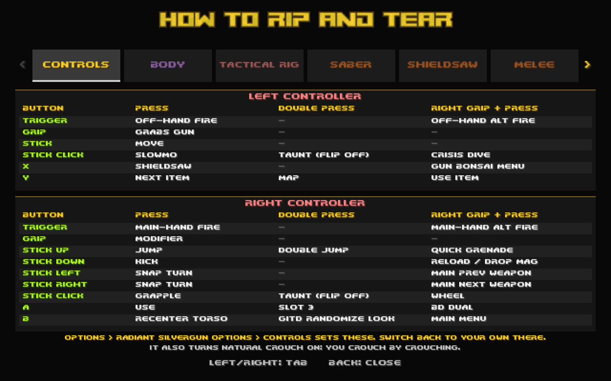 Radiant Silvergun Options > Controls sets these, switch back to your own there" width="880">

<b><a href="Controls/README.md">RSQ Controls: the full page &rarr;</a></b> &nbsp;&middot;&nbsp; <a href="#contents">contents &uarr;</a>

Keybinds are a precious resource in VR (the owner, 2026-11-10). Most of the series has no keys: you do it with your
hands, the trigger, alt fire and the grip, and anything that can be switched on or off is a row on the mod's page.
One RSQ key has a default bind: the Wheel's Open Wheel, on LThumb (its own `defaultbind`, `Wheel/KEYCONF:35`).
**RSQ_Controls.pk3 sets the buttons:** **RSQoopaControls**, the owner's layout, every button at once and natural crouch
on. It asks once, the first time it loads; after that, **Options > Radiant Silvergun Options > Controls**
(one press, then Yes). Your own controls are saved the moment you switch to RSQoopaControls, and the same row switches
back to them (**Controls: My Own**), from the menu, as often as you like. In RSQoopaControls, Open Wheel is right grip + right stick click. The same table is in the game: How To Play's CONTROLS
tab. Any key can still be bound by hand in **Options > Customize Controls**.

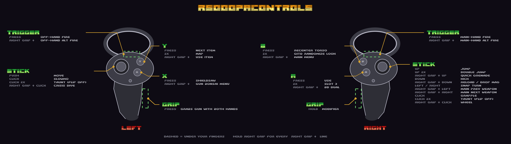

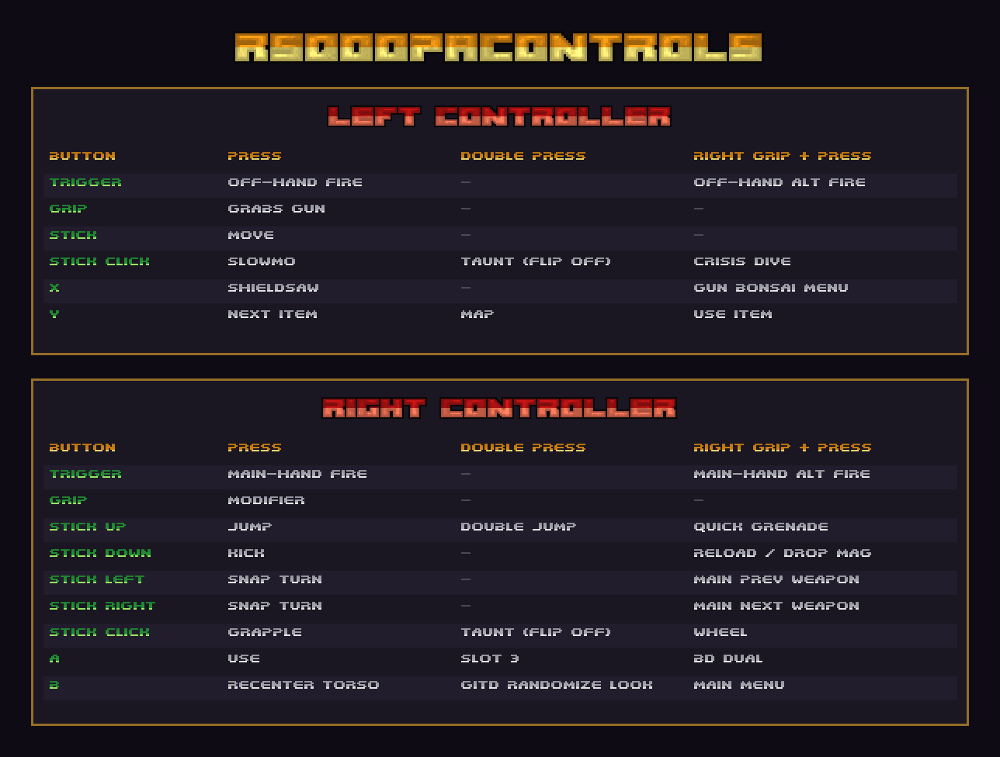

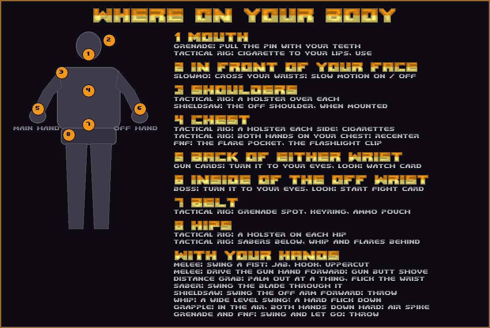

RSQoopaControls as text: every line of `design/controls/rsq_standard_controls.ini`
(**Options > Radiant Silvergun Options > Controls** writes them; where each command comes from:
`design/controls/CONTROLS.md`). Each cell: what it does, the command, the key QuestZDoom sends. Right grip + press:
hold the right grip (the modifier) and press. A double press runs the single press first. A dash: nothing there.

**Left hand (off hand)**

| Button | Press | Double press | Right grip + press |
|---|---|---|---|
| trigger | offhand fire: `+oh_attack` (Shift) | - | offhand alt fire: `+oh_altatk` (Alt) |
| grip | - (RThumb). It still steadies a gun with both hands; the mods still read it as the off grip | - (RThumb) | - |
| stick up / down | `+forward` (Axis2Plus) / `+back` (Axis2Minus) | - | - |
| stick left / right | strafe: `+moveleft` (Axis1Minus) / `+moveright` (Axis1Plus) | - | - |
| stick click | Slowmo: `rsqsm_toggle` (Space) | taunt (Brutal Doom's Offend): `brutaltaunt` (Space) | Crisis Dive: `rsqsm_dodge` (Home) |
| pad x | ShieldSaw toggle: `ssq_draw` (Pad_X) | - | Gun Bonsai menu: `netevent bonsai-show-info` (PgDn) |
| pad y | next item: `invnext` (Pad_Y) | map: `togglemap` (Pad_Y) | use item: `invuse` (PgUp) |

**Right hand (main hand)**

| Button | Press | Double press | Right grip + press |
|---|---|---|---|
| trigger | mainhand fire: `+attack` (RTrigger) | - | mainhand alt fire: `+altattack` (LTrigger) |
| grip | THE MODIFIER: sends no key of its own | - | - |
| stick up | jump: `+jump` (MWheelUp) | double jump: no line; the second press is `+jump` again, RSQ Grapple's double jump | quick grenade (BD or RSQ): `+user1` (Axis8Plus) |
| stick down | kick: `+zoom` (MWheelDown) | - | reload both guns / drop mag (one gun): `+reload` (Axis8Minus) |
| stick left / right | snap turn: QuestZDoom does it from the stick, not a bind | - | mainhand prev weapon: `weapprev` (Axis7Minus) / mainhand next weapon: `weapnext` (Axis7Plus) |
| pad a | use: `+use` (Pad_A) | slot 3: `slot 3` (Pad_A) | BD Dual: `+user3` (LThumb) |
| pad b | Recenter Torso: `rsqtr_recenter` (Pad_B) | Randomize Look (RSQ Glow In The Dark): `netevent rsqgd_randomize` (Pad_B) | Main Menu: `menu_main` (Backspace) |
| stick click | fire grapple: `+rsqgr_hook` (Enter) | taunt (Brutal Doom's Offend): `brutaltaunt` (Enter) | Open Wheel: `+wr_wheel` (Tab) |

Natural crouch is turned on (`vr_crouch_use_button=false`, the ini's `[CVars]`): you crouch by crouching.

The taunt, either stick clicked twice: Brutal Doom's Offend (`brutaltaunt`): the middle finger, a voice taunt, and every
monster that hears it is alerted; it plays in the main hand. The second click runs it instead of the single click's
command, so SlowMo stays on and the grapple hook stays out (taunt in slow motion, or on the way in on the hook).

Every key is on its mod's page and in Customize Controls. The two RSQoopaControls pictures are made by
`design/readme_art/make_controls_table.py` and `make_controls_quest2.py` from the ini; the body picture by
`design/readme_art/make_keys_art.py`.

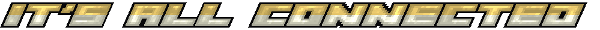

Every pk3 loads and plays alone. Load them together and they find each other by name and ask each other for things.
One string for each mod that asks another mod's service, counted from the code: 117 strings between 20 mods.

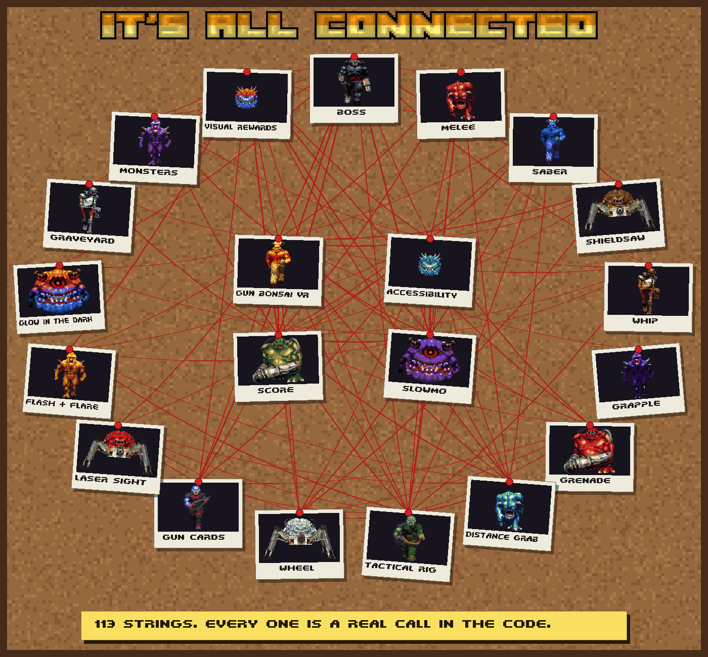

*How to read it: a string from A to B means A's code names a service B declares and asks it for something (counted by
`design/readme_art/mod_web_edges.py`). The options-menu code every mod shares is left out, and so is RSQ Monsters' own
code: its strings are the ones the other mods' code names. Network events and names read off other mods aren't
counted, so there is more talking than this. Each mod's README says what each conversation is about under Works with.*

Load these in this order. This is the owner's load order, and the one the rig tests run on:

| # | File | What it is |
|---|---|---|
| 1 | doom2.wad | Doom II, the IWAD |
| 2 | brutal22test6.pk3 | Brutal Doom 22 (Sergeant Mark IV) |
| 3 | BD_VoxelPack.pk3 | Brutal Doom's voxel pack |
| 4 | BD22 VR Reloaded | the owner's VR weapons for Brutal Doom 22 (hands on every gun, reloads by hand); its own page has the current file |
| 5 | LOB_v1.05.pk3 | Legion of Bones (SpacemanStrife) |
| 6 | GunBonsai-0.10.6.pk3 | Gun Bonsai (ToxicFrog) |
| 7 | the RSQ pk3s below | any order among themselves |

Only the IWAD is needed by everything. Lines 2 to 6 are what the series is tested with: each RSQ mod finds them by name
and uses them when they are there. Gun Bonsai is needed by one pk3 (RSQ_GunBonsaiVR, below). Legion of Bones goes after
Brutal Doom and before the RSQ pk3s (RSQ Graveyards' readme explains why). The owner's full order also carries
LegenDoom 3.0 (BD22 VR Reloaded's page says where it goes), XMVE and other mods. Mikk-'s Champions and a LegenDoom Lite
are built into RSQ Miniboss.

To install: take the pk3s you want from [pk3/](pk3/), put them with your other QuestZDoom mods, and add them to your
load order after Gun Bonsai. Take one or take them all. Plain Doom II with RSQ pk3s and nothing else works too. Take
RSQ_Controls.pk3 with them: it sets the buttons and it is the only one that has How To Play.

**Take these out of an old load order.** They are old names of pk3s in this list, and two copies of one mod do not
load together: UltraBadassQuestSaber.pk3 (now RSQ_Saber), UltraBadassShieldSaw.pk3 (now RSQ_ShieldSaw),
RSQ_TopHPBars.pk3 and RSQ_HPBars.pk3 (now RSQ_VisualRewards), Gameplay_GB_VR_Offhand_Patch.0.10.6.pk3 (now
RSQ_GunBonsaiVR). Do not load darkdoomz.pk3 with RSQ_GlowInTheDark either: DarkDoomZ is built in.

**The engine's sprite-frame cap.** QuestZDoom 17.3 counts sprite frames in 16 bits, so the whole load order has to stay
under 65,535. Past the cap, sprites share frame slots and draw the wrong picture. On 2026-11-12 the owner's full order
read 71,572; RSQ Laser Sight's PC VR halo (7,344 frames) was removed for it, and the order read 64,228. Anything baked
from here is counted first. It is the likely cause of the rogue voxels and the Imp that vanishes before it throws,
seen in the owner's headset on 11-12; not headset-confirmed.

### The pk3s

What `tools/build_all.py` builds, each in [pk3/](pk3/).

**Controls**

| pk3 | What it does |
|---|---|
| RSQ_Controls.pk3 | Sets the buttons: offers RSQoopaControls, the owner's controller layout, the first time it loads and from Radiant Silvergun Options, and switches back to your own controls there. Holds How To Play for every series mod, with the layout on its CONTROLS tab. |

**Body**

| pk3 | What it does |
|---|---|
| RSQ_TacticalRig.pk3 | Your guns on your body: six holsters on hips, chest and shoulders, a grenade spot, a keyring and an ammo pouch on the belt, spots for the saber, the whip and the flare, and cigarettes in a chest pocket. |

**Hands**

| pk3 | What it does |
|---|---|
| RSQ_Saber.pk3 | A lightsaber in each hand: cut, block shots and bullets, lock on and throw it. The Force on alt fire: Push, Pull, Grip, a Force jump. |
| RSQ_ShieldSaw.pk3 | A shield with a saw in its rim, in the off hand: block, bash, rev, ring targets and throw it round the room. One key draws it and calls it home. |
| RSQ_Melee.pk3 | Fighting with your body: jabs, hooks and uppercuts, fists that knock shots away, the gun-butt shove, the Headlock, and barrels sent at the monster your trigger paints. |
| RSQ_Whip.pk3 | A bullwhip with two moves: a Wide Swing and a Ground Crack. |
| RSQ_Grenade.pk3 | A hand grenade: pull the pin, cook it, throw it with your arm. Nine types. Also the series' barrels and explosions. |
| RSQ_FnF.pk3 | Flash and Flare: a road flare you strike and throw by hand, and a flashlight on a clip. |

**Reach**

| pk3 | What it does |
|---|---|
| RSQ_Grapple.pk3 | A hook from the off hand on one key: walls and ledges carry you, monsters pull you in for a kick, then the air spike. No rope. |
| RSQ_DistanceGrab.pk3 | Palm out at a thing across the room, flick your wrist, and it flies to your hand. Carry it, swing it, throw it. Lift doors by hand. |
| RSQ_LaserSight.pk3 | A beam out of the gun's muzzle in each hand, and a dot where it lands. It bends into the grenade launcher's arc. |

**Game**

| pk3 | What it does |
|---|---|
| RSQ_SlowMo.pk3 | The world slows, you don't: an adrenaline meter, rounds you can see and dodge, a Crisis Dive, and Be Quick or Be Dead. Other mods slow the world through it. |
| RSQ_Score.pk3 | Points for every kill and bonus rows for how you made it, Score lives that catch a killing hit, head shots, the gold bank and the Glossary. Built on ijon's Dakka scoring. |
| RSQ_Miniboss.pk3 | The Boss fight you earn and call in from the Start Fight card, its thralls, the world tier step, the kiosk and the Big Boss. Champions and LegenDoom Lite built in. Built on Tartlman's Minibosses!. |
| RSQ_VisualRewards.pk3 | Health bars, damage numbers, kill bits, banners, toasts, words over monsters, reward words in the world and the arrival beams. |
| RSQ_GunCards.pk3 | The small card beside each wrist, the watch card when you look at your wrist, and Weapon Condition (off by default). |
| RSQ_Wheel.pk3 | A ring of weapon cards in front of your hand, with a data sheet; with RSQ Tactical Rig, the holster assignment. |
| RSQ_GlowInTheDark.pk3 | Coloured light up every wall, liquids that breathe, lit switches, exits and locked doors, and DarkDoomZ's darkness built in. |
| RSQ_GunBonsaiVR.pk3 | Gun Bonsai for two hands: each hand's weapon earns its own XP, with its own gauge and screens. |
| RSQ_Monsters.pk3 | The owner's RS Monsters, Quest edition: one thirteen-colour ladder, numbered by strength, for Brutal Doom's, XMVE's or Colourful Hell's monsters. The Monster Tier moves the whole map; a monster flashes in its new colour before it changes. |
| RSQ_Graveyard.pk3 | m8f's Graveyards, RSQ Edition: a gravestone stands where you died the next time you play the map. A spent Score life leaves a gold one. |
| RSQ_PlayLog.pk3 | A recorder for tuning: with Record Play Log on it writes each map, swing, kill, hit and death to the console. It changes nothing in the game. |

**Also in [pk3/](pk3/):** **`RSQ_BDXMTiers_<Colour>.pk3`**, twelve of them, one per colour: the painted colour art for
Brutal Doom's and XMVE's monsters on the colour ladder, loaded after RSQ Monsters (RSQ Monsters' README).

### The weapon sets

Two more VR weapon sets live in [weaponsets/](weaponsets/). Each is one pk3 that stands alone on Doom II with your own
monsters and maps, and picks up the Series mods it knows when they are loaded. Load only one weapon mod.

| pk3 | What it is |
|---|---|
| [GNRC_Reloaded_0.8.pk3](weaponsets/GNRC_Reloaded/) | **GNRC Reloaded VR 0.8:** Led's Generic Weapon Mod rebuilt for VR. Doom's ten weapons in your hands, reloaded by hand (magazines, a pump, a break-open double barrel), dual wield, 3D guns. Vanilla+. |
| [WoS_Reloaded_0.8.pk3](weaponsets/WoS_Reloaded/) | **Weapons of Saturn Reloaded 0.8:** Lippeth's Weapons of Saturn rebuilt for VR. Twelve guns you hold, reload by hand and fire from the muzzle you see; between vanilla Doom and Brutal Doom. |

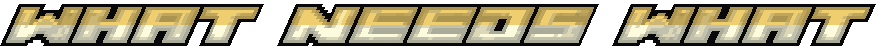

**Needs another pk3 to load:** only **RSQ_GunBonsaiVR**. It needs Gun Bonsai 0.10.6 loaded before it (it replaces some
of Gun Bonsai's files by path).

Every other pk3 loads and plays alone. The mods find each other by name and add features when the other one is there.
Without it, nothing happens and nothing breaks.

**Features that only work with another mod**, from each mod's README:

| Feature | In | Needs |
|---|---|---|
| The holster assignment screen | RSQ Wheel | RSQ Tactical Rig |
| The ShieldSaw mounted on the off shoulder | RSQ ShieldSaw | RSQ Tactical Rig and RSQ Wheel |
| The saber, whip and flare spots on the body | RSQ Tactical Rig | RSQ Saber, RSQ Whip, RSQ FnF |
| Slow motion after a shove, a launched barrel, a kick, a Wide Swing or Ground Crack, a parry, a cigarette; the Wheel's Slow | RSQ Melee, Grapple, Whip, Saber, Tactical Rig, Wheel | RSQ SlowMo |
| Words over monsters (POW!, KICK!, AMMO FULL), toasts and banners | RSQ Melee, Grapple, Distance Grab, Miniboss, Score and others | RSQ VisualRewards |
| The air spike's explosion | RSQ Grapple | RSQ Grenade |
| A barrel thrown from the hand flies as Melee's launch | RSQ Distance Grab | RSQ Melee |
| The pistol whip, the butt strike and the VR punch, done by Melee | RSQ Melee | BD22 VR Reloaded 2.0.4u or later |
| A gun's level, XP and upgrades on the data sheet and the watch card | RSQ Wheel, RSQ Gun Cards (Gun Bonsai on Card) | RSQ Gun Bonsai VR |
| GOLD on the off hand's watch card; gold bits | RSQ Gun Cards, RSQ VisualRewards | RSQ Score |
| The Boss kiosk | RSQ Miniboss | BD22 VR Reloaded with LegenDoom, and RSQ Score |
| The kiosk's REPAIR; steel bits | RSQ Miniboss, RSQ VisualRewards | RSQ Gun Cards with Weapon Condition on |
| The world tier stepping with Boss wins and losses | RSQ Miniboss | RSQ Monsters |
| Graves Rise | RSQ Miniboss | RSQ Graveyard and Legion of Bones |
| The Bones Bridge | RSQ Graveyard | Legion of Bones |
| Gold stones | RSQ Graveyard | RSQ Score |
| The obituary as words over the stone (else the console) | RSQ Graveyard | RSQ VisualRewards |
| The big moments (a Boss, slow motion, a kill chain, a level up) | RSQ Glow In The Dark | RSQ Miniboss, RSQ SlowMo, RSQ Score, RSQ Gun Bonsai VR (or Gun Bonsai) |
| Bones Drop Battery Bits | RSQ FnF | Legion of Bones and RSQ VisualRewards |
| How To Play (its tabs for every series mod you loaded) | every series mod | RSQ Controls |

**Steps aside for another mod**, by name in the code:

- RSQ Grenade takes the place of BD22 VR Reloaded's own grenade (Replace BD Grenade, on). Turn it off and RSQ Grenade stands down for it.
- RSQ Melee does BD22 VR Reloaded's butt strike, pistol whip and VR punch from 2.0.4u on; with an older BD22 VR Reloaded, Melee's gun-butt shove stands down and that pack keeps its own strike.
- RSQ SlowMo stands down for another slow-motion mod (Bullet Time X, RS_SlowMo) unless Yield to Other Mods is off.
- RSQ Laser Sight holds QuestZDoom's own laser sight (m8f's) off while it is on, so only one laser shows.
- RSQ VisualRewards takes over from coldcite's Top HP Bars when both are loaded.
- RSQ Miniboss's LegenDoom Lite stands down while LegenDoom is loaded.
- RSQ Score's own critical shots do nothing while Critical Shots (mk-crits) or RandomCrits is loaded.

Each mod's own README has its full "Works with" list.

Every series pk3 adds its page to one shared menu: **Options > Radiant Silvergun Options**. Options shows that row
once, however many series pk3s you load, in any order. Inside, each loaded mod has one row; a mod you did not load adds
no row. With RSQ_Controls.pk3 loaded, the first two rows are its own: How To Play, and Controls (RSQoopaControls / My Own). Each mod's front page holds its settings, with the rarely needed ones on one Test and Debug page, and a Reset
All at the foot. Each mod's README lists every option with its default.

Every mod's README on this page but RSQ Monsters' was written again from its code on 2026-11-27. Each row of How to play is
tied to a file and line in the mod's `docs/README_SOURCES.md`. That is a read of the code, not a game played in the
headset.

The changes made that day are not yet played in the headset: the Whip's two moves, the Grapple's air spike, the
ShieldSaw's controls, the wrist cards that show when you look at your wrist, Score's rows, the Boss called only from
the Start Fight card, the Wheel's controls. Possible bugs each reader found are in the mod's
`docs/FINDINGS_2026-11-27.md`, as questions for the owner.

The plan for 2.0 is in `design/PLANNED_PROJECTS.md`.

Every folder's CREDITS file, gathered. Each mod's own CREDITS and README say exactly which file is whose.

**The DoomVR lineage.** This series stands at the end of a long line of people who put Doom in a headset:
- **biospud:** GZ3Doom, GZDoom on the Oculus Rift, later ViveDoom.
- **Fishbiter:** forked it as OpenVRDoom and added motion controls.
- **hh79 (hari):** carried that desktop fork forward through newer GZDoom versions (3.5, 4.1, 4.3 as gzdoomvr), with fixes
  backported from QuestZDoom.
- **Team Beef (DrBeef):** QuestZDoom, Doom on the standalone Quest.
- **Emawind84:** continued QuestZDoom, bringing it up to GZDoom 4.11 and on to 17.3, the engine this series targets.
- **Ermac:** DoomXR, from Emawind84's fork.
- **presidentkoopa:** moved DoomXR onto UZDoom 5.0, now his own engine, REMA, which this series will move to after 2.0.

**The series:** presidentkoopa: the design, the direction of every change, his headset testing, and his own libraries
and mods the series draws on (RS Combat FX, RS Ballistics, RS_WorldHands, RS_Gestures, RS_SlowMo, RS_Score, RS_Holsters,
RS_VRBody, RS_WeaponSelectionSystem, RS Monsters, SuperPunchOut, Glow In The Dark 1.1, BD22 VR Reloaded). The code is
ZScript written for the series.

**The engine:** QuestZDoom 17.3 by Emawind and Team Beef: the engine, its off-hand weapon and its hand-pose script API.

**Where the owner's gathered art and sounds come from** (the owner, 2026-11-10: "thats all i remember for now"; which
file came from which game is not recorded):

- Melee sprites: Street Fighter II (Capcom).
- Explosion sprites and sounds: Gunstar Heroes (Treasure / Sega), Top Gear 2 (Genesis), Castlevania: Bloodlines
  (Konami), Streets of Rage 2 (Sega).
- Explosion sprites: Mega Man X3 (Capcom), Metal Slug X (SNK), Castlevania: Symphony of the Night (Konami), Dark Wizard
  (Sega), The King of Dragons (Capcom).
- The Be Quick or Be Dead (DOWN) music and the miniboss music: Phantasy Star IV (Sega).
- The DOWN bar and the chevrons: Kirby Mass Attack (HAL Laboratory / Nintendo).

**Other people's work, by mod:**

- **Distance Grab:** presidentkoopa's RS_WorldHands (the pull, tumble, gravity and sag); Doom's own sounds. Ideas only:
  QuestZDoom's bundled laser sight, DXR's debug cone.
- **FnF:** the flare model is the owner's; the hands are BD22 VR Reloaded's FBX hand. saegiru's Emergency Flare (UDV
  Survival Flares, in JohnnyDoom's UAC Survival Pack): box and flare sprites and the three flare sounds. DooMAD's ammo
  box voxel from BD_VoxelPack (its voxel authors: Ghostpilot, DooMAD, Monfriez, DooMGoaT, Exl, Scott_AW, ReaperMan, 4mer,
  phi108, Conrad RDW, Voxelbro, zedas). The battery after Ermac's VR-Flashlight (base: SuaveSteve's Steve's Flashlight).
  The DarkDoomZ beam style: an altered rewrite of DarkDoomZ (Caligari87, zlib).
- **Glow In The Dark:** presidentkoopa's Glow In The Dark 1.1 (wall glow after ColorfulMaps by Solid_Head and NightFright's
  Lite; liquids after Finder153's GlowingLiquids). More Lights by Jakie (SnakieJakie): its glowing-flat list.
  DarkDoomZ by Sterling Parker (Caligari87), zlib, built in as an altered version; its credits: Josh771's Dark Doom
  (inspiration), Kinsie, Gutawer, FishyClockwork, phantombeta, Marisa Kirisame, Accensus, mshahen (sound, not shipped),
  testers Fort of Hard Knox, a1337spy, Orange Bomb.
- **Grapple:** jpalomo's jp_grapple, the hookshot it is rebuilt from: its feel (the claw's flight, the wall thrust,
  number for number), its claw and chain art and its sounds. Doom II's flame, read from the IWAD.
- **Champions:** by Mikk- (ZDoom forums, "[v2.9.1] CHAMPIONS", forum.zdoom.org/viewtopic.php?t=60456), built into RSQ
  Miniboss since 2026-11-23; its own art credits are in RSQ Miniboss's CREDITS.txt. RSQ Score and Visual Rewards read
  its champions and icons by name.
- **Graveyards:** m8f's Graveyards (GPLv3), RSQ Edition by presidentkoopa; tombstone graphics by Captain J (minor edits by
  m8f). Legion of Bones (SpacemanStrife) is used by name only.
- **Grenade:** JohnnyDoom's UAC Survival Pack (its grenade: original by Froon, Brutal Doom version by Saegiru, sprites by
  Pa1nki113r): sounds, sprites, the explosion and its ammo rules. The grenade model by Gomuz. The handling from the
  owner's BD22 VR Reloaded and RS_Grenade. Barrels and explosions: Reactorcore's Explosion Spriteanim Sheet Minipack
  (CC0, by a page comment only), Rufaswan's rips (sheet by Magma MK-II), one sheet from the owner's list above,
  Meatgrinder's blood burst (Sergeant Mark IV, via RS Monsters; licence not stated), End of Starchild (structure
  reference only); the owner's Kinetic explosion sounds.
- **Gun Bonsai VR:** Gun Bonsai © 2022 Rebecca "ToxicFrog" Kelly, MIT. `sprites/ui/hud.xcf` © 2022 Sungraphica. Sounds
  from SuperPunchOut (via Punch Out Doom by DerrickDavison and Virtual Punch Out) and the Super Punch-Out!! announcer.
  coldcite's Top HP Bars bar for the Berserk Meter; SoM's Kill Rewards; Mikk's Critical Shots (the idea only).
- **Gun Cards:** Ermac's Force Unleashed holo HUD (with the owner's blessing). JFO, the JDUI font by Zedas, in
  Blackmore1014's "JDUI Brutal Doom Ultimate Edition" edit. BD_VoxelPack's key voxels (keycards by Ghostpilot, skull keys
  by Voxelbro); Freedoom's status-bar keys (BSD).
- **Laser Sight:** inspired by m8f's Laser Sight (Alexander Kromm, GPLv3); nothing of it is used. The beams are measured
  from Brutal Doom Quest's gun models.
- **Melee:** SuperPunchOut (presidentkoopa): the gloves and the punch reader. The hand model and the boxing glove mesh
  by Ermac (Rusted Legacy, MIT; PunchOutVR / Virtual Punch Out) and BD22 VR's FBX hand. The punch sounds: the owner's,
  from Streets of Rage 2 (Sega). The star sound and the punch the Hadouken and the Guard use: Punch Out Doom
  (DerrickDavison); Punch-Out!! is Nintendo's. Brutal Doom's fist numbers (parsed, not shipped). BD22 VR Reloaded's
  butt strike, pistol whip and VR punch. Hit sparks: a community sheet ripped by shezzor. "VFX Hit Impact" by
  kiddolink (bought by the owner for the series).
- **Miniboss:** Tartlman's Minibosses! v0.1.1 (the origin; its effects' design). LegenDoom Lite, built in: Yholl,
  Kyle873, Marrub, Edward850, TerminusEst13 (its CREDITS.ldlite). Champions: above. Joshua Hard's Dynamic Enemy
  Reinforcements (MIT; the idea of spawning at the map's monster spots). coldcite's bar art. The tier gems and Champion
  icons are the series' own.
- **Monsters:** Colourful Hell by Hege Cactus, rebuilt in ZScript (and its CHP edition, whose author is still to be
  credited). The tier flash: presidentkoopa's Hackfraud tree. coldcite's bar pictures. The voxel models, brightmaps and
  decals: their makers are still to be credited.
- **Saber:** RS_Main combat FX sprites and the choke loop (Ermac: DXR, Rusted Legacy). BD22 VR Reloaded's FBX hand.
  danger_doughnut52's "Jedi Lightsaber (Star Wars)" pixel art. li-gnrcwpn's beep. The saber model is believed to be from
  Star Wars Jedi Outcast (Raven Software / LucasArts) and the saber sounds from a lightsaber soundfont library; their
  authors are not recorded.
- **Score:** the scoring design is ijon's (Dakka / Vanilla VR Dakka Points, WTFPL): the bonuses, the reward loop, the
  HUD and its graphics. The fonts by Blue Shadow (the score line) and Jimmy (the breakdown). The six score sounds are
  Painkiller's (People Can Fly), via Dakka. The revival rebuilt from Dakka's numbers; its flames are doom2.wad's
  Arch-vile fire.
- **ShieldSaw:** the shield saw is id Software's (Doom: The Dark Ages). Ermac's Rusted Legacy (MIT code): his two shield
  models, the hand model and the sounds. The owner's RS Combat FX and RS Ballistics.
- **SlowMo:** the owner's RS_SlowMo design and RS Ballistics' tracer and whiz sounds. coldcite's bar. RSQ Score's
  breakdown font (Jimmy) and JFO (Zedas, Blackmore1014). Kirby Mass Attack (above). Doom's own cues by name.
- **Tactical Rig:** Ermac's Virtual Tactical Vest (the idea, the cigarette, butt and smoke) and his ZBlood-VR Zippo.
  The marine torso and helmet: Doom Eternal's Classic Slayer (id Software), rips shared on Sketchfab. The Quake torso:
  Quake's Grunt, cut by Vittorio Romeo's Quake VR mod. Zippo and cigarette sounds from Pixabay (freesound_community).
- **VisualRewards:** coldcite's Top HP Bars 1.04 (based on Nash Muhandes' SpriteShadow, MIT). Xaser Acheron's damnums
  (MIT; contributions by Major Cooke, thanks to Marrub and Zombie). SoM's Universal(ish?) Kill Rewards. JFO and Ermac's
  digits. The Z-Fighter effects sheet (a rip, not cleared: its maker is still to be credited). RSQ Score's font (Blue
  Shadow). Arrival sounds supplied by the owner; the two music tracks from Phantasy Star IV.
- **Wheel:** presidentkoopa's RS_WeaponSelectionSystem. Ermac's Force Unleashed holo HUD art. LegenDoom 3.0's brass
  knuckles (Yholl and contributors). danger_doughnut52's lightsaber. JFO. RSQ Score's fonts. The IWAD's own art by lump
  name.
- **Whip:** Moses C. Nah and MIT Newman Lab's Whip Project (BSD 3-Clause): the thong's numbers. runevision's Eye of the
  Temple devlog (the first version's idea). The cracks and swishes from Pixabay. BD22 VR Reloaded's FBX hand.
