
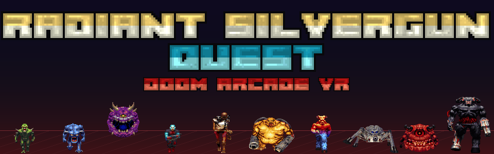

Intended to bring a sense of arcade-ness to Doom, RS leverages the strengths of a number of existing mods in tandem
with nearly two dozen modular aspects of itself. I have directed the development of a VR-first weapon set for Brutal
Doom 22 (testV6), and ordered it merged with LegenDoom 3.0, bringing 179 of its 180 effects into BD. Numerous
mechanics and abilities were designed and developed from the ground up, specifically to take advantage of what Doom
offers in VR.

<table>
<tr>
<td align="center" width="14%"><a href="#melee">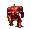 <b>Melee</b></a></td>
<td align="center" width="14%"><a href="#grapple">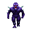 <b>Grapple</b></a></td>
<td align="center" width="14%"><a href="#distance-grab">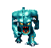 <b>Distance Grab</b></a></td>
<td align="center" width="14%"><a href="#grenade"> <b>Grenade</b></a></td>
<td align="center" width="14%"><a href="#tactical-rig">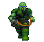 <b>Tactical Rig</b></a></td>
<td align="center" width="14%"><a href="#wheel">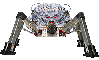 <b>Wheel</b></a></td>
<td align="center" width="14%"><a href="#slowmo">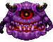 <b>SlowMo</b></a></td>
</tr>
<tr>
<td align="center" width="14%"><a href="#visual-rewards"> <b>Visual Rewards</b></a></td>
<td align="center" width="14%"><a href="#gun-cards">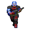 <b>Gun Cards</b></a></td>
<td align="center" width="14%"><a href="#gun-bonsai-vr">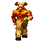 <b>Gun Bonsai VR</b></a></td>
<td align="center" width="14%"><a href="#saber">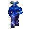 <b>Saber</b></a></td>
<td align="center" width="14%"><a href="#shieldsaw"> <b>ShieldSaw</b></a></td>
<td align="center" width="14%"><a href="#whip"> <b>Whip</b></a></td>
<td align="center" width="14%"><a href="#fnf"> <b>Flash and Flare</b></a></td>
</tr>
<tr>
<td align="center" width="14%"><a href="#glow-in-the-dark">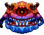 <b>Glow In The Dark</b></a></td>
<td align="center" width="14%"><a href="#miniboss"> <b>Miniboss</b></a></td>
<td align="center" width="14%"><a href="#monsters">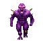 <b>Monsters</b></a></td>
<td align="center" width="14%"><a href="#graveyard"> <b>Graveyard</b></a></td>
<td align="center" width="14%"><a href="#score"> <b>Score</b></a></td>
<td align="center" width="14%"><a href="#laser-sight">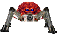 <b>Laser Sight</b></a></td>
<td align="center" width="14%"><a href="#accessibility">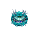 <b>Accessibility</b></a></td>
</tr>
</table>

<a href="#in-short"><b>In short</b></a> &middot; <a href="#its-all-connected">It's all connected</a> &middot; <a href="#where-it-stands">Where it stands</a> &middot; <a href="#load-order-and-install">Load order and install</a> &middot; <a href="#the-pk3s-list">The pk3s</a> &middot; <a href="#what-needs-what">What needs what</a> &middot; <a href="#keys">Keys</a> &middot; <a href="#radiant-silvergun-options">Options</a> &middot; <a href="#status">Status</a> &middot; <a href="#what-is-left-for-20">What is left for 2.0</a> &middot; <a href="#credits">Credits</a>

### What Doom Arcade is

**A reactive level rewards and punishes you for your performance.** All of Brutal Doom's monsters, as well as the
community-developed XMVE add-on, have been tiered in a way which allows them to present a larger or smaller challenge
depending on how you play.

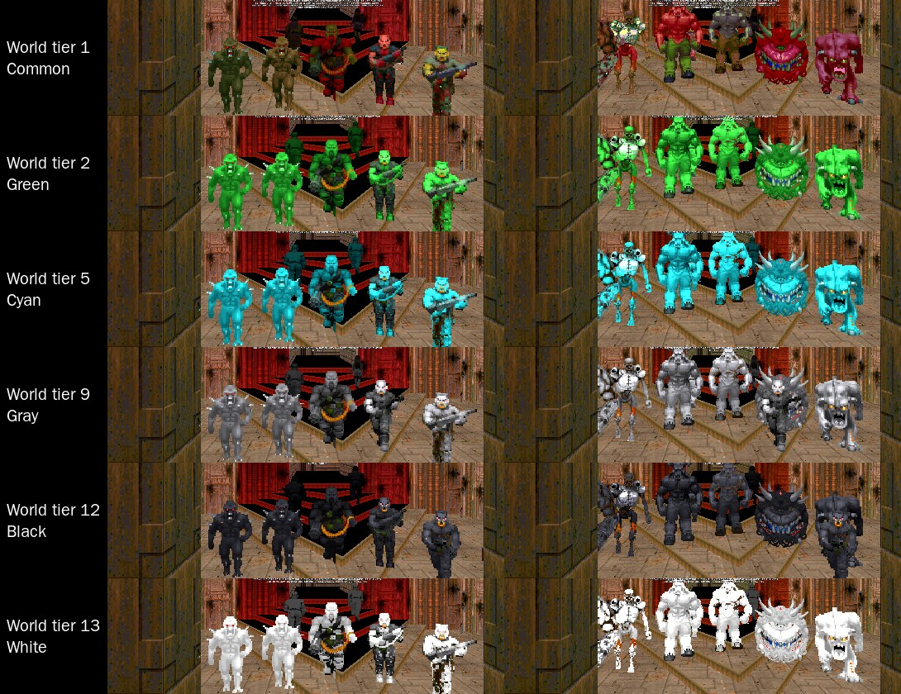

A carnage meter tracks your violence: **enough carnage calls in a Boss.** This multi-stage battle is supported by a
lives system, and provided you can **Be Quick or Be Dead**, you'll be able to stay on your feet.

| BOSS INCOMING! | DOWN | Back up |
|---|---|---|
| 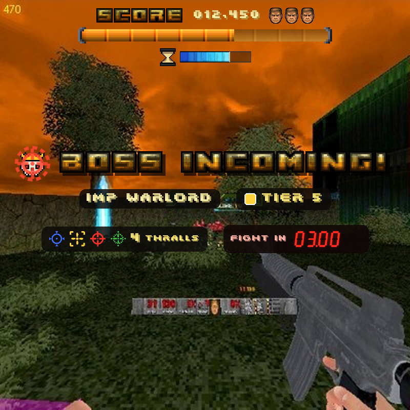 | 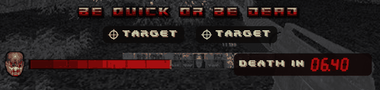 | 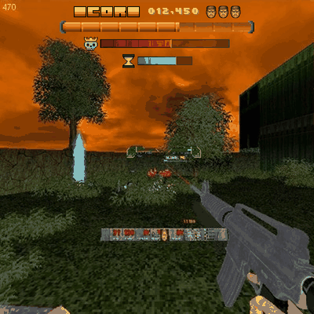 |

Defeated bosses increase the world challenge (dynamically re-tiering monsters up or down), and offer you a **Kiosk**
from which you can buy Legendary effects for your weapons, using gold you've picked up in the world from the monsters
you kill. Monsters drop health, armor, ammo and gold. Many of these mechanics are optional, including a weapon
degradation system using Condition and Repair.

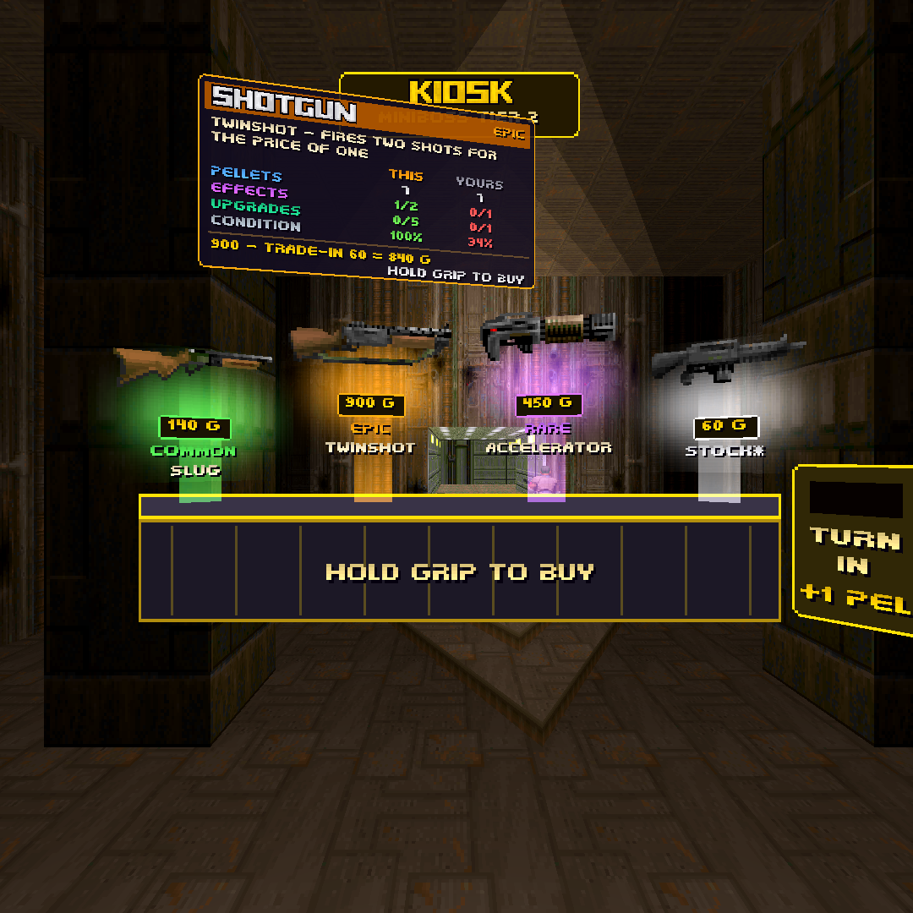 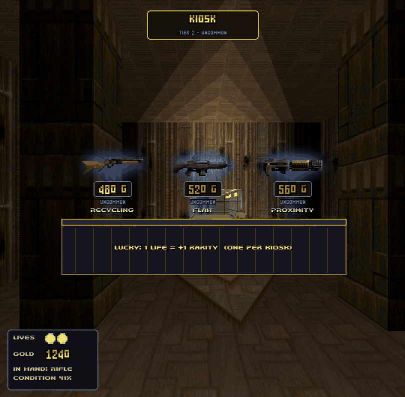

Your weapons level with damage done, unlocking various playstyles and abilities, while your skill and style award you
points for more lives and other bonuses.

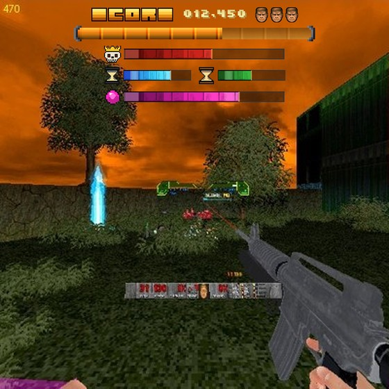 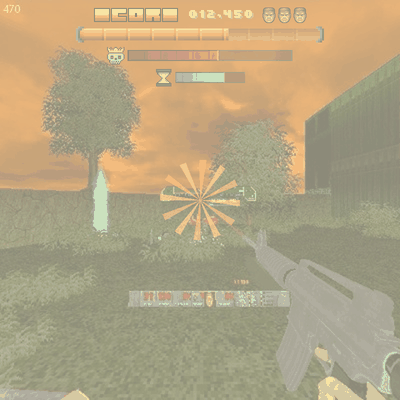

### The mods it brings together

Doom Arcade stands on other people's mods and ties them into one game: **Brutal Doom 22** (Sergeant Mark IV) and its
voxel pack, **BD22 VR Reloaded** (the VR-first weapon set for it), **LegenDoom 3.0** (legendary weapons and their
effects), **XMVE** (the community's extra Brutal Doom monsters), **Champions** (Mikk-), **Gun Bonsai** (ToxicFrog) and
**Legion of Bones** (SpacemanStrife), on **QuestZDoom 17.3**. On top of them sit the Series' own twenty-one mods. Each
one loads and plays alone, and each has a section below and a page of its own.

### VR first

Every one of them was designed for two tracked hands and a body in a room. From that standpoint, the Series gives you:

**Hands in the world.** Alyx-esque environmental interaction. Grab and lift doors. Hit switches with your game hand. Put out your hand,
highlight your target, and casually flick it back to you. Auto-equip weapons per hand. Throwable axes which you can
instantly grab and pull back to your hand. Pull barrels towards you and throw them out to the nearest enemy.

**Throwing.** A robust throwing system. Lock-on throwing axes, and a custom grenade with all-new explosion sounds and visuals
(for all explosions). Chain explosions for different visuals. Nearly 10 different grenade types, from bounce to impact
to freeze to charm.

**Melee.** We have a comprehensive melee system with hooks, jabs and uppercuts, all with visual, haptic and auditory feedback.
You can pistol whip enemies with one-handed weapons, shove an enemy away with the butt of your two-handed weapon
(trigger slow-mo and shoot with the shotgun for an homage to F.E.A.R.), or uppercut a barrel across the room into an
unsuspecting monster.

Grapple-hook yourself into a big heavy monster and fly to it with a slow-motion kick-off, double jump, hover in the
air, and hook another for a continuing combo. Grapple a light monster to you so you can channel your inner
"Get over here!" Scorpion moment while you beat its ass with hooks and jabs.

Axes, swords and chainsaws have animations unlocked, and damage is done where you actually swing (the real
downswing). Grab a monster and hold it while beating it in the face, or turn it around to act as a meat shield, thanks
to our...

<a href="Melee/README.md">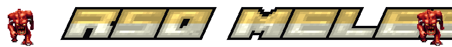</a>

...RSQ Melee. It tracks a real punch: the swing is the blow, and a light jab and a strong one are different punches
because you threw them differently, from 10 damage at the slowest that counts to 20 at full speed. Drive straight in
for a jab, swing across for a hook, rise into it for an uppercut, and the uppercut changes the fight: the monster
leaves the floor, and a barrel flies at the nearest monster while the world slows to watch. Open your hand and you
slap a fireball out of the air. Thrust your gun forward and the stock lands, time slows, and a shotgun finishes it in
a red mist. Squeeze your off hand beside a monster and it is stuck there, facing you, while your other fist works it
over; then throw it across the room.

The previews play here without sound; **click one to play the clip with sound.**

|  | [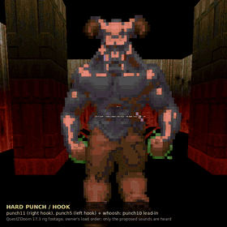](https://cdn.jsdelivr.net/gh/presidentkoopa/RSQ_UBQSeries@main/design/media/sounds/hook.mp4) | [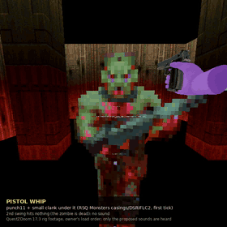](https://cdn.jsdelivr.net/gh/presidentkoopa/RSQ_UBQSeries@main/design/media/sounds/pistol_whip.mp4) |
|---|---|---|
| **Jab** | **Hook** | **Pistol whip** |
| [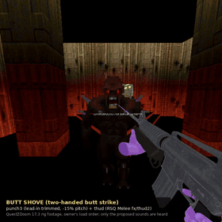](https://cdn.jsdelivr.net/gh/presidentkoopa/RSQ_UBQSeries@main/design/media/sounds/butt_shove.mp4) | [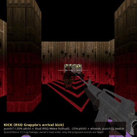](https://cdn.jsdelivr.net/gh/presidentkoopa/RSQ_UBQSeries@main/design/media/sounds/kick.mp4) | [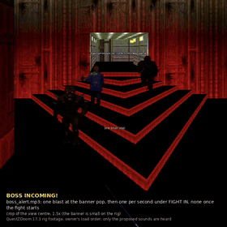](https://cdn.jsdelivr.net/gh/presidentkoopa/RSQ_UBQSeries@main/design/media/sounds/boss_incoming.mp4) |
| **Gun-butt shove** | **Kick** | **BOSS INCOMING!** |

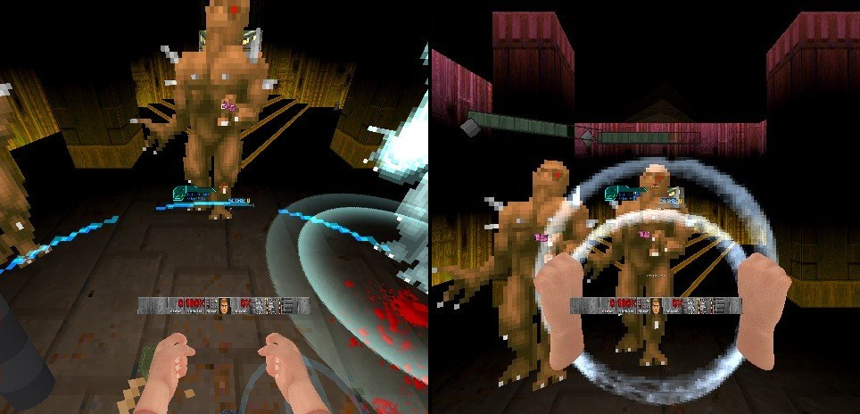

And when the thing you want to punch is on the far side of the room, go and get it with the...

<b><a href="Melee/README.md">RSQ Melee: the full page &rarr;</a></b> &nbsp;&middot;&nbsp; <a href="#contents">contents &uarr;</a>

<a href="Grapple/README.md">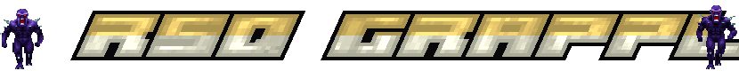</a>

...Grapple. One button fires a hook from your off hand on its chain, and where it bites decides what happens. A wall or
a floor flings you at it. A small monster is yanked across the room to your feet: GET OVER HERE. A big one drags you to
it, and arriving is the kick: you bounce off in slow motion and look for the next one to hook.

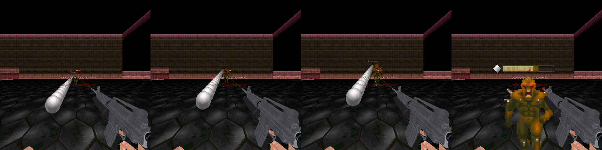 

Most things in the room don't need a hook, though. They just need your hand, and...

<b><a href="Grapple/README.md">RSQ Grapple: the full page &rarr;</a></b> &nbsp;&middot;&nbsp; <a href="#contents">contents &uarr;</a>

<a href="DistanceGrab/README.md">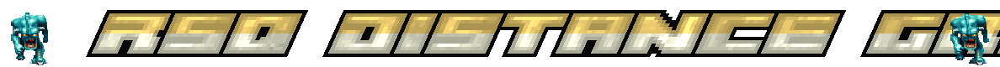</a>

...Distance Grab. Turn a palm out toward anything lying in the room and it lights up. Flick your wrist and it flies to
your hand in an arc. No buttons: your hand is the trigger. Catch it, carry it, club a monster with it, hide behind it,
or throw it with your own arm. Put your palm flat on a door and lift; lay it on a switch and it flips. A barrel thrown
hard goes off where it lands, but if a bang is what you're after there is a better tool for it: the...

<b><a href="DistanceGrab/README.md">RSQ Distance Grab: the full page &rarr;</a></b> &nbsp;&middot;&nbsp; <a href="#contents">contents &uarr;</a>

<a href="Grenade/README.md">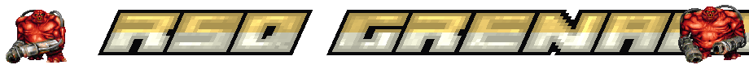</a>

...Grenade. Reach for your belt, pull the pin with your other hand or with your teeth, cook it as long as you dare, and
throw it with your own arm. It bounces off walls, floors and monsters, and you can shoot it out of the air. Nine kinds,
from a plain frag to ones that do no damage at all: they freeze a room, blind it, or turn every monster in it onto
your side. The barrels got the same treatment: five new explosions, chain reactions that grow with every link, and
blasts that change with the room. Your grenade hangs at your belt
buckle, which is part of the...

| 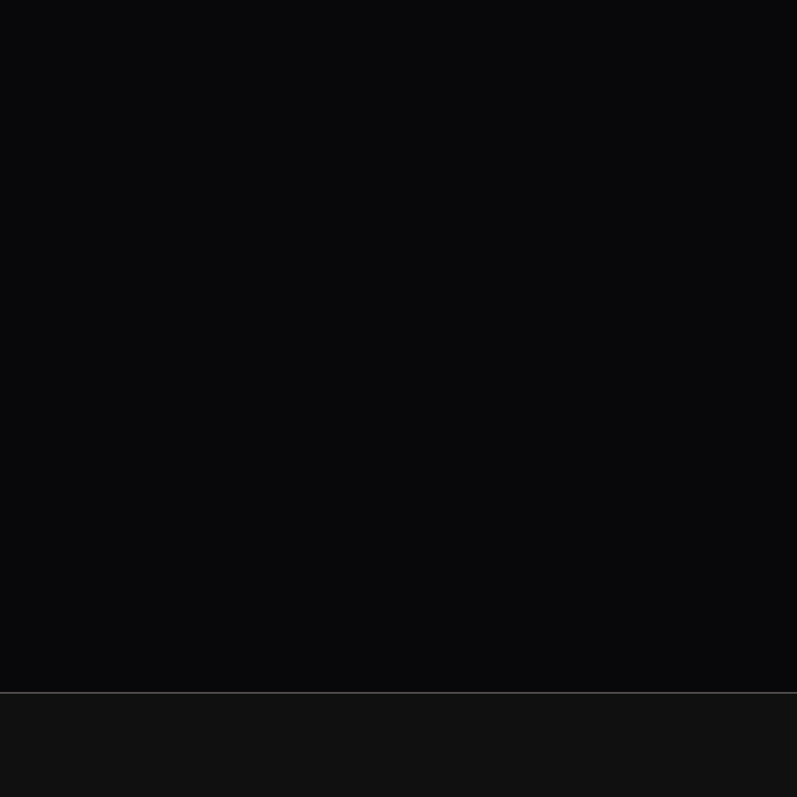 | 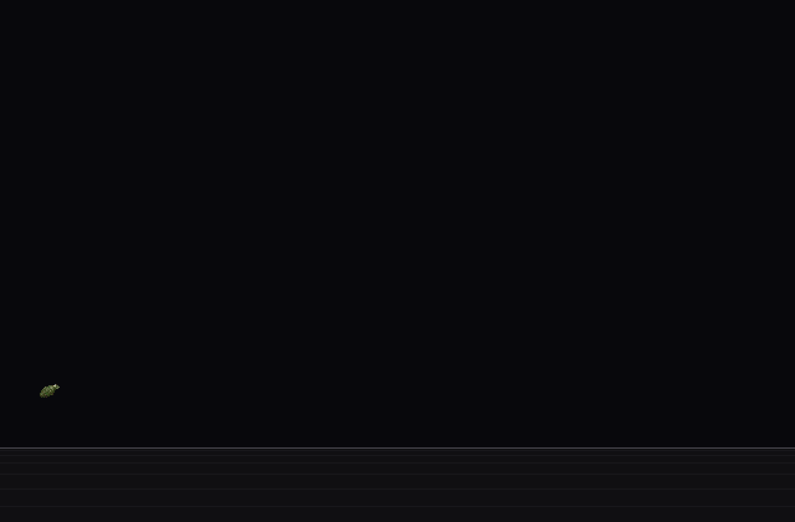 | 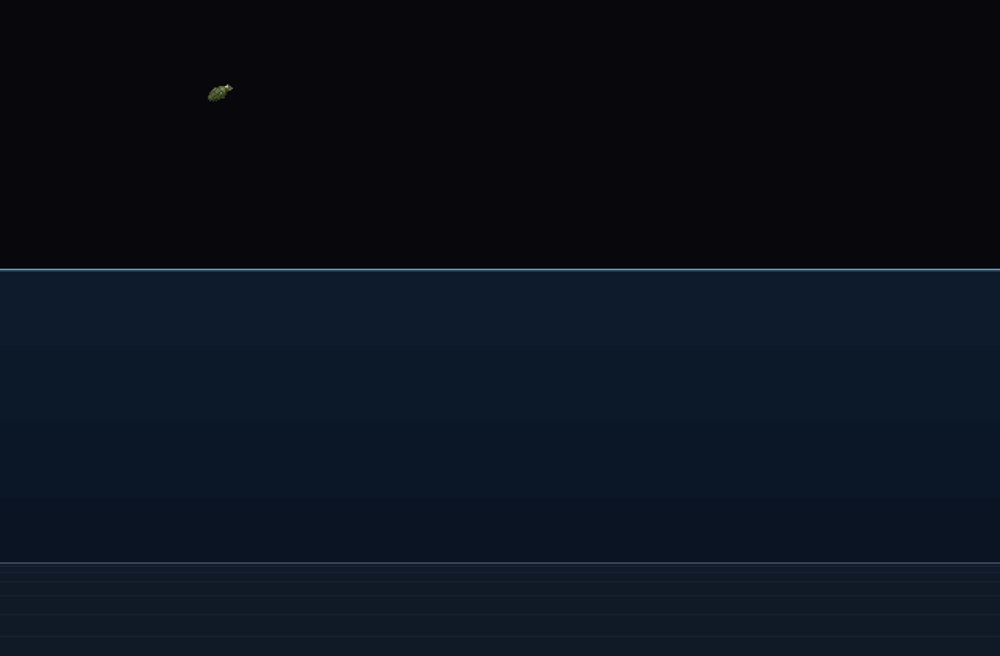 | 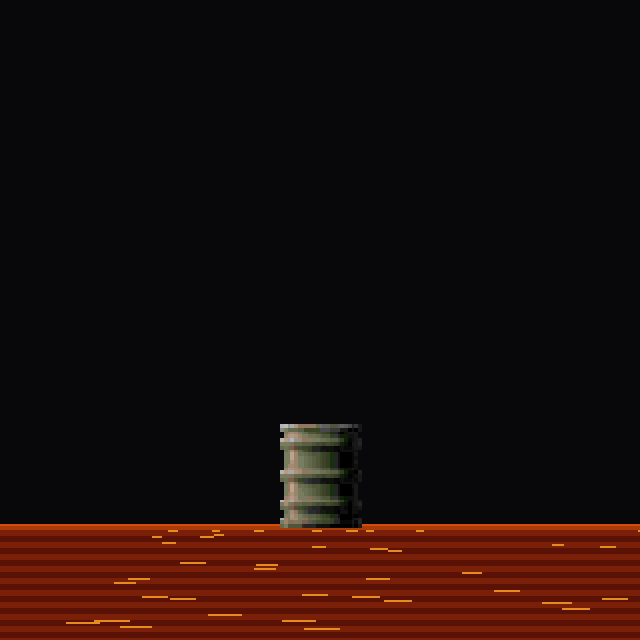 |
|---|---|---|---|
| **The mega blast** | **Skeet** | **Over water** | **Over lava** |

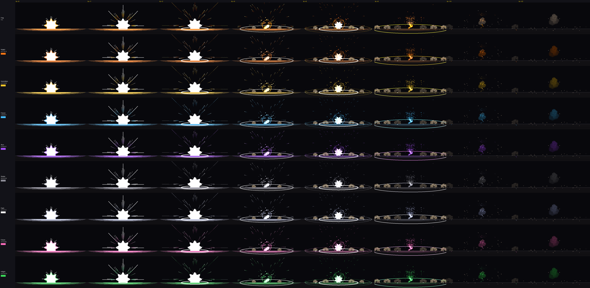

<b><a href="Grenade/README.md">RSQ Grenade: the full page &rarr;</a></b> &nbsp;&middot;&nbsp; <a href="#contents">contents &uarr;</a>

...TacticalRig. A player body featuring six holsters drawn on the player torso (which itself reacts to armor level and
health level). Dedicated slots for RSQ-added weapons. An ammo pouch. The TacticalRig can have weapons assigned to its
holsters thanks to the...

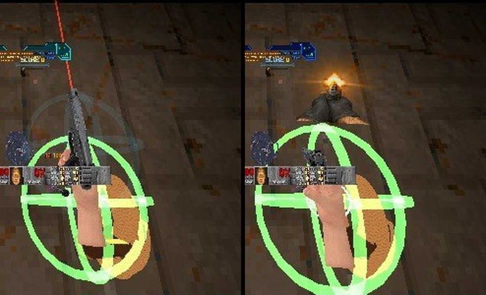

<b><a href="TacticalRig/README.md">RSQ Tactical Rig: the full page &rarr;</a></b> &nbsp;&middot;&nbsp; <a href="#contents">contents &uarr;</a>

<a href="Wheel/README.md">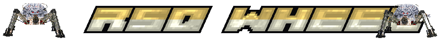</a>

...WeaponWheel. A long overdue and feature-rich VR weapon wheel, allowing for detailed weapon data readouts in game.
Slow or stop time with it open, select for either hand, support for drawing models, collapsing cards into groups, and
full support for LegenDoom and the RSQ series' arcade add-ons. It slows time thanks to...

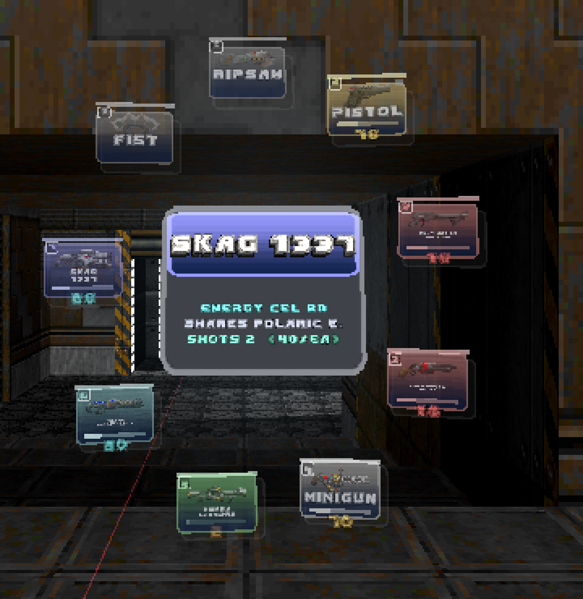 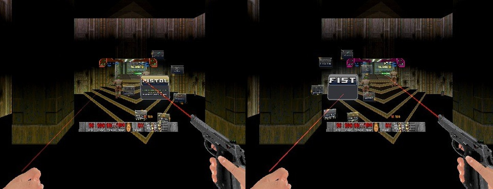

<b><a href="Wheel/README.md">RSQ Wheel: the full page &rarr;</a></b> &nbsp;&middot;&nbsp; <a href="#contents">contents &uarr;</a>

...SlowMo. An adrenaline meter fills due to player action and slows the world to allow for critical decision making.
An option for a forward-moving Crisis Dive. Nearly 40 contextual world triggers, with individual toggles for each.
Dedicated and easy-to-read UI elements keep you informed, so you always know when time is coming back to you. The RSQ
series understands that players need to be informed of what is happening under the hood, and to that effect we have...

<b><a href="SlowMo/README.md">RSQ SlowMo: the full page &rarr;</a></b> &nbsp;&middot;&nbsp; <a href="#contents">contents &uarr;</a>

...VisualRewards. In-world alphanumerics on everything, from damage done to headshot notices to threat levels and
warnings of enemies impervious to your fire.

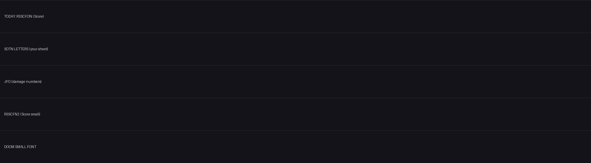

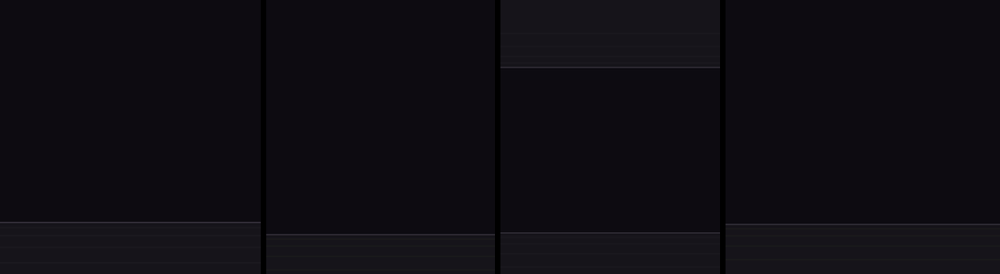 

And when a word in the air isn't enough, look at your wrist, because every gun also carries its own...

<b><a href="VisualRewards/README.md">RSQ Visual Rewards: the full page &rarr;</a></b> &nbsp;&middot;&nbsp; <a href="#contents">contents &uarr;</a>

...GunCards. A small card beside each wrist shows the rounds in the gun and the rounds in reserve, green until you
should be worried, red when you are. Turn your wrist like you're checking a watch and the full card lies flat on it:
magazine, reserve, grenades, this gun's kills on this map. Sabers, whips, gloves and flares have cards too. The same
card shows the gun's level and upgrades, which come from...

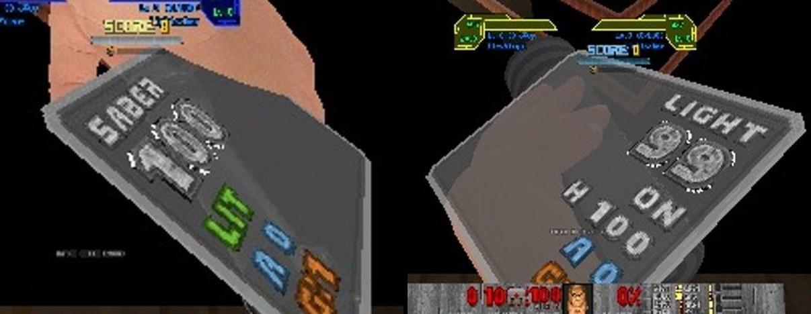

<b><a href="GunCards/README.md">RSQ Gun Cards: the full page &rarr;</a></b> &nbsp;&middot;&nbsp; <a href="#contents">contents &uarr;</a>

<a href="GunBonsaiOffhandVR/README.md">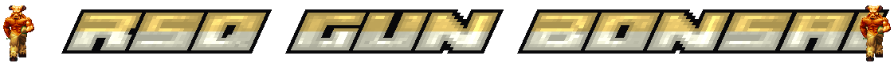</a>

...Gun Bonsai VR. ToxicFrog's Gun Bonsai, rebuilt for two hands: a kill with the off-hand pistol pays the pistol, not
the rifle in your other hand. Each hand has its own gauge and its own upgrades. Then we kept going. Your fists level
up, the left apart from the right: start with a punch, pick an Uppercut, then a Launcher, then a Ground Pound. More
than 170 new upgrades down branching trees, and every weapon in the series has one, including the ones that aren't
guns at all. Like the...

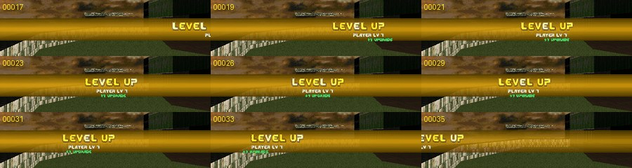

<b><a href="GunBonsaiOffhandVR/README.md">RSQ Gun Bonsai VR: the full page &rarr;</a></b> &nbsp;&middot;&nbsp; <a href="#contents">contents &uarr;</a>

...Saber. There is no attack button: the swing is the cut, and a harder swing cuts harder. Meet a fireball with the
blade and it goes where you are looking, so you aim the return with your head while your hand does the blocking.
Hold the blade across a bullet and the bullet stops. Twist your wrist and a second blade lights from the pommel, and
the staff spins in your hand, a shield that cuts. Ring a few enemies, let go, and the saber flies to each one and
comes home. Put a second saber in your other hand, or leave that hand to the Force, which is a hand and not a button:
thrust it out and things are pushed, pull it back and they come, hold it still on a monster and the monster rises,
hangs where you point, and flies when you fling it. And if you'd rather stand behind something, reach over your shoulder for the...

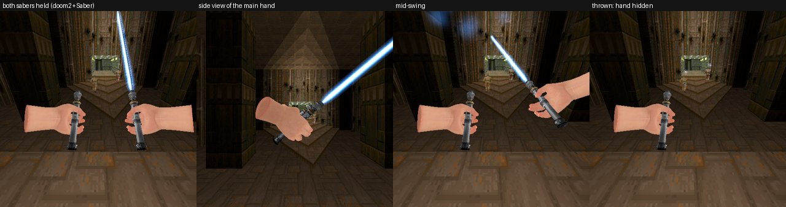

<b><a href="QuestSaber/README.md">RSQ Saber: the full page &rarr;</a></b> &nbsp;&middot;&nbsp; <a href="#contents">contents &uarr;</a>

<a href="ShieldSaw/README.md">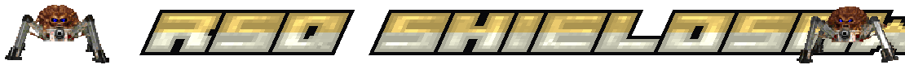</a>

...ShieldSaw. The shield saw from Doom: The Dark Ages lives on your back, and the block is the shield you see: a
fireball that crosses the plate is turned, one that slips under the rim hits you. Turned shots go where you send them,
off the face and along your swing. Bullets are stopped before they are fired and one goes back. Meet a hit with the
plate and it's a perfect block. Shove it into a demon and the demon flies into the wall. Squeeze the trigger and the
blades come out screaming. Ring up to five targets, snap your arm forward, and the saw goes round the room through
each of them, off the walls if it has to, then comes home to your hand. For everything it can't reach, there's
the...

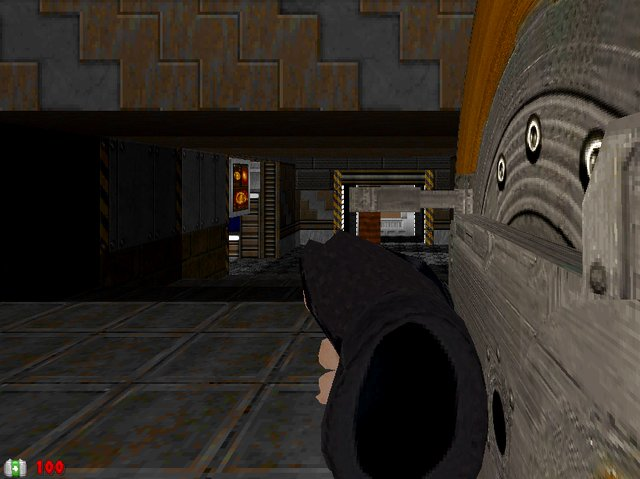 

<b><a href="ShieldSaw/README.md">RSQ ShieldSaw: the full page &rarr;</a></b> &nbsp;&middot;&nbsp; <a href="#contents">contents &uarr;</a>

...Whip. A simulated bullwhip, 1.8 m of leather on a handle, and nothing about it is a canned animation: a lazy swing
never cracks, a wind-up over the shoulder does. Mark a monster and crack it. Lock a spot on a wall or a ceiling and
the whip wraps it: now it's a rope, and you swing under it like a pendulum, or climb it hand over hand. Whirl it and
rope a monster. Which is a lot easier when you can see the monster, so in your pocket there's...

<b><a href="Whip/README.md">RSQ Whip: the full page &rarr;</a></b> &nbsp;&middot;&nbsp; <a href="#contents">contents &uarr;</a>

...Flash and Flare. Pull a road flare, strike it with a flick of your wrist, hold it up to light the way or throw it
down the corridor and watch it light the room where it lands. A flashlight hangs on you as well: grab it, click it on,
point a real beam with your hand. You'll want both, because it is dark in here, and that is on purpose, thanks to...

 

<b><a href="FlashFlare/README.md">RSQ FnF: the full page &rarr;</a></b> &nbsp;&middot;&nbsp; <a href="#contents">contents &uarr;</a>

...Glow In The Dark. Coloured light up every wall from the floor and down from the ceiling, a new mix every map. Lava,
nukage and blood breathe in their own colours, and flare when something dies in them. Locked doors glow in their
key's colour. 35 profiles, from Classic Doom tans to Neon Arcade and Vaporwave, with DarkDoomZ's darkness built in so
the glow has a dark to shine in. And the big moments wash over the whole map: a level-up, going down, and the biggest
one of all...

<b><a href="GlowInTheDark/README.md">RSQ Glow In The Dark: the full page &rarr;</a></b> &nbsp;&middot;&nbsp; <a href="#contents">contents &uarr;</a>

...the Boss. Fight well and the meter fills under your score. When it's full it turns gold and beats like a heart.
Glance at your watch, press Use, and the Boss lands in front of you in slow motion, its thralls arriving one after
another on beams of light. While its thralls stand it cannot be hurt: kill one, and for a few seconds the shield is
down. Break it in time, or everything gets stronger. And "stronger" means something specific here, because of...

<b><a href="Miniboss/README.md">RSQ Miniboss: the full page &rarr;</a></b> &nbsp;&middot;&nbsp; <a href="#contents">contents &uarr;</a>

...Monsters. Every monster stands on one ladder of thirteen colours, numbered by strength: Common, Green, Blue, Purple,
Cyan, Brown, Yellow, FireBlu, Gray, Red, Abyss, and the two boss colours, Black and White. When one changes tier you
see it coming: it strobes white for a moment, then it is something worse. Brutal Doom's and XMVE's monsters are on the
ladder with hand-painted colour art, not a tint. Sooner or later one of them gets you, and when it does...

 

<b><a href="Monsters/README.md">RSQ Monsters: the full page &rarr;</a></b> &nbsp;&middot;&nbsp; <a href="#contents">contents &uarr;</a>

...the Graveyard remembers. m8f's Graveyards, RSQ Edition: die, and a gravestone stands where you fell the next time
you play the map. They pop up out of the ground, breathe, and burn a small candle. Press Use on one and it tells you
who lies there and what killed them. With Legion of Bones loaded, the dead can get back up. A stone turns gold when
the death cost you a life, and lives are a matter for...

|  |  |  |  |
|---|---|---|---|
| **Your stones, next time** | **Who lies there** | **A gold stone** | **Graves Rise** |

<b><a href="Graveyard/README.md">RSQ Graveyard: the full page &rarr;</a></b> &nbsp;&middot;&nbsp; <a href="#contents">contents &uarr;</a>

...Score. Every kill pays what the monster was worth, and every bit of style pays more: a kill in mid-air, a shot you
never looked at, a fireball sent back into the imp that threw it. About two hundred and forty bonuses watch every
kill. Every monster remembers which of your tools touched it, in order, so a whip, then a hook, then a shotgun is a
combo, and 242 of them have names. Every map sets a target: cross it and you earn a life, which catches you at 1 HP
and brings you back in a ring of fire. Headshots pay extra, and you'll land more of them with the...

<b><a href="Score/README.md">RSQ Score: the full page &rarr;</a></b> &nbsp;&middot;&nbsp; <a href="#contents">contents &uarr;</a>

...Laser Sight. A beam out of every Brutal Doom gun's own barrel, both hands, red on the main hand and green on the
off hand, with a dot lying flat on whatever it touches. It stays glued to the gun through the kick and through a hand
reload. Pick up a grenade launcher and the laser bends into the arc your grenade will fly. And if any of the above
asks for something your body would rather not do, there is...

 

<b><a href="LaserSight/README.md">RSQ Laser Sight: the full page &rarr;</a></b> &nbsp;&middot;&nbsp; <a href="#contents">contents &uarr;</a>

...Accessibility. One page of settings that every mod in the series reads: colour-blind colours, calmer flashes, bigger
cues and text, which hand is your main hand, steadier aim, slower taps, a comfort vignette, seated play, rumble
strength, and buttons for the moves that normally need a second hand. One hand, sitting down, left-handed: it's still
the whole game.

<b><a href="Accessibility/README.md">RSQ Accessibility: the full page &rarr;</a></b> &nbsp;&middot;&nbsp; <a href="#contents">contents &uarr;</a>

Every pk3 loads and plays alone. Load them together and they find each other by name and start talking. This is every
conversation, read straight from the code: one string for each mod that asks another mod for something. 113 strings
between 21 mods.

*How to read it: a string from A to B means A's code asks B's service for something (counted by
`design/readme_art/mod_web_edges.py`). Network events and names read off other mods aren't counted, so there is more
talking than this. The tables in [What needs what](#what-needs-what) say what each conversation is about.*

Nothing here is headset-confirmed unless the Status section says so. Most of it is **rig only, not
headset-confirmed** (frames or a log from the Linux rig, with a simulated headset and controllers) or **code only,
not shown**. The [Status](#status) section has one line per mod, and what is still to do before 2.0 is in
[What is left for 2.0](#what-is-left-for-20).

Built on Brutal Doom 22 (Sergeant Mark IV), the owner's BD22 VR Reloaded, QuestZDoom 17.3 (Emawind and Team Beef),
Gun Bonsai (ToxicFrog), Legion of Bones (SpacemanStrife), Champions (Mikk-), m8f's Graveyards, ijon's Dakka scoring and
Tartlman's Minibosses!. [Credits](#credits) has the rest.

Load these in this order. This is the owner's load order, and the one the rig tests run on:

| # | File | What it is |
|---|---|---|
| 1 | doom2.wad | Doom II, the IWAD |
| 2 | brutal22test6.pk3 | Brutal Doom 22 (Sergeant Mark IV) |
| 3 | BD_VoxelPack.pk3 | Brutal Doom's voxel pack |
| 4 | BD22 VR Reloaded 2.0.4z | the owner's VR weapons for Brutal Doom 22 (hands on every gun, reloads by hand) |
| 5 | LOB_v1.05.pk3 | Legion of Bones (SpacemanStrife) |
| 6 | mk-champions | Champions |
| 7 | GunBonsai-0.10.6.pk3 | Gun Bonsai (ToxicFrog) |
| 8 | the RSQ pk3s below | any order among themselves |

Only the IWAD is needed by everything. Lines 2 to 7 are what the series is tested with: each RSQ mod finds them by name
and uses them when they are there. Gun Bonsai is needed by one pk3 (RSQ_GunBonsaiVR, below). Legion of Bones goes after
Brutal Doom and before the RSQ pk3s (RSQ Graveyards' readme explains why).

The batched rig test of 2026-11-10 ran on BD22 VR Reloaded 2.0.4f. The rig runs of 11-11 and 11-12 ran on the owner's
full order, which also carries LegenDoom 3.0, XMVE, MK Crits and other mods, with BD22 VR Reloaded 2.0.4i to 2.0.4t.
Gun Cards' Remove HUD Health and Armor needs 2.0.4o or later. The release gate of 2026-11-16 ran on 2.0.4z; the Boss
kiosk needs 2.0.4y or later (and LegenDoom 3.0), and Weapon Condition's accuracy loss needs 2.0.4z.

To install: take the pk3s you want from [pk3/](pk3/), put them with your other QuestZDoom mods, and add them to your
load order after Gun Bonsai. Take one or take them all. Plain Doom II with RSQ pk3s and nothing else works too.

Several mods have a Quest look and a PC VR look on their pages (lights, glow, card text); pick the one for how you
play. RSQ Laser Sight's PC VR look is gone since 2026-11-12 (below): every laser is the Quest beam.

**Take these out of an old load order.** They are old names of pk3s in this list, and two copies of one mod do not
load together: UltraBadassQuestSaber.pk3 (now RSQ_Saber), UltraBadassShieldSaw.pk3 (now RSQ_ShieldSaw),
RSQ_TopHPBars.pk3 and RSQ_HPBars.pk3 (now RSQ_VisualRewards), Gameplay_GB_VR_Offhand_Patch.0.10.6.pk3 (now
RSQ_GunBonsaiVR), and RSQ_Gestures.pk3 (folded into RSQ_Accessibility on 2026-11-05). Do not load darkdoomz.pk3 with
RSQ_GlowInTheDark either: DarkDoomZ is built in, and the game stops at start-up with both.

**The engine's sprite-frame cap.** QuestZDoom 17.3 counts sprite frames in 16 bits, so the whole load order has to stay
under 65,535. On 2026-11-12 the engine on the rig read the owner's full order at 71,572, 6,037 over. Past the cap,
sprites share frame slots and draw the wrong picture. RSQ Laser Sight's PC VR halo (7,344 frames) was removed for it
(the owner: "im willing to give it up for the previous beam"), and the order now reads 64,228, with no shared slot.
That brought back the watch card's missing letters (rig only, not headset-confirmed). It is also the likely cause of
the rogue voxels and wrong monster frames: not headset-confirmed. There are 1,307 frames to spare, so anything baked
from here is counted first.

*Gun Cards' watch card on the rig, before (71,572 frames) and after (64,228) (rig capture, not headset).*

### The pk3s

The 21 pk3s that `tools/build_all.py` builds, in the order the shared menu shows them.

**Body**

| pk3 | What it does |
|---|---|
| RSQ_TacticalRig.pk3 | Your guns on your body: six holsters on hips, chest and shoulders, a spot on the belt for your grenade, sabers, whip, flares, ammo and keys, and Ermac's cigarette in your pocket. |
| RSQ_Accessibility.pk3 | One page of settings every series mod reads: one hand, seated, left-handed, colour blind, motion sensitive or light sensitive. It also carries the series' gesture reader (the watch check, punches, two-hand moves). |

**Hands**

| pk3 | What it does |
|---|---|
| RSQ_Saber.pk3 | A lightsaber in each hand: cut, block bullets, send fireballs back, throw it at marked enemies. Leave the other hand free for the Force: push, pull, grip, fling, jump. |
| RSQ_ShieldSaw.pk3 | The shield saw from Doom: The Dark Ages on your back: block with it, bash with it, rev the blades, throw it round the room and catch it. |
| RSQ_Melee.pk3 | Fighting with your body: jabs, hooks and uppercuts read from your hand, open-palm slaps for fireballs, the gun-butt shove, barrels launched at monsters, boxing gloves and the Headlock. |
| RSQ_Whip.pk3 | A simulated bullwhip: mark a monster and crack it to stun it, lock a spot and swing from the rope, climb it hand over hand. |
| RSQ_Grenade.pk3 | A hand grenade: pull the pin, cook it, throw it with your arm. Nine kinds. Also the series' barrels and explosions. |
| RSQ_FnF.pk3 | Flash and Flare: a road flare you strike and throw by hand, and a flashlight clipped to your chest. |

**Reach**

| pk3 | What it does |
|---|---|
| RSQ_Grapple.pk3 | **Grapple 2.0:** one button fires a hook from your off hand on jpalomo's flying claw and chain. Walls fling you, small monsters come to you (GET OVER HERE), big ones pull you in and you kick them, bounce off in slow motion and chain to the next. No rope or swinging (that is RSQ Whip). |
| RSQ_DistanceGrab.pk3 | Turn your palm out toward anything lying in the room, flick your wrist, and it flies to your hand. Carry it, club with it, throw it. Lift doors by hand. |
| RSQ_LaserSight.pk3 | A laser out of every Brutal Doom gun's own barrel, both hands, with a dot where the shot will land. It bends into the arc of the grenade launcher. One look since 11-12: the Quest beam. |

**Game**

| pk3 | What it does |
|---|---|
| RSQ_SlowMo.pk3 | The world slows, you don't: dodgeable bullets, a Crisis Dive, and Be Quick or Be Dead (DOWN), one last stand when a monster's killing blow lands: kill the monster marked TARGET to get up. Fail it and a Score life catches you if you hold one; without one you are dead. Other mods slow the world through it. |
| RSQ_Score.pk3 | Points for every kill and a bonus for how you made it, combos, a target per map, and extra lives you earn. It also banks the gold you spend at the Boss kiosk. Built on ijon's Dakka scoring. |
| RSQ_Miniboss.pk3 | Fill the meter, then press Use at your watch or on the Start Fight card inside your off-hand wrist: a miniboss lands with three to five thralls, each a boosted legendary champion with a power of its own. Kill a thrall to open its shield for a few seconds. Win, and it drops a kiosk that sells three legendary weapons for gold (with BD22 VR Reloaded, LegenDoom and RSQ Score). Built on Tartlman's Minibosses!. |
| RSQ_VisualRewards.pk3 | Health bars over monsters, damage numbers that fly, kill bits that come to you (health, armour, ammo and gold; steel with Weapon Condition on), the banners, words over monsters in a font you pick, and the four arrival beams. |
| RSQ_GunCards.pk3 | Ammo cards on your guns, a status card on your wrist when you check your watch, and a switch that takes health and armour off the HUD. Weapon Condition (off by default): big hits wear the guns in your hands, and a worn gun shoots differently until you repair it. |
| RSQ_Wheel.pk3 | Your weapon slots on a small ring of cards; take a slot and its guns take the ring; point and let go to pick one. It keeps out of walls. With RSQ Tactical Rig, it is where you choose which holster each gun lives in. |
| RSQ_GlowInTheDark.pk3 | Coloured light up every wall, liquids that breathe, and DarkDoomZ's darkness built in. The owner's Glow In The Dark 1.1 rebuilt, with More Lights' glowing flats. |
| RSQ_GunBonsaiVR.pk3 | Gun Bonsai rebuilt for two hands: each hand earns its own XP and upgrades, with more than 170 new upgrades for what you do with your body. |
| RSQ_Monsters.pk3 | The owner's RS Monsters, Quest edition: Colourful Hell's thirteen-colour ladder, numbered by strength (11-11), and monsters that flash white and come back a tier higher. |
| RSQ_Graveyard.pk3 | m8f's Graveyards, RSQ Edition: a gravestone stands where you died the next time you play the map. A spent Score life leaves a gold one. |

**Also in [pk3/](pk3/):**

- **`RSQ_BDXMTiers_<Colour>.pk3`**, twelve of them, one per colour: the painted colour art for Brutal Doom's and XMVE's
  monsters on the colour ladder, loaded after RSQ Monsters (RSQ Monsters' README; rig only, not headset-confirmed).

### The weapon sets

Two more VR weapon sets live in [weaponsets/](weaponsets/). Each is one pk3 that stands alone on Doom II with your own
monsters and maps, and picks up the Series mods it knows when they are loaded. Load only one weapon mod.

| pk3 | What it is |
|---|---|
| [GNRC_Reloaded_0.8.pk3](weaponsets/GNRC_Reloaded/) | **GNRC Reloaded VR 0.8:** Led's Generic Weapon Mod rebuilt for VR. Doom's ten weapons in your hands, reloaded by hand (magazines, a pump, a break-open double barrel), dual wield, 3D guns. Vanilla+. |
| [WoS_Reloaded_0.8.pk3](weaponsets/WoS_Reloaded/) | **Weapons of Saturn Reloaded 0.8:** Lippeth's Weapons of Saturn rebuilt for VR. Twelve guns you hold, reload by hand and fire from the muzzle you see; between vanilla Doom and Brutal Doom. |

Both were tested on the rig on 2026-11-16 (their READMEs and `design/rigtest_2026-11-16_gnrc`): rig only, not
headset-confirmed.

*RSQ Miniboss's bar, where Be Quick or Be Dead stands, in the boss-bar style of Castlevania: Symphony of the Night
(rig capture, enlarged 4x; rig only, not headset-confirmed).*

**Needs another pk3 to load:** only **RSQ_GunBonsaiVR**. It needs Gun Bonsai 0.10.6 loaded before it (it replaces some
of Gun Bonsai's files by path).

Every other pk3 loads and plays alone. The mods find each other by name (services, network events, class names) and
add features when the other one is there. Without it, nothing happens and nothing breaks.

**Features that only work with another mod**, read from the code:

| Feature | In | Needs |
|---|---|---|
| The holster assignment screen | RSQ Wheel | RSQ Tactical Rig |
| Every upgrade tree (saber, shield, whip, grenade, hook, fists, slow motion, Gunslinger, Kill Rewards) | RSQ Gun Bonsai VR | the mod the tree is for |
| Ground Pound, Clear Out, Taunt | RSQ Gun Bonsai VR | RSQ Melee |
| Bullet Time Fists, the F.E.A.R. Effect window, Barrel Launch's slow | RSQ Melee | RSQ SlowMo |
| Holsters Ride Up When Down | RSQ Tactical Rig | RSQ SlowMo |
| Target Lock and Headshot Reaction | RSQ Laser Sight | RSQ Gun Bonsai VR and RSQ Tactical Rig |
| The arrival beams, GUARD! / TARGET! and the pops of a miniboss fight | RSQ Miniboss | RSQ VisualRewards (without it, teleport fog) |
| The tier-ups of a miniboss fight | RSQ Miniboss | RSQ Monsters |
| Graves Rise | RSQ Miniboss | RSQ Graveyard and Legion of Bones |
| The Bones Bridge | RSQ Graveyard | Legion of Bones |
| Gold tombstones | RSQ Graveyard | RSQ Score |
| The big moments (miniboss tint, the Red Map, the level-up wave, the combo glow, the grey of slow motion) | RSQ Glow In The Dark | RSQ Miniboss, RSQ SlowMo, Gun Bonsai, RSQ Score |
| The BD22 monster set | RSQ Monsters | Brutal Doom |
| Bones Drop Battery Bits | RSQ FnF | RSQ VisualRewards and Legion of Bones |
| A miniboss and thralls that are boosted legendary champions, each thrall with a different Champion power | RSQ Miniboss | Champions and LegenDoom |
| Legendary weapons from the miniboss (its thralls drop none) | RSQ Miniboss | Champions, LegenDoom and BD22 VR Reloaded's LegenDoom patch |
| The Boss kiosk (three legendary weapons for gold, in place of the Boss's one drop) | RSQ Miniboss | BD22 VR Reloaded 2.0.4y or later, LegenDoom 3.0 and RSQ Score (its gold bank); the gold bits come from RSQ VisualRewards |
| GOLD on the off hand's watch card | RSQ Gun Cards | RSQ Score |
| Steel bits that top up a held gun, and the kiosk's REPAIR | RSQ VisualRewards, RSQ Miniboss | RSQ Gun Cards with Weapon Condition on |
| Weapon Condition's accuracy loss | RSQ Gun Cards | BD22 VR Reloaded 2.0.4z (GNRC and WoS do not read it yet) |
| Remove HUD Health and Armor | RSQ Gun Cards | BD22 VR Reloaded 2.0.4o or later (the setting is its own); RSQ Gun Bonsai VR's HUD follows it |
| The level card in the small gun card's place | RSQ VisualRewards | RSQ Gun Cards |

**Steps aside for another mod**, by name in the code:

- RSQ Grenade takes the place of Brutal Doom VR's own grenade (Replace Brutal Doom's Grenade, on since 2026-11-16). Turn it off and RSQ Grenade stands down for it.
- RSQ Melee's gun-butt shove stands down with Brutal Doom VR Reloaded loaded: its pistol whip and Two-Handed Butt Strike (on since 2026-11-16), which are Melee's now, take its place.
- RSQ SlowMo stands down for another slow-motion mod (Xortts' Bullet Time X, RS_SlowMo) while Yield to Other Mods is on.
- RSQ Laser Sight and QuestZDoom's own laser sight (m8f's): with both loaded, Which Laser picks one.
- RSQ VisualRewards takes over from coldcite's Top HP Bars when both are loaded.

Each mod's own README has its full "Plays well with" list.

Keybinds are a precious resource in VR (the owner, 2026-11-10). Most of the series has no keys: you do it with your
hands, the trigger and alt fire, and anything that can be switched on or off is a row on the mod's page, not a key.
Keys as they are in the code after the keys pass of 2026-11-10 (`design/KEYBINDS_PLAN.md`):

| Mod | Keys | Menu buttons and gestures that replaced keys |
|---|---|---|
| Tactical Rig | Recenter Torso | the grip holsters, both hands (no holster keys); both hands to your chest recenters too |
| Accessibility | nine buttons that stand in for gestures: Off-Hand Modifier, Grab Pull, Grab Reach, Force Push, Force Pull, Force Grip, Shield Throw, Flick Reload, Wrist Cross | |
| Saber | none | Training Remote: Summon / Send Away is a menu button (saber only); the off-hand saber's second blade lights by twisting the wrist |
| ShieldSaw | Draw / Put Back (also calls a thrown shield home) | lock-on is holding the off trigger; the throw is the swing; recenter is Tactical Rig's key or hands to chest |
| Melee | none | |
| Whip | none | attack and alt attack: on Lock-On Controls (on) the trigger marks a monster and alt-fire locks a spot to swing from; on the rope alt-fire reels and fire lets go; you climb hand over hand with the off hand's grip and the whip hand's Use (Distance Grab's grab keys still take the rope) |
| Grenade | Quick Grenade | |
| FnF | none | |
| Grapple | Fire Hook (one key, unbound by default; always the off hand); Jump is the double jump after a kick-off | |
| Distance Grab | Grab / pull, main hand and off hand: unbound, read only with its Grab Keys row on (off by default); RSQ Grapple's and RSQ Whip's ropes are taken through them | |
| Laser Sight | none | |
| SlowMo | Slow motion on/off, Crisis Dive (Shootdodge renamed) | the wrist cross |
| Score | none | |
| Miniboss | none | the call-in is Use during a watch check, or Use on the gold Start Fight card inside the off-hand wrist |
| VisualRewards | none | |
| Gun Cards | none | |
| Wheel | Open Wheel (hold, point, release; left thumbstick click by default) | |
| Glow In The Dark | none | Randomize Colours Now is a menu button |
| Gun Bonsai VR | Gun Bonsai's own key | |
| Monsters | none | |
| Graveyards | none | Remove Gravestones on This Map and Remove All Gravestones are menu buttons |

Every key is on its mod's page and in Customize Controls. No RSQ key has a default binding except the Wheel's. Each
mod's README has a Controls section: its keys, which hand and button does what, its gestures and its menu buttons.

Status: the keys pass is code only, not shown, in the keys themselves. The 11-10 rig runs drove a few of them by their
commands (the ShieldSaw's `ssq_draw`, the Saber remote's `netevent ubqs_remote`) and showed the ShieldSaw's trigger-hold
lock, rig only, not headset-confirmed. The Quick Grenade key was shown on the rig after a fix (ae089395).

Every series pk3 adds its page to one shared menu: **Options > Radiant Silvergun Options**. Options shows that row
once, however many series pk3s you load, in any order. With Simple Options on, the row is there too, above "Full
options menu".

Inside, each loaded mod has one row, in four groups with a blank line between:

| Group | Rows |
|---|---|
| Body | RSQ Tactical Rig · Accessibility |
| Hands | RSQ Saber · RSQ ShieldSaw · RSQ Melee · RSQ Whip · RSQ Grenade · RSQ FnF (Flash and Flare) |
| Reach | RSQ Grapple · RSQ Distance Grab · RSQ Laser Sight |
| Game | RSQ SlowMo · RSQ Score · RSQ Miniboss · RSQ VisualRewards · RSQ Gun Cards · RSQ Wheel · RSQ Glow In The Dark · RSQ Gun Bonsai VR, then RSQ Monsters and RSQ Graveyards |

A mod you did not load adds no row. Each mod's front page holds its settings, with the rarely needed ones on one
Test and Debug page, and a Reset All at the foot. (Two pages differ: RSQ Graveyards has no Test and Debug page, and RSQ
Monsters' front page has no Reset All.) Accessibility's page also has Reset Every Mod.

Status: on the rig on 2026-11-09, with every RSQ pk3 loaded, Options had one Radiant Silvergun Options row, Simple
Options had one, and the menu held all 21 rows (log `design/rigtest_2026-11-09/logs/main_A-G_I.log`, lines 1122 and
1225). The groups and their order are code only. Rig only, not headset-confirmed.

Taken from each mod's README and the batched rig test of 2026-11-10 and 11-11 (`design/rigtest_2026-11-10/RESULTS.md`,
its group files `RESULTS_P1.md` to `RESULTS_P4.md`, `RESULTS_FIX.md` and `RESULTS_LSREADOUT.md`, its `evidence/` and
`PLAN.md`), the fixes committed and shown since, and the rig runs of the night of 11-11 and of 11-12 (their commit
messages and `design/HANDOFF_SESSION_2026-11-12.md`). Four labels: **rig only, not headset-confirmed** (frames or a
log from the Linux QuestZDoom 17.3 rig, a simulated headset and controllers); **loads only, not shown** (loaded on the
owner's full order, never seen working); **code only, not shown** (built, never shown); **not yet run** (waiting in
the batched rig test). Nothing is headset-confirmed unless the repo records the owner saying so.

Every launch of the 11-10 rig test, on the owner's order with BD22 VR Reloaded 2.0.4f, had no script error from our
packs. The 11-12 changes were load-checked on the owner's full order with no script error from an RSQ pack (one load,
at 03:41, also printed four VOXELDEF lines). Nothing from 11-12 is headset-confirmed.

The release of 2026-11-16 (ten pk3s rebuilt) was gated on the owner's full order with BD22 VR Reloaded 2.0.4z: MAP01
with firing, a Boss called in and killed (the kiosk dropped with 3 offers and opened), and the same with Weapon
Condition on. The only script errors were BD_VoxelPack's own four voxeldef lines, and there was no VM abort. Rig only,
not headset-confirmed.

| Mod | Status |
|---|---|
| Tactical Rig | rig only, not headset-confirmed: the rig clutter fixes, rings only for what the hand can use, in frames (T1, 11-10); the ammo pouch, holster refusals, an assignment, the grip hint (11-09, since taken out); FnF's flashlight clip behind the flare holster, and the cigarette pocket's grip taking a cigarette with nothing else firing (R1, 11-11). Headset-confirmed: cigarettes (the owner, 11-09: "Cigarette works"; recorded only in its README). loads only, not shown (11-12): Holsters Ride Up When Down (while you are DOWN the holsters squeeze up so the lowest clears the floor), the "Grip inside the ring" text gone. code only, not shown: the cigarette pocket rules, everything else. not yet run: nothing from the rig test |
| Accessibility | rig only, not headset-confirmed: Seated Play on Auto (N7), and Auto waiting while you are DOWN (11-11); Rumble Backup sent from SlowMo's and Melee's rumbles (logs; N6); the Comfort Vignette off while a menu is open (R1, 11-11); loads clean (11-10); the gesture reader on an older build (10-31). Tried and taken back (11-11): a watch check that needs the forearm across the body (the owner kept the watch check as it was). code only, not shown: the threat and slow-motion cues and the gesture names hidden while a menu is open (11-11), most of the 11-10 code-read fixes, everything else. not yet run: nothing from the rig test |
| Saber | rig only, not headset-confirmed: the second saber lit on its first draw, Force Pull's gates, the remote's distance, its +25 health and its slow (A1 to A3); the training remote as a saber game, its wrist panel and 30-second round, one throw (2.06 m/s no, 3.09 m/s yes) (11-10); the remote's slow sent by the saber's own deflects, and a bolt blocked on the blade counted for the streak and the slow (11-11). Found broken, then fixed and shown: Slappers Only fighting Start With Saber; the Force out of reach with Melee's gloves. code only, not shown: a blocked remote bolt paying no points (11-11), its diagnostic lines hidden while a menu is open (11-11), the wrist twist (the rig cannot pass a controller's roll), cutting, blocking, the rest of the Force and the rest. not yet run: nothing from the rig test |
| ShieldSaw | rig only, not headset-confirmed: a ricochet with the rings staying on their targets (H1), one throw with nothing locked, 2.06 m/s no, 3.09 m/s yes (H3), the trigger-hold lock (11-10); a far zombie's bullet (11.8 m, flat floor) blocked by the plate, health unchanged (11-11); a far zombie's bullet read as a shot, partly synthetic (H2); the Draw key putting the shield in the off hand (11-09). Found broken, then fixed and shown: a slanted shot through the plate read as a miss (now a block). code only, not shown: its debug lines hidden while a menu is open (11-11), the rest of the block, the bash, the rev, the throw's flight and the catch. not yet run: nothing from the rig test |
| Melee | **11-16**, rig only, not headset-confirmed: the owner's sounds for the punches, the pistol whip, the gun-butt shove and the kick, each on the tic its hit lands (`design/MELEE_SOUNDS.md`). **Earlier:** rig only, not headset-confirmed: both hand models, the punches, the boxing gloves, the Headlock, the fireball and bullet swats, the off-hand fist and the barrel kick, Ground Pound's and Clear Out's rings, Guard, Slappers Only, its rumble route (M1 to M8, N6, 11-10); the gloves a glove's size, the Wheel's glove cards wearing its icons (11-10, 11-11); Barrel Launch: a barrel sent by the shove's event and by a test probe to the nearest monster, 298 units in 9 tics inside SlowMo's slow, going off on it (11-12; the tumble's look not seen). Found broken, then fixed and shown: Slappers Only against Start With Saber. code only, not shown: Start With Melee Hands putting the gloves in your inventory only, and the gloves out of weapon slot 1 again (11-11; the slot-1 runs before it are history); the gesture-name line hidden while a menu is open (11-11); the moves above level 1 and the rest. not yet run: nothing from the rig test |
| Whip | rig only, not headset-confirmed: **Lock-On Controls**, the new whip, on by default (11-12): the trigger marking the nearest monster and the next, the ray always drawn and gold to the mark, the mark kept through cracks, alt-fire locking a gold spot and the crack snagging it, and climbing hand over hand with the off hand's grip and the whip hand's Use (the rope 274 to 168, 157, 145 over three strokes); a heavy crack always an MK Crits critical hit that holds the monster, and on a rope fire letting go and alt-fire reeling (11-12 night); Whip and Gun (the cursor, the crack, a one-handed swing, the Leash, a reel to a heavy one), the Rope perks with Gun Bonsai VR, the touch hold on the rope (11-10); the mark, the locked crack and the aim ray on an earlier build (11-03). Found broken, then fixed and shown: Whip and Gun's stale gold diamond (N2). code only, not shown: a gun in the other hand firing, the lasso, the yank, the mantle and the rest. not yet run: nothing from the rig test |
| Grenade | rig only, not headset-confirmed: Brutal Doom's barrels replaced by default and a chain of 9 growing to the mega blast (G2); Quick Grenade on BD22's Toss Grenade and on its key, after a fix (11-10); trigger, alt fire and cook-then-throw (11-09). loads only, not shown (11-12): the barrels' explosions twice the size (Barrel Explosion Size), their reach 1.5x (Barrel Blast Radius) and the Neon Crescent in the room's Glow In The Dark colour (one barrel set off on the rig, no frame taken). code only, not shown: SlowMo's Quick Grenade slow, the Kinetic sounds and the rest. not yet run: G1's pin and toss sounds and the side-by-side with BD22's own toss |
| FnF | rig only, not headset-confirmed: with RSQ Tactical Rig's flare holster on, the chest flare pocket off and the flashlight clip 0.21 m behind the flare holster, taken and put back there (R1, 11-11); the flare's and the flashlight's states read on Gun Cards' item card (11-10); the flashlight into the off hand, off and on; the Beam Look lights (11-09). code only, not shown: the flare's grip, strike and throw, everything else. No check of its own in the rig test |
| Grapple | **11-16**, rig only, not headset-confirmed: the arrival kick's new sound (`design/MELEE_SOUNDS.md`). **Earlier:** **Grapple 2.0**, rig only, not headset-confirmed (runs `g2run1` to `g6run2`, 2026-11-13): the flying claw, GET OVER HERE, wall and floor flings, the ledge lip, the kick-chain (KICK! x2), the hang until it bites, Chain Cancelled! (a miss or a second press: slow-mo fall until you land), the double jump and its time markers, Aim Assist on the marked monsters only, the dizzy stun, the air spike with the Neon Crescent. code only, not shown: the ledge save while slow motion is running, a real map's geometry, netplay. Details in its README |
| Distance Grab | rig only, not headset-confirmed: no grab while both hands hold a gun together (the controllers within 16 cm, 11-12); the heavy throw's weight logged (D1), Palm Gate off only with Grab Keys on (D2) (11-10); a clip locked at range (11-03, earlier build). Found broken, then fixed and shown: AMMO FULL over a full gun you carry, dropped at your feet (D3). code only, not shown: swings, the shield, doors, switches and the rest. not yet run: nothing from the rig test |
| Laser Sight | **Quest beam only since 11-12:** the PC VR look (its halo) was removed to bring the load order back under the engine's sprite-frame cap (the count read from the engine on the rig). rig only, not headset-confirmed: the beam on between shots and through a BD22 VR hand reload (L1); the greyed rows (L3); Glow Intensity's brighter bloom (L4); the range readout as glyphs in every placement and unit, and At the Dot at one apparent size (11-10); At the Dot in Feet, and a watch check with either hand putting out both hands' lasers (11-11). Found broken, then fixed: M8F's autoloaded laser with BD22 VR (now held off while ours is on; a log of the switch only); the canvas readout, never drawn in VR (rebuilt as glyphs, shown). Not shown: Beam Sparkle, Glow Intensity's wider light. loads only, not shown: an aimed gun held on its side keeps its laser through the watch check (11-12). code only, not shown: the dot's targets, the grenade arc and the rest. not yet run: nothing from the rig test |
| SlowMo | **11-16**, rig only, not headset-confirmed: **DOWN first, lives held** (the 11-15 rule further on in this row is gone): with 2 Score lives a monster's killing hit put the player DOWN, he got up at 100 %, then 66 %, and the third DOWN failed and spent a life (`boss_p1b`, `boss_p1c`); the series' explosions slowing with the world (`slowfx_old2` / `slowfx_new2`). **Earlier:** rig only, not headset-confirmed: DOWN only once no Score life is left, all or nothing: two lives spent by two killing hits with no DOWN, then DOWN and up, then DOWN on a 6 s clock run out and dead (11-15, `aon2`); DOWN as one kill on a shorter clock, three DOWNs in a row starting at 9, 6 and 3 s and each ended on the one kill, its ten bonus monsters picked and paying time, TARGET over the target (11-12; the +SEC labels and the crosshair's fly-in not made out in a frame); a miniboss window broken early ending the slow and the bar (S1), the Fog Tint Strength row (S2), the fog off with Glow In The Dark (S3), the Training Remote trigger with bolts sent back by a probe (S4), Chain Reaction's slow, Be Quick or Be Dead's plate and breathing letters, MINIBOSS INCOMING (11-10); the menu header breathing and still in Photosensitive Mode, the Training Remote slow sent by the saber itself, the green world bar for the revive and the cigarette and the two slows adding up (11-11); DOWN from start to finish and the Reload trigger (11-09). loads only, not shown (11-12): the Crisis Dive, longer, with a lift and a burst; the countdown's reason line in the SOTN look. code only, not shown: a target that plays dead counting as killed (11-11), the countdown bar, edge arrows and DOWN's panel hidden while a menu is open (11-11), the keys, the wrist cross, the Quick Grenade trigger, the dodgeable rounds. not yet run: nothing from the rig test |
| Score | **11-16**, rig only, not headset-confirmed: the gold bank, kept across maps and through a death (`kq_death1`); a life spent after a failed DOWN, with its refill, invulnerability and slow motion (`boss_p1b`, `boss_p1c`). **Earlier:** rig only, not headset-confirmed: each colour row paying on its own colour's kill (R2, R3, 11-11); the line centred under the gauges with no overlap, the line and the wrist digits hidden while a menu is open (R1, 11-11); the line's Down row at 13 by default (11-12); the menu without MeatGrinder's rows (R2), one Miniboss row at 3x, a Champion row with its icon, the wrist digits stepping aside (11-10); the head-shot check, the Revival Fire, Revenge (11-09); a killing hit with a life held spending the life, never SlowMo's DOWN (11-15, `aon2`). code only, not shown: the line centred between Gun Bonsai VR's hand gauges, level with their middle (11-11 evening), the other rows, combos, the target, lives. not yet run: nothing from the rig test |
| Miniboss | **11-16**, rig only, not headset-confirmed: the Boss kiosk dropped on a win in place of the legendary, opening after 2 s standing at it with 3 offers, buying, LUCKY, REPAIR, every word in the owner's SOTN letters (runs `kq_e2e3`, `kq_in7`, `rel3_boss`, `cnd_m1b`; `design/KIOSK.md`); the fight's rule: the miniboss at world tier + 2, a win's life crate (runs `boss_mb1` to `boss_mb3`). **Earlier:** rig only, not headset-confirmed (11-12, with Champions and LegenDoom loaded): the Start Fight card on the inside of the wrist, Use calling the miniboss in (on either wrist then; off hand only since, loads only); its bar where Be Quick or Be Dead is, in Castlevania: Symphony of the Night's boss-bar style, a glass tube stepping through shades of the miniboss's colour; the five-second arrival with the LED clock counting from the bar's first frame (its digits not read at the rig's resolution); three to five thralls, every one a full Champion with a power no other thrall has, landing on V1 to V3 and the miniboss on V4, each beam in its Champion colour; the miniboss and its thralls arriving already risen, and the rise no longer costing the miniboss lives; GUARD lit gold on a blocked hit (its shake not shown). Before 11-12: a failed landing retrying quietly, the life bars counting inherited lives, the classic pick's HUD bars, Graves Rise in all four modes, no life crate and no x3 bits (B1 to B3, B5, B6); Legendary Thralls off, with LegenDoom added (B4, not the owner's order then); the rename, GUARD! and TARGET! (11-10); the reworked fight (11-09); the meter and the call-in (11-05). Found broken, then fixed and shown: a called-in miniboss's first landing often failing (7 of 7 first try after). loads only, not shown: no Icon of Sin sound on arrival (11-12). code only, not shown: the pops, the edge arrows and more. not yet run: nothing from the rig test |
| VisualRewards | **11-16**, rig only, not headset-confirmed: gold bits and steel bits; Word Font, the words over monsters in five fonts; BOSS INCOMING!'s siren on the banner's pop (`snd_boss`); +1UP without the spinning rays and the invulnerability bar; the REVIVE chip showing the health you get up with. **Earlier:** rig only, not headset-confirmed: THREAT! over a risen legendary, fading 3 s after it rises; a gun's level-up as a small wrist toast; words and HP bars kept under the ceiling (11-12 night; the legendary fist drop's fist mesh not confirmed); the word going up the moment a legendary rises (LDH1, 11-11, then LEGENDARY); the miniboss music stopping at a map change and the volume set only while fading (V1, V2); no extra x3 on a miniboss's bits; AMMO FULL over a full gun; the tier gem and Champion icons beside the HP bar, on, off and on (11-10); the four arrival beams, DOWN's pops, HP bars (11-09). loads only, not shown (11-12): the level card and its sweep in the small gun card's place, the LEVEL UP / REVIVE / REVENGE band low in the view, the word over a LegenDoom drop only within 1.7 m and without a rarity word. code only, not shown: monster words and pops, DOWN's music, Photosensitive Mode's versions. not yet run: nothing from the rig test |
| Gun Cards | **11-16**, rig only, not headset-confirmed: Weapon Condition (off by default): a big hit wearing the Rifle 100 -> 97, damage by band (20 -> 18 / 14 / 24 / 36), backfire and misfire toasts, the CND row (`cnd_m1` to `cnd_m4`; `design/WEAPON_CONDITION.md`); the MODE row. Lose the Gun at 0: built, not shown. **Earlier:** rig only, not headset-confirmed: the watch card's missing letters back, with the load order under the engine's sprite-frame cap (11-12, runs watch5 before, watch8 after); Remove HUD Health and Armor (11-12, runs nohp0, nohp1); a watch card drawn only while it faces you (11-12, since loosened: loads only); the item card for the saber, the flashlight and the flare (11-10); count colours, RELOAD and the ammo colours on earlier builds (10-31 to 11-05). Found broken, then fixed and shown, partly: the item card's far half under the hand (N1; the flare card still loses a letter or two under the wrist in the rig's pose). loads only, not shown (11-12): the small card's wider sliders (Up / Down and Left / Right from -100 to 100, In / Out from -12 to 12 cm in 2 cm steps), Cards Alive (the cards breathe), no off-hand card while two-handing, the saber's card without LIT / OFF, the level card in the small card's place. code only, not shown: the watch-check reader, Draw in the World, the item card's key icons and the rest. not yet run: nothing from the rig test |
| Wheel | rig only, not headset-confirmed: the SMG's, flamethrower's, grenade launcher's, rocket launcher's and BFG10k's cards showing their models, the data sheet growing with the ring, the picked card big and its neighbours smaller (seen at 1.5 / 1.22 / 1.08 with a card forced; shipped at 1.8 / 1.35 / 1.12, not shown at those) (11-12); the BD pistol's card showing its voxel, Flat Ring Up To 99, Data Sheet Size up to 4.0 (11-12 night); one fist card, the picking hand getting its own glove (R1, 11-11); Opens On Main / Off (N4); the glove cards wearing RSQ Melee's icons (11-10); loads clean, its page listed (11-09, 11-10). loads only, not shown: the inspect card only within 1.7 m (11-12). code only, not shown: the data sheet back in the middle of the ring and a third bigger (11-11), the rest of the ring, the Open Wheel key pressed on a controller. not yet run: nothing from the rig test |
| Glow In The Dark | rig only, not headset-confirmed: DarkDoomZ's fog going off with Glow In The Dark (S3) and the landing's darkness dropped once (B1), logs only (11-10); the built-in DarkDoomZ darkening MAP01 and switching live (11-09). code only, not shown: the glow, the liquids, the other reactions, Randomize Colours Now as a button. No check of its own in the rig test |
| Gun Bonsai VR | rig only, not headset-confirmed: the bottom row's health and armour going with Gun Cards' Remove HUD Health and Armor (11-12, runs nohp0, nohp1); the LegenDoom pickup card and the gauge row (LDH1, 11-11); the owner's HUD decisions of 11-11 (ShieldSaw Gauge removed, no gauge over menus, Display Info on the main hand first, pictures for the whip and the bare fist; R1, 11-11); its own screens and rows (11-11): both hands' gauges cycling colour, the status screen, the level-up cards, a level-up by card on every weapon tree and every player tree, the greyed HUD rows; loads clean; nodes from the debug Add All at work: the whip's Rope perks, Two Sabers, Force Sensitive, Ricochet (11-10). loads only, not shown: a gun's LegenDoom power on the status screen (11-12). code only, not shown: where the LegenDoom row and card sit since LDH1, the trees' moves in play beyond those, the Ammo and Health Row, the rest of the 11-10 fixes. not yet run: refusing a level, toggling an upgrade on the status screen |
| Monsters | rig only, not headset-confirmed: Brutal Doom's floor candle no longer wearing a piece of our Wicked Archvile (its sprite renamed), three effects no longer flashing the voxel pack's barrel for a frame, a monster killed by ice dying its own death instead of standing as a frozen statue (11-12); a Monster Set saved as 2 reading as ColorfulHell, and the retier (R1); Tier Icons Above Monsters from its page (N5); the floating tier gems (11-10); a missed miniboss window tiering eleven monsters up (11-09, before MeatGrinder was removed). code only, not shown: the flash's look, the Vanilla and BD22 sets, bosses. not yet run: nothing from the rig test |
| Graveyards | rig only, not headset-confirmed: the obituary as words over the stone and a brighter gold candle (11-11); Graves Rise in all four modes and a riser finding a spot near a blocked stone (11-10); stones back on reload, a gold stone, Graves Rise (the README GIFs, 11-11); the Bones Bridge (11-06). Graves Rise's "31 raised 31" not shown. code only, not shown: the words on a gold stone, a riser given up after 5 tries, the remove buttons. not yet run: netgames |

**Known not to work** (from reading the code and the built pk3s):

- RSQ Monsters' **Monster Diagnostics** page: only God Mode works (its README). (Its **Tier Icons Above Monsters** row
  is on the RSQ Monsters page since 11-10, rig only, not headset-confirmed: N5.)
- (Fixed 11-10: RSQ Grapple's and RSQ Whip's ropes no longer need RSQ Distance Grab's grab keys. The controller grips
  take the rope, code only, not shown; an empty hand held still on the rope takes it, rig only, not headset-confirmed:
  `design/rigtest_2026-11-10/evidence/ROPE_*`.)
- (Fixed 11-10, commit 09243dd8: `tools/build_all.py` left Grapple's and the Whip's KEYCONF.txt out of their pk3s, so the
  Fire Hook key did not exist and the whip was not in slot 1. Both now pack; not shown on the rig since.)
- **Open, from the owner's headset (11-12):** Brutal Doom's Imp vanishes for a frame or two before it throws (not
  reproduced on the rig); rogue voxels here and there. The sprite-frame cap (in Load order and install) is the likely
  cause of the voxels; not headset-confirmed.
- (Fixed 11-12: the load order was over the engine's sprite-frame cap, which dropped letters off the watch card. Back
  under it, rig only, not headset-confirmed: Load order and install has the numbers.)

**About "0.99 played and confirmed in the headset."** Older READMEs carried this line (Gun Bonsai VR's installed
README.md still does). The only record of it in the repo is one note in `BUGS_0.99a.md` (item 46: "owner confirmed
every mod in the headset 11-03"). It does not say which parts. Everything changed since 2026-11-03 is rig only or code
only.

Everything still to do before the series is 2.0 (owner 2026-11-13). The plan behind it is `design/PLANNED_PROJECTS.md`.
**Every Big Pass covers all three weapon sets:** BD22 VR Reloaded, WoS Reloaded and GNRC Reloaded.

**The Big Five**

1. **The Arcade:** the in-world arcade language: contextual challenges, arcade words and numbers in the world, a
   conductor, bits as jackpot, time attack. Also in it: words over Champions monsters, fly-in crosshairs, the ski-pole
   jump kick (and the dash and slide), the yellow cross kick hit, and a SOTN look for the whole UI. Design only so far;
   Gun Bonsai VR's Big Pass needs the Arcade's brain designed first.
2. **Gun Bonsai VR's Big Pass:** gate as much as it possibly can behind weapon and player levels with branching paths,
   Vampire Survivors style. Also in it: the axe's guaranteed crit as an upgrade, and what happens to the boxing gloves.
3. **RSQ Score's Big Pass:** its pruning, the names too. Not scoped yet. Rage Quit and Riot Control live or die with
   the Miniboss's greed and rage.
4. **Monster Assembly:** the RSQ Monsters rebuild: menus redone, Brutal Doom's own monsters on the colour tiers, the
   tier icons back, the sprite names it shares with other packs, the tier flash matched to Hackfraud's original (needs
   the owner's file). The **Bosses** (EX tier) and their boss bar live here. (A **Miniboss** is RSQ Miniboss's.)
5. **Big Pass 5: Options:** a pass over every option row in the series: the holster swap default, which Miniboss extras
   stay (`design/MINIBOSS_CLEANUP_AUDIT.md`), Gun Cards' per-gun angles.

**Waiting on the owner**

- **Gun Cards goes PC VR only:** once the wrist cards are baked on both hands and the small card on every gun, the
  Quest text quality, the small card's 13 depth copies and its sliders go, and most of Gun Cards' sprite frames with
  them (about 1,235 to spare under the engine's cap now).

**Headset checks (only the owner's headset can show these)**

- Rogue voxels and monsters dropping frames (likely fixed by getting under the sprite-frame cap, 11-12).
- The Imp vanishing before it throws.
- Holsters while DOWN.
- "Sometimes we don't get up" (needs a log with `rsqsm_debug 1`).
- The whip's direction and the Whip README sign-off.
- Grapple 2.0's ledge save while slow motion is running (the ledge grab is shown on the rig, but not during slow motion).

**Parked, not part of 2.0:** Wheel support for other weapon mods (only LegenDoom is read); netplay (until QuestZDoom
has it).

Every folder's CREDITS file, gathered. Each mod's own CREDITS and README say exactly which file is whose.

**The DoomVR lineage.** This series stands at the end of a long line of people who put Doom in a headset:
- **biospud:** GZ3Doom, GZDoom on the Oculus Rift, later ViveDoom.
- **Fishbiter:** forked it as OpenVRDoom and added motion controls.
- **hh79 (hari):** carried that desktop fork forward through newer GZDoom versions (3.5, 4.1, 4.3 as gzdoomvr), with fixes
  backported from QuestZDoom.
- **Team Beef (DrBeef):** QuestZDoom, Doom on the standalone Quest.
- **Emawind84:** continued QuestZDoom, bringing it up to GZDoom 4.11 and on to 17.3, the engine this series targets.
- **Ermac:** DoomXR, from Emawind84's fork.
- **presidentkoopa:** moved DoomXR onto UZDoom 5.0, now his own engine, REMA, which this series will move to after 2.0.

**The series:** presidentkoopa: the design, the direction of every change, his headset testing, and his own libraries
and mods the series draws on (RS Combat FX, RS Ballistics, RS_WorldHands, RS_Gestures, RS_SlowMo, RS_Score, RS_Holsters,
RS_VRBody, RS_WeaponSelectionSystem, RS Monsters, SuperPunchOut, Glow In The Dark 1.1, BD22 VR Reloaded). The code is
ZScript written for the series.

**The engine:** QuestZDoom 17.3 by Emawind and Team Beef: the engine, its off-hand weapon and its hand-pose script API.

**Where the owner's gathered art and sounds come from** (the owner, 2026-11-10: "thats all i remember for now"; which
file came from which game is not recorded):

- Melee sprites: Street Fighter II (Capcom).
- Explosion sprites and sounds: Gunstar Heroes (Treasure / Sega), Top Gear 2 (Genesis), Castlevania: Bloodlines
  (Konami), Streets of Rage 2 (Sega).
- Explosion sprites: Mega Man X3 (Capcom), Metal Slug X (SNK), Castlevania: Symphony of the Night (Konami), Dark Wizard
  (Sega), The King of Dragons (Capcom).
- The Be Quick or Be Dead (DOWN) music and the miniboss music: Phantasy Star IV (Sega).
- The DOWN bar and the chevrons: Kirby Mass Attack (HAL Laboratory / Nintendo).

**Other people's work, by mod:**

- **Accessibility:** the gesture reader ported from presidentkoopa's RS_Gestures; the hand reading after RSQ Grapple's.
- **Distance Grab:** presidentkoopa's RS_WorldHands (the pull, tumble, gravity and sag); Doom's own sounds. Ideas only:
  QuestZDoom's bundled laser sight, DXR's debug cone.
- **FnF:** the flare model is the owner's; the hands are BD22 VR Reloaded's FBX hand. saegiru's Emergency Flare (UDV
  Survival Flares, in JohnnyDoom's UAC Survival Pack): box and flare sprites and the three flare sounds. DooMAD's ammo
  box voxel from BD_VoxelPack (its voxel authors: Ghostpilot, DooMAD, Monfriez, DooMGoaT, Exl, Scott_AW, ReaperMan, 4mer,
  phi108, Conrad RDW, Voxelbro, zedas). The battery after Ermac's VR-Flashlight (base: SuaveSteve's Steve's Flashlight).
  The DarkDoomZ beam style: an altered rewrite of DarkDoomZ (Caligari87, zlib).
- **Glow In The Dark:** presidentkoopa's Glow In The Dark 1.1 (wall glow after ColorfulMaps by Solid_Head and NightFright's
  Lite; liquids after Finder153's GlowingLiquids). More Lights by Jakie (SnakieJakie): its glowing-flat list.
  DarkDoomZ by Sterling Parker (Caligari87), zlib, built in as an altered version; its credits: Josh771's Dark Doom
  (inspiration), Kinsie, Gutawer, FishyClockwork, phantombeta, Marisa Kirisame, Accensus, mshahen (sound, not shipped),
  testers Fort of Hard Knox, a1337spy, Orange Bomb.
- **Grapple:** jpalomo's jp_grapple: the claw and chain sprites and five sounds, and the OG hook rebuilt number for
  number. The Combat FX and Ballistics looks are the owner's libraries.
- **Champions:** by Mikk- (ZDoom forums, "[v2.9.1] CHAMPIONS", forum.zdoom.org/viewtopic.php?t=60456). Not in any RSQ
  pk3: the series reads its champions and icons by name (RSQ Monsters, Miniboss, Score, Visual Rewards).
- **Graveyards:** m8f's Graveyards (GPLv3), RSQ Edition by presidentkoopa; tombstone graphics by Captain J (minor edits by
  m8f). Legion of Bones (SpacemanStrife) is used by name only.
- **Grenade:** JohnnyDoom's UAC Survival Pack (its grenade: original by Froon, Brutal Doom version by Saegiru, sprites by
  Pa1nki113r): sounds, sprites, the explosion and its ammo rules. The grenade model by Gomuz. The handling from the
  owner's BD22 VR Reloaded and RS_Grenade. Barrels and explosions: Reactorcore's Explosion Spriteanim Sheet Minipack
  (CC0, by a page comment only), Rufaswan's rips (sheet by Magma MK-II), one sheet from the owner's list above,
  Meatgrinder's blood burst (Sergeant Mark IV, via RS Monsters; licence not stated), End of Starchild (structure
  reference only); the owner's Kinetic explosion sounds.
- **Gun Bonsai VR:** Gun Bonsai © 2022 Rebecca "ToxicFrog" Kelly, MIT. `sprites/ui/hud.xcf` © 2022 Sungraphica. Sounds
  from SuperPunchOut (via Punch Out Doom by DerrickDavison and Virtual Punch Out) and the Super Punch-Out!! announcer.
  coldcite's Top HP Bars bar for the Berserk Meter; SoM's Kill Rewards; Mikk's Critical Shots (the idea only).
- **Gun Cards:** Ermac's Force Unleashed holo HUD (with the owner's blessing). JFO, the JDUI font by Zedas, in
  Blackmore1014's "JDUI Brutal Doom Ultimate Edition" edit. BD_VoxelPack's key voxels (keycards by Ghostpilot, skull keys
  by Voxelbro); Freedoom's status-bar keys (BSD).
- **Laser Sight:** inspired by m8f's Laser Sight (Alexander Kromm, GPLv3); nothing of it is used. The beams are measured
  from Brutal Doom Quest's gun models.
- **Melee:** SuperPunchOut (presidentkoopa): gloves, punch reader, sounds; the glove mesh by Ermac (PunchOutVR / Virtual
  Punch Out); punch sounds from Punch Out Doom (DerrickDavison). Punch-Out!! is Nintendo's. Brutal Doom's fist numbers
  (parsed, not shipped). BD22 VR Reloaded's butt shove. The hand model by Ermac (Rusted Legacy, MIT) and BD22 VR's FBX
  hand. Hit sparks: a community sheet ripped by shezzor. "VFX Hit Impact" by kiddolink (bought by the owner for the
  series).
- **Miniboss:** Tartlman's Minibosses! v0.1.1 (the origin; its effects' design). Joshua Hard's Dynamic Enemy
  Reinforcements (MIT; the idea of spawning at the map's monster spots). coldcite's bar art. The tier gems and Champion
  icons are the series' own.
- **Monsters:** Colourful Hell by Hege Cactus, rebuilt in ZScript (and its CHP edition, whose author is still to be
  credited). The tier flash: presidentkoopa's Hackfraud tree. coldcite's bar pictures. The voxel models, brightmaps and
  decals: their makers are still to be credited.
- **Saber:** RS_Main combat FX sprites and the choke loop (Ermac: DXR, Rusted Legacy). BD22 VR Reloaded's FBX hand.
  danger_doughnut52's "Jedi Lightsaber (Star Wars)" pixel art. li-gnrcwpn's beep. The saber model is believed to be from
  Star Wars Jedi Outcast (Raven Software / LucasArts) and the saber sounds from a lightsaber soundfont library; their
  authors are not recorded.
- **Score:** the scoring design is ijon's (Dakka / Vanilla VR Dakka Points, WTFPL): the bonuses, the reward loop, the
  HUD and its graphics. The fonts by Blue Shadow (the score line) and Jimmy (the breakdown). The six score sounds are
  Painkiller's (People Can Fly), via Dakka. The revival rebuilt from Dakka's numbers; its flames are doom2.wad's
  Arch-vile fire.
- **ShieldSaw:** the shield saw is id Software's (Doom: The Dark Ages). Ermac's Rusted Legacy (MIT code): his two shield
  models, the hand model and the sounds. The owner's RS Combat FX and RS Ballistics.
- **SlowMo:** the owner's RS_SlowMo design and RS Ballistics' tracer and whiz sounds. coldcite's bar. RSQ Score's
  breakdown font (Jimmy) and JFO (Zedas, Blackmore1014). Kirby Mass Attack (above). Doom's own cues by name.
- **Tactical Rig:** Ermac's Virtual Tactical Vest (the idea, the cigarette, butt and smoke) and his ZBlood-VR Zippo.
  The marine torso and helmet: Doom Eternal's Classic Slayer (id Software), rips shared on Sketchfab. The Quake torso:
  Quake's Grunt, cut by Vittorio Romeo's Quake VR mod. Zippo and cigarette sounds from Pixabay (freesound_community).
- **VisualRewards:** coldcite's Top HP Bars 1.04 (based on Nash Muhandes' SpriteShadow, MIT). Xaser Acheron's damnums
  (MIT; contributions by Major Cooke, thanks to Marrub and Zombie). SoM's Universal(ish?) Kill Rewards. JFO and Ermac's
  digits. The Z-Fighter effects sheet (a rip, not cleared: its maker is still to be credited). RSQ Score's font (Blue
  Shadow). Arrival sounds supplied by the owner; the two music tracks from Phantasy Star IV.
- **Wheel:** presidentkoopa's RS_WeaponSelectionSystem. Ermac's Force Unleashed holo HUD art. LegenDoom 3.0's brass
  knuckles (Yholl and contributors). danger_doughnut52's lightsaber. JFO. RSQ Score's fonts. The IWAD's own art by lump
  name.
- **Whip:** Moses C. Nah's Whip Project (MIT Newman Lab, BSD 3-Clause): the thong's stiffness, damping and masses.
  runevision's Eye of the Temple devlog (the first version's idea). Sounds from Pixabay. BD22 VR Reloaded's FBX hand.

*[Picture to come: the series' pk3s on the QuestZDoom launcher's load order]*
