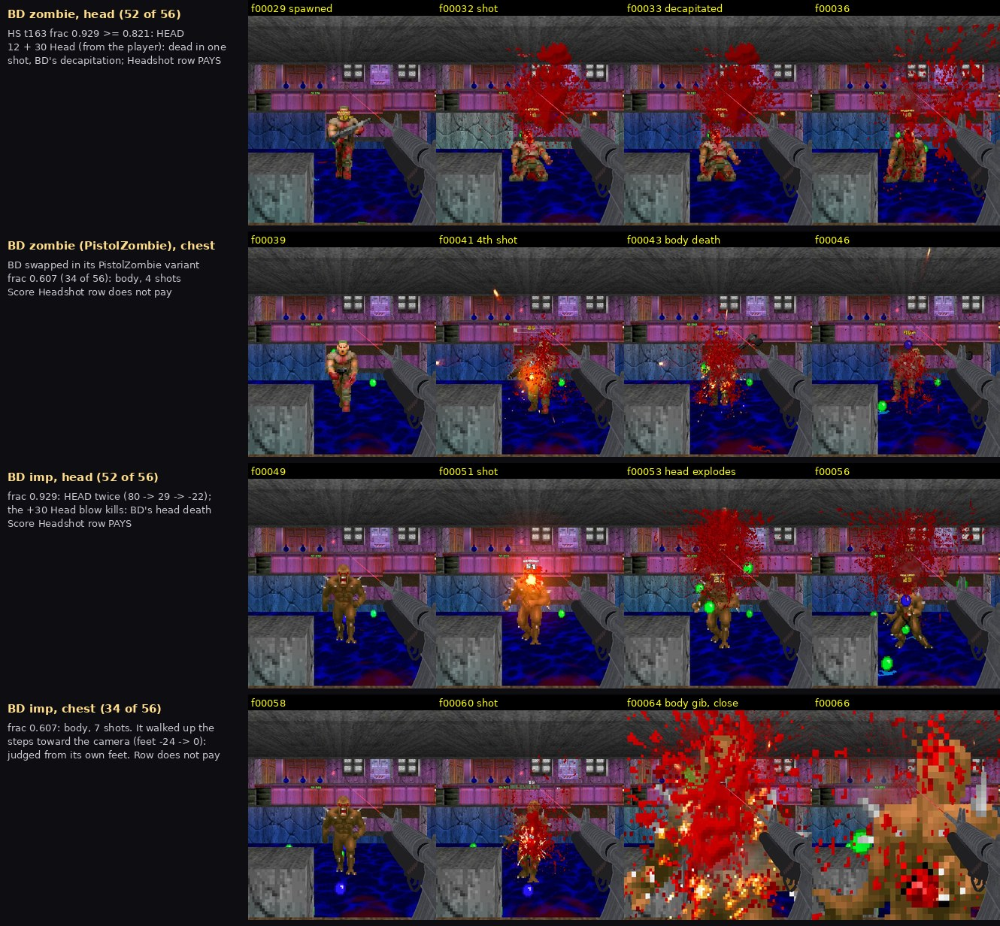
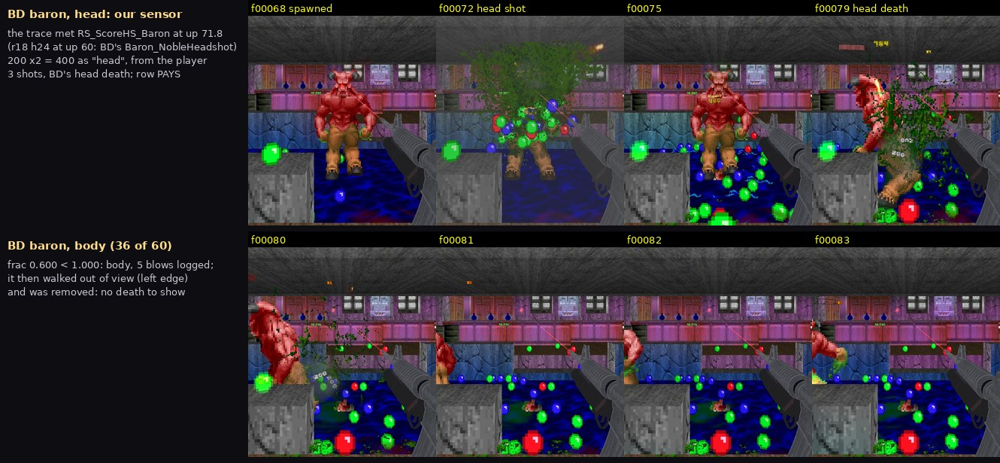
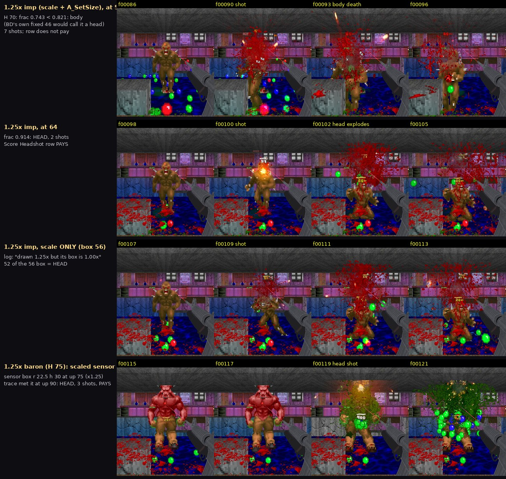
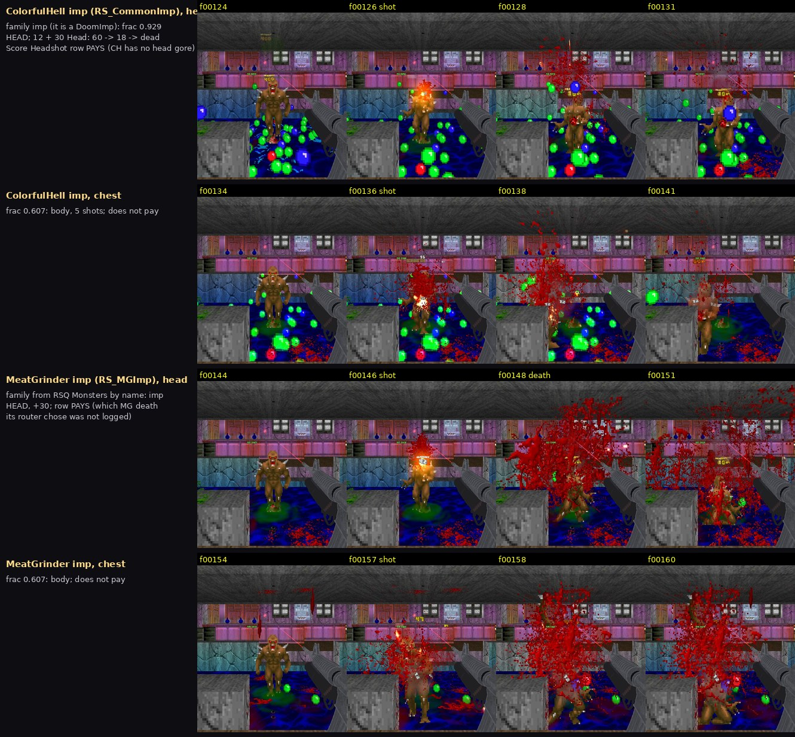
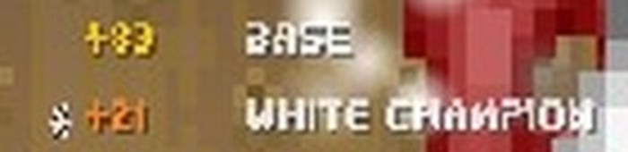
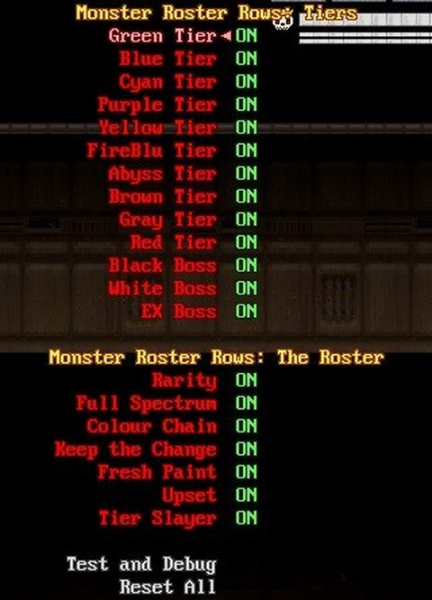

# RSQ Score
### Doom Arcade VR · points for every kill, a bonus for how you made it, and lives you earn back

Every kill pays the monster's worth, and every bit of style on top pays more: a kill in mid-air, a shot you never looked
at, a whip crack into a shield bash, a fireball sent back into the imp that threw it. The bonuses roll out under your
score as they land, and every map sets a target: cross it and you earn an extra life, which catches you at 1 HP and
brings you back in a ring of fire.

*[GIF to come: a kill, the bonus rows rolling out under the score line, the bar filling]*

---

## What it feels like

- **Kills pay what they were worth.** A monster pays its own starting health in points, so a Baron pays about
  sixteen imps. How you killed it adds more on top.
- **Style pays.** About two hundred and forty bonus rows watch every kill: point-blank, in the air, round a corner,
  a sent-back shot, a perfect parry, a champion, a legendary. Each pays a share of the kill's worth, and they add up.
- **Combos across your tools.** Every monster remembers which of your tools touched it, in order. A whip, then a hook,
  then a shotgun is a combo, and 242 of them have names.
- **A breakdown you can read.** Each bonus pops up under your score as "+120 Point-Blank" in its family's colour and
  fades away. Quick kills stack into one growing number.
- **A target every map.** The bar under your score fills toward the map's target. Cross it and you get an extra life.
- **Lives that catch you.** With a life in hand you cannot be killed outright: the blow that would drop you stops you
  at 1 HP, a life is spent, you are back to full health, and a blast hits the monsters round you and a column of fire climbs round you.
- **Big moments slow the world.** With RSQ SlowMo loaded, a Fatality, a Swan Song or a five-tool combo slows the world
  for a beat.
- **A word that breathes.** The word "Score:" breathes from calm blue to warm, flares white-gold when points land and
  warms to gold as the next life nears.

---

## How to play

| Do this | What happens |
|---|---|
| Kill a monster | Its starting health in points, on the Base row |
| Kill it with style (in the air, point-blank, in its attack, a head shot...) | Each bonus that fits adds its share on its own row under the score |
| Touch a monster with two or more of your tools, then kill it within 3 seconds of the last | A combo: a named one if the chain has a name, a 2- to 6-Tool Combo if not |
| Keep killing | The bar under your score fills toward the map's target |
| Fill the bar | It lights blue, a chime plays, and a life pip pops above your score: you hold an extra life |
| Take a hit that would kill you, with a life held | You stop at 1 HP, a life is spent: full health, a blast round you, a column of fire, and a moment of no damage |
| Look at your off-hand wrist (turn on **Score on the Wrist**) | Your score in small gold digits above the controller |

### Controls

**No keys**, and nothing to bind. Score watches what you do. It works on any monster set, alone or with any mix of the
series.

- **Gesture:** look at your off-hand wrist for the score on the wrist (with **Score on the Wrist** on).
- **Menu buttons:** only **Reset All**, at the foot of its page.

**A new map starts from zero by default:** the score, the bar and the lives you held. **New Map Keeps** lets you keep
the total, the total and the lives, or everything.

---

## How points are scored

**The base** is the monster's own starting health: a zombieman pays 20, an imp 60, a Baron 1,000. With Brutal Doom
loaded only real monsters count (the ones the level counts as kills, and anything that replaces one); Brutal Doom's
own helper actors and Champions' Indigo clones pay nothing.

**Bonuses add, they do not multiply.** Each bonus that fires pays a share of the base (×0.3 adds 30% of it). All of a
kill's shares are added together, and in total they can add at most three times the base (**Kill Bonus Cap**, 300%).
Each of the five families can have its own cap too, off by default.

**Who gets paid:**

- **Your kill** pays you, with every bonus that fits.
- **A monster killing another monster** pays every player the base plus Infighter. A monster killing itself pays
  everyone the base plus Darwin.
- **A monster your Infight or Charm grenade turned** makes kills for you (Civil War).
- **The level killing it** (a crusher, a pit, a damaging floor) pays nobody, unless you sent it there in the last two
  seconds with the Force, a kick, a punch, a bash, a whip or the hook, or it died in your Headlock: then it is your
  kill (Ring Out, Meat Shield).
- **A Lost Soul killed the moment it is spawned** pays nobody.

**Raised and spawned monsters.** Monsters standing on the map when it starts (counted once more after the first tic, so
monsters a spawner makes at the start count too) pay their full base once. Anything else, an Arch-Vile's raised corpse
or a script's spawn, pays **Raised Monster Pay**: 100% by default, so it changes nothing until you lower it.

---

## The map's target and the rewards

Every map works out its own target from its monsters: the average monster's worth, times half the map's monster
count (counted as at least 140 and at most 800 monsters), rounded to the nearest 5,000 and never below 5,000. A map
of 100 monsters averaging 150 health asks for 10,000. The bar under your score shows how far you are into the next
target; every time you cross one, you earn its reward.

**Target Reward** picks the reward:

| Choice | Each target pays |
|---|---|
| **Life Every Time** (the default) | An extra life |
| **Ammo, Then Life** / **Life, Then Ammo** | Taking turns, starting with ammo or with a life |
| **Ammo Only** | Ammo: over 20 seconds you get back **Ammo Refill** (40%) of the most of every ammo you carry |
| **Nothing** | The score is just a number; the bar goes away |

The bar fills orange when the next reward is ammo and blue when it is a life. When a reward pays, the bar lights in its
colour; a life also plays a second chime and makes the life pips swell and light up.

---

## Lives

You see your lives as pips above the score line (up to 10 drawn; you can hold more).

- **With a life held you cannot be killed outright.** The blow that would kill you stops you at 1 HP, and a life is
  spent: you are back to full health.
- **The revival:** the revival sound, a blast round you (384 damage out to 256 units; it never hurts you), a turning
  ring of fire with flames climbing round you for about two seconds, then a last burst (**Revival Fire**), and no
  damage to you while it plays (about 2.7 seconds).
- **What still kills you:** damage that ignores the hold, such as a telefrag. Then every life you held is lost.
- **More lives from other mods:** RSQ Miniboss can give one. The gold life crate is kept for the arcade systems, and nothing
  drops it yet (RSQ Miniboss stopped 11-10). The crate wears Score's gold, sends a beam of light into the sky, stays where it fell and lasts 10 seconds; in
  its last 5 it breathes faster and faster and turns ember, then red. RSQ Distance Grab can pull it to you.
- **RSQ SlowMo's DOWN comes first.** While DOWN holds you at 1 HP no life is spent; a life is spent if DOWN fails.

*[GIF to come: a life spent: the blast and the ring of fire climbing round the player]*

---

## Head shots

The game judges every blow on every monster, Brutal Doom's, RSQ Monsters', or any monster pack's, and says whether it
hit the head.

- **The head is the top of the monster, measured on its own size.** The line is the same share of its height that
  Brutal Doom uses for that kind of monster (an imp's head starts 46 units up its 56), measured from its own feet, so a
  monster grown to 1.25x has a head 1.25x as big. A monster of a kind nobody gave numbers: its top 20%.
- **Demons, spectres, Cacodemons, Pain Elementals, Lost Souls and spiders** have no head in Brutal Doom. With
  **Heads on Demons, Cacos and Spiders** on (the default) their top 20% counts as one.
- **Never a head:** an explosion, a blow that is not a bullet or a flying shot, a monster knocked down or crouching.
- **Head Shot Damage:** a head shot does Brutal Doom's extra: +30 head damage on zombie-, imp-, sergeant-,
  chaingunner- and SS-kinds, the blow again on Baron-, Knight-, Arch-Vile-, Revenant-, Mancubus- and Cyberdemon-kinds,
  and whichever is more on an unknown kind. Brutal Doom's own head deaths and leg deaths still play.
- **Brutal Doom's big monsters** keep a head target that grows with them.
- **Saws and axes** keep Brutal Doom's own check.
- **What it pays:** the Headshot row, and every combo that asks for a head shot.

*These pictures are frame sheets from the test rig (stock QuestZDoom 17.3, 2026-11-09), shots fired by a test probe,
not a gun in a headset.*

---

## Combos

**Every monster keeps a list of the tools that touched it, in order:** a gun, a saber cut, a shield bash, the hook's
bite, a whip crack, a Distance Grab throw, a grenade, a punch, a block, a Force pull. Using the same tool again and
again is one step (a burst of fire is one "gun"). The chain breaks after **3 seconds** with no new move.

When you kill it, the chain pays:

- **A named combo** if the chain matches one: its steps in order, the last step the killing blow, other moves allowed
  in between. The best-paying match wins. Some ask for more: in your own slow motion, a head shot, point-blank, the
  monster in the air, or a kind of monster (a champion, the miniboss).
- **A generic chain** for the tools no name covers: 2 tools ×0.2, 3 ×0.45, 4 ×0.75, 5 ×1.0, 6 or more ×1.2. Every
  extra mod past two adds 0.1 (up to 0.3), and a whole chain inside 2 seconds pays 1.25 times as much.
- **Every gun is one tool.** Switching guns is Switcharoo's business. A combo can still ask for one kind of gun.
- **Nothing pays twice.** A name pays for the tools it covers, and only the rest pay as generic. Rows that are combos
  already (Reeled In, Ping-Pong, Fly Ball, Bowling, Pulled In, Riposte) cover their tools the same way. A kill whose
  own chain mixed tools does not also pay Variety or the melee Combo.

Its rows in the breakdown read "Lion Tamer" or "3-Tool Combo". Any named combo, or three tools or more, makes the
word "Score:" flare; a named combo of three steps or more, five tools in one chain, or four mods is a big moment.

*[GIF to come: a whip crack, a hook yank and a shotgun kill: the named combo and its row]*

<b>All 242 named combos</b> (names are placeholders; the pay is a share of the kill's base)

The guns: **pistol** (the pistols and revolvers), **shotgun** (shotguns and the Super Shotgun), **rifle** (rifles,
machine guns, the minigun, the sniper rifle, the chaingun), **launcher** (rockets, launcher grenades, the nuke),
**energy gun** (plasma, the railgun, the BFG, the Unmaker), **flamethrower**. **Punch** is a punch RSQ Melee lands (its
gloves, or any fist with Melee loaded) or SuperPunchOut's gloves; **punch or kick** adds any other punch and Brutal
Doom's kick.

**The first fourteen**

- Lion Tamer: whip → shield bash (×0.5)
- Clay Pigeon: Force push → gun (×0.5)
- Sitting Duck: Force grip → gun (×0.5)
- Pull!: Force pull → gun (×0.5)
- Disc Jockey: Force push → ShieldSaw throw (×0.5)
- Gun Kata: punch or kick → gun (×0.4)
- Fast Hands: any melee → holster draw (×0.5)
- Lasso: whip → hook yank (×0.5)
- Pitch and Slice: Distance Grab throw → saber cut (×0.5)
- Circus Act: whip → hook yank → gun (×0.9)
- Yo-Yo: Force pull → Force push → gun (×0.9)
- Discus: shield bash → Force push → ShieldSaw throw (×0.9)
- Headlock: Headlock → punch or kick (×0.5)
- F.E.A.R. Effect: gun-butt shove → shotgun (in your slow motion) (×0.6)

**The fists (RSQ Melee): punches, the uppercut, the shove, the Guard, the Headlock**

- Trap Shooter: uppercut → shotgun (×0.5)
- Rising Dragon: uppercut → saber cut (×0.5)
- Spike: uppercut → ShieldSaw throw (×0.5)
- Catch of the Day: uppercut → hook yank (×0.6)
- Air Lash: uppercut → whip crack (×0.5)
- Alley-Oop: uppercut → Distance Grab throw (×0.5)
- Air Mail: uppercut → grenade (×0.5)
- Fireworks: uppercut → launcher (×0.5)
- One-Two-Skeet: punch → uppercut → shotgun (×0.9)
- Cross Cut: hook punch → saber cut (×0.4)
- Fist and Shield: punch → shield bash (×0.4)
- Knuckle Crack: punch → whip crack (×0.4)
- Jedi Jab: punch → Force push (×0.4)
- Punch and Pitch: punch → ShieldSaw throw (×0.4)
- Slow Trap Shooter: uppercut (in your slow motion) → shotgun (×0.55)
- Feint: jab → saber stab (×0.45)
- Skyskewer: uppercut → saber stab (×0.55)
- Pistol Whip: gun-butt shove → pistol (×0.5)
- Executioner: gun-butt shove → gun (head shot) (×0.6)
- Riot Shield: gun-butt shove → shield bash (×0.5)
- Make Room: gun-butt shove → saber cut (×0.4)
- Fire in the Hole: gun-butt shove → grenade (×0.45)
- Backlash: gun-butt shove → whip crack (×0.4)
- Street Fighter: Hadouken → uppercut (×0.6)
- Shoto: Hadouken → saber cut (×0.5)
- Return Fire: Hadouken → gun-butt shove → shotgun (×1.0)
- Neo: Hadouken (in your slow motion) → punch (×0.6)
- Backhand Spring: Swat Back → uppercut → pistol (×1.0)
- Parry Punish: Guard parry → anything (×0.5)
- Counter Cut: Guard parry → saber (×0.6)
- Knuckle Sandwich: Guard parry → punch (×0.55)
- Dragon Fist: Guard parry → uppercut → punch (×0.9)
- Pressure Valve: Guard release → punch (×0.5)
- Hostage: Headlock → pistol (×0.5)
- Close Quarters: Headlock → shotgun (×0.5)
- Hold This: Headlock → grenade (×0.6)
- Execution: Headlock → saber (×0.5)
- Suplex: Headlock → Headlock toss (×0.5)
- Flog: Headlock → whip crack (×0.5)
- Title Belt: Headlock → punch or kick · on a champion (×0.6)
- Bouncer: Headlock → punch or kick → shotgun (×0.9)
- Choke and Cut: Headlock → Chokehold → saber cut (×0.9)
- Slam and Blam: Headlock → Headlock Slam → shotgun (×0.9)
- Clay Toss: Headlock toss → shotgun (×0.5)
- Ground and Pound: Headlock Slam → punch (×0.5)
- Pin Down: Headlock Slam → saber stab (×0.55)
- Come Get Some: taunt → punch or kick (×0.4)
- Come Closer: taunt → shotgun (×0.5)
- Tremor: Ground Pound → shotgun (×0.45)
- Quake: Ground Pound → shield bash (×0.4)
- Get Back!: Clear Out → grenade (×0.5)
- Spread Out: Clear Out → launcher (×0.45)

**The saber and the Force (RSQ Saber)**

- Laser Sword: saber cut → energy gun (×0.5)
- Blade and Buckshot: saber cut → shotgun (×0.45)
- Edge and Board: saber cut → shield bash (×0.4)
- Pommel: saber cut → punch (×0.4)
- Slash and Blast: saber cut → Force push → shotgun (×0.9)
- Distraction: saber throw → punch (×0.5)
- Covering Fire: saber throw → rifle (×0.45)
- Air Traffic: saber throw → ShieldSaw throw (×0.5)
- Throw and Go: saber throw → saber cut (×0.4)
- Return Flight: saber throw → Force pull → saber cut (×0.9)
- Helpless: Force grip → saber cut (×0.5)
- Hung Out to Dry: Force grip → punch (×0.5)
- Special Delivery: Force grip → grenade (×0.5)
- Pinned: Force grip → ShieldSaw throw (×0.5)
- Strung Up: Force grip → whip crack (×0.5)
- Exorcism: Force grip → saber cut · on a Ghost champion (×0.6)
- Jedi Brawler: Force grip → punch → saber cut (×0.9)
- Superhero Landing: Force jump landing → punch (×0.5)
- Leap Strike: Force jump landing → saber cut (×0.5)
- Come Here, Go Up: Force pull → uppercut → shotgun (×0.9)
- Force Arrest: Force pull → Headlock → punch (×0.9)
- Jedi Hoplite: Force pull → shield bash → saber cut (×0.9)
- Clay Saber: Force push → saber throw (×0.5)
- Slingshot: Force push → hook yank (×0.5)
- Hot Seat: Force push → grabbed barrel (×0.5)
- Scoundrel: Force push → saber throw → pistol (×0.9)
- Push-Pull: Force push → Force pull → saber cut (×0.9)
- Time Slash: Force push (in your slow motion) → saber cut (×0.55)
- Off the Blade: saber stab → Force push (×0.5)
- Stab and Jab: saber stab → punch (×0.4)
- Shock and Awe: Force Lightning → punch (×0.5)
- Sith Ambush: Force Lightning → saber cut (×0.5)
- Overcharge: Force Lightning → energy gun (×0.5)

**The ShieldSaw (RSQ ShieldSaw)**

- Riot Control: shield bash → shotgun (×0.5)
- Bash and Slash: shield bash → saber cut (×0.5)
- Spring Back: shield bash → hook yank (×0.45)
- Bash and Lash: shield bash → whip crack (×0.4)
- Shield and Fist: shield bash → punch (×0.4)
- Crack the Shell: shield bash → blade · on a Bronze, Gold or Titan champion (×0.55)
- Bash and Launch: shield bash → uppercut → shotgun (×0.9)
- Shield Up: shield block → grenade (×0.5)
- This Is Sparta: shield block → shield bash → saber (×0.9)
- Riot Squad: shield block → shield bash → shotgun (×0.9)
- Shield Uppercut: shield block → shield bash → uppercut (×1.0)
- Slow Sparta: shield block (in your slow motion) → shield bash → saber cut (×1.0)
- Blitz: Shield Dash → uppercut (×0.5)
- Door Kicker: Shield Dash → shotgun (×0.5)
- Spartan Charge: Shield Dash → saber (×0.5)
- Saw and Saber: ShieldSaw throw → saber cut (×0.5)
- Crossfire: ShieldSaw throw → saber throw (×0.5)
- Follow-Through: ShieldSaw throw → punch (×0.4)
- Throw and Follow: ShieldSaw throw → shield bash (×0.4)
- Cleanup Crack: ShieldSaw throw → whip crack (×0.4)
- Vibranium: ShieldSaw throw → Shield Dash → punch (×0.9)
- Sawblade Send-Off: shield grind → Force push → ShieldSaw throw (×0.9)
- Turnabout: any block → hook (×0.5)
- Hoplite: shield bash → saber stab (×0.55)
- Nailed: shield slam → saber stab (×0.55)
- Up Against the Wall: shield slam → punch (×0.5)

**The whip (RSQ Whip)**

- Ringmaster: whip → hook → shield bash (×1.0)
- Frontier: whip crack → pistol (×0.5)
- High Noon: whip crack → holster draw (×0.6)
- Zorro: whip crack → saber (×0.5)
- Big Top: whip crack → ShieldSaw throw (×0.55)
- Crack and Smack: whip crack → punch (×0.4)
- Crack of Doom: whip crack → anything · on a legendary not yet risen (×0.6)
- Bullet Ballet: whip crack (in your slow motion) → gun (×0.9)
- Tetherball: whip flail → punch (×0.5)
- Tetherball Disc: whip flail → ShieldSaw throw (×0.5)
- Rope-a-Dope: lasso → punch (×0.5)
- Rodeo: lasso → gun (×0.45)
- Hogtie: lasso → saber cut (×0.5)
- Roped and Diced: lasso → ShieldSaw throw (×0.5)
- Bound: lasso → Force grip (×0.5)
- Hog-Tied: bola → grenade (×0.55)
- Saloon Brawl: lasso → punch → pistol (×0.9)
- Bounty Hunter: lasso → Force pull → saber cut (×0.9)
- Jungle Law: Tarzan swing → punch (×0.5)
- Swing Shot: Tarzan swing → shotgun (×0.5)
- Swashbuckler: Tarzan swing → saber cut (×0.6)
- Cannonball: Tarzan swing → shield bash (×0.55)
- On a Leash: whip wrap → punch (×0.5)
- Tied Up: whip wrap → saber cut (×0.5)
- Tethered: whip wrap → ShieldSaw throw (×0.5)
- Gift Wrapped: whip wrap → launcher (×0.5)
- Package Deal: whip wrap → grenade (×0.5)
- Strangler: whip wrap → Force grip (×0.5)
- Puppeteer: whip wrap → Force grip → saber cut (×0.9)
- Get Over Here!: whip yank → punch (×0.6)
- Closer: whip yank → shotgun (×0.5)
- Reel and Deal: whip yank → saber cut (×0.5)
- Yank and Bank: whip yank → shield bash (×0.55)
- Into the Blades: whip yank → shield grind (×0.55)
- Yank and Launch: whip yank → uppercut → shotgun (×0.9)
- Ringside: whip yank → Headlock → punch (×0.9)
- Reel and Run Through: whip yank → saber stab (×0.55)

**The hook (RSQ Grapple)**

- Fish Out of Water: hook → uppercut (×0.6)
- Harpoon: hook → saber cut (×0.5)
- Doorstop: hook → shield bash (×0.5)
- Come Here!: hook → punch or kick (×0.5)
- Hook Shot: hook → shotgun (×0.45)
- Care Package: hook → grenade (×0.6)
- Collar: hook → Headlock (×0.45)
- Crack the Line: hook → whip crack (×0.5)
- Sawmill: hook → shield grind (×0.55)
- Meat Hook: hook → blade (×0.55)
- Strung Out: hook → Force grip → gun (×0.9)
- Kite: hook → uppercut → hook yank (×1.1)
- Finish Him!: hook → punch or kick → Fatality (×1.1)
- Reel and Hurl: hook → shield bash → ShieldSaw throw (×1.0)
- Wrestlemania: hook yank → Headlock → punch (×0.9)
- Suplex City: hook yank → Headlock → Headlock toss (×0.9)
- Hook, Line and Sinker: hook yank → shield bash → saber cut (×0.9)
- Hooked Keg: hooked barrel → anything (×0.4)
- Fetch!: hooked barrel → Distance Grab throw → gun (×1.0)
- Drop In: Zip Kick → gun (×0.45)
- Swoop: Zip Kick → any melee (×0.6)

**Distance Grab**

- Catch This: Distance Grab throw → punch (×0.45)
- Batter Up: Distance Grab throw → gun (×0.35)
- Bait and Hook: Distance Grab throw → hook (×0.45)
- Serve and Volley: Distance Grab throw → shield bash (×0.45)
- Two Throws: Distance Grab throw → ShieldSaw throw (×0.45)
- Toss and Crack: Distance Grab throw → whip crack (×0.45)
- Kitchen Sink: Distance Grab throw → grenade → gun (×1.0)
- Bait and Switch: Distance Grab throw → hook → any melee (×1.0)
- Aftershock: grabbed barrel → any melee (×0.5)
- Sandbag Riposte: body shield → gun (×0.4)

**The grenade (RSQ Grenade, or Brutal Doom VR's own)**

- Into the Breach: grenade → any melee (×0.45)
- Mop Up: grenade → gun (×0.3)
- Flush Out: grenade → hook (×0.5)
- Shell Shock: grenade → punch (×0.5)
- Frag and Slash: grenade → saber cut (×0.5)
- Demolition: grenade → grabbed barrel → gun (×1.0)
- Ice Breaker: Freeze grenade → punch (×0.55)
- Cold Cut: Freeze grenade → saber cut (×0.55)
- Cold Shoulder: Freeze grenade → shield bash (×0.55)
- Ice Fishing: Freeze grenade → hook yank (×0.7)
- Ice Pop: Freeze grenade → uppercut → shotgun (×1.0)
- Dazed and Confused: Stun grenade → punch (×0.55)
- Stun and Gun: Stun grenade → gun (×0.45)
- Snatch: Stun grenade → hook (×0.55)
- Dizzy Finish: Stun grenade → punch → Fatality (×1.0)
- Butcher Shop: Stun grenade → hook → blade (×1.1)
- Lights Out: Flash grenade → any melee (×0.5)
- Blind Side: Flash grenade → saber (×0.55)
- Swat Team: Flash grenade → hook → shotgun (×1.0)
- Breach and Clear: Flash grenade → Shield Dash → shotgun (×0.9)
- Out of the Smoke: Smoke grenade → any melee (×0.5)
- Ninja: Smoke grenade → saber stab (×0.55)
- Batting Practice: held thing swung → gun (×0.4)
- Ghost Hold: Smoke grenade → Headlock → blade (×1.0)
- Pin Cushion: Sticky grenade → gun (×0.45)
- Hot Potato: Sticky grenade → hook → grenade (×1.2)
- Return to the Pack: Sticky grenade → Force push → grenade (×0.9)
- Hot Lash: Incendiary → whip crack (×0.5)
- Fan the Flames: Incendiary → Force push → flamethrower (×0.9)

**The guns open it**

- Rocket Punch: launcher → punch (×0.5)
- Over-Under: launcher → rifle (×0.4)
- Mop-Up Saw: launcher → chainsaw (×0.5)
- Hot Hands: flamethrower → punch (×0.5)
- Fire Whip: flamethrower → whip crack (×0.45)
- Plasma Blade: energy gun → saber cut (×0.45)
- Shoot and Snap: pistol → whip crack (×0.4)
- Buckshot Brawl: shotgun → punch (×0.4)
- Clean Up: shotgun → saber cut (×0.4)
- Suppress and Storm: rifle → shield bash (×0.45)
- Rip and Pump: chainsaw → shotgun (×0.4)
- Door Kick: kick → shotgun (point-blank) (×0.5)

**The rig, a lean, shots sent back**

- Showdown: holster draw (in your slow motion) → gun (×0.9)
- Draw and Shove Off: holster draw → Force push → pistol (×0.9)
- Tuco: thrown gun → holster draw (×0.5)
- Slip and Shoot: lean out of a round → gun (×0.4)
- Bob and Weave: lean out of a round → punch or kick (×0.5)
- Tennis: a shot sent back → a shot sent back (×0.5)
- Volley: a shot sent back → a shot sent back → a shot sent back (×1.0)
- Kingslayer: anything (in your slow motion) → anything · on the miniboss (×0.5)

---

## The score tree

Every bonus row belongs to one of five families. The family gives its colour in the breakdown, and its own cap.

| Family | Colour | What it is for |
|---|---|---|
| **Efficiency** | Red | Killing fast and clean: Spree, Untouchable, Infighter, Civil War, Hand Cannon, the roster's Upset |
| **Style** | Green | How it looked: Air, Curveball, Skeet, Thrown, Multi-Kill, the combo chain |
| **Daring** | Orange | The risk you took: Point-Blank, Redline, Swan Song, the champion and legendary rows, Headshot |
| **Melee** | Steel blue | Your hands and blades: Fatality, Boot, Juggle, the fists, the saber, the shield, the whip |
| **Counterplay** | Violet | Defence turned into a kill: Riposte, Return to Sender, Rally, Read It, Justice Shot |

**About 240 rows**, in the groups below. The names are placeholders. Most rows only pay when the mod they read is
loaded; without it they stay silent. A row's pay is a share of the kill's base: ×0.5 adds half. "Big moment" marks the
rows that can slow the world for a beat (see Big moments). Where a row "replaces" another, the two never pay on the
same kill.

<b>The classics</b> (13: the original score system's, every number kept)

| Row | Family | Pays for | Pay |
|---|---|---|---|
| **Spree** | Efficiency | Kills in quick succession. Each kill gives you 2 to 10 seconds (longer after a bigger monster) to make the next | +0.025 a kill in the run, at most ×0.25 |
| **Untouchable** | Efficiency | Kills since you last took damage. Starts once you have killed a tenth of the map's monsters (20 to 100) or a tenth of its health (2,000 to 10,000) untouched, then grows | up to ×0.5 |
| **Infighter** | Efficiency | A monster killed another monster. Paid to every player | ×0.2 |
| **Switcharoo** | Style | Two different guns fired in the last 2 to 4 seconds; or two different triggers (main, off hand, alt fire) | ×0.15; ×0.075 |
| **Air** | Style | You were off the ground. Paid on how high this jump reaches, from 64 units up | ×0.005 a unit, at most ×2.0; a big moment from ×0.5 |
| **Curveball** | Style | The monster had no line of sight to you | ×0.2 |
| **Darwin** | Style | The monster killed itself. Paid to every player | ×2.0 |
| **Telefragged** | Style | A telefrag | ×1.0, a big moment |
| **Coach Gun** | Daring | A Super Shotgun blast (Brutal Doom's own damage type for it); a weapon dealing "Scrap" pays ×0.125 | ×0.25 |
| **Brawler** | Daring | A kill with fists or a blade: Doom's fist and chainsaw, Brutal Doom's fists, saw and axe, RSQ Melee's and SuperPunchOut's gloves (×0.5); Heretic's, Hexen's and Strife's melee weapons at their own prices | ×0.1 to ×0.5 |
| **Redline** | Daring | Your health at 25 or less | ×0.02 at 25 up to ×0.5 at 1; a big moment at 5 or less |
| **Swan Song** | Daring | A kill that lands after you died. Replaces Redline | ×3.0, a big moment |
| **Point-Blank** | Daring | Within 64 units, edge to edge | ×0.1 |

<b>Melee: blades, the Force, the shield, fists and boots</b> (27)

- **Fatality** (Melee): Brutal Doom's execution. ×0.5, a big moment.
- **Cleaved** (Melee): a melee kill that took the body apart. ×0.3.
- **Hurled** (Melee): the thrown ShieldSaw or saber; each further kill by the same throw pays more. ×0.3, +0.15 each, at most ×0.75.
- **Shield Work** (Melee): the shield's bash ×0.3, its revved grind ×0.2.
- **Riposte** (Counterplay): you blocked its attack (shield or saber), then killed it within 3 s. ×0.4.
- **Perfect Riposte** (Counterplay): the same after a perfect block. Replaces Riposte. ×0.7, a big moment.
- **Return to Sender** (Counterplay): a shot sent back killed it. ×0.4; a Hadouken or Swat Back ×0.6; the Guard's reflect ×0.5; the whip's Return Crack ×0.55.
- **Combo** (Melee): kills by different melee moves within 4 s. ×0.1 a move past the first, at most ×0.4.
- **Poetic Justice** (Counterplay): a sent-back shot killed the monster that fired it. ×0.3, a big moment.
- **Boomerang** (Melee): a throw that killed on its way out kills again on its way home. ×0.5, a big moment.
- **Ground Down** (Melee): the thrown disc stuck in a tough monster and ground it to death. ×0.3.
- **Heavy Swing** (Melee): Brutal Doom VR's hard swing: the second blow of the swing killed ×0.15, the third ×0.3 (a big moment).
- **Choked** (Melee): the Force grip's choke, or RSQ Melee's Chokehold. ×0.3.
- **Slammed** (Melee): a body flung from the Force grip died hitting something. ×0.5, a big moment.
- **Juggle** (Melee): a melee kill of a monster in the air that you put there in the last 2 s. ×0.3.
- **Boot** (Melee): Brutal Doom's kick, head kick or stomp. ×0.2.
- **Pulled In** (Melee): the Force pull brought it, a melee blow finished it within 2 s. ×0.3.
- **Twin Blades** (Melee): a saber kill with a lit saber in each hand. ×0.2.
- **Rally** (Counterplay): sent-back shots killing one after another, each within 3 s: the second ×0.2, the third ×0.4, then ×0.6 (a big moment).
- **Ring Out** (Melee): the level or another monster finished what you sent there (see Who gets paid). ×0.5, a big moment.
- **Ground Pound** (Melee): the Force jump's landing, or RSQ Melee's two-fist pound. Replaces Slammed. ×0.3.
- **Clean Sweep** (Melee): the ShieldSaw thrown at two or more locks killed the last of them. ×0.5, a big moment.
- **Bank Shot** (Melee): the disc came off a wall onto a new lock and killed it. ×0.4, a big moment.
- **Shield Wall** (Counterplay): a kill while your shield blocked another monster's attack in the last second. ×0.25.
- **Counter** (Melee): a melee blow killed it mid-attack. ×0.3.
- **Knockdown** (Melee): a punch finished it while it reeled. ×0.2.
- **Flurry** (Melee): a run of glove punches, left and right, each within half a second: the third ×0.15, the fourth ×0.3, then ×0.45 (a big moment).

<b>Shots, throws, the rig and slow motion</b> (14)

- **Thrown** (Style): something you threw with Distance Grab. ×0.2, +0.03 a m/s over 3, at most ×0.5.
- **Powder Keg** (Style): the blast of a barrel your throw set off; each kill within a second of the last pays more. ×0.3, +0.2 each, at most ×1.1; a big moment from the third.
- **Air Catch** (Daring): a thrown thing you caught back out of the air and threw again. ×1.0, +0.5 a catch, at most ×2.0, a big moment.
- **Skeet** (Style): the monster was in the air (not a flyer). ×0.25.
- **Quick Draw** (Daring): a shot from the gun you just drew from an RSQ Tactical Rig holster, within 1.2 s. ×0.35.
- **No-Look** (Daring): the shot left more than 60 degrees from where your head faced. ×0.3.
- **Blind-fire** (Daring): your eyes could not see it, but your hand's shot could. Replaces No-Look. ×0.4, a big moment.
- **Off-hand** (Style): your off hand's trigger fired the kill. ×0.2.
- **Full Hands** (Style): a shot kill while a hand carries something with Distance Grab. ×0.25.
- **Body Blow** (Style): a thrown corpse killed it. ×0.3.
- **Hand-Me-Down** (Style): a gun a dead monster dropped, thrown. ×0.3.
- **Hot Swap** (Daring): mid-fight you drew a different gun from a holster and it killed. ×0.25.
- **Stretched Second** (Style): a kill while RSQ SlowMo has the world slowed pays **Style Share** (50%) of what the kill's other bonuses paid, Efficiency's left out. Half that in a slow motion the game started for you; nothing in Score's own; 1.5 times as much at 10% speed or slower.
- **Two Guns** (Style): a shot kill from one hand within a second of one from the other. ×0.25.

<b>The hook and the rope</b> (9)

- **Reeled In** (Melee): the hook brought it, a melee blow finished it within 2 s; a chain of them pays more. ×0.3, +0.15, at most ×0.75; a big moment from the third. Replaces Pulled In.
- **Ping-Pong** (Style): hooked, sent flying back out, hooked again, then killed. ×0.4, +0.2 a volley, at most ×1.0.
- **Bowling** (Style): a body you threw (the hook's yank, the Headlock toss, a monster on the whip) struck it. ×0.5, +0.25 a body, at most ×1.25, a big moment.
- **Hard Landing** (Style): the hook's throw itself killed it. ×0.3.
- **Fly Ball** (Style): killed while your hook was throwing it. Replaces Skeet and Juggle. ×0.35.
- **Swinging** / **Hanging Shot** (Daring): a kill while a rope (RSQ Grapple's or RSQ Whip's) carries you ×0.35; hanging still ×0.15. Replaces Air.
- **Dismount** (Daring): you let go of a swing at speed and killed within 3 s in the air, or within a second of landing. Replaces Air. ×0.4.
- **Lashed** (Melee): a whip crack. ×0.25 (×0.2 light, ×0.35 heavy, when RSQ Whip says how hard).
- **Variety** (Style): three or more of your tools in one fight (kills within 10 s of each other). ×0.15 a tool past two, at most ×0.6; a big moment at five.

<b>Combo Chain</b> (1 bonus, many rows)

The chain described under Combos: its rows are **2-Tool Combo** to **6-Tool Combo** and one row per named combo.

<b>The fists (RSQ Melee, RSQ Gun Bonsai VR's fist upgrades)</b> (17)

All Melee family.

- **Shoryuken**: an uppercut. ×0.3.
- **Liver Shot**: a punch below the chest. ×0.2.
- **Glass Jaw**: a punch to the top fifth. ×0.25.
- **Textbook**: jab, jab, hook inside a second. ×0.35.
- **Triple Threat**: jab, hook, uppercut inside a second. Replaces Shoryuken and Textbook. ×0.5, a big moment.
- **Dempsey Roll**: a run of alternating hooks. ×0.15 a hook past two, at most ×0.6.
- **Air Combo**: a punch on a monster your uppercut launched. Replaces Juggle and Skeet. ×0.3.
- **Bouncer**: the Clear Out palm thrust. ×0.3.
- **Release**: the Guard's stored charge let out. ×0.4.
- **Toss**: a monster thrown out of the Headlock dies of its landing. ×0.35.
- **Piledriver**: the Headlock Slam. ×0.5, a big moment.
- **Cut Loose**: the Headlock Uppercut. ×0.4.
- **Butt Stroke**: the gun-butt shove itself. ×0.3.
- **K.O.**: Gun Bonsai VR's Finisher. ×0.5, a big moment.
- **Shatter**: a frozen monster shattered. ×0.4.
- **Live Wire**: Shock Fist's arc. ×0.3.
- **Blast Radius**: Explosive Fist's blast. ×0.25.

<b>Shared melee</b> (6)

- **Weapon Master** (Melee): a run of kills with one melee mod (fists, saber, ShieldSaw, whip), each within 10 s. ×0.1 a kill past two, at most ×0.5.
- **Giant Slayer** (Melee): a melee kill of a monster of 400 health or more ×0.5; 2,000 or more ×1.0 (a big moment).
- **Death from Above** (Melee): a melee kill falling onto it from a metre above its head. ×0.4.
- **Juggler** (Style): a kill while your thrown saber or disc is still in flight. ×0.25.
- **Misdirection** (Counterplay): a sent-back shot killed a monster that did not fire it. ×0.25.
- **Multi-Kill** (Style): one blow, blast or swing killed more than one. Each kill past the first: a grenade ×0.2 (up to ×1.0), a shotgun ×0.3 (Super Shotgun ×0.35), a rifle ×0.15 (the sniper rifle ×0.5), an energy gun ×0.2 (the railgun ×0.4, up to ×1.2; the BFG ×0.1), other guns ×0.15, a Force push ×0.2, a Distance Grab throw ×0.3, a melee move ×0.25; at most ×0.75 otherwise. A big moment from ×0.6.

<b>The saber, the ShieldSaw, the whip, the hook</b> (19)

- **Lunge** (Melee): a stab driven by your whole body. ×0.4.
- **Impaled** (Melee): you drew the blade out of an impaled monster. ×0.5, a big moment.
- **Back Off** (Counterplay): your crossed blades turned the shot that killed. Replaces Return to Sender. ×0.5.
- **Double Throw** (Melee): both sabers thrown, each killing within a second of the other. ×0.4.
- **Shield Dash** (Melee): the bash at the end of a Shield Dash. ×0.4.
- **Bit Off More** (Melee): ground to death on your revving shield while clawing at it. ×0.5.
- **Homecoming** (Melee): the disc or saber killed on its way home only. ×0.3.
- **Eyes in the Back** (Counterplay): the shield on your back blocked it, then you killed it. ×0.5.
- **Hold the Line** (Counterplay): Shield Wall, against two or more monsters in the last 2 s. Replaces Shield Wall. ×0.25, +0.1 a monster, at most ×0.55.
- **Cleaver** (Melee): the disc cut it in two thanks to the Cleaver upgrade. ×0.2.
- **Wrecking Ball** (Melee): the monster you swing on the whip smashed into it. ×0.4.
- **Tarzan** (Melee): you swung in on the rope and your arrival killed it. Replaces Swinging. ×0.5, a big moment.
- **Stun Lock** (Melee): a stunning crack held it, another tool killed it. ×0.3.
- **Heavy Haul** (Melee): a heavy monster you yanked off its feet died within 2 s. ×0.35.
- **Snap Kill** (Melee): a marked crack from 6 m or more. ×0.3.
- **Hooked Keg** (Style): the blast of a barrel your hook bit; each further kill within 3 s pays more. ×0.4, +0.2, at most ×1.2.
- **Boarding Party** (Daring): you reeled yourself to a monster too heavy to come and killed it in melee within 2 s. Replaces Reeled In. ×0.6.
- **Zip Kick** (Melee): arriving by rope at speed. ×0.35.
- **Scorpion** (Melee): Gun Bonsai VR's counterpunch on what the hook brought. Replaces Counter. ×0.3.

<b>Distance Grab, the rig, the grenade</b> (14)

- **Heavy Throw** (Style): a thrown thing of 100 kg or more. ×0.15.
- **Throwaway** (Style): a gun you threw. ×0.3, +0.2 if it was empty.
- **Iaido** (Daring): the saber drawn from its spot kills straight away. ×0.45.
- **Pin Pulled** (Daring): the grenade drawn from your belt buckle kills within 3 s. ×0.3.
- **Armory** (Daring): three different guns, each drawn from a holster and each killing, inside 6 s. ×0.5.
- **Cooked** (Daring): a grenade cooked in your hand for a second or more. ×0.2, +0.1 a half second more, at most ×0.6.
- **Airburst** (Style): the grenade went off in the air. ×0.35.
- **Tagged** (Style): a Sticky grenade killed the monster it rode. ×0.35.
- **Hold My Beer** (Daring): a grenade that went off in your hand killed it. ×0.5; ×0.8 if you lived. A big moment.
- **Cluster Bomb** (Style): a Cluster bomblet. ×0.25.
- **Ice Breaker** (Style): a monster your Freeze grenade froze, shattered. Replaces Shatter. ×0.5.
- **Civil War** (Efficiency): a monster your Infight or Charm grenade turned made the kill. ×0.4.
- **Blindside** (Style): killed while your Flash or Smoke grenade had it blind. ×0.3.
- **Barbecue** (Style): your Incendiary's fire finished it. ×0.25.

<b>The guns</b> (10)

- **Hold Streak** (Style): kills while one trigger stays down. ×0.15 a kill past two, at most ×0.6.
- **Double Tap** (Style): two pistol hits within 10 tics, the second kills. ×0.2.
- **Hand Cannon** (Efficiency): one revolver round from full health to dead. ×0.25 with Brutal Doom VR's revolver; ×0.3 with the other revolver Score knows (its slug).
- **Headshot** (Daring): the killing blow was a head shot. ×0.25; ×0.4 with the sniper rifle or the revolver.
- **Sights Up** / **Glass** (Daring): a gun kill from 768 units or more, aimed down the gun (the shot within 2 degrees of your head's facing) ×0.2; the sniper rifle or railgun from 1,024 units ×0.4, from 2,048 ×0.6.
- **Direct Hit** (Style): a rocket's impact, not its splash. ×0.2.
- **Danger Close** (Daring): a nuke kill with you within 768 units, alive. ×0.5.
- **Unmade** (Daring): an Unmaker kill of a monster of 1,000 health or more. ×0.3.
- **Rip and Tear** (Melee): a chainsaw kill of a monster of 400 health or more. ×0.5; a big moment from 1,000.
- **Tomahawk** (Melee): a thrown axe. ×0.3.

<b>Champions, LegenDoom and RSQ Miniboss</b> (42)

**What the monster was** (Daring; one colour row and one mutation row a kill, the bigger wins):

- **Champions' colours:** Dark Red, Red, Orange, Yellow, Dark Green, Green, Cyan, Blue, Indigo, Violet, Pink, Black, Grey and White Champion ×0.25; **Bronze** and **Silver Champion** ×0.5; **Gold Champion** ×0.75. A champion's extra health is in its base already; these pay for its powers.
- **Champions' mutations:** **Titan** ×0.5 (a big moment), **Undying** ×0.5 (its heart killed first), **Ghost**, **Balloon** and **Hybrid** ×0.25.
- Each Champion row carries its power's icon, the series' own (left of the number, or right of the name when the
  colour-blind letter is on the left). Rig only, not headset-confirmed (the picture below).
- **LegenDoom:** **Legendary** (it rose) ×1.5, a big moment; **Legend Denied** (killed before it could rise) ×0.75; **Legendary Champion** (risen, with its champion powers on) ×0.5, a big moment. With Champions' LegenDoom dormant mode a champion has no powers until it rises, and pays no colour row before then.

*A White Champion's row in the breakdown, "+21 White Champion" with its snowflake icon on the left (rig capture, not headset).*

**How you killed it** (Daring unless marked):

- **Immovable Object**: a melee kill of a Bronze champion. ×0.4.
- **Pop!**: a Balloon champion, killed with anything but a gun. ×0.3.
- **Pinata**: a champion gibbed. ×0.25.
- **Champion Streak**: champion kills each within 5 s. ×0.1 each, at most ×0.5.
- **Too Close for Comfort**: an Orange champion, in melee or point-blank. ×0.35.
- **Glass Cannon**: a Black champion in one blow from full. ×0.35.
- **Fool's Gold**: a monster a Gold champion gilded. ×0.2.
- **Heartbreaker**: an Undying champion within 2 s of its heart. ×0.35.
- **Champion Fatality** (Melee): Brutal Doom's Fatality on a champion. ×0.25.
- **Rainbow**: champions of 5, 10 and all 14 colours in one map: ×0.5, ×1.0, ×2.0, each paid once (a big moment from ×1.0).
- **One-Tap Legend**: a legendary from its full health in one blow. Replaces Legend Denied. ×1.0, a big moment.
- **Strike While It Rises**: a legendary within 2 s of rising. ×0.5.
- **Legend Slayer**: two legendaries within 10 s. ×0.5.
- **Chain Gang**: thralls killed one after another in one slow window: the second ×0.4, the third ×0.8, then ×1.0 (a big moment).
- **Rage Quit**: the miniboss, killed while its rage runs. ×0.75, a big moment.
- **Riot Control**: an enraged monster. ×0.15.

<b>The second round of moves, and the last grain of slow motion</b> (12)

- **Run Through** (Melee): a saber stab. ×0.25.
- **Saberstaff** (Melee): the staff's back blade or its spin. ×0.3.
- **Unlimited Power** (Melee): Force Lightning. ×0.35.
- **Clash Break** (Melee): a monster staggered by your blade-lock shockwave, killed within 3 s. ×0.35.
- **Buzzsaw** (Melee): a grind kill after 1.5 s or more of grinding. Replaces Shield Work. ×0.3.
- **Wall Splat** (Melee): knocked into a wall, killed by it. ×0.4; a big moment on a monster of 400 or more.
- **Clubbed** (Melee): a thing you held, swung into it. ×0.3, +0.1 a corpse.
- **Trap Shot** (Style): your grenade, shot by you in the air. ×0.6, a big moment.
- **Teeth** (Style): a grenade you pulled the pin of with your teeth. ×0.15.
- **Contact** (Style): an Impact grenade burst on it. ×0.4.
- **Chain Swing** (Daring): a kill on the second or later of whip swings latched one after another. ×0.2 a swing past the first, at most ×0.8.
- **Last Grain** (Style): a kill as the world speeds back up at the end of a slow motion. ×0.2.

<b>RSQ Melee's moves, second round</b> (14)

- **Swatted** (Counterplay): a missile your open palm knocked aside killed something. Replaces Return to Sender. ×0.5.
- **Rope-a-Dope** (Counterplay): your Guard soaked its blow and you killed it within 3 s. ×0.4; ×0.6 with your hands or a hand weapon.
- **Seismic** (Melee): one Ground Pound kills two or more. Replaces Multi-Kill. ×0.3 a kill past the first, at most ×0.9 (a big moment from ×0.6).
- **Out of My Way** (Melee): the same for one Clear Out.
- **Full Release** (Counterplay): the same for one Guard release.
- **Meat Shield** (Counterplay): the monster in your Headlock dies of what another monster threw at you. Replaces Ring Out. ×0.6.
- **Human Shield** (Daring): a kill while your off hand holds a monster as a shield. ×0.3.
- **Field Goal** (Melee): the blast of a barrel your uppercut kicked. ×0.5.
- **Seeing Stars** (Melee): a monster a Heavy Hands punch froze, killed within a second. ×0.3.
- **Meteor** (Melee): a monster your uppercut launched came down on it. ×0.4.
- **Star Punch** (Melee): the gloves' Star Punch. ×0.5, a big moment.
- **Down for the Count** (Melee): a monster your Rifle Butt knocked down, killed within 3 s. ×0.35.
- **Bare Knuckle** (Daring): a glove kill with RSQ Melee's Slappers Only on. ×0.15.
- **Red Mist** (Style): a shotgun kill in your F.E.A.R. slow motion on a monster you did not shove. ×0.35.

<b>Reading the monster's attack</b> (2)

- **Justice Shot** (Counterplay): your gun killed it while it wound up an attack, before the attack left it. ×0.4; a big moment on a monster of 700 or more.
- **Read It** (Counterplay): its shot passed within 1.5 m of you and never hurt you, and you killed it within 3 s. ×0.5.

<b>RSQ Monsters' roster</b> (32, each with its own switch on the options page)

**The ladder's tiers** (Daring; one a kill; Common pays none): **Green** ×0.1, **Blue** ×0.15, **Cyan** ×0.2,
**Purple** and **Yellow** ×0.25, **FireBlu** and **Abyss** ×0.3, **Brown** and **Gray** ×0.35, **Red** ×0.4, the
**Black Boss** ×0.75 and **White Boss** ×1.0 (both big moments). **EX Boss** ×0.5 pays on top (a big moment).

**The roster:**

- **Rarity** (Daring): how rare the monster's spawn was, from 1 in 20: ×0.1 a doubling past 1 in 10, at most ×1.0 (a big moment from ×0.5).
- **Full Spectrum** (Daring): all 13 colours killed by you in one map. ×2.0 once, a big moment.
- **Colour Chain** (Style): the same colour killed again and again. ×0.15 a kill past two, at most ×0.75.
- **Keep the Change** (Efficiency): killed while it flashes, about to move up a tier. ×0.3; ×0.5 if it was becoming a boss.
- **Fresh Paint** (Style): killed within 3 s of moving up a tier. ×0.25.
- **Upset** (Efficiency): a Common, Green or Blue monster killed a boss tier or an EX. Paid to every player. ×0.75, a big moment.
- **Tier Slayer** (Daring): a boss tier or EX killed with a pistol, fists, a kick or the shove. ×0.5, a big moment.

<b>Points from other mods</b> (9)

These rows pay when another mod says so, not on a kill of their own:

- **Deflect**, **Remote Down** (Melee): RSQ Saber's training remote, a bolt knocked back into it and the remote knocked out of the air.
- **Indiana Jones** (Daring): a gap crossed on RSQ Grapple's rope.
- **Thrall Slow Kill** ×0.3 and **Miniboss** (Daring): RSQ Miniboss's, each a share of the kill it is for. Miniboss is ×1.0 for a
  miniboss in the map and ×3.0 for the one you called in: one row, one reward.
- **Revenge** ×1.0 and **Revive** (Daring): RSQ SlowMo's DOWN. Revenge is the kill's base (100 if no kill comes with it); Revive pays three times the last Revenge's base (300 without one).

---

## Big moments

With **RSQ SlowMo** loaded, a kill that a big-moment row paid on slows the world to 35% for 0.6 seconds (**Slow
Motion Moments**, on). After one, the next waits **Cooldown** (6 s), so a spree is not one long slow motion.

**Hit-Stop on Big Kills** (off): a big moment, or any monster of 400 health or more, stops the world for a beat: 5%
speed for 115 ms after SlowMo's ease in, at most once a second, and never while the world is already slowed. When the
same kill is a big moment too, the slow motion follows once the stop is over.

Without SlowMo nothing slows; the rows still pay.

*[GIF to come: a Fatality, the world dropping to 35% for a beat]*

---

## The HUD

The score sits in the top right of your view by default (**Across** 85, **Down** 10, **Size** 150; RSQ Accessibility's
Text Size makes it bigger still).

- **The line:** "Score:" and your running total in gold. It flashes when points land (**Bar Flash**).
- **The word "Score:" is alive** (**Living Label**): it breathes from calm blue to warm once every 2 seconds, flares
  white-gold when points land, holds bright for a second after a big combo, and warms toward gold in the last quarter
  before the next reward. **Letters**: Uniform (the word as one), Wave (a ripple across the letters), Chaos (each
  letter on its own pace).
- **The bar** under the line: how far you are to the next reward, orange toward ammo, blue toward a life, in a
  bracket. When a reward pays it lights in that colour.
- **The life pips** above the line, animated, up to 10. A new life makes them swell and light.
- **The breakdown** below the bar: one row per bonus that paid, "+N" in its family's colour and the row's name in
  white. A row grows while it is still on screen; it shows for **Bonus Time** (35 tics: half a second at full, then a
  half-second fade). Rows keep
  their places while others come and go.
- **Out of the way:** the rows drop below RSQ SlowMo's countdown bar and RSQ Miniboss's Miniboss meter while they
  show, and the whole display moves down while RSQ Gun Bonsai VR's ShieldSaw gauge is on. It hides on the automap and
  with the full-screen no-HUD view.
- **On your wrist** (**Score on the Wrist**, off): your total in small gold digits above the off-hand controller, in
  VR only. While RSQ Saber's training remote is out, its panel takes this spot and the digits step aside.

**Screen flashes are off.** A reward and a revival light the bar and the pips instead of tinting your whole view
(**Reward Screen Flash** and **Revival Screen Flash** bring the old tints back, under the **Screen Flash** switch).

**RSQ Accessibility:** with a colour-blind palette the families take colours made for that vision and each row gets
its family's letter (E, S, D, M, C); the breathing word keeps to brightness. Photosensitive Mode holds the word still,
dims every flash to 40% and lets the score flash at most 2.5 times a second; the life crate fades without breathing.

*[Still to come: the HUD up close: the score line, the bar, three life pips and a breakdown in five colours]*

*[GIF to come: the word breathing, then Letters set to Wave and Chaos]*

*[GIF to come: the bar filling, lighting blue, the life pips popping]*

*[Still to come: the score on the wrist]*

*[Still to come: a colour-blind breakdown with its family letters]*

---

## Plays well with

Score talks to most of the series, always by name: every mod still loads and plays alone. Its rows simply stay silent
without the mod they read.

- **RSQ SlowMo:** big moments and hit-stop slow the world through SlowMo. Score reads SlowMo's clock for Stretched
  Second, Last Grain and the combos that ask for your own slow motion. SlowMo's DOWN comes before a Score life, sends
  Revenge and Revive, fires the Revival Fire for its top tier, reads how many lives you hold and Score's tier words
  for its target names ("Dark Red Champion Imp"), and tells Score when you lean out of a round (Slip and Shoot, Bob and
  Weave). SlowMo's countdown bar sits under Score's bar, and the breakdown moves below it.
- **RSQ Melee:** the fists, the Guard, the shove, the Headlock and their many rows and combos. Melee says which punch
  landed (jab, hook, uppercut, star punch, how high), names each move before its blow, and its F.E.A.R. Effect is the
  combo of that name. Slappers Only pays Bare Knuckle.
- **RSQ Saber:** cuts, stabs, throws, the Force (push, pull, grip, jump, lightning), blocks and parries, the training
  remote's Deflect and Remote Down.
- **RSQ ShieldSaw:** the bash, grind, dash, slam and disc, blocks and perfect blocks, shots turned back, the disc's
  locks for Clean Sweep and Bank Shot.
- **RSQ Grapple:** the hook's bite, yank and Zip Kick, its volleys, the bodies it throws, the rope under you, and
  Indiana Jones for a gap crossed.
- **RSQ Whip:** cracks (and how hard), flails, lassos, wraps, yanks, Tarzan swings, chained swings.
- **RSQ Distance Grab:** throws (how hard, how heavy, caught in the air), a barrel's blast, what your hands hold, a held
  thing swung; it can pull the life crate.
- **RSQ Tactical Rig:** what you drew from which holster and when (Quick Draw, Hot Swap, Armory, Iaido, Pin Pulled), a
  thrown gun. The Rig can give you a cigarette for every so many Score points (its own option).
- **RSQ Grenade:** every kind, cooked, skeeted, pulled with your teeth, Impact, Cluster, Sticky, and the monsters its
  Infight and Charm grenades turn.
- **RSQ Miniboss:** its thralls, the miniboss, its rage and slow window. It pays Thrall Slow Kill, Miniboss and
  miniboss fight, reads each kill's style points and your lives for
  its own scoring, and its Miniboss meter sits under Score's bar.
- **RSQ Monsters:** the roster rows. When a monster changes tier, Monsters moves its place in the map's count so it
  still pays once.
- **RSQ Gun Bonsai VR:** its fist, shove and hook upgrades are tags Score reads (Finisher, Shatter, Shock Fist,
  Explosive Fist, Scorpion, Meteor...). Its "XP Source: Style" pays weapon XP from each kill's style points and combo
  chain, and its Lucky Kill reads Score's big moments. Its own HUD hides Score's line while it is on, and its ShieldSaw
  gauge moves Score's display down.
- **Gun Bonsai:** Score adds what you earn to the game's own score count, which Gun Bonsai can turn into weapon XP.
- **RSQ Accessibility:** colour-blind palettes, Photosensitive Mode and Text Size, as above.
- **RSQ Graveyard:** a life spent leaves its gold tombstone where you stood.
- **RSQ Glow In The Dark:** its Combo Glow climbs with each scored kill.
- **RSQ Wheel:** its ring numbers use Score's lettering when Score is loaded.
- **Champions and LegenDoom (Lite):** their colour, mutation and legendary rows, Rainbow, and combos that ask for a
  champion.
- **Brutal Doom and Brutal Doom VR Reloaded:** what counts as a kill, the head-shot check, Fatality, the boots, the
  Super Shotgun's Coach Gun, the hard swing's Heavy Swing, and the gun kinds the combos and rows name.

---

## Options

*Radiant Silvergun Options → RSQ Score.* One page, most important first; the raw numbers are under Test and Debug.
**Reset All** at the foot covers both. In a netgame the rows that change what a kill pays are the host's; how the
score looks is yours.

| Section | Rows |
|---|---|
| Top | Show Score · Size (150) · Living Label · Letters (Uniform, Wave, Chaos) · Score on the Wrist (off) |
| Rewards | Show Reward Bar · Target Reward (Ammo Then Life, Life Then Ammo, Ammo Only, Life Every Time, Nothing) · New Map Keeps (Nothing, Total, Total and Rewards, Everything) |
| Big Moments | Slow Motion Moments · Hit-Stop on Big Kills (off) · Revival Fire · Bar Flash · Screen Flash · Reward Screen Flash (off) · Revival Screen Flash (off) |
| Head Shots | Head Shot Damage · Heads on Demons, Cacos and Spiders |
| Monster Roster Rows: Tiers | Green, Blue, Cyan, Purple, Yellow, FireBlu, Abyss, Brown, Gray, Red Tier · Black Boss · White Boss · EX Boss |
| Monster Roster Rows: The Roster | Rarity · Full Spectrum · Colour Chain · Keep the Change · Fresh Paint · Upset · Tier Slayer |
| Test and Debug: Display | Across (85) · Down (10) · Bonus Time (35 tics; 0 hides the breakdown) |
| Test and Debug: Bonus Caps | Kill Bonus Cap (300%) · Efficiency, Style, Daring, Melee and Counterplay Caps (0, none) |
| Test and Debug: Reward Target | Target Size (50%) · Fewest Monsters (140) · Most Monsters (800) · Round To (5,000) · Ammo Refill (40%) · Raised Monster Pay (100%) |
| Test and Debug: Slow Motion | Cooldown (6 s) · Style Share (50%) |
| Test and Debug: Head Shots | Unknown Monster's Head (80% of height) · Head Shot Log |
| Test and Debug | Debug Log |

Rows not marked (off) are on by default; the default choice is Life Every Time, Nothing and Every Monster by Its Size.

*The roster rows on the options page: the tier rows, The Roster's seven, then Test and Debug (rig capture, not headset).*

*[Still to come: the options page]*

---

## Status

| | |
|---|---|
| **rig only, not headset-confirmed** (2026-11-10, the batched rig test, `design/rigtest_2026-11-10/RESULTS.md`) | Every launch on the owner's order (with BD22 VR Reloaded 2.0.4f) had no script error from our packs. A called-in miniboss's kill paid ONE row, **Miniboss** (15000, 3x), and no Bossfight row (`evidence/L1_log.txt`). A Champion row with its icon: "+21 White Champion" with its snowflake (`evidence/R4_score_champion_row.jpg`). The wrist digits stepping aside while RSQ Saber's training remote is out, and back after (`evidence/A4_score_wrist_steps_aside.jpg`) |
| **rig only, not headset-confirmed** (2026-11-09, logs and frames) | The head-shot check, with the Headshot row paying on head kills and not on chest kills: Brutal Doom zombies and imps (head and chest), a Brutal Doom Baron's head through Score's own head target, an imp and a Baron grown to 1.25x judged on their grown size (and a 1.25x imp that was only drawn bigger judged on its real box), RSQ Monsters' ColorfulHell and (since removed) MeatGrinder imps; the +30 head damage, and the Baron's head shot doubled. The same run showed that Brutal Doom's own check did not pay the Headshot row on a Brutal Doom head kill, so that option was removed (the check is always Score's own now). The Revival Fire's ring of flames, fired by RSQ SlowMo's DOWN top tier, and the Revenge award reaching Score from DOWN (SlowMo's log; the points paid were not logged) |
| **Headset-confirmed** | Nothing yet |
| **code only, not shown** | The 11-10 changes: the whip rows (Snap Kill named before the crack lands; with RSQ Grapple loaded too, Score asks both ropes for Swinging, Hanging Shot and Dismount), MeatGrinder's rows gone, Severed retired. The 11-09 evening fixes: Headshot pays only when the killing blow itself hit the head (a head hit then a body-shot kill no longer pays), and Hot Seat, Aftershock and Demolition can fire (a barrel thrown with Distance Grab now counts as a thrown keg). Everything else on this page: the base and every other bonus row, the combo chain and its named combos, the target and the rewards, lives and Score's own revival on a spent life, the life crate, the breakdown, the breathing word, the wrist, the big moments and the hit-stop, the roster rows |
| **not yet run** | R2 of the batched rig test (`design/rigtest_2026-11-10/PLAN.md`): Score's menu without the MeatGrinder rows |

---

## Under the hood

- **Bonuses are classes,** each a small piece of code that looks at one kill and answers with a share of its base.
  The list is built once and sorted by class name, so every machine adds them in the same order. Another mod can add
  its own bonus, named combo or tool by name (`RS_ScoreRegistry.RegisterBonus`, `RegisterCombo`, `RegisterTool`, or
  `RS_ScoreService` "combo" / "tool"); no mod does yet.
- **One kill, worked out once.** The facts (who, with what, how far, could it see you, how high you were) are gathered
  at the kill into one event; every bonus answers first, then the supersede pass, then Stretched Second (which reads
  the others), then the caps, then the pay, and only then does any bonus remember the kill.
- **Netplay-safe.** Scoring is play scope and reads only synced state; the HUD is ui scope and only reads. A cvar that
  changes what a kill pays is a server cvar; one that changes what you see is a user cvar. Only the machine of the
  player who earned it sends a slow-motion pulse.
- **The score lives on the player** as an inventory token, so it rides savegames and map changes by itself.
- **The map count** is taken at load and again after the first tic. A monster pays its full base once, and is
  crossed off when it dies, so a raised corpse cannot pay twice. `RS_ScoreService` "census.take" / "census.add" let a
  mod move a monster's place (RSQ Monsters' tier change).
- **The ledger** keeps every tool use on every monster (a mod's own name for a move replaces Score's guess on the same
  tic), polls the mods for what does no damage (a bite, a pull, a block), and drops what is older than 10 s.
- **The service** `RS_ScoreService`: `award`, `givelife`, `revivefire`, `touch`, `combo`, `tool`, `census.take`,
  `census.add`, `headshot`, `kill.serial`, `kill.style`, `kill.base`, `kill.big`, `kill.chain`, `kill.victim`,
  `monster.name`, `score`, `progress`, `lives`, `rewards`, and for other HUDs `hud.cx`, `hud.bar.bottom`, `hud.bar.w`.
  Score asks the series' own services by name and finds each once a session.
- **The game's score count** gets every gain and never a loss, so mods that read rises (Gun Bonsai) never see points
  vanish.
- **Quest-friendly:** the reward and the revival light HUD pieces instead of a whole-view tint (a tint is two
  full-eye passes per eye in VR); the revival's fire is a pool of 32 flames and one light, made once; the bar is
  cropped from its picture, not clipped (a clip misses the projected HUD in VR); the wrist digits are billboards
  (a canvas draws black in VR).
- **The head check** judges each blow from where the shot met the monster's box, never from a hand's pose. Brutal
  Doom's head-checking bloods and head hitboxes are swapped by name for Score's own copies, which do what Brutal Doom
  does from Score's verdict.
- **Stock QuestZDoom 17.3:** ZScript and data only. No engine changes.

## Credits

The full list, with every file and its origin, is in **CREDITS.md**.

- **ijon** (*Dakka*, *Vanilla VR Dakka Points*, WTFPL): the scoring design, the thirteen classic bonuses and their
  families and numbers, the reward loop, the HUD layout and its graphics, the colour set, and the revival that Score's
  fire is rebuilt from.
- **Blue Shadow** (the score line's font) and **Jimmy** (the breakdown's font), carried from *Dakka*.
- **People Can Fly** (*Painkiller*): the reward, life and revival sounds, carried from *Dakka*.
- **presidentkoopa:** RS_Score, the design of the Quest series' version, and the breathing word's colours from his
  own earlier Score HUD.
- **id Software:** the Arch-Vile fire the revival draws, the Berserk pack the life crate wears, and the small-font
  digits on the wrist, all read from the IWAD (not shipped).
- **QuestZDoom** (Emawind and Team Beef): the engine and its VR hand API.
