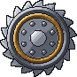
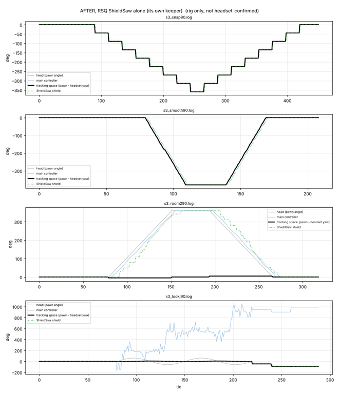
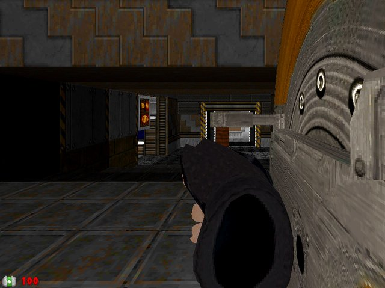
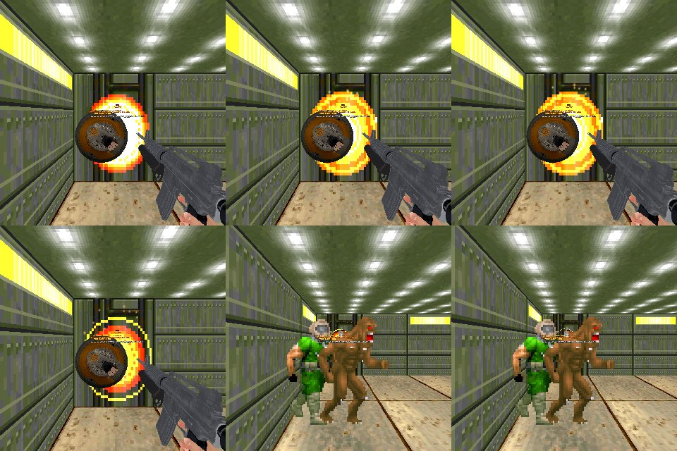
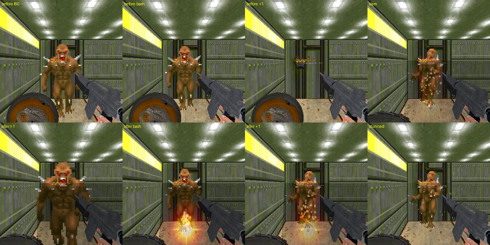
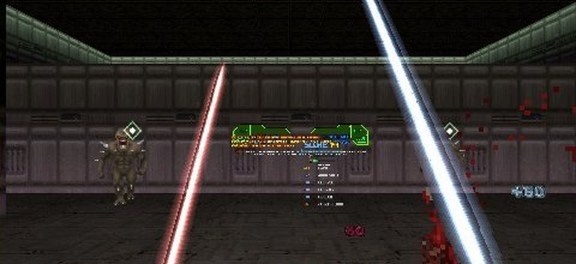

# RSQ ShieldSaw
### Doom Arcade VR · a buzzsaw shield on your back: block it, bash it, rev it, throw it and catch it

Reach behind you, press Use, and the shield saw from Doom: The Dark Ages is on your off arm. Hold it up and fireballs
glance off it, bullets die at the muzzle, and anything that claws at you gets shoved back. Shove it into a demon and
the demon flies into the wall. Squeeze the trigger and the blades come out screaming. Paint a few targets, snap your
arm forward, and the saw goes round the room cutting through them, then comes home to your hand.

*[GIF to come: three rings painted, a throw cutting through two imps and grinding a third, then the catch]*

---

## What it feels like

- **It lives on your back.** Reach to the small of your back (or behind your neck, or over your shoulder) and press
  Use. Whatever your off hand was holding steps aside, and comes back when the shield goes away.
- **Hold it up and it blocks.** The block is the shield you see: a 58 cm disc on your forearm. A fireball that
  crosses it glances off, a fireball that flies under the rim hits you.
- **Meet the shot and it's a perfect block.** Push the plate into the attack instead of just holding it there: the
  shot leaves faster, a clawing demon always reels, the hit rings a tone higher, your hand knocks twice, and the plate
  blooms white.
- **Bullets never get out of the gun.** A bullet whose line crosses your shield is stopped at the muzzle, and goes
  back out at whoever is in its way.
- **Shove it.** A hard push of the plate is a bash: a burst of sparks, a body launched off its feet, and if a wall is
  behind it, a wall slam that stuns.
- **Rev it.** Hold the off trigger and the saw winds up, blades out, pitch climbing. Anything in the blades is ground
  and bleeds.
- **Throw it.** Hold Use away from your back and sweep your hand across the room: a ring lands on each target, one at a
  time, the first one biggest. Snap your arm forward and let go of the throw button (the off trigger, unless you pick
  another). The saw visits them in the order you ringed them, bouncing off walls on the way.
- **Small things are cut in two, big things are chewed.** Fodder is sliced through, mid-size monsters get the disc
  stuck in them grinding, the heavies knock it away.
- **It always comes home.** Back along the way it went, and into your hand if your hand is there. Press the throw
  button again mid-flight to call it back early.

---

## How to play

| Do this | What happens |
|---|---|
| Off hand to the small of your back, press **Use** | The shield is in your off hand |
| Same place, **Use** again | Back on your back. Your off hand gets its empty hand back |
| Hold the shield in the way | Blocks shots, bullets, claws and blasts that cross the disc |
| Push the plate into a shot or a claw as it lands | A perfect block |
| Shove the plate into a monster | A bash |
| Hold the **off trigger** | The saw revs: blades out, grinding |
| Hold the **off trigger**, sweep across targets (or Use away from your back, with Lock On With: Use) | A ring on each target (up to 5) |
| Let go of the throw button (the **off trigger** by default) while snapping your arm forward | Thrown, at the ringed targets in order (or into a cone along the throw) |
| Let go with the arm still | Nothing: it stays in your hand, and your rings stay 5 seconds |
| Press the throw button while it flies | Called back |
| Hand near it as it comes back | Caught |
| Both hands to your chest for half a second | The body the shield hangs on turns to where you face |
| Flick the gun in your main hand down | That gun reloads (with Brutal Doom VR's guns) |

### Controls

**One key, and it needs no binding:** **Draw / Put Back**, for a desktop or a backup. It draws the shield, puts it
back, or calls a thrown one home. It is on this mod's page under Controls and in Customize Controls ("RSQ ShieldSaw",
listed as "ShieldSaw: draw / put back / recall"). Unbound.

- **Off hand, Use** at the spot on your back: draw, and put back.
- **Off trigger:** hold to rev the saw and, with **Lock On With: Hold the Trigger** (the default), ring targets at the
  same time; let go with the arm snapping forward to throw; press it while the shield flies to call it back. **Throw
  Button** can move the throw to the off alt, or either.
- **Gestures:** hold the plate in the way (block), push it into a hit as it lands (perfect block), shove it into a
  monster (bash), the throw (at least **Throw Hand Speed (m/s)**, 2.5), both hands to your chest for half a second
  (recenter, **Recenter: Hands to Chest**), and a flick down of the main-hand gun (reload, with Brutal Doom VR's guns).

Gone on 2026-11-10: the **Throw Along Aim** key (the throw is the swing), the **Lock On (Hold)** key (hold the trigger
instead) and the **Recenter Torso** key of this mod (RSQ Tactical Rig's Recenter Torso key and the hands-to-chest gesture
do it). The console commands `ssq_throw` and `ssq_recenter` stay, with no key. RSQ Accessibility's
Shield Throw button is its own (see *Plays well with*).

You start every game with it on your back. Turn on **Start in Hand** to start holding it.

---

## On your back

The shield hangs flat along your back, outer face out, like a plate on a backpack, at whichever spot you take it
from. A small diamond marks the grab, brighter as your hand gets close.

| Take It From | Where |
|---|---|
| **Small of the Back** (default) | 30 cm behind your eyes, 10 cm to the off side, 62 cm down (belt height), a 30 cm grab. Only behind your hips, so the hip holsters stay free |
| **Behind the Neck** | 22 cm behind, 8 cm to the off side, 18 cm down, a 26 cm grab: reach over the off shoulder |
| **Back or Neck** | Either |
| **Over the Shoulder** | The old mount, 27 cm behind and 12 cm to the off side of your eyes, 30 cm down |

**It hangs on your body, not your head.** Look around and the shield stays where your back is. Snap turns and smooth
turns carry it round with you. A real turn in your room does not: put it back in front of you with both hands to your
chest (half a second), or RSQ Tactical Rig's **Recenter Torso** key. It also faces you again on its own at a map start, a respawn, a
level change and a loaded save. Two older guesses (the body turning when your head and both hands turn together, and
the body slowly catching up with a head held round) are still there as options, both off.

**It hangs at your real height.** The mount is measured from your standing eyes, not the game's fixed eye height, and
does not dip when you bend to reach behind you. Sit down (or use RSQ Accessibility's Seated Play) and it comes down with
you.

*A rig plot, 2026-11-03, RSQ ShieldSaw alone (TacticalRig/tools/rigtest/turnprobe): the dotted line is the body the
shield hangs on. Top: eight 45° snaps each way, followed exactly. Second: a smooth 360 each way. The third panel was
taken while the body still followed a real room turn of head and hands; that guess has been off by default since the
evening of 11-03. Not captures from the headset.*

*[Still to come: the shield flat on the back in RSQ Tactical Rig's mirror, and the reach to draw it]*

**Show ShieldSaw** (on) draws the stowed shield. **Draw With Use** off leaves your back free for another mod's holster
and draws only with the Draw key. **Next/Prev Offhand Weapon** (off) puts the shield into QuestZDoom's off-hand
weapon cycle as well.

**Putting it away** (**On Manual Store**): your off hand gets its empty hand back (the default, so you can reload by
hand at once), or the weapon it held before the shield came out.

---

## In your hand

*Rig frame from an earlier build (before 2026-11-05), desktop view: the hand on the grip (centre) and the shield's
face, very close to the camera, on the right. On a desktop the off controller is not where your arm would be. Not a
capture from the headset.*

*[Still to come: the held shield in a headset view, closed and with the blades out]*

The shield in your hand is Ermac's shield and saw models, with his hand closed on the grip. **Shield Size** makes the whole
thing bigger in five steps (1.0 to 1.5); the block grows with it, so what you see is always what blocks. Fine
placement sliders (Held X, Y, Z, Yaw, Pitch, Roll) are under Test and Debug, read live, so you can dial it in with the
headset on.

While you hold it, your main hand keeps its gun. Weapon switches in the main hand are followed; if QuestZDoom's
switch-hands button or another mod tries to take the off hand, the shield is put straight back (**Off-Hand Switch:
Keep Shield**). Set it to **Allow Switch** and taking the hand puts the shield on your back instead.

**Flick to reload.** Brutal Doom VR only reloads by hand while its own empty hand is in your off hand. With the shield
there, flick the main gun's barrel down (45° within four tics, ending 40° below level) and it reloads, the same flick
Brutal Doom VR uses. Its own Flick setting is honoured.

---

## The block

**What crosses the disc is stopped.** Every hit you take is tested against the disc's face: fireballs, claws and bites,
bullets, and explosions whose line to you crosses the plate (the plate is a 4 cm thick disc: a line through any part
of it counts, slanted or straight). A blocked hit does no damage, sparks fly off the face on
the attacker's side, and you hear it where it happened (**Positional Sound**) and feel it in your off hand.

- **Turn Shots Early** (on): a shot crossing the plate is turned before it ever reaches you, even one that would have
  missed. The plate is tested where it was, halfway, and where it is each tic, so a fast parry doesn't slip past.
- **Blocked Shots:** **Returned** (default) or **Cancelled**.
- **Turned Shots Go:** **Off the Face and My Swing** (default: the shot glances off the plate like a mirror, and the way
  the plate is moving pushes it, so a bash throws it along the bash), **Off the Face**, **Where I Look** (helped onto
  the enemy nearest your gaze, within 14°), or **To Shooter**.
- **Muzzle Block** and **Return Bullets** (both on): a bullet whose line crosses your shield never fires. It comes back
  off the plate at the same damage, along the same aim rule, and the monster it hits turns on you. Your own shots are
  never stopped.
- **Blocked Melee:** **Stun and Shove** (default), **Stun**, or **Nothing**.
- **Block While Holstered** (off): the shield on your back blocks too.
- **Double Block Size** (off): the blocking disc twice as wide; the shield you see stays the same.
- **Revved,** the blades add 6 cm to the rim.

### Perfect block

Meet the attack instead of waiting for it: the plate must be moving into the hit at about 0.7 m/s (a parry flick)
when it lands. The best of the last few tics counts, so a parry past its peak still counts.

- A turned shot leaves 1.6 times faster.
- A melee attacker always reels and is shoved twice as far, whatever Blocked Melee says.
- The block rings a tone higher, your hand knocks twice, and the plate blooms white.
- **Hit-Stop** (off): the attacker freezes for a beat (4 tics).
- **Perfect Block Slow-Mo** (off): half a second of slow motion through RSQ SlowMo.

*[GIF to come: an imp's fireball glancing off the plate, then a perfect block sending one back faster]*
*[GIF to come: a zombieman firing into the shield, and the bullet coming back at him]*

### Saber over shield

With RSQ Saber in your main hand, lit, rest the blade across the front of the plate (within 15 cm of the face): the
block grows 1.3 times wider while you hold the stance. The grind and the bash stay the plain plate.

*[Still to come: the saber braced across the shield]*

---

## The bash

Drive the plate along its face at about 1.3 m/s, or lean it steadily into a body (a sustained push counts too), and
whatever the plate is on gets bashed:

- 10 to 40 damage, harder the faster you drove it.
- Thrown away from the plate with a little lift, so it leaves the floor. Heavy monsters lean, light ones fly, and
  anything that cannot be pushed stays put.
- A burst of sparks on the body at the height the plate struck, a thud, a long buzz.
- **Bash Needs Sight** (on): nothing through a wall or a closed door.
- One bash every 10 tics.
- **Hit-Stop** (off): the bashed body freezes for a beat (4 tics), as on a perfect block.
- A bash never starts Brutal Doom's stealth-kill cutscene on an unaware monster; Brutal Doom's own kicks and punches
  still do.

**Wall Slam** (on). A body the bash throws into a wall hits it: extra damage by how hard it struck (5 to 40), a forced
pain frame, frozen for 8 tics, then a small rebound off the wall.

*Rig frames from an earlier build (before 2026-11-05), desktop view, six frames. Top row: the held shield beside the
rifle in the main hand, an orange and yellow burst blooming round its rim, larger in each frame. Bottom left: the burst
fading to a thin yellow ring round the plate. Bottom middle and right: an imp and a green-armoured marine down the
corridor with small sparks at head height; what those two frames record is not written down. Not captures from the
headset.*

*Rig frames from an earlier build (before 2026-11-05), desktop view, as labelled on the sheet: a bash on a monster
without (top) and with (bottom) the bash burst, then the slam and the stun. Not captures from the headset.*

*[GIF to come: a bash that slams an imp into a wall, in the current build]*

---

## The rev

Hold the off trigger: the saw winds up in 0.6 seconds, the housing opens, the blades deploy and spin, and the motor's
pitch climbs. Let go and it winds down.

- **The grind:** anything the revved rim is on takes 6 damage, each body at most every 4 tics, and throws its own blood
  (Brutal Doom's blood on Brutal Doom's monsters).
- **A revved throw** goes 60% faster and hits 60% harder.

*[GIF to come: the blades deploying, then grinding a pinky with blood flying]*

---

## The throw

### Lock on

Locking on is its own choice, **Lock On With**:

- **Hold the Trigger** (default since 11-10): hold the off trigger to rev AND paint at once (with Throw Button on Off
  Trigger), then swing and let go to throw, like the whip and the saber.
- **Use:** hold Use with your hand away from the shoulder mount and sweep the shield across the room to paint rings.
  Use at the mount is still the draw and the put-back.

Every 3 tics the target nearest your hand's line gets a ring, so
you sweep across a crowd and feel each one land, with a click and a tick in your hand.

- Up to **5** rings (**Max Locks**), inside 25° of where your hand points and within about 35 m, in sight.
- **The first ring is the biggest** and breathes; the disc visits them in the order you ringed them.
- A ring holds while its target stays within 60° of your hand and in sight; it drops after 3 seconds out.
- Let go of the lock and the rings stay 5 seconds: long enough to rev and throw.

*With Gun Bonsai VR's Ricochet: the disc turned off a pillar and cut a new imp (the blood, right), and the rings (the small white diamonds) are still on the two targets painted before the throw; the two blades are RSQ Saber's, held in the same run (rig capture, not headset).*

*[GIF to come: three rings painting one by one as the hand sweeps across a room]*

### Let it fly

The off trigger always revs the saw. The throw is letting go of the throw button with your arm snapping forward, at
least **Throw Hand Speed (m/s)** (2.5, the series' one throw threshold since 2026-11-10) and roughly where you are
looking. **Throw Button** picks which: **Off Trigger** (default), **Off
Alt**, or **Either**. Pressing it again while the saw flies calls it back.
A release with the arm still, a backhand or the end of a block is not a throw: the shield stays in your hand.

- **The fastest moment of your swing** is the throw, not the instant you let go.
- **How fast:** your arm's speed, as if the disc weighed 5 kg, never slower than a floor speed. It winds up as it
  chases targets, toward a top speed.
- **Which way:** 70% the way your arm moved, 30% the way your hand points. With a ring ahead, it leaves toward the
  first ring.
- **No rings?** It takes what is in a 25° cone along the throw. Nothing there: it flies on for two seconds, then turns
  for home.
- **Walls:** it bounces off up to 3 walls on its way to the ringed targets, turning back to the next one as soon as it
  can see it.

### What it does to them

By the monster's starting health, never by its name:

| Monster | What happens |
|---|---|
| 70 health or less | **Cut in two**, every time, and the disc rips on through |
| Up to 600 | The disc **sticks in it and grinds** for 0.6 seconds, then goes on to the next ring |
| More, or a boss | **Glances off** at 40% damage |

A thrown hit does 24 to 44 before those rules. **BD22 Monsters** (off) raises the limits for Brutal Doom's tougher
monsters: cut up to 250 (to the revenant), stuck up to 1200 (to the baron). A monster that refuses to die on purpose
(a Champions Dark Red playing dead, an Undying heart) takes the grind or the glance, never the cut. A LegenDoom
legendary counts its second life.

*[GIF to come: the disc cutting an imp in two, sticking in a cacodemon, and glancing off a baron]*

### Coming home

When the last ring is done (or it hits a wall with none left), it comes back the way it went, never through a wall.
After 3 seconds of trying it stops asking the level and flies straight to you. Your hand within about 70 cm catches it
(**Catch on Return**, on); otherwise it lands on your back. It is never gone longer than 12 seconds.

*[GIF to come: the disc bouncing off a wall, coming home along its path, and caught in the hand]*

---

## Plays well with

Every other mod is found by name while the game runs. RSQ ShieldSaw loads and plays alone.

- **RSQ Gun Bonsai VR:** the ShieldSaw has its own upgrade tree. **Broadening** widens the block (+20% a level, to
  double). **Back Plate** lets the shield on your back block, then turn shots. **Bulwark** makes a perfect block
  easier. **Rebound** and **Reflect** make returned bullets hit harder. **Rev Shield** grinds what claws a revving
  plate, then turns shots even with Blocked Shots on Cancelled. **Spartan** (with RSQ Saber braced) sends every turned
  shot back at its shooter, then makes the bash cut too. **Shield Wall** sets the perfect-block slow motion. **Strike
  True** sets the hit-stop (never longer than the Hit-Stop Tics slider). **Hungry Blades** raises the grind. **Wall
  Slam** hits and stuns harder. **Shield Size** grows the shield. **Charge** makes a bash on the run strike everything in
  a wedge ahead, with a shockwave. **Shield Dash** thrusts you forward when you shove the shield with the stick pushed
  forward, and lands as a bash. **Battering Ram** throws a bashed body into whatever is behind it. **Lockstep** sets
  the number of rings. **Ricochet** turns a wall hit toward a new target. **Wall Bounces** adds walls. **Meat Grinder**
  frees a stuck disc at full speed after a kill. **Cleaver** raises the hit tiers. **Buzzsaw Return** grinds what it
  passes on the way home. **Hunter's Return** swerves it through monsters on the way home. All the disc's, bullets' and
  turned shots' damage is paid to the ShieldSaw, not to the gun in your other hand. With Gun Bonsai VR loaded, Block
  While Holstered, Perfect Block Slow-Mo and Hit-Stop are greyed until you learn Back Plate, Shield Wall and Strike
  True; learned, the row turns them on or off.
- **RSQ Tactical Rig:** with **Turn With the Rig** on, the shield hangs on the rig's own body, so the shield and the
  holsters always turn together, and the Recenter Torso key recenters the rig. A hand inside one of the rig's holsters
  is the rig's press, never the shield's. The off-shoulder holster is the shield's when it is carried Over the
  Shoulder.
- **RSQ Saber:** Saber Over Shield (a wider block) and Spartan. The saber's off-hand blade is never mistaken for you
  taking the off hand.
- **RSQ SlowMo:** Perfect Block Slow-Mo.
- **RSQ Score:** the shield tells it what no damage event can: which monster's attack you blocked (and if it was
  perfect), which shots you turned and whose bullets you returned, which monster is ringed, which way the disc is
  flying and whether it is stuck grinding, and how long the rim has been grinding a monster. Wall slams, back-plate
  blocks, rev blocks, Spartan, Reflect, Charge, dashes, Cleaver and Buzzsaw Return each count as their own move.
- **RSQ Accessibility:** Photosensitive Mode (the block flash and bloom dimmed and rate-limited), Gesture Ease (wider
  grab zone, lower throw speed and angle, an easier flick), Cue Size (the rings), Colour-blind modes (the rings and the
  block-area view; rank is size, never colour), Rumble Strength, Seated Play (the mount comes down with you), Steady
  Hands (the lock cone and the throw's aim), and One-Handed: the Off-Hand Modifier lets
  your main hand take the shield off your back, the Shield Throw button throws at the rings (or along your aim), and
  the Flick Reload button reloads.
- **RSQ Miniboss:** a miniboss made legendary at its best health counts that health in the hit tiers.
- **Brutal Doom VR (BD22 VR):** its empty hand comes back to your off hand when you put the shield away, its gun-side
  hand layers keep working while the shield is drawn, and the flick reloads its guns.
- **Brutal Doom (brutal22test6):** BD22 Monsters hit tiers, its blood on a grind, and no stealth-kill cutscene from
  a bash or a wall slam.
- **Champions:** a Dark Red that turns unshootable and vanishes is let go, not followed across the map; a Bronze that
  cannot be moved is not shoved; a champion's raised health counts in the tiers.
- **Gun Bonsai:** a returned bullet counts as your damage.
- **LegenDoom and LegenDoom Lite:** a legendary's second life counts in the tiers.

---

## Options

*Options → Radiant Silvergun Options → RSQ ShieldSaw.* One page, every number under Test and Debug. Defaults in
brackets.

| Section | Rows |
|---|---|
| Shield | Start With Shield (On) · Start in Hand (Off) · Show ShieldSaw (On) · Take It From (Small of the Back; Over the Shoulder, Behind the Neck, Back or Neck) · Draw With Use (On) · Next/Prev Offhand Weapon (Off) · Mount Marker (When Needed; Never, Always) · Shield Size (1.0, up to 1.5) |
| Block | Shield Blocks (On) · Block While Holstered (Off) · Double Block Size (Off) · Blocked Shots (Returned; Cancelled) · Turned Shots Go (Off the Face and My Swing; To Shooter, Where I Look, Off the Face) · Turn Shots Early (On) · Muzzle Block (On) · Return Bullets (On) · Perfect Block (On) · Perfect Block Slow-Mo (Off) · Saber Over Shield (On) · Blocked Melee (Stun and Shove; Stun, Nothing) |
| Bash | Shield Bash (On) · Bash Needs Sight (On) · Wall Slam (On) · Hit-Stop (Off) |
| Throw | Lock On With (Hold the Trigger; Use) · Throw Button (Off Trigger; Off Alt, Either) · Max Locks (5) · Catch on Return (On) · Hit Tiers (On) · BD22 Monsters (Off) |
| Hands and Body | On Manual Store (Fist; Previously Held Weapon) · Off-Hand Switch (Keep Shield; Allow Switch) · Recenter: Hands to Chest (On) · Turn With the Rig (On) · Body Turns With Hands (Off) · Body Catches Up (Off) |
| Look and Sound | Block Feedback (On: sparks, flashes, block sounds and rumble) · Positional Sound (On) · Others See Shield (Netgame Only; Only Me, Everyone) · Spin Direction (Normal; Flipped) |
| Controls | Draw / Put Back (also recalls a thrown shield). Unbound |
| Test and Debug | Debug Log (Off) · Show Block Area (Off: the blocking disc drawn as dots). **Damage:** Throw Damage (1.0) · Bash Damage (1.0) · Grind Damage (6) · Wall Slam Damage (1.0) · Bullet Return Damage (1.0). **Shield Fit:** Disc Forward (-15.4) · Disc Side (-7.5) · Disc Up (-5.0) · Block Radius (29.2 cm) · Block Depth (4 cm). **Throw and Disc:** Throw Hand Speed (m/s) (2.5) · Throw Speed (1.6) · Arm or Aim (0.70) · Aim Forward (0.35) · Slowest Throw (12) · Disc Weight (5.0) · Disc Wind-Up (0.05) · Disc Top Speed (34) · Return Speed (22) · Return Patience (105 tics) · Catch Radius (24) · Breadcrumb Gap (4) · Bisect Limit (70) · Embed Limit (600) · Glance Damage (0.40) · Embed Damage (3) · Embed Time (21) · Rev Time (21) · Grind Gap (4) · Rev Throw Bonus (0.6) · Revved Blade Reach (6.0) · Wall Bounces (3). **Lock-On:** Lock Cone (25°) · Lock Range (1200) · Lock Keep Angle (60°) · Out of Sight Grace (105 tics) · Lock Gap (3) · Rings Kept (175 tics) · Ring Size (1.00). **Block and Bash:** Deflect Assist (14°) · Swing Steers Shots (3.00) · Guard Margin (0 cm) · Early Turn Lookahead (1.0) · Turned Shot Speed (1.00) · Melee Shove (12) · Perfect Block Speed (25) · Bash Speed (45) · Bash Reach (1.20) · Leaned Bash (0.6) · Bash Knockback (1.35) · Bash Lift (2.5) · Wall Slam Bump (3.0) · Wall Slam Stun (8) · Hit-Stop Tics (4) · Brace Block Size (1.30) · Brace Gap (15 cm). **Mount:** Shoulder Forward (-27) · Shoulder Side (12) · Shoulder Up (-30) · Small of Back: Behind (-30), Side (10), Down (-62), Reach (30) · Neck: Behind (-22), Side (8), Down (-18), Reach (26) · Eyes to Neck (9) · Grab Reach (30) · Grab Zone (1.6) · Back Yaw, Pitch, Roll (0) · Back Size (1.00). **In the Hand:** Held X, Y, Z (0) · Held Yaw, Pitch, Roll (0) |

Speeds on Test and Debug are map units a second (about 34 to the metre) for the hand, map units a tic for the disc.

Both pages end with **Reset All**: every setting on both pages goes back to its default (your key bindings stay).

With RSQ Gun Bonsai VR loaded, a line at the top of the page says so, and Block While Holstered, Perfect Block Slow-Mo,
Hit-Stop and Hit-Stop Tics are greyed until their upgrade is learned.

The game rules (damage, block, bash, throw, lock-on, the disc, the grab zone) are the host's in netplay. Your carry
spot and its numbers, Start in Hand, Show ShieldSaw, Draw With Use, Next/Prev Offhand Weapon, Lock On With, Mount
Marker, the body rows, Block Feedback, Positional Sound, Others See Shield, the held placement and Debug Log are each
player's own.

---

## Status

| | |
|---|---|
| **rig only, not headset-confirmed** (2026-11-11, the last checks, `design/rigtest_2026-11-10/RESULTS_LAST.md`) | **A far bullet blocked by the plate:** a ZombieMan 11.76 m away on flat floor (rig02), the plate held facing it. Its real hitscan (through a puff): `guard kind 1 BLOCKED`, health 100 -> 100, and with the default muzzle guard `ATE a hitscan`, health unchanged; its own attacks over 1600 tics: two BLOCKED and one ATE, no damage to you (`design/rigtest_2026-11-10/evidence/LAST_SSQ_far_zombie_blocked_log.txt`) |
| **rig only, not headset-confirmed** (2026-11-10 night, `design/rigtest_2026-11-10/RESULTS_FIX.md`) | **A slanted shot through the plate is a block: found BROKEN in H2, then fixed (commit 1dbd6e35) and shown.** a zombie 1.7 m ahead firing down through the held plate, `guard kind 1 BLOCKED`, health 100 -> 100 (the same line read `missed` before the fix, `P2D_log.txt`); the plate held aside, the same shot `missed`, 100 -> 98 (`design/rigtest_2026-11-10/evidence/FIX_B_log.txt`, F6). A far shot from the step reached neither the plate nor the player, so a far block is still not shown |
| **rig only, not headset-confirmed** (2026-11-10 night, the packed batch, P2: `design/rigtest_2026-11-10/RESULTS_P2.md`, rig02) | **H1, a ricochet:** two targets ringed, one moved behind a pillar and a third spawned beside you; the disc hit the pillar, turned to the third and cut it, and the first two rings stayed on their own targets until each was cut (`design/rigtest_2026-11-10/evidence/P2_H1_ricochet_rings_stay_frames.jpg`, `P2G_log.txt`). **H2, a far zombie's bullet reads as a shot, partly synthetic:** a zombie's damage sent with itself as the inflictor read as a shot from 12.5 m and as melee from 1.7 m (`P2E_log.txt`); real hitscans always arrive through a puff and read as shots (`P2B_log.txt`, `P2D_log.txt`). H2 also found the slanted-shot miss (row above). **H3, one throw, nothing locked:** 2.06 m/s no throw, 3.09 m/s thrown (`P2C_log.txt`) |
| **rig only, not headset-confirmed** (2026-11-10, the batched rig test, `design/rigtest_2026-11-10/RESULTS.md`) | Every launch on the owner's order (with BD22 VR Reloaded 2.0.4f) had no script error from our packs. **The trigger-hold lock:** holding the off trigger painted a lock ("1 locked", `evidence/L8_log.txt`). **One throw:** the posed swing read the same as the Saber's, 2.06 m/s and 3.09 m/s (`L8_log.txt`). Both releases had a target locked, and a locked release always throws, so the 2.5 m/s threshold itself was not shown there (H3, above, shows it with nothing locked). The ShieldSaw Throw Hand Speed (m/s) row at 2.50 (`evidence/menus_new_rows.jpg`) |
| **rig only, not headset-confirmed** (2026-11-09, full load order) | The pack loads on doom2, brutal22test6, BD_VoxelPack, BD22 VR Reloaded 2.0.4e, LOB, Champions, Gun Bonsai and the rest of the series with no script error of its own, and "RSQ ShieldSaw" is on Radiant Silvergun Options (`design/rigtest_2026-11-09/logs/main_A-G_I.log`, load order lines 3-38, menu line 1201). The Draw key puts the shield in the off hand beside BD22 VR's rifle, and it stays there while the main hand changes to the rocket launcher and RSQ Tactical Rig's cigarette (`design/rigtest_2026-11-09/batch2/launch3_harness_reruns.log`, lines 1223, 4689, 4703). That run was not a ShieldSaw test |
| **rig only, not headset-confirmed** (2026-11-03, an earlier build, RSQ ShieldSaw alone) | The body the stowed shield hangs on: sixteen 45° snaps followed exactly, a smooth 360 each way, a real 60° or 90° room turn left alone, then put right by the hands-to-chest gesture and by the Recenter Torso key; faced to the head again after a save and load and a map change; no script errors (`TacticalRig/tools/rigtest/turnprobe/evidence/recenter_after_shieldsaw_alone.txt`, `after_shieldsaw_alone.txt`) |
| **rig only, not headset-confirmed** (frames, an earlier build, before 2026-11-05) | The held shield in the hand, desktop view (`docs/screens/held_shield_ermac_hand.png`); the bash burst, a wall slam and its stun (`docs/screens/bash_fx_before_after.png`, `docs/screens/bash_hit_owner_burst.png`). Pictures of what an earlier build did, not proof of this one |
| **Headset-confirmed** | Nothing |
| **code only, not shown** | **The 11-10 key change:** one key, Draw / Put Back, and the lock and throw keys gone (the 11-10 run drew the shield with the key's command, `ssq_draw`, before its throws, but no line logs the draw itself). The 11-10 fixes: 16 unused sprites and an unused saw loop sound removed; the rumble route to RSQ Accessibility |
| **code only, not shown** (a commit says rig-shown, but no log or frame is in the repo) | The stowed shield flat along the back at every spot, and a draw from the small of the back with RSQ Tactical Rig (commits of 11-08 and 11-09); Next/Prev Offhand Weapon and the grind's blood (11-06) |
| **code only, not shown** | Everything else on this page: the block, the sweep, the muzzle block and returned bullets, the perfect block, Saber Over Shield, the bash's damage and shove, the rev and the grind, the throw's flight, the hit tiers, the bounces, the return and the catch, the flick reload, every Gun Bonsai VR upgrade, the Accessibility settings, netplay |
| **not yet run** | Nothing from the rig test: H1 to H3 and the far bullet have run (above) |

All VR behaviour is rig only, not headset-confirmed.

---

## Under the hood

- **Stock QuestZDoom 17.3** (gzdoom 4.14 ZScript): ZScript and data only. No engine changes.
- **The shield is an off-hand weapon** (`SSQ_ShieldSaw`) only so the engine draws its model at the off controller. It
  never fires: the rev reads the off trigger straight off the synced buttons. The five sizes are five baked meshes,
  picked by sprite, because MODELDEF fixes a model's size at load.
- **The block disc is measured off the mesh,** followed through stock QZD 17.3's model chain (`guard.zs`): centre 15.4
  cm back along the forearm, 7.5 cm to the controller's right, 5 cm down, rim 29.2 cm (35.2 cm with the blades out),
  face pointing away from the arm. Show Block Area draws it.
- **Three block paths:** `AbsorbDamage` on the player's `SSQ_Guard` item for everything that lands; a sweep each tic
  over a list of live missiles (a projectile is never in the blockmap, so an iterator never finds one); and
  `WorldHitscanPreFired`, which cancels a monster's bullet before it is traced. The returned bullet is fired by a
  one-tic helper (`SSQ_Ricochet`) so the engine does not re-aim it down the main controller.
- **The arm, not the body.** Every hand speed (throw, bash, perfect block) is measured in the body's frame, so walking,
  strafing and snap turns are never a swing. A per-frame hand fix (`SSQ_HandSync`) carries the last rendered frame's
  hands to where the body is now, so a slow frame never reads as a jump.
- **Netplay-safe.** The renderer writes the hands on the console player's pawn only, so each machine sends its own
  hand (`ssq-pose`: position, angles, handedness, Steady Hands aim, seat drop), the body's yaw and eye height
  (`ssq-body`) and the saber stance (`ssq-brace`) as network events; every block, bash, throw and catch is decided in
  the playsim from those. The world copy of your shield (Others See Shield) stands in for the off-hand model while
  QuestZDoom's two-hand grab hides it.
- **Turns:** `SSQ_TurnKeeper` (`turnkeep.zs`) is RSQ Tactical Rig's turn keeper, copied so the two turn together.
- **For other mods: `SSQ_ScoreService`**, found by name. `GetInt`: `locked`, `blocked`, `perfect`, `returned`,
  `grind.held`, `thrown.leg`, `disc.grinding`; `GetObject`: `returned.from`; `GetIntUI`: `menu.locked`.
- **It asks, by name:** `RSQ_MeleeUpgradeService` (Gun Bonsai VR), `RS_ScoreService` (`touch`), `RSQTR_BodyService`
  (`body.yaw`, `body.recenter`), `UBQS_SaberService` (`saber.lit`), `RSQA_Service`, `RSQMB_Service`, and sends
  `rsm_pulse` for RSQ SlowMo.
- **Console:** `netevent ssq-draw`, `ssq-throw`, `ssq-lock 1|0`, `ssq-recenter`. `tools/packpose.py` packs a fake hand
  pose for `netevent ssq-pose` on a headless rig.
- **Old settings move on once.** Settings saved under older defaults (lock grace, rings kept, the throw button, the
  block's margin and depth, the turned-shot aim, the back spots, the body-turn guess) are moved to the current ones the
  first time this version loads.
- **Tools:** `build.sh` packs the pk3; `tools/fxpull.py` is the record of what came from RS Combat FX and RS
  Ballistics; `tools/rigtest/ssprobe` and `ssbody` are rig probes (the wall-slam and brace scenes, the body-frame log).
  Never shipped.

## Credits

The full list is in **CREDITS.txt**.

- **id Software:** the shield saw itself, from Doom: The Dark Ages (2025): its design, and the mesh Ermac ripped from
  the game.
- **Ermac (iAmErmac), Rusted Legacy** (https://github.com/iAmErmac/rusted-legacy): brought the shield saw to Doom VR
  first, and this mod started from his version. His two shield models, the hand model and the sounds come from it.
  His Rusted Legacy code is MIT (`models/hand/LICENSE_RustedLegacy_MIT.txt`); that licence does not make id Software's
  ripped mesh MIT. Which of the two shield meshes is which, and where the hand and sounds came from before Rusted
  Legacy, is not recorded.
- **RS Combat FX and RS Ballistics** (presidentkoopa's effect libraries): the saw voice and block sparks, and the Shield
  Dash and Charge effects and sounds.
- **QuestZDoom** (Emawind, Team Beef): the engine and its off-hand weapon and hand-pose support.
- **presidentkoopa:** this standalone version, its design, its headset testing and the direction of every change; the
  bash-hit burst.
