
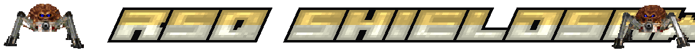

# RSQ ShieldSaw
### Doom Arcade VR · a buzzsaw shield on your back: block it, bash it, rev it, throw it and catch it

<a href="../README.md#shieldsaw">&larr; RSQ UBQ Series</a>

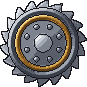

Reach behind you, press Use, and the shield saw from Doom: The Dark Ages is on your off arm.

**What it does:**

- **Turns shots away:** fireballs and rockets glance off the plate and go where you send them ([The block](#the-block))
- **Stops bullets** before they are fired, and sends one back
- **Stuns and shoves** anything that claws at it
- **Perfect block:** meet the hit with the plate and the shot goes back faster
- **Shield bash:** shove it into a monster and the monster flies; into a wall, a **wall slam** ([The bash](#the-bash))
- **The saw cuts:** hold the trigger, the blades come out, and whatever the rim touches is ground ([The saw](#the-saw))
- **Locks on** to up to five monsters as you sweep your hand ([The throw](#the-throw))
- **Throws:** it visits every monster you marked, bounces off walls to reach them, cuts the small ones in two, sticks
  in and grinds the middling ones, glances off the big ones
- **Comes home:** back along its own path to your hand; catch it, or call it back early
- **Extra damage:** a revved throw is 60% harder and faster, and **BD22 Monsters** lets it cut through and grind
  Brutal Doom's tougher monsters
- **Scales in size:** Shield Size, up to half again as big, the shield you see and the block together
- **Lives on your body:** the small of your back, behind your neck or over your shoulder ([On your back](#on-your-back))
- **Wider with a saber:** rest your lit blade across it and the block grows
- **21 upgrades** with RSQ Gun Bonsai VR, from a wider plate to a dash that ends in a bash ([Plays well with](#plays-well-with))

Three things make it more than a shield:

- **The block is the shield you see.** A 58 cm disc on your forearm, measured off the model. A fireball that crosses
  it is turned; one that flies under the rim hits you.
- **Turned shots go where you send them.** A shot leaves the plate like light off a mirror, and the shield's own
  motion is added on top: angle the plate and it goes aside, swing into it and it goes the way you swung.
- **The throw visits your marks and comes home.** Ring up to five monsters, snap your arm forward, and the saw goes
  round the room through each of them, off walls if it has to, then back to your hand.

*[GIF to come: three rings painted, a throw cutting through two imps and grinding a third, then the catch]*

**Works with any monster set.** On Brutal Doom, turn on **BD22 Monsters** and the thrown saw cuts through and grinds
its tougher monsters ([The throw](#the-throw)).

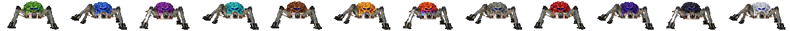

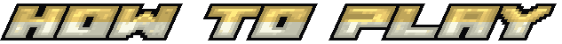

| Do this | What happens |
|---|---|
| Off hand to the small of your back, press **Use** | The shield is in your off hand |
| Same place, **Use** again | Back on your back. Your off hand gets its empty hand back |
| Hold the shield in the way | Blocks shots, bullets, claws and blasts that cross the disc |
| Push the plate into a shot or a claw as it lands | A perfect block |
| Shove the plate into a monster | A bash |
| Hold the **off trigger** | The saw revs: blades out, grinding |
| Hold the **off trigger**, sweep across targets (or Use away from your back, with Lock On With: Use) | A ring on each target (up to 5) |
| Let go of the throw button (the **off trigger** by default) while snapping your arm forward | Thrown, at the ringed targets in order (or into a cone along the throw) |
| Let go with the arm still | Nothing: it stays in your hand, and your rings stay 5 seconds |
| Press the throw button while it flies | Called back |
| Hand near it as it comes back | Caught |
| Both hands to your chest for half a second | The body the shield hangs on turns to where you face |
| Flick the gun in your main hand down | That gun reloads (with Brutal Doom VR's guns) |

### Controls

**One key, and it needs no binding:** **Draw / Put Back**, for a desktop or a backup. It draws the shield, puts it
back, or calls a thrown one home. It is on this mod's page under Controls and in Customize Controls ("RSQ ShieldSaw",
listed as "ShieldSaw: draw / put back / recall"). Unbound.

- **Off hand, Use** at the spot on your back: draw, and put back.
- **Off trigger:** hold to rev the saw and, with **Lock On With: Hold the Trigger** (the default), ring targets at the
  same time; let go with the arm snapping forward to throw; press it while the shield flies to call it back. **Throw
  Button** can move the throw to the off alt, or either.
- **Gestures:** hold the plate in the way (block), push it into a hit as it lands (perfect block), shove it into a
  monster (bash), the throw (at least **Throw Hand Speed (m/s)**, 1.5), both hands to your chest for half a second
  (recenter, **Recenter: Hands to Chest**), and a flick down of the main-hand gun (reload, with Brutal Doom VR's guns).

Gone on 2026-11-10: the **Throw Along Aim** key (the throw is the swing), the **Lock On (Hold)** key (hold the trigger
instead) and the **Recenter Torso** key of this mod (RSQ Tactical Rig's Recenter Torso key and the hands-to-chest gesture
do it). The console commands `ssq_throw` and `ssq_recenter` stay, with no key. RSQ Accessibility's
Shield Throw button is its own (see *Plays well with*).

You start every game with it on your back. Turn on **Start in Hand** to start holding it.

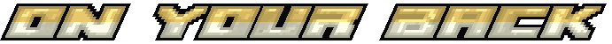

You start every game with it. It hangs at the **small of your back**; **Take It From** moves it behind your neck or
over your shoulder. Reach there with your off hand and press **Use** to take it, and again to put it back. Whatever
your off hand was holding steps aside, and when the shield goes away the hand gets its fist back (**On Manual Store**
can give it the weapon it held before).

The stowed shield is drawn where it hangs (**Show ShieldSaw**), and it hangs on your body, not your head: look around
and it stays put. With RSQ Tactical Rig loaded it turns with the rig's body, shield and holsters together. Hold both
hands to your chest for half a second and the body turns to where you face.

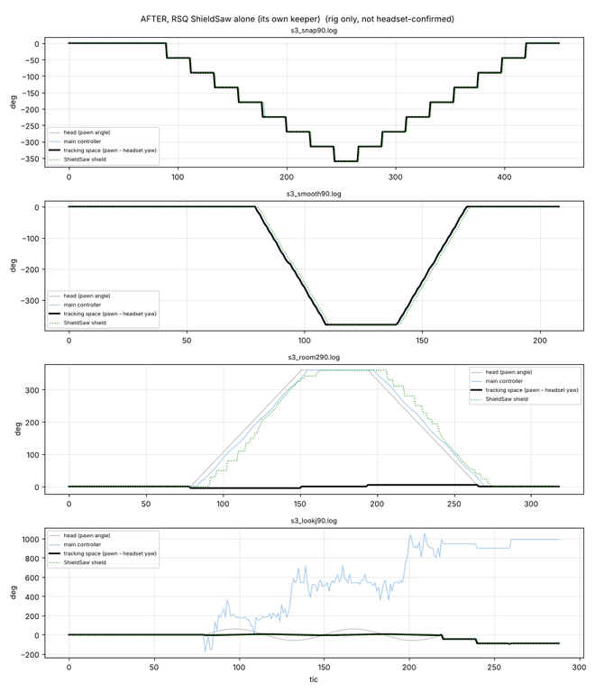

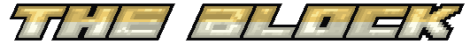

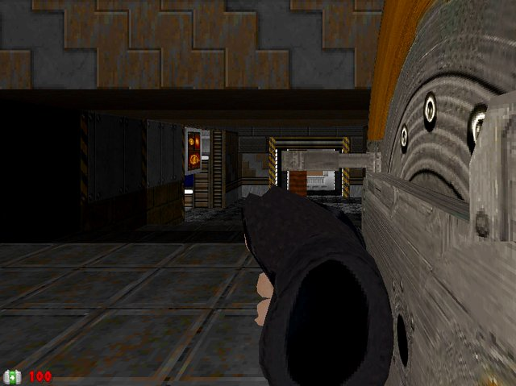

The shield blocks while it is in your hand. What it stops depends on what is coming:

| Coming at you | What the shield does |
|---|---|
| A fireball, a rocket, any projectile | Turned, the moment its path crosses the disc, even one that would have missed you. A homing shot sent back at its shooter homes on him |
| A bullet | Stopped before it leaves the gun, and a shot of the same strength goes back out from the plate |
| A claw or a bite | No damage, and the monster is stunned and shoved back |

**Where a turned shot goes** is **Turned Shots Go**. The default is off the face and your swing; the others send it
straight back at the shooter, where you are looking, or off the face alone.

### Perfect block

Don't hold the shield in the way: **meet** the attack with it. If the plate is moving into the hit as it lands, the
shot leaves 1.6 times faster, and a melee attacker always staggers and is shoved twice as far. You will know: the
block rings a tone higher, your hand knocks twice, and the plate blooms white where it was struck.

*[GIF to come: an imp's fireball glancing off the plate, then a perfect block sending one back faster]*
*[GIF to come: a zombieman firing into the shield, and the bullet coming back at him]*

### Saber over shield

With RSQ Saber: rest your lit blade across the front of the plate and the block is 30% wider while it stays there.

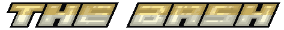

Shove the plate into a monster. A snap of the arm does it, and so does leaning the shield into a body and walking. The
harder the shove, the more it hurts (10 to 40 damage), and the body is thrown back and a little up. Weight counts: an
imp flies, a Cyberdemon leans. A bash cannot reach through a wall or a door.

**Wall Slam:** a body the bash throws into a wall takes 5 to 40 more damage, by how fast it hit, and stands frozen in
its pain for a moment.

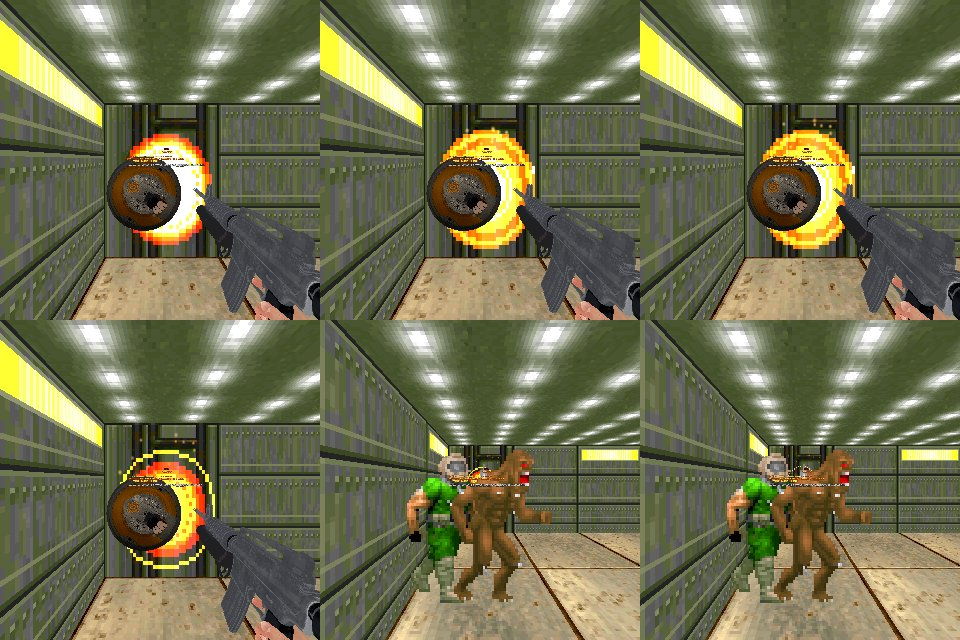

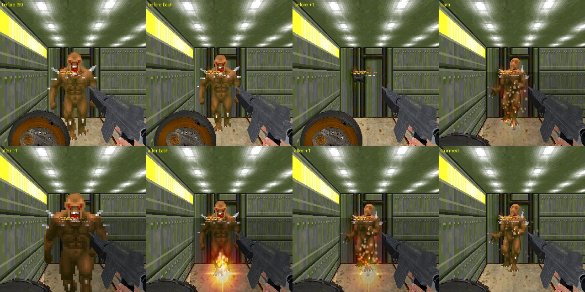

On Brutal Doom, a bash on a monster that has not seen you does not start its stealth-kill cutscene.

*[GIF to come: a bash that slams an imp into a wall, in the current build]*

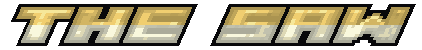

Hold the **off trigger**. The blades come out and spin up over about half a second, the sound climbing with them.
While they spin, whatever the rim touches is ground: 6 damage a hit, a few hits a second on each body, with its blood
on the walls. A revved shield also throws harder (below).

*[GIF to come: the blades deploying, then grinding a pinky with blood flying]*

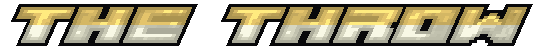

### Lock on

Holding the trigger also marks targets. Sweep your hand across the room and a ring goes onto each monster your hand
points at, one after another, up to five. Let go without throwing and the rings stay for 5 seconds.

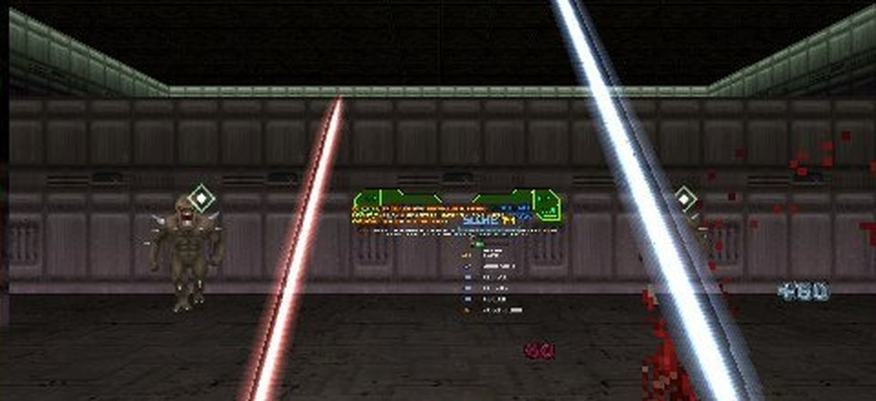

*[GIF to come: three rings painting one by one as the hand sweeps across a room]*

### Let it fly

Let go of the trigger while snapping your arm forward (at least 1.5 m/s, roughly the way you are looking). It leaves at
4 times your hand's peak speed, at most 30 m/s (never under the Slowest Throw), the series' one throw feel. The saw
leaves toward the first ring, visits each one in turn, and builds speed as it goes. A wall in the way is bounced off,
up to three a throw. With nothing ringed it flies where you threw it. A fully revved throw is 60% faster and hits 60%
harder.

### What it does to them

It depends on how much health the monster has:

| The monster's health | What the saw does | With **BD22 Monsters** on |
|---|---|---|
| 70 or less | Cuts it in two and flies on | 250 or less (up to Brutal Doom's revenant) |
| 600 or less | Sticks in and grinds it for a moment, then flies on | 1,200 or less (up to its baron) |
| More, or a boss | Glances off for less than half damage | |

**BD22 Monsters is off by default.** Brutal Doom's monsters are tougher than Doom's (its imp has 80 health), so on
Brutal Doom turn it on, or the saw sticks in or glances off nearly everything.

The saw does not cut through a monster that is built to play dead or to have a second life (Champions' Dark Red, a
LegenDoom legendary before it transforms): those are ground or glanced.

*[GIF to come: the disc cutting an imp in two, sticking in a cacodemon, and glancing off a baron]*

### Coming home

When the last ring is done it comes back the way it went, round corners and through doors, never through a wall. If
it is still trying after 3 seconds it flies straight to you whatever is in the way. Hold your hand near it and you
catch it; otherwise it lands back on your body. Press the trigger while it is out and it turns for home at once.

*[GIF to come: the disc bouncing off a wall, coming home along its path, and caught in the hand]*

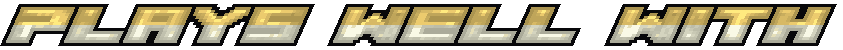

Every other mod is found by name while the game runs. RSQ ShieldSaw loads and plays alone.

- **RSQ Wheel:** pick a weapon for your off hand from the Wheel while the shield is on your arm, and the shield goes
  to your shoulder and the picked weapon stays, whatever Off-Hand Switch is set to (owner 11-13: "the saw is fighting
  me"). *Loads only, not shown.*
- **RSQ Gun Bonsai VR:** the ShieldSaw has its own upgrade tree. **Broadening** widens the block (+20% a level, to
  double). **Back Plate** lets the shield on your back block, then turn shots. **Bulwark** makes a perfect block
  easier. **Rebound** and **Reflect** make returned bullets hit harder. **Rev Shield** grinds what claws a revving
  plate, then turns shots even with Blocked Shots on Cancelled. **Spartan** (with RSQ Saber braced) sends every turned
  shot back at its shooter, then makes the bash cut too. **Shield Wall** sets the perfect-block slow motion. **Strike
  True** sets the hit-stop (never longer than the Hit-Stop Tics slider). **Hungry Blades** raises the grind. **Wall
  Slam** hits and stuns harder. **Shield Size** grows the shield. **Charge** makes a bash on the run strike everything in
  a wedge ahead, with a shockwave. **Shield Dash** thrusts you forward when you shove the shield with the stick pushed
  forward, and lands as a bash. **Battering Ram** throws a bashed body into whatever is behind it. **Lockstep** sets
  the number of rings. **Ricochet** turns a wall hit toward a new target. **Wall Bounces** adds walls. **Meat Grinder**
  frees a stuck disc at full speed after a kill. **Cleaver** raises the hit tiers. **Buzzsaw Return** grinds what it
  passes on the way home. **Hunter's Return** swerves it through monsters on the way home. All the disc's, bullets' and
  turned shots' damage is paid to the ShieldSaw, not to the gun in your other hand. With Gun Bonsai VR loaded, Block
  While Holstered, Perfect Block Slow-Mo and Hit-Stop are greyed until you learn Back Plate, Shield Wall and Strike
  True; learned, the row turns them on or off.
- **RSQ Tactical Rig:** with **Turn With the Rig** on, the shield hangs on the rig's own body, so the shield and the
  holsters always turn together, and the Recenter Torso key recenters the rig. A hand inside one of the rig's holsters
  is the rig's press, never the shield's. The off-shoulder holster is the shield's when it is carried Over the
  Shoulder.
- **RSQ Saber:** Saber Over Shield (a wider block) and Spartan. The saber's off-hand blade is never mistaken for you
  taking the off hand.
- **RSQ SlowMo:** Perfect Block Slow-Mo.
- **RSQ Score:** the shield tells it what no damage event can: which monster's attack you blocked (and if it was
  perfect), which shots you turned and whose bullets you returned, which monster is ringed, which way the disc is
  flying and whether it is stuck grinding, and how long the rim has been grinding a monster. Wall slams, back-plate
  blocks, rev blocks, Spartan, Reflect, Charge, dashes, Cleaver and Buzzsaw Return each count as their own move.
- **RSQ Accessibility:** Photosensitive Mode (the block flash and bloom dimmed and rate-limited), Gesture Ease (wider
  grab zone, lower throw speed and angle, an easier flick), Cue Size (the rings), Colour-blind modes (the rings and the
  block-area view; rank is size, never colour), Rumble Strength, Seated Play (the mount comes down with you), Steady
  Hands (the lock cone and the throw's aim), and One-Handed: the Off-Hand Modifier lets
  your main hand take the shield off your back, the Shield Throw button throws at the rings (or along your aim), and
  the Flick Reload button reloads.
- **RSQ Miniboss:** a miniboss made legendary at its best health counts that health in the hit tiers.
- **Brutal Doom VR (BD22 VR):** its empty hand comes back to your off hand when you put the shield away, its gun-side
  hand layers keep working while the shield is drawn, and the flick reloads its guns.
- **Brutal Doom (brutal22test6):** BD22 Monsters hit tiers, its blood on a grind, and no stealth-kill cutscene from
  a bash or a wall slam.
- **Champions:** a Dark Red that turns unshootable and vanishes is let go, not followed across the map; a Bronze that
  cannot be moved is not shoved; a champion's raised health counts in the tiers.
- **Gun Bonsai:** a returned bullet counts as your damage.
- **LegenDoom and LegenDoom Lite:** a legendary's second life counts in the tiers.

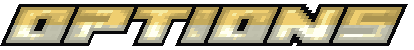

*Options → Radiant Silvergun Options → RSQ ShieldSaw.* One page, every number under Test and Debug. Defaults in
brackets.

| Section | Rows |
|---|---|
| Shield | Start With Shield (On) · Start in Hand (Off) · Show ShieldSaw (On) · Take It From (Small of the Back; Over the Shoulder, Behind the Neck, Back or Neck) · Draw With Use (On) · Next/Prev Offhand Weapon (Off) · Mount Marker (When Needed; Never, Always) · Shield Size (1.0, up to 1.5) |
| Block | Shield Blocks (On) · Block While Holstered (Off) · Double Block Size (Off) · Blocked Shots (Returned; Cancelled) · Turned Shots Go (Off the Face and My Swing; To Shooter, Where I Look, Off the Face) · Turn Shots Early (On) · Muzzle Block (On) · Return Bullets (On) · Perfect Block (On) · Perfect Block Slow-Mo (Off) · Saber Over Shield (On) · Blocked Melee (Stun and Shove; Stun, Nothing) |
| Bash | Shield Bash (On) · Bash Needs Sight (On) · Wall Slam (On) · Hit-Stop (Off) |
| Throw | Lock On With (Hold the Trigger; Use) · Throw Button (Off Trigger; Off Alt, Either) · Max Locks (5) · Catch on Return (On) · Hit Tiers (On) · BD22 Monsters (Off) |
| Hands and Body | On Manual Store (Fist; Previously Held Weapon) · Off-Hand Switch (Keep Shield; Allow Switch) · Recenter: Hands to Chest (On) · Turn With the Rig (On) · Body Turns With Hands (Off) · Body Catches Up (Off) |
| Look and Sound | Block Feedback (On: sparks, flashes, block sounds and rumble) · Positional Sound (On) · Others See Shield (Netgame Only; Only Me, Everyone) · Spin Direction (Normal; Flipped) |
| Controls | Draw / Put Back (also recalls a thrown shield). Unbound |
| Test and Debug | Debug Log (Off) · Show Block Area (Off: the blocking disc drawn as dots), and every number behind the shield as a slider: damage, the fit of the disc, the throw and the disc's flight, lock-on, block and bash, where it sits on your body and in your hand |

Speeds on Test and Debug are map units a second (about 34 to the metre) for the hand, map units a tic for the disc.

Both pages end with **Reset All**: every setting on both pages goes back to its default (your key bindings stay).

With RSQ Gun Bonsai VR loaded, a line at the top of the page says so, and Block While Holstered, Perfect Block Slow-Mo,
Hit-Stop and Hit-Stop Tics are greyed until their upgrade is learned.

The game rules (damage, block, bash, throw, lock-on, the disc, the grab zone) are the host's in netplay. Your carry
spot and its numbers, Start in Hand, Show ShieldSaw, Draw With Use, Next/Prev Offhand Weapon, Lock On With, Mount
Marker, the body rows, Block Feedback, Positional Sound, Others See Shield, the held placement and Debug Log are each
player's own.

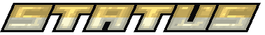

| | |
|---|---|
| **code only, not run** (2026-11-22, the owner's call: "code only no rig checks till i say"; not load-checked either) | **The series' one throw feel (owner 11-22: "all the throwing isn't smooth. it feels like it takes too much effort, that nothing goes very far, and that it feels so floaty"), the same in RSQ Grenade, RSQ FnF and RSQ ShieldSaw.** The disc leaves at 4 times the hand's peak speed with Throw Speed and Disc Weight at their defaults (1.6 and 5 kg read as 1.0; it was 1.37 times, so most throws left at the 12 units a tic floor), at most 30 m/s before the rev bonus; the peak is the fastest two-tic window of the last seven that goes away from you, so a wind-up or a backhand never wins; a let-go from 1.5 m/s throws (Throw Hand Speed, 2.5 before; a saved 2.5 is moved once, settings generation 6). The disc still flies with no gravity: it is a homing saw |
| **loads only, not shown** (2026-11-13, run `main1`: the owner's full order with BD22 VR Reloaded 2.0.4x, no script error from our packs) | **The shield yields the off hand to a Wheel pick** (owner 11-13): a weapon RSQ Wheel puts in the off hand while the shield is drawn sends the shield to the shoulder; the picked weapon stays |
| **code only, not shown** (2026-11-11, `design/rigtest_2026-11-10/RESULTS_DOWNSHOT.md`; not run, by the owner's order "no rig test, code only until i say"; not load-checked either) | The body's eyes and the recenter gesture's eyes use the engine's fixed standing eye height (the player class's ViewHeight), not the pawn's ViewHeight. RSQ SlowMo's DOWN scales the pawn's ViewHeight to 40%, which put them about 0.9 m too high while you were down. Standing and crouching are unchanged |
| **code only, not shown** (2026-11-11, `design/rigtest_2026-11-10/RESULTS_HUD11.md`; not run, by the owner's order "no rig test, code only until i say"; not load-checked either) | The debug lines (ssq_debug) are not drawn while any menu is open (owner 11-11) |
| **rig only, not headset-confirmed** (2026-11-11, the last checks, `design/rigtest_2026-11-10/RESULTS_LAST.md`) | **A far bullet blocked by the plate:** a ZombieMan 11.76 m away on flat floor (rig02), the plate held facing it. Its real hitscan (through a puff): `guard kind 1 BLOCKED`, health 100 -> 100, and with the default muzzle guard `ATE a hitscan`, health unchanged; its own attacks over 1600 tics: two BLOCKED and one ATE, no damage to you (`design/rigtest_2026-11-10/evidence/LAST_SSQ_far_zombie_blocked_log.txt`) |
| **rig only, not headset-confirmed** (2026-11-10 night, `design/rigtest_2026-11-10/RESULTS_FIX.md`) | **A slanted shot through the plate is a block: found BROKEN in H2, then fixed (commit 1dbd6e35) and shown.** a zombie 1.7 m ahead firing down through the held plate, `guard kind 1 BLOCKED`, health 100 -> 100 (the same line read `missed` before the fix, `P2D_log.txt`); the plate held aside, the same shot `missed`, 100 -> 98 (`design/rigtest_2026-11-10/evidence/FIX_B_log.txt`, F6). A far shot from the step reached neither the plate nor the player, so a far block is still not shown |
| **rig only, not headset-confirmed** (2026-11-10 night, the packed batch, P2: `design/rigtest_2026-11-10/RESULTS_P2.md`, rig02) | **H1, a ricochet:** two targets ringed, one moved behind a pillar and a third spawned beside you; the disc hit the pillar, turned to the third and cut it, and the first two rings stayed on their own targets until each was cut (`design/rigtest_2026-11-10/evidence/P2_H1_ricochet_rings_stay_frames.jpg`, `P2G_log.txt`). **H2, a far zombie's bullet reads as a shot, partly synthetic:** a zombie's damage sent with itself as the inflictor read as a shot from 12.5 m and as melee from 1.7 m (`P2E_log.txt`); real hitscans always arrive through a puff and read as shots (`P2B_log.txt`, `P2D_log.txt`). H2 also found the slanted-shot miss (row above). **H3, one throw, nothing locked:** 2.06 m/s no throw, 3.09 m/s thrown (`P2C_log.txt`) |
| **rig only, not headset-confirmed** (2026-11-10, the batched rig test, `design/rigtest_2026-11-10/RESULTS.md`) | Every launch on the owner's order (with BD22 VR Reloaded 2.0.4f) had no script error from our packs. **The trigger-hold lock:** holding the off trigger painted a lock ("1 locked", `evidence/L8_log.txt`). **One throw:** the posed swing read the same as the Saber's, 2.06 m/s and 3.09 m/s (`L8_log.txt`). Both releases had a target locked, and a locked release always throws, so the 2.5 m/s threshold itself was not shown there (H3, above, shows it with nothing locked). The ShieldSaw Throw Hand Speed (m/s) row at 2.50 (`evidence/menus_new_rows.jpg`) |
| **rig only, not headset-confirmed** (2026-11-09, full load order) | The pack loads on doom2, brutal22test6, BD_VoxelPack, BD22 VR Reloaded 2.0.4e, LOB, Champions, Gun Bonsai and the rest of the series with no script error of its own, and "RSQ ShieldSaw" is on Radiant Silvergun Options (`design/rigtest_2026-11-09/logs/main_A-G_I.log`, load order lines 3-38, menu line 1201). The Draw key puts the shield in the off hand beside BD22 VR's rifle, and it stays there while the main hand changes to the rocket launcher and RSQ Tactical Rig's cigarette (`design/rigtest_2026-11-09/batch2/launch3_harness_reruns.log`, lines 1223, 4689, 4703). That run was not a ShieldSaw test |
| **rig only, not headset-confirmed** (2026-11-03, an earlier build, RSQ ShieldSaw alone) | The body the stowed shield hangs on: sixteen 45° snaps followed exactly, a smooth 360 each way, a real 60° or 90° room turn left alone, then put right by the hands-to-chest gesture and by the Recenter Torso key; faced to the head again after a save and load and a map change; no script errors (`TacticalRig/tools/rigtest/turnprobe/evidence/recenter_after_shieldsaw_alone.txt`, `after_shieldsaw_alone.txt`) |
| **rig only, not headset-confirmed** (frames, an earlier build, before 2026-11-05) | The held shield in the hand, desktop view (`docs/screens/held_shield_ermac_hand.png`); the bash burst, a wall slam and its stun (`docs/screens/bash_fx_before_after.png`, `docs/screens/bash_hit_owner_burst.png`). Pictures of what an earlier build did, not proof of this one |
| **Headset-confirmed** | Nothing |
| **code only, not shown** | **The 11-10 key change:** one key, Draw / Put Back, and the lock and throw keys gone (the 11-10 run drew the shield with the key's command, `ssq_draw`, before its throws, but no line logs the draw itself). The 11-10 fixes: 16 unused sprites and an unused saw loop sound removed; the rumble route to RSQ Accessibility |
| **code only, not shown** (a commit says rig-shown, but no log or frame is in the repo) | The stowed shield flat along the back at every spot, and a draw from the small of the back with RSQ Tactical Rig (commits of 11-08 and 11-09); Next/Prev Offhand Weapon and the grind's blood (11-06) |
| **code only, not shown** | Everything else on this page: the block, the sweep, the muzzle block and returned bullets, the perfect block, Saber Over Shield, the bash's damage and shove, the rev and the grind, the throw's flight, the hit tiers, the bounces, the return and the catch, the flick reload, every Gun Bonsai VR upgrade, the Accessibility settings, netplay |
| **not yet run** | Nothing from the rig test: H1 to H3 and the far bullet have run (above) |

All VR behaviour is rig only, not headset-confirmed.

- **Stock QuestZDoom 17.3** (gzdoom 4.14 ZScript): ZScript and data only. No engine changes.
- **The shield is an off-hand weapon** (`SSQ_ShieldSaw`) only so the engine draws its model at the off controller. It
  never fires: the rev reads the off trigger straight off the synced buttons. The five sizes are five baked meshes,
  picked by sprite, because MODELDEF fixes a model's size at load.
- **The block disc is measured off the mesh,** followed through stock QZD 17.3's model chain (`guard.zs`): centre 15.4
  cm back along the forearm, 7.5 cm to the controller's right, 5 cm down, rim 29.2 cm (35.2 cm with the blades out),
  face pointing away from the arm. Show Block Area draws it.
- **Three block paths:** `AbsorbDamage` on the player's `SSQ_Guard` item for everything that lands; a sweep each tic
  over a list of live missiles (a projectile is never in the blockmap, so an iterator never finds one); and
  `WorldHitscanPreFired`, which cancels a monster's bullet before it is traced. The returned bullet is fired by a
  one-tic helper (`SSQ_Ricochet`) so the engine does not re-aim it down the main controller.
- **The arm, not the body.** Every hand speed (throw, bash, perfect block) is measured in the body's frame, so walking,
  strafing and snap turns are never a swing. A per-frame hand fix (`SSQ_HandSync`) carries the last rendered frame's
  hands to where the body is now, so a slow frame never reads as a jump.
- **Netplay-safe.** The renderer writes the hands on the console player's pawn only, so each machine sends its own
  hand (`ssq-pose`: position, angles, handedness, Steady Hands aim, seat drop), the body's yaw and eye height
  (`ssq-body`) and the saber stance (`ssq-brace`) as network events; every block, bash, throw and catch is decided in
  the playsim from those. The world copy of your shield (Others See Shield) stands in for the off-hand model while
  QuestZDoom's two-hand grab hides it.
- **Turns:** `SSQ_TurnKeeper` (`turnkeep.zs`) is RSQ Tactical Rig's turn keeper, copied so the two turn together.
- **For other mods: `SSQ_ScoreService`**, found by name. `GetInt`: `locked`, `blocked`, `perfect`, `returned`,
  `grind.held`, `thrown.leg`, `disc.grinding`; `GetObject`: `returned.from`; `GetIntUI`: `menu.locked`.
- **It asks, by name:** `RSQ_MeleeUpgradeService` (Gun Bonsai VR), `RS_ScoreService` (`touch`), `RSQTR_BodyService`
  (`body.yaw`, `body.recenter`), `UBQS_SaberService` (`saber.lit`), `RSQA_Service`, `RSQMB_Service`, and sends
  `rsm_pulse` for RSQ SlowMo.
- **Console:** `netevent ssq-draw`, `ssq-throw`, `ssq-lock 1|0`, `ssq-recenter`. `tools/packpose.py` packs a fake hand
  pose for `netevent ssq-pose` on a headless rig.
- **Old settings move on once.** Settings saved under older defaults (lock grace, rings kept, the throw button, the
  block's margin and depth, the turned-shot aim, the back spots, the body-turn guess) are moved to the current ones the
  first time this version loads.
- **Tools:** `build.sh` packs the pk3; `tools/fxpull.py` is the record of what came from RS Combat FX and RS
  Ballistics; `tools/rigtest/ssprobe` and `ssbody` are rig probes (the wall-slam and brace scenes, the body-frame log).
  Never shipped.

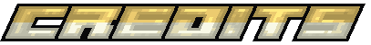

The full list is in **CREDITS.txt**.

- **id Software:** the shield saw itself, from Doom: The Dark Ages (2025): its design, and the mesh Ermac ripped from
  the game.
- **Ermac (iAmErmac), Rusted Legacy** (https://github.com/iAmErmac/rusted-legacy): brought the shield saw to Doom VR
  first, and this mod started from his version. His two shield models, the hand model and the sounds come from it.
  His Rusted Legacy code is MIT (`models/hand/LICENSE_RustedLegacy_MIT.txt`); that licence does not make id Software's
  ripped mesh MIT. Which of the two shield meshes is which, and where the hand and sounds came from before Rusted
  Legacy, is not recorded.
- **RS Combat FX and RS Ballistics** (presidentkoopa's effect libraries): the saw voice and block sparks, and the Shield
  Dash and Charge effects and sounds.
- **QuestZDoom** (Emawind, Team Beef): the engine and its off-hand weapon and hand-pose support.
- **presidentkoopa:** this standalone version, its design, its headset testing and the direction of every change; the
  bash-hit burst.
