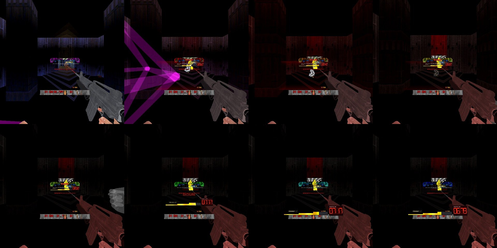
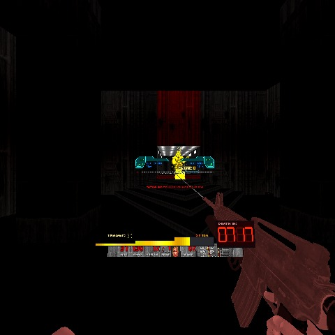
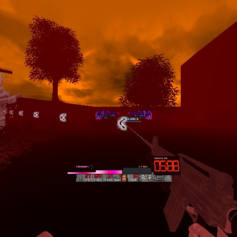
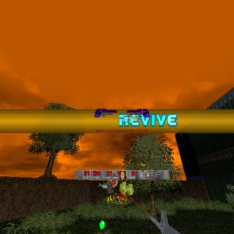

# RSQ SlowMo
### Doom Arcade VR · the world slows, you don't: dodgeable bullets, a shootdodge, and one last stand when you go DOWN

Press a key, cross your wrists or leap sideways and the world drops to a quarter speed while your head and hands stay
on real time. Enemy bullets become rounds you can see, lean away from and hear whiz past. The rest of the series slows
the world too, for a parry, a shove, a chain of barrels or a heavy hit, and a bar under your score counts down the real
time left. Turn on DOWN and a monster's killing blow leaves you on the floor in a grey world with a few seconds to take
your revenge.

*[GIF to come: the world slowing, an enemy's shots turning into glowing rounds, the player leaning out of one as it whizzes past]*

---

## What it feels like

- **The world slows; you don't.** Monsters walk, fire, fall and die at a quarter speed. Their sounds drop in pitch with
  them. Your head and hands are never slowed.
- **Bullets you can see.** Inside slow motion an enemy's gunshot becomes a glowing round flying down the same line, with
  the same damage. Step or lean out of its way and it misses. A close one whizzes or cracks past your ear and buzzes
  both hands.
- **Lean out of it.** Move your head across a round's path and it passes you by, the way you would dodge in a room.
- **Shootdodge.** One key throws you into a sideways leap and drops the world to a tenth of its speed until you land.
  Your own dive hangs in the air too.
- **The game slows time for you.** A perfect parry, a gun-butt shove, the cigarette, a barrel chain, a heavy hit from a
  boss: each can slow the world for a moment. Every one has its own on/off switch.
- **A bar that tells you when real time is back.** A green bar under your score drains with the real seconds left and
  names what slowed the world.
- **DOWN (optional).** A monster's killing hit holds you at 1 HP instead. The world goes grey and nearly stops, you sink
  to the floor, and you have 9 seconds to kill the monsters marked for you and get up.

---

## How to play

| Do this | What happens |
|---|---|
| Press your **Slow Motion Key** (bind it under *Customize Controls → RSQ SlowMo*) | The world eases down to the World Speed (a quarter by default). Press again to end it |
| Cross your wrists in front of your face and hold them there a moment | The same as the key. With **Wrist Cross Bursts** on, a 4-second burst instead |
| Press your **Shootdodge Key** while standing | You jump and leap the way your stick points (forward if it is centred); the world drops to a tenth until you land |
| Lean your head sideways as a round comes at you | It passes on the side you leaned away from |
| Open the RSQ Wheel | The world slows for as long as the wheel is open |

**How long it lasts.** With Adrenaline off (the default) your held slow motion lets go by itself after **Slow Motion
Length** (6 real seconds); pressing again ends it sooner. A shootdodge lasts until you land, 6 seconds at most.

**Nothing to bind?** The keys have no default binding. The wrist cross works without one.

**Also in slow motion:** your own walking, jumping and falling slow with the world (**Slow Me Too**; never your head or
hands). The nearest monsters walk smoothly instead of stepping in jumps (**Smooth Walkers**). Your shots leave a fading
trail from the muzzle to where they landed (**Shot Trails**) and slowed rockets and fireballs leave a pale wake
(**Missile Wakes**). Your own shots that fly (rockets, plasma, projectile bullets such as Brutal Doom's true bullets) slow too unless you turn **Slow My Shots** off. **Colour Drain** (off by
default) greys the view a little while time is slowed.

You hear Doom's power-up pickup as the world slows and a lift landing as it comes back, with a rumble in both hands.

---

## The adrenaline meter

Off by default. Turn on **Adrenaline** and your own slow motion is no longer free:

- **Earn it.** A kill gives 12, a round that only just misses you gives 4, and damage you take gives half its amount.
  Other mods can add to it (RSQ Gun Bonsai VR's melee Adrenaline and Second Wind do).
- **Spend it.** Your held slow motion and a shootdodge in the air drain it: a full meter lasts 10 seconds. A wrist-cross
  burst pays its 4 seconds up front.
- **You need 25 to start.** Below that you get a low buzz and Doom's "oof" instead.
- **A full meter** plays the item pickup sound. With **Keep Adrenaline** on the meter goes with you to the next level.

Only your held slow motion (the key, the wrist cross, the Wheel, the Accessibility button), the burst and the
shootdodge spend it. Slow motion started any other way (a parry, the cigarette, a blast, a heavy hit) never does.

---

## The bars

Two bars sit centred under RSQ Score's bar, each with a small hourglass at its left. Without Score they sit where
Score's bar would be.

| Bar | When | What it shows |
|---|---|---|
| **Stored slow-mo** (left) | Adrenaline on | Your adrenaline meter. Deep blue when low, cyan at half, nearly white when full. Dim below the line you need to start (a white tick marks it), and it pulses while you spend it |
| **Countdown** (right) | While the world is slowed | The real time left until full speed, draining evenly through the ease back out. A short line underneath says what slowed the world: SLOW MOTION, SHOOTDODGE, RELOAD, CHAIN REACTION, HEAVY HIT: BARON OF HELL and so on |

With Adrenaline off the countdown shows for every slow motion. With Adrenaline on it shows only when the game slowed time
for you (your own spends the stored bar instead). When the countdown appears beside the stored bar, the stored bar glides
aside so the pair stays centred.

If something stretches the slow motion, the countdown refills with a glint. **Bar Animation** adds a light band sweeping
along the fill and a breathing edge. **Bar Colour** picks one of 17 colours or Random (a new one each time). With RSQ
Miniboss loaded, both bars take the size of its Miniboss meter and sit centred under it.

*[GIF to come: the adrenaline meter filling and the countdown bars draining]*

*[Still to come: the countdown bar with its cause line under RSQ Score's bar]*

---

## When the game slows time for you

Each trigger has its own switch on the options page. There are two kinds.

**Your triggers** are things you chose to do. They are never refused for time.

| Trigger | From |
|---|---|
| Slow Motion Key, Wrist Cross, Burst, Shootdodge | This mod |
| Wheel | Opening the RSQ Wheel |
| Accessibility Button | RSQ Accessibility's slow-motion button |
| Melee Gun Butt Shove | A shove that lands (RSQ Melee) |
| Cigarette | Flicking the cigarette from your mouth (RSQ Tactical Rig) |
| Saber Parry | A perfect parry (RSQ Saber, with its own slow-motion option on) |
| ShieldSaw Block | A perfect block (RSQ ShieldSaw, with its own slow-motion option on) |
| Quick Grenade | A grenade from RSQ Grenade's quick key, so you can shoot it in the air (1.5 s) |
| Training Remote | RSQ Saber's training remote: each bolt you deflect (0.3 s), and the remote knocked down (1.5 s) |

**Automatic triggers** happen to you. After one ends, the next automatic one waits 25 seconds (**Auto Cooldown**), so
the game is not slowing all the time. Heavy Hit Slowdown and the miniboss fight landing keep out of that shared wait.

| Trigger | Default | What sets it off |
|---|---|---|
| **Miniboss** | On | RSQ Miniboss's slow window, and the miniboss fight landing (the landing skips the cooldown) |
| **Close Call** | Off | A rocket or fireball about to hit you up close: 0.7 s to step aside |
| **Reload** | Off | Your reload. **Reload When**: always, or only at 25 health or less. **Reload Length**: a fixed 1.2 s, until the reload ends (10 s at most), or until it ends but no longer than the fixed time. **Reload Hands**: either hand, main hand only, off hand only, or both hands at once (Brutal Doom VR's dual wield) |
| **Grenade Blast** | Off | Your own grenade going off (Brutal Doom's hand grenade, RSQ Grenade's) |
| **Over-Under Blast** | Off | The 40 mm under Brutal Doom VR's Rifle and Machinegun going off |
| **Locked Barrel** | On | A barrel you threw or uppercut at a locked monster lands on it and goes off (RSQ Distance Grab) |
| **Barrel Multi-Kill** | On | One barrel's blast kills two or more monsters |
| **Chain Reaction** | On | A barrel's blast sets off another barrel |
| **Barrel Near You** | On | Any barrel goes off within 2 m of you |
| **Score** | On | RSQ Score's big moments and its hit-stop |
| **Gun Bonsai VR** | On | RSQ Gun Bonsai VR's Adrenaline, Showdown and Time Dilation upgrades |
| **Other Mods** | On | Any other mod that asks for slow motion |
| **Heavy Hit Slowdown** | On | See below |

Blasts and barrels hold the slow motion for **Blast Time** (3 s); a heavy hit for 3 s. This mod's own triggers slow the
world to your World Speed; the other mods ask for their own length and speed.

### Heavy Hit Slowdown

On by default. When one tic's damage takes 75% of your maximum health (**Heavy Hit Size**), the world slows for 3
seconds, if the hit came from a boss, a big demon (Cyberdemon, Spider Mastermind, Baron, Hell Knight, Mancubus,
Arch-Vile, Revenant, or anything that replaces one), a LegenDoom legendary, a Champions champion, or an RSQ Miniboss or
its thralls. Any attacker counts when one of these is true:

- **Arch-Vile Blast:** it was an Arch-Vile's flame.
- **Blasted Off Your Feet:** the hit threw you upward.
- **Hit From Behind:** it came from more than 60 degrees off where you were looking.
- **Armour Broken:** it took your last armour.

It never fires on a hit that kills you, or while you are DOWN. Its **Cooldown** row: No Limit (the default), once per
20 s, once per 60 s, or the shared Auto Cooldown. During an RSQ Miniboss fight every heavy hit fires.

---

## Be Quick or Be Dead (DOWN)

Its name on the menu and the panel is **Be Quick or Be Dead** (code only, not shown yet), with the Q, the K and both D's of DEAD breathing in
size (still in Photosensitive Mode); this page calls it DOWN for short. Off by default. Turn it on and the killing blow from a monster holds you at 1 HP instead. A fall, a crusher, your
own shot, a barrel nobody set off or a hazard still kills you as normal.

- **You go down in slow motion.** About a second of slow fall, your view sinking to 40% of your standing height. The world
  drops to its slowest (5%). You can still crawl, at a third of your speed, and your own shots fly at full speed. While
  you are DOWN, hits cannot kill you.
- **DEATH IN.** A clock of 9 real seconds. Damage you deal buys time back, as a share of a whole monster: 1 second for a
  zombie, imp or pinky, half a second for a Lost Soul, 2 for anything bigger, 10 for a Cyberdemon or Spider Mastermind.
  The bought time pours in slowly, so the clock always drains at least a quarter speed, and it never climbs above 9.
- **Your targets.** The first time you go down you owe one kill. Each DOWN after that owes one more, until you spend an
  RSQ Score life. The first target is the monster that downed you, if it is still in your fight; the rest are copies of
  it that appear in front of you (or nearby, out of view, if there is no room in front). Targets glow in their own
  colour, are full-bright and 15% bigger, with half again their health (LegenDoom sets its own). With Champions loaded they are real Champions; with LegenDoom loaded, legendaries; with neither, DOWN
  red.
- **Find them.** Each target carries its own crosshair icon. In view, the crosshair assembles over it. Up to 75 degrees off to
  the side, a trail of chevrons at eye level leads to it. Farther round, an arrow at the edge of your view points the
  way to turn (straight behind you: at the bottom, pointing down).
- **The reward bar.** Three steps of 3 seconds, tallest on the right. Kill a target while others remain and the bar
  refills. The step you are in when the last one dies is your tier.
- **Get up.** The last target dead, you are up at once:

| Tier | Invulnerable | Slow motion after | Extras |
|---|---|---|---|
| **Top** (the first 3 s) | 5 s | 3 s | RSQ Score's Revival Fire, a cigarette back (RSQ Tactical Rig), a grenade back (RSQ Grenade) |
| **Middle** | 3 s | 1.5 s | |
| **Bottom** | 1 s | 5 s | |

  Both guns you hold get their magazines filled for free (guns with a magazine, never from your reserve). Health and armour: with RSQ VisualRewards' Kill Rewards on,
  the bits from your kills while DOWN are banked and paid out (health up to your maximum, armour up to 250); if nothing
  was banked you get up with the health you had. Without it you get 100%, 66% or 33% of your maximum health by tier,
  and that share of 100 armour.
- **Run out of time** and you die, unless RSQ Score has a life for you. Then the spawned targets vanish in teleport fog
  and the monster that downed you loses its glow and stays.

**The look.** The world goes black and white under a blood-red tint, and only for you. A target's room keeps its
colour when the room is small. DarkDoomZ drops to DarkDoom Black while you are DOWN (single player) and goes back after.
With RSQ Glow In The Dark the map turns deep blood red. With RSQ VisualRewards the DOWN music plays. You hear a heavy
hit and a ringing in your ears as you fall, a heartbeat that quickens as the clock runs down, and a relief when you get
up. Both controllers thump when the panel lands.

**The panel.** The reward bar, a line for each target, and the DEATH IN clock in red seven-segment digits. By default it
appears big in the middle of your view with BE QUICK OR BE DEAD over it, then sinks to its place under your gaze.

*These pictures are frames from the test rig (stock QuestZDoom 17.3, 2026-11-09), not captures from the headset.*

*[GIF to come: a target's crosshair assembling over it]*

*[Still to come: the edge arrows pointing to a target behind you]*

---

## Plays well with

SlowMo talks to most of the series, always by name: every mod still loads and plays alone.

- **RSQ Accessibility:** its slow-motion button toggles slow motion (its own switch here). Its Min SlowMo Ease makes
  every ease in and out at least that long, Gesture Ease widens the wrist cross, Rumble Strength scales every rumble, the
  colour-blind palette recolours the rounds, your shot trails and the countdown bar, and Photosensitive Mode drops the
  bar's glint, holds its edge, the DOWN arrows, trail and clock still, and removes the panel's overshoot and the
  crosshair's flash. Its own slow-motion cues (a rumble and a label) come from SlowMo's clock.
- **RSQ Distance Grab:** the Locked Barrel trigger. A barrel you steered onto its locked monster slows the world when it
  goes off.
- **RSQ Glow In The Dark:** its glow drains toward a cold grey while the world is slowed. With **Red Map** on the whole
  map turns blood red while you are DOWN. **Fog Colour: Complementary to GITD** takes the opposite colour of each room's
  glow. If GITD is holding DarkDoomZ dark for a miniboss's landing, DOWN gives back your own setting, not GITD's.
- **RSQ Grapple and RSQ Whip:** they read the world's speed, so a monster they pull moves at the slowed pace.
- **RSQ Grenade:** the Grenade Blast trigger. Thrown grenades follow the world's speed (and can run faster than it, on
  Grenade's own option); with Slow My Shots off they stay at full speed. Grenade's Only in Slow-Mo row reads
  SlowMo's clock, and Gun Bonsai VR's Skeet Window slows the world through SlowMo. Getting up on the top tier gives a grenade back.
- **RSQ Gun Bonsai VR:** a SlowMo upgrade tree. **Deeper** slows the world further (x0.8, x0.6, x0.4 of your World
  Speed). **Longer** stretches the wrist-cross burst (5, 6, 8 s) and makes a full meter last 25% longer a level.
  **Cheaper** spends the meter 20% slower a level. **Lean Dodge** unlocks Lean Out of Bullets (that row is greyed until
  it is learned); its second level dodges a monster's claw as well. **Matrix** turns on Colour Drain and Shot Trails and
  drains the colour almost fully. Its Adrenaline, Showdown and Time Dilation upgrades slow the world, Marksman and
  Dodger work while it is slowed, and Bullet Time Fists (with RSQ Melee) punch the slowed rounds back.
- **RSQ Melee:** a landed gun-butt shove slows the world, and while that lasts the shotgun's F.E.A.R. Effect is on.
  Fireballs you punch back keep the speed you sent them with.
- **RSQ Miniboss:** its slow windows and its miniboss fight landing slow the world (the landing shows MINIBOSS INCOMING under the
  countdown and leaves the cooldown alone, so the windows after it still slow). Its miniboss and thralls count for Heavy
  Hit Slowdown, and a miniboss fight lifts that cooldown. Its arrows to arriving monsters are SlowMo's edge arrows. The bars
  line up under its Miniboss meter.
- **RSQ Saber and RSQ ShieldSaw:** a perfect parry or a perfect block slows the world for half a second.
- **RSQ Score:** its big moments and hit-stop slow the world, and it reads SlowMo back for its own slow-motion bonuses
  (a claw dodged by leaning, with Lean Dodge 2, is reported to it too). Its combo rows move down to make room for the countdown bar. With DOWN: no Score life
  is spent while you are DOWN, spending one resets the kills you owe, a failed DOWN uses a life if you have one, each
  target you kill earns Revenge, the top tier fires its Revival Fire, and the target lines use Score's monster names and
  font.
- **RSQ Tactical Rig:** the cigarette slows the world, and with the Rig's own option you move at full speed while you
  smoke. Getting up on the top tier puts a cigarette back. The Rig knows when you are DOWN.
- **RSQ VisualRewards:** with DOWN, "+0.4s" pops where your hits buy time, REVENGE and REVIVE (sized by tier), each
  target's health bar kept up, the Kill Rewards bank for getting up, and the DOWN music. Its Level-Up Slow-Mo option
  slows the world through SlowMo.
- **RSQ Wheel:** opening it slows the world (its own switch here); closing it ends the slow motion it started.
- **Brutal Doom and Brutal Doom VR Reloaded:** enemy bullets that Brutal Doom fires as projectiles slow down to round
  speed too.
  The reload trigger reads Brutal Doom VR's reloads, hand reloads and dual wield; the blast triggers know its grenades and
  the over-under 40 mm. DOWN's magazine refill is for its magazine guns, and without DOWN's own sounds its heartbeat is
  Brutal Doom's.
- **LegenDoom and Champions:** DOWN's targets become legendaries or real Champions; their attacks count for Heavy Hit
  Slowdown.
- **DarkDoomZ:** DarkDoom Black (or Classic) while you are DOWN, your own mode put back after, even after a quit
  mid-DOWN.
- **Xortts' Bullet Time X or RS_SlowMo:** two slow-motion systems would compound, so with **Yield to Other Mods** on
  (the default) SlowMo stands down and says so in the console.

---

## Options

*Radiant Silvergun Options → RSQ SlowMo.* One page with every option, most important first; the raw numbers are under
Test and Debug. **Reset All** at the foot covers both. In a netgame the rows that change everyone's world are the
host's (World Speed, the world's rules, most triggers, DOWN's rules); your keys, wrist cross, reload rows, Slow Me Too,
the bars and DOWN's look are yours.

| Section | Rows |
|---|---|
| Top | Slow Motion Key · Shootdodge Key · World Speed (0.25) · Slow Motion Length (6 s; greyed with Adrenaline on) |
| Slow Motion | Dodgeable Bullets · Lean Out of Bullets · Slow Me Too · Slow My Shots · Smooth Walkers · Adrenaline (off) · Keep Adrenaline · Haptics · Yield to Other Mods |
| Look | Colour Drain (off) · Shot Trails · Missile Wakes · Stored Slow-Mo Bar · Countdown Bar · Bar Animation · Bar Colour (Green; 17 colours or Random) |
| Your Triggers | Slow Motion Key · Shootdodge · Wrist Cross · Wrist Cross Bursts (off) · Burst · Wheel · Accessibility Button · Melee Gun Butt Shove · Cigarette · Saber Parry · ShieldSaw Block · Quick Grenade · Training Remote |
| Automatic Triggers | Miniboss · Close Call (off) · Reload (off) · Reload When (Always, Low Health) · Reload Length (Fixed Time, Until the Reload Ends, Until It Ends, at Most the Fixed Time) · Reload Hands (Either Hand, Main Hand Only, Off Hand Only, Both Hands at Once) · Grenade Blast (off) · Over-Under Blast (off) · Locked Barrel · Barrel Multi-Kill · Chain Reaction · Barrel Near You · Score · Gun Bonsai VR · Other Mods |
| Be Quick or Be Dead | Be Quick or Be Dead (off) · Music · Clock (9 s) · Bar Step (3 s) · Slowest Clock Drain (0.25) · Time: Small Monster (1 s), Lost Soul (0.5 s), Big Monster (2 s), Cyberdemon / Mastermind (10 s) · Invulnerable: Top, Middle, Bottom (5, 3, 1 s) · Slow-Mo After: Top, Middle, Bottom (3, 1.5, 5 s) · No Bank: Top, Middle, Bottom (100, 66, 33%) · Bank Armour Cap (250) · Turn Marker (Triple Chevron; Framed Triangle, Framed Fat Arrow, Triangle With Afterimages) · Red Map · Lower View When Down · Panel Size (1.0) · Target Lines (Icon, Name) · Death In Entrance (Middle Then Sink, Bottom Only, Slam Up) · Entrance Size (1.6) · Slow Fall · Black and White World · Fade (1 s) · Fog Tint Strength (0.6) · Fog Colour (Blood Red; Ember, Toxic Green, Deep Blue, Violet, Bone White, Random, Complementary to GITD) · Targets' Room in Colour (Small Rooms; Off, Always) · DarkDoomZ When Down (DarkDoom Black; Off, DarkDoom Classic) · Sounds |
| Heavy Hit Slowdown | Heavy Hit Slowdown · Heavy Hit Size (75% of max health) · Arch-Vile Blast · Blasted Off Your Feet · Hit From Behind · Armour Broken · Cooldown (No Limit; Once per 20 s, Once per 60 s, Use Shared) |
| Test and Debug | Ease In (0.15 s) · Ease Out (0.4 s) · Range (3000) · Sound Follows (1.0) · Round Speed (14) · Slow Me Too Strength (1.0) · Auto Cooldown (25 s) · Shootdodge World Speed (0.10), Leap (12), Hang (0.5) · Wrist Gap (0.16 m) · Wrist Hold (12 tics) · Reload Time (1200 ms) · Close Call Time (700 ms) · Blast Time (3000 ms) · Low Health At (25) · Adrenaline To Start (25), Full Meter (10 s), Per Kill (12), Per Near Miss (4) · Lean Needed (0.06 m) · Lean Baseline (2 s) · Smooth Range (1024) · Smooth Walkers (12) · Colour Drain Amount (0.35) · Bar Size (1.5; only without RSQ Miniboss) · Debug Log |

Rows not marked (off) are on by default. With RSQ Gun Bonsai VR loaded, a gold line at the top says so and Lean Out of
Bullets is greyed until you learn Lean Dodge.

---

## Status

| | |
|---|---|
| **Shown on the rig** (2026-11-09, frames and logs) | DOWN from start to finish: a monster's killing hit held at 1 HP, the world to 5%, the slow fall to 40% view height, the crawl, targets (the killer swapped for a real Champions copy, extra copies spawned in view), the grey world with its blood-red tint and the target's small room in colour, DarkDoomZ to DarkDoom Black and back, the panel's Middle Then Sink entrance and the chevron trail (both in their earlier form: see below), hits buying time, the bar refilling on a kill with targets left, getting up on the top, middle and bottom tiers with their slow motion, Score's Revenge and Revival Fire, a save and load mid-DOWN, and a map change mid-DOWN letting the grey world and DarkDoomZ go (log; the next map not seen) (the kills were made by the test probe). The Reload trigger on the main hand, the off hand and both hands, with Fixed Time and Until the Reload Ends, the world easing to a quarter speed and back (log) |
| **Headset-confirmed** | Nothing yet |
| **Code only, not yet shown** | The three fixes made after the rig run: Entrance Size (the rig showed one fixed size whatever the setting), the chevrons in the target's colour while the world is grey (the rig showed them white), and Fog Colour. Everything else on this page: the key, the wrist cross, the burst, the shootdodge, Slow Me Too, the dodgeable rounds and leaning out of them, Smooth Walkers, Colour Drain, the adrenaline meter, how the two bars look, every other trigger, Heavy Hit Slowdown, the edge arrows, the crosshairs assembling, and DOWN's sounds and music |

---

## Under the hood

- **Slow motion in script, on stock QuestZDoom 17.3.** The engine has no world clock, so SlowMo keeps one. Everything
  within **Range** (3000 units) of a player is time-dilated, not frozen: its velocity is scaled by the factor and its
  gravity by the factor squared (a slowed fall), every state it enters lasts 1/factor as long (fractions carried), and
  a push it is given mid-slow is scaled too. So the world still moves every tic and does not stutter in a headset. A
  monster's walking slows because its states stretch; **Smooth Walkers** spreads each step of the nearest 12 walkers
  over those stretched tics instead of one jump and a pause.
- **What is never slowed:** players, what they carry, and the series' own actors (classes named RSQ*, UBQS*, SSQ*: the
  grab, the rig's props, the shield, the saber). Your own projectiles slow unless **Slow My Shots** is off, and never
  while you are DOWN or smoking at full speed (RSQ Tactical Rig's cigarette).
- **The rounds** replace a monster's hitscan before it is traced (WorldHitscanPreFired), from the same muzzle point and
  angle, carrying the shot's damage, damage type, puff and flags; the hit is dealt as a hitscan's would be, so monsters
  still infight over it. Melee and reaches of 128 or less stay hitscans. They fly at **Round Speed** (14 units a tic) at
  the set depth and speed up as the world comes back.
- **The doors other mods use** (by name, nothing linked): `netevent rsm_toggle | rsm_on | rsm_off | rsm_pulse <ms>
  <speed %> | rsm_state` (RS_SlowMo's own events, deeper and longer win), the named door `netevent
  rsqsm_start:<who> <ms> <speed %> <flags>`, and `RSQSM_Service` (`start`, `start.auto`, `start.bossfight`,
  `adrenaline`, `adrenaline.add`, `slowmo.active`, `active`, `scale`, `running`, `trigger.auto`, `trigger.score`,
  `countdown`, `countdown.bottom`, `arrow.add`, `arrow.clear`, `down`, `down.hold`, `down.any`, `down.redmap`,
  `down.left`, `down.mark`, `down.bank`). An `rsm_pulse` is told apart by what was sent with it on the same tic
  (`rsqml_fear`, `rsqtr_cigslowmo`) or by its length and speed; anything unrecognised is Other Mods. DOWN tells every
  service whose name contains `RSQDownJoin`: `down.start`, `down.target`, `down.time`, `down.revenge`, `down.up`,
  `down.revive`, `down.fail`.
- **The ease** is linear: Ease In crosses the whole way in 0.15 s, Ease Out in 0.4 s. The countdown counts real tics
  (the map's own clock is never slowed) and ends exactly as the world reaches full speed.
- **Slow Me Too** scales what the engine produced for your movement each tic (the step on the ground, the thrust in the
  air, your vertical speed and gravity), never your head or hands; **Slow Me Too Strength** takes part of it.
- **Netplay-safe.** Every event lands on every machine on the same tic and the clock runs on synced state. Only the
  sound pitch, the wrist cross and the head lean read your own machine, and those only send events. The adrenaline
  meter is one meter shared by the game. DOWN's grey world and DarkDoomZ are your view only (DarkDoomZ single player
  only).
- **Exact restores.** Each room's own colour, the stock heights of your pawn, DarkDoomZ's mode and every slowed actor's
  speed, gravity and sound pitch are put back as they were, at the end, at a map change, and after a load.
- **Quest-friendly:** the world is scanned once every 17 tics (4000 actors at most); the bars and DOWN's panel are
  separate HUD quads with no clip rectangle (a scissor misses the projected HUD in VR); the grey world is each sector's
  own desaturation, written in 16 steps, not a post-process pass.
- **Stock QuestZDoom 17.3:** ZScript and data only. No engine changes.

## Credits

The full list, with every file and licence, is in **CREDITS.txt**.

- **presidentkoopa:** the design (his RS_SlowMo's events, settings and standing down for another slow-motion mod), the
  round's tracer mesh and the near-miss whiz and crack recordings from his RS_Ballistics.
- **coldcite** (Top HP Bars 1.04): the countdown bar's style.
- **Jimmy** (RSQ Score's combo font, carried from ijon's Dakka) and **Zedas** (JFO, in Blackmore1014's "JDUI Brutal Doom
  Ultimate Edition"): DOWN's panel lettering.
- **id Software:** the stock Doom sounds the clock plays, from the IWAD (not shipped).
- **Generated for this pack:** DOWN's sounds (synthesized, no samples), the round's placeholder sprite, the crosshair
  icons, turn markers and trail chevrons.
- **Xortts' Bullet Time X:** nothing taken; SlowMo only recognises it so the two never compound.
- **QuestZDoom** (Emawind and Team Beef): the engine and its hand-pose API.
