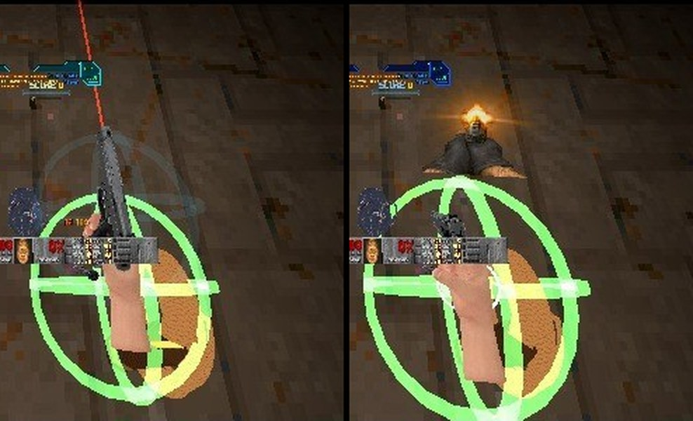

# RSQ Tactical Rig
### Doom Arcade VR · your guns on your body, a grenade on your belt, and Ermac's cigarette in your pocket

Reach for your hip and draw. Put a gun back where it lives and it stays there. Six holsters on your hips, chest and
shoulders hold a gun each, exactly the one you put there. Your grenade, sabers, whip, flares, ammo and keys each have a
spot of their own on your belt.

*[picture to come: hero shot, the rig worn, seen in the mirror (front and back side by side)]*

---

## What it feels like

- **Draw from your body.** Reach to a holster, squeeze the grip, and the gun is in your hand. Squeeze there with a gun in
  your hand and it goes away. Each hand holsters and draws its own gun.
- **Everything has its place.** The first holster you put a gun in becomes that gun's. Put it anywhere else and it flies
  home with a streak of light. A holster that belongs to another gun turns you away with a red flash, a double buzz and
  a picture of the gun it belongs to.
- **Look down and see your kit.** Stored guns hang on you the way they are worn: muzzle down on the hips, cross-draw on
  the chest, slung on your back over the shoulders. A small light on each tells you how much ammo it has.
- **Your belt does the rest.** A grenade hangs at the buckle, an ammo pouch sits beside it for Brutal Doom VR's hand
  reloads, and every key you pick up dangles from a keyring.
- **A mirror to set it up.** A copy of you stands in front of you while you move the holsters, so you can see your own
  shoulders and back.
- **Ermac's cigarette.** Pull one from your chest pocket, put it in your mouth, light it with the Zippo in your other
  hand, and time slows when you spit it out. Off until you turn it on.

---

## How to play

| Do this | What happens |
|---|---|
| A gun in your hand, squeeze the grip (or press Use) inside a holster's ring | The gun goes in. The first time, that holster becomes this gun's |
| An empty hand, squeeze inside a full holster | You draw its gun |
| Put a gun at a holster that is not its own | It goes to its own holster instead; if the holster you reached for holds a gun, that one comes to your hand |
| Put a gun at a holster another gun owns, or that is full, when your gun has no home yet | Turned away: red flash, double buzz, the owner's picture |
| An empty hand held in an empty holster for a second | That holster is freed (a white flash shows whose it was) |
| Squeeze at the belt buckle | Your grenade comes to your main hand. Squeeze there again with it in hand and your gun comes back |
| Reload a Brutal Doom VR gun with your off hand at the ammo pouch | That's where the magazines, shells and rounds come from |
| Both hands held to your chest for a moment (or the Recenter Torso key) | The holsters turn back in front of you |
| Turn on **Move Holsters by Hand**, squeeze a ring, carry it, let go | That holster moves there and stays |

The rings show when a hand comes near, and only for holsters that hand can use right now. The first time you hold a gun, a
faint ghost hand shows you where to put it. Miss the same ring three times in a few seconds and it lights up with a
"Grip inside the ring" hint.

### Controls

**One key: Recenter Torso** (unbound; owner 2026-11-10: the grip holsters, so there are no holster keys). It turns
the holsters, the torso and RSQ ShieldSaw's shield to where your head faces. It is on this mod's page and in Customize
Controls, section **RSQ Tactical Rig**.

- **Either hand, the grip:** put away and draw at a holster's ring (**Grip Holsters**, on). **Use** does the same
  (**Use Holsters**, on). The grip is read from the controller's grip buttons (**Main Grip Keys**, **Off Grip Keys**
  under Test and Debug), not from a key you bind.
- **Off-hand trigger** with the Zippo: light the cigarette. **Main-hand alt fire** on a card of RSQ Wheel: the holster
  screen.
- **Gestures:** both hands held to your chest for a moment (recenter, **Recenter by Hands**); an empty hand held in an
  empty holster for a second (free it). The cigarette goes in at your lips with **Use**.
- **Menu buttons:** **Measure My Height**, and Save and Load for the four holster profiles.

*[picture to come: the ghost hand showing the way to the hip holster (GIF)]*

---

## Where everything sits

Six gun holsters, one gun each, plus spots that hold one thing only. Main hand and off hand swap sides for a left-handed
player. Positions are set for an eye height of 1.62 m and scale to you (see Your body).

| Place | Where | Holds |
|---|---|---|
| **Left hip, right hip** | At your sides, about belt height | One gun each, muzzle down |
| **Left chest, right chest** | Either side of your breastbone | One gun each, cross-draw |
| **Left shoulder, right shoulder** | Just behind the top of each shoulder | One gun each, slung on your back, butt up |
| **Grenade spot** | The belt buckle | Your hand grenade |
| **Ammo pouch** | Beside the buckle, toward your off hand | The ammo Brutal Doom VR's hand reloads take |
| **Keyring** | Front of the belt, on your off-hand side | Every key you carry |
| **Saber spots** | Just below each hip | RSQ Saber's hilts, each on its own hand's side |
| **Whip holster** | Main-hand hip, just behind and outside the saber spot | RSQ Whip's whip |
| **Flare holster** | Off-hand hip, just behind and outside the saber spot | RSQ FnF's road flares |
| **Cigarette pocket** | High on your left chest (right, left-handed) | Your cigarettes |

*[picture to come: the mirror's front and back views with every ring showing]*

**Rings tell you what is what.** A gun holster is a wire sphere: blue when idle (or your profile's colour), green, brighter
and a size larger with a hand inside. A spot that holds one thing only is a magenta wire diamond. Only the rings your hand
could use right now show, and only the nearest is bright. Set **Holster Rings** to **Always** to see them all while you
move holsters around.

*Looking down: the pistol hand inside the right-hip holster's ring, green and bright (left), then the pistol put away in it (right) (rig capture, not headset).*

**Things with their own home never take a gun holster.** Your grenade, flares and flashlight, the cigarette and Zippo, the
whip, the sabers and the ShieldSaw stay out of the six gun holsters. Put a saber, the whip or an unlit flare on an empty
holster and it simply goes to its own spot. A lit flare is never holstered.

---

## Stored guns and their ammo

What you put in a holster is exactly what hangs there, drawn as the gun's own 3D model. Every Brutal Doom gun has a
measured size and facing. Plain Doom's guns (pistol, shotgun, super shotgun, chaingun, rocket launcher, plasma rifle,
BFG, chainsaw) hang as Brutal Doom VR's models, which the rig carries itself. A gun with no measurement is not drawn.

- **Ammo light:** green with half a magazine or more, yellow when low or empty with ammo to reload, red (smaller, pulsing
  slowly) when there is nothing at all.
- **Ammo arc:** a thin ring round the light, as long as the gun is full.
- **Ammo count** (off by default): the rounds as small digits above the ring.

*[picture to come: looking down at a stored gun on the hip with its ammo light and arc]*

Your holsters are kept from level to level. After a death or a pistol start a holster stays empty until you have that gun
again, then it is back where you kept it.

**Brutal Doom's dual guns** go in as one gun: holster a pair and you draw one. Brutal Doom's own Dual key pairs them again.

---

## The holster assignment screen (with RSQ Wheel)

With RSQ Wheel loaded, **main-hand alt fire on a gun's card** opens the holster web: a panel with a marine and your six gun
holsters as numbered rings, in your profile's colour, each showing the gun that owns it. Pull the trigger on a ring and
the gun is assigned to that holster and goes straight in. **Clear** takes its holster away. Set the Wheel's **Web View**
to **Mirror** and the panel shows the rig's own mirror of you instead, with the rings on your real holster spots.

Things with their own home are turned away here too. With RSQ ShieldSaw worn over the shoulder, that shoulder shows the
ShieldSaw and takes no gun.

*[picture to come: the holster assignment screen, Marine view]*
*[picture to come: the holster assignment screen, Mirror view]*

---

## The grenade spot

Squeeze at the buckle with either hand and your hand grenade comes to your **main hand**: Brutal Doom VR's own grenade,
or RSQ Grenade's when that is what your load order uses. Squeeze there again with the grenade in hand and the gun you had
comes back. While you have grenades and none is in your hand, one hangs at the buckle. Its light is your count: green for
two or more, yellow for one, red for none. With an RSQ Grenade kind other than the frag in hand, the spot glows in that
kind's colour.

*[picture to come: the grenade hanging at the buckle]*

---

## The ammo pouch

A small canvas pouch on your belt, for **Brutal Doom 22 VR's hand reloads**: with the pouch on, they take magazines,
shells and rounds from here and nowhere else. Turn it off and the reload grabs ammo anywhere, as Brutal Doom VR does on
its own. A light on its flap shows your main gun's spare ammo: green for two magazines or more, yellow for less, red and
blinking for none. **Pouch Reaches for Your Hand** lets it ease up to 3.5 cm toward your off hand as it comes near, and
back as it leaves.

*[picture to come: the pouch on the belt with its light, the off hand reaching in]*

---

## The keyring

Every key you carry hangs from a steel ring on your belt as the key itself (its own sprite, or the voxel or model your
pack gives it), in a little fan that sways as you move. Look down and see what you can open. Only you see it.

**Keys Open Doors** (off by default):
- **Main hand:** squeeze at the ring and the keys come into your hand. Touch them to a locked door and it is used through
  Doom's own lock check. No key that fits: Doom's own "you need a key".
- **Off hand:** squeeze at the ring and hold. At a locked door, pull the trigger to unlock and open it, or hold alt fire
  and raise your hand to lift it (with RSQ Distance Grab, the door follows your hand).

*[picture to come: the keyring with all six keys, looking down]*

---

## Cigarettes

Ermac's tribute, **off by default**. Turn on **Cigarettes** and a pocket of three sits on your chest.

| Do this | What happens |
|---|---|
| Main hand: squeeze at the chest pocket | A cigarette in that hand, the Zippo in your other hand |
| Bring it to your lips and press Use | It goes in your mouth and stays there, following your head. Your gun is back in your hand |
| Off-hand trigger with the Zippo's flame at the tip | It lights. You smoke: a glowing tip, smoke rising |
| Smoke it (2 seconds, or press Use to finish early) | You spit it out and breathe out, and time slows (with RSQ SlowMo) |
| Use anywhere but your lips | Flicked away |
| Main-hand squeeze at your mouth before it is lit | Back in your hand |

**The smoke's slow motion is its own.** It lasts as long as you set with **Smoke Slow-Mo Time** (5 to 30 seconds, 6 by
default), it doesn't use your adrenaline, and RSQ SlowMo's countdown bar shows how much of it is left.

Switching weapons, a holster, death or a level change ends it at once: an unlit cigarette goes back in the pocket, a lit
one is flicked. Left unlit in your mouth for 7 seconds, it drops. You and your shots move at full speed in the smoke's slow
motion unless you turn that off (Move at Full Speed While Smoking).

**Cigarettes are precious.** You start a game with a full pocket, and it does **not** refill on a new level: what you
have left comes with you. You earn more: RSQ Score gives you one every so many points, killing an RSQ Miniboss fills
the pocket, and getting up from RSQ SlowMo's DOWN gives one back. (Turn on **Refill Each Level** for the old way.)

*[picture to come: the whole ritual, pocket to lips to Zippo to flick (GIF)]*

---

## The mirror

You can look down at your hips, but never at your own shoulders or back. So a copy of you stands about a metre in front
of you: the torso, every holster's ring, what each one holds (guns, sabers, the coiled whip, a flare, the grenade, the
pouch, your cigarettes, RSQ ShieldSaw's shield), and your two hands as small green spheres, moving as you move. Show your
**front** (like a real mirror), your **back** (as someone behind you sees it), or **both** side by side. By default it
appears while **Move Holsters by Hand** is on.

*[picture to come: the mirror, front and back side by side, while moving a holster]*

**Map mirrors too.** With the torso on, a mirror in the map shows your torso, your helmet, and the guns and hands you are
holding, instead of the flat sprite marine.

*[picture to come: the player in a map mirror, torso, helmet and held gun]*

---

## Your body

**The holsters stay on your body, not your head.** Look around and they stay put. Snap and smooth turns carry them round
exactly. Turn your real body in the room and the torso follows once your head has stayed turned for a moment, as long as
your hands are not in a holster or reaching out to the side. If they ever end up in the wrong place, bring **both hands
to your chest** or press **Recenter Torso**. They also recenter on their own at the start of a map, on a respawn and when
you load a save. The holsters hang from your neck, so a nod does not slide them.

**Your height.** **Measure My Height** scales the whole rig to you (70% to 130%). If you never measured, it is done for
you the first time you stand still for two seconds.

**Seated.** Turn on **Seated** (or RSQ Accessibility's Seated Play) and the rig hangs from your seated eyes. The two seated
profiles move the hips and belt spots up and forward onto your lap, unless you placed them yourself.

**Four holster profiles.** Save and load where every holster sits: Standing A (blue), Standing B (orange), Seated A
(purple), Seated B (yellow). The rings take the colour of the profile in use.

**A torso to wear** (off by default). The Doom marine (green, blue with blue armour, red breathing over it when your health
is low) or Quake's Grunt (its own skin, green or blue). With the marine you also wear a helmet, seen only in mirrors. The
torso fades to about half as you look down, so you can see your holsters.

*[picture to come: the two torsos, marine and Grunt, in the mirror]*

---

## More, off by default

- **Throw Guns.** Squeeze with your hand swinging fast, away from every holster, and the gun flies from your hand and lands
  as a pickup you can take again. It hits a monster by its weight and your speed and staggers it. **Throw With Use** lets
  the main hand throw on a Use press too.
- **Move Gun at Watch.** During a watch check (RSQ Gestures, RSQ Gun Cards, or the rig's own copy of the check), press Use
  and the gun in that hand moves to your other hand, or the two swap.

---

## Plays well with

- **Brutal Doom 22 VR Reloaded:** the ammo pouch is for its hand reloads; its grenade is the buckle's; the ghost hand that
  teaches holstering is its own hand. **Its Dual key:** with a gun in your off hand only and your main hand empty, Dual now
  puts the same gun in your main hand too, instead of taking the off hand's away.
- **RSQ Wheel:** the holster assignment screen, its mirror view, and badges on each holstered gun's card showing where it
  hangs.
- **RSQ Saber:** two hilt spots below the hips, each hand its own. **Saber on Hip Too** lets the main saber clip to a hip.
- **RSQ Whip** and **RSQ FnF:** a holster each on the hips, drawn on your body while stored. FnF's own flare pocket and
  flashlight clip get rings like the rig's.
- **RSQ Grenade:** the buckle hands out its grenade when Brutal Doom VR's is not in play, and glows in the kind's colour.
- **RSQ ShieldSaw:** while its shield is stowed on your off shoulder, the rig leaves that shoulder to it (**Shoulder to
  ShieldSaw**). Set to Over the Shoulder, that holster is the ShieldSaw's alone.
- **RSQ SlowMo:** the cigarette's slow motion; getting up from DOWN gives a cigarette back; the "Grip inside the ring" hint
  never counts while you are down.
- **RSQ Score:** a Quick Draw bonus for a kill with a gun you just drew; cigarettes earned by score.
- **RSQ Miniboss:** a miniboss kill fills your cigarettes; calling a miniboss fight at the watch check never also moves your gun.
- **RSQ Gun Bonsai VR:** Smoker (longer smoke slow motion, and nothing can hurt you in it), Chain Smoker (more
  cigarettes), Gun Toss (harder gun throws), Boomerang Gun (a thrown gun flies back to its holster or your hand).
- **RSQ Distance Grab:** lift locked doors with the keys in your off hand; it stands aside while a hand is in a holster.
- **RSQ Accessibility:** colour-blind palettes for every ring and the torso, larger text for the rig's messages, rumble
  strength, Seated Play, and Photosensitive Mode for the cigarette's lights.
- **Plain Doom:** the rig works without Brutal Doom; its guns hang as Brutal Doom VR's models.

---

## Options

*Radiant Silvergun Options → RSQ Tactical Rig.* Everything is on one page; the raw numbers are under Test and Debug.
**Reset All** resets both pages and keeps your measured height.

| Section | Rows |
|---|---|
| Holsters | Tactical Rig (On) · Grip Holsters (On) · Use Holsters (On) · Holster Rings (Never / Hand Nearby / Always While Moving Holsters; Hand Nearby) · Holster Reach (1.0) · Quick Swap (On) · Keep Between Levels (On) · Move Gun at Watch (Off) · Hang From Neck (On) |
| Spots | Grenade Spot (On) · Show Grenade (On) · Saber on Hip Too (Off) · Whip Holster (On) · Flare Holster (On) · Ammo Pouch (Off: Grab Anywhere) (On) · Pouch Reaches for Your Hand (On) · Show Ammo Pouch (On) · Shoulder to ShieldSaw (On) · Keyring (On) · Keys Open Doors (Off) |
| Stored Guns | Show Stored Guns (On) · Stored Gun Size (1.0) · Ammo Light (On) · Ammo Count (Off) |
| Gun Throwing | Throw Guns (Off) · Throw With Use (Off) · Thrown Guns Hurt (On) |
| Body | Seated (Off) · Measure My Height · Torso (Off) · Torso Style (Doom Marine / Quake Grunt) · Helmet (On) · Torso Fades Looking Down (On) · Torso Follows Room Turns (On) · Head and Hands Turn (Off) · Torso Catches Up (Off) · Recenter by Hands (On) · Recenter Torso (a key, unbound) |
| Cigarettes | Cigarettes (Off) · Smoke Slows Time (On) · Smoke Slow-Mo Time (6 s) · Move at Full Speed While Smoking (On) · Cigarette Every N Score (0, off) · Minibosses Refill Cigarettes (On) · Refill Each Level (Off) · Unlit Cigarette Goes Away (On) · Show Cigarettes (On) |
| Setup | Move Holsters by Hand (Off) · Mirror (Off / While Moving / Always; While Moving) · Mirror Shows (Front / Back / Both; Both) · Haptics (On) · Messages (Off) |
| Holster Profiles | Save and Load: Standing A (Blue), Standing B (Orange), Seated A (Purple), Seated B (Yellow) |
| Test and Debug | Stored Guns: Gun Length (0.25 m), Back Gun Length (0.70 m), Gun Turn (0°), Flip These Guns · Body: Body Turn Angle (35°), Body Turn Delay (1 s), Ignore Looking Down (25°), Mirror Distance (1.0 m) · Hands: Press Delay (3 tics), Throw Speed (2.5 m/s), Thrown Gun Damage (1.0), Main Grip Keys, Off Grip Keys, Empty Hand Weapon · Torso Fit: Torso Height, Torso Forward, Torso Size, Helmet Height, Low Health Glow (35%) · Cigarette: Mouth Zone Size, In Mouth Forward (0.12 m), In Mouth Down (0.07 m), Smoke Time (2 s), Unlit Goes Away After (7 s), Slow Motion Speed (25%), Pack Size (3) · Holster Positions: Forward, Left, Up and Size for each of Left Hip, Right Hip, Grenade Spot, Left Chest, Right Chest, Keyring, Left Shoulder, Right Shoulder, Left Saber, Right Saber, Whip, Flare, Ammo Pouch · Debug: Throw Debug Log (Off) |

**Keys:** one, *Options → Customize Controls → RSQ Tactical Rig → Recenter Torso* (also on the rig's own page).

---

## Status

| | |
|---|---|
| **rig only, not headset-confirmed** (2026-11-10, the batched rig test, `design/rigtest_2026-11-10/RESULTS.md`) | Every launch on the owner's order (with BD22 VR Reloaded 2.0.4f) had no script error from our packs. No Tactical Rig check has been run in it yet |
| **rig only, not headset-confirmed** (2026-11-09, full series load order with Brutal Doom 22 VR Reloaded) | The ammo pouch on the belt, its ring, and the pouch easing toward the off hand · own-home refusals: RSQ Grenade's grenade and FnF's flare turned away with the double buzz, and a shotgun assigned to Left chest with its ring flash and ammo arc (sent as the same assignment events the Wheel's holster screen sends; the screen itself was not used) · two-handing a rifle not counting toward the "Grip inside the ring" hint, while the same reach without two-handing shows it · grenade throws through a shoulder ring not counting toward the hint, while the control run shows it · logged in the same runs: Brutal Doom VR's Dual key giving the main hand the off hand's gun, the ghost-hand holster tip looping to the right hip, the automatic height measure, the one-time recenter tip |
| **Headset-confirmed** | Cigarettes (the owner, 2026-11-09: "Cigarette works"). This line is the only record of it in the repo (it went in with this README, commit 0146025c), and the cigarette's pocket rules changed after it (below) |
| **code only, not shown** | Rig clutter, all four fixes (built 11-08, kept by the owner 11-10; among them rings only for what the hand can use and the nearest bright; `design/PARKED.md` lists all four); cigarettes are precious (the pocket no longer refills on a new level, what is left is kept across levels, earned from Score, minibosses and DOWN); the watch check's copy regenerated 11-10; the hint staying quiet while you are DOWN; everything else on this page |
| **not yet run** | T1 of the batched rig test (`design/rigtest_2026-11-10/PLAN.md`): the rig clutter fixes, all four, in frames |

---

## Under the hood

- **Netplay-safe.** Your hands are read on your own machine only. What they decide (holster, draw, take a grenade, throw,
  the cigarette's steps, a key to a door) travels as one network event per action, and every machine applies it from the
  same inventory. Rings, stored-gun models, the mirror, the keyring and the torso are drawn on your machine only.
- **Hands carried to the body.** QuestZDoom writes the controller poses only when it renders a frame, so on a slow frame
  a hand read against a walking body jumped back and forth. Each frame's controller offset is sent and added to where the
  body is this tic (`RSQTR_HandSync`, the same fix as BD22 VR Reloaded's).
- **The body is the tracking space, not the head.** The torso's yaw follows the tracking space (a snap or smooth turn shows
  as both controllers turning with the pawn), so looking around never moves the holsters. A room turn is read from the
  head held 45° or more off the torso for 1.5 s; the rig hangs from a neck point behind and under the eyes.
- **Scale read live:** `vr_vunits_per_meter` and the level's pixel stretch, so changing either never puts the holsters out
  of reach. Defaults are for a 1.62 m eye height.
- **Assignment is synced play state:** each gun holster's owner (`lockCls`) and contents (`lastPut`). A gun is filed under
  its main-hand name, so Brutal Doom VR's off-hand copies (`RSQ_Off_<gun>`) and its two-gun weapons go in as the single gun.
- **Stored guns are measured ahead of time.** A running game cannot measure a model, so `tools/measure_pickups.py` writes
  the `RSQTRFIT` table (length, facing, centre, the frame to wear) and `RSQTRLAY` (the held models' MODELDEF scale and
  offset, for map-mirror stand-ins). Every lump named `RSQTRFIT` is read, so a weapon pack can ship its own; the plain
  Doom rows come from `tools/vanilla_holsters.py`.
- **Everything else in the series is found by name.** No mod links against another; a missing mod's hook never fires.
  Other mods ask the rig through `RSQTR_RigService`: `rig.region`, `rig.busy`, `pouch.at`, `rig.drawtic` / `rig.drawn`,
  `rig.holster`, `rig.regionname`, `rig.owner`, `rig.claim`, `rig.profile`, `rig.locked`, `rig.lockable`, `mirror.web`.
  RSQ Wheel's web assigns and clears with the `rsqtr_assign:<gun>` and `rsqtr_unassign:<gun>` events.
- **Holster profiles and the item spots' places are this machine's only** (nosave settings): a profile of every place is
  longer than the engine's 256-byte limit for a shared user setting.
- **Old settings move forward once.** A setting still at an old default moves to the new one (`rsqtr_cfgver`, version 8).
- **The watch check** is RSQ Gestures' when loaded, else RSQ Gun Cards' copy, else the rig's own generated copy.
- **Stock QuestZDoom 17.3:** ZScript and data only. No engine changes. The rig stands down outside VR, where the two hands
  collapse to one point.

---

## Credits

The full list, with every file and its source, is in **CREDITS.txt**.

- **Ermac** (iAmErmac, DoomVR co-designer; Rusted Legacy, DXR): the idea, from his Virtual Tactical Vest for Doom VR (body
  holsters, and the cigarette as a tribute). The cigarette, its butt and its smoke come from that mod; the Zippo is the
  voxel lighter from his ZBlood-VR. This is new code, written for stock QuestZDoom 17.3.
- **id Software:** the marine torso and helmet (the Doom Eternal Classic Slayer, a rip shared on Sketchfab, prepared and
  recoloured in presidentkoopa's RS_VRBody) and the Quake Grunt torso (cut by Vittorio Romeo's original Quake VR mod,
  recoloured in RS_VRBody).
- **presidentkoopa:** the holster spheres (his RS_Holsters) and the holster, draw and foley sounds (his RS_CombatFX).
- **Pixabay** ("freesound_community", Pixabay Content License): the Zippo and cigarette sounds.
- **QuestZDoom** (Emawind and Team Beef): the engine, and the off-hand weapon and hand-pose API the rig reads.
