# RSQ Visual Rewards
### Doom Arcade VR · health bars, damage numbers that fly, kill bits, level-up banners and monsters that arrive on a beam of light

Every monster you hurt gets a health bar over its head. Every hit throws a little number into the air, a chain of
hits rolls up into a total that punches when the monster dies, and the monster bursts into bits of health, armour and
ammo that fly to you. When another mod calls monsters in, they arrive on one of four beams of light, each with its own
sound.

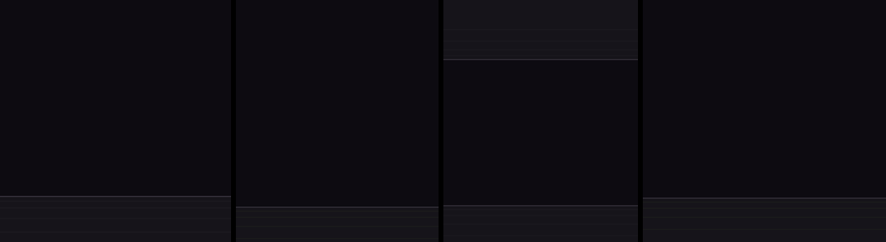

*Design render: the four arrival beams playing side by side (V1, V2, V3 indoors, V4), drawn by the mockup tools the
game's beams were built from. Not a capture from the game or the headset.*

---

## What it feels like

- **See how hurt it is.** A bar over every monster you have hurt, longer for tougher monsters, flashing white the
  moment your hit lands.
- **Watch your hits fly.** Each hit pops a small number out of the spot you hit. It jets up and over, spinning a
  little, and is gone in about two thirds of a second.
- **Build a combo.** From the second hit on the same monster a running total sits over its bar, counting up like an
  arcade counter, with "x2", "x3" ... beside it. It warms from white to red as the chain grows, shakes from x5, and
  cools down if you stop for three seconds.
- **The kill lands.** The total punches once and holds. A headshot gets a gold HEADSHOT over a bigger number.
- **Bits, everywhere.** A monster bursts into glowing bits of health, armour and ammo. Stand still and they fly to you.
- **What you picked up, on your wrist.** "+25" health, "+10" armour, "+5" ammo rise from the pickup and fly to your
  wrist.
- **Level up in style.** With Gun Bonsai, a gold LEVEL UP band sweeps past in front of you; a gun's level-up rises off
  the gun as a little tag.
- **Monsters arrive like an arcade boss stage.** Called-in monsters land on a beam of light in their own colour, hidden
  until the beam reveals them, with words over them ("GUARD!", "TARGET!") and the miniboss fight's own music.

---

## How to play

There is nothing to hold: load it and play.

| Do this | What happens |
|---|---|
| Shoot a monster | Its bar appears; a number jets off where you hit it |
| Keep hitting it within 3 seconds | A running total and "xN" combo over its bar |
| Kill it | The total punches; the monster bursts into bits |
| Stand near the bits (2 m) | They fly to you and are picked up |
| Walk over a pickup | "+N" rises from it and flies to your wrist |
| Level up (Gun Bonsai) | The LEVEL UP band, or the gun's tag |
| A miniboss fight starts (RSQ Miniboss) | Its monsters arrive on beams; its music crossfades in |

Everything is on one options page, **RSQ VisualRewards**, and every part can be switched off on its own.

---

## HP bars

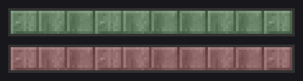

*The bar art from Visual Rewards' starting point (original 1.04, `original_1.04/graphics`), styles A and B, drained
from full to empty, enlarged 5x. Assembled from the image files, not a capture from the game.*

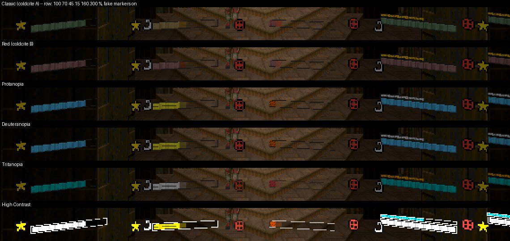

*Rig frames from an earlier build (committed by 2026-11-05): the bar colour sets at several health levels, with test
markers. Not captures from the headset.*

The bars are coldcite's Top HP Bars, rebuilt for VR.

- **Only on what is hurt.** A monster gets its bar the moment it is hurt (or when its health changes another way, such
  as a healer's), never before.
- **Longer for tougher monsters.** An imp's bar is coldcite's size; a baron's is about 1.6 times longer, a Cyberdemon's
  nearly twice.
- **Hit flash.** The tic after your hit lands the bar flashes white.
- **Overheal.** Health above full shows as a thin strip above the bar; laps beyond the strip show as pips, up to four.
- **Readable across a room.** Bars grow with distance (Far Size, up to twice as big at range) and sit on the sprite's
  real top, voxels included.
- **Colours.** Classic (coldcite's green), Red, three colour-blind sets (Protanopia, Deuteranopia, Tritanopia), High
  Contrast, Cyan / Lavender / Orange, and Random (each bar picks its own). The colour-blind and high-contrast sets also
  hatch and pulse the low band, so they do not rely on colour alone.
- **Markers beside the bar.** Hooked, stunned, locked on, gripped and whipped (from the series' mods), frozen in a
  hit-stop, held in a headlock, brought back by an Arch-Vile, burning, and a heart on allies. Above the bar: a crown on a
  miniboss (with its tier pips), a chain link on its thralls, a gem on a LegenDoom legendary.
- **Tier gem and Champion icons** (on): beside the bar, the monster's RSQ Monsters tier as a gem (bosses' gems
  crowned), then its Champion power and mutation, in the series' own icons. They sit on the left, or on the right
  when the left already holds markers. Champions' own floating icon is hidden while they are on. Code only, not shown
  yet.
- **Choices:** only the monster your gun points at, a lit chunk showing what your hit took off, blue bars for allies,
  only the 24 nearest, and a distance limit.

*[GIF to come: a bar appearing on a hit, flashing, the chunk draining, the overheal strip on a legendary]*

---

## Damage numbers

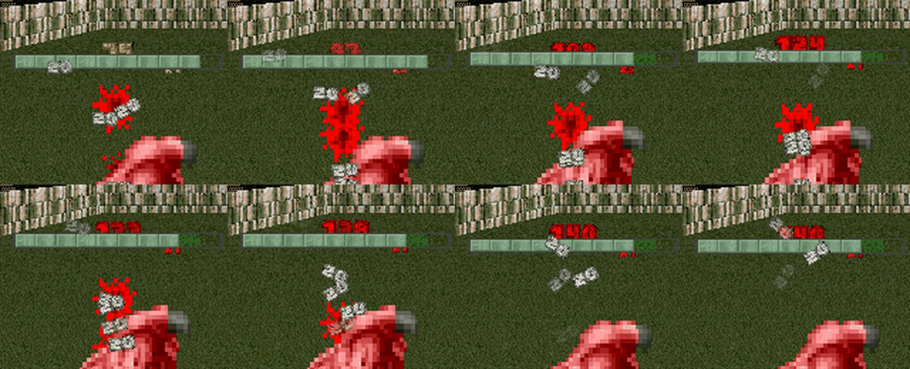

*Rig frames from an earlier build (committed by 2026-11-05): hit numbers jetting and spinning off a monster while the
total counts up over its bar. Not captures from the headset.*

The numbers are Xaser Acheron's damnums, redrawn for VR.

- **Small, and where you hit.** Each number starts at the spot your shot struck, a little in front of the monster on
  your side, and is about 7 cm tall (it never fills more than a small part of your view, however near).
- **Little jets.** Each hit jets out at a slightly different angle and speed, spins a little (some a lot) and fades.
  Shotgun pellets landing together make one number, unless Shotgun Spray is on.
- **The running total and combo.** From the chain's second hit, centred over the bar, counting up, bouncing on each
  hit. It moves beside the bar under a low ceiling, and the combo moves to the other side when a wall is in the way.
- **The kill.** The total punches once, holds and fades. **Overkill Word** (off by default) adds OVERKILL when the last
  hit went well past zero.
- **Headshots** (Brutal Doom's head hits): a gold HEADSHOT over a number a third bigger, a jolt, a slow gold shimmer,
  letters bobbing.
- **Colour by damage type** (the default): bullets white, shells yellow, fire orange, plasma cyan, explosives red, BFG
  lime, rail blue, melee pink, saws crimson, the series' Saber sky blue and Force lavender. Or by hit strength, one
  colour, Random, or damnums' own classic colours.
- **Out of your face.** Numbers stay at least about a metre from your eyes and slide off either gun's aim line, and
  they are traced clear of walls and ceilings. Only the 12 nearest show (Most Numbers).
- **Hit-stop and slow motion.** A number on a monster frozen in a hit-stop waits with it. In RSQ SlowMo's slow motion,
  numbers slow with the world, or keep your own time.
- **Four fonts.** JFO metal (the default), Ermac's digits, Classic Doom and Classic Doom (small), each in a Quest or a
  PCVR quality.

### Gains on you

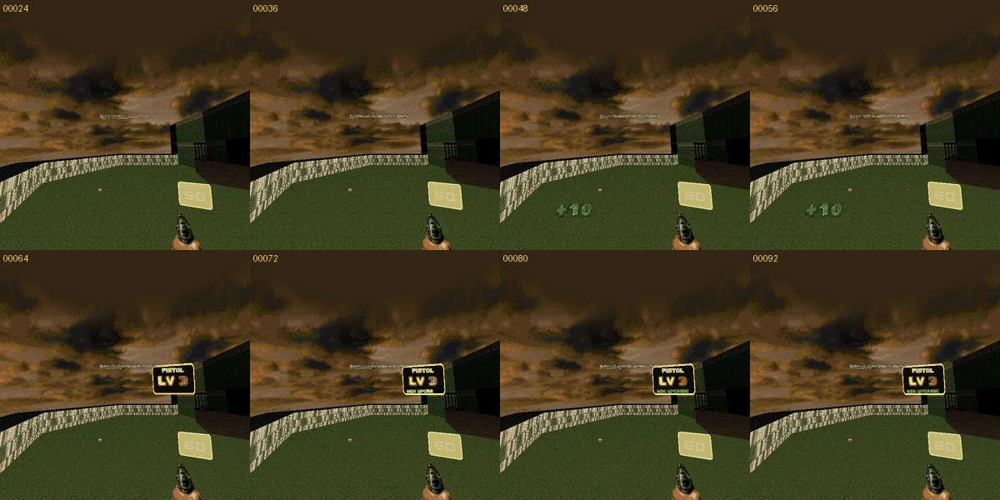

*Rig frames from an earlier build (committed by 2026-11-05): top, "+10" rising from a pickup; bottom, a pistol's level-up
tag. Not captures from the headset.*

Health, armour and ammo you pick up rise as "+N" from the pickup and fly to your wrist: health green and armour sky
blue to your off hand, ammo gold to the hand whose gun uses it. With RSQ Gun Cards the ammo number fades into the
card's own "+N".

---

## Kill Rewards

Every monster you kill bursts into bits: SoM's Universal Kill Rewards, with a plain menu.

- **How many:** one bit for every 10 of the monster's health at Standard (an imp rolls 6), Few (per 20) or Many (per 5).
  Each bit drops half the time. A boss always drops every bit, three times as many by default (Boss Fountain).
- **What:** health (25), armour (10, up to 250) or ammo (5 rounds for one of the guns you carry), by default mostly
  ammo (15 health, 20 armour, 65 ammo).
- **They come to you.** Bits within 2 m fly to you and are picked up, so you never have to walk into them.
- **They don't wait.** After 7 seconds a bit is gone: it blinks, faster and faster, over its last two seconds, or fades over its last second (your choice).
- **One monster pays once.** Brutal Doom's invisible helpers and its crawling, burning or slumped dying bodies never
  drop bits.

*[GIF to come: a baron bursting into a fountain of bits that fly to the player]*

---

## Level-ups (Gun Bonsai)

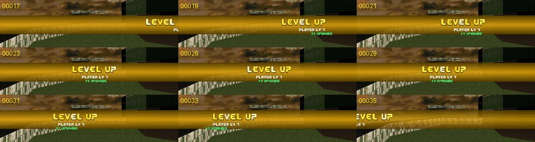

*Rig frames from an earlier build (committed by 2026-11-05): the player level-up band. Not captures from the headset.*

- **Player level-up:** a gold band across your view, LEVEL UP scrolling in fast, slowing through the middle so you can
  read it, and out fast, with "PLAYER LV n" and "+1 UPGRADE" trailing. In VR it stands about 2 m in front of you, faces
  you and follows your gaze lazily, so it reads like a sign. **Level-Up Slow-Mo** (off) adds a short RSQ SlowMo pulse
  while it is readable.
- **Weapon level-up:** a small tag rises off the gun: its name types in letter by letter, "LV n" stamps in, NEW UPGRADE
  flickers green, then it fades. With RSQ Gun Bonsai VR it rises off the hand whose gun levelled.

---

## Arrivals: the four beams

When another mod brings a monster in (today, RSQ Miniboss's miniboss fight), the monster arrives on a beam in a colour the
caller picks. It is hidden until the beam reveals it, and every beam has its own sound, starting the moment the beam
does: full volume out to about 12 m, fading to nothing at about 53 m.

| | |
|---|---|
| **V1:** a beam opens around the monster and narrows; rings drop down it and land on the floor. Revealed on the 7th tic (0.2 s) |  |
| **V2 (arcade):** a ring flashes on the floor, the beam slams down, rings ride up it, and the monster goes white, then its colour, then itself (revealed at 0.34 s) | 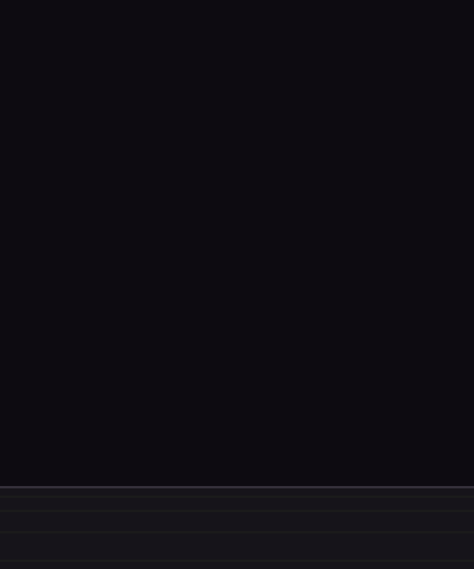 |
| **V3 indoors:** a column bursts up and is cut at the real ceiling, splashing along it, sparks dropping, then narrows to reveal the monster (at 0.54 s) | 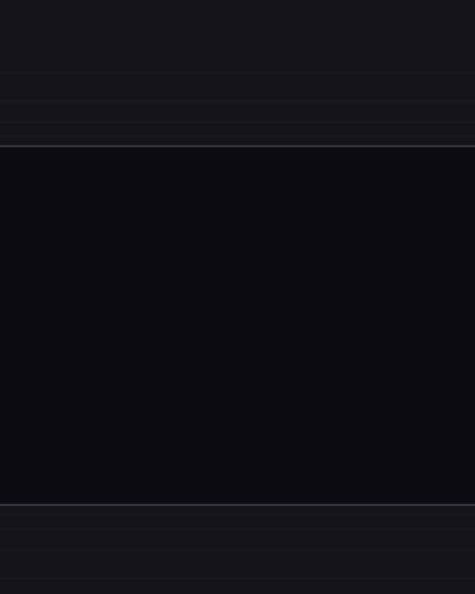 |
| **V3 outdoors:** under the sky (or a ceiling out of reach) the column climbs out of sight, flames trailing upward | 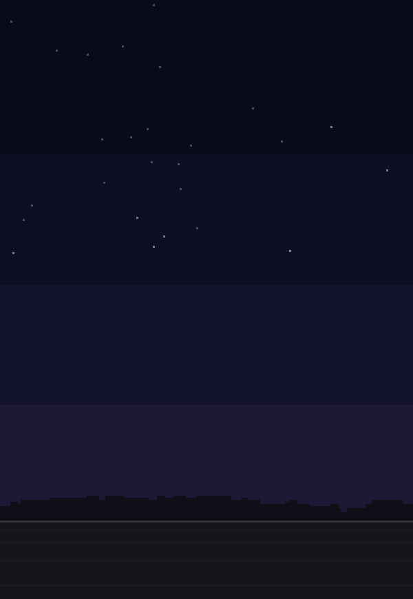 |
| **V4 (boss):** six beams appear on a ring, spin faster and faster, close in and merge, then a skull pillar, and the monster arrives (at 0.89 s) | 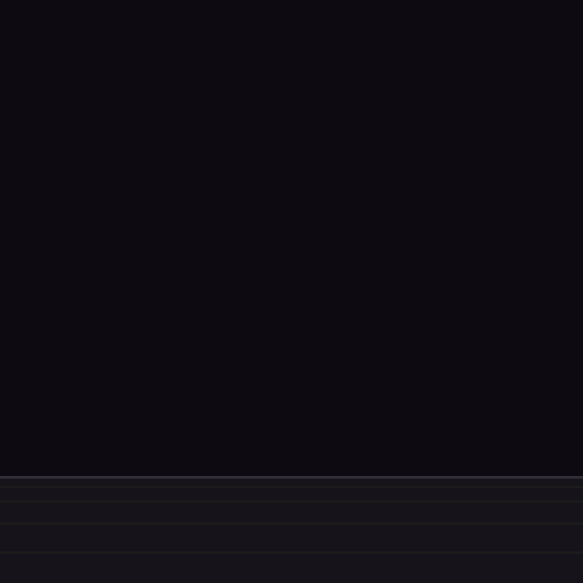 |

*Design renders, drawn by the same mockup tools the game's beams follow tic by tic. Not captures from the game or the
headset.*

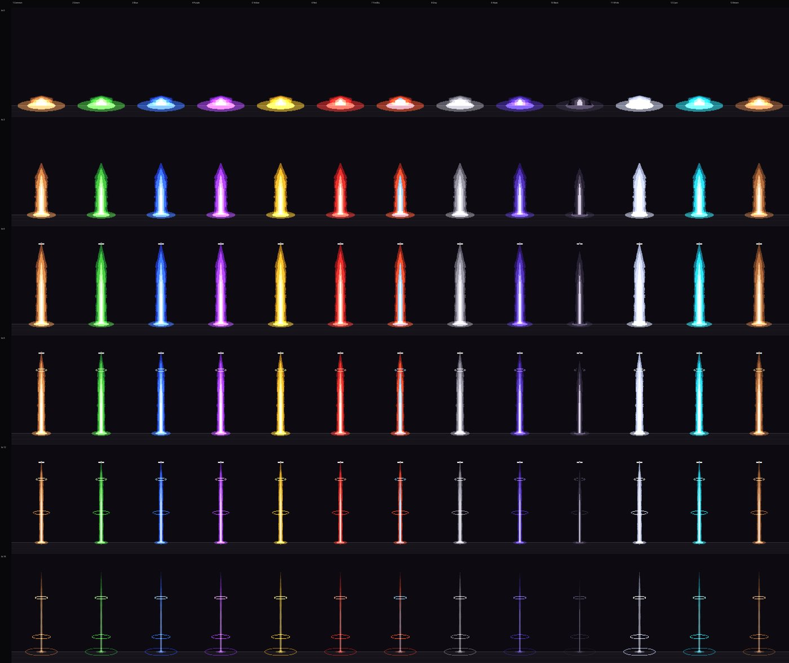

*Design render: V1 in thirteen tier colours. A very dark colour is drawn see-through instead of glowing.*

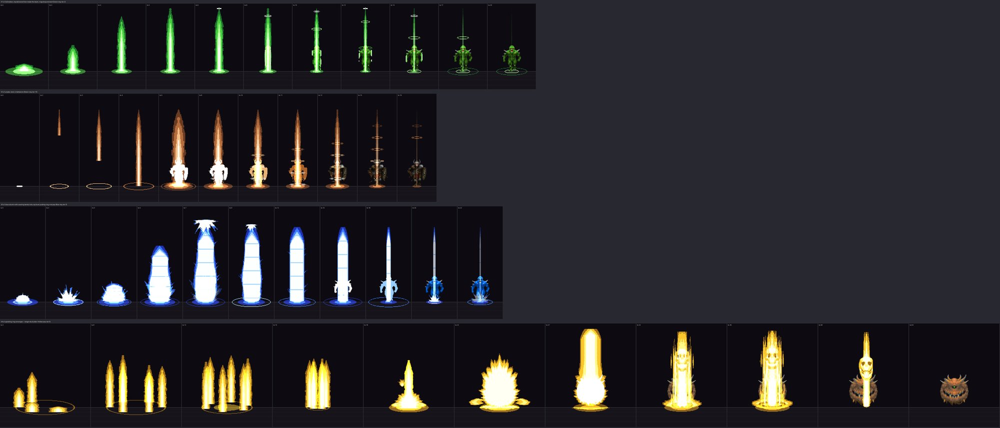

*Design render: the four beams tic by tic (top to bottom: V1, V2, an earlier draft of V3, V4).*

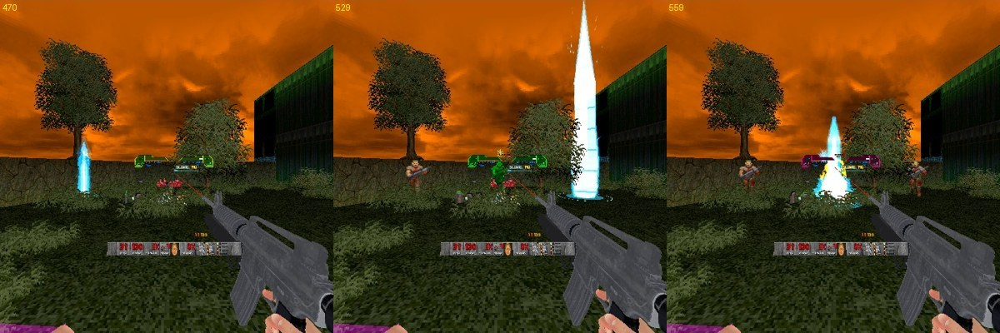

*Rig frames, 2026-11-09, MAP01's courtyard: V1, V3 (outdoors) and V4 called on a zombie by a test script. Not captures
from the headset.*

- The beams are sized to the monster (a baron's beam is taller than an imp's).
- A monster that dies mid-beam is shown at once; the beam never leaves a monster hidden.
- The beams run at full speed even while RSQ SlowMo has slowed the world, and stand still while time is frozen.
- **Arrival Beams** off: the caller's own arrival plays instead (RSQ Miniboss's teleport fog).

### Words and pops

Another mod can put a word over a monster in RSQ Score's score-line font: a one-off word that pops, flickers to white,
drifts up and fades, or a word held over it until it is cleared (normal, small, or large and pulsing). RSQ Miniboss uses
GUARD! (silver) when its shield turns a shot, and TARGET! (gold) over what you should shoot. A **pop** is a pixel ring and
star burst in a colour, at the monster's middle (RSQ Miniboss: a thrall's death).

*[GIF to come: GUARD! popping over a shielded miniboss, TARGET! held over its thralls, a pop as a thrall dies]*

---

## Scene music

Other mods can tell this one a scene has started, and the scene's own track crossfades in over the level music (the
level music fades to silent under it). When the scene ends, the track fades out and the level music fades back in
where it has got to.

- **The miniboss fight** (RSQ Miniboss): the owner's track "20 organic beat", for everyone.
- **DOWN** (RSQ SlowMo): the owner's "29 red alert", heard only by the player who is down. It stands above a miniboss fight's
  track, which carries on silently underneath and comes back when you get up (unless the fight ended meanwhile).
- **Scene Music Volume** sets the scene track's loudness; **Scene Crossfade** how long the fades take (2 s).

---

## RSQ SlowMo's DOWN

While you are DOWN in RSQ SlowMo:

- Each hit that buys you time shows "+0.5s" (or however much) at the monster, in DOWN's crimson.
- REVENGE flies past on the band when you kill your mark, and REVIVE every time you get up, bigger for a better tier.
- A DOWN target gets its bar at once and keeps it, hit or not.
- Bits from your kills within three times your Bits Fly to Me reach fly into your DOWN plate and are banked (paid as
  health and armour when you revive); ammo bits give their ammo as they arrive.

*[GIF to come: "+0.5s" popping off a monster while DOWN, then REVIVE on the band]*

---

## Plays well with

- **RSQ Miniboss:** its miniboss fight calls the arrival beams (V1 thralls with a V3 miniboss, or V2 thralls with V4, picked
  per fight, each in its monster's tier colour), the GUARD! and TARGET! words, the pops, and the miniboss fight scene music
  (its **Miniboss Music** row). Here: a crown with tier pips over the miniboss's bar and a chain link over its thralls;
  with its **Boss Kill Rewards** row on, a miniboss counts as a boss for Kill Rewards (its boss fountain). Without this pack, its monsters land in teleport fog.
- **RSQ SlowMo:** the DOWN tie-ins above, and its DOWN Music (its **DOWN Music** row). Here: Numbers in Slow-Mo, and the
  optional level-up slow-motion pulse.
- **RSQ Gun Bonsai VR** and **Gun Bonsai:** the level-up band and the weapon tag (with Gun Bonsai VR, the gun's name and
  which hand). Gun Bonsai VR's Kill Rewards path works through this pack, and is offered only while it is loaded: Bit
  Scavenger (+25% bits a level), Rich Bits (bits worth 2x to 4x, drawn glowing), Magnet (bits fly from 2, 3, 4 m) and
  Lucky Kill (double or more on a critical, a Finisher or a big moment). Its stunned marker shows on the bars.
- **RSQ Gun Cards:** an ammo gain lands in the card's own "+N", and the wrist number is sized to the card's digits.
- **RSQ FnF:** with its **Bones Drop Battery Bits** row, Legion of Bones monsters drop yellow battery bits here; each
  refills 15% of your flashlight.
- **RSQ Grenade:** with Gun Bonsai VR's Scavenger at level 3, one ammo bit in four is a grenade. Its Incendiary fire
  lights the burning marker.
- **RSQ Grapple, RSQ ShieldSaw, RSQ Saber, RSQ Whip, RSQ DistanceGrab:** their hooked, stunned, locked, gripped, whipped
  and held markers on the bars. RSQ Whip leaves Kill Rewards bits alone.
- **RSQ Score:** the words use its font, and the combo's 3-second window is the same as its chain's.
- **RSQ Accessibility:** Photosensitive Mode dims the bars', pops' and beams' flashes to 40%, slows the shimmer, stops the words' white flicker,
  makes bits fade instead of blink, and draws the beams' white silhouettes in a light colour. Its colour-blind palette
  overrides the bar colours and swaps the default combo colours for a safe set.
- **Brutal Doom:** its head hits are HEADSHOTs, its damage types colour the numbers, its helpers and dying bodies get no
  bar, number or bits.
- **LegenDoom and Champions:** a LegenDoom candidate does not give itself away with an overheal before it turns; a turned
  legendary wears a gem. Over a champion the bar sits above Champions' icon.
- **coldcite's Top HP Bars:** loaded too, this pack takes over (one set of bars), and his HUD Options entry opens this
  menu when his pk3 loads first.
- **Mods written for damnums:** their damage-type colours are read too.
- **Voxels** (BD_VoxelPack, Voxel Doom II): bars sit on the voxel's real top.

---

## Options

*Options → Radiant Silvergun Options → RSQ VisualRewards.* One page, with Test and Debug below it. Defaults in brackets.

| Section | Rows |
|---|---|
| HP Bars | HP Bars (On) · Bar Colours (Classic; Red, Protanopia, Deuteranopia, Tritanopia, High Contrast, Cyan Lavender Orange, Random) · Bar Size (0.30) · Full Bright (Off) · Fade With Stealth (On) · Overheal Strip (On) · Status Markers (On) · Tier Gem and Champion Icons (On) · Only Where I Aim (Off) · Damage Chunk (Off) · Blue Bars for Allies (Off) · Nearest 24 Only (Off) · Distance Limit (Off) |
| Damage Numbers | Damage Numbers (On) · Numbers For (Monsters Only; All Shootable) · Number Font (JFO Metal; Ermac, Classic Doom, Classic Doom (small)) · Number Size (1.00) · Word Size (1.00) · Text Quality (Quest; PCVR) · Hit Colours (By Damage Type; By Hit Strength, Classic (below), 17 colours, Random) · Classic Colour (Default, and damnums' 21 colours) · Classic Type Colours (On) · Total Colours (Follow Combo; 17 colours, Random) · Combo Colours (White Yellow Orange Red; five more ramps, Random) · Headshot Colour (Gold) · Pop and Settle (On) · Motion Without Pop (Toss; Float) · Size by Hit (Off) · Grow with Distance (Off) · Running Total (On) · Kill Slam (On) · Combo Counter (On) · Combo Shake (On) · Overkill Word (Off) · Headshot Word (On) · Headshot Flash (On) · Headshot Cycling (On) · Shotgun Spray (Off) · Gains on You (On) · Freeze in Hit-Stop (On) · Numbers in Slow-Mo (World Time; Your Time) · Out of Your Face (On) · Clear of Walls (On) · Most Numbers (12; 6, 24, 48) |
| Kill Rewards | Kill Rewards (On) · Bits per Kill (Standard (1 per 10); Few (1 per 20 health), Many (1 per 5), Custom (Test and Debug)) · Boss Fountain (x3; x1, x5) · What Drops (Custom (Test and Debug); Even Mix, Mostly Health, Mostly Armour, Mostly Ammo) · Bits Vanish After (7 s; Never, 15 s, 30 s, 1 min) · Bits Vanish As (Blink Out; Fade Out) · Ammo Bits Give (Any Gun I Carry; The Gun in Hand) · Bits Fly to Me (2.0 m, 0 to 4) |
| Level-Up | Player Level-Up (On) · Level-Up Slow-Mo (Off) · Band Colour (Gold) · Text Colour (Gold) · Weapon Level-Up (On) · Weapon Tag Colour (Gold) |
| Arrivals and Words | Arrival Beams (On) · Monster Words (On) · Pops (On) · Scene Music (On) · Scene Music Volume (1.00) · Scene Crossfade (2.0 s) |
| Test and Debug | HP Bars: Far Size (2.00) · Height (0.10) · Limit Distance (1536). Kill Rewards: Drop Mode (By Health; Range) · Health per Bit (10) · Drop Chance (50) · Mix: Health (15) · Mix: Armour (20) · Mix: Ammo (65) · Ammo Type 1 Counts (On) · Ammo Type 2 Counts (Off) · Range: Fewest (1) · Range: Most (3) · Range: Random (On) · Debug Log (Off) |

The page ends with **Reset All**: every setting named on this page and on Test and Debug goes back to its default.

The HP bars, Kill Rewards and Arrival Beams rows, and Damage Numbers, Numbers For and Shotgun Spray, are the host's
(one setting for everyone in netplay). The rest of the damage-number rows and the level-up, words, pops and scene music
rows are each player's own.

---

## Status

| | |
|---|---|
| **Shown on the rig** (2026-11-09, 19:04 run) | The four arrival beams on the rig's full series load order (doom2, brutal22test6, BD_VoxelPack, BD22 VR Reloaded, then the series): each called on a monster with its own sound starting on the beam's first tic (V1 1.16 s, V2 1.26 s, V3 1.00 s, V4 2.78 s) and the monster revealed on tic 7, 12, 19 and 31; frames of V1, V3 outdoors and V4 (above). In the same run: the DOWN tie-ins logged ("+1.5s" and "+0.5s", REVENGE, REVIVE at the middle and top tier sizes), HP bars drawn over monsters in the frames, and no script error from this pack. That build was the one before the evening's changes (scene music rewritten for DOWN, DOWN's track, the Kill Rewards banked-bit fix); those are code only |
| **Shown on the rig, earlier builds** (committed by 2026-11-05) | HP bar colour sets and markers, damage-number jets, totals, combo, kill and overkill, headshots, the level-up band, the weapon tag, gains flying to the wrist, Kill Rewards after its move into this pack (frames and logs in test/evidence). The code has changed since; they are not proof of the current build |
| **Headset-confirmed** | Nothing yet |
| **Code only, not yet shown** | Monster words and pops; V2's frames and V3 indoors; the scene music (miniboss fight and DOWN); battery bits; bits banking into the DOWN plate; Photosensitive Mode's versions of everything; netplay; everything else on this page not listed above |

---

## Under the hood

- **Stock QuestZDoom 17.3:** ZScript and data only. No engine changes.
- **No hard links.** Every other mod is found by name while the game runs; the pack loads and plays alone.
- **Light on Quest.** The numbers and words are VisualThinkers drawn from textures: no sprite frames, no actors, never
  ticked by the engine; one driver places them all after every actor has moved. Caps: 200 number glyphs, 160 word
  glyphs, 24 words, 12 pops, and Most Numbers. Bars rebuild their frame only when something changed and are polled
  1/16 of the list a tic.
- **Stereo.** A number's quad is built once from the centre eye, so both eyes see it at one depth.
- **Netplay.** Bars, bits and beams are play-side and run the same on every machine (named random numbers in the beams);
  every beam piece, number, word and pop is local to each player's view. Only the console player's own DOWN words and
  level-ups show on his screen.
- **The beams** hide the monster with its render flag only: it still thinks and can be hit, so the caller keeps it from
  acting. Everything it changed on the monster is put back exactly at the reveal, if the beam is removed early, or after
  a save and load mid-beam. A second beam on the same monster is refused.
- **For other mods: RSQVR_Service**, found by name. It answers `loaded`, `kr.loaded`, `kr.on`, `kr.perk`, `kr.magnet`,
  `helper` (is this one of Brutal Doom's helpers), and takes `kr.battery` (battery bits from a body), `beam` (kind
  `v1`..`v4`, a colour, a size, the monster; answers the tics until the reveal, 0 when it did not play), `word`,
  `word.hold`, `word.clear`, `pop`, `scene.push` (key, priority, owner, music) and `scene.pop`. **RSQTHP_DnService**
  `crit` marks a monster's hits as crits (nothing is drawn for a crit yet). **RSQVR_RSQDownJoin** takes RSQ SlowMo's
  `down.time`, `down.revenge`, `down.up` and `down.target`. Bars ask every service whose name contains `RSQTHP_Marker`
  for `hooked`, `stunned`, `locked`, `gripped`, `whipped`.
- **Saved settings carry over.** Kill Rewards keeps Gun Bonsai VR's old setting names, so old settings and saves still
  work.
- **Tools** (VisualRewards/tools, never shipped): `gen_art.py` (the bar art and TEXTURES), `cvd_check.py` (colour-blind
  distances), `gen_dn_art.py` and `gen_dn_dot.py` (the number glyphs), `gen_beams.py` (the beam, word and pop art and
  tables), `beam_spec/` (the approved beam mockups and their renders), `beam_check.py` (checks the beam code without an
  engine), `beam_sounds/gen_beam_sounds.py` (RVQB1-4), `gen_battery_bit.py`, `gen_gauges.py` (the series' HUD bars).
- **The beam sounds** are made from the owner's own files only (pitch, layering, echo; nothing synthesized):
  V1 ONPARE8 with an octave-down copy and a small-room echo; V2 ONPARE2 the same way; V3 ONPARE3 the same way, faded out
  to end with the beam; V4 ONPARE2 as the beams rise, then PL01_U lowered 15% on the merge, with a hall echo. The
  owner's "hit" sound (ONPARE6) is kept for the miniboss fight's segment break, not yet built.

## Credits

The full list, with every file and licence, is in **CREDITS.txt**.

- **coldcite:** Top HP Bars 1.04, the bars' layout, art and idea (itself based on Nash Muhandes' SpriteShadow, MIT).
- **Xaser Acheron** (with Major Cooke; thanks to Marrub and Zombie): damnums 1.0.2 (MIT), the damage numbers' idea,
  Doom digit art, colours and motion.
- **SoM:** Universal(ish?) Kill Rewards 1.0, the bits, their orbs and the drop rules.
- **Zedas** and **Blackmore1014:** the JFO font (JDUI Brutal Doom Ultimate Edition), the default number font.
- **iamErmac:** the Force Unleashed holo digits (Ermac font).
- **Blue Shadow:** RS Score's score-line font (via ijon's Dakka), the monster words.
- **presidentkoopa:** the design, the arrival sounds and the two music tracks (sources to be recorded before release).
- **End of Starchild:** V1's growth and narrowing, as a motion reference only.
- **Not yet cleared:** V3's dome, splash, burst and columns and V4's skull pillar are frames cut from a ripped
  "Z-Fighter effects" sheet. Before any release they must be credited properly or redrawn.
- **QuestZDoom** (Emawind and Team Beef): the engine.
