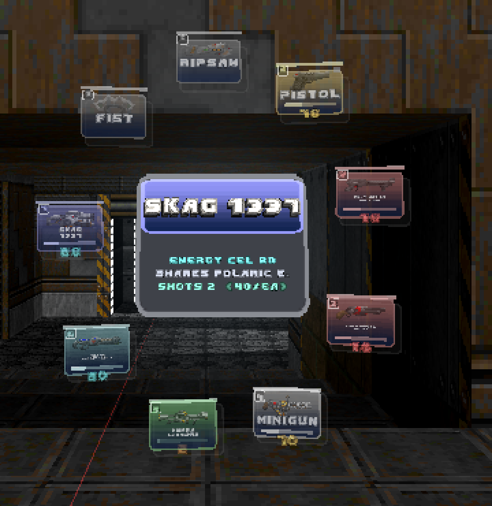
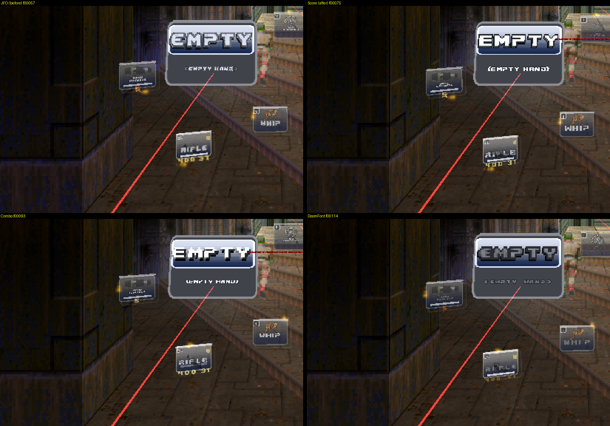
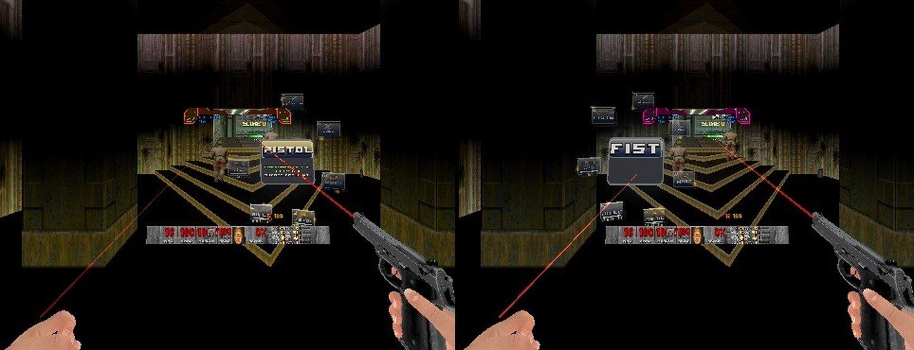

# RSQ Wheel
### Doom Arcade VR · every gun you carry on a ring of cards, and the place where you decide which holster each one lives in

Press and hold, and your guns come out of your wrist as a ring of cards in front of you. Point either hand at one and let
go, or reach in and pull it out by hand. And with RSQ Tactical Rig, it's where you **kit yourself out**: pick a card,
point at a spot on your body, and that gun lives there from now on. A sheet in the middle of the ring tells you about the
gun you are pointing at.

*[picture to come: the ring opening in the headset, cards growing out of the wrist (GIF)]*

---

## What it feels like

- **Kit yourself out from the ring.** With RSQ Tactical Rig, alt fire on a card and a picture of your body opens beside
  the ring with your six holsters on it: shoulders, chest, hips. Pull the trigger on one and the gun flies off its card
  into that holster, and that's its home from now on. Reach for that spot in a fight and that gun is there.
- **One button.** Hold it, point at a card, let go: that gun is in your hand. Tap it and the ring stays up while you
  choose. Tap twice and you are back on the gun you just had.
- **Either hand picks.** Whichever hand points at a card, or reaches into it, gets the gun. Point each hand at a
  different card and let go, and each hand takes its own.
- **Cards are things.** With your hand in a card, snap it back toward you and the gun comes out with it. Snap a gun
  toward the ring, not at any card, and it goes back in; your hand is empty again.
- **Learn it by feel.** Every card ticks in your hand as you land on it: a light short tick on a pistol, a long heavy
  one on a BFG.
- **Know before you pick.** The sheet in the middle shows the gun's name, its rounds and reserve, the other guns that
  share its ammo, which holster it lives in, and its kills and hit rate once you have used it.
- **Time waits for you.** With RSQ SlowMo, the world slows while the ring is open. You can also have the ring stop time
  outright.

---

## How to play

| Do this | What happens |
|---|---|
| Hold the wheel button (left thumbstick click), point a hand at a card, let go | That hand takes the gun. Let go over nothing and the ring just closes |
| Tap the wheel button | The ring opens and stays up. Pull the trigger (either hand) on a card to take it |
| Tap it twice, quickly | The ring closes and the hand you last picked with goes back to the gun it had before |
| Reach a hand into a card and press Use | That hand takes the gun |
| Hand in a card, snap it back toward you | The gun comes out with your hand |
| Snap a hand holding a gun toward the ring, pointing at no card | The gun goes back on the ring; the hand takes its fist |
| Point at a card that hides more guns, and wait (or press Use) | Its slot fans out, one card per gun |
| Hold the trigger on a card in a fan, move it, let go | That gun takes the new place in its slot, and keeps it |
| Main-hand alt fire on a card (with RSQ Tactical Rig) | The holster screen opens for that gun: your body with its six holsters |
| On the holster screen, pull the trigger on a holster | The gun flies into it: that holster is its home from now on |
| Off-hand alt fire on a card | That gun goes in or out of your next / previous weapon list |
| Turn more than 45° away from the ring | It swings round to sit in front of you again |
| Leave it alone | After 4 seconds with nothing pointed at, it fades, ticks once, and folds away |

### Controls

**One key: Open Wheel** (hold, point, release). It is bound to the **left thumbstick click** by default (a key already
bound to something else is left alone). It is on this mod's page under Controls and in Customize Controls, section
**RSQ Wheel**, as "Open Wheel (hold, point, release)".

- **The key:** hold, point, let go to take a gun; tap to leave the ring up; tap twice to go back to the last gun.
- **Either hand, trigger** on a card: take it (hold it on a card in a fan to move that card).
- **Main hand, alt fire** on a card: the holster screen (with RSQ Tactical Rig). **Off hand, alt fire** on a card: that
  gun in or out of your next / previous weapon list.
- **Use** with a hand in a card: that hand takes the gun.
- **Gestures:** snap a hand in a card back toward you (the gun comes out with it); snap a hand holding a gun toward the
  ring (it goes back on the ring).
- Your own **next / previous weapon** keys step through the Wheel's list.

Gone on 2026-11-10 (owner: keys are precious in VR): **Wheel: open**, **Wheel: off hand** and **Wheel: main hand**, and
the `]` and `[` default binds. Their console commands stay, with no key and no menu row. The two ModelSwapper keys have
been off the controls list since 11-09, while ModelSwapper support is parked.

---

## The ring

**One card per gun, or one per slot.** With up to ten guns every gun has its own card and the ring grows to fit them.
Past ten, each weapon slot gets one card, so slot 4 is always in the same direction; a card that hides others shows a
small "+N" in its corner. Point at it for a moment, or press Use while pointing, and the slot opens as a **fan** of
cards stacked outward. The last gun you used comes first in its fan, and you can drag the rest into any order you like.

**The cards.** Each card shows the gun's picture, its name, its slot number, its ammo and a bar for it. With
BD_VoxelPack loaded, the gun's own pickup voxel turns slowly on its card instead of a flat picture. A gun you are already
holding gets a corner mark. A card that is out of ammo rests in a colour that says so, and one running low pulses. The
card you point at steps toward you, grows a little, lights the room round it, and the others fade back. When you take a
gun, its card bursts into sparks and spins away as the ring folds.

**The fist is always there.** The fist's card sits on the ring whether or not you own a fist, and it gives the hand that
picked it that hand's own fist.

**Some things always go to one hand.** Either hand can pick them, but RSQ ShieldSaw's shield always ends up in your off
hand, and RSQ Saber's saber, RSQ Whip's whip and RSQ Grenade's grenade always in your main hand.

**Brutal Doom 22 VR's off-hand guns share one card.** Pick it with your main hand and you get the gun; pick it with your
off hand and you get its off-hand version.

**A gun with nothing to fire is not taken.** No rounds loaded, none in reserve, nothing for its alt fire: you hear Doom's
dry click and your hand keeps what it had. A gun with an empty magazine but rounds in reserve is still taken.

**Picking the gun your other hand holds.** If there is a second copy of it, that hand takes the copy and you hold one in
each hand. If not, the two hands swap.

**RSQ Grenade's kinds.** The grenade's card opens a fan of every other grenade kind you own, each in its own colour.
Pick one and you hold that kind.

**The Wheel's own icons.** A few cards would say little with their own pictures, so the Wheel draws its own: the fist,
the lightsaber, the whip, the ShieldSaw, the road flare and flashlight (RSQ FnF) and the Force hand (RSQ Saber). The
gloves wear RSQ Melee's own icons (the main glove's and the off glove's), and the Wheel's glove only when those are not
there.

---

## The data sheet

A panel stands in the middle of the ring and describes the card you are pointing at, or the gun in your hand when you
point at nothing ("EMPTY" for an empty hand). Point at a gun lying on the floor and, after a moment, the same sheet
appears for it.

*Rig frame, 2026-11-06, in the JFO font. The default font is now RSQ Score's (see Fonts).*

What it can show, each only when there is something to say:

- the gun's name, in a band of its colour
- what is loaded and what is in reserve, and how many shots that is
- **SHARES:** the other guns you carry that eat the same ammo
- **HOLSTER:** where it lives on RSQ Tactical Rig
- **GUN BONSAI LV:** its level, progress and up to four upgrades by name (with Gun Bonsai and RSQ Gun Bonsai VR)
- **KILLS, SHOTS, ACCURACY:** counted by the Wheel itself for every gun you use, so it works with any weapon set; turn
  on **This Level's Kills** for a second row with this level's counts
- **LegenDoom:** the gun's rarity in LegenDoom's own colours, its legendary name, and its power in LegenDoom's own words

**Two Hands Compare** (off by default): point your other hand at a different card and the sheet turns into the two guns
side by side, the better numbers marked.

---

## The wrist card

Off by default. Bring a forearm up across your chest as if checking a watch and hold it there a moment: a small card
stands over that wrist with the gun's name, its rounds, its kills and hit rate, and its Gun Bonsai level. Lower your arm
and it folds away. With RSQ Gun Cards loaded and its own watch card on, Gun Cards' card shows instead.

*[picture to come: the wrist card over the main-hand wrist]*

---

## Kit yourself out: the holster screen (with RSQ Tactical Rig)

This is how you decide where every gun lives on your body, without ever leaving the fight for a menu.

**Main-hand alt fire on a card** opens a panel beside the ring: your marine with Tactical Rig's six gun holsters on him
as numbered rings (1 left shoulder, 2 right shoulder, 3 left chest, 4 right chest, 5 left hip, 6 right hip), in your
holster profile's colour. A ring that belongs to another gun shows that gun's name. Lines draw out from the card to the
rings.

- **Pull the trigger on a ring** and the gun flies into it: it is assigned to that holster and goes straight in. A gun
  that held that holster before loses it.
- **Clear** takes the gun's holster away.
- **Alt fire on the same card again** closes the panel; on another card, it opens that card's.

Set **Web View** to **Mirror** and the panel shows Tactical Rig's own mirror of you instead, with the rings on your real
holster spots (your left on your left). With RSQ ShieldSaw worn over the shoulder, that shoulder shows the ShieldSaw and
takes no gun. Without RSQ Tactical Rig, main-hand alt fire on a card gives a dull tick and nothing else.

**How a card looks tells you where its gun lives:** a plain card is on the Wheel only; a card with a short gold light
running round its edge is in your next / previous list; a card sitting back on the ring, smaller and faded, outlined in
your profile's colour, has a holster.

*[picture to come: the holster screen, Marine view]*
*[picture to come: the holster screen, Mirror view]*
*[picture to come: a gun flying from its card into a holster ring (GIF)]*

---

## Next and previous weapon

Your next / previous weapon keys (each hand's) step through one shared list, in slot order. A new game starts with
every gun on it. **Off-hand alt fire on a card** takes that gun off the list or puts it back; a gun with a holster is
never on it. With nothing on the list, the keys step through every gun, as Doom does.

---

## Fonts

The ring's text now uses **RSQ Score's fonts**: **Score** (the default, its "SCORE:" lettering) or **Combo** (its smaller
combo font). The Wheel carries its own copies, so they work without RSQ Score loaded. The older sets are still there:
JFO, the status bar numerals, small gold or grey numerals, DoomFont only, and Ermac's digits.

*Rig frames, 2026-11-09: JFO (top left), Score (top right), Combo (bottom left), DoomFont (bottom right).*

The holster screen's ring numbers are in RSQ Score's combo digits when RSQ Score is loaded, and JFO's big digits without
it.

---

## Looks

- **Card Look.** **Colour by Gun** (the default) washes each card in its gun's colour, the same colour RSQ Gun Cards
  gives it, lit warm from the top, with a halo behind the card you point at and the series' lock-on mark at your
  pointer's tip. **Classic** is the plain ring.
- **Palette.** Standard, Doom (the status bar's reds and golds), Hell (embers and bone) or Tech (Doom 2's computer greens).
- **Ring Plates.** The Wheel's own plates (Ermac style) or the status bar's stone.
- **Extras, off by default:** a breathing halo, a spark running round each card's edge, and a starfield behind the ring.

---

## Plays well with

- **RSQ Tactical Rig:** the holster screen, its Mirror view, and the HOLSTER row on the sheet.
- **RSQ SlowMo:** the ring slows the world while it is open. Slow motion you started yourself keeps running when the ring
  closes, unless you turn on **Closing Ends SlowMo**.
- **RSQ Gun Bonsai VR** (with Gun Bonsai): a gun's level and upgrades on the sheet and the wrist card.
- **RSQ Grenade:** a fan of your grenade kinds, and the grenade always goes to your main hand.
- **RSQ ShieldSaw, RSQ Saber, RSQ Whip:** each goes to its own hand, with its own icon; ShieldSaw's shoulder on the holster
  screen.
- **RSQ Gun Cards:** the cards take Gun Cards' gun colours, and its watch card replaces the Wheel's.
- **RSQ Laser Sight:** a hand whose gun draws a laser points at the ring along that laser, so you never see two beams.
- **RSQ Score:** the holster screen's ring numbers in its combo digits.
- **RSQ Accessibility:** Colour Blind Mode (every card neutral, only the one you point at coloured), Photosensitive Mode
  (the breathing and the edge sweep softer and slower), Slower Taps (more time for a hold or a double tap) and Steady
  Hands (a smoothed pointer). Seated Play puts the wrist card's pose at your seated eyes.
- **Brutal Doom 22 VR Reloaded:** one card for each gun and its off-hand version; Brutal Doom's own dry-fire click.
- **BD_VoxelPack:** the turning gun models on the cards.
- **RSQ Saber, RSQ ShieldSaw, RSQ Whip, RSQ Melee (with Gun Models on Cards):** their cards turn their own pack's model
  instead of the icon: the saber's hilt (the one at your hip), the shield, the coiled whip, and for the fist and the
  gloves RSQ Melee's FBX fist in your Hand Skin Tone (BD22 VR's), or the boxing glove while the gloves are worn. A pack
  that is not loaded leaves its card the icon. Code only, not shown on the rig yet.
- **LegenDoom:** rarity colours, legendary names and powers on the sheet.

**Other weapon mods are parked.** The Wheel has readers for DoomRL Arsenal, Doomablo, the Pandemonia family, Guncaster,
MetaDoom, BorderDoom, DOOM Infinite, Combined Arms, Final Doomer, ModelSwapper and Lithium. They are switched off for
now (the owner, 2026-11-09) and their options are hidden. Only Gun Bonsai and LegenDoom are read.

---

## Options

*Radiant Silvergun Options → RSQ Wheel.* Everything is on one page; the fine-tuning numbers are under Test and Debug.
**Reset All** resets both pages.

| Section | Rows |
|---|---|
| (top) | Weapon Wheel (On) · Either Hand Picks (On) · Opens On (Main hand / Off hand) · Sound (On) · Controller Rumble (1.0) · Size (1.0) |
| Controls | Open Wheel (hold, point, release; left thumbstick click) |
| Picking | Two Hands Compare (Off) · Open on Your Gun (Off) · Wrist Card (Off) · Open at Level Start (Off) · Slow Time While Open (On) · Closing Ends SlowMo (Off) · Freeze Without SlowMo (Off) · Freeze Time While Open (Off) · Pull a Card Out (1.5) · Throw a Gun Back (2.6) · Reach In (7) · Feel Each Gun's Weight (1.0) |
| Look | Palette (Standard, Doom, Hell, Tech) · Font (Score, Combo, JFO, Status bar numerals, Small gold numerals, Small grey numerals, DoomFont only, Ermac's digits; Score) · Ring Plates (Its own (Ermac style) / Status bar stone) · Card Look (Colour by Gun / Classic) · Web View (Marine / Mirror) · Gun Models on Cards (On) · Ammo Counts (On) · Ammo Readout (LED segments / LCD, punched out / Lozenge badge) · Rarity Colours (On) · Mark Guns You Hold (On) · Slot Numbers (On) · Cards Face You (On) · Hover Halo Breathes (Off) · Edge Sweep (Off) · Flash on Pick (On) · Spark Colour (Slot colour / White hot / Rainbow) · Hover Lights the Room (On) · Background Stars (0) |
| Data Sheet | Show Data Sheet (On) · Weapon Stats (On) · Track Kills and Accuracy (On) · This Level's Kills (Off) · Gun Bonsai Rows (On) · Point at a Gun (On) · Compare With Yours (Off) |
| Other Mods | LegenDoom Rarity (On) · LegenDoom Effects (On) |
| Test and Debug | Picking: Hold to Pick (9 tics), Double Tap (10 tics), Ring Follows Past (45°), Folds After (140 tics), Fold Warning (25 tics) · Ring: Ring Distance Ahead (34), Ring Radius (5), Height Above Hand (2), Lean Toward You (12), Wrist Roll Spins the Ring (0), Stick Deadzone (0.2), Card Width (4.2), Card Height (3.0), Hovered Card Steps Out (1.5), Hovered Card Grows (0.06), Other Cards Fade To (0.55), Cards Grow In (6 tics), Card Shadow (0.32), Shadow Offset (0.35), Face Parallax (0.06), Idle Breathing (0.35), Breathing Speed (1.7), Low Ammo Below (0.25), Low Ammo Pulse (0.35), Model Turn Speed (1.5), Model Size (0.16), Model Stand-Off (3) · Cards: Flat Ring Up To (10 weapons), Fan Close Forgiveness (6 tics), Star Brightness (0.5), Light Size (44), Light Holds Across Gaps (3 tics), Sparks (18), Spark Speed (1.4), Volume (0.65), Idle Shimmer (0), Taken Card Spins (360°) · Data Sheet: Data Sheet Size (1.0), Pointing at a Gun: Rest For (18 tics), Wrist Card: Hold the Pose (8 tics), Wrist Card Size (0.6), Palette by Name, Font Set by Name · Debug Log (Off) |

**Weapon Wheel Off** stops the ring from opening and hands next / previous weapon back to the engine. **Freeze Without
SlowMo** only acts when RSQ SlowMo is not loaded; **Freeze Time While Open** stops
time whether SlowMo is loaded or not. Distances are in map units (34 to a metre).

**Keys:** one, *Options → Customize Controls → RSQ Wheel → Open Wheel*. A default key that is already bound to
something else is left alone; bind it there instead. **Opens On** picks the hand the ring opens in front of (with
Either Hand Picks on, both hands still pick from it).

*Opens On set to Main hand: the ring opens in front of the right hand, the PISTOL card in front (left); set to Off hand: in front of the left hand, the FIST card in front (right) (rig capture, not headset).*

---

## Status

| | |
|---|---|
| **code only, not shown** (2026-11-11 22:10; loads clean on the full order, not run) | The data sheet is back in the middle of the ring (3616ed19's "closer" sheet reverted: pulled toward the eye it left the centre and shrank) and a third bigger at every Data Sheet Size (owner: "put it back where it was and make it bigger") |
| **code only, not shown** (2026-11-11 evening; loads clean on the full order, not run) | A card shows the pickup frame a gun really shows: the first Spawn state that lasts and draws something. BD22's pistol starts on a zero-tic frame of vanilla Doom's pistol (PIST A 0) before its own pickup (P3ST K), so its card drew the vanilla pistol; now it is BD's pistol pickup, like every other gun (owner: "use BD pistol pickup model in wheel for pistol") |
| **rig only, not headset-confirmed** (2026-11-11, rig batch R1, `design/rigtest_2026-11-10/RESULTS_R1.md`) | Start With Melee Hands on: ONE fist card in slot 1; a pick with the main hand gives RSQ_Glove, with the off hand RSQ_GloveOff (log; the hover was set by a probe, so aiming is not tested). 3D cards: the FBX fist in skin tone, the shield turning in place, the coiled whip, the saber as a thin rod turning in place in two frames (whether it reads as a hilt: judge in the headset) |
| **rig only, not headset-confirmed** (2026-11-11, the last checks, `design/rigtest_2026-11-10/RESULTS_LAST.md`) | **The glove cards, the gloves in slot 1 by RSQ Melee:** Start With Melee Hands on and a map load, no console addslot; slot 1 holds RSQ_Glove and RSQ_GloveOff; Open Wheel (`+wr_wheel`): two MELEE HANDS cards with Melee's RMICA0 / RMICB0 (`design/rigtest_2026-11-10/evidence/LAST_WHEEL_glove_cards_slot1.jpg`, `_log.txt`) |
| **rig only, not headset-confirmed** (2026-11-10 night, `design/rigtest_2026-11-10/RESULTS_FIX.md`) | **The glove cards wear RSQ Melee's icons:** both rings with the two MELEE HANDS cards showing Melee's RMICA0 / RMICB0, not the Wheel's WRIGLOVE (`design/rigtest_2026-11-10/evidence/FIX_3_wheel_glove_cards_RMIC.jpg`). **But** on the owner's order the gloves are not in any weapon slot, so the ring has no glove card at all: for that frame they were put in slot 1 from the console (`addslot 1 RSQ_Glove`; slot readout in `FIX_E_log.txt`). The owner decided: RSQ Melee now puts them in slot 1 (commit 18043e65; slot readout `FIX_3b_gloves_in_slot1_log.txt`) |
| **rig only, not headset-confirmed** (2026-11-10, the batched rig test, `design/rigtest_2026-11-10/RESULTS.md`) | Every launch on the owner's order (with BD22 VR Reloaded 2.0.4f) had no script error from our packs. The ring was not opened in them (the packed batch, next row, opened it) |
| **rig only, not headset-confirmed** (2026-11-10 night, the packed batch, N4: `design/rigtest_2026-11-10/RESULTS_P4.md`) | **Opens On:** hands 0.64 m apart, the Open Wheel key's command tapped: on Main hand the ring opened in front of the right hand, on Off hand in front of the left; a second tap closed it each time (`design/rigtest_2026-11-10/evidence/P4_N4_wheel_opens_on_main_then_off.jpg`, `P4_A_log.txt`). The key was sent as its command, not pressed |
| **rig only, not headset-confirmed** (2026-11-09, full series load order) | The Wheel loads with the rest of the series and its RSQ Wheel page appears under Radiant Silvergun Options, with no error from the Wheel in the log. Nothing of the ring itself was exercised in that run |
| **Headset-confirmed** | Nothing yet |
| **code only, not shown** (2026-11-11, owner's order "no rig test, code only until i say") | **3D models on the saber, shield, whip and fist cards** (Gun Models on Cards on): each card stands its own pack's world mesh, spawned by its class name so the pack's own MODELDEF draws it: RSQ Saber's UBQS_HipSaber (UBSP N), RSQ ShieldSaw's SSQ_Prop (SSQP A), RSQ Whip's RSQWP_Stowed (RSWP A), RSQ Melee's RSQ_Glove at its FBX fist (RMHF A) wearing BD22 VR's Hand Skin Tone, or its boxing glove (RMHG A) while Slappers Only or Boxing Gloves is on; the gloves' cards show the same. Without the pack, the icon. Sizes and centres measured from the meshes by `tools/measure_card_props.py` (`wr_CardProp`, `wr_q_vox.zs`). Not run: not built into a load-checked launch, no frame. Before: these cards kept their icon in 3D mode, because a card with the Wheel's own icon skipped the model (`spawnCardModels`), and their packs have no pickup voxel for the card to measure |
| **code only, not shown** | The 11-10 key change (one Open Wheel key; on the rig only its command was sent, above); the 11-09 evening fixes (Reset All covers Freeze Time and Web View, the ModelSwapper keys off the controls list, Freeze Without SlowMo on its own); everything else on this page |
| **not yet run** | Nothing from the rig test: N4 and the glove cards with the gloves in slot 1 by Melee have run (above) |

---

## Under the hood

- **REMA's wheel on stock QuestZDoom 17.3.** The ring is presidentkoopa's RS_WeaponSelectionSystem from his UZDXREMA
  engine. Everything it asked of REMA's engine is redone in ZScript (`wr_q_shim.zs`): each card, label and bar is a
  model quad placed every tic, text is a strip of one-quad-per-character cells, and colour is a palette translation built
  at run time. Canvas textures were not used: on QuestZDoom 17.3 they draw black in VR.
- **The WAD's own art.** Card plates come from STBAR, words from DoomFont, numbers from the status bar numerals, all by
  lump name through TEXTURES (`tools/gen_assets.py`). Palettes (`WRPALS`) and font sets (`WRFONTS`) are lumps read by
  name, so any pk3 can add its own and pick it with Palette by Name / Font Set by Name.
- **Event handlers, in order:** `wr_Rig` (the ring), `wr_StatEvents` (the kill / shot / accuracy ledger),
  `wr_Watch` (the wrist card), `wr_BB` (lays out every quad after the ring moves them), `wr_VRState` (the pointer and
  the freeze).
- **Fire never shoots through the ring.** Trigger, alt fire and Use are caught in `InputProcess` only while a card or
  the holster panel is under a hand, and turned into `wr_*` network events.
- **Pointing:** each hand's ray, one-to-one with the controller; a hand holding an RSQ Laser Sight gun points along the
  line Laser Sight publishes (`RSQLS_SightService`). Hand speeds and the wrist pose are measured in true proportions
  (the engine's pixel stretch put back), at 34 units a metre.
- **Rumble** goes through the series' quake-wave route (RSQ ShieldSaw's buzzer), felt with `vr_quake_haptic_level`
  above 0; at 0 every card gets the engine's same flat pulse, so Feel Each Gun's Weight needs it.
- **Stats are counted, not read.** Damage, rate of fire and pellets live inside fire states, out of a script's reach,
  so `wr_stattracker.zs` watches the game: per gun instance, on a hidden ledger item the player carries, so a save keeps
  them. A kill goes to the hand that fired most recently, and to neither if it can't tell.
- **The series, by name.** Every other mod is reached through its service or class name at run time
  (`RSQTR_RigService`, `RSQSM_Service`, `RSQGB_Service`, `RSQGN_Service`, `RSQ_BD22OffhandService`,
  `RSQLS_SightService`, `rsqgc_*` and `rsqa_*` settings), so the Wheel loads and plays alone. The holster screen assigns
  and clears with Tactical Rig's `rsqtr_assign:<gun>` and `rsqtr_unassign:<gun>` events. Other mods can ask the Wheel
  through `wr_RigService` (is it open, which hand, where, which gun is pointed at).
- **What is kept:** the next / previous list rides on the player (`wr_RotTok`), so it lasts through levels and saves; your
  fan order is a setting (`wr_slot_order`) that Reset All leaves alone. Old configs are moved to new defaults once
  (`wr_cfgver`, generation 30).
- **Other-mod support is parked** in `wr_modsupport.zs`: every compat reader but LegenDoom's answers "off". The hidden
  setting `wr_unpark_mods 1` brings them back, for testing only. Most of those readers read another mod's fields by name,
  which needs REMA's engine; on QuestZDoom that read always answers "not there".
- **Not in the menu, on purpose:** REMA settings that do nothing on QuestZDoom 17.3 (the engine's own wheel, the room
  effects, painted card faces, the distance-field plate and its glow). Their settings stay so a config can still hold
  them.
- **Stock QuestZDoom 17.3:** ZScript and data only. No engine changes. Built for single player: the ring follows the
  console player only.

---

## Credits

The full list, with every file and its source, is in **CREDITS.txt**.

- **presidentkoopa:** the wheel, RS_WeaponSelectionSystem, from his UZDXREMA engine and RS_VR_Unified; its sounds came
  across with it.
- **Ermac:** his Force Unleashed holo HUD art, which the ring's own plates and digits are drawn from (with the owner's
  blessing).
- **id Software:** the IWAD art the ring draws by name: STBAR, DoomFont, the status bar numerals.
- **RSQ Score's fonts**, carried from ijon's **Dakka**: the score-line font by **Blue Shadow** and the breakdown (combo)
  font by **Jimmy**.
- **JFO**, the JDUI font by **Zedas**, in the "JDUI Brutal Doom Ultimate Edition" edit by **Blackmore1014**.
- **LegenDoom** (Yholl and its contributors): the brass knuckles on the fist card.
- **danger_doughnut52** (dinopixel.com): the lightsaber card's pixel art.
- The whip, ShieldSaw, flare, flashlight, Force hand, gloves and padlock icons, the lock-on mark and the glow art are the
  series' own.
- **QuestZDoom** (Emawind and Team Beef): the engine, and the off-hand weapon and hand-pose API the ring reads.
