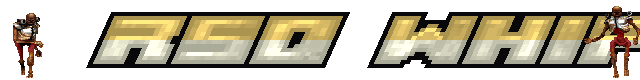

# RSQ Whip

A bullwhip you hold as a weapon in slot 1. Its thong is simulated: it hangs coiled from the handle and follows your hand. It has two moves, both made with the whip hand and no button: a wide swing that hits every monster in the 120 degrees in front of the swing, and a crack down at the ground whose impact throws nearby monsters into the air.

## How to play

| Do this | What happens | Needs |
|---|---|---|
| Start a map | Within a second you are given the whip in slot 1. You are not switched to it | Whip: On, Whip in Slot 1: On (defaults) |
| Press a key bound to slot 1, or step to the whip with next or previous weapon | The whip comes up in the Whip In hand, coiled at the handle with a short tail hanging | Whip In: Main Hand (default) |
| Get the whip into the hand Whip In does not name | Within a second it is moved to the Whip In hand | |
| Own the whip and hold it in neither hand | It hangs coiled at the main hand's hip | Show Whip: On (default) |
| Hold the whip and move that hand | The thong, 25 links and 1.8 m long, follows the handle. It touches and hurts nothing. The weapon never fires a shot | |
| Wide Swing: swing the whip hand in a wide level arc round your body: 70 degrees of bearing in a fifth of a second, at 2 m/s or more | Every monster in sight within 2.6 m, in the 120 degrees in front of the swing (60 either side of its middle), takes 8 damage, is pushed away and flinches. You hear the light crack | |
| Hit at least one monster with a Wide Swing | Slow motion is asked for, half a second | RSQ SlowMo loaded |
| Ground Crack: flick the whip hand hard downward: 1.6 m/s or more down, more down than across, then stopped dead within a ninth of a second | The thong flies to the floor where the hand's line meets it within 4.5 m. If that line meets no floor there, it flies to the floor under where the line ends | |
| Wait 5 tics for the thong to land | The impact: the heavy crack, sparks and a ring of sparks and dust running out along the floor. Every living hostile monster in your sight within 3 m of the spot is thrown up into the air and outward, and flinches. It takes no damage | |
| Catch a boss, a monster that cannot be pushed, or one of mass 1000 or more in the shockwave | It flinches and is not thrown | |
| Catch a flying monster in the shockwave | It is pushed outward and flinches, and is not lifted | |
| Catch at least one monster in the shockwave | Slow motion is asked for, one second | RSQ SlowMo loaded |
| Catch a monster in the shockwave | RSQ Score is told that your Ground Crack caught it. Kill it within 2 s while it is still in the air and Score gives its Ground Crack row | RSQ Score loaded |
| Snap turn, stick turn, or turn your head | Neither move starts. After a snap or stick turn none starts for 8 tics | |
| Raise the whip hand to shoulder height or higher with the handle pointing up and back, and hold it there a moment | The coil pays out and the thong stiffens into a line out of the handle. Swing forward and it follows like a rod. This hits nothing | |
| Hold the whip still for about a second | The thong reels back into its coil | |
| Pull the whip hand's trigger or alt fire | Nothing: the weapon has no shot and reads no button | |
| Switch to another weapon | The thong is gone within 2 tics. A Ground Crack still in the air makes no impact | |
| Die | The thong is gone | |
| Set Whip In to Off Hand | The whip lives in the off hand | Whip In: Off Hand (default Main Hand) |
| Turn Hand on the Handle off | No hand is drawn on the handle; the whip draws its own handle | Hand on the Handle: Off (default On) |
| Type `rsqwp_reset` in the console | The settings it lists go back to their defaults | |

## Keys

<!-- GEN:keys -->
This mod has no keys.
<!-- /GEN:keys -->

## Options

<!-- GEN:options -->
Options > Radiant Silvergun Options > RSQ Whip

| Option | Default | What it does |
|---|---|---|
| **Whip** | | |
| Whip | On | Turns the whip on or off; while off nobody is given it. |
| Whip in Slot 1 | On | Every player carries the whip weapon in slot 1. |
| Whip In | Main Hand | Which hand holds the whip. |
| Show Whip | On | The whip hangs coiled at your hip while you own it and hold it in neither hand. |
| Test and Debug | (page) | The hand on the handle, how the thong moves, and the debug log. |
| Reset All | (button) | Puts every RSQ Whip setting back to its default. |

RSQ Whip: Test And Debug (7 rows)

| Option | Default | What it does |
|---|---|---|
| **Whip** | | |
| Hand on the Handle | On | Draws a hand gripping the whip's handle. |
| **Thong** | | |
| Thickness | 1 (0.2 to 2) | The thong's thickness. |
| Stiffness | 1 (0.25 to 4) | How stiff the thong bends. |
| Damping | 1 (0 to 4) | How quickly the thong's bending settles. |
| Air Drag | 1 (0 to 4) | Air drag on the thong. |
| Hand Smoothing (tics) | 0.8 (0 to 2) | How many tics the handle trails the hand on a steady motion (0 raw). |
| Debug Log | Off | Logs the two moves, every tic, or the cost to the console. |

<!-- /GEN:options -->

## Works with

| Mod | What changes |
|---|---|
| RSQ SlowMo | The Whip asks it by name for slow motion at the speed you set there: half a second after a Wide Swing that hit a monster, one second after a Ground Crack that caught one. Without it nothing is asked |
| RSQ Tactical Rig | While the Rig draws the coiled whip at its whip holster, the Whip's own hip coil is hidden. The coil the Rig draws is the Whip's model. A whip drawn into a hand is laid out again from that hand's handle |
| RSQ Gun Bonsai VR | The Wide Swing's damage is credited to the whip weapon. Its Long Thong upgrade is read once a second and lengthens the thong. Its other whip upgrades change nothing in the Whip |
| RSQ Score | The Wide Swing's damage type is the Whip's own, Whip: Score gives a kill by it its Lashed row, and two or more kills by one swing its Wide Swing row. For each monster a Ground Crack's shockwave catches the Whip sends Score the touch `ground.crack` (`RS_ScoreService`, by name), which Score's Ground Crack row and its combos read. A monster is also noted as whipped before a Wide Swing hurts it and when a shockwave catches it, and the Whip answers that by name. Without it nothing is sent |
| RSQ VisualRewards | The Whip still answers its marker question, always with no: nothing is wrapped or tied any more |
| RSQ Wheel, RSQ Distance Grab, RSQ Grapple, RSQ Laser Sight, RSQ Miniboss, MK Crits | Nothing is read from them. The whip is flagged as a melee weapon |
| Any mod that asks | The Whip answers by name (RSQWP_Service): for a monster, whipped (tics since a Wide Swing hit it or a shockwave caught it). The older names are still answered: swinging, airborne and swings are 0, flailing is 0, and released, landed, rope speed, crack weight, wrapped, yanked and returned are -1 |

## Limits

- The Whip has no keys and reads no button. KEYCONF only puts the whip in slot 1 and defines the `rsqwp_reset` console command.
- With Whip off nobody is given the whip and a whip in the hand does nothing.
- The two moves' numbers (speeds, arc, reach, damage, push, radius, lift, slow motion length) are fixed in the code; no setting changes them.
- A move comes at most once every 8 tics, never while a Ground Crack's thong is still in the air, and not in the 8 tics after the whip comes into the hand.
- Any downward move of the whip hand at 1.6 m/s or more that stops dead reads as a Ground Crack, a dropped arm included.
- A Wide Swing must be level: its up and down part may be no more than 0.6 of its level part. Its 120 degrees are centred on the middle of the swing, not on where you face.
- The shockwave does no damage, reaches only monsters you can see, and skips friendly monsters. A Wide Swing hits friendly monsters too.
- A Wide Swing does not push a monster of mass 1000 or more, or one that cannot be pushed.
- Slow motion is asked for only when a move reached at least one monster.
- The thong itself hits nothing. The whip never targets a player.

## Credits

The full list is in **CREDITS.txt**.

- **presidentkoopa:** the project, the series, and Brutal Doom VR Reloaded's FBX hand (Hand on the Handle, its rifle-magazine
  hold, the same mesh as RSQ Saber's Force hand). That FBX's original author and licence are not recorded.
- **Moses C. Nah and MIT Newman Lab:** "Whip Project - Targeting with a Whip" (BSD 3-Clause): the thong's numbers. Its
  code is not included.
- **runevision (Rune Skovbo Johansen):** the first version followed his devlog on Eye of the Temple's whip. Verlet rope
  references: dylnli/rope (after Sebastian Lague) and chrischristakis/RopePhysics.
- **RSQ Grapple:** the rope (swing, reel, pump, climb, let go, the slide), forked.
- **Pixabay** (Pixabay Content License): the light and heavy cracks and the three swishes. Their authors were not
  recorded. The hit is stock Doom's punch (**id Software**).
- **Generated for this pack:** the plaited thong and wrapped handle skins, the coil and the drawn handle
  (`tools/gen_whip.py`, `tools/gen_whipcoil.py`, `tools/gen_whiphand.py`), on RSQ Grapple's rope tube.
- **QuestZDoom** (Emawind and Team Beef): the engine and its VR hand API.

---
Written from the code as changed on 2026-11-27 (the owner's two moves, over commit e2b60912e; the touch sent to RSQ Score was added later the same day, over commit 8eaad88ea). That code is not compiled and not run yet.
