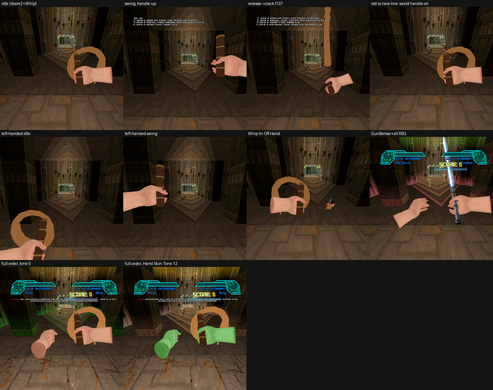
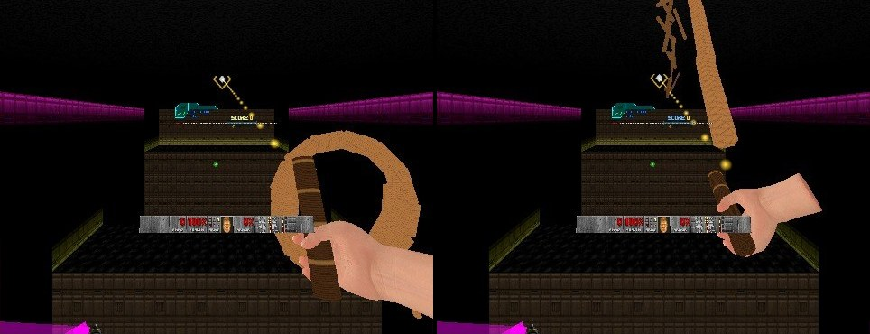
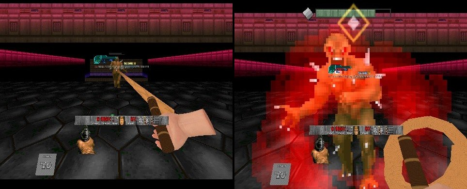
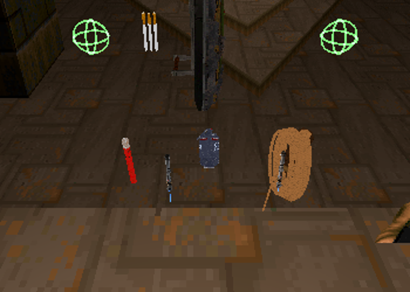

# RSQ Whip
### Doom Arcade VR · a real bullwhip: crack it, snag a beam and swing, rope a monster and yank it in

The whip is a simulated leather thong, 1.8 m long, on a 24 cm handle. Nothing about it is a canned animation: it hangs
from your hand, follows your hand, and cracks when your hand makes the tip go fast enough. Raise it over your shoulder,
bring it down hard, and it cracks where the loop arrives. Point at something and the crack flies to it. Aim at a wall or
a ceiling with your other hand and the crack wraps the whip round that spot: now it is a rope, and you swing from it like
a pendulum. Close your off hand on the thong, whirl it, let go, and it ropes a monster.

*[GIF to come: a wind-up, the crack, an imp knocked into its pain frame]*

---

## What it feels like

- **A whip, not a hookshot.** It does not pull you in a straight line. On a rope you hang from the spot and swing under it:
  you fall, swing through the bottom, rise the other side, and the swing slowly dies down unless you pump it.
- **The crack comes from your arm.** A lazy swing never cracks. A wind-up over the shoulder and a hard swing forward does,
  and so can a sharp flick of the wrist. A harder crack hurts more and sounds heavier.
- **It is held coiled.** At rest most of the thong sits in a coil at the handle and only a short tail hangs. A wind-up pays
  it out; leave it still for under a second and it coils back up.
- **Walking and snap turns don't move it.** The thong is carried with your body, so only what your hand does counts.
- **It does things.** A crack stuns a monster, throws a switch it lands on, and flicks a loose pickup to you.
- **Your hand on the handle.** By default you see Brutal Doom VR's FBX hand gripping the handle, in your Hand Skin Tone.
- **It hangs on your hip** while you own it and it is not in your hand.

---

## How to play

The whip is a weapon in **slot 1**, given to every player. It works in either hand (**Whip In**).

| Do this | What happens |
|---|---|
| Select the whip (slot 1) | It comes up in your Whip In hand, coiled |
| Raise the hand over your shoulder, handle pointing up and back, then swing forward hard | The thong stiffens, pays out, follows your swing, and cracks where the tip is fastest |
| Flick the wrist hard | It can crack without a wind-up, too |
| Hold the whip hand's trigger and point the whip hand | A gold diamond marks a switch, key, powerup, pickup or monster |
| Whip hand's alt-fire, with the trigger held | The mark moves to the next target |
| Crack while something is marked | The thong flies out to it. A monster takes the crack and the whip wraps round it; a pickup is flicked to you; a switch is thrown |
| Whip wrapped round a monster: pull your whip hand back hard, then stop | A yank. Light monsters fly to you, medium ones stagger, heavy ones pull **you** to them |
| Hold the **other** hand's alt-fire (or, whip in the main hand and the off hand empty, the off hand's trigger) | A dotted aim ray from that hand. Gold diamond: the whip can anchor there. Red: it can't |
| Crack while the ray is gold (or within 1 s of letting go of a gold spot) | The whip flies to the spot and becomes a rope |
| On the rope, in the air | You swing. Lean the stick to pump, haul down on the whip to add speed |
| Snagged while standing: jump, or close your empty off hand on the whip (or hold it still on the rope) | The swing starts |
| On the rope: hold the whip hand's trigger | Reel in, like climbing |
| On the rope: whip hand's alt-fire | Let go. You keep your speed |
| Empty hand on the rope: close its grip, press RSQ Distance Grab's grab key, or just hold it still there a moment | Take hold and climb hand over hand |
| Reel up to a ledge lip, or lay a free hand on it | Mantle up and over |
| Main-hand whip: close your off hand's grip on the handle or thong | The lasso: the off hand holds the thong. Circle it to whirl, let go of the grip to throw |
| Whip in one hand, a gun in the other (**Whip and Gun**) | The whip hand's own dotted ray is the snag cursor while its trigger is up. Crack while it is gold and the whip flies there and becomes a rope. The gun keeps both its buttons. See *Whip and Gun* below |
| Whip and Gun: hold the whip hand's trigger, point at a monster, crack, keep holding | The **Leash**: a light monster is pulled along the floor to you, a heavy one is an anchor you swing from |

### Controls

**No keys** (owner, 2026-11-10: the whip is attack and alt attack). Select it in slot 1.

- **Whip hand, trigger:** hold to mark a target; on the rope, hold to reel in.
- **Whip hand, alt fire:** with the trigger held, move the mark on; on the rope, let go.
- **Whip and Gun** (a gun in the other hand, the row on): no button aims. The whip hand's own ray is the cursor whenever
  its trigger is up; the trigger held marks as above. The other hand's trigger and alt-fire stay the gun's.
- **Other hand, alt fire:** hold for the aim ray (with the whip in the main hand and the off hand empty or a fist, its
  trigger too, with **Aim With Off Hand** on).
- **Off controller's grip button** (read as raw keys, **Off Grip Keys**, 443 436): the off hand on the handle or the
  thong for the lasso; an empty off hand near the whip hand to start a swing.
- **Holding the rope** (to climb), with an empty hand within 16 map units of it, any of three:
  - **the controller's grip** (read as raw keys: **Main Grip Keys** 446, **Off Grip Keys** 443 436); let go of the grip
    to let go of the rope;
  - **RSQ Distance Grab's grab keys** (**Grab / pull**, main and off hand; **Grab Keys Grip Rope** on; no default
    binding since 11-10);
  - **touch** (**Touch Holds Rope**, on): bring the hand to the rope, at least 0.3 m out along it from your body, and
    hold it still a moment (6 tics, under 0.4 m/s). No button. Move it about 1 m off the rope (twice Grab Reach) to let
    go. A hand already on the rope's line when the whip snagged (the off hand aiming the ray) doesn't take it: it has
    to come to the rope. On a snagged rope waiting for its start, a touch is the grip start, as the grip is.
  A key's hold and a touch hold are kept apart: letting go of a key never drops a touch hold, or the reverse. After a
  key's hold the hand must leave the rope before touch takes it again.
- **A hand laid on a ledge's lip** (the mantle) takes hold only through RSQ Distance Grab's grab keys.
- **Jump** on a snagged rope: start the swing.
- **Gestures:** the crack (a wind-up over the shoulder and a hard swing, or a sharp flick), the yank (pull back hard,
  then stop), the whirl and the throw of the lasso, hauling down on the rope (Arm Pump). The movement stick pumps the
  swing.

Gone on 2026-11-10: the four binds **Whip (Main)**, **Whip (Off)**, **Grab Whip (Main)** and **Grab Whip (Off)**, and the
**RSQ Whip** section in Customize Controls. The page's Controls rows went with them.

*Rig frames, 2026-11-03, an earlier build (before the 11-05 holster-draw fix and the 11-06 reach change): the coiled
whip in the FBX hand, the handle up for the wind-up, the thong out after the release, left-handed, Whip In: Off Hand,
the full order with Gun Bonsai VR, and Hand Skin Tone 12. Simulated headset, not a capture from a real headset.*

---

## The crack

- **When it cracks.** The tip must pass **Crack Speed** (20, about 20 m/s), with most of the thong paid out and your
  hand driving it. The crack lands where the tip was fastest. One swing, one crack: it re-arms once the thong has calmed
  or on a new wind-up. A snap turn never cracks it, and the wind-up itself never cracks.
- **How hard.** Between Crack Speed and **Hardest Crack Speed** (43) the crack does from a quarter of **Damage** (12) to
  all of it: 3 to 12. A fast piece of thong that touches a monster without cracking stings for up to 3. Each thing is hit
  once per lash.
- **The lash.** For 8 tics after the crack, fast thong still lands as hard as the crack.
- **What it hits.** With **Whip Aim: Free**, only what the tip touches (12 map units, about 35 cm). With **Assist** (the
  default), the nearest thing within **Aim Reach** (40 map units, about 1.2 m) of the crack. The tip must see it: no
  cracking through walls.
- **Stun** (on): a monster cracked goes into its pain frames, which breaks off the attack it was winding up.
- **Throws Switches** (on): a line with a use or shoot special within that reach is worked as a Use press would. Locks
  still want their key.
- **Fetches Pickups** (on): loose pickups near the crack fly to you on an arc, and are picked up when they reach you.
- **Knockback** (off): off, a crack doesn't push the monster. On, it gets the engine's push, and a monster a plain crack
  wrapped also swings with your arm (see *Flail*).
- **Hit-Stop** (off): the cracked monster freezes for 3 tics (a light crack) to 6 (the hardest).
- **The whip's own damage type.** Brutal Doom answers a "Melee" hurt with its stealth-kill fatality; the whip deals
  "Whip", so its kills are plain pain and death and you are not thrown into an execution.
- **Sounds:** a swish as it loads, a light or a heavy crack (heavy once the crack is past halfway to the hardest), Doom's
  punch on flesh, and a short rumble in the whip hand.

*[GIF to come: a soft crack and a hard crack on two zombiemen, the two crack sounds]*

### Crack Fireballs

**Crack Fireballs** (off): in the crack's lash, the outer third of the thong passing through a monster's missile (fireball,
rocket) explodes it there. **Cracked Fireballs** picks what happens: **Explode There** (default), or **Knocked Away**:
it flies off the way you swung, never back at you, at most 15° down and 30° up, and it is yours now, so it can hit the
monster that fired it. Only monsters' missiles, never yours.

*[GIF to come: an imp's fireball cracked out of the air]*

---

## Marking a target

Hold the whip hand's trigger and point the whip hand.

- **What can be marked,** within **Whip Reach** (20 m): with **Switches First** (on), switches, keys, powerups and
  count-items anywhere roughly ahead (within 70°) are marked first, nearest first. Then monsters and pickups along your
  hand (within 20°), nearest first. Switches First off: what you point at wins over a switch. Doors are never marked.
- **In sight only.** Gun Bonsai VR's Kill Rewards bits are never marked, fetched, lassoed or cracked onto.
- **The mark** is the series' lock diamond, a white centre in a gold ring, over the target. A short tick in the hand
  says it changed.
- **Keep the Mark** (on): the lift before an overhead crack points your hand elsewhere; the mark stays where it is while
  that target is alive, in reach and in sight. Only alt-fire moves it on.
- **Let go of the trigger** and the mark is gone.
- **A crack while marked** sends the thong out to it in 5 tics, however far (up to Whip Reach). A monster takes the
  crack (at least as hard as Crack Speed) and the whip wraps round it. A pickup is flicked to you. A switch is thrown.

*[GIF to come: the diamond on a far switch, a crack, the switch flipping]*

---

## Wrapped: the yank and the flail

A marked crack (or a thrown lasso) that lands on a monster wraps round it. The thong stays laid out to it.

- **How long:** 2 seconds; as long as you keep the trigger held, with **Flail** on. Then it slips off.
- **The yank.** Pull your whip hand back away from the monster, hard (at least about 1.5 m/s; full at about 4 m/s),
  then stop. The pull counts against your body, so walking back doesn't.
  - **Light** (mass up to **Pulled Up To**, 400: imps, zombies, demons): pulled off its feet toward you, a quarter of the
    way on a tug up to nine tenths on a violent pull. On a hard pull it goes into its pain frames.
  - **Medium** (up to **Too Heavy From**, 1000): it staggers part of the way.
  - **Heavy** (1000 and up, a boss, a monster that can't be pushed, an RSQ Miniboss with Can't Be Yanked): it doesn't
    move. The yank throws **you** toward it in an arc.
- **Yank Grace** (off): for 12 tics (about a third of a second) after the wrap, no pull counts, so a crack's
  follow-through doesn't yank by accident.
- **Flail** (on): a lassoed monster (and, with **Knockback** on, one a crack wrapped) is held at the rope's length and
  swings round with your arm. A light one is lifted, pinned in its pain frame. Swing it into another monster and it
  smashes: (speed − 8) × 0.8 damage, at most 40, to the one it hits, half that to the one you swing, and a chance of pain.
  The same monster is smashed at most every 10 tics. Heavy things don't swing.

*[GIF to come: an imp lassoed and swung into a zombieman]*
*[GIF to come: a yank on a baron pulling the player in]*

---

## The lasso

With the whip in your **main** hand, close the off hand on it: the off controller within **Lasso Reach** (0.30 m) of the
handle or the thong with its grip button down (**Off Grip Keys**), or RSQ Distance Grab's off-hand grab key, or the
engine's two-hand grip.

- The off hand holds the thong where it took hold. The rest is the same simulated whip.
- **Whirl it.** Circle the off hand and the loop is helped round: help starts at a 6 cm circle and one turn in 3 s, and is
  full at 15 cm and one turn in 1.1 s.
- **Let go of the grip** and it flies on along the circle, at least as fast as it was whirling. It ropes the monster
  nearest that way (within 25°, and the shorter of Whip Reach and 7.2 m), hits it as hard as it was going, and wraps
  round it, ready for the flail and the yank. Nothing there: it flies out to full length. Too slow: it just drops.
- A thrown lasso never cracks.

*[GIF to come: the lasso whirled over the head and thrown onto an imp]*

---

## Swinging

This is the pendulum. Two ways onto a rope:

- **Catch Edges** (on): a fast tip that hits an edge above your hand (16 map units or more above it, **Snag Edge
  Height**) wraps round it: a beam, a doorway's head, a ledge's lip, the top of a 3D floor. A crack right beside such an
  edge does it too. A flat wall, floor or ceiling has nothing to wrap round. A switch on the wrapped line is worked.
- **Aimed Swing** (on): hold the other hand's alt-fire for the aim ray. **Aim With Off Hand** (on): with the whip in the
  main hand and the off hand empty or a fist, the off hand's trigger holds the ray too (and that fist doesn't punch).
  Gold means a wall or a ceiling within **Whip Reach**; red means out of reach, sky, a floor, a portal, a polyobject, a
  3D middle texture or no room. Crack while it is gold and the thong flies there (5 to 8 tics) and latches 4 map units
  off the surface (off a wall, a body's width further out, so the bottom of the arc is clear of the wall). A switch on
  that wall is worked.
- **Beam Beats Lock-On** (on): while the ray is held, or for 1 s after you let go of a gold spot, the crack goes only
  there: no mark, no lock, no edge snag, no target at the tip, and a lasso throws into the air. A monster you had wrapped
  is let go. A red ray gives a plain crack. Off: the spot is kept for 6 tics after you let go, and nothing stands down.

### Starting the swing

Snagged in the air, you swing at once. Snagged from the ground, you stand on the rope until you start (or step off):

- **Jump Starts Swing** (on): jump. You are lifted (**Jump Lift**, 10) and pushed where you face (**Jump Push**, 8), on
  top of the speed you had. Not stacked on the engine's own jump.
- **Grip Starts Swing** (on): close your empty off hand within 0.5 m of the whip hand or the rope: two hands on the
  whip. The rope is taken up 0.7 m more than the arc needs. With **Swing Assist: Grab Snag** (on) you are lifted
  (**Assist Lift**, 8) and carried toward the point under the anchor (**Assist Speed**, 10). That press doesn't become a
  climbing hold; the next one does.
- Both starts off: you hop a little on the latch.
- From the ground the rope is taken in so the arc clears the floor.

### On the rope

- **The swing** is a real pendulum from the anchor. It loses about 12% of its swing each half swing and comes to rest
  hanging under the anchor. Lean the movement stick to pump it (**Stick Lean**). Haul down on the whip in the air to add
  speed (**Arm Pump**). **Top Speed** is 30.
- **Reel** (hold the whip hand's trigger, a fresh press): the rope comes in at **Reel Speed** (3 a tic, about 3 m/s),
  easing in over 6 tics. Shortest rope: 32.
- **Let go** with the whip hand's alt-fire. You fly off with the fastest of your last 3 tics' speed, so a late let-go at
  the bottom still counts. **Keep Momentum** (on): you keep the swing's speed when you land. Let go just under a high
  anchor and you get a small hop (**Ledge Hop**, 6) to get a foot over.
- **Chain swings.** Let go of an aimed swing and the whip is back in your hand at once, thong out, ready for the next
  crack while you are still in the air.
- **The rope slips** if it loses sight of its anchor round a corner, if the wall it hangs on goes (a door opening), or
  if a ceiling crushes down on it.
- **Off Hand Stays Free** (on): taking a gun into the off hand never lets go of the rope. Off: it lets go of an aimed
  swing.

### Climbing

- **Rope Climbing** (on): a free hand within 16 map units of the rope (**Grab Reach**) holds it when you close its grip,
  press RSQ Distance Grab's grab key, or hold it still there (Touch Holds Rope). Pull down to climb, push up to lower yourself, one to one with your hand, at most 8 a tic (**Climb Speed
  Cap**). Let go, reach up with the other hand, take hold, pull.
- **Free Hand Only** (on): only an empty hand or a fist can take hold, never a gun hand.
- **Grab Keys Grip Rope** (on): RSQ Distance Grab's grab keys take hold of the rope. The controller's grip always does.
- **Touch Holds Rope** (on): an empty hand held still on the rope a moment takes it, no button; about 1 m off the rope lets go.

### Mantle

**Mantle** (on): on a rope caught on a ledge lip with a floor beyond it, reel or climb until the lip is at your chest, or
lay a free hand on the lip with RSQ Distance Grab's grab key, and you are lifted just over it and carried onto the top.

*[GIF to come: the aim ray gold on a ceiling, the crack, the swing across a pit]*
*[GIF to come: a jump start from the ground and a let-go onto a ledge]*

---

## Whip and Gun ("Indiana Jones")

The whip in one hand and a gun in the other at the same time (owner, 2026-11-10: "aim with the whip hand, we still
target actors while holding in primary fire"). This is a second way to carry the slot-1 whip, not a new weapon. With
the other hand empty or a fist, the whip plays exactly as above.

**How you get it.** It turns on by itself whenever the slot-1 whip is in one hand and the other hand holds a weapon
(anything but an empty hand or a fist), with **Whip and Gun** on (the default). You need no key and no extra select.
For example:
- **Whip In: Main Hand**: draw a pistol into the off hand (an RSQ Tactical Rig holster with the off hand, or any
  off-hand draw);
- **Whip In: Off Hand**: select the whip (slot 1, or the Rig's whip holster) with a gun in the main hand.
Put the gun away, or take the whip out of the hand, and it is the ordinary whip again.

| Do this | What happens |
|---|---|
| Point the whip hand (trigger up) | Where the whip can anchor (a wall or a ceiling within Whip Reach), a dotted **gold** ray from the whip hand ends in the series' diamond. Where it can't, nothing is drawn (owner 11-10: the cursor shows only when it can snag; code only, not shown) |
| Point at a gold spot, then crack (a wind-up and swing, or a flick) | The cursor holds still on the spot through the wind-up and the swing (it stays where you pointed before the hand began to sweep), and the whip flies there and latches. With no cursor, a crack is an ordinary crack: what the tip hits, edge snags and fetches all work as usual |
| On the rope | One hand on the whip. **Jump** starts the swing from the ground (there is no free hand for the grip start); trigger reels, alt-fire lets go. Let go with the cursor gold and the next crack goes there (chain swings) |
| Hold the trigger and point | Marking, exactly as the slot-1 whip does (the cursor is gone while you hold it). Alt-fire moves the mark on |
| A marked crack lands on a monster with the trigger still held (**Leash** on) | The Leash: the whip catches it on a line. A light one slides to you along the floor (10 map units a tic, stopping 16 short) and the line lets go when it arrives, ready for your gun. One too heavy (over mass 1000, a boss, a Can't Be Yanked miniboss) is an anchor: a fresh trigger press reels you to it, alt-fire lets go |
| Trigger let go before the marked crack lands, or Leash off | It wraps, as the slot-1 whip does: the yank and the flail |
| Fire or alt-fire the gun | The gun fires. The whip takes neither button |

*The cursor: the gold dotted ray from the whip hand ends in the diamond on the ceiling through the wind-up (left), and the crack flies to that spot (right) (rig capture, not headset).*

*The Leash: the whip cracked out to the marked imp down the room (left), then the imp pulled in close in front of you, the diamond over it; the pistol is in the off hand (rig capture, not headset).*

There is no lasso in this mode, because the other hand is holding the gun.

**Rows** (*Whip and Gun* section): **Whip and Gun** (on): off, a gun in the other hand changes nothing (the other
hand's alt-fire aims the ray, as before). **Leash** (on).

*Rig, 2026-11-10 (simulated headset):* `design/rigtest_2026-11-10/evidence/BINDWHIP_cursor_crack_swing_frames.jpg`:
the red and then gold ray from the whip hand, held through the wind-up, the thong flying to the ceiling spot, the
rope in the swing. `BINDWHIP_leash_frames.jpg`: the diamond on an imp, the leash line, the imp pulled in front of
you, the pistol in the off hand.

The old bind whip's keys (**Whip (Main)** / **Whip (Off)**) and its **Whip Style: Assist** and **Whip Aim: Lock** stay
unused (Lock points the other hand, which holds the gun here). Their code is kept with the rest of the unused rope code
(the thrown hook, the zip, the chain look, the bite ledger) in `design/WHIP_DEAD_FEATURES.md`.

---

## Your whip, your hand

- **Whip In** (Main Hand): the hand the whip lives in. Set it to Off Hand and the whip is moved there (at most once a
  second). Only one whip is out at a time. The lasso needs the whip in the main hand.
- **Hand on the Handle** (on, your own setting): Brutal Doom VR's FBX hand, in its magazine hold, round the handle, toned
  by BD22 VR's Hand Skin Tone. Off: no hand; the simulated handle is drawn on its own.
- **Show Whip** (on, your own setting): while you own the whip and it is in neither hand, it hangs coiled on your
  main hand's hip (0.06 m back, 0.30 m out, 0.84 m under your eyes; the left hip for a left-handed setup). While RSQ
  Tactical Rig draws it in its whip holster (the Rig on, in VR, its **Whip Holster** row on) this coil stands down; with
  the Whip Holster off, the coil still shows.
- **Whip in Slot 1** (on): every player is given the whip (checked once a second). You are never switched to it.
- **Whip** (on): the master switch. Off, no whip comes out, any whip out is put away, and nobody is given the whip.

*Rig frame, 2026-11-03, an earlier build: the coiled whip (right) hanging with the rest of RSQ Tactical Rig's holsters.
Simulated headset, not a capture from a real headset.*

---

## Plays well with

- **RSQ Gun Bonsai VR:** the whip weapon has its own upgrade tree, and earns XP for its own hits. Crack: **Sting** (+25%
  crack damage a level), **Stun** (the crack's pain held 10 + 10 a level tics), **Crack Shot** (cracked missiles blow up;
  2 and 3 also hurt what stands within 2 m / 2.5 m), **Return Crack** (a cracked missile goes back at its shooter, its
  damage +25% a level), **Strike True** (hit-stop of 3 / 4 / 6 tics). Reach: **Long Thong** (the thong ×1.25 / 1.5 / 1.75),
  **Quick Mark** (pickups and switches marked 2 m a level past Whip Reach; level 3 marks a second pickup and one crack fetches
  both). Wrap: **Heavy Yank** (the light mass 400 → 600 / 800 / 1000), **Pull and Punch** (offered only with RSQ Melee
  loaded: a yanked monster arrives staggered for your free hand's punch). Lasso: **Lasso** (level 2: held 50% longer), **Bola** (one more
  light monster within 2.5 m a level, tied to the first and yanked with it). Rope: **Snag** (level 2: edges from your hand's height up),
  **Mantle** (level 2: from a swing too), **Momentum** (levels 2 and 3: the swing's top speed 30 → 36 / 42), **Tarzan**
  (swinging into a monster at 3 m/s or more hurts it 10 + 10 a level times your share of top speed and knocks it down),
  **Fast Reel** (the reel, and the Leash's pull, 10% faster a level, 4 levels), **Steady Line** (hanging with the stick
  centred, the swing's air drag ×1 + 3 a level, so it settles fast), **Slingshot** (letting go of a swing in mid-air:
  your speed ×1 + 0.1 a level). The Leash's four (offered only while Whip and Gun and Leash are on): **Heavy Lash** (the
  Leash's mass limit ×1 + 0.5 a level; one still too heavy staggers 10 + 10 a level tics when caught), **Barbed Claw**
  (the catch does 4 + 4 a level, tearing free of a living monster 6 + 6 a level), **Get Over Here** (it arrives staggered
  20 + 15 a level tics), **Bowling** (on its way it strikes what is in its path: 5 + 5 a level plus half its speed,
  staggered 15 + 10 a level, shoved aside). Their numbers are RSQ Grapple's own.
  With Gun Bonsai VR loaded, the page shows *"GunBonsaiOVR detected. Mod features unlocked via upgrades."* and these rows
  grey out until learned: **Hit-Stop** (Strike True), **Crack Fireballs** (Crack Shot), **Lasso**, **Catch Edges**
  (Snag), **Mantle**, **Keep Momentum** (Momentum). Learned, the row turns it on and off. **Cracked Fireballs** is always
  greyed with Gun Bonsai VR: Crack Shot and Return Crack decide.
- **RSQ Score:** the whip tells Score what it did. A crack kill pays **Lashed** (more for a crack in the top half of the
  whip's range). Swinging a monster into another pays **Wrecking Ball**; Tarzan's blow pays **Tarzan**; a marked crack
  that kills from 6 m or more pays **Snap Kill** (the whip names the marked crack before it lands, 11-10); **Stun Lock**
  (a Stun crack, another tool kills), **Heavy Haul** (a Heavy Yank) and **Chain Swing** (the second and later swings of a
  chain) read it too, as do the rope rows (**Swinging**, **Hanging Shot**, **Dismount**) and Score's whip combos
  (Ringmaster, Frontier, High Noon, Zorro, Tetherball, Rope-a-Dope, Get Over Here!, Jungle Law and the rest on Score's
  page). With RSQ Grapple loaded too, Score asks both ropes (11-10), so a whip swing still pays the rope rows.
- **RSQ Tactical Rig:** the whip has its own holster on the main hand's hip (the Rig's **Whip Holster** row). It is
  there whenever you own the whip and it is in neither hand; draw it into your Whip In hand, put it back at the hip or at
  an empty gun holster. It never goes into a gun holster. The Rig draws the coil there (Show Whip decides).
- **RSQ VisualRewards:** a monster the whip has wrapped, lassoed or tied (Bola) wears the **whipped** marker (a coiled
  lash) by its health bar. A hit-stop shows as its frozen marker.
- **RSQ Melee:** Gun Bonsai VR offers Pull and Punch only while Melee is loaded.
- **RSQ Miniboss:** its **Can't Be Yanked** row (on): a miniboss is treated as heavy (a yank pulls you to it).
- **RSQ SlowMo:** you and the whip run at full speed.
- **RSQ Distance Grab:** its grab keys are how a hand takes the rope and how the off hand can take the thong (**Grab Keys Grip Rope**), and its grip keys are the
  default **Off Grip Keys** (443 436).
- **RSQ Saber** and **RSQ Melee:** Saber's bare Force hand and Melee's gloves count as an empty off hand for the aim
  ray and the grip start. With Aim With Off Hand on and the whip in your main hand, the off trigger aims the ray instead
  of holding the Force; turn the row off to give it back.
- **RSQ Wheel:** the whip has its own icon there and goes to the main hand (Whip In then moves it if you chose the off
  hand).
- **RSQ Grapple:** its rope code is where the whip's rope came from. The two are separate mods and load together.
- **RSQ Accessibility:** Rumble Strength scales every whip rumble. Steady Hands smooths the marking and the aim
  ray (never the whip itself). Gesture Ease widens the rope's Grab Reach. The
  Off-Hand Modifier lets the main controller play the off hand. Comfort Vignette eases
  in while you swing, reel or climb. Cue Size scales the diamonds; the colour-blind palette recolours them
  and the aim ray, and High Contrast lights the rope at full brightness.
- **Brutal Doom VR (BD22 VR):** its FBX hand and Hand Skin Tone are Hand on the Handle. Its empty off hand counts as free
  for climbing, aiming and the grip start.

---

## Options

*Radiant Silvergun Options → RSQ Whip.* One page, with the numbers under Test and Debug. **Reset All** (on both pages)
resets every Whip setting; the console alias `rsqwp_reset` does the same.

| Section | Rows |
|---|---|
| Whip | Whip (On) · Whip in Slot 1 (On) · Whip In (Main Hand / Off Hand; Main Hand) · Show Whip (On) · Hand on the Handle (On) · Whip Aim (Free / Assist; Assist) · Whip Reach (m) (20; 3 to 60) · Switches First (On) |
| Crack | Stun (On) · Knockback (Off) · Hit-Stop (Off) · Throws Switches (On) · Fetches Pickups (On) · Crack Fireballs (Off) · Cracked Fireballs (Explode There / Knocked Away; Explode There) |
| Monsters | Lasso (On) · Flail (On) · Keep the Mark (On) · Yank Grace (Off) |
| Swinging | Catch Edges (On) · Aimed Swing (On) · Aim With Off Hand (On) · Beam Beats Lock-On (On) · Off Hand Stays Free (On) · Grip Starts Swing (On) · Swing Assist: Grab Snag (On) · Jump Starts Swing (On) · Mantle (On) · Keep Momentum (On) |
| Climbing | Rope Climbing (On) · Free Hand Only (On) · Grab Keys Grip Rope (On) |
| Whip and Gun | Whip and Gun (On) · Leash (On) |
| Controls | none (owner 11-10) |
| Test and Debug: Crack | Crack Speed (20) · Damage (12) · Hardest Crack Speed (43) · Aim Reach (40) · Pulled Up To (mass) (400) · Too Heavy From (mass) (1000) · Lasso Reach (m) (0.30) |
| Test and Debug: Thong | Thickness (1.0) · Stiffness (1.00) · Damping (1.00) · Air Drag (1.00) · Hand Smoothing (tics) (0.8) |
| Test and Debug: Rope | Reel Speed (3) · Shortest Rope (32) · Top Speed (30) · Stick Lean (0.25) · Arm Pump (0.12) · Swing Air Drag (0.0020) · Rope Friction (0.025) · Ledge Hop (6) · Snag Edge Height (16) · Rope Meets Body (0.60) · Jump Lift (10) · Jump Push (8) · Assist Lift (8) · Assist Speed (10) · Slack Rope Pieces (12: most pieces a slack rope is drawn in) · Let-Go Rope Return Speed (64: a let-go rope coming back to the hand) |
| Test and Debug: Climbing | Grab Reach (16) · Climb Speed Cap (8) · Off Grip Keys (443 436) · Debug Log (Off / Events / Every Tic / Cost / Snags and Grip Keys / Aim Ray Every Tic; Off) |

Speeds are map units a tic unless a row says otherwise. Whip In, Hand on the Handle, Show Whip and Off Grip Keys are
your own settings; every other row is a server setting.

*[picture to come: the RSQ Whip options page]*

---

## Status

| | |
|---|---|
| **rig only, not headset-confirmed** (2026-11-10, the batched rig test, `design/rigtest_2026-11-10/RESULTS.md`) | Every launch on the owner's order had no script error from our packs. Those launches came before the 11-10 fixes (commit 09243dd8), and no whip move was exercised |
| **rig only, not headset-confirmed** (2026-11-09, an earlier build) | The pack loads on the full series order (doom2, brutal22test6, BD_VoxelPack, BD22 VR, LOB, Champions, Gun Bonsai and the RSQ pk3s) with no script error of its own (the only script errors in that log are BD_VoxelPack's voxeldef.txt); its page is listed under Radiant Silvergun Options; Gun Bonsai VR registers the whip tree's upgrades on the whip weapon; RSQ Tactical Rig lists the Whip holster among the main hand's holsters (log: `design/rigtest_2026-11-09/logs/main_A-G_I.log`). No whip move was exercised in that run |
| **rig only, not headset-confirmed** (2026-11-03, an earlier build) | The mark skipping Kill Rewards bits and marking a Clip, keeping the mark with the hand pointed away, the wind-up → pay-out → swing → release → crack sequence, the locked crack flying 215 units to the Clip and the Clip taken; a plain crack fetching a Stimpack and leaving the bits; the aim ray refusing a 9.0 m wall at a 9 m reach and an ordinary crack instead, and at a 60 m reach a wall 56.3 m off read gold, the crack cast there in 8 tics and latched, waiting for its start (`tools/rigtest/evidence_1103_holster/bits_and_range.txt`); the Rig's whip holster drawing the whip and putting it home, and the coil on the hip right- and left-handed (same folder); Hand on the Handle, left-handed, Whip In: Off Hand and Hand Skin Tone (`tools/rigtest/hand_1103/sheet.png`). Since then the reach settings were replaced by Whip Reach (11-06) and the holster draw re-seat was added (11-05), so these are not re-shown on the current build |
| **rig only, not headset-confirmed** (2026-11-10, the touch hold; `design/rigtest_2026-11-10/evidence/ROPE_WP_*`) | On SWINGTST after an aimed crack snagged the ceiling: the off hand aiming the ray, on the rope's line, was not taken (it never came to the rope); brought to the rope and held still, it took it in 6 tics and that was the grip start (lifted and swung); with Grip Starts Swing off the same touch was a climbing hold, and drawing the hand 0.4 m in along the rope shortened it 312 to 299; moved 1 m away it let go. The grip keys themselves can't be pressed on the rig |
| **rig only, not headset-confirmed** (2026-11-10, Whip and Gun; `design/rigtest_2026-11-10/evidence/BINDWHIP_*`) | Slot-1 whip in the main hand, a Pistol put in the off hand: the mode came on the next tic. The whip hand's ray, red, then gold on a ceiling 8.7 m off; held on that spot through the wind-up and swing; the crack cast there and latched; a jump started a one-handed swing; alt-fire let go. Trigger held: an imp marked, the marked crack hit it and the Leash pulled it in 10 a tic until it stood in front; a heavy one became an anchor and a fresh trigger press reeled the player to it. With the off hand empty, the old aimed swing gave the same log as before. Not shown: a gun in the other hand actually firing (the rig's vanilla Pistol in the off hand didn't fire, the whip took none of its buttons), a Tactical Rig holster draw, Whip In: Off Hand with a gun in the main hand, the row turned off |
| **rig only, not headset-confirmed** (2026-11-10, the Rope perks; `design/rigtest_2026-11-10/evidence/PERKS_*`) | With Gun Bonsai VR's Add All against none: Fast Reel 4 reel 3.0 → 4.2 a tic and the Leash 10 → 14; Steady Line 3 the swing's speed at each bottom 10.5 / 5.2 / 2.2 against 17.1 / 15.2 / 13.4; Slingshot 3 ×1.30 on a let-go in the air; Heavy Lash 3 an imp came at a mass limit that had made it an anchor, and a heavy demon's stagger was asked for 40 tics; Barbed Claw 4 bite 20, tear 30; Get Over Here 3 asked for 65 tics on arrival; Bowling 3 struck a demon in the path for 27 and shoved it aside |
| **Headset-confirmed** | Nothing yet |
| **code only, not shown** | **The 11-10 fixes (commit 09243dd8):** the whip added to slot 1 in the pk3 (before, its KEYCONF was left out of the pk3), the bind whip's three rows and the Leash's three sliders gone, Snap Kill, Score asking both ropes, the hip coil whenever the Rig is not drawing it, the Rope page's two renamed rows. That commit records a load check of the full order with no errors from our packs; its log is not in the repo. **The 11-10 key change:** no keys |
| **code only, not shown** | Everything else on this page: the swing itself after the latch (no log of a pendulum swing is in the repo), the reel, climbing, the mantle, the jump and grip starts and Swing Assist, letting go with the speed kept, chain swings, edge snags (Catch Edges), the lasso and the whirl, the wrap, the flail and the smash, the yank, Crack Fireballs, Hit-Stop, Yank Grace, Switches First, the one Whip Reach, the re-seat on a holster draw, Show Whip without the Rig, every Gun Bonsai VR node, the Score rows, the VisualRewards marker. And everything changed 11-10: the marked crack naming itself to Score (Snap Kill), Score asking both ropes (Swinging, Hanging Shot, Dismount with RSQ Grapple loaded), Crack Fireballs noting missiles already in flight when it turns on, the hip coil showing whenever the Rig is not drawing it, Gun Bonsai VR's Quick Mark tooltip reading Whip Reach |
| **not yet run** | Nothing: the batched rig test of 2026-11-10 (`design/rigtest_2026-11-10/PLAN.md`) has no Whip check |
| **Not in the game (from reading the code)** | The old bind whip's keys, Assist and Lock (no input since 11-10), and the unused rope code (a thrown hook, the zip, the chain look, the bite ledger), in `design/WHIP_DEAD_FEATURES.md`. The rope perks and the bind whip are planned (above) |

---

## Under the hood

- **Stock QuestZDoom 17.3:** ZScript and data only, no engine changes. Nothing is linked: every other mod is found by
  class or service name at run time, and the whip loads and plays alone.
- **The thong** is 25 links of 7.2 cm (1.8 m) after Moses C. Nah's MIT whip model: its bend stiffness, damping, link
  length and node mass node for node, simulated position-based in 16 sub-steps a tic, in room units (map height ×1.2) so
  a length means the same in every direction. The handle is a rigid 24 cm stick driven along the hand's path, critically
  damped (**Hand Smoothing**), so a jumpy hand never kicks the thong. Links are swept against walls, floors and ceilings
  every tic and mended back if one ends up through a wall; stuck for 6 tics, the whip is laid out again from the hand.
- **The body's frame:** the thong is moved and turned with your body every tic before it is simulated; a snap or stick
  turn is spotted as both controllers turning round the body by the same angle in one tic.
- **The hand's height:** the machine with the controllers sends each hand's offset from the eye of that rendered frame
  (`rsqwp_hp0`, `rsqwp_hp1`), so view bob and step dips don't read as swings. On SteamVR (`vr_mode 10`) it measures from
  the frame's eye in all three axes.
- **The rope** is RSQ Grapple's core, forked (`RSQWP_Core`, `RSQWP_Hook`): solved on the velocity the engine is about to
  move you by, so the engine's own collision moves you and a rope can't put you in a wall.
- **Handlers:** `RSQWP_Core` (the rope), `RSQWP_Input` (the old bind whip's console events, no keys), `RSQWP_Whip` (the whip), `RSQWP_Events` (the ledger
  for other mods), `RSQWP_HipShow` (Show Whip's hip coil, when the Rig is not drawing it). The weapon is `RSQWP_WhipWeapon` (slot 1 through
  KEYCONF's `addslotdefault`, so Brutal Doom's player class keeps it); the hip coil is `RSQWP_Stowed`.
- **Network events:** `rsqwp_fire`, `rsqwp_up` (the bind whip, no keys since 11-10; the hand's pose packed in),
  `rsqwp_grab` (the old Grab Whip, no keys), `rsqwp_pose` (the climbing hand), `rsqwp_lock` (the bind whip's Lock), `rsqwp_aimkey` (the eaten aim keys), `rsqwp_ogrip`
  (the off grip key, read by scan code from **Off Grip Keys**), `rsqwp_hp0` / `rsqwp_hp1`. It also hears Distance
  Grab's `rsqdg_press` / `rsqdg_release`. The mark and the aim ray read the hand in play: single player is exact.
  QuestZDoom has no netplay.
- **For other mods: `RSQWP_Service`,** found by name. With a player: `swinging`, `airborne`, `released`, `landed`,
  `swings`, `rope.speed`, `released.speed`. With a monster: `whipped`, `crack.k` (0 to 100), `wrapped`, `wrapped.by`,
  `yanked`, `flailing`. With a missile: `returned`. Times are tics, -1 for nothing in the last 10 s. A crack or a smash is
  noted before the blow lands, so a scorer hearing the death already reads it. `GetIntUI("menu.locked", node)` greys the
  Gun Bonsai VR rows. `RSQTHP_MarkerWhip` answers VisualRewards' `whipped`.
- **What it asks:** `RSQ_MeleeUpgradeService` (Gun Bonsai VR's node levels once a second, its XP bracket, `stagger`,
  `knockdown`), `RS_ScoreService` (`touch`), `RSQSM_Service` (`scale`), `RSQA_Service`, `RSQMB_Service` (`bossfor`
  `yank`), and `RSQTR_RigService` (`rig.holster` for the whip: whether the Rig draws the coil).
- **Damage type** `Whip`, so Brutal Doom's "Melee" stealth kill never triggers.
- **Saves:** after a load no rope reads as held, no hand holds the rope, and the rope table is rebuilt from the hooks
  in the level.
- **Debug Log** prints `T_WP` (the rope) and `T_WPW` (the whip) lines: wind-up, swing, release, crack, mark, cast,
  latch, start, yank and the rest.

---

## Credits

The full list is in **CREDITS.txt**.

- **presidentkoopa:** the project, the series, and Brutal Doom VR Reloaded's FBX hand (Hand on the Handle, its rifle-magazine
  hold, the same mesh as RSQ Saber's Force hand). That FBX's original author and licence are not recorded.
- **Moses C. Nah and MIT Newman Lab:** "Whip Project - Targeting with a Whip" (BSD 3-Clause): the thong's numbers. Its
  code is not included.
- **runevision (Rune Skovbo Johansen):** the first version followed his devlog on Eye of the Temple's whip. Verlet rope
  references: dylnli/rope (after Sebastian Lague) and chrischristakis/RopePhysics.
- **RSQ Grapple:** the rope (swing, reel, pump, climb, let go, the slide), forked.
- **Pixabay** (Pixabay Content License): the light and heavy cracks and the three swishes. Their authors were not
  recorded. The hit is stock Doom's punch (**id Software**).
- **Generated for this pack:** the plaited thong and wrapped handle skins, the coil and the drawn handle
  (`tools/gen_whip.py`, `tools/gen_whipcoil.py`, `tools/gen_whiphand.py`), on RSQ Grapple's rope tube.
- **QuestZDoom** (Emawind and Team Beef): the engine and its VR hand API.
